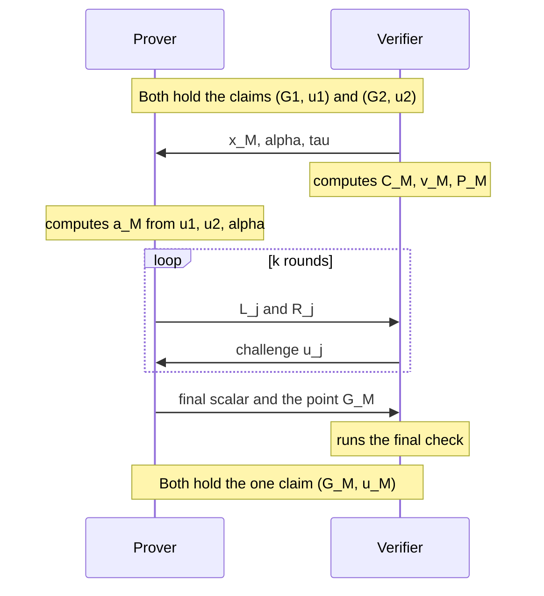
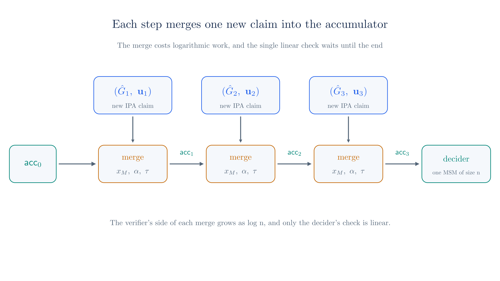

# Accumulation

The [chapter on recursive proofs](./recursive-proofs.md) sets up the goal of a proof that verifies an earlier proof, and a verifier with linear steps blocks that goal. [Chapter 09](./nark.md#_17-a-short-proof-from-the-same-parts) identified the two linear steps in our verifier. This chapter removes one of them, the multi-scalar multiplication that computes $\hat{G}$ at the end of the inner product argument.

The technique does not make that computation cheaper. It postpones the computation, and it lets many postponed computations collapse into one. A prover states the output as a claim, each recursive step merges the new claim with the old one using a random spot check, and one party does the expensive work once, at the very end. The technique comes from [Halo](https://eprint.iacr.org/2019/1021), and [Bünz, Chiesa, Mishra and Spooner](https://eprint.iacr.org/2020/499) later gave it foundations under the name **accumulation scheme**.

::: warning Reconstructed from the Ragu Book, the Halo 2 book and papers, not confirmed by the authors
We rebuilt the merge protocol in Sections 2 to 8 from the books and papers, not from code. It is our own assembly of the [Ragu Book's description of Halo](https://github.com/tachyon-zcash/ragu/blob/3219e0865e8bff1f9d817bfe3850d9e94b64338c/book/src/protocol/index.md?plain=1#L162-L168), the [Halo 2 book's recursion page](https://zcash.github.io/halo2/background/recursion.html), and the argument in [chapter 07](./inner-product-argument.md), and we checked its algebra with the script behind this page. It teaches the idea, and it may differ in detail from the protocols in the two papers, of which we could read only the abstracts. Only Section 11 rests on the code at commit `3219e08`.
:::

::: tip Terminology
This chapter says that claims **merge**, following the book's wording for Halo. A merge combines two claims into one. It is a different thing from a **fuse**, the [PCD operation from chapter 02](./pcd-intro.md#fusing-in-ragu), although a fuse would contain merges if a system used this technique.
:::

## 1. The step that remains

Recall the final check of the inner product argument from [chapter 07](./inner-product-argument.md#the-final-check):

$$P + \sum_{j=1}^{k} \left(u_j^{-2} \cdot L_j + u_j^{2} \cdot R_j\right) = \hat{a} \cdot (\hat{G} + \hat{b} \cdot U).$$

The left side takes $2k$ scalar multiplications. On the right side, $\hat{b} = g(x)$ takes about $k$ field multiplications, because $g$ is a product of $k$ factors. Only $\hat{G}$ costs a linear amount, because computing it takes one MSM over all $n$ generators, $\hat{G} = \dot{\v{s}}{\v{G}}$.

[Section 8 of chapter 07](./inner-product-argument.md#_8-the-polynomial-g-x) also showed what this point is. The coefficients of $g$ are the entries of $\v{s}$, so $\hat{G}$ is the Pedersen commitment to the polynomial $g$. From here on we write $g_{\v{u}}$ to show that this polynomial depends on the challenges $\v{u} = (u_1, \ldots, u_k)$, and $\v{g}_{\v{u}}$ for its coefficient vector, which is the $\v{s}$ of chapter 07:

$$g_{\v{u}}(X) = \prod_{j=1}^{k} \left(u_j^{-1} + u_j X^{2^{k-j}}\right), \qquad \hat{G} = \dot{\v{g}_{\v{u}}}{\v{G}}.$$

Two features of this equation make accumulation possible. The polynomial has a description of only $k$ scalars, even though it has $n$ coefficients, so anyone can evaluate it at a point with logarithmic work. The commitment is also linearly homomorphic, as [chapter 06](./polynomial-commitments.md#_5-adding-commitments) showed, so a combination of such points commits to the same combination of polynomials. The sections below use both.

## 2. Splitting off the expensive step

The verifier only needs $\hat{G}$ as an input to one equation, so it can test that equation with a value that somebody else computed. Let the prover supply the point. The verifier then does all the logarithmic work, runs the final check with the supplied $\hat{G}$, and stops short of the MSM. What it has left is one unverified statement:

$$\text{claim } (\hat{G}, \v{u}): \quad \hat{G} = \dot{\v{g}_{\v{u}}}{\v{G}}.$$

The verifier's conclusion now has a condition attached. It has established that the evaluation claim holds provided that this statement is true. The claim is small, at one point and $k$ scalars, even though it speaks about all $n$ generators.

<!-- worked:split-run -->

Here is the split applied to the run of chapter 07, with $\v{u} = (15, 10)$. The prover sends $\hat{G} = (20,\,25)$ along with the proof.

| Verifier step | Computation | Result |
| --- | --- | --- |
| Combine the cross terms | $P + \sum_j (u_j^{-2} \cdot L_j + u_j^{2} \cdot R_j)$ | $(14,\,22)$ |
| Evaluate $g_{\v{u}}$ at $x = 9$ | $34 \cdot 17$, one factor per round | $\hat{b} = 19$ |
| Final check with the supplied point | $4 \cdot ((20,\,25) + 19 \cdot U)$ | $(14,\,22)$ |
| Output | The claim $(\hat{G}, \v{u})$ | $((20,\,25),\ (15, 10))$ |

<!-- /worked:split-run -->

The condition matters, because a prover who chooses $\hat{G}$ has real power over the final check. As the [recursive proofs chapter](./recursive-proofs.md#_5-why-the-linear-steps-cannot-be-dropped) showed, such a prover can solve the final equation for the point it supplies. Here is that attack on the run of chapter 07, which later sections reuse. All of the argument's protection against a false value now depends on the claim:

<!-- worked:forge -->

Take the false value $y = 38$ from chapter 07, where the true value is $37$. The statement point now carries an extra $1 \cdot U$, and honest folding keeps it, so the folded point is $(7,\,6)$. With the true $\hat{G} = (20,\,25)$ the final check fails. The prover keeps $\hat{a} = 4$ and instead supplies $\hat{G}^* = \hat{G} + 11 \cdot U = (26,\,23)$, where $11$ is the inverse of $4$ modulo 43. The right side becomes $4 \cdot ((26,\,23) + 19 \cdot U) = (7,\,6)$, so the check passes. Only the claim is wrong, because $\dot{\v{g}_{\v{u}}}{\v{G}} = (20,\,25)$ and not $(26,\,23)$.

<!-- /worked:forge -->

So a passing final check proves nothing unless somebody eventually confirms the claim. The rest of the chapter arranges for that confirmation to happen once, however many claims arise.

## 3. Deciding a claim

The direct way to confirm a claim is to run the postponed computation. Multiply out the factors of $g_{\v{u}}$, compute the MSM, and compare the result with $\hat{G}$. We call the party who does this the **decider**, and we call the check itself deciding.

<!-- worked:decide-one -->

For the claim $((20,\,25),\ (15, 10))$, the factors $(23 + 15X^2)(13 + 10X)$ multiply out to the coefficients $(41, 15, 23, 21)$, and the MSM with $\v{G}$ gives $(20,\,25)$, so the decider accepts. For the forged claim from the last section, the same MSM gives the same point, which differs from $(26,\,23)$, so the decider rejects.

<!-- /worked:decide-one -->

Moving the MSM out of the verifier helps a recursive proof, because the decider runs outside any circuit. It does not reduce the total work, though. A chain of recursive proofs creates a new claim at every step, and each one would have to be carried in the statement until a decider dealt with it:

<!-- worked:pile-up -->

With $n = 2^{13}$ and a hypothetical $1,000$ steps, checking every claim directly takes $1,000$ MSMs of $8,192$ terms, or $8,192,000$ scalar multiplications. The statement would also carry $1,000$ points and $13,000$ challenges.

<!-- /worked:pile-up -->

The statement must stay a fixed size for recursion to work, so we need to turn several claims into one claim, cheaply enough to do inside a circuit.

## 4. Testing a claim at one point

We start with one claim and look for a test cheaper than the MSM. The claim says that the point $\hat{G}$ commits to a particular polynomial, and the earlier chapters already show how to query a committed polynomial. If the verifier picks a random point $x$, it can ask the prover to open $\hat{G}$ at $x$ using an inner product argument, and then compare the opened value with $g_{\v{u}}(x)$.

The comparison is available to the verifier because the product form of $g_{\v{u}}$ takes only logarithmic work, however large $n$ is:

<!-- worked:spot-one -->

Take the claim from chapter 07 and the point $x = 29$. The two factors of $g_{\v{u}}$ are $23 + 15 \cdot 29^2 = 39$ and $13 + 10 \cdot 29 = 2$, and their product is $35$. Evaluating the four coefficients $(41, 15, 23, 21)$ directly gives $35$ as well, but that route needs all $n$ of them, while the factors need only $k$ terms.

<!-- /worked:spot-one -->

The test catches a false claim for the reason given in [chapter 03](./statements-and-challenges.md#_5-testing-polynomials-at-a-random-point). Suppose $\hat{G}$ actually commits to some other polynomial $h$ of degree below $n$ (a point with a hidden multiple of $U$ is a separate case, which Sections 5 and 8 handle). The difference $h - g_{\v{u}}$ is then a nonzero polynomial with at most $n - 1$ roots, so the opened value matches at no more than $n - 1$ points out of $q$, provided the prover fixes $\hat{G}$ before it learns $x$.

<!-- worked:spot-count -->

Suppose that the point in a claim commits to $h$ with coefficients $(19, 37, 37, 22)$ instead of $g_{\v{u}}$. We chose the difference $h - g_{\v{u}} = (X-2)(X-7)(X-20)$ to have as many roots as a cubic can. Testing all 43 points, the two polynomials agree at $x \in \{2, 7, 20\}$ and nowhere else, so the spot check catches this claim at $40$ of the 43 points.

<!-- /worked:spot-count -->

The opening has two properties that differ from the openings of earlier chapters. First, its witness is public. The vector being opened is the coefficient vector of $g_{\v{u}}$, which anyone can compute from $\v{u}$, so the prover needs no secret and no stored data to run this argument. It pays a linear cost to multiply out the factors and fold, but it does this outside the circuit.

Second, this opening is itself an inner product argument, so its verifier faces its own final check with its own $\hat{G}$. Splitting that check as in Section 2 produces a new claim $(\hat{G}', \v{u}')$. For a single claim we have therefore traded one claim for another, plus some logarithmic work, and that looks like no progress. The gain appears when two claims share one opening.

## 5. Merging two claims

Suppose we hold two claims $(\hat{G}_1, \v{u}_1)$ and $(\hat{G}_2, \v{u}_2)$, and write $g_1$ and $g_2$ for their polynomials. We would like one opening to test both. A random linear combination from [chapter 03](./statements-and-challenges.md#_7-random-linear-combinations) can do this, so take a challenge $\alpha$ and combine the points:

$$C_M = \hat{G}_1 + \alpha \cdot \hat{G}_2.$$

If both claims are true, homomorphism tells us what this point commits to:

$$
\begin{aligned}
C_M &= \dot{\v{g}_1}{\v{G}} + \alpha \cdot \dot{\v{g}_2}{\v{G}} \\
&= \dot{\v{g}_1 + \alpha\v{g}_2}{\v{G}},
\end{aligned}
$$

which is the commitment to the polynomial $g_1(X) + \alpha\,g_2(X)$. We want to open this commitment at a random point $x_M$, so we need the opening in the form that chapter 07 proves, an inner product of the committed vector with the power vector $\v{x_M^n} = (1, x_M, x_M^2, \ldots, x_M^{n-1})$. The committed vector is the witness

$$\v{a}_M = \v{g}_1 + \alpha\v{g}_2,$$

and the prover can compute it from the public challenges. Its inner product with the powers splits along the sum, and each piece is a polynomial evaluated at $x_M$:

$$
\begin{aligned}
\dot{\v{a}_M}{\v{x_M^n}} &= \dot{\v{g}_1}{\v{x_M^n}} + \alpha\,\dot{\v{g}_2}{\v{x_M^n}} \\
&= g_1(x_M) + \alpha\,g_2(x_M).
\end{aligned}
$$

The verifier holds both sets of challenges, so it can compute the right side through the product forms, with logarithmic work. We call that value

$$v_M = g_1(x_M) + \alpha\,g_2(x_M).$$

The statement to prove is now an ordinary evaluation claim, that $C_M$ opens at $x_M$ to $v_M$, with witness $\v{a}_M$. The verifier computed every part of that statement from the two input claims.

Each challenge has a separate job. The point $x_M$ exposes a wrong polynomial, as in Section 4. The weight $\alpha$ stops two wrong polynomials from cancelling each other. Without it, a prover could make $g_1$ too large by some polynomial and $g_2$ too small by the same polynomial, and the sum would be correct at every point.

The argument needs one more ingredient, which [chapter 07](./inner-product-argument.md#scaling-u-by-a-challenge) introduced. The input points come from the prover, so they could contain a hidden multiple of $U$. Suppose the first point commits to $g_1 + c$ and also hides $c \cdot U$. Then $C_M$ commits to a polynomial whose value at every $x_M$ exceeds $v_M$ by $c$, and once the verifier adds $v_M \cdot U$, the hidden $c \cdot U$ supplies exactly the missing part of the value. No choice of $x_M$ or $\alpha$ exposes this. We therefore weight $U$ by a third challenge $\tau$, sampled after the input points, and we use $\tau \cdot U$ as the value generator in every round. The hidden term is still $c \cdot U$, while the value now needs $\tau c \cdot U$, so the two match only when $\tau = 1$. Section 8 runs this attack on the toy curve. The statement point for the argument is

$$P_M = C_M + (\tau v_M) \cdot U.$$

The prover now runs the inner product argument of chapter 07 on $\v{a}_M$ with fresh round challenges $\v{u}_M$, and the verifier splits off the final check as in Section 2. We shorten $g_{\v{u}_M}$ to $g_M$. With the supplied point $\hat{G}_M$ and $\hat{b}_M = g_M(x_M)$, that check reads

$$P_M + \sum_{j=1}^{k} \left(u_j^{-2} \cdot L_j + u_j^{2} \cdot R_j\right) = \hat{a}_M \cdot \left(\hat{G}_M + (\tau \hat{b}_M) \cdot U\right).$$

The result of all this is one claim, $(\hat{G}_M, \v{u}_M)$, with the same form as each input. The order of messages keeps the prover from choosing anything after it sees the challenge that tests it:



The same construction handles any number of claims, by using powers of $\alpha$. For claims $0$ to $m - 1$,

$$C_M = \sum_{i=0}^{m-1} \alpha^{i} \cdot \hat{G}_i, \qquad v_M = \sum_{i=0}^{m-1} \alpha^{i}\,g_i(x_M).$$

The verifier's work grows by one scalar multiplication and $k$ factor multiplications for each extra claim.

## 6. A complete merge on the toy curve

We need two claims to merge. The first comes from the run in chapter 07. The second comes from a fresh run of the same argument, on chapter 06's other vector at a different point. Both runs use chapter 07's fixed $U$, because the numbers for the first run then match that chapter exactly. All challenges are picked by hand.

<!-- worked:claims -->

| | Claim 1 | Claim 2 |
| --- | --- | --- |
| Polynomial opened | $(7, 2, 5, 3)$ at $x_1 = 9$ | $(3, 1, 8, 4)$ at $x_2 = 5$ |
| Value | $37$ | $20$ |
| First round cross terms | $L = (22,\,7)$, $R = (30,\,8)$ | $L = (4,\,6)$, $R = (9,\,9)$ |
| Second round cross terms | $L = (28,\,21)$, $R = (14,\,9)$ | $L = (9,\,9)$, $R = (23,\,7)$ |
| Challenges | $\v{u}_1 = (15, 10)$ | $\v{u}_2 = (3, 5)$ |
| Final scalar | $4$ | $42$ |
| Supplied point | $\hat{G}_1 = (20,\,25)$ | $\hat{G}_2 = (9,\,22)$ |
| Final check, both sides | $(14,\,22)$ | $(16,\,10)$ |

<!-- /worked:claims -->

Both final checks pass, so the verifier has two claims and has not yet done any linear work. It now starts the merge:

<!-- worked:merge-setup -->

The verifier sends $x_M = 29$ and $\alpha = 16$, then computes the merged commitment and value from public data:

| Quantity | Computation | Result |
| --- | --- | --- |
| $g_1(x_M)$ | $39 \cdot 2$ | $35$ |
| $g_2(x_M)$ | $15 \cdot 42$ | $28$ |
| $v_M$ | $35 + 16 \cdot 28$ | $10$ |
| $C_M$ | $(20,\,25) + 16 \cdot (9,\,22)$ | $(16,\,21)$ |

The prover computes the two coefficient vectors from the public challenges, namely $\v{g}_1 = (41, 15, 23, 21)$ and $\v{g}_2 = (23, 16, 35, 15)$, and combines them into $\v{a}_M = \v{g}_1 + 16\v{g}_2 = (22, 13, 24, 3)$. Committing to this vector directly gives $(16,\,21)$, and evaluating it at $29$ gives $10$, so the claim is true.

<!-- /worked:merge-setup -->

<!-- worked:merge-start -->

The verifier then sends $\tau = 22$. Both sides form the statement point $P_M = C_M + (\tau v_M) \cdot U = (16,\,21) + 5 \cdot U = (8,\,22)$, and the rounds use $\tau \cdot U = (27,\,30)$ as the value generator.

<!-- /worked:merge-start -->

The rest is the inner product argument with $\v{a}_M$ as the folded vector, even though nothing about it is secret here. The prover folds, and the verifier updates the statement point after each round:

<!-- worked:merge-rounds -->

| Round $j$ | $L_j$ | $R_j$ | $u_j$ | Folded point |
| --- | --- | --- | --- | --- |
| 1 | $(20,\,25)$ | $(7,\,25)$ | $8$ | $(23,\,24)$ |
| 2 | $(24,\,1)$ | $(7,\,25)$ | $12$ | $(9,\,9)$ |

<!-- /worked:merge-rounds -->

Some points in this table repeat points from earlier tables. For example, $L_1$ equals $\hat{G}_1$, and the two $R_j$ are equal. The toy group has only 43 elements, so such repeats happen by chance and mean nothing.

<!-- worked:merge-final -->

The prover sends $\hat{a}_M = 17$ and supplies $\hat{G}_M = (22,\,7)$. The verifier computes $\hat{b}_M = g_M(29) = 4 \cdot 22 = 2$ from the challenges $\v{u}_M = (8, 12)$, and the final check is

$$(9,\,9) = 17 \cdot \left((22,\,7) + (22 \cdot 2) \cdot U\right).$$

Both sides are the same point, so the verifier accepts and outputs the single claim $((22,\,7),\ (8, 12))$.

<!-- /worked:merge-final -->

The point that an honest prover gets by folding $\v{G}$ is the commitment to $g_M$, because the folding depends only on the round challenges and never on the vector being opened. The verifier never computes it, but the decider does. Now suppose this is the last claim, so that a decider takes over:

<!-- worked:merge-decide -->

The decider multiplies out $g_M$ to get the coefficients $(13, 23, 15, 10)$, computes the MSM with $\v{G}$, and gets $(22,\,7)$, so it accepts. This one MSM is the only linear group work outside the prover. We can also check what it vouches for by running the two MSMs it replaced, which give $\dot{\v{g}_1}{\v{G}} = (20,\,25)$ and $\dot{\v{g}_2}{\v{G}} = (9,\,22)$, the two input points.

<!-- /worked:merge-decide -->

## 7. Keeping a running accumulator

A merge turns two claims into one claim of the same form, so we can repeat it. We call the object that carries the current claim forward the **accumulator**, written $\mathsf{acc}$. Each step produces one new claim from the proof it just verified, and merges that claim into the accumulator. The first step has no earlier accumulator, which is one of the base cases that the [recursive proofs chapter](./recursive-proofs.md#_9-the-base-case) handles. In this scheme, the first step can merge with a fixed placeholder claim whose point anyone can compute once in advance. One choice is the claim with every challenge equal to 1, whose polynomial has every coefficient equal to 1, so its point is the sum of the generators.

<!-- worked:placeholder -->

On the toy curve the placeholder claim is $((16,\,21),\ (1, 1))$. Its factors are $(1 + X^2)(1 + X)$, and the point is $G_0 + G_1 + G_2 + G_3 = (16,\,21)$, which by chance equals the $C_M$ of Section 6. Merging it with claim 1, reusing the challenges of Section 6, gives $v_M = 20$ and $C_M = (7,\,25)$, the final check passes, and the decider accepts the output claim $((22,\,7),\ (8, 12))$. The placeholder behaves like any other true claim.

<!-- /worked:placeholder -->



The next table continues the run with two more claims, each from a fresh inner product argument on a new polynomial:

<!-- worked:chain -->

| Inputs | $x_M$ | $\alpha$ | New $\hat{G}$ | New $\v{u}$ |
| --- | --- | --- | --- | --- |
| 1 and 2 | $29$ | $16$ | $(22,\,7)$ | $(8, 12)$ |
| Accumulator and claim 3, $((9,\,9),\ (7, 16))$ | $21$ | $3$ | $(17,\,24)$ | $(12, 18)$ |
| Accumulator and claim 4, $((7,\,25),\ (2, 17))$ | $26$ | $10$ | $(4,\,25)$ | $(3, 8)$ |

The decider computes one MSM for the last row, gets $(4,\,25)$, and accepts. That single check covers all four input claims.

<!-- /worked:chain -->

### One recursive step

Here is how this fits inside the step that [the previous chapter](./recursive-proofs.md) describes. The previous proof's statement contains the accumulator $\mathsf{acc}_i$. The step's circuit then does the following:

1. It runs the previous proof's verifier up to the split of Section 2, which yields a new claim from the previous proof's own inner product argument. This verifier still computes $s(x, y)$, the other linear step from [chapter 09](./nark.md#_17-a-short-proof-from-the-same-parts).
2. It derives $x_M$, $\alpha$ and $\tau$ from a transcript that contains $\mathsf{acc}_i$ and the new claim, and it computes $C_M$ and $v_M$.
3. It checks the merge's inner product argument up to the split, using a merge proof that the prover computed outside the circuit and supplied as a witness.
4. It places the resulting claim in its own statement as $\mathsf{acc}_{i+1}$.

Steps 2 to 4 take logarithmic work, and so does the inner product part of step 1. The computation of $s(x, y)$ in step 1 is still linear in the circuit size, because accumulating $\hat{G}$ does nothing for it, and [Section 10](#_10-the-other-linear-step) returns to it. What accumulation does guarantee is that none of the circuit's work depends on how many steps came before, because the accumulator stays one point and $k$ challenges however long the chain grows. Once a step has proved the merge check, later steps have no use for the old merge proof, because the new proof vouches for the check. The circuit's group operations raise a further problem, because the curve's points do not live in the circuit's field. The [curve cycles chapter](./curve-cycles.md) deals with that, and we ignore it here.

Proof-carrying data has a tree in place of a chain, so a step with two children holds two accumulators and two new claims. The formula with powers of $\alpha$ from Section 5 covers this case. Here is an example with three inputs at once:

<!-- worked:three -->

Merge claims 1, 2 and 4 in one step. In a real run the transcript would absorb all three claims, so the challenges would differ from those of Section 6, but we reuse them here so that the two runs can be compared. The merge gives $v_M = 17$ and $C_M = (6,\,8)$, the final check passes, and the output point is $(22,\,7)$, the same as in the two-claim merge. The output point is the folded generator, which depends only on $\v{u}_M$. The inputs enter through $C_M$, $v_M$, the cross terms and the final scalar, and all four of these change when a claim is added.

<!-- /worked:three -->

### What each party pays

The verifier's side of a merge is now small, and the prover takes on the linear work:

<!-- worked:costs -->

| Work for one merge of two claims, $n = 2^{13}$ | Who | Amount |
| --- | --- | --- |
| Evaluate $g_1$ and $g_2$ at $x_M$ | Verifier | $12$ squarings and $26$ factor multiplications |
| Compute $C_M$ | Verifier | $1$ scalar multiplication |
| Combine the $L_j$ and $R_j$ | Verifier | $26$ scalar multiplications |
| Evaluate $g_M$ at $x_M$ | Verifier | $13$ factor multiplications, reusing the squarings |
| Final check | Verifier | $2$ scalar multiplications |
| Multiply out $g_1$ and $g_2$ | Prover | about $16,384$ field multiplications |
| Compute all the $L_j$, $R_j$ and fold $\v{G}$ | Prover | $32,764$ scalar multiplications |

<!-- /worked:costs -->

The verifier rows add up to 29 scalar multiplications only if the verifier never forms $P_M$ as a separate point. Instead it moves the term $(\tau v_M) \cdot U$ to the right side of the final check, where it combines with $(\hat{a}_M \tau \hat{b}_M) \cdot U$ into one multiple of $U$, so the final check costs one multiplication of $\hat{G}_M$ and one of $U$.

The prover's count comes from the rounds. A round on a vector of length $m$ takes $m$ scalar multiplications for $L$ and $R$ and another $m$ for the two weights on each entry of the folded $\v{G}$, and the lengths halve from $n$ down to 2.

<!-- worked:total -->

Over the same hypothetical $1,000$ claims, the group work that a verifier must do drops from $8,192,000$ scalar multiplications to $29$ per merge plus one decider MSM of $8,192$. The accumulator stays at one point and $13$ challenges, or $448$ bytes at 32 bytes each, and each merge proof holds $26$ points and one scalar, or $864$ bytes.

<!-- /worked:total -->

Deciding needs no help from the prover. Anyone who holds the final accumulator and the public generators can run it, and [the Halo 2 book](https://zcash.github.io/halo2/background/recursion.html) describes this as one linear-time computation that settles an entire batch.

### What the final verifier does

The chain ends with a last proof $\pi_n$, which a verifier outside any circuit receives. Its statement contains the accumulator $\mathsf{acc}_n$, which covers every claim up to the previous step. The last proof also has its own inner product argument, and splitting that argument's final check produces one more claim that no step has merged yet. The final verifier therefore has two claims in hand, and it has two ways to finish. It can decide both claims, which takes two MSMs. Or the prover can send a merge proof for the two claims along with $\pi_n$, computed outside any circuit as usual, and the verifier checks that merge and decides the single result. Here is the second route on the toy chain:

<!-- worked:final -->

Suppose the chain stops after claim 4, and treat claim 4 as the last proof's own claim. The last proof carries the accumulator $((17,\,24),\ (12, 18))$ in its statement, which covers claims 1 to 3. The final verifier runs the last proof's inner product argument up to the split. Its final check passes with the supplied point, and this yields claim 4, $((7,\,25),\ (2, 17))$. It then checks the prover's merge proof for these two claims, which is the third row of the table, and gets the claim $((4,\,25),\ (3, 8))$. Finally it decides that one claim. For $n = 2^{13}$ this costs $28$ scalar multiplications for the split, $29$ for the merge and $8,192$ for the decider, or $8,249$ in all. Deciding the accumulator and the last claim separately needs no merge proof, but it still needs the $28$ for the split and then two MSMs, or $16,412$ scalar multiplications.

<!-- /worked:final -->

Either way, a constant number of MSMs settles the whole chain, and with the extra merge proof the count stays at one.

## 8. Why cheating fails

Nothing inside the chain runs the MSM, so we need to see why a false claim cannot disappear along the way. A cheater wants some input claim to be false while the final accumulator is true.

We start with something the accumulation verifier cannot do. The merge ends in a final check with a supplied point, just like the check in Section 2, and Section 2 showed that a prover can make such a check pass by adding a suitable multiple of $U$ to the point it supplies. That trick works whatever went wrong earlier in the merge, so the accumulation verifier on its own never stops a prover who is determined to continue. The guarantee that a merge does give is narrower. If any input claim is false, then the output claim is false as well, except at a few unlucky challenges.

The counts below measure that luck. When we say that a merge **passes**, we mean that it passes with the honest output point, the one that the prover gets by folding $\v{G}$, so that the output claim is true. Every other way through the final check leaves a false output claim for the decider.

The counts also need a model of a real curve. On the toy curve every point is a known multiple of every other, so a cheater could solve for a forgery at almost any challenge, as [chapter 07 showed](./inner-product-argument.md#why-the-generators-must-have-no-known-relation), and a count of passing challenges would say nothing about a real curve. The script therefore also runs the protocol in a formal group, where each point is a list of its coefficients on $G_0, \ldots, G_3$ and $U$, and where two points are equal only if the lists are. It also repeats the first count below on the toy curve at a sample of weights, with the same result.

### A false claim moves forward

The first case shows the forged output at work. It feeds the forged claim of Section 2 into a merge, where the honest output point fails and only a false one gets through:

<!-- worked:forge-carry -->

The forged claim from Section 2 is $((26,\,23),\ (15, 10))$, and its point hides $11 \cdot U$. Merge it with the true claim 2, using the challenges of Section 6. The commitment becomes $(4,\,6)$, and the honest fold reaches $\hat{G}_M = (22,\,7)$, but the check fails, since the left side is $(22,\,24)$ and the right side is $(9,\,9)$. The script repeats this in the formal group for all 1,806 pairs and five values of $\tau$, with no acceptances. To continue, the prover has to repeat its trick and supply $\hat{G}_M^* = \hat{G}_M + 31 \cdot U = (8,\,22)$. That passes the final check, so the false claim has moved to the output. The decider then computes $(22,\,7)$, sees that it differs from $(8,\,22)$, and rejects.

<!-- /worked:forge-carry -->

### A false input

Next we count how often a false input yields a true output. Take the case where the prover holds a real polynomial behind a wrong point, and folds honestly from then on:

<!-- worked:count-one -->

Take the false point from Section 4, which commits to $h$, and merge it with the true claim 2. For each of the 1,806 pairs of $x_M$ and nonzero $\alpha$, run the merge with the prover folding its real vector and supplying its honest folded generator. The check passes for 126 pairs, and these are exactly the pairs with $x_M \in \{2, 7, 20\}$, the roots of $h - g_1$. The weight $\alpha$ plays no part, because only one input is wrong.

<!-- /worked:count-one -->

### Two false inputs

With two false inputs there is a chance that the errors cancel, which is the case that $\alpha$ exists to handle:

<!-- worked:count-two -->

Now make claim 2 false as well, with $h_2 - g_2$ having the coefficients $(1, 40, 0, 2)$. A pair $(x_M, \alpha)$ passes when $(h_1 - g_1)(x_M) + \alpha (h_2 - g_2)(x_M) = 0$. Running all 1,806 pairs gives 39 that pass, against the bound of $4 \cdot 43 = 172$ from the [multivariate root count](./statements-and-challenges.md#_6-polynomials-in-several-variables), since the expression has total degree at most 4. To see what $\alpha$ prevents, let the second error be the exact negative of the first. With $\alpha$ fixed at 1 the errors cancel, and all 43 values of $x_M$ pass. With $\alpha$ random, the 166 passing pairs are those 43 pairs with $\alpha = 1$ and the pairs at the three roots.

<!-- /worked:count-two -->

For a real curve the same reasoning gives a bound of $n$ divided by $q$, which is negligible for $n = 2^{13}$ and a field of about $2^{254}$ elements.

### What the decider settles

A false claim therefore survives from merge to merge, and at each merge it has a small chance of turning into a true one through a lucky $x_M$. If it survives to the end it meets the decider, which computes the MSM and catches it. This is the sense in which one decider check covers everything before it. A true final accumulator means that, except with small probability at each merge, every input claim was true too. A verifier who skips the decider has no such assurance, because every step before the decider may be carrying a false claim.

The prover could also send altered $L_j$ and $R_j$ in the merge, instead of folding honestly. [Chapter 07's gap argument](./inner-product-argument.md#counting-the-challenges-a-cheater-can-survive) covers this, and it allows at most 4 surviving challenges per round. On the toy curve that fraction is large, but on a real curve it is negligible.

### The order of the messages

The bound on false inputs depends on the prover fixing its points before it sees $x_M$:

<!-- worked:late -->

Suppose the prover learns $x_M = 29$ before it fixes its point. It picks $h = g_1 + 5(X - 29)$, whose coefficients are $(25, 20, 23, 21)$, and sends the commitment $(18,\,21)$, which is not $\hat{G}_1$. Since $h(29) = g_1(29)$, the merge passes, and every later step is honest. If instead the point is fixed first and $x_M$ varies over all 43 values, the merge passes only at $x_M = 29$.

<!-- /worked:late -->

In a non-interactive proof, this means that the transcript has to absorb both input claims in full before it produces $x_M$, $\alpha$ and $\tau$, for the reason given in [chapter 03](./statements-and-challenges.md#_9-omitting-data-from-the-transcript). The challenges $\v{u}$ belong to the claim as much as the point does, because a prover who could change them after $x_M$ was fixed could change the polynomial that the check compares against.

### The weight on U

A prover can also hide a multiple of $U$ in an input point, and arrange the $G$ part and the $U$ part of the point to offset each other at every $x_M$ at once:

<!-- worked:hidden -->

Take the point $\hat{G}_1 + 6 \cdot G_0 + 6 \cdot U = (27,\,1)$, so that the prover holds $g_1 + 6$ and the hidden $6 \cdot U$ pays for the extra value. With $\tau$ fixed at 1, the merge passes for all 1,806 pairs $(x_M, \alpha)$, although the claim is false. At our $x_M$ and $\alpha$, running all 42 nonzero values of $\tau$ gives acceptance at $\tau = 1$ only.

<!-- /worked:hidden -->

The merge has to reject this point whatever produced it. The chain's guarantee is that a passing merge implies true inputs, so the merge must catch every false input, including one whose hidden $U$ part offsets its $G$ part. The inner product argument alone cannot do this, for the reason [chapter 07](./inner-product-argument.md#why-the-generators-must-have-no-known-relation) gives. Its gap argument proves that the statement point has the form $\dot{\v{a}}{\v{G}} + \dot{\v{a}}{\v{b}} \cdot U$ for some $\v{a}$, and that relation matches the evaluation claim only when the commitment has no $U$ component. Here $C_M$ carries whatever $U$ part the input points carry. The random weight $\tau$ closes this gap in the same way as chapter 07's $z$, at the cost of one more challenge.

### Assumptions

This reasoning relies on the following, and it is informal and not a security proof. The discrete log relation assumption holds for $\v{G}$ together with $U$. The prover builds its points from the generators with coefficients it knows. Challenges are uniform and come after the data they test, which in a non-interactive proof means treating the transcript hash as a random oracle. The decider's MSM runs honestly on the final accumulator.

Recursion adds a further layer that we have not analysed, because each step's statement relies on proofs that themselves rely on earlier proofs. The [abstract of the accumulation scheme paper](https://eprint.iacr.org/2020/499) notes that Halo's authors outlined their approach without details or security proofs, and it presents foundations for that approach as the paper's purpose.

## 9. Atomic accumulation

We can now give the general pattern a name. An **accumulation scheme** has three parts, and the book's [IVC section](https://github.com/tachyon-zcash/ragu/blob/3219e0865e8bff1f9d817bfe3850d9e94b64338c/book/src/protocol/core/accumulation/index.md?plain=1#L59-L81) uses the symbols below for the last two:

| Part | Job | In this chapter |
| --- | --- | --- |
| Accumulation prover | Produce a new accumulator and a proof that it was formed correctly | Compute $\v{a}_M$, run the argument, supply $\hat{G}_M$ |
| Accumulation verifier, $\mathsf{Acc.V}$ | Check the update cheaply | Compute $C_M$ and $v_M$, and run the final check with the supplied point |
| Decider, $\mathsf{Acc.Decide}$ | Check the final accumulator, possibly at great expense | Compute $\dot{\v{g}_{\v{u}}}{\v{G}}$ and compare |

The scheme in this chapter has a special property, which is that the accumulator is all that anybody needs. The polynomial behind $(\hat{G}, \v{u})$ can be rebuilt from $\v{u}$, so the prover of the next merge needs no extra data, and neither does the decider. The book [calls this form **atomic** accumulation](https://github.com/tachyon-zcash/ragu/blob/3219e0865e8bff1f9d817bfe3850d9e94b64338c/book/src/protocol/index.md?plain=1#L181-L186), and it describes this as the original formalization, in which the accumulator alone lets a party produce and check each insertion.

The atomic form has a cost that explains why later work moved on from it. Every proof placed into an atomic accumulator has to be partly verified inside the circuit, so that proof must already be short and its verifier sublinear, apart from the deferred part. In our setting, that means running a full inner product argument for each proof at every step, and then one more for the merge, which puts this linear work on the prover of every step.

The [next chapter](./split-accumulation.md) relaxes this by letting the accumulator have a separate witness that only the prover and decider hold. That permits a long proof with no inner product argument during recursion, and it is the form that Ragu uses.

## 10. The other linear step

Chapter 09 listed two linear steps, and so far we have dealt only with $\hat{G}$, which is why the recursive step of Section 7 still contains a linear computation. The other is computing $s(x, y)$, which requires reading the whole circuit. The test we used here relies on $g_{\v{u}}$ having a short product form, and the wiring polynomial has none. The verifier cannot evaluate it cheaply at a random point, so the spot check of Section 4 does not carry over directly.

The Ragu Book [describes how Halo handled this case](https://github.com/tachyon-zcash/ragu/blob/3219e0865e8bff1f9d817bfe3850d9e94b64338c/book/src/protocol/index.md?plain=1#L154-L161). The prover supplies a claimed commitment to $s(X, y)$, and a parallel protocol reduces such claims together by random spot validation. Ragu has its own treatment in the chapter on [wiring and the registry](./wiring-and-registry.md), so we leave the details to that chapter.

## 11. Accumulation in Ragu

The code at commit `3219e08` contains the exact objects of this chapter, in [`crates/ragu_pcd/src/ipa/verifier.rs`](https://github.com/tachyon-zcash/ragu/blob/3219e0865e8bff1f9d817bfe3850d9e94b64338c/crates/ragu_pcd/src/ipa/verifier.rs#L26-L33):

```rust
pub struct Accumulator<C: Affine> {
    /// The claimed output of the linear-time polycommit opening protocol
    pub g: C,

    /// A vector of challenges u_0, ..., u_{k - 1} sampled by the verifier, to
    /// be used in computing G'_0.
    pub u: Vec<C::Scalar>,
}
```

The field `g` is our $\hat{G}$, and `u` holds our $\v{u}$, in the one-sided convention of [chapter 07](./inner-product-argument.md#_9-the-code-s-one-sided-fold), so the polynomial behind it is $\prod_j (1 + w_j X^{2^{k-j}})$. The method [`Guard::use_g`](https://github.com/tachyon-zcash/ragu/blob/3219e0865e8bff1f9d817bfe3850d9e94b64338c/crates/ragu_pcd/src/ipa/verifier.rs#L45-L53) is the split of Section 2, since it takes a supplied point and returns this type. The method [`Guard::use_challenges`](https://github.com/tachyon-zcash/ragu/blob/3219e0865e8bff1f9d817bfe3850d9e94b64338c/crates/ragu_pcd/src/ipa/verifier.rs#L36-L43) is the direct route, which adds the whole vector to the MSM.

::: warning Reconstructed from code at commit 3219e08, not confirmed by the authors
**The deferral is not in use.** Our search finds `use_g` and `compute_g` called only from [one IPA test](https://github.com/tachyon-zcash/ragu/blob/3219e0865e8bff1f9d817bfe3850d9e94b64338c/crates/ragu_pcd/tests/ipa.rs#L410-L422), and we found no code that merges two such accumulators. The IPA runs at compression, and the [compression verifier](https://github.com/tachyon-zcash/ragu/blob/3219e0865e8bff1f9d817bfe3850d9e94b64338c/crates/ragu_pcd/src/compress/batch/verifier.rs#L32-L34) calls `use_challenges`, so it computes the full MSM.

**What Ragu accumulates instead.** The [fuse](https://github.com/tachyon-zcash/ragu/blob/3219e0865e8bff1f9d817bfe3850d9e94b64338c/crates/ragu_pcd/src/fuse/_10_p.rs#L1-L8) accumulates a polynomial $p(X)$ with a claim $p(u) = v$ (here $u$ is an evaluation point, not an IPA challenge), which is a batched evaluation claim of the form in [chapter 08](./batched-openings.md), and the proof keeps the polynomial itself. That is split accumulation, the subject of the next chapter. The same file has a private [type also named `Accumulator`](https://github.com/tachyon-zcash/ragu/blob/3219e0865e8bff1f9d817bfe3850d9e94b64338c/crates/ragu_pcd/src/fuse/_10_p.rs#L63), which is unrelated to the IPA type above.

**Planned use.** The [aggregator profile](https://github.com/tachyon-zcash/ragu/blob/3219e0865e8bff1f9d817bfe3850d9e94b64338c/crates/ragu_pcd/src/profile.rs#L720-L736) foresees circuits that verify a compressed proof, and those circuits would face this same MSM. They have not landed, and we found nothing that says whether they would use `use_g`, so this remains unsettled.
:::

::: warning The book and the code describe this differently
**Ragu Book:** the [appendix on SNARKs](https://github.com/tachyon-zcash/ragu/blob/3219e0865e8bff1f9d817bfe3850d9e94b64338c/book/src/appendix/snarks.md?plain=1#L37-L41) says that the NARK's instance contains "the IPA accumulator state", and its [comparison table](https://github.com/tachyon-zcash/ragu/blob/3219e0865e8bff1f9d817bfe3850d9e94b64338c/book/src/appendix/snarks.md?plain=1#L53) lists IPA verification as linear time, deferred via accumulation.

**Code at `3219e08`:** as above, a proof's accumulated state is a batched polynomial claim and not a point with its IPA challenges, and the IPA's MSM is computed in full at compression. The [doc comment](https://github.com/tachyon-zcash/ragu/blob/3219e0865e8bff1f9d817bfe3850d9e94b64338c/crates/ragu_pcd/src/ipa/verifier.rs#L24) on `Accumulator` also calls it "an evaluation claim and a proof", while its fields are one point and the challenges.

This site follows the code. The book's general statement that [Ragu's scheme descends from Halo's](https://github.com/tachyon-zcash/ragu/blob/3219e0865e8bff1f9d817bfe3850d9e94b64338c/book/src/appendix/related.md?plain=1#L13-L18) is consistent with both, since the next chapter builds directly on these ideas.
:::

Names differ across sources as well. The book's [Halo passage](https://github.com/tachyon-zcash/ragu/blob/3219e0865e8bff1f9d817bfe3850d9e94b64338c/book/src/protocol/index.md?plain=1#L162-L168) writes the claim as $(G, \v{u})$ with polynomial $g_{\v{u}}$, its IPA section writes $G_0$, and the code writes $G'_0$, while this site writes $\hat{G}$. The Halo 2 book's recursion page uses factors of the form $u_i + u_i^{-1} X^{2^{i-1}}$, so compare the placement of the inverse and the order of the rounds before you move a formula between sources.

## 12. Where this chapter leaves us

This chapter took the following steps:

1. The verifier can take $\hat{G}$ from the prover and finish everything else with logarithmic work, which leaves the claim $(\hat{G}, \v{u})$ that $\hat{G}$ commits to $g_{\v{u}}$.
2. A decider can confirm a claim with one MSM, but claims would pile up if each one had to be decided separately.
3. Opening $\hat{G}$ at a random point tests the claim, because the verifier can evaluate $g_{\v{u}}$ with $k$ factors, and two different polynomials rarely agree at a random point.
4. A random combination of two claims is an evaluation claim that the verifier can state on its own, and the prover's witness is public. Proving it with one inner product argument yields a single new claim.
5. Repeating this keeps one fixed-size accumulator across any number of steps, with logarithmic verifier work per merge. The final verifier merges the last proof's own claim into the accumulator and then runs one MSM as the decider.
6. A false input passes only at rare challenges, and otherwise it forces a false output, so the false claim travels to the decider. The chain establishes nothing until the decider has run.
7. The accumulator here is all that the next prover needs, which makes this atomic accumulation. Ragu's code contains the claim type, but its recursion uses a different form.

Atomic accumulation still runs a complete inner product argument at every step. The [next chapter](./split-accumulation.md) separates each accumulator into a public instance and a private witness, which removes that argument from the recursive path and lets the steps use a proof without any succinctness at all.
