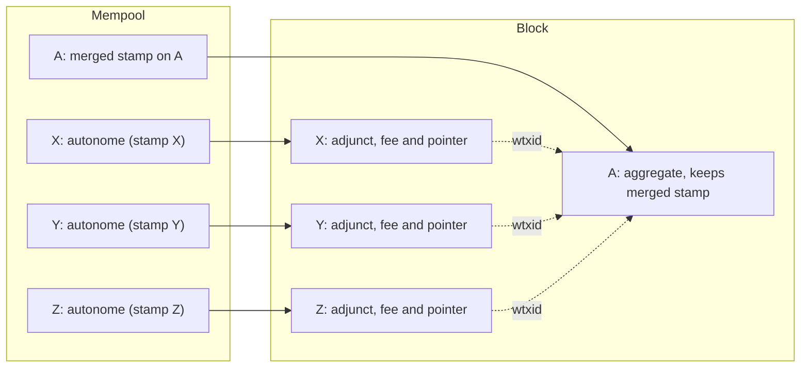
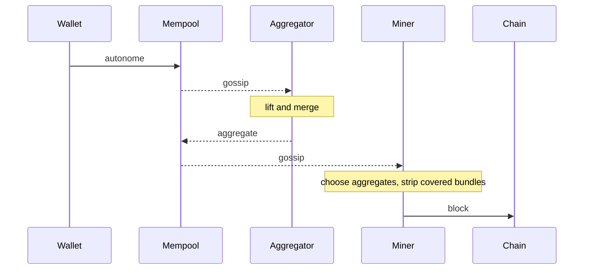

# Aggregation and Bundles

[Chapter 2](./pcd-intro.md#_11-aggregation-in-tachyon) followed one aggregate through its proof tree, treating the transactions around it as labelled boxes. This chapter opens those boxes. We look at what a Tachyon bundle contains on the wire, how a wallet commits to a fee before the fee is known, how merging and stripping change a bundle without disturbing what its owner signed, how identifiers survive those changes, and what an aggregator does when blocks land in the middle of its work.

The steps that produce a stamp have their internals in [chapter 22](./proof-tree.md), so here we use them by what they establish. We keep the bundles of chapter 2, an innocent aggregate A and three wallet bundles X, Y and Z, and give them real toy values.

::: warning Status of these designs
Tachyon has not activated on mainnet and its design is still changing. Everything here describes the [Tachyon repository](https://github.com/tachyon-zcash/tachyon/tree/7e502548db33845dbaacdc0efe905d1a3c45e626) at commit `7e50254`, which pins Ragu at [`0725b52`](https://github.com/tachyon-zcash/tachyon/blob/7e502548db33845dbaacdc0efe905d1a3c45e626/crates/tachyon/Cargo.toml#L74-L76) rather than the `3219e08` used in the Ragu chapters. The [bundle format ZIP](https://github.com/tachyon-zcash/tachyon/blob/7e502548db33845dbaacdc0efe905d1a3c45e626/book/src/zips/tachyon-bundle.md) and the [aggregator protocol ZIP](https://github.com/tachyon-zcash/tachyon/blob/7e502548db33845dbaacdc0efe905d1a3c45e626/book/src/zips/tachyon-aggregator.md) are empty outlines at this commit, so no normative specification exists. The book's [own notes](https://github.com/tachyon-zcash/tachyon/blob/7e502548db33845dbaacdc0efe905d1a3c45e626/book/src/aggregation.md?plain=1#L60-L63) leave the tachygram union algorithm and the aggregation limits to be written.

As [chapter 19](./notes-and-nullifiers.md#_13-where-these-derivations-run) records, Tachyon builds against a mock of Ragu, so we describe what the proof steps declare and we did not find real circuits enforcing it. The crate also has no validator and no mempool. It has a [`Bundle::verify`](https://github.com/tachyon-zcash/tachyon/blob/7e502548db33845dbaacdc0efe905d1a3c45e626/crates/tachyon/src/bundle/mod.rs#L808-L858) for one covering bundle, while block assembly, the window check, and transaction-level balance appear only in the book and in tests.
:::

We follow the book's names "stamped" and "stripped" for the two bundle states. The code calls them [`ProofStamp` and `PointerStamp`](https://github.com/tachyon-zcash/tachyon/blob/7e502548db33845dbaacdc0efe905d1a3c45e626/crates/tachyon/src/bundle/mod.rs#L3-L9). We also say "action" and "stamp" for the book's "tachyaction" and "tachystamp". As in chapter 2, "fuse" names Ragu's operation, and "merge" appears only for what the Tachyon steps do to stamps.

## 1. What aggregation removes and what it keeps

A miner wants to check one proof in place of thousands, so we should ask which parts of a transaction exist only to serve its proof. Going through a bundle's contents with this question in mind gives a short answer.

Each action's signature authorizes that action, and no proof about other transactions can replace it. The value commitments and the binding signature show that one bundle balances, and that fact also belongs to the bundle. The tachygrams must stay public, because validators compare them against the [two-epoch window](./pool-state.md#_11-the-consensus-window) and absorb their commitment into the anchor chain. That leaves the proof, plus a few values that serve only to check it.

The deep dive [states the same conclusion](https://github.com/tachyon-zcash/tachyon/blob/7e502548db33845dbaacdc0efe905d1a3c45e626/book/src/revisit.md?plain=1#L1401-L1406). Balance, authorization, and the window check apply per bundle whether or not a bundle was aggregated, so aggregation reduces proof verification and changes nothing else that consensus checks. This gives us three requirements for the format:

1. A bundle must be able to lose its proof without invalidating its signatures, so the signatures cannot cover the proof.
2. A verifier must be able to find the bundles a proof covers, and must notice if one is missing.
3. Something must still identify each bundle stably, while its proof changes hands.

[Three names](https://github.com/tachyon-zcash/tachyon/blob/7e502548db33845dbaacdc0efe905d1a3c45e626/book/src/aggregation.md?plain=1#L21-L25) describe where a bundle can stand with respect to these requirements. An **autonome** comes from a wallet and carries a complete proof of its own actions. An **aggregate** comes from an aggregator and carries a merged proof that needs inputs from other transactions. An **adjunct** has been stripped by a miner, so it has no proof and it points to the aggregate that covers it. An aggregate with no actions of its own is an [**innocent** aggregate, and one with actions is a **based** aggregate](https://github.com/tachyon-zcash/tachyon/blob/7e502548db33845dbaacdc0efe905d1a3c45e626/book/src/aggregation.md?plain=1#L29-L32).

Here are our four bundles. They use small values so that every later equation fits on a line, and the columns on the right are explained in Section 3.

<!-- worked:bundles -->

| Bundle | Spends | Outputs | $\mathsf{maxfee}$ | $\mathsf{fee}$ | $v^{\mathsf{bal}}$ | Change note value | Contribution $v^{\mathsf{bal}} + \mathsf{fee}$ |
| --- | --- | --- | --- | --- | --- | --- | --- |
| A | none | none | 0 | 0 | 0 | 0 | 0 |
| X | 25 | none | 5 | 5 | 20 | 0 | 25 |
| Y | 30 | 21 | 6 | 4 | 3 | 2 | 7 |
| Z | none | 9 | 3 | 2 | -12 | 1 | -10 |

<!-- /worked:bundles -->

## 2. The bundle on the wire

The first byte, [`tachyonBundleState`](https://github.com/tachyon-zcash/tachyon/blob/7e502548db33845dbaacdc0efe905d1a3c45e626/book/src/bundle.md?plain=1#L146-L152), selects among no bundle (`0x00`), stamped (`0x01`), and stripped (`0x02`). Any other value [is rejected](https://github.com/tachyon-zcash/tachyon/blob/7e502548db33845dbaacdc0efe905d1a3c45e626/crates/tachyon/src/bundle/mod.rs#L138-L150). A [body](https://github.com/tachyon-zcash/tachyon/blob/7e502548db33845dbaacdc0efe905d1a3c45e626/book/src/bundle.md?plain=1#L156-L167) follows, with the same layout in both states:

| Field | Size in bytes | Meaning |
| --- | --- | --- |
| `valueBalanceTachyon` | 8 | net value of the actions, with the max fee note counted as an output |
| `nActionsTachyon` | compactsize | number of actions $n$ |
| `vActionsTachyon` | $64n$ | each action's $\mathsf{cv}$ and $\mathsf{rk}$, which together form its **descriptor** |
| `cvFeeMaxTachyon` | 32 | value commitment of the max fee note |
| `vActionSigsTachyon` | $64n$ | one signature per action |
| `bindingSigTachyon` | 64 | the binding signature |
| `nMemoTachyon` | compactsize | memo length $m$, zero when absent |
| `vMemoTachyon` | $m$ | an opaque payload for the recipient |

The trailer depends on the state, and it is where stripping happens. A [stamped trailer](https://github.com/tachyon-zcash/tachyon/blob/7e502548db33845dbaacdc0efe905d1a3c45e626/book/src/bundle.md?plain=1#L177-L187) holds the proof and what goes with it, and a [stripped trailer](https://github.com/tachyon-zcash/tachyon/blob/7e502548db33845dbaacdc0efe905d1a3c45e626/book/src/bundle.md?plain=1#L213-L218) holds a pointer:

| Stamped trailer | Size in bytes | Stripped trailer | Size in bytes |
| --- | --- | --- | --- |
| `vFeeTachyon` | 8 | `vFeeTachyon` | 8 |
| `hStampCoverageTachyon` | 32 | `tachyonAggregateId` | 64 |
| `anchorTachyon` | 32 | | |
| `cTachygrams` | 32 | | |
| `nTachygrams` | compactsize | | |
| `vTachygrams` | $32t$ | | |
| `proofTachyon` | fixed | | |

The figure separates the fields by how they are treated, because that division satisfies requirement 1 from Section 1. **Effecting data** states what the transaction does, and **authorization data** shows that it may do so. The signatures cover only effecting data, so everything in the trailer can change after signing. Section 7 builds the identifiers from the same division.

The memo sits on the effecting side for a reason that the [book states](https://github.com/tachyon-zcash/tachyon/blob/7e502548db33845dbaacdc0efe905d1a3c45e626/book/src/bundle.md?plain=1#L171) and a test confirms. Relayers rewrite authorization data during aggregation, so a memo held there could be removed while the block still committed to the same transaction.

<!-- worked:memo -->

Bundle Y carries the memo `first contact`. Dropping it changes the bundle commitment from `27cd15dd` to `b9ca90b4`, and the binding signature made over the first value fails against the second.

<!-- /worked:memo -->

The reader also [enforces a few rules](https://github.com/tachyon-zcash/tachyon/blob/7e502548db33845dbaacdc0efe905d1a3c45e626/crates/tachyon/src/stamp/mod.rs#L312-L342) that the book's table does not show. A stamped trailer must hold at least one tachygram, the list must be strictly increasing in its byte encoding, and repeats are rejected. A bundle with no actions [must have a zero value balance](https://github.com/tachyon-zcash/tachyon/blob/7e502548db33845dbaacdc0efe905d1a3c45e626/crates/tachyon/src/bundle/mod.rs#L916-L921), and the max fee commitment [cannot be the identity](https://github.com/tachyon-zcash/tachyon/blob/7e502548db33845dbaacdc0efe905d1a3c45e626/crates/tachyon/src/bundle/mod.rs#L928-L937).

## 3. Fees chosen after signing

Now we need to explain the fee fields, which exist because of the following problem. A signature over a fixed fee would fix the fee at signing time. A wallet may sign on a hardware device and prove elsewhere, and the right fee may only be known when the transaction goes out. The Tachyon answer is that [the wallet signs a maximum once](https://github.com/tachyon-zcash/tachyon/blob/7e502548db33845dbaacdc0efe905d1a3c45e626/book/src/fee.md?plain=1#L3-L7) and picks the actual fee later, with the difference coming back as a new note.

### The max fee note

To reserve the maximum, the bundle counts it as one more output, so that the signed balance already accounts for it. Every bundle carries a [**max fee note**](https://github.com/tachyon-zcash/tachyon/blob/7e502548db33845dbaacdc0efe905d1a3c45e626/book/src/fee.md?plain=1#L22-L35), an opening $(\mathsf{pk}, \mathsf{maxfee}, \psi, \mathsf{rcm})$ with the same fields as any [note](./notes-and-nullifiers.md#_4-notes-and-commitments). It is never spent, and the bundle publishes only its value commitment,

$$\mathsf{cv}_{\mathsf{maxfee}} = [-\mathsf{maxfee}]\,\mathcal{V} + [r]\,\mathcal{R}, \qquad r = \mathsf{Poseidon}_{\texttt{Tachyon-FeeBlind}}(\mathsf{pk},\ \psi,\ \mathsf{rcm}).$$

A blind normally comes from fresh randomness. This one comes from the owner fields, so signing $\mathsf{cv}_{\mathsf{maxfee}}$ also fixes who will own the change. A prover who substitutes a different $\mathsf{pk}$ gets a different $r$, and therefore a different commitment from the signed one, unless it can find a collision in Poseidon.

The value balance [counts the reservation](https://github.com/tachyon-zcash/tachyon/blob/7e502548db33845dbaacdc0efe905d1a3c45e626/book/src/fee.md?plain=1#L45-L48) as an output:

$$v^{\mathsf{bal}} = \sum v_{\text{in}} - \sum v_{\text{out}} - \mathsf{maxfee}.$$

### The binding signature

A validator cannot see the values, so it has to check this equation on commitments. An action's [value commitment](https://github.com/tachyon-zcash/tachyon/blob/7e502548db33845dbaacdc0efe905d1a3c45e626/book/src/authorization.md?plain=1#L122) is $\mathsf{cv}_i = [v_i]\mathcal{V} + [\mathsf{rcv}_i]\mathcal{R}$, where $v_i$ is positive for a spend and negative for an output. Chapter 22 shows how the proof ties these to notes. The [validator's key](https://github.com/tachyon-zcash/tachyon/blob/7e502548db33845dbaacdc0efe905d1a3c45e626/book/src/fee.md?plain=1#L54-L58) adds all the commitments and removes the public balance:

$$\mathsf{bvk} = \sum_i \mathsf{cv}_i + \mathsf{cv}_{\mathsf{maxfee}} - [v^{\mathsf{bal}}]\,\mathcal{V}.$$

Expanding the commitments and collecting the two generators gives

$$\begin{aligned}
\mathsf{bvk} &= \sum_i \big([v_i]\mathcal{V} + [\mathsf{rcv}_i]\mathcal{R}\big) + [-\mathsf{maxfee}]\mathcal{V} + [r]\mathcal{R} - [v^{\mathsf{bal}}]\mathcal{V} \\
&= \Big[\sum_i v_i - \mathsf{maxfee} - v^{\mathsf{bal}}\Big]\mathcal{V} + \Big[\sum_i \mathsf{rcv}_i + r\Big]\mathcal{R}.
\end{aligned}$$

The first bracket is zero exactly when the claimed balance is right, since $\sum_i v_i = \sum v_{\text{in}} - \sum v_{\text{out}}$. In that case $\mathsf{bvk} = [\mathsf{bsk}]\mathcal{R}$ with $\mathsf{bsk} = \sum_i \mathsf{rcv}_i + r$, and the planner, who knows every blind, can sign with $\mathsf{bsk}$ as a key. The signature proves knowledge of that key. Neither $\mathsf{bsk}$ nor $\mathsf{bvk}$ mentions the fee, so a signature made now stays valid at any fee chosen later.

<!-- worked:generators -->

We write $\mathcal{V} = (26,\,8)$ and $\mathcal{R} = (23,\,7)$ for the toy value commitment generators, and values and blinds are scalars in $\F_{43}$.

<!-- /worked:generators -->

Bundle Y spends 30, creates an output of 21, and reserves a maximum of 6, so $v^{\mathsf{bal}} = 30 - 21 - 6 = 3$.

<!-- worked:binding-run -->

| Term | Formula | Point |
| --- | --- | --- |
| $\mathsf{cv}$ of the spend | $[30]\mathcal{V} + [16]\mathcal{R}$ | $(6,\,23)$ |
| $\mathsf{cv}$ of the output | $[-21]\mathcal{V} + [15]\mathcal{R}$ | $(26,\,23)$ |
| $\mathsf{cv}_{\mathsf{maxfee}}$ | $[-6]\mathcal{V} + [5]\mathcal{R}$ | $(14,\,9)$ |
| $\mathsf{bvk}$ | sum of the three, minus $[3]\mathcal{V}$ | $(17,\,7)$ |
| $[\mathsf{bsk}]\mathcal{R}$ | $\mathsf{bsk} = 16 + 15 + 5 = 36$ modulo 43 | $(17,\,7)$ |

<!-- /worked:binding-run -->

The last two rows agree, so the planner's key matches what the validator derives. Here is what happens if the claimed balance is wrong.

<!-- worked:binding-cheat -->

Suppose a bundle claims a value balance of 4 while the committed values still give 3. The validator computes $\mathsf{bvk}' = (8,\,9)$, which is $[\mathsf{bsk}]\mathcal{R} - \mathcal{V}$, and the true key 36 no longer matches it. On our toy curve the matching key is 3, found by counting. Finding it requires the discrete log of $\mathcal{V}$ with respect to $\mathcal{R}$, which on a real curve nobody can compute.

<!-- /worked:binding-cheat -->

This rests on the assumption that the discrete log between the two generators is unknown. The real generators are [shared with Orchard](https://github.com/tachyon-zcash/tachyon/blob/7e502548db33845dbaacdc0efe905d1a3c45e626/book/src/authorization.md?plain=1#L128) and come from hashing to the curve.

### The fee change note

Later, a prover picks $\mathsf{fee} \leq \mathsf{maxfee}$. The unused part of the reservation has to stay in the pool, so the proof creates a [**fee change note**](https://github.com/tachyon-zcash/tachyon/blob/7e502548db33845dbaacdc0efe905d1a3c45e626/book/src/fee.md?plain=1#L64-L68) $(\mathsf{pk}, \mathsf{maxfee} - \mathsf{fee}, \psi, \mathsf{rcm})$, which differs from the max fee note only in its value. It is published only as its [note commitment](./notes-and-nullifiers.md#_4-notes-and-commitments) $\mathsf{cm}_{\mathsf{chg}}$, which is a tachygram. A fee equal to the maximum leaves a change note of value zero, and that note still publishes its tachygram, so the tachygram count reveals nothing about the fee. Bundle X in our table is this case.

We can now find what a bundle [contributes to its transaction](https://github.com/tachyon-zcash/tachyon/blob/7e502548db33845dbaacdc0efe905d1a3c45e626/book/src/fee.md?plain=1#L144-L148). The pool loses the spends and gains the outputs and the change:

$$\begin{aligned}
\text{net outflow} &= \sum v_{\text{in}} - \sum v_{\text{out}} - (\mathsf{maxfee} - \mathsf{fee}) \\
&= \Big(\sum v_{\text{in}} - \sum v_{\text{out}} - \mathsf{maxfee}\Big) + \mathsf{fee} \\
&= v^{\mathsf{bal}} + \mathsf{fee}.
\end{aligned}$$

That is why the wire format defines the contribution as [`valueBalanceTachyon + vFeeTachyon`](https://github.com/tachyon-zcash/tachyon/blob/7e502548db33845dbaacdc0efe905d1a3c45e626/book/src/bundle.md?plain=1#L169). For Y at fee 4, the pool loses $30 - 21 - 2 = 7$, which equals $3 + 4$. Three of these leave to another pool and four pay the fee. A transaction's pools must then sum to a non-negative total, which the book assigns to transaction accounting outside the bundle.

### Choosing the fee

The fee reaches the proof through a **fee descriptor**, the pair $(\mathsf{cv}_{\mathsf{maxfee}}, \mathsf{fee})$. Its [Poseidon digest](https://github.com/tachyon-zcash/tachyon/blob/7e502548db33845dbaacdc0efe905d1a3c45e626/book/src/fee.md?plain=1#L85-L87) is

$$d_{\mathsf{fee}} = \mathsf{Poseidon}_{\texttt{Tachyon-FeeDg}}\big(x(\mathsf{cv}_{\mathsf{maxfee}}),\ y(\mathsf{cv}_{\mathsf{maxfee}}),\ \mathsf{fee}\big).$$

The step [`FeeFuse`](https://github.com/tachyon-zcash/tachyon/blob/7e502548db33845dbaacdc0efe905d1a3c45e626/crates/tachyon/src/stamp/proof/stamp.rs#L518-L645) takes the bundle's `Actions` header and a witness holding the max fee note opening and the fee. It derives $r$, then $\mathsf{cv}_{\mathsf{maxfee}}$, then $d_{\mathsf{fee}}$ and $\mathsf{cm}_{\mathsf{chg}}$, and it adds these last two to the sets that the following section describes. Its output is a `Stamp`. Since the step accepts only `Actions` as input, [it cannot apply twice](https://github.com/tachyon-zcash/tachyon/blob/7e502548db33845dbaacdc0efe905d1a3c45e626/book/src/fee.md?plain=1#L136-L137) to one lineage, which is the [suffix idea](./pcd-intro.md#telling-header-types-apart) from chapter 2. A bundle with no actions uses [`FeeSeed`](https://github.com/tachyon-zcash/tachyon/blob/7e502548db33845dbaacdc0efe905d1a3c45e626/crates/tachyon/src/stamp/proof/stamp.rs#L647-L659), which has unit inputs, requires $\mathsf{maxfee} = 0$, and uses fee 0.

These steps [prove a local relation and not funding](https://github.com/tachyon-zcash/tachyon/blob/7e502548db33845dbaacdc0efe905d1a3c45e626/book/src/fee.md?plain=1#L112-L114). The funding comes from the actions, the binding signature, and transaction accounting. Here is bundle Y proved at three fees. We use the stand-in hash from [chapter 20](./pool-state.md#_6-folding-stamps-into-a-hash-chain), SHA-256 reduced modulo 43, for each Poseidon value, because the digests must be roots of polynomials over $\F_{43}$. The two hex columns are the first bytes of real BLAKE2b-256 digests over toy encodings, which Section 7 defines.

<!-- worked:fee-levels -->

| $\mathsf{fee}$ | Change note value | $\mathsf{cm}_{\mathsf{chg}}$ | $d_{\mathsf{fee}}$ | Contribution | Bundle commitment | $\mathsf{auth\_digest}$ contribution |
| --- | --- | --- | --- | --- | --- | --- |
| 0 | 6 | 18 | 35 | 3 | `27cd15dd` | `5fd9be06` |
| 4 | 2 | 12 | 36 | 7 | `27cd15dd` | `110857ce` |
| 6 | 0 | 7 | 12 | 9 | `27cd15dd` | `8de8c40d` |

<!-- /worked:fee-levels -->

The bundle commitment stays the same in all three rows, and [a test asserts the same thing](https://github.com/tachyon-zcash/tachyon/blob/7e502548db33845dbaacdc0efe905d1a3c45e626/crates/tachyon/tests/integration/fee.rs#L298-L310) on the real byte formats, along with an unchanged binding signature. So the fee can move without any new signature, but [changing it rebuilds the stamp](https://github.com/tachyon-zcash/tachyon/blob/7e502548db33845dbaacdc0efe905d1a3c45e626/book/src/fee.md?plain=1#L120-L124), so only a party holding the max fee note opening and the action proofs can do it. The sources do not describe a protocol for negotiating a fee between a wallet and anyone else.

The range check in `FeeFuse` deserves a closer look.

<!-- worked:fee-range -->

Our toy range check accepts 7 of the 43 field values of the fee for bundle Y, namely 0 to 6. The check is needed because field arithmetic would otherwise wrap around. A fee of 7 gives a change value of $6 - 7 \equiv 42$ modulo 43. Fee and change then still sum to $7 + 42 \equiv 6 = \mathsf{maxfee}$ in the field, so the sum looks balanced, although the integers 7 and 42 are worth 49 in total against a reservation of 6.

<!-- /worked:fee-range -->

[The step rejects this](https://github.com/tachyon-zcash/tachyon/blob/7e502548db33845dbaacdc0efe905d1a3c45e626/crates/tachyon/src/stamp/proof/stamp.rs#L569-L577) by requiring $\mathsf{maxfee} \leq \texttt{MAX\_MONEY}$ and $\mathsf{maxfee} - \mathsf{fee} \in [0, \texttt{MAX\_MONEY}]$. A real field is far larger, but it wraps around in the same way, and a dishonest prover can pick the fee freely, so the check is needed there as well. Under the mock this check runs natively on integers, and a real circuit would have to constrain it.

Each max fee note [needs a fresh $\mathsf{rcm}$](https://github.com/tachyon-zcash/tachyon/blob/7e502548db33845dbaacdc0efe905d1a3c45e626/book/src/fee.md?plain=1#L33-L35), because reusing an opening reuses $r$. Reusing an opening at the same fee also repeats the fee digest, which [consensus rejects](https://github.com/tachyon-zcash/tachyon/blob/7e502548db33845dbaacdc0efe905d1a3c45e626/book/src/fee.md?plain=1#L128-L130), and [a test](https://github.com/tachyon-zcash/tachyon/blob/7e502548db33845dbaacdc0efe905d1a3c45e626/crates/tachyon/tests/integration/fee.rs#L376-L378) checks this for a forged stamp that covers two such bundles.

## 4. What a stamp covers

Each stamp's header, as [chapter 2](./pcd-intro.md#the-stamp-header) described, commits to an action set and a tachygram set. We can now list [what these sets hold](https://github.com/tachyon-zcash/tachyon/blob/7e502548db33845dbaacdc0efe905d1a3c45e626/book/src/fee.md?plain=1#L128-L133). For a stamp covering $N$ actions in $B$ bundles:

- The **action set** holds one digest per action and one fee digest per bundle, which makes $N + B$ members. An action's digest is [$d_i = \mathsf{Poseidon}_{\texttt{Tachyon-ActionDg}}(\mathsf{cv}_i, \mathsf{rk}_i)$](https://github.com/tachyon-zcash/tachyon/blob/7e502548db33845dbaacdc0efe905d1a3c45e626/crates/tachyon/src/digest/poseidon.rs#L100-L107).
- The **tachygram set** holds two tachygrams per action and one change commitment per bundle, which makes $2N + B$ members.

Each set is encoded as a polynomial with its members as roots, and it is committed exactly as [chapter 20](./pool-state.md#_2-encoding-a-set-as-a-polynomial) did for tachygrams:

$$\mathsf{action\_acc} = \text{Commit}\Big(\prod_i (X - d_i) \prod_j (X - d_{\mathsf{fee},j})\Big), \qquad \mathsf{tachygram\_acc} = \text{Commit}\Big(\prod_k (X - \mathsf{tg}_k)\Big).$$

The action set must [ignore order](https://github.com/tachyon-zcash/tachyon/blob/7e502548db33845dbaacdc0efe905d1a3c45e626/book/src/authorization.md?plain=1#L98-L103) because merging combines stamps from unrelated wallets in any order, and the polynomial gives this for free. It sits alongside the ordered BLAKE2b digest of the actions, which serves the signatures, and the book stresses that the two digests are not interchangeable.

Here are the four stamps for our bundles before any merge, all at one common anchor $\alpha$. As in chapter 2, we assume the older stamps have already been lifted to it. The polynomials live over $\F_{43}$ and the commitments use the generators of [chapter 20](./pool-state.md#_3-committing-to-the-set), extended to thirteen points from the curve's list.

<!-- worked:stamps -->

| Bundle | Action digests | Tachygrams | $\mathsf{action\_acc}$ | $\mathsf{tachygram\_acc}$ | Coverage indicator |
| --- | --- | --- | --- | --- | --- |
| A | $\{13\}$ | $\{38\}$ | $(20,\,6)$ | $(30,\,23)$ | `921fc7d3` |
| X | $\{34, 9\}$ | $\{26, 33, 37\}$ | $(4,\,25)$ | $(17,\,24)$ | `1bce90fd` |
| Y | $\{4, 21, 36\}$ | $\{10, 12, 22, 25, 31\}$ | $(16,\,10)$ | $(18,\,21)$ | `09d993b0` |
| Z | $\{31, 25\}$ | $\{14, 23, 27\}$ | $(20,\,25)$ | $(11,\,30)$ | `79ece152` |

<!-- /worked:stamps -->

The sizes match chapter 2. A has one digest and one tachygram, which come from its fee alone. X and Z have two and three, and Y has three and five.

## 5. Merging stamps

An aggregator's [process](https://github.com/tachyon-zcash/tachyon/blob/7e502548db33845dbaacdc0efe905d1a3c45e626/book/src/aggregation.md?plain=1#L48-L56) starts by choosing transactions and validating their stamps. It aligns their anchors with `StampLift`, as [chapter 20](./pool-state.md#_10-moving-a-proof-along-the-chain) explained, and then it applies [`StampMerge`](https://github.com/tachyon-zcash/tachyon/blob/7e502548db33845dbaacdc0efe905d1a3c45e626/crates/tachyon/src/stamp/proof/stamp.rs#L244-L325) pairwise. An innocent aggregate proves its own zero fee first with `FeeSeed` and merges the others into that stamp. Finally it serializes the merged stamp and publishes its bundle as a new transaction.

The merge needs no secrets from the wallets. [`ProofStamp::merge`](https://github.com/tachyon-zcash/tachyon/blob/7e502548db33845dbaacdc0efe905d1a3c45e626/crates/tachyon/src/stamp/mod.rs#L1061-L1143) takes the two stamps and their covered descriptors, all of which the aggregator holds from the mempool. It outputs a new proof, the [union of the tachygrams](https://github.com/tachyon-zcash/tachyon/blob/7e502548db33845dbaacdc0efe905d1a3c45e626/crates/tachyon/src/stamp/mod.rs#L946-L949), a new coverage digest, and the fee of the left stamp. This choice of fee matters, because the merged stamp [stays on the receiving bundle and keeps that bundle's fee](https://github.com/tachyon-zcash/tachyon/blob/7e502548db33845dbaacdc0efe905d1a3c45e626/book/src/fee.md?plain=1#L137-L140). The other bundles carry their own fees separately once stripped, so the fee digests they contributed are still covered.

Running the merges on our stamps gives the following table. Each check is the product test of [chapter 20](./pool-state.md#_4-combining-and-dividing-sets), evaluated on the tachygram polynomials at a stand-in challenge, with products taken modulo 43.

<!-- worked:merge-run -->

| Merge | Output action set size | Output tachygrams | $\mathsf{action\_acc}$ | $\mathsf{tachygram\_acc}$ | Check at $r$ | Trailer fee |
| --- | --- | --- | --- | --- | --- | --- |
| A with X | 3 | 4 | $(24,\,30)$ | $(28,\,21)$ | $r = 31$: $36 \cdot 17 = 10$ | 0 |
| previous with Y | 6 | 9 | $(25,\,29)$ | $(24,\,30)$ | $r = 20$: $3 \cdot 15 = 2$ | 0 |
| previous with Z | 8 | 12 | $(7,\,25)$ | $(1,\,29)$ | $r = 36$: $9 \cdot 37 = 32$ | 0 |

<!-- /worked:merge-run -->

The commitment column does not grow, which is the point of committing. The last row covers 8 digests and 12 tachygrams with two curve points and an anchor, and the same [fixed-size proof](https://github.com/tachyon-zcash/tachyon/blob/7e502548db33845dbaacdc0efe905d1a3c45e626/book/src/bundle.md?plain=1#L187) as a one-action autonome.

### Repeated values

Our `Join` rule in chapter 2 rejected a repeated entry on its own, and [chapter 2](./pcd-intro.md#_11-aggregation-in-tachyon) noted that `StampMerge` has no such check. A code comment [confirms](https://github.com/tachyon-zcash/tachyon/blob/7e502548db33845dbaacdc0efe905d1a3c45e626/crates/tachyon/tests/integration/fixtures.rs#L205-L212) that the step proves a multiset union, and a dishonest prover can fuse overlapping stamps. The honest path in the crate cannot do this, because it builds the merged polynomial from the set union, which is not the product when the inputs overlap, so its product check fails. The defence against a dishonest prover comes from what the verifier compares.

<!-- worked:overlap -->

Suppose a wallet publishes a second bundle X$'$ that spends the same note as X with a fresh $\theta$. Its descriptor and fee note differ, but it shares the nullifiers 26 and 33 with X. A forger can still fuse A, X and X$'$, because the product polynomial has degree 7 with double roots at those two values, and the step checks only the product. Its header holds the commitment $(9,\,9)$. The wire format forces the published list to be unique, so the list has 5 entries. The arity rule asks for $2 \cdot 2 + 3 = 7$, so the first check fails. Recomputing from those 5 values gives $(28,\,10)$, which also misses the header.

<!-- /worked:overlap -->

This is why the book can call the second gate of Section 8 [an exact test](https://github.com/tachyon-zcash/tachyon/blob/7e502548db33845dbaacdc0efe905d1a3c45e626/book/src/aggregation.md?plain=1#L152). Every action and bundle contributes a fixed number of tachygrams, and a published list has no repeats, so a stamp whose inputs shared a value always comes up short.

### Decompression

We have to be careful about what the aggregator actually fuses, because the sources disagree here, as [chapter 2](./pcd-intro.md#_10-uncompressed-and-compressed-proofs) recorded. A stamp on the wire holds a proof in compressed form, for bandwidth. A step takes uncompressed children. Something must connect the two.

::: warning Sources disagree: how an aggregator fuses a published stamp
**Tachyon book:** [aggregators decompress](https://github.com/tachyon-zcash/tachyon/blob/7e502548db33845dbaacdc0efe905d1a3c45e626/book/src/aggregation.md?plain=1#L43-L44) proofs to a mutable format, merge them, and recompress before broadcasting. Its [notes](https://github.com/tachyon-zcash/tachyon/blob/7e502548db33845dbaacdc0efe905d1a3c45e626/book/src/aggregation.md?plain=1#L160-L162) add that serialization is expensive and that a stamp can only change while decompressed, and they ask whether the cost grows with size.

**Ragu Book at `3219e08`:** [compression is terminal](https://github.com/tachyon-zcash/ragu/blob/3219e0865e8bff1f9d817bfe3850d9e94b64338c/book/src/concepts/pcd.md?plain=1#L126-L127), so a compressed proof can be verified and cannot be fused further.

**Ragu code at `3219e08`:** the [profile comments](https://github.com/tachyon-zcash/ragu/blob/3219e0865e8bff1f9d817bfe3850d9e94b64338c/crates/ragu_pcd/src/profile.rs#L10-L15) describe a planned design that differs from a format conversion. An `Aggregator` profile would add circuits that verify a wallet's compressed proof inside the circuit, so that the proof enters the aggregator's fuse as witness data. An internal [`Decompress` step](https://github.com/tachyon-zcash/ragu/blob/3219e0865e8bff1f9d817bfe3850d9e94b64338c/crates/ragu_pcd/src/step/internal/decompress.rs#L1-L12) would then output its header. Those circuits [have not landed](https://github.com/tachyon-zcash/ragu/blob/3219e0865e8bff1f9d817bfe3850d9e94b64338c/crates/ragu_pcd/src/profile.rs#L720-L736), and the comment says they will need a larger rank.

**Ragu at `0725b52`, which Tachyon pins:** the real crate has [`compress`](https://github.com/tachyon-zcash/ragu/blob/0725b5244371c37e9c19a80b0f660ce11ac5f74a/crates/ragu_pcd/src/compress/mod.rs) and we found no `Decompress` step or profile module. The [mock](https://github.com/tachyon-zcash/ragu/blob/0725b5244371c37e9c19a80b0f660ce11ac5f74a/src/mock/application.rs) that Tachyon actually builds against has `seed`, `fuse`, `verify`, and `rerandomize`, and no compression.

**Tachyon code at `7e50254`:** the mock has one proof type, whose [serialization pads it](https://github.com/tachyon-zcash/ragu/blob/0725b5244371c37e9c19a80b0f660ce11ac5f74a/src/mock/proof.rs#L117-L135) to a constant named [`PROOF_SIZE_COMPRESSED`](https://github.com/tachyon-zcash/ragu/blob/0725b5244371c37e9c19a80b0f660ce11ac5f74a/src/mock/proof.rs#L17-L18) and [parses back](https://github.com/tachyon-zcash/ragu/blob/0725b5244371c37e9c19a80b0f660ce11ac5f74a/src/mock/proof.rs#L156-L159) to the same type. So a stamp [read from the wire](https://github.com/tachyon-zcash/tachyon/blob/7e502548db33845dbaacdc0efe905d1a3c45e626/crates/tachyon/src/stamp/mod.rs#L344-L356) can be merged directly. This works only because the mock has nothing to decompress.

This site follows the Ragu code. A compressed proof cannot be fused today, decompression is planned, and our examples merge stamps while they are uncompressed. The wire format and the merge run together in the Tachyon crate only because of the mock. The cost of the aggregator's real work, including its effect on proof size and on the rank, is therefore not yet known.
:::

The same limitation reaches `StampUnmerge` in Section 11, since its divisors also arrive from the mempool in published form. That is our inference, because the sources discuss decompression only for merging.

### Rerandomization and hiding

Each stamp-producing operation in the crate [rerandomizes its proof before release](https://github.com/tachyon-zcash/tachyon/blob/7e502548db33845dbaacdc0efe905d1a3c45e626/book/src/proof-tree.md?plain=1#L397-L403), and we confirmed this at the [end of `merge`](https://github.com/tachyon-zcash/tachyon/blob/7e502548db33845dbaacdc0efe905d1a3c45e626/crates/tachyon/src/stamp/mod.rs#L1126-L1133). The book's reason is that an aggregator sees its inputs, and its output should carry no link back to them. As [chapter 2](./pcd-intro.md#_10-uncompressed-and-compressed-proofs) records, the Ragu book and code at `3219e08` say the construction does not yet establish zero knowledge or unlinkability. So we treat this as an intended property that the proof system has not yet delivered. It also affects what an aggregator could learn from the stamps it merges.

## 6. Stripping

Once a merged stamp exists, its covered bundles no longer need their own stamps, but they do need to reach the chain. A miner [authoring a block](https://github.com/tachyon-zcash/tachyon/blob/7e502548db33845dbaacdc0efe905d1a3c45e626/book/src/aggregation.md?plain=1#L69) replaces the stamp of each covered bundle with a pointer to the aggregate. The operation is small, and [the code](https://github.com/tachyon-zcash/tachyon/blob/7e502548db33845dbaacdc0efe905d1a3c45e626/crates/tachyon/src/bundle/mod.rs#L608-L623) keeps every field of the body and replaces the stamp with the aggregate's identifier and the bundle's fee.

Comparing the two trailers from Section 2, the following values go away: the coverage indicator, anchor, tachygram commitment, tachygram list, and proof. The tachygrams have not been lost, since the aggregate's stamp holds them in its own list. Stripping keeps the fee in the trailer for a reason. The fee is part of the transaction's balance, and it is an input to the fee digest that the covering proof binds.

::: warning Book and code: who strips
The [bundle page](https://github.com/tachyon-zcash/tachyon/blob/7e502548db33845dbaacdc0efe905d1a3c45e626/book/src/bundle.md?plain=1#L140) says aggregators strip and merge. The [aggregation page](https://github.com/tachyon-zcash/tachyon/blob/7e502548db33845dbaacdc0efe905d1a3c45e626/book/src/aggregation.md?plain=1#L21-L25) and the [aggregator guide](https://github.com/tachyon-zcash/tachyon/blob/7e502548db33845dbaacdc0efe905d1a3c45e626/book/src/network_roles/aggregator.md?plain=1#L15-L16) assign stripping to miners, with aggregators publishing complete autonomes and aggregates. In the code, [`strip`](https://github.com/tachyon-zcash/tachyon/blob/7e502548db33845dbaacdc0efe905d1a3c45e626/crates/tachyon/src/bundle/mod.rs#L609-L623) is a method on a bundle that anyone can call. This site follows the aggregation page, which also matches the logic, since only a block author knows which aggregate ends up in the block.
:::

An innocent aggregate can be stripped as well, if another aggregator merges it into something larger. It then contributes no actions, and it [still names its covering aggregate and keeps its fee descriptor and binding signature](https://github.com/tachyon-zcash/tachyon/blob/7e502548db33845dbaacdc0efe905d1a3c45e626/book/src/aggregation.md?plain=1#L34-L35). The value zero is not a valid pointer, so the reader [rejects an all-zero identifier](https://github.com/tachyon-zcash/tachyon/blob/7e502548db33845dbaacdc0efe905d1a3c45e626/crates/tachyon/src/stamp/mod.rs#L205-L212), which leaves the state byte as the only way to say "no stamp".

::: warning Sources differ: what an innocent aggregate is
**Deep dive:** a purely aggregating bundle has [an empty action list, a zero balance, and a trivial binding signature](https://github.com/tachyon-zcash/tachyon/blob/7e502548db33845dbaacdc0efe905d1a3c45e626/book/src/revisit.md?plain=1#L691-L694).

**Fee and aggregation pages, and code at `7e50254`:** an innocent aggregate [has its own max fee note](https://github.com/tachyon-zcash/tachyon/blob/7e502548db33845dbaacdc0efe905d1a3c45e626/book/src/aggregation.md?plain=1#L58), and its stamp starts from `FeeSeed`. So its $\mathsf{bvk} = \mathsf{cv}_{\mathsf{maxfee}} = [r]\mathcal{R}$ is an ordinary key, and it [publishes one tachygram and one fee digest](https://github.com/tachyon-zcash/tachyon/blob/7e502548db33845dbaacdc0efe905d1a3c45e626/crates/tachyon/src/stamp/proof/stamp.rs#L647-L700), and [a test](https://github.com/tachyon-zcash/tachyon/blob/7e502548db33845dbaacdc0efe905d1a3c45e626/crates/tachyon/tests/integration/fee.rs#L643-L687) merges and strips such a bundle.

This site follows the code. Bundle A in our example has these values.
:::

## 7. Transaction identifiers

We now have a bundle that exists in several physical forms: as an autonome, at a different fee, stripped with one pointer, or stripped with another. These forms need one stable name, so that a wallet can recognize its transaction. They also need to be told apart, because they are different bytes. Zcash's [ZIP 239](https://zips.z.cash/zip-0239) already has this split, with `wtxid = txid || auth_digest`, and Tachyon [routes each field to one half](https://github.com/tachyon-zcash/tachyon/blob/7e502548db33845dbaacdc0efe905d1a3c45e626/book/src/transaction-identifiers.md?plain=1#L5-L8).

The first half covers effecting data only. Tachyon's [contribution to `txid`](https://github.com/tachyon-zcash/tachyon/blob/7e502548db33845dbaacdc0efe905d1a3c45e626/book/src/authorization.md?plain=1#L78-L92), which [the code](https://github.com/tachyon-zcash/tachyon/blob/7e502548db33845dbaacdc0efe905d1a3c45e626/crates/tachyon/src/digest/blake2b.rs#L175-L187) calls the bundle commitment, is

$$\text{BLAKE2b-256}_{\texttt{ZTxIdTachyonHash}}\big(\mathsf{hActionsTachyon} \,\|\, \mathsf{valueBalanceTachyon} \,\|\, \mathsf{cvFeeMaxTachyon} \,\|\, \mathsf{hMemoTachyon}\big),$$

where $\mathsf{hActionsTachyon}$ hashes each $\mathsf{cv}_i \| \mathsf{rk}_i$ in wire order and $\mathsf{hMemoTachyon}$ hashes the memo to a fixed width. Every signature signs a sighash built from this value. The second half covers what can change. Tachyon's [contribution to `auth_digest`](https://github.com/tachyon-zcash/tachyon/blob/7e502548db33845dbaacdc0efe905d1a3c45e626/book/src/transaction-identifiers.md?plain=1#L19-L25) is

$$\text{BLAKE2b-256}_{\texttt{ZTxAuthTachyHash}}\big(\mathsf{tachyonBundleState} \,\|\, \mathsf{vActionSigs} \,\|\, \mathsf{bindingSigTachyon} \,\|\, \mathsf{tachyonStampState}\big).$$

The last input is [72 bytes in both states](https://github.com/tachyon-zcash/tachyon/blob/7e502548db33845dbaacdc0efe905d1a3c45e626/book/src/transaction-identifiers.md?plain=1#L27-L34). A stamped bundle uses its fee, the coverage indicator, and $\mathsf{hStampDataTachyon}$, a digest of the proof's digest, the anchor, $\mathsf{cTachygrams}$, and the tachygrams. A stripped bundle uses its fee and the 64-byte `tachyonAggregateId`. The book says that the personalization [`ZTxAuthTachyHash` is a placeholder](https://github.com/tachyon-zcash/tachyon/blob/7e502548db33845dbaacdc0efe905d1a3c45e626/book/src/transaction-identifiers.md?plain=1#L48) until an amendment to ZIP 244 fixes it.

Here are forms of A and Y in our example. We compute real BLAKE2b-256 with these personalizations, over toy encodings of the points, field elements and signatures. A real `txid` and `auth_digest` would hash these contributions together with those of other pools, and we leave that step out.

<!-- worked:ids -->

| Physical form | State byte | Bundle commitment | $\mathsf{auth\_digest}$ contribution |
| --- | --- | --- | --- |
| A with its `FeeSeed` stamp | `0x01` | `0a280ad9` | `1a82caa9` |
| A with the merged stamp over A, X, Y and Z | `0x01` | `0a280ad9` | `0343b231` |
| A stripped, pointing to a larger aggregate on T | `0x02` | `0a280ad9` | `70dbdc11` |
| Y as an autonome at fee 4 | `0x01` | `27cd15dd` | `7d693073` |
| Y as an autonome at fee 3 | `0x01` | `27cd15dd` | `0157e0a3` |
| Y stripped, pointing to A with the merged stamp | `0x02` | `27cd15dd` | `b187f946` |
| Y stripped, pointing to A with a stamp that covers only A, X and Y | `0x02` | `27cd15dd` | `459ecaa1` |
| Y stripped, pointing to the aggregate on T | `0x02` | `27cd15dd` | `1e19351f` |

<!-- /worked:ids -->

In each bundle, the third column stays fixed and the fourth never repeats. This table also shows why an adjunct [points to a `wtxid` rather than a `txid`](https://github.com/tachyon-zcash/tachyon/blob/7e502548db33845dbaacdc0efe905d1a3c45e626/book/src/transaction-identifiers.md?plain=1#L52). The first two rows have the same bundle commitment, and only one of them is a stamp that covers Y. A pointer to the first half alone could not say which stamp it means, and a stamp that covers less would not validate the adjunct.

No circular dependency arises. An adjunct's identifier depends on the aggregate's `wtxid`, while the aggregate's `wtxid` depends only on its own fields and its stamp's digests. Neither depends on the pointers. So a miner can finish the aggregate first, then [assign the references](https://github.com/tachyon-zcash/tachyon/blob/7e502548db33845dbaacdc0efe905d1a3c45e626/book/src/transaction-identifiers.md?plain=1#L54). Nor do pointers need anyone's signature, because they sit in the trailer. The covering aggregate must be top-level in the block, never stripped and never covered in turn, which keeps the pointed-to `wtxid` stable. So a stack of aggregates flattens when it reaches a block, and in the table both A and Y can point directly to the aggregate on T.

::: warning Sources differ: what the identifiers contain
**Deep dive:** [`txid` commits to $(\mathsf{action\_acc} \,\|\, v^{\mathsf{bal}} \,\|\, \mathsf{da\_digest})$](https://github.com/tachyon-zcash/tachyon/blob/7e502548db33845dbaacdc0efe905d1a3c45e626/book/src/revisit.md?plain=1#L756-L757), which uses the polynomial commitment to the actions.

**Identifier and authorization pages, and code at `7e50254`:** [the formula above](https://github.com/tachyon-zcash/tachyon/blob/7e502548db33845dbaacdc0efe905d1a3c45e626/crates/tachyon/src/bundle/mod.rs#L234-L242), with the BLAKE2b digest of the actions, the max fee commitment, and the memo digest.

**A smaller point in the code:** [`AggregateId`](https://github.com/tachyon-zcash/tachyon/blob/7e502548db33845dbaacdc0efe905d1a3c45e626/crates/tachyon/src/stamp/mod.rs#L103-L112) names the first half of its constructor's input `sighash`, while the book and [a test comment](https://github.com/tachyon-zcash/tachyon/blob/7e502548db33845dbaacdc0efe905d1a3c45e626/crates/tachyon/tests/integration/fixtures.rs#L102-L108) say `txid` and note that the two coincide only for fully shielded transactions.

This site follows the identifier page. The book's link to a ["Block Layout" section](https://github.com/tachyon-zcash/tachyon/blob/7e502548db33845dbaacdc0efe905d1a3c45e626/book/src/transaction-identifiers.md?plain=1#L54) points to a heading that the aggregation page does not have at this commit, and we found no specification of how the bundles of a block are ordered or how references get resolved.
:::

## 8. Finding out what a stamp covers

A stamp [carries no proof header](https://github.com/tachyon-zcash/tachyon/blob/7e502548db33845dbaacdc0efe905d1a3c45e626/book/src/aggregation.md?plain=1#L144). This creates a problem before a transaction reaches a block. Within a block, a verifier collects the bundles that point to an aggregate and rebuilds the header from them. In the mempool, nothing connects an aggregate to the bundles it covers, and the only way to test a guess at them would be a full proof verification.

The **action set indicator** `hStampCoverageTachyon` [makes this test cheap](https://github.com/tachyon-zcash/tachyon/blob/7e502548db33845dbaacdc0efe905d1a3c45e626/book/src/aggregation.md?plain=1#L146). It is a BLAKE2b digest that the transaction's author supplies, [built in two layers](https://github.com/tachyon-zcash/tachyon/blob/7e502548db33845dbaacdc0efe905d1a3c45e626/book/src/bundle.md?plain=1#L201-L207):

$$\begin{aligned}
\mathsf{hStampCoverageTachyon} &= \text{BLAKE2b-256}_{\texttt{Tachyon-Coverage}}\big(\mathsf{hStampActionsTachyon} \,\|\, \mathsf{hStampFeesTachyon}\big), \\
\mathsf{hStampActionsTachyon} &= \text{BLAKE2b-256}_{\texttt{Tachyon-Actions}}\big(a_1 \,\|\, \cdots \,\|\, a_N\big), \quad a_i = \mathsf{cv}_i \,\|\, \mathsf{rk}_i, \\
\mathsf{hStampFeesTachyon} &= \text{BLAKE2b-256}_{\texttt{Tachyon-Fees}}\big(f_1 \,\|\, \cdots \,\|\, f_B\big), \quad f_j = \mathsf{cv}_{\mathsf{maxfee},j} \,\|\, \mathsf{LE64}(\mathsf{fee}_j).
\end{aligned}$$

Each sub-digest takes its entries in sorted byte order, so that the digest depends only on the set. The indicator has a side benefit, which is that it distinguishes an autonome from an aggregate. [The code's test](https://github.com/tachyon-zcash/tachyon/blob/7e502548db33845dbaacdc0efe905d1a3c45e626/crates/tachyon/src/bundle/mod.rs#L669-L681) asks whether the digest matches the bundle's own descriptors alone.

The indicator is [not a soundness mechanism](https://github.com/tachyon-zcash/tachyon/blob/7e502548db33845dbaacdc0efe905d1a3c45e626/book/src/aggregation.md?plain=1#L150). It is a claim by the author, and it strips away with the rest of the stamp. The proof binds the action set separately. A wrong indicator can only harm its author, because others will decline to handle the transaction. So consider what a verifier does with a candidate collection of bundles. It applies [two fast gates](https://github.com/tachyon-zcash/tachyon/blob/7e502548db33845dbaacdc0efe905d1a3c45e626/book/src/aggregation.md?plain=1#L152) before the proof: compare the indicator, then compare the tachygram count with $2N + B$. Here are the candidates for the merged stamp on A, which has 12 tachygrams.

<!-- worked:gates -->

| Candidate adjuncts with A | $N$ | $B$ | $2N + B$ | Indicator | Arity (12) | Proof header |
| --- | --- | --- | --- | --- | --- | --- |
| none | 0 | 1 | 1 | fails | fails | fails |
| X | 1 | 2 | 4 | fails | fails | fails |
| Y | 2 | 2 | 6 | fails | fails | fails |
| Z | 1 | 2 | 4 | fails | fails | fails |
| X, Y | 3 | 3 | 9 | fails | fails | fails |
| X, Z | 2 | 3 | 7 | fails | fails | fails |
| Y, Z | 3 | 3 | 9 | fails | fails | fails |
| X, Y, Z | 4 | 4 | 12 | passes | passes | passes |
| X, Y, Z$'$ (a different one-action bundle) | 4 | 4 | 12 | fails | passes | fails |
| X, Y at fee 3 in its trailer, Z | 4 | 4 | 12 | fails | passes | fails |

<!-- /worked:gates -->

The script enumerates every subset of the three other bundles, and only the full set passes. The last two rows show why two gates and a proof are not redundant. A bundle swapped for another of the same shape passes the arity gate, since arity only counts, and so the indicator has to catch it. If an author forged the indicator as well, the proof would still fail on the rebuilt header.

### Verifying a block's aggregate

We can now write down the full check in the order of [`Bundle::verify`](https://github.com/tachyon-zcash/tachyon/blob/7e502548db33845dbaacdc0efe905d1a3c45e626/crates/tachyon/src/bundle/mod.rs#L822-L858), and run it on our block. A validator handles each adjunct's signatures in the same way, and the [crate checks those separately](https://github.com/tachyon-zcash/tachyon/blob/7e502548db33845dbaacdc0efe905d1a3c45e626/crates/tachyon/tests/integration/bundle.rs#L65-L74), since this method [verifies no details about the adjuncts](https://github.com/tachyon-zcash/tachyon/blob/7e502548db33845dbaacdc0efe905d1a3c45e626/crates/tachyon/src/bundle/mod.rs#L808-L810) beyond their pointers and descriptors. Our first row counts all four bundles.

<!-- worked:block-verify -->

| Check | Inputs | Result on our block |
| --- | --- | --- |
| Signatures | every bundle's action and binding signatures | 8 signatures verify |
| Pointers | the 3 adjuncts' `tachyonAggregateId` against the wtxid of A | all equal `0a280ad9`$\ldots$ |
| Coverage | 4 action descriptors and 4 fee descriptors, none repeated | the digest `4c2ec215` matches the trailer |
| Tachygram count | $2 \cdot 4 + 4$ | 12 published |
| Tachygram set | commit to the published list | $(1,\,29)$ equals `cTachygrams` |
| Proof | header $((7,\,25),\ (1,\,29),\ \alpha)$ | the header matches the one the proof was made for |

<!-- /worked:block-verify -->

The proof verification [reads the carried tachygram commitment and not the list](https://github.com/tachyon-zcash/tachyon/blob/7e502548db33845dbaacdc0efe905d1a3c45e626/crates/tachyon/src/stamp/mod.rs#L1291-L1298), which is why the tachygram set row has to come first. [Chapter 20](./pool-state.md#_5-checking-a-commitment-against-the-published-list) described the differing accounts of that comparison, and we follow the code. The checks that this method does not make are the anchor lookup, the epoch rule, the tachygram window, and the absorption, all of which [chapter 20](./pool-state.md#_11-the-consensus-window) listed.

The fee descriptors also pass through this check, so we can confirm that aggregation changes nothing about who pays.

<!-- worked:fees-in-block -->

The merged stamp on A states a trailer fee of 0, the adjuncts state 5, 4 and 2, and their fee descriptors are all covered by the one proof. The bundles therefore pay 11 in total, the same as if each had been mined alone.

<!-- /worked:fees-in-block -->

A miner cannot quietly adjust these amounts.

<!-- worked:fee-rewrite -->

Suppose a miner rewrites the trailer of the adjunct Y from fee 4 to fee 3, which is still within the signed maximum of 6. The bundle commitment does not change, because the fee is not effecting data, so the signatures still verify. The fee digest changes from 36 to 30, so the rebuilt action set has a different root, and its commitment becomes $(27,\,1)$ in place of the header's $(7,\,25)$. The proof cannot verify against that header.

<!-- /worked:fee-rewrite -->

## 9. What aggregation saves

The wire format lets us count bytes. The size of a real proof is not settled, so we use the mock's [`PROOF_SIZE_COMPRESSED`](https://github.com/tachyon-zcash/ragu/blob/0725b5244371c37e9c19a80b0f660ce11ac5f74a/src/mock/proof.rs#L17-L18) of 23,000 bytes as a placeholder. A [comment in Ragu at `3219e08`](https://github.com/tachyon-zcash/ragu/blob/3219e0865e8bff1f9d817bfe3850d9e94b64338c/crates/ragu_pcd/src/profile.rs#L10-L11) describes a compressed proof as a few kilobytes, so these numbers probably overstate the proof's share. They all assume empty memos.

<!-- worked:sizes -->

| Bundle shape | Stamped size in bytes | Stripped size in bytes |
| --- | --- | --- |
| 0 actions, carrying 12 tachygrams (the merged stamp on A) | 23,596 | 179 |
| 1 action, 3 tachygrams (X and Z) | 23,436 | 307 |
| 2 actions, 5 tachygrams (Y) | 23,628 | 435 |

<!-- /worked:sizes -->

<!-- worked:size-totals -->

Published separately, X, Y and Z take 70,500 bytes with 3 proofs. Published as the aggregate A with three adjuncts, the same three transactions plus A take 24,645 bytes with 1 proof. The saving grows with the batch, which we can see on hypothetical inputs. 1,000 two-action bundles take 23,628,000 bytes separately, and 618,246 bytes as one innocent aggregate and 1,000 adjuncts, which is 618 bytes per bundle in place of 23,628. The proof falls from 1,000 copies to 1, while the 5,000 tachygrams and 2,000 action signatures all remain.

<!-- /worked:size-totals -->

The bytes that remain have a floor, since each action keeps its 128-byte descriptor and signature and adds 64 bytes of tachygrams. Aggregation removes the proofs and a few short fields, and it adds a 64-byte pointer to each bundle. So the byte savings per bundle depend on the proof size. The verification savings do not, because a block's validators check one proof in place of one per bundle, and they [absorb one commitment into the anchor chain](./pool-state.md#_12-what-validators-keep) per aggregate and not per transaction.

There is a limit to how much one aggregate can hold, and it comes from the commitments rather than the block size, as [the book's notes](https://github.com/tachyon-zcash/tachyon/blob/7e502548db33845dbaacdc0efe905d1a3c45e626/book/src/aggregation.md?plain=1#L157) say. The reader [rejects a list](https://github.com/tachyon-zcash/tachyon/blob/7e502548db33845dbaacdc0efe905d1a3c45e626/crates/tachyon/src/stamp/mod.rs#L317-L323) whose polynomial would have more coefficients than the rank allows.

<!-- worked:limit -->

At the production rank a polynomial has $2^{13} = 8,192$ coefficients, so a stamp can hold at most 8,191 tachygrams. Bundles of two actions contribute 5 tachygrams each, so one aggregate covers at most 1,638 of them, or 3,276 actions.

<!-- /worked:limit -->

This agrees with the book's "on the order of thousands of actions". The rank comes from Ragu, and the [comment on decompression](#decompression) suggests that an aggregator may eventually work at a larger one, so this limit is also unsettled.

## 10. The aggregator's role

Tachyon adds one role to the [usual transaction path](https://github.com/tachyon-zcash/tachyon/blob/7e502548db33845dbaacdc0efe905d1a3c45e626/book/src/network_roles/overview.md?plain=1#L21-L41). The aggregator takes transactions from the mempool and returns aggregates to it:

The book [expects miners to integrate this role](https://github.com/tachyon-zcash/tachyon/blob/7e502548db33845dbaacdc0efe905d1a3c45e626/book/src/aggregation.md?plain=1#L8), and it does not treat the peer-to-peer version as settled. Its [notes](https://github.com/tachyon-zcash/tachyon/blob/7e502548db33845dbaacdc0efe905d1a3c45e626/book/src/aggregation.md?plain=1#L155-L169) ask whether aggregates have optimal qualities, whether miners will rely on the network at all, and whether they would pick aggregates first or transactions first. They also record that merging into one aggregate cannot be parallelized while several aggregates can be built side by side, and that merging a small autonome and a large aggregate cost about the same.

Everything else in this section comes from [the aggregator guide](https://github.com/tachyon-zcash/tachyon/blob/7e502548db33845dbaacdc0efe905d1a3c45e626/book/src/network_roles/aggregator.md), which is advice rather than consensus rules. Its starting point is that [several aggregators can work on the same autonomes](https://github.com/tachyon-zcash/tachyon/blob/7e502548db33845dbaacdc0efe905d1a3c45e626/book/src/network_roles/aggregator.md?plain=1#L3-L5) and blocks keep landing, so the work has to survive competition.

**The anchor comes first.** An aggregator [works at a current-epoch anchor and lifts every input to it](https://github.com/tachyon-zcash/tachyon/blob/7e502548db33845dbaacdc0efe905d1a3c45e626/book/src/network_roles/aggregator.md?plain=1#L52-L54). Lifts cannot cross an epoch boundary, and a stamp anchored in epoch $e$ cannot be published after epoch $e + 1$, as [chapter 20](./pool-state.md#_11-the-consensus-window) explained. So an aggregate started in one epoch is finished within the next, or it is rebuilt.

**Inputs have to be disjoint.** It [compares the tachygrams](https://github.com/tachyon-zcash/tachyon/blob/7e502548db33845dbaacdc0efe905d1a3c45e626/book/src/network_roles/aggregator.md?plain=1#L56-L58) of its candidates with each other and with its working stamp, and it merges a disjoint set. It should keep the stamps of candidates that overlapped, because a block may include one of those instead.

**Its reasons to aggregate are partly its own.** A bundle of the aggregator's own [gets mined along with what it covers](https://github.com/tachyon-zcash/tachyon/blob/7e502548db33845dbaacdc0efe905d1a3c45e626/book/src/network_roles/aggregator.md?plain=1#L19-L21), and an aggregate that carries finished proving work is more attractive for the next party to take on. We return to payment in Section 12.

**Proving work should stay reusable.** Suppose an aggregator holds the stamp of A after the merge, and the stamps of X, Y and Z. Dividing out the last three gives a stamp for A's own actions and fee, even though A's builder never published one. The guide [calls this intended](https://github.com/tachyon-zcash/tachyon/blob/7e502548db33845dbaacdc0efe905d1a3c45e626/book/src/network_roles/aggregator.md?plain=1#L29-L33), because the signed actions are unchanged and the builder wanted them mined. The builder keeps no ownership of the grouping.

The guide calls an aggregate [**transparent**](https://github.com/tachyon-zcash/tachyon/blob/7e502548db33845dbaacdc0efe905d1a3c45e626/book/src/network_roles/aggregator.md?plain=1#L35-L36) to a participant who holds or can derive a stamp for each of the other bundles it covers, at the fee the aggregate selected. Such a participant can split the aggregate into any subset without asking the builder. The guide recommends that aggregators [keep their inputs and merge order and cache recent mempool stamps](https://github.com/tachyon-zcash/tachyon/blob/7e502548db33845dbaacdc0efe905d1a3c45e626/book/src/network_roles/aggregator.md?plain=1#L38-L44) until the working aggregate expires, and that they [publish only complete autonomes and aggregates](https://github.com/tachyon-zcash/tachyon/blob/7e502548db33845dbaacdc0efe905d1a3c45e626/book/src/network_roles/aggregator.md?plain=1#L46-L48), since a released intermediate is a divisor someone else can use.

A builder could instead hold back a component proof, so that it alone can split its aggregate. Against this, the guide suggests a social rule. Aggregators [merge another's aggregate only if it is transparent to them](https://github.com/tachyon-zcash/tachyon/blob/7e502548db33845dbaacdc0efe905d1a3c45e626/book/src/network_roles/aggregator.md?plain=1#L60-L62), or if they are willing to drop it whole. Then the cost of withholding falls on the party doing the withholding.

## 11. When a block lands

Suppose our aggregator is holding the merged stamp, which we call $W$, and a new block includes X on its own. The stamp of $W$ repeats X's tachygrams, and consensus [rejects a tachygram published twice within two epochs](https://github.com/tachyon-zcash/tachyon/blob/7e502548db33845dbaacdc0efe905d1a3c45e626/book/src/network_roles/aggregator.md?plain=1#L66-L70). So publishing $W$ now would fail. Rebuilding from the remaining inputs would discard finished work, and we want to keep the proof of the rest.

The step [`StampUnmerge`](https://github.com/tachyon-zcash/tachyon/blob/7e502548db33845dbaacdc0efe905d1a3c45e626/crates/tachyon/src/stamp/proof/stamp.rs#L761-L839) removes one stamp from another. It has the shape of a merge run backward. Its witness holds the quotient polynomials, and it [enforces](https://github.com/tachyon-zcash/tachyon/blob/7e502548db33845dbaacdc0efe905d1a3c45e626/book/src/proof-tree.md?plain=1#L382) that each dividend polynomial is the product of the divisor's and the quotient's, at one common anchor. Each set polynomial is a product of linear factors, so [unique factorization makes the division exact](https://github.com/tachyon-zcash/tachyon/blob/7e502548db33845dbaacdc0efe905d1a3c45e626/book/src/proof-tree.md?plain=1#L383-L384), and the divisor's factors are a sub-multiset of the dividend's. As [chapter 2](./pcd-intro.md#removing-a-contributor) observed, the output header may state less than the input, and that is acceptable because a step need only establish the relation it declares.

<!-- worked:unmerge-run -->

Dividing the tachygram polynomial of the merged stamp, which has degree 12, by that of X, which has degree 3, leaves remainder zero and a quotient of degree 9. Dividing the action polynomials takes degree 8 to degree 6, also with remainder zero. The quotient stamp has the header $((18,\,10),\ (28,\,21),\ \alpha)$, which is the same header we would get by merging A, Y and Z directly. At the challenge $r = 30$ the tachygram check reads $5 = 41 \cdot 19$ modulo 43. The trailer fee stays at 0, which is A's fee.

<!-- /worked:unmerge-run -->

The quotient replaces the stamp on A, and building continues. Finding what to remove takes some care, because [three comparisons](https://github.com/tachyon-zcash/tachyon/blob/7e502548db33845dbaacdc0efe905d1a3c45e626/book/src/network_roles/aggregator.md?plain=1#L67-L69) are needed. Action descriptors show which of $W$'s bundles the block includes. Fees must be compared separately, because a block may carry a bundle at a different fee. Tachygrams must also be compared, because a conflicting spend of one note has a different descriptor and the same nullifiers.

The fee case is where the [exact-divisor rule](https://github.com/tachyon-zcash/tachyon/blob/7e502548db33845dbaacdc0efe905d1a3c45e626/book/src/network_roles/aggregator.md?plain=1#L72-L74) applies. What has to come out is the bundle as it was merged, at the fee $W$ holds.

<!-- worked:unmerge-fee -->

Suppose instead that the block carries X at fee 4, while the merged stamp holds X at fee 5. The block's stamp has the fee digest 2 and the change commitment 39 where ours has 9 and 37. Dividing by it leaves a nonzero remainder of degree 1 on the action polynomial and of degree 2 on the tachygram polynomial, so no quotient exists. The two versions of X still share the nullifiers 26 and 33, so the merged stamp cannot be published either. Dividing by the cached fee 5 stamp of X removes X and gives the quotient above, and the fee in the block plays no part.

<!-- /worked:unmerge-fee -->

### Three cases

The guide [sorts all situations by one question](https://github.com/tachyon-zcash/tachyon/blob/7e502548db33845dbaacdc0efe905d1a3c45e626/book/src/network_roles/aggregator.md?plain=1#L86-L91), which is whether a stamp in hand or in the block covers exactly the bundles to remove. If one does, the aggregator divides once, which the guide calls the easy case. If none does, but one can be built by merging stamps held or derivable, it calls the case medium. Otherwise the case is hard, and the aggregator gives up a larger input that contains the mined bundles, or it rebuilds. Here is the medium case on our stamps.

<!-- worked:unmerge-medium -->

Suppose the block includes an aggregate on a bundle T, covering T, X and Y, and T is not in our stamp. Dividing by T's stamp fails, because it has the factors of T and our stamp does not, which leaves a remainder of degree 6 on the action polynomial. Merging our cached stamps of X and Y gives a divisor that covers exactly what has to come out, and dividing by it leaves a stamp with 3 digests and 4 tachygrams, covering A and Z, with header $((16,\,21),\ (7,\,6),\ \alpha)$. The other route merges a stamp of T into our stamp first and then divides by the block's stamp. It reaches the same header.

<!-- /worked:unmerge-medium -->

We condense the [guide's table](https://github.com/tachyon-zcash/tachyon/blob/7e502548db33845dbaacdc0efe905d1a3c45e626/book/src/network_roles/aggregator.md?plain=1#L93-L104) below:

| Merged into $W$ | Block includes | Case |
| --- | --- | --- |
| autonome $X$ | $X$ as an autonome | easy, divide by $X$ |
| autonomes $X, Y, Z$ | an aggregate covering exactly those | easy, divide by that aggregate |
| aggregate $G$ | $G$, unchanged or inside a larger aggregate | easy, divide by $G$ |
| aggregate $G$ | one of $G$'s adjuncts as an autonome | easy, divide by that autonome |
| autonomes $X, Y$ | an aggregate on $T$ covering $T, X, Y$ | medium, merge $X$ and $Y$, then divide |
| aggregate $G$ covering $G, X, Y, Z$ | $G$ regrouped with $X$ and another bundle | medium if $Y$ and $Z$ are cached, hard otherwise |
| aggregate $G$ | some of $G$'s bundles, with a needed stamp withheld | hard |
| anything anchored in epoch $e$ | a block past the end of epoch $e + 1$ | $W$ is dead, so rebuild in the new epoch |

The guide's [order of preference](https://github.com/tachyon-zcash/tachyon/blob/7e502548db33845dbaacdc0efe905d1a3c45e626/book/src/network_roles/aggregator.md?plain=1#L113-L114) is an exact divisor, a built divisor, and then dropping a larger input, with a rebuild whenever that costs less. Its regrouped row [is the most instructive](https://github.com/tachyon-zcash/tachyon/blob/7e502548db33845dbaacdc0efe905d1a3c45e626/book/src/network_roles/aggregator.md?plain=1#L106-L111). If $G$'s builder kept working and the block includes $G$'s bundle with a new set of adjuncts at a new fee, the aggregator divides its kept $G$ stamp by the cached stamps of $Y$ and $Z$. The result covers $G$'s bundle at its old fee and $X$, which is exactly what has to come out of $W$, and the new fee does not enter. The code also [has a test](https://github.com/tachyon-zcash/tachyon/blob/7e502548db33845dbaacdc0efe905d1a3c45e626/crates/tachyon/tests/integration/unmerge.rs#L225-L229) of a divisor that crosses merge boundaries in this way.

### Losing the receiver

The quotient keeps the dividend's fee, as [`unmerge` says](https://github.com/tachyon-zcash/tachyon/blob/7e502548db33845dbaacdc0efe905d1a3c45e626/crates/tachyon/src/stamp/mod.rs#L1145-L1154), and this has a consequence when the receiver is what the block mined.

<!-- worked:unmerge-receiver -->

Suppose the block included A on its own. Dividing A out leaves a stamp covering X, Y and Z, with 11 tachygrams. Its trailer fee is still 0, while the fees it covers are 5, 4 and 2. Placed on X, the verifier would build the fee descriptor of X with fee 0, and the indicator check fails. Merging the stamp into a new bundle B with its own fee of 1 gives a stamp whose receiver is B, with trailer fee 1 and 14 tachygrams, and it covers B, X, Y and Z.

<!-- /worked:unmerge-receiver -->

The [guide's remedy](https://github.com/tachyon-zcash/tachyon/blob/7e502548db33845dbaacdc0efe905d1a3c45e626/book/src/network_roles/aggregator.md?plain=1#L116-L119) is exactly this merge into a bundle outside the quotient.

### At the miner

A miner's task [is short by comparison](https://github.com/tachyon-zcash/tachyon/blob/7e502548db33845dbaacdc0efe905d1a3c45e626/book/src/network_roles/aggregator.md?plain=1#L121-L126). It includes eligible disjoint aggregates as they are, with every bundle they cover stripped to point at them. Where two candidates overlap, it removes the overlap from one of them with cached stamps instead of rebuilding either, and it can spend the saved proving time on an aggregate of its own.

## 12. Fee levels and payment

Everything in Section 3 concerned how a fee is bound and balanced. It left open how large a fee should be and who receives what. On the first question, the book's [ZIP 317 page](https://github.com/tachyon-zcash/tachyon/blob/7e502548db33845dbaacdc0efe905d1a3c45e626/book/src/zips/zip-317.md?plain=1#L13) says that how to define Tachyon's contribution to the conventional fee is under discussion and nothing has been decided. It links a draft in the ZIPs fork, whose [pull request](https://github.com/tachyon-zcash/zips/pull/1) GitHub showed as closed without merging when we checked, so we treat the draft as a record of one proposal and not as the design.

[That draft](https://github.com/tachyon-zcash/zips/blob/4c86a5ff85c129782311ffb2025bca5a16fd73a5/zips/tachyon-fee-contribution.md?plain=1#L162) sets $\mathit{contribution}_{\mathsf{Tachyon}} = \mathsf{nActionsTachyon}$ for [every bundle type](https://github.com/tachyon-zcash/zips/blob/4c86a5ff85c129782311ffb2025bca5a16fd73a5/zips/tachyon-fee-contribution.md?plain=1#L179-L181), whether autonome, aggregate or adjunct. Its argument is that a transaction's fee should remain a function of its own public fields, with no knowledge of which aggregate covers it. It [rejects a lower price for adjuncts](https://github.com/tachyon-zcash/zips/blob/4c86a5ff85c129782311ffb2025bca5a16fd73a5/zips/tachyon-fee-contribution.md?plain=1#L235-L241) because that would shift cost onto the aggregate. Applying ZIP 317's standard formula of 5,000 zatoshi per logical action with a grace of 2 gives the following amounts. These are conventions for wallets and not consensus rules.

<!-- worked:zip317 -->

| Bundle | $\mathsf{nActionsTachyon}$ | Logical actions, ignoring other pools | Conventional fee in zatoshi |
| --- | --- | --- | --- |
| A (innocent) | 0 | 0 | 10,000 |
| X | 1 | 1 | 10,000 |
| Y | 2 | 2 | 10,000 |
| a bundle of 5 actions | 5 | 5 | 25,000 |

<!-- /worked:zip317 -->

An innocent aggregate has $\mathsf{maxfee} = 0$, so its Tachyon bundle can pay nothing, and any fee would need to come from another pool in its transaction. The sources do not address this directly.

On the second question, a bundle's fee enters its transaction's balance like any other Zcash fee, and we found no mechanism in the sources that pays an aggregator from it. The draft [explicitly leaves the aggregator's proof work unpriced](https://github.com/tachyon-zcash/zips/blob/4c86a5ff85c129782311ffb2025bca5a16fd73a5/zips/tachyon-fee-contribution.md?plain=1#L136-L138) and calls it a market and protocol-design concern. Together with the guide's reasons from Section 10, this suggests that aggregation may be funded by vertically integrated miners and by aggregators with bundles of their own, though no source makes this into a design commitment.

## 13. Why cheating fails

The table below collects the attacks from this chapter. Each row assumes the proof system's soundness, and the mock means that the relations are declared and not yet enforced by real circuits. We also assume that BLAKE2b and Poseidon resist collisions and that the discrete log between $\mathcal{V}$ and $\mathcal{R}$ is unknown.

| A cheater tries to | Who tries | What stops it |
| --- | --- | --- |
| Claim a false balance | wallet | $\mathsf{bvk}$ keeps a $\mathcal{V}$ term, so no key is known (Section 3) |
| Set a fee above the maximum | prover | The range check in `FeeFuse` (Section 3) |
| Redirect the fee change note | prover | The blind $r$ depends on the owner fields, so $\mathsf{cv}_{\mathsf{maxfee}}$ would differ from the signed value (Section 3) |
| Apply a fee twice | prover | `FeeFuse` accepts only `Actions`, and consensus rejects a repeated fee digest (Section 3) |
| Rewrite an adjunct's fee | miner | The fee digest changes, and the rebuilt header fails (Section 8) |
| Drop a memo | relayer | The bundle commitment changes, so the signatures fail (Section 2) |
| Leave a covered bundle out of a block | miner | The rebuilt header differs from the proof's (Section 8) |
| Point an adjunct at the wrong aggregate | miner | The [pointer check](https://github.com/tachyon-zcash/tachyon/blob/7e502548db33845dbaacdc0efe905d1a3c45e626/crates/tachyon/src/bundle/mod.rs#L767-L787) fails, and the adjunct's descriptors would be missing from the right header (Section 8) |
| Merge stamps that share a tachygram | aggregator | The arity check or the recomputed commitment fails (Section 5) |
| Publish a false indicator | author | Others decline the transaction, and the proof binds the set regardless (Section 8) |
| Remove a bundle that was never merged in | aggregator | No quotient exists (Section 11) |

Aggregators and miners hold no special power in this table, because everything they can change sits in authorization data that the proof and the rebuilt header check. An aggregator can choose what to merge, withhold component proofs, and fail to publish. These are questions of availability and incentives, so the guide treats them with conventions and not with cryptography. Forged stamps are also caught [in tests](https://github.com/tachyon-zcash/tachyon/blob/7e502548db33845dbaacdc0efe905d1a3c45e626/crates/tachyon/tests/integration/stamp.rs#L574), with the caveat that the mock proof can only show a mismatch of headers.

::: warning Reconstructed from code at commit 7e50254, not confirmed by the authors
The order of checks in Section 8 comes from `Bundle::verify`, and combining it with the adjunct and consensus checks is our reading. The claim that the block's other bundles get their signatures checked in the same way comes from the [deep dive](https://github.com/tachyon-zcash/tachyon/blob/7e502548db33845dbaacdc0efe905d1a3c45e626/book/src/revisit.md?plain=1#L1401-L1406), since the crate has no block validator. The observation in Section 7 that pointers create no circular dependency is our own reading of the digest formulas.
:::

## 14. Where this chapter leaves us

This chapter took the following steps:

1. Aggregation removes proofs and leaves signatures, value commitments, fee descriptors, and tachygrams in place, since those check facts about each bundle.
2. A bundle on the wire has a common body and one of two trailers. Effecting data states what the transaction does, and the signatures cover only that. Everything that aggregation changes sits in authorization data.
3. A wallet signs a maximum fee through the max fee note's commitment. The binding signature balances against that maximum, and a proof later picks the fee and returns the difference as a fee change note that always publishes one tachygram.
4. A stamp's action set holds action and fee digests, and its tachygram set holds $2N + B$ values. Merging multiplies these polynomials, keeps the receiver's fee, and needs no wallet secrets.
5. Decompression remains a gap. The Tachyon book assumes it, the Ragu code plans it through in-circuit verification and has not landed it, and the Tachyon crate avoids the question by using a mock proof.
6. A miner strips covered bundles, leaving each a fee and a pointer to the aggregate's `wtxid`. The `txid` half stays stable through every form, and the `auth_digest` half tells the forms apart.
7. The coverage indicator and the tachygram count give two cheap checks before the proof, and the proof remains the check that matters. It runs against a header that the verifier rebuilds from the bundles it can see.
8. Aggregators work within an epoch's deadline, merge disjoint inputs, and keep their stamps so that they can divide out whatever a block has mined.
9. Fee levels and aggregator payment are unsettled, and the bundle and aggregator ZIPs are still empty outlines.

This completes the path of a transaction, from a note's keys to a block. The next chapter, [Final Recap](./recap.md), traces one spend through every layer of the site, with a link to the chapter that explains each layer.
