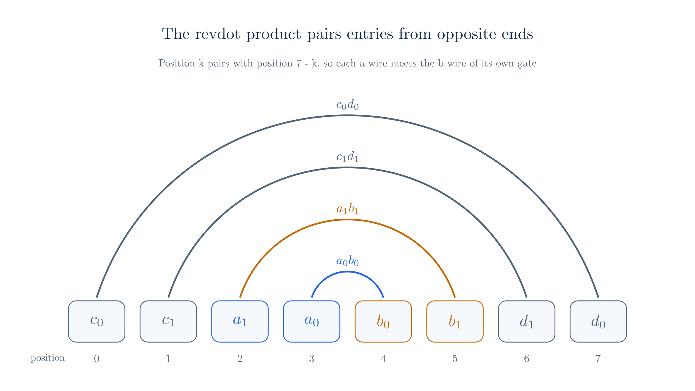

# Arithmetization

A proof system cannot directly reason about a program. Its algebra works with field elements, so the first step in any proof is to rewrite the statement as equations over a field. This rewriting is called **arithmetization**, and every later step depends on its output.

This chapter takes one small computation through the whole process. We start with ordinary arithmetic, express it as a list of multiplications and linear equations, and then compress all of those equations into a single equation with one secret vector. That final equation is the form Ragu proves, and the next chapter turns it into a statement about polynomials.

## 1. What arithmetization produces

Suppose a prover wants to convince a verifier of the following statement:

> I know a number $x$ such that $x^3 + x + 5 = 35$.

Here 35 is public, and $x$ is secret. A statement of this kind has two parts. The **instance** is the public part, which both parties see. The **witness** is the secret part, which only the prover knows. Arithmetization has to produce a fixed set of equations, determined only by the statement's structure, such that a witness satisfies the equations exactly when the statement is true.

The equations cannot depend on the secret value, because the verifier must know them in advance. A program with an `if` branch therefore has to compute both branches and select one arithmetically. For example, a value $s$ is restricted to a bit by the equation $s(s - 1) = 0$, and the expression $s \cdot p + (1 - s) \cdot q$ selects between $p$ and $q$. Hash functions and signature checks reduce to field equations in the same way, with many more of them.

All arithmetic in this chapter happens in $\F_{43}$, the scalar field of the toy curve from the [curves appendix](./appendix-curves.md). The statement is an equation in this field, though the small values in our example make it look like ordinary arithmetic.

## 2. Flattening a computation

The expression $x^3 + x + 5$ contains several operations at once, so we first split it into steps that each perform one operation. Each intermediate result gets its own name:

<!-- worked:flatten -->

| Step | Operation | Value for $x = 3$ |
| --- | --- | --- |
| 1 | $w_1 = x \cdot x$ | 9 |
| 2 | $w_2 = w_1 \cdot x$ | 27 |
| 3 | $w_2 + x + 5$ | 35 |

<!-- /worked:flatten -->

The steps have different costs in a proof system. Step 3 is a linear combination of values we already have, and later sections show that linear combinations can be checked in bulk with a single random combination. Steps 1 and 2 multiply two unknown values, which no linear check can express. Multiplications are therefore what a proof system counts as its main cost, and we keep their number small.

## 3. Gates

Each multiplication becomes a **gate**. A circuit with $n$ gates uses three vectors $\v{a}, \v{b}, \v{c} \in \F_q^n$, and gate $i$ requires

$$a_i \cdot b_i = c_i.$$

The entries of these vectors are called **wires**. Together they form the witness, which also goes by the name **trace** because it records one execution of the computation. In vector form, all the gates together say $\v{a} \circ \v{b} = \v{c}$, where $\circ$ is the entrywise product.

Our computation has two multiplications, so $n = 2$:

<!-- worked:gates -->

| Gate $i$ | $a_i$ | $b_i$ | $c_i$ | Check |
| --- | --- | --- | --- | --- |
| 0 | 3 | 3 | 9 | $3 \cdot 3 = 9$ |
| 1 | 9 | 3 | 27 | $9 \cdot 3 = 27$ |

<!-- /worked:gates -->

## 4. Linear constraints

The gates alone are not enough, because they treat every wire as independent. Nothing yet says that the $a_1$ of gate 1 is the output $c_0$ of gate 0, or that the same $x$ is used everywhere. A separate set of **linear constraints** connects the wires and ties them to the instance. Constraint $j$ has the form

$$\sum_{i=0}^{n-1} u_{j,i}\, a_i + \sum_{i=0}^{n-1} v_{j,i}\, b_i + \sum_{i=0}^{n-1} w_{j,i}\, c_i = k_j,$$

which we can write with inner products as

$$\dot{\v{u}_j}{\v{a}} + \dot{\v{v}_j}{\v{b}} + \dot{\v{w}_j}{\v{c}} = k_j.$$

The vectors $\v{u}_j, \v{v}_j, \v{w}_j$ are public and describe the circuit. The vector $\v{k}$ is the **public input vector**, which holds the instance.

Our statement needs four constraints. The first three connect wires, and the last one checks the output. It moves the constant 5 to the right side, which gives the target value $35 - 5$:

<!-- worked:constraints -->

| $j$ | Constraint | $\v{u}_j$ | $\v{v}_j$ | $\v{w}_j$ | $k_j$ |
| --- | --- | --- | --- | --- | --- |
| 0 | $a_0 - b_0 = 0$ | $(1, 0)$ | $(-1, 0)$ | $(0, 0)$ | 0 |
| 1 | $a_1 - c_0 = 0$ | $(0, 1)$ | $(0, 0)$ | $(-1, 0)$ | 0 |
| 2 | $b_1 - a_0 = 0$ | $(-1, 0)$ | $(0, 1)$ | $(0, 0)$ | 0 |
| 3 | $c_1 + a_0 = 30$ | $(1, 0)$ | $(0, 0)$ | $(0, 1)$ | 30 |

<!-- /worked:constraints -->

Step 3 from Section 2 has disappeared into constraint 3 at no additional cost in gates. This is why addition is cheap here: a sum of any number of wires appears as one row of coefficients, with no new multiplication.

Ragu allows up to $4n$ constraint rows, a limit that comes from the size of the polynomial holding the wiring data. Our circuit has room for 8 rows, and the four unused rows are all zeros, which any witness satisfies.

The gates and constraints together reject false statements:

<!-- worked:wrong-input -->

Try $x = 4$ instead. Filling in the gates gives $\v{a} = (4, 16)$, $\v{b} = (4, 4)$ and $\v{c} = (16, 21)$, with $4 \cdot 4 = 16$ and $16 \cdot 4 = 21$ modulo 43. Both gates and the first three constraints hold. The last constraint gives $c_1 + a_0 = 25$, which is not 30, so this witness is rejected.

<!-- /worked:wrong-input -->

## 5. Reducing the gates to one equation

The verifier now faces $n$ gate equations and $4n$ constraints, and a real circuit has thousands of each. A proof that handled every equation separately would be enormous, so we want to replace them all with one equation that still fails if any of them fails.

Let $e_i = a_i b_i - c_i$ be the error of gate $i$. Adding the errors directly would not work, because errors of $+1$ and $-1$ cancel. Multiplying each error by a different power of a random value $z$ prevents this cancellation:

$$\sum_{i=0}^{n-1} z^i e_i = \sum_{i=0}^{n-1} z^i (a_i b_i - c_i).$$

Read this sum as a polynomial in $z$ with the errors as its coefficients. If every gate holds, this is the zero polynomial, so the sum is 0 for every $z$. If any gate fails, it is a nonzero polynomial of degree less than $n$, which has fewer than $n$ roots. The prover must fix the witness before seeing $z$, so a uniformly random $z$ hits a root with probability below $n / |\F_q|$.

<!-- worked:gate-sum -->

For the honest witness both gate errors are 0, so the sum is 0 for every $z$. Now take a dishonest witness with $\v{a} = (3, 8)$, $\v{b} = (3, 3)$ and $\v{c} = (8, 27)$. It satisfies all the linear constraints above, but its gate errors are $a_0 b_0 - c_0 = 1$ and $a_1 b_1 - c_1 = 40$ modulo 43. At $z = 5$ the sum is $1 + 5 \cdot 40 = 29$, which exposes the error. Checking all 43 values of $z$ finds 1 value that hides it, $z = 29$, the root of this degree-1 polynomial.

<!-- /worked:gate-sum -->

On a field of about $2^{255}$ elements, this probability is negligible. We have traded certainty for an overwhelming probability, in exchange for checking only one equation.

## 6. Reducing the constraints to one equation

The constraints collapse in the same way, using a second random value $y$. Multiplying constraint $j$ by $y^j$ and adding gives

$$\sum_{j=0}^{4n-1} y^j \Big( \dot{\v{u}_j}{\v{a}} + \dot{\v{v}_j}{\v{b}} + \dot{\v{w}_j}{\v{c}} \Big) = \sum_{j=0}^{4n-1} y^j k_j.$$

Inner products are linear, so we can move the powers of $y$ inside. Define the combined vectors

$$\v{u}(y) = \sum_j y^j \v{u}_j, \qquad \v{v}(y) = \sum_j y^j \v{v}_j, \qquad \v{w}(y) = \sum_j y^j \v{w}_j.$$

The equation becomes

$$\dot{\v{u}(y)}{\v{a}} + \dot{\v{v}(y)}{\v{b}} + \dot{\v{w}(y)}{\v{c}} = \dot{\v{k}}{\v{y^{4n}}},$$

where $\v{y^{4n}} = (1, y, \ldots, y^{4n-1})$. The combined vectors are public once $y$ is known, so this is one linear equation in the witness.

<!-- worked:constraint-sum -->

At $y = 7$, the combined vectors are $\v{u}(y) = (37, 7)$, $\v{v}(y) = (42, 6)$ and $\v{w}(y) = (36, 42)$. The left side for the honest witness is $2 + 15 + 39 = 13$ modulo 43. The right side is $7^3 \cdot 30 = 13$, because only $k_3$ is nonzero.

<!-- /worked:constraint-sum -->

We now have two equations, one quadratic in the witness and one linear. The remaining sections merge them into one equation about a single vector.

## 7. Reading one coefficient of a product

The merged equation needs a specific form, and the reason comes from polynomial multiplication. Take polynomials $p$ and $q$ with coefficient vectors $\v{p}, \v{q} \in \F_q^m$. The coefficient of $X^{k}$ in the product $p(X)q(X)$ is the sum of $p_i q_j$ over all pairs with $i + j = k$. For the middle exponent $k = m - 1$, this sum is

$$\sum_{i=0}^{m-1} p_i\, q_{m-1-i}.$$

Each entry of $\v{p}$ meets the entry of $\v{q}$ at the mirrored position. This is the inner product of $\v{p}$ with the reversal $\rv{q}$ of $\v{q}$, which is called the **revdot product**:

$$\revdot{\v{p}}{\v{q}} = \dot{\v{p}}{\rv{q}} = \sum_{i=0}^{m-1} p_i\, q_{m-1-i}.$$

<!-- worked:product -->

Let $p(X) = 1 + 2X + 3X^2 + 4X^3$ and $q(X) = 5 + 6X + 7X^2 + 8X^3$ over $\F_{43}$. The coefficient of $X^3$ in $p(X)q(X)$ collects every pair of exponents that adds to 3: $1 \cdot 8 + 2 \cdot 7 + 3 \cdot 6 + 4 \cdot 5 = 17$ modulo 43. The revdot product computes the same sum, since $\rv{q} = (8, 7, 6, 5)$ and $\dot{\v{p}}{\rv{q}} = 17$. The full product has coefficients $(5, 16, 34, 17, 18, 9, 32)$, and the entry for $X^3$ is the one in the middle.

<!-- /worked:product -->

So a claim about a revdot product is a claim about one coefficient of a polynomial product. This link is why Ragu writes its checks as revdot products, and the next chapter uses it to reach a polynomial test. Our goal for the rest of this chapter is to express both equations as one revdot product.

## 8. Arranging the witness

A gate's product $a_i b_i$ has to appear in a revdot product of the witness with itself. Since revdot pairs position $k$ with position $m - 1 - k$, we need to place $a_i$ and $b_i$ at mirrored positions. We also need room for the $c_i$ wires, whose partners must not create unwanted products.

A vector of length $4n$ with four blocks of length $n$ achieves this:

$$\v{r} = \v{c} \,\|\, \rv{a} \,\|\, \v{b} \,\|\, \rv{d}.$$

The vector $\v{d}$ is an extra block of wires that we set to zero for now, so each $c_i$ has a partner of value 0. Reversing the $\v{a}$ block places $a_i$ at position $2n - 1 - i$, and $b_i$ sits at position $2n + i$. These two positions add up to $4n - 1$, so they are partners. A vector with this arrangement is called a **structured vector**.

With $n = 2$, the positions and their partners are:

<!-- worked:layout -->

| Position $k$ | Entry | Value | Partner position $7 - k$ | Partner entry |
| --- | --- | --- | --- | --- |
| 0 | $c_0$ | 9 | 7 | $d_0$ |
| 1 | $c_1$ | 27 | 6 | $d_1$ |
| 2 | $a_1$ | 9 | 5 | $b_1$ |
| 3 | $a_0$ | 3 | 4 | $b_0$ |
| 4 | $b_0$ | 3 | 3 | $a_0$ |
| 5 | $b_1$ | 3 | 2 | $a_1$ |
| 6 | $d_1$ | 0 | 1 | $c_1$ |
| 7 | $d_0$ | 0 | 0 | $c_0$ |

<!-- /worked:layout -->

Each product appears twice in the revdot sum, once from each end of the pair. With $\v{d} = \v{0}$, the $c$ wires contribute nothing, so

$$\revdot{\v{r}}{\v{r}} = 2\sum_{i=0}^{n-1} a_i b_i.$$

<!-- worked:plain-revdot -->

For our witness, $\v{r} = (9, 27, 9, 3, 3, 3, 0, 0)$. Multiplying each entry by its partner and summing gives $\revdot{\v{r}}{\v{r}} = 29$, and $2\dot{\v{a}}{\v{b}} = 2(3 \cdot 3 + 9 \cdot 3) = 29$ modulo 43.

<!-- /worked:plain-revdot -->

::: warning The Ragu Book's chapters arrange the witness differently
The Ragu Book's [core arithmetization chapter](https://github.com/tachyon-zcash/ragu/blob/3219e0865e8bff1f9d817bfe3850d9e94b64338c/book/src/protocol/core/arithmetization.md) uses $\v{c} \| \rv{b} \| \v{a} \| \v{0}$, which swaps the roles of $\v{a}$ and $\v{b}$. Its [local arithmetization chapter](https://github.com/tachyon-zcash/ragu/blob/3219e0865e8bff1f9d817bfe3850d9e94b64338c/book/src/protocol/local/arithmetization.md) uses the arrangement above, and the [wiring code](https://github.com/tachyon-zcash/ragu/blob/3219e0865e8bff1f9d817bfe3850d9e94b64338c/crates/ragu_circuits/src/wiring/mod.rs#L13-L22) at commit `3219e08` matches it. The two arrangements give the same products, because $a_i b_i = b_i a_i$. This site uses the arrangement from the code.
:::

## 9. Weighting each gate

The sum $2\sum_i a_i b_i$ has lost track of which product belongs to which gate, so it cannot check the gates individually. Section 5 solved the same problem by giving each gate its own power of $z$, and we can build this weighting into the revdot product.

Multiply entry $k$ of the second vector by $z^k$. This operation is called **dilation**, and the result is $\v{r} \circ \v{z^{4n}}$, where $\v{z^{4n}} = (1, z, \ldots, z^{4n-1})$. The revdot product becomes

$$\revdot{\v{r}}{\v{r} \circ \v{z^{4n}}} = \sum_{k=0}^{4n-1} r_k\, r_{4n-1-k}\, z^{4n-1-k}.$$

Now we group the terms by gate. The wires $a_i$ and $b_i$ occupy positions $2n - 1 - i$ and $2n + i$. Taking $k = 2n - 1 - i$ produces $a_i b_i z^{2n + i}$, and taking $k = 2n + i$ produces $b_i a_i z^{2n - 1 - i}$. The pair of wires $c_i, d_i$ contributes in the same way at positions $i$ and $4n - 1 - i$. The result is

$$\revdot{\v{r}}{\v{r} \circ \v{z^{4n}}} = \sum_{i=0}^{n-1} a_i b_i \big( z^{2n-1-i} + z^{2n+i} \big) + \sum_{i=0}^{n-1} c_i d_i \big( z^{i} + z^{4n-1-i} \big).$$

Each gate now has its own weight, built from powers of $z$ that no other gate uses. With $\v{d} = \v{0}$, the second sum vanishes.

<!-- worked:dilation -->

At $z = 5$ the powers are $(1, 5, 25, 39, 23, 29, 16, 37)$, so $\v{r} \circ \v{z^{8}} = (9, 6, 10, 31, 26, 1, 0, 0)$.

| $k$ | $r_k$ | $r_{7-k}$ | $z^{7-k}$ | Term |
| --- | --- | --- | --- | --- |
| 0 | 9 | 0 | 37 | 0 |
| 1 | 27 | 0 | 16 | 0 |
| 2 | 9 | 3 | 29 | 9 |
| 3 | 3 | 3 | 23 | 35 |
| 4 | 3 | 3 | 39 | 7 |
| 5 | 3 | 9 | 25 | 30 |
| 6 | 0 | 27 | 5 | 0 |
| 7 | 0 | 9 | 1 | 0 |

The last column sums to 38. The formula above gives the same value, using weights $z^3 + z^4 = 19$ and $z^2 + z^5 = 11$: $9 \cdot 19 + 27 \cdot 11 = 38$ modulo 43.

<!-- /worked:dilation -->

## 10. Removing the output wires

The expression above contains the products $a_i b_i$, but a gate check needs the differences $a_i b_i - c_i$. We therefore have to subtract $c_i$ with the same weight as its gate:

$$-\sum_{i=0}^{n-1} c_i \big( z^{2n-1-i} + z^{2n+i} \big).$$

This sum is linear in the witness, so it can be written as a revdot product of $\v{r}$ with a public vector $\v{t}$. The wire $c_i$ sits at position $i$, and its partner is position $4n - 1 - i$. Placing the desired coefficient at that partner position gives

$$t_{4n-1-i} = -\big( z^{2n-1-i} + z^{2n+i} \big) \quad \text{for } 0 \le i < n,$$

with all other entries of $\v{t}$ equal to zero. Adding the two revdot products and using linearity gives

$$\revdot{\v{r}}{\v{r} \circ \v{z^{4n}} + \v{t}} = \sum_{i=0}^{n-1} (a_i b_i - c_i) \big( z^{2n-1-i} + z^{2n+i} \big).$$

This expression is the gate check from Section 5 with different weights. It is zero for every $z$ when all the gates hold, and otherwise it is a nonzero polynomial in $z$.

<!-- worked:t-vector -->

At $z = 5$, $\v{t} = (0, 0, 0, 0, 0, 0, 32, 24)$. Its two nonzero entries sit at positions 7 and 6, the partners of $c_0$ and $c_1$. Then $\revdot{\v{r}}{\v{t}} = 5$, and adding the dilated term gives $38 + 5 = 0$ modulo 43, as it should for a witness that satisfies its gates.

<!-- /worked:t-vector -->

## 11. Encoding the constraints

The combined constraint equation from Section 6 is linear in the witness, so it fits the same pattern. We want a public vector $\v{s}$ such that $\revdot{\v{r}}{\v{s}}$ equals its left side. Each wire's coefficient goes at the partner of that wire's position:

| Wire | Position in $\v{r}$ | Coefficient | Position in $\v{s}$ |
| --- | --- | --- | --- |
| $a_i$ | $2n - 1 - i$ | $\v{u}(y)_i$ | $2n + i$ |
| $b_i$ | $2n + i$ | $\v{v}(y)_i$ | $2n - 1 - i$ |
| $c_i$ | $i$ | $\v{w}(y)_i$ | $4n - 1 - i$ |

Filling in these entries gives $\revdot{\v{r}}{\v{s}} = \dot{\v{k}}{\v{y^{4n}}}$ for a witness that satisfies the constraints.

<!-- worked:s-vector -->

At $y = 7$, placing the vectors from Section 6 at the partner positions gives $\v{s} = (0, 0, 6, 42, 37, 7, 42, 36)$, and $\revdot{\v{r}}{\v{s}} = 13$. This equals $\dot{\v{k}}{\v{y^{8}}} = 13$.

<!-- /worked:s-vector -->

The vector $\v{s}$ contains the whole circuit structure, compressed by $y$. The chapter on [wiring and the registry](./wiring-and-registry.md) studies how a verifier can check $\v{s}$ without computing it from scratch.

## 12. The consolidated equation

Both checks are now revdot products with the same left vector $\v{r}$. The revdot product is linear in its second argument, so we can add them into one equation:

$$\boxed{\revdot{\v{r}}{\v{r} \circ \v{z^{4n}} + \v{t} + \v{s}} = \dot{\v{k}}{\v{y^{4n}}}}$$

This is the output of arithmetization. It contains one secret vector, $\v{r}$. Everything else depends only on the circuit, the instance, and the challenges $z$ and $y$.

<!-- worked:combined -->

At $z = 5$ and $y = 7$, the combined right vector is $\v{r} \circ \v{z^{8}} + \v{t} + \v{s} = (9, 6, 16, 30, 20, 8, 31, 17)$. Its revdot product with $\v{r} = (9, 27, 9, 3, 3, 3, 0, 0)$ is 13, and $\dot{\v{k}}{\v{y^{8}}} = 13$. Checking the equation at all $43^2 = 1849$ pairs $(z, y)$ confirms that the honest witness passes at every pair.

<!-- /worked:combined -->

### Why a false witness fails

Subtracting the right side from the left side splits the equation into two parts:

$$\underbrace{\sum_{i=0}^{n-1} (a_i b_i - c_i) \big( z^{2n-1-i} + z^{2n+i} \big)}_{E_g(z)} + \underbrace{\Big( \revdot{\v{r}}{\v{s}} - \dot{\v{k}}{\v{y^{4n}}} \Big)}_{E_c(y)} = 0.$$

The first part depends only on $z$, and every power of $z$ in it is at least $z^{n}$, since $2n - 1 - i \ge n$ for $i < n$. The second part depends only on $y$. A gate error therefore cannot cancel a constraint error for all values of the challenges, because the two parts vary independently. If either part is nonzero, the whole expression is a nonzero polynomial in $(z, y)$ of degree at most $4n - 1$. The prover has to fix $\v{r}$ before seeing the challenges, so a random pair passes with probability at most $(4n - 1)/|\F_q|$. This relies only on the fact about polynomial roots from Section 5, extended to two variables by the Schwartz–Zippel lemma.

On the toy field we can count the exact number of passing challenges for several dishonest witnesses:

<!-- worked:cheats -->

| Dishonest witness | $\v{a}$ | $\v{b}$ | $\v{c}$ | Passing pairs $(z, y)$ | Fraction |
| --- | --- | --- | --- | --- | --- |
| Gates fail, constraints hold | $(3, 8)$ | $(3, 3)$ | $(8, 27)$ | 172 of 1849 | 0.093 |
| Gates hold, last constraint fails | $(4, 16)$ | $(4, 4)$ | $(16, 21)$ | 43 of 1849 | 0.023 |
| Both fail | $(4, 8)$ | $(4, 4)$ | $(8, 21)$ | 40 of 1849 | 0.022 |

The bound for this circuit is $(4n - 1)/|\F_q| = 7/43 \approx 0.163$, and each row falls below it.

<!-- /worked:cheats -->

Those rates are large only because the field has 43 elements. For $n = 2^{11}$ on a 255-bit field, the bound falls below $2^{-240}$.

Notice that the argument depends on the challenge order. A prover who learned $z$ and $y$ before fixing $\v{r}$ could look for a witness that satisfies only this one equation. The [chapter on polynomial commitments](./polynomial-commitments.md) provides the tool that fixes $\v{r}$ first.

## 13. The arithmetization in Ragu

::: warning Reconstructed from code at commit 3219e08, not confirmed by the authors
Our toy circuit sets $\v{d} = \v{0}$ and moves constants into $\v{k}$. Ragu's implementation differs in the following ways:

- **Four wires per gate.** The [local arithmetization chapter](https://github.com/tachyon-zcash/ragu/blob/3219e0865e8bff1f9d817bfe3850d9e94b64338c/book/src/protocol/local/arithmetization.md) gives each gate the two equations $a_i b_i = c_i$ and $c_i d_i = 0$. The second equation is the second sum from Section 9, which the dilation already checks. At a gate with $c_i = 0$, the wire $d_i$ is free to hold extra witness data.
- **A wire that holds the constant 1.** The [circuit setup code](https://github.com/tachyon-zcash/ragu/blob/3219e0865e8bff1f9d817bfe3850d9e94b64338c/crates/ragu_circuits/src/raw.rs#L19-L33) reserves gate 0 as a system gate, with $d_0 = 1$ as the `ONE` wire and a blinding factor in $a_0$. A constraint ties this wire to the constant term of the instance. Constants such as our 5 can then appear in constraints as multiples of `ONE`, instead of being moved to $\v{k}$.
- **Virtual wires.** Ragu's [`Driver` interface](https://github.com/tachyon-zcash/ragu/blob/3219e0865e8bff1f9d817bfe3850d9e94b64338c/crates/ragu_core/src/drivers.rs#L299-L341) has `mul` for gates, `enforce_zero` for constraints, and `add` for a virtual wire, which is a named linear combination of existing wires. A virtual wire adds no gate, which matches the cost of addition we saw in Section 4.

The core chapter of the Ragu Book describes the simpler form with $\v{d} = \v{0}$, and this chapter follows that form for its example.
:::

## 14. Comparison with R1CS and PLONK

Other proof systems make different choices at this stage. Two of them are worth knowing, and the first is needed for the next chapter.

**R1CS** (rank-1 constraint system) uses one vector $\v{w}$ containing the constant 1, the instance, and the witness. Three public matrices define the constraints:

$$A\v{w} \circ B\v{w} = C\v{w}.$$

Each row is one constraint that multiplies two linear combinations of $\v{w}$ and compares the result with a third. Our statement fits in three rows:

<!-- worked:r1cs -->

With $\v{w} = (1, 35, 3, 9, 27)$, holding the constant 1, the public output, $x$, $w_1$ and $w_2$, the three matrices are

$$A = \begin{bmatrix}0 & 0 & 1 & 0 & 0 \\ 0 & 0 & 0 & 1 & 0 \\ 5 & 0 & 1 & 0 & 1\end{bmatrix},\quad B = \begin{bmatrix}0 & 0 & 1 & 0 & 0 \\ 0 & 0 & 1 & 0 & 0 \\ 1 & 0 & 0 & 0 & 0\end{bmatrix},\quad C = \begin{bmatrix}0 & 0 & 0 & 1 & 0 \\ 0 & 0 & 0 & 0 & 1 \\ 0 & 1 & 0 & 0 & 0\end{bmatrix}.$$

The products are $A\v{w} = (3, 9, 35)$ and $B\v{w} = (3, 3, 1)$. Their entrywise product is $(9, 27, 35)$, which equals $C\v{w}$.

<!-- /worked:r1cs -->

R1CS and Ragu's system have the same expressive power, and each can be converted to the other with a linear increase in size. R1CS merges the wiring into its multiplication rows, while Ragu's system (called Bootle16, after its source paper) keeps gates and linear constraints apart. That separation is what makes the revdot form above possible.

**PLONK** uses gates with selectable coefficients, of the form $q_L a + q_R b + q_O c + q_M ab + q_C = 0$, and adds separate copy constraints to connect wires. Later variants add custom gates and lookup tables that reduce the number of gates for certain operations. Ragu [deliberately avoids these features](https://github.com/tachyon-zcash/ragu/blob/3219e0865e8bff1f9d817bfe3850d9e94b64338c/book/src/protocol/index.md). It uses a simple circuit model and splits large computations into many small circuits that communicate along the PCD tree.

## 15. Where this chapter leaves us

This chapter took the following steps:

1. A computation becomes a list of multiplication gates and linear constraints over a field.
2. Random powers of $z$ and $y$ reduce all gates and constraints to two equations, at the cost of a small failure probability.
3. A revdot product corresponds to one coefficient of a polynomial product.
4. A structured vector $\v{r}$ places each $a_i$ and $b_i$ at mirrored positions, and dilation by $z$ weights each gate separately.
5. The public vectors $\v{t}$ and $\v{s}$ add the gate outputs and the wiring, which gives one equation.

The prover still has to convince the verifier of this equation without revealing $\v{r}$. The next chapter starts from the R1CS form to derive the standard QAP reduction, and then uses Section 7 to reach a polynomial test for the consolidated equation.
