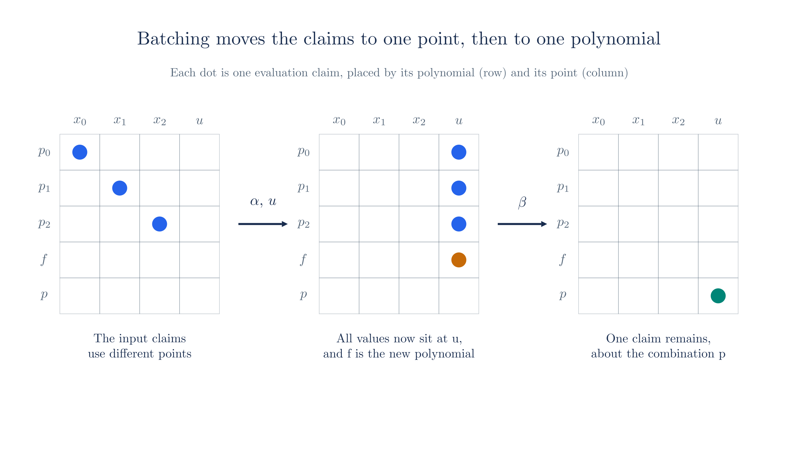
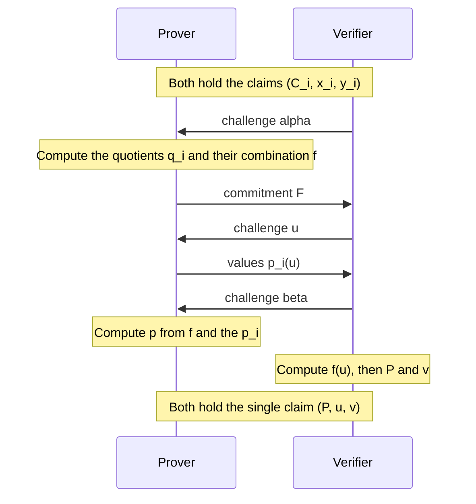

# Batched Openings

The [inner product argument](./inner-product-argument.md) proves one evaluation claim about one committed polynomial. A complete proof makes several such claims, about different polynomials at different points, and running the argument once per claim multiplies its cost. This chapter reduces any number of claims to a single claim, so that the argument runs only once.

The reduction has two stages. The first moves every claim to one fresh random point with the help of quotient polynomials, and the second combines the resulting claims at that point using a random linear combination. The Ragu Book calls these stages alpha batching and beta batching after their challenges, and the literature calls the whole technique a batched opening or a multi-opening.

Several sections compare this description with Ragu's code. Every statement in this chapter about what the code does is reconstructed from code at commit `3219e08`, not confirmed by the authors.

## 1. Why a proof makes many claims

The [next chapter](./nark.md) assembles a complete proof, and [its final step in the Ragu Book](https://github.com/tachyon-zcash/ragu/blob/3219e0865e8bff1f9d817bfe3850d9e94b64338c/book/src/protocol/core/nark.md?plain=1#L238-L247) lists the claims that the verifier needs checked. We will meet these polynomials properly in that chapter. For now, only the shape of the list matters, and it looks like this.

$$\underbrace{a(0) = 1,\quad a(xz) = \cdots}_{\text{two claims about } a}, \qquad b(x) = \cdots, \qquad s(x, y) = \cdots, \qquad \underbrace{k(0) = 1,\quad k(y) = c}_{\text{two claims about } k}.$$

The value 1 in the claim about $a(0)$ is the book's, and [chapter 09](./nark.md) explains why the code's value differs. The difference does not change the shape of the list. The letters $x$, $y$ and $z$ here are challenges that the next chapter introduces, and they are unrelated to the notation $x_i$, $y_i$ that this chapter uses from the next paragraph on. The polynomial $s(X, Y)$ has two variables, but once the challenge $y$ is fixed, $s(X, y)$ is an ordinary polynomial in $X$, so the claim about it has the same form as the others.

That makes six claims about four polynomials at the four points $0$, $xz$, $x$ and $y$. Later chapters add more, because a recursive step also has to handle the claims it inherits from earlier proofs. Opening each claim separately repeats the whole argument, with its group elements and its verifier work, once per claim. Section 10 counts what batching saves on this list, after we have laid out what the batched argument sends.

We write one claim as a triple $(C_i, x_i, y_i)$, which says that the polynomial $p_i$ behind the commitment $C_i$ satisfies $p_i(x_i) = y_i$. Both parties hold the triples, and only the prover holds the polynomials. The goal is a short exchange after which both parties hold a single triple $(P, u, v)$, with the property that a false input claim leads to a false output claim, except with negligible probability.

## 2. Combining claims at different points

The [random linear combinations](./statements-and-challenges.md#_6-random-linear-combinations) from chapter 03 already solve the problem when all the claims use one point. If $p_0(x) = y_0$ and $p_1(x) = y_1$, the verifier picks $r$ and asks about $p_0 + r p_1$ at $x$. It can compute the commitment $C_0 + r C_1$ and the expected value $y_0 + r y_1$ alone, because [commitments and evaluations combine with the same coefficients](./polynomial-commitments.md#evaluations-of-linear-combinations). Chapter 03 ran this check on [two claims at the point 9](./statements-and-challenges.md#combining-evaluation-claims).

The method stops working when the points differ, because a combination of polynomials has no single point at which the combined claim makes sense. The next example tries it on two true claims at different points.

<!-- worked:mismatch -->

Suppose the prover claims $p_0(9) = 37$ and $p_1(5) = 20$, with the polynomials $p_0 = 7 + 2X + 5X^2 + 3X^3$ and $p_1 = 3 + X + 8X^2 + 4X^3$. Take $r = 6$. The combination $p_0 + 6 p_1$ has the value $36$ at $9$ and the value $35$ at $5$, while the combined claim is $37 + 6 \cdot 20 = 28$. The claimed number matches neither value, even though both claims are true, because the value at $9$ needs $p_1(9) = 7$ and nobody has said anything about that.

<!-- /worked:mismatch -->

We therefore need some way to convert a claim at $x_i$ into a claim at a point shared by all the others. Since the verifier's challenge can supply such a point, we look for a way to restate $p(x) = y$ as a fact that holds everywhere, so that it can be tested anywhere.

## 3. Writing a claim as a division

The statement $p(x) = y$ says that the polynomial $p(X) - y$ has a root at $x$. Chapter 03 showed that [each root gives a linear factor](./statements-and-challenges.md#each-root-gives-a-linear-factor), so the claim holds exactly when there is a polynomial $q$ with

$$p(X) - y = (X - x)\, q(X).$$

We call $q$ the **quotient** of the claim. The prover computes it by a procedure called synthetic division. For a polynomial $p$ with coefficients $a_0, \ldots, a_3$, the quotient has three coefficients $b_2, b_1, b_0$, and the prover finds them from the top down. It starts with $b_2 = a_3$, and each later line multiplies the previous result by $x$ and adds the next coefficient of $p$. One more line of the same kind gives back $p(x)$. The next example runs the procedure on a claim from the commitments chapter.

<!-- worked:division -->

Take $p(X) = 7 + 2X + 5X^2 + 3X^3$ and $x = 9$, so $a_3, a_2, a_1, a_0 = 3, 5, 2, 7$.

| Line | Formula | Value modulo 43 |
| --- | --- | --- |
| $b_2$ | $a_3$ | $3$ |
| $b_1$ | $a_2 + x b_2 = 5 + 9 \cdot 3$ | $32$ |
| $b_0$ | $a_1 + x b_1 = 2 + 9 \cdot 32$ | $32$ |
| $y$ | $a_0 + x b_0 = 7 + 9 \cdot 32$ | $37$ |

The quotient is $q(X) = 32 + 32X + 3X^2$, and the last line recovers $y = 37$, the value of $p(9)$ from the [commitments chapter](./polynomial-commitments.md#_8-writing-an-evaluation-as-an-inner-product). Multiplying out $(X - 9)(32 + 32X + 3X^2)$ returns $13 + 2X + 5X^2 + 3X^3$, which equals $p(X) - 37$ with coefficients reduced modulo 43.

<!-- /worked:division -->

The claimed value $y$ plays no part in the first three lines. It appears only in the last line, which has to reproduce $p(x)$, so the division comes out exact precisely when the claim is true. The box below derives the table from the equation $p(X) - y = (X - x)\,q(X)$, and the same pattern works for any number of coefficients.

::: details Deriving the division table

Take the case $n = 4$. Then $p$ has coefficients $a_0, \ldots, a_3$, the quotient has degree 2, and we can write $q(X) = b_0 + b_1 X + b_2 X^2$. Multiplying out the right side gives

$$
\begin{aligned}
(X - x)(b_0 + b_1 X + b_2 X^2) &= b_0 X + b_1 X^2 + b_2 X^3 - x b_0 - x b_1 X - x b_2 X^2 \\
&= -x b_0 + (b_0 - x b_1) X + (b_1 - x b_2) X^2 + b_2 X^3.
\end{aligned}
$$

Matching each power of $X$ against $p(X) - y = (a_0 - y) + a_1 X + a_2 X^2 + a_3 X^3$ produces four equations:

$$
\begin{aligned}
b_2 &= a_3, \\
b_1 - x b_2 &= a_2, \\
b_0 - x b_1 &= a_1, \\
-x b_0 &= a_0 - y.
\end{aligned}
$$

The first three equations determine the quotient from the top coefficient down, and $y$ plays no part in them. Solving them gives $b_2 = a_3$, then $b_1 = a_2 + x a_3$, then $b_0 = a_1 + x a_2 + x^2 a_3$. Only the last equation mentions $y$, and rearranging it gives

$$y = a_0 + x b_0 = a_0 + a_1 x + a_2 x^2 + a_3 x^3 = p(x).$$

So the system has a solution exactly when the claim is true. Each line of the division table is one of these equations, solved for its unknown.

:::

The same computation behaves differently when the claimed value is wrong, as the next example shows.

<!-- worked:false-division -->

Suppose the prover claims $p(9) = 38$ instead. The first three lines of the table do not involve $y$, so they produce the same $q(X)$. The last line still computes $37$, which contradicts the claim. Expanding shows the same mismatch, since $(X - 9) q(X) = p(X) - 37$ while the claim needs $p(X) - 38$. No polynomial can repair this, because at $X = 9$ the product $(X - 9) q(X)$ is zero for every $q$, whereas $p(9) - 38 = 42$. Written with that leftover constant, the division reads $p(X) - 38 = (X - 9)\,q(X) + 42$.

<!-- /worked:false-division -->

The last line of the division table shows what happens in general. The first three lines produce the same $q$ whatever $y$ is, and the last line leaves over the constant $p(x) - y$, so every claim, true or false, satisfies
$$p(X) - y = (X - x)\, q(X) + \big(p(x) - y\big).$$

We call the constant $p(x) - y$ the **error** of the claim, or the **remainder** of the division. It is zero exactly when the claim is true. In the false example above, it is the constant added after $(X - x)\,q(X)$ in the example's closing equation, which writes the false division with its leftover. A claim has a quotient polynomial exactly when its error is zero.

For a false claim, the fraction $(p(X) - y)/(X - x)$ still exists as a **rational function**, meaning a fraction of two polynomials. Dividing the equation above by $X - x$ gives
$$\frac{p(X) - y}{X - x} = q(X) + \frac{p(x) - y}{X - x},$$
so the fraction is a polynomial plus the error over $X - x$. The second term cannot be simplified to a polynomial, and it has no value at $X = x$, where the denominator is zero. We call such a point a **pole** of the fraction. No polynomial has a pole, so no polynomial can agree with this fraction everywhere, and the protocol below relies on that difference.

## 4. Moving one claim to a new point

The equation $p(X) - y = (X - x)\,q(X)$ is an identity between polynomials, so it holds at every point. For any $u \neq x$, dividing by the nonzero number $u - x$ gives

$$q(u) = \frac{p(u) - y}{u - x}.$$

This relation gives us a test at a point unrelated to $x$. The prover commits to $q$ first, which fixes it. The verifier then picks a random $u$, the prover sends the value $p(u)$, and the verifier computes what $q(u)$ has to be from the formula. What remains are two claims at the point $u$. The original commitment must open to the sent value, and the quotient's commitment must open to the computed value. The point $x$ appears only in the verifier's arithmetic and in no remaining opening.

<!-- worked:one-claim -->

Take a second polynomial $p_1(X) = 3 + X + 8X^2 + 4X^3$, with the commitment $C_1 = (6,\,23)$ and the claim $p_1(5) = 20$. Division gives $q_1(X) = 12 + 28X + 4X^2$.

| Step | Party | Value or check |
| --- | --- | --- |
| 1 | Prover commits to the quotient | $Q_1 = (17,\,24)$ |
| 2 | Verifier sends a challenge | $u = 17$ |
| 3 | Prover sends the value of $p_1$ at $u$ | $p_1(17) = 11$ |
| 4 | Verifier derives the value of $q_1$ at $u$ | $(11 - 20) / (17 - 5) = 10$ |

The commitment $C_1$ must now open to $11$ at $17$, and $Q_1$ must open to $10$ at $17$. Evaluating the quotient directly confirms that $q_1(17) = 10$.

<!-- /worked:one-claim -->

For one claim this looks like a step backward, because it replaced one opening with two. The gain appears with several claims, since every claim can use the same $u$. The three claims of the next section, at three different points, become openings that all sit at $u$, and the same-point method of Section 2 then merges them into a single opening.

The test also has the behaviour we want for a false claim. For now, assume the prover sends the true value $p(u)$, which the opening of $C$ at $u$ enforces. Section 9 deals with a prover that sends a false one. If $p(x) \neq y$, whatever polynomial $q'$ the prover commits to differs from the rational function, so the formula gives the wrong value at most values of $u$. The exceptions number at most $n$, so the prover has at most an $n / |\F|$ chance of passing.

::: details Counting the exceptions

Multiply the formula through by $u - x$. The formula matches only where $(X - x) q'(X) - (p(X) - y)$ vanishes, and this polynomial is nonzero because a false claim has no quotient. Its degree is at most $n$, since the commitment limits $q'$ to degree $n - 1$, so [it has at most $n$ roots](./statements-and-challenges.md#a-polynomial-of-degree-d-has-at-most-d-roots).

:::

## 5. Alpha batching

With $m$ claims, a separate commitment to each quotient would add $m$ curve points to the proof. Commitments add in the same way as polynomials, so the prover can send one commitment to a combination of the quotients. Our running example has three polynomials with one claim each, listed in the next table.

<!-- worked:claims -->

| Claim $i$ | Polynomial $p_i(X)$ | Point $x_i$ | Value $y_i$ | Commitment $C_i$ | Quotient $q_i(X)$ |
| --- | --- | --- | --- | --- | --- |
| 0 | $7 + 2X + 5X^2 + 3X^3$ | 9 | 37 | $(27,\,30)$ | $32 + 32X + 3X^2$ |
| 1 | $3 + X + 8X^2 + 4X^3$ | 5 | 20 | $(6,\,23)$ | $12 + 28X + 4X^2$ |
| 2 | $2 + 9X + 4X^2 + 6X^3$ | 2 | 41 | $(17,\,24)$ | $41 + 16X + 6X^2$ |

The commitment $C_2 = (17,\,24)$ is the same point as $Q_1$ from Section 4, although $q_1$ and $p_2$ are different polynomials. This is a coincidence of the toy group, which has only 43 elements, so unrelated vectors often share a commitment. On a real curve such a collision would break binding.

<!-- /worked:claims -->

A plain sum of the quotients would be safe if every claim used its own point, because an error over $X - 5$ and an error over $X - 9$ cannot cancel each other, as the combined fraction below makes precise. The running example has distinct points, but real lists do not. Section 1's list has claims about $a(0)$ and $k(0)$, which share the point $0$. Errors at a shared point can cancel, because two false claims at the same $x$ have their errors over the same denominator, and a cheater can choose those errors to be opposite. For this example only, put the claims about $p_0$ and $p_1$ both at the point $9$, instead of the points in the table. The next example runs the attack with those two claims.

<!-- worked:plain-sum -->

The true values at $9$ are $p_0(9) = 37$ and $p_1(9) = 7$. A cheater claims $38$ and $6$, so both claims are false. The errors are opposite, so $p_0 + p_1 - (38 + 6)$ still has a root at $9$ and division by $X - 9$ leaves no remainder. The result is the genuine polynomial $42 + 33X + 7X^2$, which the cheater can commit to and open at any point.

<!-- /worked:plain-sum -->

Giving each quotient a different random weight prevents this, which is the same reasoning as for [powers of one challenge](./statements-and-challenges.md#powers-of-one-challenge). The verifier sends a challenge $\alpha$ after the claims are fixed, and the prover forms

$$f(X) = \sum_{i=0}^{m-1} \alpha^{m-1-i}\, q_i(X).$$

For three claims this is $f(X) = \alpha^2 q_0(X) + \alpha\, q_1(X) + q_2(X)$. The first claim takes the highest power, which is the order Ragu's code uses, and Section 7 compares it with the book's order.

To see what the weights do to false claims, compare $f$ with the **combined fraction**, which applies the same weights to the fractions $(p_i(X) - y_i)/(X - x_i)$ instead of the quotients. Section 3 split each fraction into its quotient plus the claim's error over $X - x_i$. Applying that split to every term shows that the combined fraction equals $f$ plus, for each distinct point $a$, one leftover term $R_a/(X - a)$. We call $R_a$ the **combined error at $a$**. It is the weighted sum of the errors of the claims at $a$, and it replaces the single error of Section 3 when several claims share a point. The box below writes out the grouping.

::: details Splitting the combined fraction

The combined fraction is
$$\sum_{i=0}^{m-1} \alpha^{m-1-i}\, \frac{p_i(X) - y_i}{X - x_i}.$$
Section 3 split each fraction into the quotient $q_i(X)$ plus the claim's error over $X - x_i$. The quotient parts add up to $f$. The error parts with the same point $a$ share the denominator $X - a$, so they add into one term. Grouping them this way gives
$$\sum_{i=0}^{m-1} \alpha^{m-1-i}\, \frac{p_i(X) - y_i}{X - x_i} = f(X) + \sum_{a} \frac{R_a}{X - a}, \qquad R_a = \sum_{i:\, x_i = a} \alpha^{m-1-i} \big(p_i(a) - y_i\big),$$
where the outer sum on the right runs over the distinct points $a$ among the $x_i$.

:::

When every claim is true, every $R_a$ is zero and the combined fraction equals $f$. The combined fraction has a pole at $a$ exactly when $R_a$ is nonzero. With one claim per point, $R_a$ is a single weighted error and is nonzero whenever that claim is false, which is why a plain sum is safe in that case. With several claims at $a$, the weights make it unlikely that their errors cancel, and the plain-sum attack shows by how much.

<!-- worked:alpha-count -->

With the weights $\alpha$ and $1$, the two errors from the plain-sum attack above leave the combined error $R_9 = \alpha \cdot 42 + 1$ over $X - 9$. Trying all 43 values of $\alpha$ finds that only $\alpha = 1$ removes it, and that value is the plain sum.

<!-- /worked:alpha-count -->

The prover now computes $f$ for the running example and commits to it. Each $p_i$ has $n$ coefficients, so each quotient has $n - 1$ coefficients, and so does their combination $f$. The commitment scheme uses $n$ generators, so the prover pads $f$ with a zero in the top position and commits to the padded vector. The table below lists the unpadded coefficients, and the table in Section 7 shows the padded vector.

<!-- worked:alpha-f -->

Take $\alpha = 11$, so $\alpha^2 = 35$ modulo 43. Each column of the next table combines one power of $X$.

| Term | $X^0$ | $X^1$ | $X^2$ |
| --- | --- | --- | --- |
| $q_0(X)$ | 32 | 32 | 3 |
| $q_1(X)$ | 12 | 28 | 4 |
| $q_2(X)$ | 41 | 16 | 6 |
| $f(X) = 35\,q_0 + 11\,q_1 + q_2$ | 3 | 25 | 26 |

The prover commits to $f$ and sends the single point $F = (27,\,1)$.

<!-- /worked:alpha-f -->

The commitment $F$ fixes $f$ before the next challenge. The prover has not sent any of the individual quotients, and the verifier does not need them.

## 6. Moving every claim to u

The verifier now sends a random point $u$. Section 4 gave a formula for one quotient at $u$, and because $f$ is a combination of the quotients, the same weights carry over to its value. Substituting term by term gives

$$
\begin{aligned}
f(u) &= \sum_{i=0}^{m-1} \alpha^{m-1-i}\, q_i(u) \\
&= \sum_{i=0}^{m-1} \alpha^{m-1-i}\, \frac{p_i(u) - y_i}{u - x_i}.
\end{aligned}
$$

The right side uses only the values $p_i(u)$ together with numbers the verifier already holds, so the prover sends those values and the verifier computes $f(u)$ for itself. The formula divides by $u - x_i$, which would fail if $u$ landed on one of the original points. In a field of about $2^{254}$ elements, a random $u$ lands on one of the $m$ points with probability at most $m/|\F|$. One place where Ragu runs this protocol is compression, the operation from [chapter 02](./pcd-intro.md) that turns a fused proof into a short final proof, and the [compression verifier](https://github.com/tachyon-zcash/ragu/blob/3219e0865e8bff1f9d817bfe3850d9e94b64338c/crates/ragu_pcd/src/compress/batch/verifier.rs#L70-L72) rejects if $u$ lands on a claim point. The toy field has only 43 elements, so the worked examples in this chapter draw $u$ only from values that avoid the claim points.

<!-- worked:derive-fu -->

Take $u = 17$. The prover sends $p_0(17) = 14$, $p_1(17) = 11$ and $p_2(17) = 1$, and the verifier computes each term from those values and the original claims.

| $i$ | $p_i(u)$ | $u - x_i$ | $(p_i(u) - y_i) / (u - x_i)$ | Weight | Weighted term |
| --- | --- | --- | --- | --- | --- |
| 0 | 14 | 8 | 24 | 35 | 23 |
| 1 | 11 | 12 | 10 | 11 | 24 |
| 2 | 1 | 15 | 26 | 1 | 26 |

The last column sums to $f(17) = 30$ modulo 43. The prover, who holds $f$, gets the same number by direct substitution into $3 + 25X + 26X^2$. The verifier has obtained this value without seeing $f$.

<!-- /worked:derive-fu -->

The verifier now holds $m + 1$ claims that all use the point $u$. The commitment $F$ must open to the computed $f(u)$, and each $C_i$ must open to the sent $p_i(u)$. The obstacle from Section 2 has gone, because no remaining opening refers to the points $x_i$. The original claims have not disappeared, however, since each $y_i$ and $x_i$ now sits inside the formula for $f(u)$, and a false $y_i$ makes that number wrong.

## 7. Beta batching

Since all the claims now use one point, a random linear combination finishes the job. The verifier sends a challenge $\beta$ after the prover has sent its values, and the prover forms

$$p(X) = \beta^m f(X) + \sum_{i=0}^{m-1} \beta^{m-1-i}\, p_i(X).$$

For three claims this is $p(X) = \beta^3 f(X) + \beta^2 p_0(X) + \beta\, p_1(X) + p_2(X)$. The verifier cannot compute $p$, but linearity gives it everything else. The commitment comes from the [homomorphic property](./polynomial-commitments.md#_5-adding-commitments), and the value comes from substituting $u$ into the definition of $p$:

$$
\begin{aligned}
P &= \beta^m \cdot F + \sum_{i=0}^{m-1} \beta^{m-1-i} \cdot C_i, \\
v &= \beta^m f(u) + \sum_{i=0}^{m-1} \beta^{m-1-i}\, p_i(u).
\end{aligned}
$$

The output is the triple $(P, u, v)$, a claim of exactly the form the inner product argument proves.

The name $P$ has a different meaning in the [commitments chapter](./polynomial-commitments.md#_9-combining-the-commitment-and-the-claim), where $P = C + y \cdot U$ was the statement point of an opening. Here $P$ is a plain commitment to the polynomial $p$, which is the Ragu Book's usage, so the statement point for the output claim is $P + v \cdot U$.

<!-- worked:beta-p -->

Take $\beta = 23$, whose powers modulo 43 are $\beta^2 = 13$ and $\beta^3 = 41$.

| Input | Weight | Commitment | Value at $u$ | Coefficients |
| --- | --- | --- | --- | --- |
| $f$ | $41$ | $(27,\,1)$ | 30 | $(3, 25, 26, 0)$ |
| $p_0$ | $13$ | $(27,\,30)$ | 14 | $(7, 2, 5, 3)$ |
| $p_1$ | $23$ | $(6,\,23)$ | 11 | $(3, 1, 8, 4)$ |
| $p_2$ | $1$ | $(17,\,24)$ | 1 | $(2, 9, 4, 6)$ |
| Combined $p$ | | $P = (14,\,9)$ | $v = 32$ | $(27, 8, 29, 8)$ |

The verifier derives $P$ and $v$ from the first four rows, using only group operations and field arithmetic. The prover derives the coefficients of $p$. Committing to those coefficients gives $(14,\,9)$, and substituting $u = 17$ into $p$ gives $32$, so both agree with what the verifier computed.

<!-- /worked:beta-p -->

Every input to $p$, including $f$, needs a weight of its own, because Section 9 shows that errors in two inputs with the same weight can cancel for every $\beta$. The book's formulas leave the weights partly open:

::: warning The Ragu Book and the code differ here
Reconstructed from code at commit `3219e08`, not confirmed by the authors. The [book](https://github.com/tachyon-zcash/ragu/blob/3219e0865e8bff1f9d817bfe3850d9e94b64338c/book/src/protocol/core/accumulation/pcs.md?plain=1#L42-L63) writes $f = \sum_i \alpha^i q_i$ and $p = f + \sum_i \beta^i p_i$ and does not state the range of $i$. The [compression verifier](https://github.com/tachyon-zcash/ragu/blob/3219e0865e8bff1f9d817bfe3850d9e94b64338c/crates/ragu_pcd/src/compress/batch/verifier.rs#L67-L92) gives the first claim the highest power of $\alpha$, gives $f$ the highest power of $\beta$, and gives the last polynomial weight 1. This site follows the code. Read with $\beta^i$ starting at $i = 1$, the book's formula gives distinct weights in a different order, which is equally safe and is the form the [Halo 2 book](https://zcash.github.io/halo2/design/proving-system/multipoint-opening.html) uses. Read from $i = 0$, it gives $f$ and $p_0$ the same weight 1, and Section 9 shows why that shared weight is unsafe.
:::

## 8. The complete protocol

The following diagram shows what the two stages do to the claims, and the sequence after it lists the messages.





The soundness of the protocol depends on the order of these messages, as Section 9 explains. Under [Fiat–Shamir](./statements-and-challenges.md#_7-removing-the-verifier-with-fiat–shamir), each challenge becomes a hash of a transcript that has absorbed everything before it, including the claims themselves. The worked examples here use chosen challenges so that the numbers stay readable.

Here is the whole run, gathered from the previous sections. For the last step, the prover reveals $p$, and the verifier checks it directly:

<!-- worked:run -->

| Step | Party | Value or check |
| --- | --- | --- |
| 0 | Both hold the claims | $((27,\,30),\,9,\,37)$, $((6,\,23),\,5,\,20)$, $((17,\,24),\,2,\,41)$ |
| 1 | Verifier sends a challenge | $\alpha = 11$ |
| 2 | Prover commits to $f$ | $F = (27,\,1)$ |
| 3 | Verifier sends a challenge | $u = 17$ |
| 4 | Prover sends the values at $u$ | $14,\ 11,\ 1$ |
| 5 | Verifier sends a challenge | $\beta = 23$ |
| 6 | Verifier derives $f(u)$ | $30$ |
| 7 | Verifier derives the output claim | $P = (14,\,9)$, $v = 32$ |
| 8 | Prover reveals $p$ | $(27, 8, 29, 8)$ |
| 9 | Verifier checks the commitment | $\dot{\v{p}}{\v{G}} = (14,\,9)$, which equals $P$ |
| 10 | Verifier checks the value | $p(17) = 32$, which equals $v$ |

<!-- /worked:run -->

Steps 8 to 10 are the expensive ones. The [Ragu Book's NARK](https://github.com/tachyon-zcash/ragu/blob/3219e0865e8bff1f9d817bfe3850d9e94b64338c/book/src/protocol/core/nark.md?plain=1#L242-L245) really does finish this way, with the prover sending $p$ in full, and the next chapter returns to that choice. A succinct proof replaces those three steps with one inner product argument for $(P, u, v)$, as [compression](https://github.com/tachyon-zcash/ragu/blob/3219e0865e8bff1f9d817bfe3850d9e94b64338c/crates/ragu_pcd/src/compress/batch/verifier.rs#L27-L35) does in the code.

## 9. Why cheating fails

The argument below relies on three assumptions. Commitments are binding under the [discrete log relation assumption](./polynomial-commitments.md#_4-why-a-prover-cannot-change-the-vector), the final opening is sound, and Fiat–Shamir challenges behave like uniform random values that nobody can predict before the preceding messages are fixed, which is the [random oracle assumption](./statements-and-challenges.md#the-assumption).

Take one false claim in the running example. We first look at what the false value does to a run in which the prover otherwise follows the protocol. Then we go through the challenges in the order the protocol sends them, $\alpha$, then $u$, then $\beta$, and ask at each stage what a cheater can try. On the toy field we count the cheater's success by trying every challenge.

### The cheater commits to the quotients and reports true values

A cheater who runs the honest division gets a perfectly good polynomial $f$, because division ignores $y$. The false value only shows up later, inside the verifier's formula.

<!-- worked:cheat-drop -->

The cheater claims $p_1(5) = 21$, whereas the true value is $20$. It computes the quotients by the division table, which ignores $y$, and commits to the same $f$, then reports true values at $u$. The false $y_1$ enters the verifier's formula, and at $u = 17$ the derived value is $4$ while $f(17) = 30$. We measure the gap as the derived value minus $f(u)$, which here is $4 - 30 = 17$ modulo 43. It equals $R_{5} / (u - 5)$, because at $\alpha = 11$ the combined error is $R_{5} = 11 \cdot (20 - 21) = 32$, and $32 / 12 = 17$ modulo 43. We tried every pair of challenges. The challenge $u$ has to avoid the three claim points 9, 5 and 2, which leaves 40 allowed values, and $\beta$ can take all 43. The gap is nonzero at all 40 values of $u$, and the only passing runs are the 40 that have $\beta = 0$.

<!-- /worked:cheat-drop -->

The gap is never zero here. At every allowed $u$ it equals the combined error $R_5$ divided by $u - 5$, because the honest $f$ is the polynomial part of the combined fraction and $R_5/(X - 5)$ is the part left over. The combined error $R_5$ is the weight of claim 1 times the claim's nonzero error, and the weight is nonzero for the $\alpha$ used here, so the gap cannot vanish at any allowed $u$. The check at $\beta = 0$ passes only because $\beta^m$ then removes $f$ from $p$ altogether, and the stage for $\beta$ below returns to that case.

### The cheater hopes for a cancelling alpha

The gap above depends on the false claim having a nonzero weight, and the challenge $\alpha$ sets the weights. Section 5 showed that false claims at a shared point can cancel for one particular $\alpha$. A single false claim can also lose its weight entirely. In either case the combined fraction has no pole, so the cheater holds a genuine polynomial $f$ that passes everything afterwards. In the running example only the second case can occur, and the next example finds the one $\alpha$ that causes it.

<!-- worked:cheat-alpha -->

In the running example only claim 1 is false, and its weight is $\alpha$. The combined error at the point $5$ is $R_{5} = \alpha \cdot (20 - 21) = 42\,\alpha$ modulo 43, a polynomial of degree 1 in $\alpha$ whose only root is $\alpha = 0$. At that value the weights are $0, 0, 1$, so the false claim drops out of $f$ and the honest quotients pass. We checked all 40 allowed values of $u$ and all 43 values of $\beta$ with $\alpha = 0$, and the cheater passes in all $1720$ runs.

<!-- /worked:cheat-alpha -->

The same reasoning works with more claims. The combined error $R_a$ at a point is a sum of the errors of the claims at that point, each multiplied by its power of $\alpha$. This is a polynomial in $\alpha$ of degree at most $m - 1$, and its coefficients are those errors, so it is nonzero whenever one of the claims at that point is false. A nonzero polynomial of degree at most $m - 1$ has at most $m - 1$ roots, so a random $\alpha$ removes the pole with probability at most $(m - 1)/|\F|$. From here on we take $\alpha = 11$, which leaves the pole in place.

### The cheater commits to a different polynomial

With the pole in place, the honest quotients fail at every $u$, as the first example showed. The cheater's next option is to commit to something other than the quotients, before it sees $u$, chosen so that the formula holds with true values at as many points as possible. Call the committed polynomial $f'$. It has degree at most $n - 1$, because the commitment holds $n$ coefficients. The cheater passes at $u$ when

$$f'(u) = \sum_{i=0}^{m-1} \alpha^{m-1-i}\, \frac{p_i(u) - y_i}{u - x_i}.$$

The right side is the combined fraction evaluated at $u$, and it has a pole, so no polynomial $f'$ can match it everywhere. Clearing the denominators turns the requirement into a nonzero polynomial equation in $u$. If the claims use $d$ distinct points, that equation has degree at most $n - 1 + d$, so the cheater matches at most $n - 1 + d$ values of $u$. When only one claim is false, as in our example, the bound tightens to $n$. The box below gives both counts.

::: details Counting the values of u that a different polynomial can match

To count the values of $u$ where this can hold, we turn it into a polynomial equation. Suppose the claims use $d$ distinct points, and let $Z(X) = \prod_a (X - a)$ be the product of $X - a$ over those points, a polynomial of degree $d$. Multiplying both sides by $Z(u)$ cancels every denominator, because each $u - x_i$ is one of the factors of $Z(u)$. Moving everything to one side gives

$$f'(u)\, Z(u) - \sum_{i=0}^{m-1} \alpha^{m-1-i}\, \big(p_i(u) - y_i\big)\, \frac{Z(u)}{u - x_i} = 0.$$

Each $Z(X)/(X - x_i)$ is $Z$ with one factor removed, so it is a polynomial of degree $d - 1$. The first term then has degree at most $(n - 1) + d$, and each term of the sum has degree at most $(n - 1) + (d - 1)$, so the left side is a polynomial in $u$ of degree at most $n - 1 + d$. It is not the zero polynomial. If it were, dividing by $Z$ would make $f'$ equal to the combined fraction, and a polynomial cannot equal a fraction with a pole. A nonzero polynomial of that degree has at most $n - 1 + d$ roots, so the cheater matches at most $n - 1 + d$ values of $u$.

In our example only claim 1 is false, so Section 5's split of the combined fraction leaves the honest $f$ plus the single term $R_5/(u - 5)$. The requirement becomes $f'(u) = f(u) + R_5/(u - 5)$, and multiplying by $u - 5$ alone clears it:

$$\big(f'(u) - f(u)\big)(u - 5) = R_5.$$

The left side has degree at most $(n - 1) + 1 = n$, and the equation cannot hold everywhere because the left side is zero at $u = 5$ while $R_5$ is not. So the cheater matches at most $n$ values of $u$.

:::

The next example finds a polynomial on the toy field that reaches the count of $n$.

<!-- worked:cheat-fit -->

The cheater can make the committed polynomial match the verifier's formula at a few values of $u$ by interpolation. Through the four points $u \in \{3, 11, 17, 30\}$ it gets $f'(X) = 20 + 20X + 32X^2 + 26X^3$, with commitment $(7,\,6)$. If the challenge lands on one of these four values, the cheater reports true values and passes for every $\beta$. If it lands anywhere else among the 40 allowed values, this polynomial does not match. We tried all $43^4 = 3,418,801$ polynomials of degree at most 3. None matches the formula at more than $4$ points, and exactly $91,390$ reach $4$, one for each choice of four points.

<!-- /worked:cheat-fit -->

### The cheater lies about a value at u

After $u$ arrives, the cheater has committed to $f$ and can no longer change it. To close the gap it can change a value that it sends at $u$. This moves the error from the formula for $f(u)$ into the term for $p_i(u)$, where $\beta$ catches it instead, as the next example shows.

<!-- worked:cheat-lie -->

At $u = 17$ the cheater sends $12$ for $p_1(17)$ in place of the true $11$, a shift of $1$ chosen so that the derived value equals $f(17) = 30$. In effect it reports values of $p_1 + 1$, a polynomial that does satisfy the false claim, while its commitment still holds $p_1$. The output claim now carries that shift. With $\beta = 23$, the value $v$ and the true $p(17)$ differ by $\beta \cdot 1 = 23$, so the check fails. Of the 43 values of $\beta$, only $\beta = 0$ passes.

<!-- /worked:cheat-lie -->

The cheater can also spread its lies across all the values. Let $e_f$ be the error in the derived $f(u)$, and let $e_i$ be the error in the sent $p_i(u)$. The difference between $v$ and the true value of $p$ at $u$ is

$$\beta^m e_f + \sum_{i=0}^{m-1} \beta^{m-1-i}\, e_i,$$

which is a polynomial in $\beta$ of degree at most $m$. All of its coefficients are fixed before $\beta$ is chosen. If any of them is nonzero, at most $m$ values of $\beta$ make it vanish. They can all be zero only if true values satisfy the formula at $u$, and that is the case the previous stage already counted.

<!-- worked:cheat-best -->

Fix $f$ and $u = 17$ as above. The cheater can send any of $43^3 = 79507$ triples of values. Trying all of them against all 43 values of $\beta$ shows that no triple passes for more than $3$ values of $\beta$, which agrees with the fact that the error is a nonzero polynomial of degree at most 3 in $\beta$.

<!-- /worked:cheat-best -->

### Two inputs with the same weight

The stage for $\beta$ relied on each input having its own power of $\beta$. Then each error sits in its own coefficient of the error polynomial, and a lie in one value cannot offset a lie in another for every $\beta$. If two inputs share a weight, their errors land in the same coefficient and can cancel there. The book's formula read from $i = 0$, as Section 7 described, gives $f$ and $p_0$ the same weight, and the next example exploits that.

<!-- worked:collision -->

Take the same false claim $p_1(5) = 21$, but start both sums at $i = 0$, so that $f$ and $p_0$ both have weight 1 in $p$. The cheater commits to the honest combination $f = \sum_i \alpha^i q_i$, which at $\alpha = 11$ is $8 + 40X + 42X^2$. Under these weights, with true values at $u = 17$, the derived value falls $26$ short of $f(17)$. The cheater then sends $18$ for $p_0(17)$, a shift of $4$. The shift changes the derived value of $f(u)$ and the $p_0$ term of $v$, and the two changes add up to exactly that miss. No power of $\beta$ appears in this equation, so we checked that the forged message passes for all 43 values of $\beta$. The attack works at 39 of the 40 allowed values of $u$, for a total of $1677$ of the $1720$ pairs $(u, \beta)$.

<!-- /worked:collision -->

We do not suggest the authors intend this reading of the book, and the code's distinct weights do not have this collision. The collision comes from the $\beta$ sum alone, so the range of the $\alpha$ sum makes no difference to it.

### Adding up the stages

A cheater wins a run if $\alpha$ removes the pole, or else if $u$ lands on a point where its committed polynomial matches, or else if $\beta$ lands on a root of its error polynomial. To bound its chance over all triples of challenges on the toy field, we need the counts for every $\alpha$, while the brute-force searches above used only the running example's $\alpha$.

Those searches in fact cover every nonzero $\alpha$. Changing $\alpha$ only rescales the combined error of the false claim, and the cheater can rescale its own polynomial to match, so the set of values of $u$ it can hit is the same for every nonzero $\alpha$. The box below shows the rescaling.

::: details Why one value of alpha stands for all nonzero values

The equation from the stage for $u$ gives the argument. Write $e = p_1(5) - y_1$ for the error of the false claim, so that $R_5 = \alpha e$. The honest $f$ changes with $\alpha$, but the requirement $\big(f'(u) - f(u)\big)(u - 5) = R_5$ keeps its form, and dividing it by $u - 5$ and by the nonzero $\alpha$ gives

$$\frac{f'(u) - f(u)}{\alpha} = \frac{e}{u - 5}.$$

The right side does not mention $\alpha$. As $f'$ ranges over all polynomials of degree at most $n - 1$, so does $(f' - f)/\alpha$, so the set of values of $u$ that a cheater can match is the same for every nonzero $\alpha$.

:::

The counts found for the running example's $\alpha$ therefore hold for every nonzero $\alpha$, and the next example adds them up.

<!-- worked:cheat-total -->

At $\alpha = 0$ the cheater wins all $1720$ pairs $(u, \beta)$. At each of the other 42 values of $\alpha$, the count from $\alpha = 11$ applies. The cheater wins on at most $4$ of the 40 values of $u$ outright, and on at most $3$ of the 43 values of $\beta$ at each of the other $36$, which is at most $4 \cdot 43 + 36 \cdot 3 = 280$ pairs. In total that is at most $1720 + 42 \cdot 280 = 13,480$ of the $73,960$ triples. Stage by stage, the bad values are $1$ of 43 for $\alpha$, $4$ of 40 for $u$ and $3$ of 43 for $\beta$.

<!-- /worked:cheat-total -->

On the toy field these fractions are large only because the field has 43 elements. In general, adding the three stages gives a bound of $\big((m - 1) + (n - 1 + d) + \ell\big) / |\F|$, where $\ell$ is the number of polynomials. The running example has $\ell = m$, and Section 10 covers claims that share a polynomial, for which $\ell$ is smaller.

<!-- worked:toy-terms -->

The toy example fits inside each term. With $m = 3$, $n = 4$, $d = 3$ and $\ell = 3$, the three terms allow $m - 1 = 2$ bad values of $\alpha$, $n - 1 + d = 6$ bad values of $u$ and $\ell = 3$ bad values of $\beta$, against the 1, 4 and 3 that we found. The first two counts are smaller because only one claim is false, which leaves a single pole and a combined error of degree 1 in $\alpha$.

<!-- /worked:toy-terms -->

<!-- worked:real-bound -->

For $n = 2^{13}$, with the six claims, four points and four polynomials from Section 1, the three bounds add up to $(5 + 8195 + 4) / |\F| = 8204 / |\F|$. For a field of about $2^{254}$ elements, as with the Pasta curves, this is below $2^{-240}$. Ragu draws $\beta$ from a shorter, 143-bit range, for reasons the [endoscalars chapter](./endoscalars.md) explains, and with that range the $\beta$ term alone is about $4 / 2^{143} = 2^{-141}$ and dominates the sum.

<!-- /worked:real-bound -->

Fiat–Shamir lets a cheater retry privately, so as [chapter 03 explains](./statements-and-challenges.md#_9-repeated-trials), the chance grows with the number of attempts. We make no claim about Ragu's overall security level here.

### Each challenge has to come after the message it tests

All of these counts assume the cheater does not know a challenge when it sends the message that the challenge tests. The three examples below show that the protocol fails if any challenge arrives early.

<!-- worked:early-alpha -->

Return to the variant from Section 5 in which the claims about $p_0$ and $p_1$ both use the point $9$, instead of the points 9, 5 and 2 of the running example. Suppose the cheater learns $\alpha = 11$ before it makes its two claims at the point $9$. It claims $p_0(9) = 38$ and $p_1(9) = 39$, whose errors $42$ and $11$ satisfy $11 \cdot 42 + 11 = 0$ modulo 43. Both claims are false, yet $\alpha(p_0 - 38) + (p_1 - 39)$ is divisible by $X - 9$, which gives the genuine polynomial $f = 18 + 9X + 37X^2$. Both claims use the point $9$, so here $u$ only has to avoid $9$, which leaves 42 values. This cheater passes for all 42 values of $u$ and all 43 values of $\beta$, a total of $1806$ of $1806$ runs.

<!-- /worked:early-alpha -->

<!-- worked:early-u -->

Suppose the cheater learns $u = 17$ before it commits. The interpolated polynomial $f'$ from earlier in this section matches the formula at that point, so the cheater commits to it, reports true values, and passes for all 43 values of $\beta$.

<!-- /worked:early-u -->

<!-- worked:early-beta -->

Suppose the cheater learns $\beta = 23$ before sending the values at $u = 17$. It sends $38$ for $p_1(17)$, with the shift $27$ solved from the one linear equation that makes the total error vanish at this $\beta$. The check passes. Moving to $\beta = 24$ makes the same message fail.

<!-- /worked:early-beta -->

### Binding at the end

The check on $(P, u, v)$ means something only because $P$ can be opened in one way. Every polynomial above was fixed by its commitment, and a prover who knows a relation among the generators is free of that restriction, as the next example shows.

<!-- worked:forged-open -->

Using the known discrete logs of the toy generators, a prover can adjust entries 0 and 1 of $\v{p}$ to get $\v{p}' = (26, 41, 29, 8)$. This vector commits to the same $P = (14,\,9)$ and evaluates to $33$ at $u = 17$, not $32$. A prover with this ability could satisfy the final check for a wrong $v$, which is why the discrete log relation assumption is necessary.

<!-- /worked:forged-open -->

## 10. Claims that share a polynomial or a point

The running example gave each claim its own polynomial, while Section 1 listed two claims each about $a$ and $k$. The protocol needs only a small change for this. The prover's values at $u$ depend on the polynomial and not on the original point, so it sends one value per polynomial, and each claim about that polynomial reuses the value. As a result the formula for $f(u)$ still has one term per claim, whereas $p$ has one term per polynomial. Writing $\ell$ for the number of polynomials and $j_i$ for the polynomial that claim $i$ refers to, the formulas become

$$
\begin{aligned}
f(u) &= \sum_{i=0}^{m-1} \alpha^{m-1-i}\, \frac{p_{j_i}(u) - y_i}{u - x_i}, \\
p(X) &= \beta^\ell f(X) + \sum_{j=0}^{\ell-1} \beta^{\ell-1-j}\, p_j(X).
\end{aligned}
$$

This is why six claims need only four values.

<!-- worked:shared -->

Add a fourth claim, $p_0(2) = 12$. This claim reuses $p_0$ and also shares the point $2$ with claim 2. The quotient polynomial gains one term, $f(X) = \alpha^3 q_0 + \alpha^2 q_1 + \alpha q_2 + q_3$ with $q_3 = 24 + 11X + 3X^2$, and becomes $f(X) = 14 + 28X + 31X^2$ with commitment $F = (16,\,10)$ at $\alpha = 11$. The prover still sends only the three values $14, 11, 1$, because both claims about $p_0$ use the same number $14$ when the verifier derives $f(17) = 32$. The output at $\beta = 23$ is $P = (8,\,22)$ and $v = 28$, and opening $p = 5 + 2X + 19X^2 + 8X^3$ confirms both.

<!-- /worked:shared -->

Two claims may also share a point, as claims 2 and 3 do here. The verifier then needs only one inverse of $u - x_i$, and the $\alpha$ weights keep the claims apart as Section 5 showed. Two claims about the same polynomial at the same point with different values cannot both be true, and [the code](https://github.com/tachyon-zcash/ragu/blob/3219e0865e8bff1f9d817bfe3850d9e94b64338c/crates/ragu_pcd/src/compress/batch/mod.rs#L49-L64) rejects such a list before batching.

::: warning The Ragu Book and the code differ here
Reconstructed from code at commit `3219e08`, not confirmed by the authors. The [book](https://github.com/tachyon-zcash/ragu/blob/3219e0865e8bff1f9d817bfe3850d9e94b64338c/book/src/protocol/core/accumulation/pcs.md?plain=1#L51-L63) notes that only one evaluation per polynomial is needed, but its formulas for $p$ and $v$ still index $\beta^i p_i$ by claim. The [prover](https://github.com/tachyon-zcash/ragu/blob/3219e0865e8bff1f9d817bfe3850d9e94b64338c/crates/ragu_pcd/src/compress/batch/prover.rs#L54-L60) at commit `3219e08` loops over polynomials, so each polynomial appears once in $p$. This site follows the code.
:::

With one value per polynomial, we can count what batching saves on the list from Section 1:

<!-- worked:cost -->

Take $n = 2^{13}$ with 32-byte values, and the six claims about four polynomials from Section 1. Six separate arguments carry $6 \times 26 = 156$ group elements, or $4,992$ bytes. One batched argument carries $26$ group elements, plus the commitment $F$ and one value at $u$ for each of the $4$ polynomials, for $992$ bytes. Both counts leave out the small constant number of extra values that each argument carries. The verifier saves work as well. Its largest cost in each argument is one multi-scalar multiplication over the $n$ generators, so six separate arguments need six of them of size $2^{13}$, while the batched argument needs one, plus a linear combination of the $5$ points $F$ and $C_i$ to form $P$. The last weight is 1, so only $4$ of those points need a scalar multiplication.

<!-- /worked:cost -->

## 11. Blinding factors

The [book's protocol](https://github.com/tachyon-zcash/ragu/blob/3219e0865e8bff1f9d817bfe3850d9e94b64338c/book/src/protocol/core/accumulation/pcs.md?plain=1#L45-L58) uses hiding commitments, written $\bar{C}_i$ and $\bar{F}$ with blinding factors $\gamma_i$ and $\gamma_f$. Blinding factors combine with the same weights as the polynomials, [as chapter 06 showed](./polynomial-commitments.md#_6-hiding-the-vector), so the prover sets $\gamma = \beta^m \gamma_f + \sum_i \beta^{m-1-i} \gamma_i$, and the verifier's formula for the commitment does not change in form.

<!-- worked:blinding -->

Take blinding factors $\gamma_0, \gamma_1, \gamma_2 = 17, 29, 11$ and $\gamma_f = 5$. The blinded commitments are $\bar{C}_0 = (5,\,29)$, $\bar{C}_1 = (8,\,9)$, $\bar{C}_2 = (9,\,9)$ and $\bar{F} = (26,\,23)$. The verifier combines them into $\bar{P} = (24,\,1)$. The prover computes $\gamma = 41 \cdot 5 + 13 \cdot 17 + 23 \cdot 29 + 11 = 29$ modulo 43, and $\dot{\v{p}}{\v{G}} + 29 \cdot H = (24,\,1)$, the same point.

<!-- /worked:blinding -->

The warning in [chapter 06](./polynomial-commitments.md#_6-hiding-the-vector) applies here as well. At commit `3219e08` the [IPA code](https://github.com/tachyon-zcash/ragu/blob/3219e0865e8bff1f9d817bfe3850d9e94b64338c/crates/ragu_pcd/src/ipa/mod.rs#L1-L16) omits this term, and the [fuse step commits to $f$](https://github.com/tachyon-zcash/ragu/blob/3219e0865e8bff1f9d817bfe3850d9e94b64338c/crates/ragu_pcd/src/fuse/_08_f.rs#L241-L242) with no blinding factor.

## 12. Relation to SHPLONK and Halo 2

The Ragu Book [credits](https://github.com/tachyon-zcash/ragu/blob/3219e0865e8bff1f9d817bfe3850d9e94b64338c/book/src/protocol/index.md?plain=1#L18-L20) this technique to [SHPLONK](https://eprint.iacr.org/2020/081), by Boneh, Drake, Fisch and Gabizon. That paper works with KZG commitments and lets the prover open each polynomial at a set of points. Its prover commits to a random combination of fractions, one per polynomial, whose numerator is the polynomial minus its claimed values and whose denominator vanishes on the claimed points. When every set holds a single point, each fraction is one of our $(p_i(X) - y_i)/(X - x_i)$, and the committed polynomial is our $f$ with the weights in a different order.

The two protocols then differ in how they finish. SHPLONK's verifier picks a random point and does not receive the values of the polynomials there. Instead it builds, from the commitments it already holds, a commitment to one polynomial that should be zero at that point, and the prover opens it to zero. Ragu has the prover send the values at $u$ and combines them under $\beta$, which matches the [multipoint opening in Halo 2](https://zcash.github.io/halo2/design/proving-system/multipoint-opening.html). Neither the Ragu Book nor the code explains why Ragu sends the values. The box below gives SHPLONK's finishing polynomial and a further difference from Halo 2.

::: details How SHPLONK finishes, and how Halo 2 groups its queries

In our notation, SHPLONK's verifier uses the polynomial
$$L(X) = \sum_{i=0}^{m-1} \alpha^{m-1-i}\, \frac{p_i(X) - y_i}{u - x_i} - f(X),$$
which equals zero at $X = u$ when every claim is true, by the formula of Section 6. Once $u$ is fixed, each $1/(u - x_i)$ is a number, so $L$ is a linear combination of the $p_i$, the constants $y_i$ and $f$. A constant polynomial $c$ has the coefficient vector $(c, 0, \ldots, 0)$, so it commits to $c \cdot G_0$. The verifier can therefore build the commitment to $L$ from the $C_i$, $F$ and one multiple of $G_0$ that collects all the $y_i$ terms, and the prover opens $L$ at $u$ to the value zero. Halo 2 also groups polynomials by their sets of query points and interpolates over each set, whereas Ragu gives every claim its own term. This comparison follows a [walkthrough of the paper](https://hackmd.io/@walpo/shplonk) and the documentation of [gnark-crypto's implementation](https://pkg.go.dev/github.com/consensys/gnark-crypto@v0.17.0/ecc/bls12-381/shplonk).

:::

## 13. Batching in Ragu

The clearest place to see this protocol in the code is the compression path, whose [module comment](https://github.com/tachyon-zcash/ragu/blob/3219e0865e8bff1f9d817bfe3850d9e94b64338c/crates/ragu_pcd/src/compress/batch/mod.rs#L1-L13) describes the same steps. The [prover](https://github.com/tachyon-zcash/ragu/blob/3219e0865e8bff1f9d817bfe3850d9e94b64338c/crates/ragu_pcd/src/compress/batch/prover.rs#L35-L60) divides by $X - x_i$ without using the claimed value, as Section 3 predicted, then writes $F$, squeezes $u$, writes the values, and squeezes $\beta$. The verifier computes $f(u)$ and $v$ by Horner's rule, which builds a weighted sum by repeatedly multiplying the running total by the challenge and adding the next term. That rule is how the weights from Section 7 arise, with the first claim getting the highest power of $\alpha$ and $f(u)$ the highest power of $\beta$. The box below shows the verifier's two loops.

::: details The verifier's loops in the code

Reconstructed from code at commit `3219e08`, not confirmed by the authors. This excerpt comes from [`compress/batch/verifier.rs`](https://github.com/tachyon-zcash/ragu/blob/3219e0865e8bff1f9d817bfe3850d9e94b64338c/crates/ragu_pcd/src/compress/batch/verifier.rs#L67-L81) at commit `3219e08`:

```rust
let mut f_at_u = C::Scalar::ZERO;
for claim in claims {
    let denominator = (u - claim.point)
        .invert()
        .ok_or_else(|| Error::InvalidWitness("u lands on a query point".into()))?;
    f_at_u = f_at_u * alpha + (batch.evaluations[claim.poly] - claim.value) * denominator;
}

let mut value = f_at_u;
for &evaluation in &batch.evaluations {
    value = value * beta + evaluation;
}
```

Each pass through the first loop multiplies everything so far by $\alpha$, so the first claim ends up with the highest power. The second loop starts from $f(u)$, which therefore gets the highest power of $\beta$. The index `claim.poly` is the $j_i$ of Section 10.

:::

::: warning Reconstructed from code at commit 3219e08, not confirmed by the authors
The fuse step runs the same reduction with the same weights, spread across [`_08_f.rs`](https://github.com/tachyon-zcash/ragu/blob/3219e0865e8bff1f9d817bfe3850d9e94b64338c/crates/ragu_pcd/src/fuse/_08_f.rs#L1-L18), [`_09_eval.rs`](https://github.com/tachyon-zcash/ragu/blob/3219e0865e8bff1f9d817bfe3850d9e94b64338c/crates/ragu_pcd/src/fuse/_09_eval.rs#L1-L5) and [`_10_p.rs`](https://github.com/tachyon-zcash/ragu/blob/3219e0865e8bff1f9d817bfe3850d9e94b64338c/crates/ragu_pcd/src/fuse/_10_p.rs#L1-L12), with the verifier's arithmetic in the [`compute_v` circuit](https://github.com/tachyon-zcash/ragu/blob/3219e0865e8bff1f9d817bfe3850d9e94b64338c/crates/ragu_pcd/src/internal/native/circuits/compute_v.rs#L211-L241). It differs from the description above in two ways that later chapters cover. The values at $u$ go into a committed stage rather than being sent directly, which is the subject of [staging](./staging.md). The challenge $\beta$ is also [derived from a 143-bit endoscalar](https://github.com/tachyon-zcash/ragu/blob/3219e0865e8bff1f9d817bfe3850d9e94b64338c/crates/ragu_primitives/src/endoscalar.rs#L64-L67) rather than taken as a full field element, which is the subject of [endoscalars](./endoscalars.md).
:::

The chapter on [split accumulation](./split-accumulation.md) wraps this protocol so that the output triple becomes a running accumulator, and the chapter on [curve cycles](./curve-cycles.md) divides its arithmetic between two circuits. We stop before both, since each depends on recursion, which we have not reached.

## 14. Where this chapter leaves us

This chapter took the following steps:

1. A claim $p(x) = y$ holds exactly when $p(X) - y$ is divisible by $X - x$, so a true claim has a quotient polynomial and a false one does not.
2. The relation $q(u) = (p(u) - y)/(u - x)$ moves a claim from $x$ to a new point $u$, because the verifier can compute the quotient's value from the value of $p$.
3. Alpha batching commits to one combination $f$ of all the quotients, with random weights that stop errors at a shared point from cancelling.
4. The prover sends one value per polynomial at a random $u$, and the verifier derives $f(u)$ from those values and the original claims.
5. Beta batching combines $f$ and the polynomials at $u$ into one triple $(P, u, v)$, and every input needs a distinct weight.
6. A false claim survives only if a challenge lands on one of a small number of bad values, provided that each challenge comes after the message it tests.

Together with the [inner product argument](./inner-product-argument.md), this gives a single short opening for all of a proof's evaluation claims. The [next chapter](./nark.md) assembles the arithmetization, the polynomial encoding, the commitments and this batching into one complete proof.
