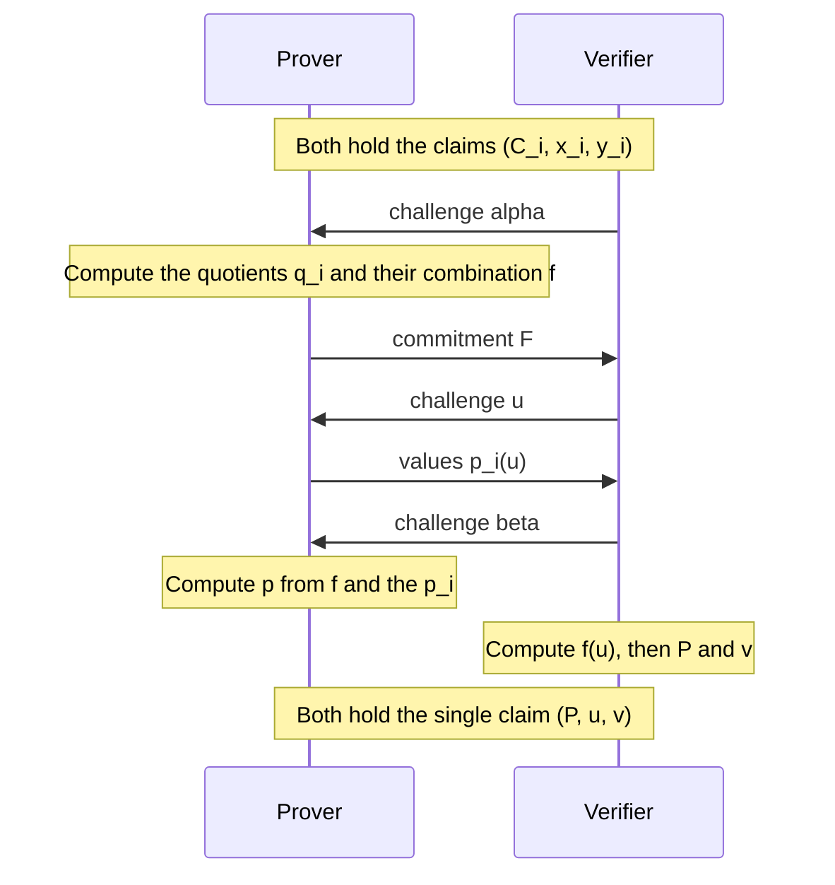

# Batched Openings

The [inner product argument](./inner-product-argument.md) proves one evaluation claim about one committed polynomial. A complete proof makes several such claims, about different polynomials at different points, and running the argument once per claim multiplies its cost. This chapter reduces any number of claims to a single claim, so that the argument runs only once.

The reduction has two stages. The first moves every claim to one fresh random point with the help of quotient polynomials, and the second combines the resulting claims at that point using a random linear combination. The Ragu Book calls these stages alpha batching and beta batching after their challenges, and the literature calls the whole technique a batched opening or a multi-opening.

## 1. Why a proof makes many claims

The [next chapter](./nark.md) assembles a complete proof, and [its final step in the Ragu Book](https://github.com/tachyon-zcash/ragu/blob/3219e0865e8bff1f9d817bfe3850d9e94b64338c/book/src/protocol/core/nark.md?plain=1#L238-L247) lists the claims that the verifier needs checked. We will meet these polynomials properly in that chapter. For now, the shape of the list is what matters:

$$\underbrace{a(0) = 1,\quad a(xz) = \cdots}_{\text{two claims about } a}, \qquad b(x) = \cdots, \qquad s(x, y) = \cdots, \qquad \underbrace{k(0) = 1,\quad k(y) = c}_{\text{two claims about } k}.$$

That makes six claims about four polynomials at the four points $0$, $xz$, $x$ and $y$. Later chapters add more, because a recursive step also has to handle the claims it inherits from earlier proofs. Each separate opening carries $2k$ group elements for a polynomial with $n = 2^k$ coefficients, and it costs the verifier a linear amount of curve work:

<!-- worked:cost -->

Take $n = 2^{13}$ with 32-byte values, and the six claims above. Six separate arguments carry $6 \times 26 = 156$ group elements, or $4,992$ bytes. One batched argument carries $26$ group elements, plus the extra commitment and the $4$ scalars that this chapter introduces, for $992$ bytes. Both counts leave out the small constant number of extra values that each argument carries.

<!-- /worked:cost -->

We write one claim as a triple $(C_i, x_i, y_i)$, which says that the polynomial $p_i$ behind the commitment $C_i$ satisfies $p_i(x_i) = y_i$. Both parties hold the triples, and only the prover holds the polynomials. The goal is a short exchange after which both parties hold a single triple $(P, u, v)$, with the property that a false input claim leads to a false output claim, except with negligible probability.

The name $P$ needs a warning, because it has a different meaning in the [commitments chapter](./polynomial-commitments.md#_9-combining-the-commitment-and-the-claim). There, $P = C + y \cdot U$ was the statement point of an opening. In this chapter $P$ is a plain commitment to a polynomial $p$, which is the Ragu Book's usage, so the statement point for the output claim would be $P + v \cdot U$.

## 2. Combining claims at different points

The [random linear combinations](./statements-and-challenges.md#_7-random-linear-combinations) from chapter 03 already solve the problem when all the claims use one point. If $p_0(x) = y_0$ and $p_1(x) = y_1$, the verifier picks $r$ and asks about $p_0 + r p_1$ at $x$. It can compute the commitment $C_0 + r C_1$ and the expected value $y_0 + r y_1$ alone, because [commitments and evaluations combine with the same coefficients](./polynomial-commitments.md#evaluations-of-linear-combinations).

The method stops working when the points differ, because a combination of polynomials has no single point at which the combined claim makes sense:

<!-- worked:mismatch -->

Suppose the prover claims $p_0(9) = 37$ and $p_1(5) = 20$, with the polynomials $p_0 = 7 + 2X + 5X^2 + 3X^3$ and $p_1 = 3 + X + 8X^2 + 4X^3$. Take $r = 6$. The combination $p_0 + 6 p_1$ has the value $36$ at $9$ and the value $35$ at $5$, while the combined claim is $37 + 6 \cdot 20 = 28$. The claimed number matches neither value, even though both claims are true, because the value at $9$ needs $p_1(9) = 7$ and nobody has said anything about that.

<!-- /worked:mismatch -->

We therefore need some way to convert a claim at $x_i$ into a claim at a point shared by all the others. Since the verifier's challenge can supply such a point, we look for a way to restate $p(x) = y$ as a fact that holds everywhere, so that it can be tested anywhere.

## 3. Writing a claim as a division

The statement $p(x) = y$ says that the polynomial $p(X) - y$ has a root at $x$. Chapter 03 showed that [each root gives a linear factor](./statements-and-challenges.md#each-root-gives-a-linear-factor), so the claim holds exactly when there is a polynomial $q$ with

$$p(X) - y = (X - x)\, q(X).$$

We call $q$ the **quotient** of the claim. To see how the prover computes it, and why a false claim has no quotient, write out the case $n = 4$. Then $p$ has coefficients $a_0, \ldots, a_3$, the quotient has degree 2, and we can write $q(X) = b_0 + b_1 X + b_2 X^2$. Multiplying out the right side gives

$$
\begin{aligned}
(X - x)(b_0 + b_1 X + b_2 X^2) &= b_0 X + b_1 X^2 + b_2 X^3 - x b_0 - x b_1 X - x b_2 X^2 \\
&= -x b_0 + (b_0 - x b_1) X + (b_1 - x b_2) X^2 + b_2 X^3.
\end{aligned}
$$

Matching each power of $X$ against $p(X) - y = (a_0 - y) + a_1 X + a_2 X^2 + a_3 X^3$ produces four equations:

$$
\begin{aligned}
b_2 &= a_3, \\
b_1 - x b_2 &= a_2, \\
b_0 - x b_1 &= a_1, \\
-x b_0 &= a_0 - y.
\end{aligned}
$$

The first three equations determine the quotient from the top coefficient down, and $y$ plays no part in them. Solving them gives $b_2 = a_3$, then $b_1 = a_2 + x a_3$, then $b_0 = a_1 + x a_2 + x^2 a_3$. Only the last equation mentions $y$, and rearranging it gives

$$y = a_0 + x b_0 = a_0 + a_1 x + a_2 x^2 + a_3 x^3 = p(x).$$

So the system has a solution exactly when the claim is true. This procedure is called synthetic division, and the same pattern works for any $n$.

<!-- worked:division -->

Take $p(X) = 7 + 2X + 5X^2 + 3X^3$ and $x = 9$, so $a_3, a_2, a_1, a_0 = 3, 5, 2, 7$.

| Line | Formula | Value modulo 43 |
| --- | --- | --- |
| $b_2$ | $a_3$ | $3$ |
| $b_1$ | $a_2 + x b_2 = 5 + 9 \cdot 3$ | $32$ |
| $b_0$ | $a_1 + x b_1 = 2 + 9 \cdot 32$ | $32$ |
| $y$ | $a_0 + x b_0 = 7 + 9 \cdot 32$ | $37$ |

The quotient is $q(X) = 32 + 32X + 3X^2$, and the last line recovers $y = 37$, the value of $p(9)$ from the [commitments chapter](./polynomial-commitments.md#_8-writing-an-evaluation-as-an-inner-product). Multiplying out $(X - 9)(32 + 32X + 3X^2)$ returns $13 + 2X + 5X^2 + 3X^3$, which equals $p(X) - 37$ with coefficients reduced modulo 43.

<!-- /worked:division -->

Here is what the same computation does when the claimed value is wrong:

<!-- worked:false-division -->

Suppose the prover claims $p(9) = 38$ instead. The first three lines of the table do not involve $y$, so they produce the same $q(X)$. The last line still computes $37$, which contradicts the claim. Expanding shows the same mismatch, since $(X - 9) q(X) = p(X) - 37$ while the claim needs $p(X) - 38$. No polynomial can repair this, because at $X = 9$ the product $(X - 9) q(X)$ is zero for every $q$, whereas $p(9) - 38 = 42$.

<!-- /worked:false-division -->

A false claim therefore has no quotient polynomial. The fraction $(p(X) - y)/(X - x)$ still exists as a rational function, with a pole at $x$ that no polynomial can reproduce, and the protocol below relies on that difference.

## 4. Moving one claim to a new point

The equation $p(X) - y = (X - x)\,q(X)$ is an identity between polynomials, so it holds at every point. For any $u \neq x$, dividing by the nonzero number $u - x$ gives

$$q(u) = \frac{p(u) - y}{u - x}.$$

This relation gives us a test at a point unrelated to $x$. The prover commits to $q$ first, which fixes it. The verifier then picks a random $u$, the prover sends the value $p(u)$, and the verifier computes what $q(u)$ has to be from the formula. What remains are two claims at the point $u$. The original commitment must open to the sent value, and the quotient's commitment must open to the computed value. The point $x$ appears only in the verifier's arithmetic and in no remaining opening.

<!-- worked:one-claim -->

Take a second polynomial $p_1(X) = 3 + X + 8X^2 + 4X^3$, with the commitment $C_1 = (6,\,23)$ and the claim $p_1(5) = 20$. Division gives $q_1(X) = 12 + 28X + 4X^2$.

| Step | Party | Value or check |
| --- | --- | --- |
| 1 | Prover commits to the quotient | $Q_1 = (17,\,24)$ |
| 2 | Verifier sends a challenge | $u = 17$ |
| 3 | Prover sends the value of $p_1$ at $u$ | $p_1(17) = 11$ |
| 4 | Verifier derives the value of $q_1$ at $u$ | $(11 - 20) / (17 - 5) = 10$ |

The commitment $C_1$ must now open to $11$ at $17$, and $Q_1$ must open to $10$ at $17$. Evaluating the quotient directly confirms that $q_1(17) = 10$.

<!-- /worked:one-claim -->

For one claim this looks like a step backward, because it replaced one opening with two. The gain appears with several claims, since every claim can use the same $u$, and the same-point method of Section 2 then applies to all of them.

The test also has the behaviour we want for a false claim. If $p(x) \neq y$, whatever polynomial $q'$ the prover commits to differs from the rational function, so the formula gives the wrong value at most values of $u$. To count the exceptions, multiply through by $u - x$. The formula matches only where $(X - x) q'(X) - (p(X) - y)$ vanishes, and this polynomial is nonzero because a false claim has no quotient. Its degree is at most $n$, since the commitment limits $q'$ to degree $n - 1$, so [it has at most $n$ roots](./statements-and-challenges.md#a-polynomial-of-degree-d-has-at-most-d-roots) and the prover has at most an $n / |\F|$ chance of passing.

## 5. Alpha batching

With $m$ claims, a separate commitment to each quotient would add $m$ curve points to the proof. Commitments add in the same way as polynomials, so the prover can send one commitment to a combination of the quotients. Our running example has three polynomials with one claim each:

<!-- worked:claims -->

| Claim $i$ | Polynomial $p_i(X)$ | Point $x_i$ | Value $y_i$ | Commitment $C_i$ | Quotient $q_i(X)$ |
| --- | --- | --- | --- | --- | --- |
| 0 | $7 + 2X + 5X^2 + 3X^3$ | 9 | 37 | $(27,\,30)$ | $32 + 32X + 3X^2$ |
| 1 | $3 + X + 8X^2 + 4X^3$ | 5 | 20 | $(6,\,23)$ | $12 + 28X + 4X^2$ |
| 2 | $2 + 9X + 4X^2 + 6X^3$ | 2 | 41 | $(17,\,24)$ | $41 + 16X + 6X^2$ |

<!-- /worked:claims -->

The combination cannot be a plain sum, because errors at a shared point can cancel. Two false claims at the same $x$ have remainders over the same denominator, and a cheater can choose those remainders to be opposite:

<!-- worked:plain-sum -->

The true values at $9$ are $p_0(9) = 37$ and $p_1(9) = 7$. A cheater claims $38$ and $6$, so both claims are false. The errors are opposite, so $p_0 + p_1 - (38 + 6)$ still has a root at $9$ and division by $X - 9$ leaves no remainder. The result is the genuine polynomial $42 + 33X + 7X^2$, which the cheater can commit to and open at any point.

<!-- /worked:plain-sum -->

Giving each quotient a different random weight prevents this, which is the same reasoning as for [powers of one challenge](./statements-and-challenges.md#powers-of-one-challenge). The verifier sends a challenge $\alpha$ after the claims are fixed, and the prover forms

$$f(X) = \sum_{i=0}^{m-1} \alpha^{m-1-i}\, q_i(X).$$

For three claims this is $f(X) = \alpha^2 q_0(X) + \alpha\, q_1(X) + q_2(X)$. The first claim takes the highest power, which is the order Ragu's code uses, and Section 7 compares it with the book's order. The weights rule out the cancellation above:

<!-- worked:alpha-count -->

With the weights $\alpha$ and $1$, the two errors from the previous example leave the remainder $\alpha \cdot 42 + 1$ over $X - 9$. Trying all 43 values of $\alpha$ finds that only $\alpha = 1$ removes it, and that value is the plain sum.

<!-- /worked:alpha-count -->

The prover now computes $f$ for the running example and commits to it. A quotient has degree $n - 2$, so $f$ fits within the generators, with a zero in the top position.

<!-- worked:alpha-f -->

Take $\alpha = 11$, so $\alpha^2 = 35$ modulo 43. Each column of the next table combines one power of $X$.

| Term | $X^0$ | $X^1$ | $X^2$ |
| --- | --- | --- | --- |
| $q_0(X)$ | 32 | 32 | 3 |
| $q_1(X)$ | 12 | 28 | 4 |
| $q_2(X)$ | 41 | 16 | 6 |
| $f(X) = 35\,q_0 + 11\,q_1 + q_2$ | 3 | 25 | 26 |

The prover commits to $f$ and sends the single point $F = (27,\,1)$.

<!-- /worked:alpha-f -->

The commitment $F$ fixes $f$ before the next challenge. The prover has not sent any of the individual quotients, and the verifier does not need them.

## 6. Moving every claim to u

The verifier now sends a random point $u$. Section 4 gave a formula for one quotient at $u$, and because $f$ is a combination of the quotients, the same weights carry over to its value. Substituting term by term gives

$$
\begin{aligned}
f(u) &= \sum_{i=0}^{m-1} \alpha^{m-1-i}\, q_i(u) \\
&= \sum_{i=0}^{m-1} \alpha^{m-1-i}\, \frac{p_i(u) - y_i}{u - x_i}.
\end{aligned}
$$

The right side uses only the values $p_i(u)$ together with numbers the verifier already holds, so the prover sends those values and the verifier computes $f(u)$ for itself. The formula divides by $u - x_i$, which would fail if $u$ landed on one of the original points. On a real curve this has negligible probability, and the [compression verifier](https://github.com/tachyon-zcash/ragu/blob/3219e0865e8bff1f9d817bfe3850d9e94b64338c/crates/ragu_pcd/src/compress/batch/verifier.rs#L70-L72) rejects if it happens.

<!-- worked:derive-fu -->

Take $u = 17$. The prover sends $p_0(17) = 14$, $p_1(17) = 11$ and $p_2(17) = 1$, and the verifier computes each term from those values and the original claims.

| $i$ | $p_i(u)$ | $u - x_i$ | $(p_i(u) - y_i) / (u - x_i)$ | Weight | Weighted term |
| --- | --- | --- | --- | --- | --- |
| 0 | 14 | 8 | 24 | 35 | 23 |
| 1 | 11 | 12 | 10 | 11 | 24 |
| 2 | 1 | 15 | 26 | 1 | 26 |

The last column sums to $f(17) = 30$ modulo 43. The prover, who holds $f$, gets the same number by direct substitution into $3 + 25X + 26X^2$. The verifier has obtained this value without seeing $f$.

<!-- /worked:derive-fu -->

The verifier now holds $m + 1$ claims that all use the point $u$. The commitment $F$ must open to the computed $f(u)$, and each $C_i$ must open to the sent $p_i(u)$. The obstacle from Section 2 has gone, because no remaining opening refers to the points $x_i$. The original claims have not disappeared, however, since each $y_i$ and $x_i$ now sits inside the formula for $f(u)$, and a false $y_i$ makes that number wrong.

## 7. Beta batching

Since all the claims now use one point, a random linear combination finishes the job. The verifier sends a challenge $\beta$ after the prover has sent its values, and the prover forms

$$p(X) = \beta^m f(X) + \sum_{i=0}^{m-1} \beta^{m-1-i}\, p_i(X).$$

For three claims this is $p(X) = \beta^3 f(X) + \beta^2 p_0(X) + \beta\, p_1(X) + p_2(X)$. The verifier cannot compute $p$, but linearity gives it everything else. The commitment comes from the [homomorphic property](./polynomial-commitments.md#_5-adding-commitments), and the value comes from substituting $u$ into the definition of $p$:

$$
\begin{aligned}
P &= \beta^m \cdot F + \sum_{i=0}^{m-1} \beta^{m-1-i} \cdot C_i, \\
v &= \beta^m f(u) + \sum_{i=0}^{m-1} \beta^{m-1-i}\, p_i(u).
\end{aligned}
$$

The output is the triple $(P, u, v)$, a claim of exactly the form the inner product argument proves.

<!-- worked:beta-p -->

Take $\beta = 23$, whose powers modulo 43 are $\beta^2 = 13$ and $\beta^3 = 41$.

| Input | Weight | Commitment | Value at $u$ | Coefficients |
| --- | --- | --- | --- | --- |
| $f$ | $41$ | $(27,\,1)$ | 30 | $(3, 25, 26, 0)$ |
| $p_0$ | $13$ | $(27,\,30)$ | 14 | $(7, 2, 5, 3)$ |
| $p_1$ | $23$ | $(6,\,23)$ | 11 | $(3, 1, 8, 4)$ |
| $p_2$ | $1$ | $(17,\,24)$ | 1 | $(2, 9, 4, 6)$ |
| Combined $p$ | | $P = (14,\,9)$ | $v = 32$ | $(27, 8, 29, 8)$ |

The verifier derives $P$ and $v$ from the first four rows, using only group operations and field arithmetic. The prover derives the coefficients of $p$. Committing to those coefficients gives $(14,\,9)$, and substituting $u = 17$ into $p$ gives $32$, so both agree with what the verifier computed.

<!-- /worked:beta-p -->

The polynomial $f$ needs a weight of its own, distinct from the weight of every $p_i$. If two inputs share a weight, an error in one can cancel an error in the other for every $\beta$. The book's formulas leave this point open, because they do not state where the index starts:

::: warning The Ragu Book and the code differ here
The [book](https://github.com/tachyon-zcash/ragu/blob/3219e0865e8bff1f9d817bfe3850d9e94b64338c/book/src/protocol/core/accumulation/pcs.md?plain=1#L42-L63) writes $f = \sum_i \alpha^i q_i$ and $p = f + \sum_i \beta^i p_i$ and does not state the range of $i$. The [compression verifier](https://github.com/tachyon-zcash/ragu/blob/3219e0865e8bff1f9d817bfe3850d9e94b64338c/crates/ragu_pcd/src/compress/batch/verifier.rs#L67-L92) at commit `3219e08` gives the first claim the highest power of $\alpha$, gives $f$ the highest power of $\beta$, and gives the last polynomial weight 1. This site follows the code. A different order of distinct weights only relabels the inputs, so the book's formula read with $\beta^i$ starting at $i = 1$ is equally good, and that is the form the [Halo 2 book](https://zcash.github.io/halo2/design/proving-system/multipoint-opening.html) uses for its final polynomial.

Reading the book's sum from $i = 0$ would not be safe, since $f$ and $p_0$ would then both have weight 1. We do not suggest the authors intend this reading, and the code's distinct weights do not have this collision. The collision comes from the $\beta$ sum alone, so the range of the $\alpha$ sum makes no difference to it. The toy curve shows why the index matters:

<!-- worked:collision -->

Keep the false claim $p_1(5) = 21$, and use the sum from $i = 0$ in both places, so that $f$ and $p_0$ both have weight 1 in $p$. The cheater commits to the honest $f = \sum_i \alpha^i q_i$, which at $\alpha = 11$ is $8 + 40X + 42X^2$. At $u = 17$ the derived value misses $f(17)$ by $26$. The cheater then sends $18$ for $p_0(17)$, a shift of $4$. The shift changes the derived value of $f(u)$ and the $p_0$ term of $v$, and the two changes add up to exactly that miss. No power of $\beta$ appears in this equation, so we checked that the forged message passes for all 43 values of $\beta$. The attack works at 39 of the 40 allowed values of $u$, for a total of $1677$ of the $1720$ pairs $(u, \beta)$. This forgery fails only at $u = 8$, where $1 + 1/(u - x_0) = 0$ modulo 43.

<!-- /worked:collision -->

:::

## 8. The complete protocol

The following diagram shows what the two stages do to the claims, and the sequence after it lists the messages.




The soundness of the protocol depends on the order of these messages, as Section 9 explains. Under [Fiat–Shamir](./statements-and-challenges.md#_8-removing-the-verifier-with-fiat–shamir), each challenge becomes a hash of a transcript that has absorbed everything before it, including the claims themselves. The worked examples here use chosen challenges so that the numbers stay readable.

Here is the whole run, gathered from the previous sections. For the last step, the prover reveals $p$, and the verifier checks it directly:

<!-- worked:run -->

| Step | Party | Value or check |
| --- | --- | --- |
| 0 | Both hold the claims | $((27,\,30),\,9,\,37)$, $((6,\,23),\,5,\,20)$, $((17,\,24),\,2,\,41)$ |
| 1 | Verifier sends a challenge | $\alpha = 11$ |
| 2 | Prover commits to $f$ | $F = (27,\,1)$ |
| 3 | Verifier sends a challenge | $u = 17$ |
| 4 | Prover sends the values at $u$ | $14,\ 11,\ 1$ |
| 5 | Verifier sends a challenge | $\beta = 23$ |
| 6 | Verifier derives $f(u)$ | $30$ |
| 7 | Verifier derives the output claim | $P = (14,\,9)$, $v = 32$ |
| 8 | Prover reveals $p$ | $(27, 8, 29, 8)$ |
| 9 | Verifier checks the commitment | $\dot{\v{p}}{\v{G}} = (14,\,9)$, which equals $P$ |
| 10 | Verifier checks the value | $p(17) = 32$, which equals $v$ |

<!-- /worked:run -->

Steps 8 to 10 are the expensive ones. The [Ragu Book's NARK](https://github.com/tachyon-zcash/ragu/blob/3219e0865e8bff1f9d817bfe3850d9e94b64338c/book/src/protocol/core/nark.md?plain=1#L242-L245) really does finish this way, with the prover sending $p$ in full, and the next chapter returns to that choice. A succinct proof replaces those three steps with one inner product argument for $(P, u, v)$, as [compression](https://github.com/tachyon-zcash/ragu/blob/3219e0865e8bff1f9d817bfe3850d9e94b64338c/crates/ragu_pcd/src/compress/batch/verifier.rs#L27-L35) does in the code.

## 9. Why cheating fails

The argument below relies on three assumptions. Commitments are binding under the [discrete log relation assumption](./polynomial-commitments.md#_4-why-a-prover-cannot-change-the-vector), the final opening is sound, and Fiat–Shamir challenges behave like uniform random values that nobody can predict before the preceding messages are fixed, which is the [random oracle assumption](./statements-and-challenges.md#the-assumption).

Take one false claim in the running example. We follow what a cheater can try at each stage, and we count its success on the toy field by trying every challenge.

### The cheater commits to the quotients and reports true values

A cheater who runs the honest division gets a perfectly good polynomial $f$, because division ignores $y$. The false value only shows up later, inside the verifier's formula.

<!-- worked:cheat-drop -->

The cheater claims $p_1(5) = 21$, whereas the true value is $20$. It computes the quotients by the division table, which ignores $y$, and commits to the same $f$, then reports true values at $u$. The false $y_1$ enters the verifier's formula, and at $u = 17$ the derived value is $4$ while $f(17) = 30$, a gap of $26$. We tried every pair of challenges, with 40 allowed values of $u$ and 43 of $\beta$. The gap is nonzero at all 40 values of $u$, and the only passing runs are the 40 that have $\beta = 0$.

<!-- /worked:cheat-drop -->

The gap is never zero here, because it equals a nonzero weight times a nonzero remainder, divided by $u - x_i$. The check at $\beta = 0$ passes only because $\beta^m$ then removes $f$ from $p$ altogether, and a random $\beta$ avoids that value except with probability $1 / |\F|$.

### The cheater lies about a value at u

To close the gap, the cheater can change a value that it sends at $u$. This moves the error from the formula for $f(u)$ into the term for $p_i(u)$, where $\beta$ catches it instead:

<!-- worked:cheat-lie -->

At $u = 17$ the cheater sends $12$ for $p_1(17)$ in place of the true $11$, a shift of $1$ chosen so that the derived value equals $f(17) = 30$. In effect it reports values of $p_1 + 1$, a polynomial that does satisfy the false claim, while its commitment still holds $p_1$. The output claim now carries that shift. With $\beta = 23$, the value $v$ and the true $p(17)$ differ by $\beta \cdot 1 = 23$, so the check fails. Of the 43 values of $\beta$, only $\beta = 0$ passes.

<!-- /worked:cheat-lie -->

The cheater can also spread its lies across all the values. Let $e_f$ be the error in the derived $f(u)$, and let $e_i$ be the error in the sent $p_i(u)$. The difference between $v$ and the true value of $p$ at $u$ is

$$\beta^m e_f + \sum_{i=0}^{m-1} \beta^{m-1-i}\, e_i,$$

which is a polynomial in $\beta$ of degree at most $m$. All of its coefficients are fixed before $\beta$ is chosen. If any of them is nonzero, at most $m$ values of $\beta$ make it vanish.

<!-- worked:cheat-best -->

Fix $f$ and $u = 17$ as above. The cheater can send any of $43^3 = 79507$ triples of values. Trying all of them against all 43 values of $\beta$ shows that no triple passes for more than $3$ values of $\beta$, which agrees with the fact that the error is a nonzero polynomial of degree at most 3 in $\beta$.

<!-- /worked:cheat-best -->

### The cheater commits to a different polynomial

The remaining option is to commit to something other than the quotients, chosen so that the formula holds with true values at as many points as possible. Suppose the claims use $d$ distinct points. Clearing denominators by multiplying through by the product of the $u - x_i$ for those points turns the requirement into a polynomial equation in $u$ of degree at most $n - 1 + d$. It is not identically zero as long as the combined fraction has a pole. The cheater therefore matches at most $n - 1 + d$ values of $u$. In our example only one claim is false, which leaves one pole, and the count is $n$:

<!-- worked:cheat-fit -->

The cheater can make the committed polynomial match the verifier's formula at a few values of $u$ by interpolation. Through the four points $u \in \{3, 11, 17, 30\}$ it gets $f'(X) = 20 + 20X + 32X^2 + 26X^3$, with commitment $(7,\,6)$. If the challenge lands on one of these four values, the cheater reports true values and passes for every $\beta$. If it lands anywhere else among the 40 allowed values, this polynomial does not match. We tried all $43^4 = 3,418,801$ polynomials of degree at most 3. None matches the formula at more than $4$ points, and exactly $91,390$ reach $4$, one for each choice of four points.

<!-- /worked:cheat-fit -->

The numbers on the toy field are large only because the field has 43 elements:

<!-- worked:cheat-total -->

Combining the counts bounds the best cheater on the toy curve. It wins on at most $4$ of the 40 values of $u$ outright and on at most $3$ of the 43 values of $\beta$ at each of the other $36$, which is at most $280$ of the $1720$ pairs of challenges.

<!-- /worked:cheat-total -->

### The cheater hopes for a cancelling alpha

Section 5 showed that false claims at a shared point can cancel for one particular $\alpha$. If they do, the combined fraction has no pole, and the cheater holds a genuine $f$ that passes everything afterwards. With $m$ claims, the leftover remainder at a point is a nonzero polynomial in $\alpha$ of degree at most $m - 1$, so at most $m - 1$ values of $\alpha$ remove it.

Adding the three stages gives a bound of $\big((m - 1) + (n - 1 + d) + \ell\big) / |\F|$, where $\ell$ is the number of polynomials. The running example has $\ell = m$, and Section 10 covers claims that share a polynomial, for which $\ell$ is smaller.

<!-- worked:real-bound -->

For $n = 2^{13}$, with the six claims, four points and four polynomials from Section 1, the three bounds add up to $(5 + 8195 + 4) / |\F| = 8204 / |\F|$. For a field of about $2^{254}$ elements, as with the Pasta curves, this is below $2^{-240}$. The fuse step draws $\beta$ from a 143-bit endoscalar, as Section 13 notes, and with that range the $\beta$ term alone is about $4 / 2^{143} = 2^{-141}$ and dominates the sum.

<!-- /worked:real-bound -->

Fiat–Shamir lets a cheater retry privately, so as [chapter 03 explains](./statements-and-challenges.md#_10-repeated-trials), the chance grows with the number of attempts. We make no claim about Ragu's overall security level here.

### Each challenge has to come after the message it tests

All of these counts assume the cheater does not know a challenge when it sends the message that the challenge tests. The protocol fails if any challenge arrives early:

<!-- worked:early-alpha -->

Suppose the cheater learns $\alpha = 11$ before it makes its two claims at the point $9$. It claims $p_0(9) = 38$ and $p_1(9) = 39$, whose errors $42$ and $11$ satisfy $11 \cdot 42 + 11 = 0$ modulo 43. Both claims are false, yet $\alpha(p_0 - 38) + (p_1 - 39)$ is divisible by $X - 9$, which gives the genuine polynomial $f = 18 + 9X + 37X^2$. This cheater passes for all 42 values of $u$ and all 43 values of $\beta$, a total of $1806$ of $1806$ runs.

<!-- /worked:early-alpha -->

<!-- worked:early-u -->

Suppose the cheater learns $u = 17$ before it commits. The interpolated polynomial $f'$ from earlier in this section matches the formula at that point, so the cheater commits to it, reports true values, and passes for all 43 values of $\beta$.

<!-- /worked:early-u -->

<!-- worked:early-beta -->

Suppose the cheater learns $\beta = 23$ before sending the values at $u = 17$. It sends $38$ for $p_1(17)$, with the shift $27$ solved from the one linear equation that makes the total error vanish at this $\beta$. The check passes. Moving to $\beta = 24$ makes the same message fail.

<!-- /worked:early-beta -->

### Binding at the end

The check on $(P, u, v)$ means something only because $P$ can be opened in one way. Every polynomial above was fixed by its commitment, and a prover who knows a relation among the generators loses that restriction:

<!-- worked:forged-open -->

Using the known discrete logs of the toy generators, a prover can adjust entries 0 and 1 of $\v{p}$ to get $\v{p}' = (26, 41, 29, 8)$. This vector commits to the same $P = (14,\,9)$ and evaluates to $33$ at $u = 17$, not $32$. A prover with this ability could satisfy the final check for a wrong $v$, which is why the discrete log relation assumption is necessary.

<!-- /worked:forged-open -->

## 10. Claims that share a polynomial or a point

The running example gave each claim its own polynomial, while Section 1 listed two claims each about $a$ and $k$. The protocol needs only a small change for this. The prover's values at $u$ depend on the polynomial and not on the original point, so it sends one value per polynomial, and each claim about that polynomial reuses the value. As a result the formula for $f(u)$ still has one term per claim, whereas $p$ has one term per polynomial. Writing $\ell$ for the number of polynomials and $j_i$ for the polynomial that claim $i$ refers to, the formulas become

$$
\begin{aligned}
f(u) &= \sum_{i=0}^{m-1} \alpha^{m-1-i}\, \frac{p_{j_i}(u) - y_i}{u - x_i}, \\
p(X) &= \beta^\ell f(X) + \sum_{j=0}^{\ell-1} \beta^{\ell-1-j}\, p_j(X).
\end{aligned}
$$

This explains the proof-size count in Section 1, since six claims need only four values.

<!-- worked:shared -->

Add a fourth claim, $p_0(2) = 12$. This claim reuses $p_0$ and also shares the point $2$ with claim 2. The quotient polynomial gains one term, $f(X) = \alpha^3 q_0 + \alpha^2 q_1 + \alpha q_2 + q_3$ with $q_3 = 24 + 11X + 3X^2$, and becomes $f(X) = 14 + 28X + 31X^2$ with commitment $F = (16,\,10)$ at $\alpha = 11$. The prover still sends only the three values $14, 11, 1$, because both claims about $p_0$ use the same number $14$ when the verifier derives $f(17) = 32$. The output at $\beta = 23$ is $P = (8,\,22)$ and $v = 28$, and opening $p = 5 + 2X + 19X^2 + 8X^3$ confirms both.

<!-- /worked:shared -->

Two claims may also share a point, as claims 2 and 3 do here. The verifier then needs only one inverse of $u - x_i$, and the $\alpha$ weights keep the claims apart as Section 5 showed. Two claims about the same polynomial at the same point with different values cannot both be true, and [the code](https://github.com/tachyon-zcash/ragu/blob/3219e0865e8bff1f9d817bfe3850d9e94b64338c/crates/ragu_pcd/src/compress/batch/mod.rs#L49-L64) rejects such a list before batching.

::: warning The Ragu Book and the code differ here
The [book](https://github.com/tachyon-zcash/ragu/blob/3219e0865e8bff1f9d817bfe3850d9e94b64338c/book/src/protocol/core/accumulation/pcs.md?plain=1#L51-L63) notes that only one evaluation per polynomial is needed, but its formulas for $p$ and $v$ still index $\beta^i p_i$ by claim. The [prover](https://github.com/tachyon-zcash/ragu/blob/3219e0865e8bff1f9d817bfe3850d9e94b64338c/crates/ragu_pcd/src/compress/batch/prover.rs#L54-L60) at commit `3219e08` loops over polynomials, so each polynomial appears once in $p$. This site follows the code.
:::

## 11. Blinding factors

The [book's protocol](https://github.com/tachyon-zcash/ragu/blob/3219e0865e8bff1f9d817bfe3850d9e94b64338c/book/src/protocol/core/accumulation/pcs.md?plain=1#L45-L58) uses hiding commitments, written $\bar{C}_i$ and $\bar{F}$ with blinding factors $\gamma_i$ and $\gamma_f$. Blinding factors combine with the same weights as the polynomials, [as chapter 06 showed](./polynomial-commitments.md#_6-hiding-the-vector), so the prover sets $\gamma = \beta^m \gamma_f + \sum_i \beta^{m-1-i} \gamma_i$, and the verifier's formula for the commitment does not change in form.

<!-- worked:blinding -->

Take blinding factors $\gamma_0, \gamma_1, \gamma_2 = 17, 29, 11$ and $\gamma_f = 5$. The blinded commitments are $\bar{C}_0 = (5,\,29)$, $\bar{C}_1 = (8,\,9)$, $\bar{C}_2 = (9,\,9)$ and $\bar{F} = (26,\,23)$. The verifier combines them into $\bar{P} = (24,\,1)$. The prover computes $\gamma = 41 \cdot 5 + 13 \cdot 17 + 23 \cdot 29 + 11 = 29$ modulo 43, and $\dot{\v{p}}{\v{G}} + 29 \cdot H = (24,\,1)$, the same point.

<!-- /worked:blinding -->

The warning in [chapter 06](./polynomial-commitments.md#_6-hiding-the-vector) applies here as well. At commit `3219e08` the [IPA code](https://github.com/tachyon-zcash/ragu/blob/3219e0865e8bff1f9d817bfe3850d9e94b64338c/crates/ragu_pcd/src/ipa/mod.rs#L1-L16) omits this term, and the [fuse step commits to $f$](https://github.com/tachyon-zcash/ragu/blob/3219e0865e8bff1f9d817bfe3850d9e94b64338c/crates/ragu_pcd/src/fuse/_08_f.rs#L241-L242) with no blinding factor.

## 12. Relation to SHPLONK and Halo 2

The Ragu Book [credits](https://github.com/tachyon-zcash/ragu/blob/3219e0865e8bff1f9d817bfe3850d9e94b64338c/book/src/protocol/index.md?plain=1#L18-L20) this technique to [SHPLONK](https://eprint.iacr.org/2020/081), by Boneh, Drake, Fisch and Gabizon. That paper works with KZG commitments and treats polynomials opened at sets of points. In its second scheme, the prover commits to

$$h(X) = \sum_i \gamma^{i-1}\, \frac{f_i(X) - r_i(X)}{Z_{S_i}(X)},$$

where $Z_{S_i}$ vanishes on the point set of $f_i$, and $r_i$ interpolates the claimed values on that set. When each set holds one point, $r_i$ is the constant $y_i$ and $Z_{S_i}$ is $X - x_i$, so $h$ is our $f$ with the weights in a different order.

The two protocols then part ways. SHPLONK's verifier sends a random $z$, and instead of receiving values there it builds a commitment to a polynomial $L$ that must vanish at $z$. In the one-point case with distinct points, with $T$ the set of all points and $Z_T$ its vanishing polynomial, that polynomial is

$$L(X) = \sum_i \gamma^{i-1}\, \frac{Z_T(z)}{z - x_i}\, \big(f_i(X) - y_i\big) - Z_T(z)\, h(X).$$

Every coefficient here is a number the verifier can compute, so it can derive the commitment to $L$ from the input commitments and the commitment to $h$. Dividing the formula by $Z_T(z)$ and setting $X = z$ gives the same relation as Section 6, which shows that $L(z) = 0$ for honest polynomials. The paper finishes with one KZG opening of $L$ at $z$. We can run this form on our example, taking a Pedersen commitment to a constant $y$ as $y \cdot G_0$ and using $z = u$ with our $\alpha$ weights:

<!-- worked:shplonk -->

In our run $Z_T(u) = 21$, and the construction gives $L(X) = 11 + 26X + 16X^2 + 31X^3$. Substituting $u = 17$ gives $0$, and the combination of $C_i$, $y_i$ and $F$ gives the commitment $(25,\,2)$, which matches $L$ directly. The prover sent no values at $u$ for this check.

<!-- /worked:shplonk -->

Ragu instead has the prover send the values at $u$ and combines them under $\beta$. This matches the [multipoint opening in Halo 2](https://zcash.github.io/halo2/design/proving-system/multipoint-opening.html), which also forms a combination of quotients, evaluates it at a fresh challenge using the opened polynomials' values, and adds the result to those polynomials under one more challenge. Halo 2 first groups polynomials by their set of query points and interpolates over each set, whereas Ragu gives every claim its own term and needs no interpolation.

This comparison is our own reading of these sources, except that we could not retrieve the SHPLONK paper's text when checking this chapter, so the formulas for $h$ and $L$ above are unverified against it. Neither the Ragu Book nor the code explains why Ragu sends the values instead of using SHPLONK's $L$.

## 13. Batching in Ragu

The clearest place to see this protocol in the code is the compression path, whose [module comment](https://github.com/tachyon-zcash/ragu/blob/3219e0865e8bff1f9d817bfe3850d9e94b64338c/crates/ragu_pcd/src/compress/batch/mod.rs#L1-L13) describes the same steps. The [prover](https://github.com/tachyon-zcash/ragu/blob/3219e0865e8bff1f9d817bfe3850d9e94b64338c/crates/ragu_pcd/src/compress/batch/prover.rs#L35-L60) divides by $X - x_i$ without using the claimed value, as Section 3 predicted, then writes $F$, squeezes $u$, writes the values, and squeezes $\beta$. The verifier computes $f(u)$ and $v$ by Horner's rule, which is how the weights from Section 7 arise. This excerpt comes from [`compress/batch/verifier.rs`](https://github.com/tachyon-zcash/ragu/blob/3219e0865e8bff1f9d817bfe3850d9e94b64338c/crates/ragu_pcd/src/compress/batch/verifier.rs#L67-L81) at commit `3219e08`:

```rust
let mut f_at_u = C::Scalar::ZERO;
for claim in claims {
    let denominator = (u - claim.point)
        .invert()
        .ok_or_else(|| Error::InvalidWitness("u lands on a query point".into()))?;
    f_at_u = f_at_u * alpha + (batch.evaluations[claim.poly] - claim.value) * denominator;
}

let mut value = f_at_u;
for &evaluation in &batch.evaluations {
    value = value * beta + evaluation;
}
```

Each pass through the first loop multiplies everything so far by $\alpha$, so the first claim ends up with the highest power. The second loop starts from $f(u)$, which therefore gets the highest power of $\beta$. The index `claim.poly` is the $j_i$ of Section 10.

::: warning Reconstructed from code at commit 3219e08, not confirmed by the authors
The fuse step runs the same reduction with the same weights, spread across [`_08_f.rs`](https://github.com/tachyon-zcash/ragu/blob/3219e0865e8bff1f9d817bfe3850d9e94b64338c/crates/ragu_pcd/src/fuse/_08_f.rs#L1-L18), [`_09_eval.rs`](https://github.com/tachyon-zcash/ragu/blob/3219e0865e8bff1f9d817bfe3850d9e94b64338c/crates/ragu_pcd/src/fuse/_09_eval.rs#L1-L5) and [`_10_p.rs`](https://github.com/tachyon-zcash/ragu/blob/3219e0865e8bff1f9d817bfe3850d9e94b64338c/crates/ragu_pcd/src/fuse/_10_p.rs#L1-L12), with the verifier's arithmetic in the [`compute_v` circuit](https://github.com/tachyon-zcash/ragu/blob/3219e0865e8bff1f9d817bfe3850d9e94b64338c/crates/ragu_pcd/src/internal/native/circuits/compute_v.rs#L211-L241). It differs from the description above in two ways that later chapters cover. The values at $u$ go into a committed stage rather than being sent directly, which is the subject of [staging](./staging.md). The challenge $\beta$ is also [derived from a 143-bit endoscalar](https://github.com/tachyon-zcash/ragu/blob/3219e0865e8bff1f9d817bfe3850d9e94b64338c/crates/ragu_primitives/src/endoscalar.rs#L64-L67) rather than taken as a full field element, which is the subject of [endoscalars](./endoscalars.md).
:::

The chapter on [split accumulation](./split-accumulation.md) wraps this protocol so that the output triple becomes a running accumulator, and the chapter on [curve cycles](./curve-cycles.md) divides its arithmetic between two circuits. We stop before both, since each depends on recursion, which we have not reached.

## 14. Where this chapter leaves us

This chapter took the following steps:

1. A claim $p(x) = y$ holds exactly when $p(X) - y$ is divisible by $X - x$, so a true claim has a quotient polynomial and a false one does not.
2. The relation $q(u) = (p(u) - y)/(u - x)$ moves a claim from $x$ to a new point $u$, because the verifier can compute the quotient's value from the value of $p$.
3. Alpha batching commits to one combination $f$ of all the quotients, with random weights that stop errors at a shared point from cancelling.
4. The prover sends one value per polynomial at a random $u$, and the verifier derives $f(u)$ from those values and the original claims.
5. Beta batching combines $f$ and the polynomials at $u$ into one triple $(P, u, v)$, and every input needs a distinct weight.
6. A false claim survives only if a challenge lands on one of a small number of bad values, provided that each challenge comes after the message it tests.

Together with the [inner product argument](./inner-product-argument.md), this gives a single short opening for all of a proof's evaluation claims. The [next chapter](./nark.md) assembles the arithmetization, the polynomial encoding, the commitments and this batching into one complete proof.
