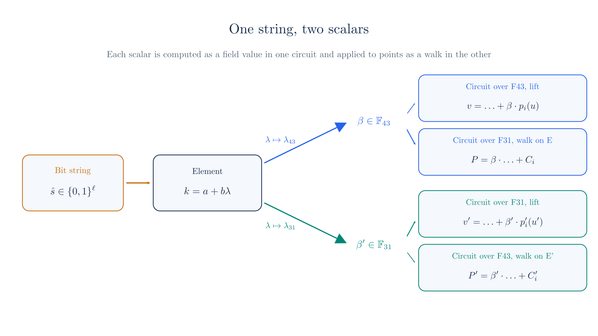

# Endoscalars

The [curve cycles chapter](./curve-cycles.md#_9-sharing-one-set-of-challenges) left a promise open. It split each fold between two circuits and let one transcript supply the challenges for both. In its toy run the challenges crossed between the circuits as small integers, and the secondary circuit used them in plain double-and-add. That chapter also noted that Ragu's code does something else, because in the code a short value maps to a scalar that is not the plain integer.

This chapter supplies that map. We start from a symmetry of the curves that makes one particular large scalar free to apply, and we build a way of reading a short bit string that uses this symmetry at every step. The same string then acts as one scalar in each field of the cycle, which is what lets a challenge cross. After that we count the gates, show why distinct strings stay distinct on Pasta and fail to on the toy curves, and rerun the fold from Chapter 13 with the real map.

::: warning Reconstructed from code at commit 3219e08, not confirmed by the authors
The radix-3 encoding, its cost and its injectivity argument come from the [Ragu Book](https://github.com/tachyon-zcash/ragu/blob/3219e0865e8bff1f9d817bfe3850d9e94b64338c/book/src/protocol/extensions/endoscalar.md?plain=1#L47-L102) and the [code](https://github.com/tachyon-zcash/ragu/blob/3219e0865e8bff1f9d817bfe3850d9e94b64338c/crates/ragu_primitives/src/endoscalar.rs#L844-L918), and our script reruns them. Sections 3, 10, 11 and 13 also describe how the code uses the encoding. These descriptions cover where the code gets its cube-root constants, which challenges stay full field elements, how the secondary side lifts the low bits of each challenge, how `bind_endoscalar` and the secondary `compute_v` tie the walk bits to `pre_beta`, and the code's point count behind the feedback factor. We reconstructed all of these from the code as well. The toy fold in Sections 10 and 11 is our own small assembly of that usage, and its width of 5 bits has no counterpart in Ragu.
:::

::: tip Terminology
An **endoscalar** is the bit string itself, which the book writes $\hat{s}$. Its length is 143 bits in Ragu. **Endoscaling** means multiplying a point by the string. **Lifting** means computing the scalar that the string stands for in a given field. We print bit strings with the first bit on the left, and the first bit is the least significant, as in the code. We keep the [names from Chapter 13](./curve-cycles.md#_4-the-pasta-cycle). The **primary** circuit has wires in $\F_p$, or $\F_{43}$ in the toy cycle, and the code calls it the native side. The **secondary** circuit has wires in $\F_q$, or $\F_{31}$ in the toy cycle, and the code calls it the nested side. We use primary and secondary in the prose and keep native and nested only for names that appear in the code.
:::

## 1. What the plain integer costs

A short integer does fit in both fields, so the plain approach of Chapter 13 can work in principle.

<!-- worked:fold-points -->

Its trouble is the price. In Ragu's code a fuse folds $93$ points of Pallas and $105$ points of Vesta with one challenge, counts that Section 13 derives. A Horner fold of $93$ points makes $92$ multiplications by the challenge, one for each point after the first, and the other fold makes $104$. A Ragu circuit holds only $2^{11}$ gates, and the double-and-add from the [recursive proofs chapter](./recursive-proofs.md#point-operations) spends about ten gates on every bit, so one multiplication by a challenge of 143 bits would fill most of a circuit.

<!-- /worked:fold-points -->

The way to reduce that price is to get several bits of scalar out of each point addition, and this needs a supply of multiples of the base point that cost nothing to compute. Curves of the form $y^2 = x^3 + b$ have such a supply. Using it gives up the plain integer, though, so we then have to check that the circuits still agree on what the string means.

## 2. The curve's endomorphism

The equation $y^2 = x^3 + b$ sees $x$ only through its cube. So if $\zeta$ is a cube root of 1 in the coordinate field, then replacing $x$ with $\zeta x$ leaves the equation unchanged, and the map

$$\phi(x, y) = (\zeta x, y)$$

sends points of the curve to points of the curve. A cube root other than 1 exists when the field size is 1 modulo 3, which holds for both toy fields and both Pasta fields.

<!-- worked:endo-map -->

The cube roots of 1 in $\F_{31}$ are $1$, $5$ and $25$, since $5^3 = 125 = 4 \cdot 31 + 1$ and $25 = 5^2$. We take $\zeta = 5$. The generator $G_0 = (1,\,2)$ maps to $\phi(G_0) = (5,\,2)$, and this image is on $E$, because $2^2 = 4$ and $5^3 + 3 = 128$, which equals $4$ modulo 31.

<!-- /worked:endo-map -->

To be useful for scalar multiplication, the map has to respect addition, meaning that $\phi(A) + \phi(B) = \phi(A + B)$ for any two points. Here is a check on one pair:

<!-- worked:endo-hom -->

Take $A = (27,\,30)$ and $B = (6,\,23)$ from [Chapter 8](./batched-openings.md#_8-the-complete-protocol). Their sum is $(5,\,29)$, which maps to $(25,\,29)$. Mapping first gives $\phi(A) = (11,\,30)$ and $\phi(B) = (30,\,23)$, and these add to $(25,\,29)$. We confirmed the identity on all $1,764$ ordered pairs of affine points of $E$.

<!-- /worked:endo-hom -->

The reason it holds in general is that scaling both $x$-coordinates by $\zeta$ divides the slope of the chord by $\zeta$, and the formulas for the sum then put the factor $\zeta$ back on the new $x$ and leave $y$ alone. The box carries out this algebra for addition and for doubling. A map from a group to itself that respects the operation is called an **endomorphism**.

::: details Why the map respects addition
For points with $x_1 \neq x_2$, the sum has slope $s = (y_2 - y_1) / (x_2 - x_1)$, with $x_3 = s^2 - x_1 - x_2$ and $y_3 = s (x_1 - x_3) - y_1$. Apply $\phi$ to both inputs. The new slope is

$$s' = \frac{y_2 - y_1}{\zeta x_2 - \zeta x_1} = \frac{s}{\zeta}.$$

Since $\zeta^3 = 1$, we have $1 / \zeta^2 = \zeta$, and the new $x$-coordinate is

$$s'^2 - \zeta x_1 - \zeta x_2 = \frac{s^2}{\zeta^2} - \zeta (x_1 + x_2) = \zeta (s^2 - x_1 - x_2) = \zeta x_3.$$

The new $y$-coordinate is

$$\frac{s}{\zeta} (\zeta x_1 - \zeta x_3) - y_1 = s (x_1 - x_3) - y_1 = y_3.$$

So $\phi(A) + \phi(B) = (\zeta x_3, y_3) = \phi(A + B)$. The tangent slope for doubling becomes $3 \zeta^2 x^2 / (2y) = s / \zeta$ too, because $\zeta^2 = 1 / \zeta$, and the same two lines then cover doubling.
:::

Because our curves have prime order, a map that respects addition can only act in one way, which is as multiplication by a fixed scalar. We can see this by asking, for several points $T$, which multiple of $T$ the image $\phi(T)$ is:

<!-- worked:endo-eigen -->

| Point $T$ | $\phi(T)$ | Multiple of $T$ that equals $\phi(T)$ |
| --- | --- | --- |
| $G_0 = (1,\,2)$ | $(5,\,2)$ | $6$ |
| $G_1 = (6,\,8)$ | $(30,\,8)$ | $6$ |
| $G_2 = (11,\,1)$ | $(24,\,1)$ | $6$ |
| $G_3 = (17,\,7)$ | $(23,\,7)$ | $6$ |

<!-- /worked:endo-eigen -->

In general, $\phi$ multiplies every point by one scalar $\lambda$, which we call its **eigenvalue**. (This $\lambda$ has nothing to do with the fold weight $\lambda$ of the [revdot chapter](./revdot-folding.md#_4-two-challenges-and-the-error-matrix).) Applying $\phi$ three times returns every point to itself, and $\phi$ is not the identity, so $\lambda$ is a cube root of 1 other than 1, which means

$$\lambda^2 + \lambda + 1 = 0.$$

::: details Why $\phi$ acts as one scalar, and why $\lambda^2 + \lambda + 1 = 0$
Every point is a multiple of one generator $T_0$, and $\phi(T_0)$ is some multiple $\lambda \cdot T_0$. For any other point $a \cdot T_0$, respecting addition gives

$$\phi(a \cdot T_0) = a \cdot \phi(T_0) = a \lambda \cdot T_0 = \lambda \cdot (a \cdot T_0).$$

Applying $\phi$ three times multiplies $x$ by $\zeta^3 = 1$, so $\lambda^3 = 1$ in the scalar field. Since $\phi$ is not the identity map, $\lambda \neq 1$, and dividing $\lambda^3 - 1 = (\lambda - 1)(\lambda^2 + \lambda + 1)$ by the first factor leaves $\lambda^2 + \lambda + 1 = 0$.
:::

<!-- worked:endo-eigen-check -->

Every row gives the same multiple, and the same holds for all 42 affine points. So on $E$ with $\zeta = 5$ we have $\lambda = 6$, and indeed $6^2 + 6 + 1 = 43 = 1 \cdot 43$.

<!-- /worked:endo-eigen-check -->

This gives us what Section 1 asked for, since a circuit can compute a large multiple of a point at almost no cost:

<!-- worked:endo-cost -->

Computing $6 \cdot G_0$ by the double-and-add of the [recursive proofs chapter](./recursive-proofs.md#point-operations) would take $21$ gates for a 3-bit scalar, while $\phi(G_0)$ takes no gates, because multiplying a wire by the constant $5$ is part of a linear combination. The contrast is sharper on Pasta, where $\lambda$ is a scalar of about 251 bits, and a multiplication by it would cost about $2,501$ gates with the same method.

<!-- /worked:endo-cost -->

Negation is free as well, because it only flips the sign of $y$. So from one point we get the six multiples $\pm 1$, $\pm \lambda$, $\pm \lambda^2$ with no gates beyond selecting among them.

## 3. One constant for each field

A combination of point additions that uses $\phi$, such as $a \cdot T + b \cdot \phi(T)$ for a point $T$ of $E$, acts on $T$ as some scalar in $\F_{43}$. The circuit that computes those additions is the secondary circuit, which works over $\F_{31}$ and never sees that scalar. The fold of Chapter 13 also needs the same scalar as a number, for the value side, and the primary circuit, over $\F_{43}$, computes that number. The primary circuit cannot see the point additions. It can only substitute a constant of its own field for $\lambda$, and the result is right only if its constant is the eigenvalue that $\phi$ actually has on $E$. Here is what happens when it is not:

<!-- worked:pairing-mismatch -->

Take the combination $3 \cdot G_0 + 2 \cdot \phi(G_0)$ on $E$, where $\phi$ uses $\zeta = 5$. The secondary circuit, over $\F_{31}$, computes it with point additions and gets $(11,\,30)$, which is $15 \cdot G_0$ because $\phi$ acts as multiplication by $6$. The primary circuit, over $\F_{43}$, has to produce the matching number $3 + 2\lambda$ from its own constant. With the constant $6$ it gets $3 + 2 \cdot 6 = 15$, which agrees. With the other cube root, $36$, it gets $3 + 2 \cdot 36 = 75$, which is $32$ modulo 43, and $32 \cdot G_0 = (14,\,9)$ is a different point. The number and the point would then describe different scalars.

<!-- /worked:pairing-mismatch -->

Each field has two cube roots other than 1, and the choice of $\zeta$ on the coordinates decides which root of the scalar field is the eigenvalue. Here are all the choices on the toy cycle:

<!-- worked:pairing -->

| Curve | Coordinate field | $\zeta$ | Scalar field | $\lambda$ |
| --- | --- | --- | --- | --- |
| $E$ | $\F_{31}$ | $5$ | $\F_{43}$ | $6$ |
| $E$ | $\F_{31}$ | $25$ | $\F_{43}$ | $36$ |
| $E'$ | $\F_{43}$ | $6$ | $\F_{31}$ | $5$ |
| $E'$ | $\F_{43}$ | $36$ | $\F_{31}$ | $25$ |

<!-- /worked:pairing -->

To read the table, notice that a field's constant has two jobs. It is the $\zeta$ that a circuit over that field applies to the coordinates of the curve whose points it adds, and it is the $\lambda$ that a circuit over that field substitutes when it computes the scalar of a combination on the partner curve. On a cycle both jobs fall on the same field, because the coordinate field of one curve is the scalar field of the other. Ragu therefore keeps [one constant per field](https://github.com/tachyon-zcash/ragu/blob/3219e0865e8bff1f9d817bfe3850d9e94b64338c/crates/ragu_primitives/src/endoscalar.rs#L32-L38), called `ZETA`, and uses it for both roles.

Write $c_{31}$ for the constant that $\F_{31}$ keeps and $c_{43}$ for the constant that $\F_{43}$ keeps. Sharing one constant per field is correct only if two equations hold:

- on $E$, whose coordinates lie in $\F_{31}$, the map with $\zeta = c_{31}$ must have eigenvalue $\lambda = c_{43}$;
- on $E'$, whose coordinates lie in $\F_{43}$, the map with $\zeta = c_{43}$ must have eigenvalue $\lambda = c_{31}$.

Being a cube root other than 1 [does not by itself decide this](https://github.com/tachyon-zcash/ragu/blob/3219e0865e8bff1f9d817bfe3850d9e94b64338c/book/src/protocol/extensions/endoscalar.md?plain=1#L104-L110), so we check the equations against the table.

<!-- worked:pairing-choice -->

Take the pair $c_{31} = 5$ and $c_{43} = 6$. In row 1, $\zeta = 5$ on $E$ gives $\lambda = 6$, which equals $c_{43}$, so the first equation holds. In row 3, $\zeta = 6$ on $E'$ gives $\lambda = 5$, which equals $c_{31}$, so the second holds too. The pair $c_{31} = 5$ and $c_{43} = 36$ fails the first equation, because row 1 still gives $\lambda = 6$ on $E$, and that disagreement is the mismatch of the example above. The squares, $c_{31} = 25$ and $c_{43} = 36$, form the other consistent pair, through rows 2 and 4.

<!-- /worked:pairing-choice -->

Once $c_{31}$ is fixed, the first equation leaves no freedom, because the row with $\zeta = c_{31}$ determines $\lambda$ on $E$ and therefore $c_{43}$. The second equation is then the real check, since it asks whether that forced $c_{43}$, used as $\zeta$ on $E'$, gives back $c_{31}$. This is why the Pasta test below changes only one constant. Keeping one constant and replacing the other with its square breaks an equation.

On Pasta, we tested the pair that the `pasta_curves` crate uses:

<!-- worked:pasta-pair -->

$$
\begin{aligned}
\zeta_p &= \texttt{0x12ccca834acdba712caad5dc57aab1b01d1f8bd237ad31491dad5ebdfdfe4ab9}, \\
\zeta_q &= \texttt{0x06819a58283e528e511db4d81cf70f5a0fed467d47c033af2aa9d2e050aa0e4f}.
\end{aligned}
$$

We multiplied the point $(-1,\,2)$ of Pallas by $\zeta_q$ and got $(-\zeta_p,\,2)$, and we multiplied the point $(-1,\,2)$ of Vesta by $\zeta_p$ and got $(-\zeta_q,\,2)$. Replacing $\zeta_p$ with its square while $\zeta_q$ stays the same makes the first test fail.

<!-- /worked:pasta-pair -->

Ragu does not take its constants from `pasta_curves`. It reads them from a dependency, `zakura-udon`, which computes them with a macro that we did not evaluate, so we have not confirmed whether Ragu uses this pair or the other consistent pair, made of the squares of these two. The squares pass our test as well, so either choice is consistent, and Ragu's own [consistency test](https://github.com/tachyon-zcash/ragu/blob/3219e0865e8bff1f9d817bfe3850d9e94b64338c/crates/ragu_primitives/src/endoscalar.rs#L1123-L1149) checks the pairing on both curves for whichever pair it has.

## 4. Elements with two images

We now need a way to talk about a combination such as $a \cdot T + b \cdot \phi(T)$ without saying which curve $T$ lies on. Treat $\lambda$ as a formal symbol that obeys $\lambda^2 = -1 - \lambda$, and work with pairs $a + b \lambda$ of integers. These form a ring called $\mathbb{Z}[\lambda]$, the Eisenstein integers. Products follow from the rule for $\lambda^2$:

$$(a + b\lambda)(c + d\lambda) = ac + (ad + bc)\lambda + bd\lambda^2 = (ac - bd) + (ad + bc - bd)\lambda.$$

An element of this ring acts on a point of either curve, and replacing the symbol with the curve's eigenvalue gives the same result as a scalar:

<!-- worked:ring-map -->

Take $3 + 2\lambda$. With $\lambda = 6$ it maps to $3 + 2 \cdot 6 = 15$ in $\F_{43}$, and with $\lambda = 5$ it maps to $3 + 2 \cdot 5 = 13$ in $\F_{31}$. Applied to $G_0$ on $E$, the element means $3 \cdot G_0 + 2 \cdot \phi(G_0) = (11,\,30)$, and $15 \cdot G_0$ is the same point. Applied to $G' = (32,\,3)$ on $E'$, it means $3 \cdot G' + 2 \cdot \phi(G') = (40,\,18)$, and $13 \cdot G'$ is the same point.

<!-- /worked:ring-map -->

The rest of the chapter builds on this fact. One element of $\mathbb{Z}[\lambda]$ has an image in each scalar field, and both images are computed by the same rule from the same pair of integers.

We also need to know when an element has image zero, since that decides when two different elements become the same scalar. The tool is the **norm**,

$$N(a + b\lambda) = a^2 - ab + b^2.$$

It equals the squared absolute value of $a + b\lambda$ when we read $\lambda$ as the complex number $e^{2\pi i/3}$, so it is never negative, it is zero only for the zero element, and the triangle inequality applies to its square root.

The norm controls zero images through one rule: an element can map to zero in $\F_q$ only if $q$ divides its norm. The box substitutes the zero image into the norm to show this. In particular, a nonzero element whose norm is below $q$ cannot map to zero:

::: details Why a zero image forces $q$ to divide the norm
Suppose $a + b\lambda$ maps to zero modulo a prime $q$, where $\lambda$ now stands for a root in $\F_q$. Then $a \equiv -b\lambda$, and substituting into the norm gives

$$N(a + b\lambda) \equiv b^2\lambda^2 + b^2\lambda + b^2 = b^2 (\lambda^2 + \lambda + 1) \equiv 0 \pmod q.$$
:::

<!-- worked:ring-zero -->

The element $5 - \lambda$ has norm $25 + 5 + 1 = 31$. With $\lambda = 5$ it maps to $0$ in $\F_{31}$, while in $\F_{43}$ it maps to $42$. The element $1 + 7\lambda$ has norm $1 - 7 + 49 = 43$, and it maps to $0$ in $\F_{43}$ and to $5$ in $\F_{31}$. We searched all coefficients from $-40$ to $40$. Each of the $210$ nonzero elements that map to $0$ in $\F_{31}$ has a norm divisible by 31, and each of the $152$ that map to $0$ in $\F_{43}$ has a norm divisible by 43.

<!-- /worked:ring-zero -->

## 5. Reading a string as an element

We want a rule that reads bits into an element, using only cheap multiples, with a large number of bits per point addition. We also want distinct strings to give distinct elements. If two strings gave one scalar, a cheater hoping that the challenge lands on a particular bad value would have two strings that reach it in place of one, and so twice the chance. Distinct elements of the ring are the first step towards distinct scalars, and Section 8 completes the argument.

Consider a running point that we repeatedly multiply by a radix $m$, adding one digit multiple of the base point at each stage. We call this sequence of steps a **walk**. The cleanest way to guarantee distinct elements is to make the walk decodable, so that we can read the string back from the element. We can do that by recognizing the last digit from the residue of the element modulo $m$, subtracting it, dividing by $m$, and repeating on what remains.

Residues of ring elements work coordinate by coordinate. We say that $a + b\lambda \equiv c + d\lambda \pmod 3$ when $3$ divides both $a - c$ and $b - d$. Each of $a$ and $b$ has three residues, so there are nine classes, which we label by the pair $(a \bmod 3,\ b \bmod 3)$. An element in the class $(0, 0)$ has both coefficients divisible by 3, so dividing it by 3 gives another element of the ring. That is why decoding works, because once we subtract a digit from the right class, the remainder lies in the class $(0, 0)$ and the division is exact.

For decoding it is enough that the digits lie in distinct classes, and we also leave the class $(0, 0)$ without a digit. Its natural digit would be $0$, and adding $0 \cdot T$ means adding the point at infinity, which has no coordinates and which the incomplete additions of Section 8 cannot handle. That section needs every digit $d$ to be nonzero. Eight digits also match three bits exactly. So a tripling walk uses eight nonzero digits, one for each nonzero class, and reads three bits for each tripling. The six free multiples fill six classes, and $\pm(1 - \lambda)$ fills the other two:

<!-- worked:digits -->

| $(s, e_1, e_2)$ | Digit | As $(a, b)$ | Modulo 3 | Norm |
| --- | --- | --- | --- | --- |
| $(0, 0, 0)$ | $1$ | $(1,\ 0)$ | $(1,\ 0)$ | $1$ |
| $(1, 0, 0)$ | $-1$ | $(-1,\ 0)$ | $(2,\ 0)$ | $1$ |
| $(0, 1, 0)$ | $\lambda$ | $(0,\ 1)$ | $(0,\ 1)$ | $1$ |
| $(1, 1, 0)$ | $-\lambda$ | $(0,\ -1)$ | $(0,\ 2)$ | $1$ |
| $(0, 0, 1)$ | $\lambda^2$ | $(-1,\ -1)$ | $(2,\ 2)$ | $1$ |
| $(1, 0, 1)$ | $-\lambda^2$ | $(1,\ 1)$ | $(1,\ 1)$ | $1$ |
| $(0, 1, 1)$ | $1 - \lambda$ | $(1,\ -1)$ | $(1,\ 2)$ | $3$ |
| $(1, 1, 1)$ | $-(1 - \lambda)$ | $(-1,\ 1)$ | $(2,\ 1)$ | $3$ |

<!-- /worked:digits -->

The last two rows are not free multiples, but Section 7 shows that they still cost little. Halo's original walk [uses doubling](https://github.com/tachyon-zcash/ragu/blob/3219e0865e8bff1f9d817bfe3850d9e94b64338c/book/src/protocol/extensions/endoscalar.md?plain=1#L49-L56), with the digits $\pm 1, \pm\lambda$, which gives two bits for each doubling. A doubling walk cannot add $\pm\lambda^2$ as a third pair, because two strings would then reach the same element, so tripling is what lets the walk use all six free multiples. The box explains this and gives a clash.

::: details Why a doubling walk cannot use $\pm\lambda^2$
The residue test above does not explain why a doubling walk is limited to four digits. That test is sufficient for decoding and not necessary. Modulo 2 there are only four classes, and Halo's own digits already share them in pairs, because $1 \equiv -1$ and $\lambda \equiv -\lambda$ modulo 2. Halo therefore has to tell the two members of a pair apart in some other way, much as an integer walk with digits $\pm 1$ in radix 2 can be decoded by looking modulo 4 in place of modulo 2. Once $\pm\lambda^2$ is added, no argument of this kind can work, because two strings then reach exactly the same element:

<!-- worked:radix2-clash -->

For instance, $2 \cdot 1 + \lambda$ and $2 \cdot (-\lambda^2) + (-\lambda)$ are both $2 + \lambda$, because $-\lambda^2 = 1 + \lambda$.

<!-- /worked:radix2-clash -->

:::

The layout in [`group_scale`](https://github.com/tachyon-zcash/ragu/blob/3219e0865e8bff1f9d817bfe3850d9e94b64338c/crates/ragu_primitives/src/endoscalar.rs#L478-L494) then reads as follows. Bits 0 and 1 are $(s_0, e_0)$, and each later group of three bits is one digit $(s, e_1, e_2)$ from the table. On a base point $T$, with $n$ digits, the walk sets the running point $A_i$ by

$$A_0 = 2 \cdot (-1)^{s_0} \phi^{e_0}(T), \qquad A_{i+1} = 3 \cdot A_i + d_i \cdot T.$$

Expanding the recurrence shows which element the string names:

$$k = 2 \cdot 3^{n} (-1)^{s_0} \lambda^{e_0} + \sum_{i=0}^{n-1} 3^{\,n-1-i} d_i.$$

A string of $n$ digits has $2 + 3n$ bits. Ragu uses $n = 47$, and $2 + 3 \cdot 47 = 143$ accounts for the width. The doubling at the start uses the two leftover bits, and Section 8 shows why it also matters that $A_0$ is more than a single unit.

Because each digit has its own residue, the element determines the string. Here is the decoding on a small case:

<!-- worked:decode-setup -->

Take the 11-bit string `01011100110`, which has three digits. Its first two bits say $s_0 = 0$ and $e_0 = 1$, its digits are $1 - \lambda$, $-1$ and $-\lambda$, and Horner gives $k = 6 + 44\lambda$. Starting from $k$ alone, we read the last digit from its residue modulo 3, subtract it, and divide by 3:

<!-- /worked:decode-setup -->

<!-- worked:decode -->

| Current value | Modulo 3 | Digit it must end in | After subtracting and dividing by 3 |
| --- | --- | --- | --- |
| $6 + 44\lambda$ | $(0,\ 2)$ | $-\lambda$ | $2 + 15\lambda$ |
| $2 + 15\lambda$ | $(2,\ 0)$ | $-1$ | $1 + 5\lambda$ |
| $1 + 5\lambda$ | $(1,\ 2)$ | $1 - \lambda$ | $2\lambda$ |

<!-- /worked:decode -->

<!-- worked:decode-end -->

In the first row, for instance, subtracting the digit gives $6 + 44\lambda - (-\lambda) = 6 + 45\lambda = 3(2 + 15\lambda)$, so the division by 3 is exact. The value that remains after the last row is $2\lambda$, which is $2 \cdot (\lambda)$, so the first two bits are $s_0 = 0$ and $e_0 = 1$. The string comes back in full.

<!-- /worked:decode-end -->

Every step of that decoding is forced, so two strings cannot name the same element of the ring:

<!-- worked:ring-injective -->

We enumerated every string for $n$ from 0 to 4, which at $n = 4$ means $16,384$ strings, and no two gave the same element of $\mathbb{Z}[\lambda]$.

<!-- /worked:ring-injective -->

## 6. One string, two scalars

Our toy endoscalar has one digit and therefore 5 bits. The [`lift` function](https://github.com/tachyon-zcash/ragu/blob/3219e0865e8bff1f9d817bfe3850d9e94b64338c/crates/ragu_primitives/src/endoscalar.rs#L987-L1012) computes the element's image in a chosen field, by running the Horner form of the formula above with that field's `ZETA`.

<!-- worked:lift-run -->

Take the string `11111`. Its first two bits are $s_0 = 1$ and $e_0 = 1$, so the initial unit is $-\lambda$. The remaining three bits are $(s, e_1, e_2) = (1, 1, 1)$, so the digit is $-(1 - \lambda)$. The element is

$$k = 2 \cdot 3 \cdot (-\lambda) - (1 - \lambda) = -6\lambda - 1 + \lambda = -1 - 5\lambda.$$

With $\lambda = 6$ this is $12$ in $\F_{43}$, and with $\lambda = 5$ it is $5$ in $\F_{31}$. As an integer, the string is $31$, and neither scalar has any simple relation to that number.

<!-- /worked:lift-run -->

A few more strings show that the two scalars vary independently of each other and of the integer:

<!-- worked:lift-table -->

| String | As an integer | Element | Scalar in $\F_{43}$ | Scalar in $\F_{31}$ |
| --- | --- | --- | --- | --- |
| `11000` | $3$ | $1 - 6\lambda$ | $8$ | $2$ |
| `11010` | $11$ | $-5\lambda$ | $13$ | $6$ |
| `10110` | $13$ | $-6 - \lambda$ | $31$ | $20$ |
| `00101` | $20$ | $7 + \lambda$ | $13$ | $12$ |
| `01011` | $26$ | $1 + 5\lambda$ | $31$ | $26$ |
| `11111` | $31$ | $-1 - 5\lambda$ | $12$ | $5$ |

<!-- /worked:lift-table -->

A circuit that needs the scalar as a field value computes the lift in gates, and this costs far less than a walk:

<!-- worked:lift-cost -->

Inside a circuit the lift is a Horner loop over the digits. Our traced version spends one gate on the product $s_0 e_0$ of the first two bits, and then two gates per digit, one for the product $e_1 e_2$ and one to apply the sign. For our 5-bit string that is $3$ gates. On Pasta, with 47 digits, it is $95$ gates, just under a fifth of the $480$ gates of one walk.

<!-- /worked:lift-cost -->

Endoscaling a point by this string means running the walk with $\phi$ and the digit multiples. It needs no knowledge of $\lambda$ or of the scalar field, because the circuit only computes with coordinates. The result is still the multiple that the lift predicts, on each curve:

<!-- worked:walk-two-curves -->

| Curve | Base point | $A_0$ | $3 \cdot A_0$ | Digit point | $A_1$ | Direct multiple that equals $A_1$ |
| --- | --- | --- | --- | --- | --- | --- |
| $E$ | $G_0 = (1,\,2)$ | $(18,\,21)$ | $(25,\,29)$ | $(26,\,8)$ | $(18,\,10)$ | $12$ |
| $E'$ | $G' = (32,\,3)$ | $(13,\,22)$ | $(32,\,3)$ | $(2,\,31)$ | $(20,\,3)$ | $5$ |

<!-- /worked:walk-two-curves -->

<!-- worked:walk-note -->

Both rows end at the multiple the lift predicts. On $E'$ the tripled point returns to $G'$ itself, because $A_0$ has index $-2\lambda$ and $3 \cdot (-2 \cdot 5) = -30$, which is $1$ modulo 31.

<!-- /worked:walk-note -->

This matches the book's [consistency property](https://github.com/tachyon-zcash/ragu/blob/3219e0865e8bff1f9d817bfe3850d9e94b64338c/book/src/protocol/extensions/endoscalar.md?plain=1#L42-L43), and we can now say why a challenge can cross the cycle. Look at the two uses of each scalar. The scalar $\beta$ in $\F_{43}$ scales polynomials over $\F_{43}$, whose commitments lie on $E$. The primary circuit, over $\F_{43}$, computes $\beta$ directly by lifting, and it uses the result to fold values. The secondary circuit, over $\F_{31}$, cannot hold $\beta$, but it does not need to, since it walks points of $E$ by the bits, and the walk acts as $\beta$. The other pair works the same way in the opposite direction:

The bits are all that the two circuits share, and a bit is 0 or 1 in any field. Neither circuit ever handles a number from the other's field.

The same equality holds at full size. We ran it with Ragu's own test value:

<!-- worked:pasta-run -->

The code's [consistency test](https://github.com/tachyon-zcash/ragu/blob/3219e0865e8bff1f9d817bfe3850d9e94b64338c/crates/ragu_primitives/src/endoscalar.rs#L1126-L1149) uses the endoscalar $206786806484900909362154774549736492353$. Our Python lift sends it to a scalar beginning `0x2d3c28380a8fb270...` in $\F_q$ and a scalar beginning `0x26ea1541fb5a78a6...` in $\F_p$. The walk on $(-1,\,2)$ on Pallas, in gates over $\F_p$, gives the same point as a direct multiplication by the first, and the walk on $(-1,\,2)$ on Vesta, in gates over $\F_q$, gives the same point as a direct multiplication by the second. Each walk took $480$ gates.

<!-- /worked:pasta-run -->

## 7. The walk in gates

Now we count, using the gates from the [recursive proofs chapter](./recursive-proofs.md#point-operations), where a gate is one multiplication and a division counts as one multiplication checked backwards. A digit step has two parts, which are picking the digit's point and computing $3 \cdot A + D$.

### Tripling and adding

Done naively, $3 \cdot A + D = ((A + D) + A) + A$ is three additions at three gates each, or nine gates. Two of those gates compute $y$-coordinates of intermediate points that are never kept, so we try to remove them. Each addition needs the $y$-coordinate of its input only to form its slope, and the slope of the next addition can be written in terms of the previous slope and the coordinates of $A$, so the intermediate $y$-coordinates drop out. The [code](https://github.com/tachyon-zcash/ragu/blob/3219e0865e8bff1f9d817bfe3850d9e94b64338c/crates/ragu_primitives/src/endoscalar.rs#L886-L905) ends up with seven gates, which the worked run at the end of this section lists one by one.

::: details Removing the intermediate $y$-coordinates
Write $A = (x, y)$. The first addition has slope $t_1$, with $x_1 = t_1^2 - x - x_D$ and $y_1 = t_1 (x - x_1) - y$. The second addition has slope

$$t_2 = \frac{y_1 - y}{x_1 - x} = \frac{t_1 (x - x_1) - 2y}{x_1 - x} = -t_1 - \frac{2y}{x_1 - x}.$$

So $y_1$ has disappeared, and the slope equation becomes $(t_1 + t_2)(x_1 - x) = -2y$. The third addition follows in the same way, and only its output needs a $y$-coordinate.
:::

### Picking the digit

Choosing among eight points would normally cost gates for each coordinate of each option, and the base point's coordinates are arbitrary wires. The code avoids this by first moving the point to a curve where its two coordinates are equal. The map $(x, y) \mapsto (c^2 x, c^3 y)$ takes $y^2 = x^3 + b$ to $y^2 = x^3 + c^6 b$, for any nonzero $c$. Choosing $c = x / y$ makes both new coordinates equal to $r = x^3 / y^2$, and the addition formulas never read $b$, so the walk can run on the new curve and move back at the end.

<!-- worked:normalize -->

For $G_0 = (1,\,2)$ on $E$, we get $c = 1/2 = 16$ and $r = c^2 x = 8$. The new curve has constant $c^6 \cdot 3 = 17$, and $(r, r) = (8,\,8)$ lies on it because $8^2 = 2$ and $8^3 + 17 = 2$ modulo 31.

<!-- /worked:normalize -->

On this curve the base point is $(r, r)$, so its free multiples are $(r, r)$, $(\zeta r, r)$ and $(\zeta^2 r, r)$. For the fourth digit we add $(r, r)$ and $-\phi(r, r) = (\zeta r, -r)$, and working through that addition shows that the result is also a constant multiple of $r$ plus a constant, namely $x = \zeta^2 (r - \tfrac{4}{3})$ and $y = (1 + 2\zeta)(r - \tfrac{8}{9})$. The details below carry out the algebra. So all four digits have coordinates that are affine in $r$:

::: details Computing the $1 - \lambda$ digit
To keep $s$ free for the sign bit, we call the slope of this addition $\sigma$. It is the constant $\sigma = -2r / (\zeta r - r) = -2 / (\zeta - 1)$. From $\zeta^2 + \zeta + 1 = 0$ we get $(\zeta - 1)^2 = \zeta^2 - 2\zeta + 1 = -3\zeta$, and $(\zeta - 1)(\zeta^2 - 1) = \zeta^3 - \zeta^2 - \zeta + 1 = 3$, so $1 / (\zeta - 1) = (\zeta^2 - 1) / 3$ and $\sigma = -\tfrac{2}{3}(\zeta^2 - 1)$. The $x$-coordinate is then

$$x = \sigma^2 - r - \zeta r = \frac{4}{-3\zeta} + \zeta^2 r = \zeta^2 \Big(r - \frac{4}{3}\Big),$$

where the middle step uses $-1 - \zeta = \zeta^2$, and the last uses $1/\zeta = \zeta^2$. The $y$-coordinate is $\sigma (r - x) - r$. First we write $r - x = r - \zeta^2 r + \tfrac{4}{3}\zeta^2 = -(\zeta^2 - 1) r + \tfrac{4}{3}\zeta^2$, and multiply by $\sigma$:

$$\sigma (r - x) = \frac{2}{3}(\zeta^2 - 1)^2 r - \frac{8}{9}(\zeta^2 - 1)\zeta^2.$$

Both brackets simplify with $\zeta^3 = 1$, which gives $\zeta^4 = \zeta$, and with $1 + \zeta = -\zeta^2$:

$$(\zeta^2 - 1)^2 = \zeta^4 - 2\zeta^2 + 1 = \zeta + 1 - 2\zeta^2 = -3\zeta^2, \qquad (\zeta^2 - 1)\zeta^2 = \zeta^4 - \zeta^2 = \zeta - \zeta^2.$$

So $\sigma (r - x) = -2\zeta^2 r - \tfrac{8}{9}(\zeta - \zeta^2)$, and subtracting $r$ gives

$$y = -2\zeta^2 r - r - \frac{8}{9}(\zeta - \zeta^2) = (1 + 2\zeta)\Big(r - \frac{8}{9}\Big),$$

where the last step uses $-2\zeta^2 - 1 = 2 + 2\zeta - 1 = 1 + 2\zeta$ and $\zeta - \zeta^2 = \zeta + 1 + \zeta = 1 + 2\zeta$.
:::

<!-- worked:digit-coords -->

| $(e_1, e_2)$ | Digit | $x$ | $y$ | At $r = 8$ |
| --- | --- | --- | --- | --- |
| $(0, 0)$ | $1$ | $r$ | $r$ | $(8,\,8)$ |
| $(1, 0)$ | $\lambda$ | $\zeta r$ | $r$ | $(9,\,8)$ |
| $(0, 1)$ | $\lambda^2$ | $\zeta^2 r$ | $r$ | $(14,\,8)$ |
| $(1, 1)$ | $1 - \lambda$ | $\zeta^2 (r - 4/3)$ | $(1 + 2\zeta)(r - 8/9)$ | $(22,\,30)$ |

<!-- /worked:digit-coords -->

Each coordinate in the table is $r$ times a constant, plus a constant, and only the constants depend on the bits. If the circuit can turn the bits into the right constants with additions alone, then a selection needs only one product with $r$ per coordinate. Let $s$ be the digit's sign bit from the table in Section 5, which negates $y$.

Interpolating the table row by row gives such a formula. The first three rows differ only in the multiplier of $r$, so they need no products at all. The last row needs a correction that must switch on only when $e_1 = e_2 = 1$, so the circuit multiplies it by the bit product $\pi = e_1 e_2$, and the sign of that correction brings in a second bit product, $\pi_s = e_1 e_2 s$. With $\pi$ and $\pi_s$ as wires, this form costs four gates per digit, one for each bit product and one for each product with $r$. The first box below builds it.

::: details Building the selector by interpolation
Start with $x$. The row $(0, 0)$ has $x = r$, which is the base. Moving to the row $(1, 0)$ changes the multiplier of $r$ from $1$ to $\zeta$, so we add $(\zeta - 1) e_1 r$. Moving to $(0, 1)$ changes it from $1$ to $\zeta^2$, so we add $(\zeta^2 - 1) e_2 r$. These two terms reproduce the first three rows. In the row $(1, 1)$ both are switched on, and together with the base they give $r(1 + \zeta - 1 + \zeta^2 - 1) = (\zeta + \zeta^2 - 1) r = -2r$, using $\zeta + \zeta^2 = -1$. The table asks for $\zeta^2 r - \tfrac{4}{3}\zeta^2$ in that row, so the last row needs the correction

$$\zeta^2 r - \tfrac{4}{3}\zeta^2 - (-2r) = (\zeta^2 + 2) r - \tfrac{4}{3}\zeta^2 = (1 - \zeta) r - \tfrac{4}{3}\zeta^2,$$

where the last step uses $\zeta^2 = -1 - \zeta$. The correction must appear only when $e_1 = e_2 = 1$, so we multiply it by the bit product $\pi = e_1 e_2$, which is 1 in that row and 0 in the others.

Now $y$. In the first three rows $y$ is $r$ with the digit's sign, so the base is $(1 - 2s) r$. The last row asks for $(1 - 2s)(1 + 2\zeta)(r - \tfrac{8}{9})$, and subtracting the base leaves the correction

$$(1 - 2s)\Big((1 + 2\zeta) r - \tfrac{8}{9}(1 + 2\zeta) - r\Big) = (1 - 2s)\Big(2\zeta r - \tfrac{8}{9}(1 + 2\zeta)\Big).$$

This correction must also appear only in the last row, so it is multiplied by $\pi$ as well. The factor $\pi (1 - 2s)$ equals $\pi - 2\pi_s$, where $\pi_s = e_1 e_2 s$ is a second bit product. Collecting the terms gives

$$
\begin{aligned}
x_D &= r \big(1 + (\zeta - 1) e_1 + (\zeta^2 - 1) e_2 + (1 - \zeta) \pi\big) - \tfrac{4}{3} \zeta^2 \pi, \\
y_D &= r \big((1 - 2s) + 2\zeta (\pi - 2\pi_s)\big) - \tfrac{8}{9} (1 + 2\zeta)(\pi - 2\pi_s).
\end{aligned}
$$

Once $\pi$ and $\pi_s$ are wires, each bracket is a sum of bits times constants, and each line has a single product with $r$. This form therefore costs four gates per digit, one each for $\pi$ and $\pi_s$ and one for each product with $r$.
:::

The code's unhoisted gadget, which we call the plain selector, [refactors this interpolation](https://github.com/tachyon-zcash/ragu/blob/3219e0865e8bff1f9d817bfe3850d9e94b64338c/crates/ragu_primitives/src/endoscalar.rs#L563-L586) to save one gate, so it costs three gates per digit. It isolates the last row with one product $j$ that plays the role of $\pi$, and a single product then applies the sign and brings in $r$ together, which removes the gate for $\pi_s$. Our toy run below uses it, and its table lists the formulas. The second box states them in full and checks them against the table of digit coordinates.

::: details The plain selector's formulas and the four-case check
$$
\begin{aligned}
h &= \Big(r + \tfrac{4}{9}(\zeta - 1) e_1\Big)\Big((\zeta - 1) e_1 + (\zeta^2 - 1) e_2\Big), \\
j &= (e_1 + e_2 - 1)\, h, \\
x_D &= r + h + \tfrac{\zeta - 1}{3} j + \tfrac{4\zeta}{3} e_1, \\
y_D &= (1 - 2s)\Big(r - \tfrac{2\zeta}{3} j\Big).
\end{aligned}
$$

The products $h$, $j$ and $y_D$ take one gate each. Here $j$ is nonzero only when $e_1 = e_2 = 1$, so it plays the role of $\pi$, and the single product in $y_D$ applies the sign and brings in $r$ together, which saves the gate that the interpolation spent on $\pi_s$.

The checks use $(\zeta - 1)^2 = -3\zeta$, $\zeta + \zeta^2 = -1$ and $(\zeta - 1)(\zeta + 2) = \zeta^2 + \zeta - 2 = -3$.

- For $(e_1, e_2) = (0, 0)$, $h = j = 0$, so $x_D = r$ and $y_D = (1 - 2s) r$.
- For $(1, 0)$, $j = 0$ and $h = (\zeta - 1) r + \tfrac{4}{9}(\zeta - 1)^2 = (\zeta - 1) r - \tfrac{4}{3}\zeta$. Then $x_D = r + (\zeta - 1) r - \tfrac{4}{3}\zeta + \tfrac{4}{3}\zeta = \zeta r$.
- For $(0, 1)$, $j = 0$ and $h = (\zeta^2 - 1) r$, so $x_D = \zeta^2 r$.
- For $(1, 1)$, the second factor of $h$ is $\zeta + \zeta^2 - 2 = -3$, so $h = -3r - \tfrac{4}{3}(\zeta - 1)$, and $j = h$. Then $x_D = r + h \cdot \tfrac{\zeta + 2}{3} + \tfrac{4\zeta}{3}$, and $h \cdot \tfrac{\zeta + 2}{3} = -(\zeta + 2) r + \tfrac{4}{3}$. Together, $x_D = -(\zeta + 1) r + \tfrac{4}{3}(1 + \zeta) = \zeta^2 (r - \tfrac{4}{3})$. For $y$, $r - \tfrac{2\zeta}{3} h = (1 + 2\zeta) r + \tfrac{8}{9}(\zeta^2 - \zeta)$, and $\zeta^2 - \zeta = -(1 + 2\zeta)$, so $y_D = (1 - 2s)(1 + 2\zeta)(r - \tfrac{8}{9})$.

In the first three cases $y_D = (1 - 2s) r$, which matches the table.
:::

Here is the plain selector on our toy digit:

<!-- worked:selector-run -->

For our string `11111` the digit bits are $(s, e_1, e_2) = (1, 1, 1)$. On $\F_{31}$ we have $r = 8$, $\zeta = 5$ and $1/3 = 21$:

| Gate | Equation | Value |
| --- | --- | --- |
| 1 | $h = \big(r + \tfrac{4}{9}(\zeta - 1) e_1\big)\big((\zeta - 1) e_1 + (\zeta^2 - 1) e_2\big)$ | $h = 27 \cdot 28 = 12$ |
| 2 | $j = (e_1 + e_2 - 1)\, h$ | $j = 12$ |
| 3 | $y_D = (1 - 2s)\big(r - \tfrac{2\zeta}{3} j\big)$ | $y_D = 1$ |
| none | $x_D = r + h + \tfrac{\zeta - 1}{3} j + \tfrac{4\zeta}{3} e_1$ | $x_D = 22$ |

The point $D = (22,\,1)$ is the negation of the $1 - \lambda$ row of the table, $(22,\,30)$, as the sign bit $s = 1$ requires.

<!-- /worked:selector-run -->

<!-- worked:selector-check -->

We compared both selectors with direct point arithmetic for all eight digits at every affine point of both curves, which makes $576$ comparisons, and they all agreed.

<!-- /worked:selector-check -->

### Doubling, one digit, and the total

The walk starts with a doubling, which is cheap on the normalized curve for a related reason. The tangent at $(r, r)$ has slope $3r^2 / (2r) = 3r / 2$, which is linear in $r$, so it costs no gate. Then two gates compute the doubled point and two more apply the sign $(-1)^{s_0}$ and the map $\phi^{e_0}$, which makes four. After that each digit costs three gates to select and seven to triple and add. With 47 digits, the total is $3 + 4 + 10 \cdot 47 + 3$ gates, counting the three to normalize at the start and the three to move back at the end.

<!-- worked:triple-setup -->

Here is the digit step for our string `11111` on $G_0$. Its first two bits make the initial unit $-\lambda$, so the 4-gate doubling turns the normalized base point $(8,\,8)$ into $A_0 = -2\lambda \cdot (8,\,8) = (20,\,22)$. The digit point is the $D = (22,\,1)$ that the selector produced above.

<!-- /worked:triple-setup -->

<!-- worked:triple-run -->

| Gate | Equation | Value |
| --- | --- | --- |
| 1 | $t_1 (x_D - x) = y_D - y$ | $t_1 = 5$ |
| 2 | $x_1 = t_1^2 - x - x_D$ | $x_1 = 14$ |
| 3 | $(t_1 + t_2)(x_1 - x) = -2y$ | $t_2 = 23$ |
| 4 | $x_2 = t_2^2 - x_1 - x$ | $x_2 = 30$ |
| 5 | $(t_2 + t_3)(x_2 - x) = -2y$ | $t_3 = 16$ |
| 6 | $x_3 = t_3^2 - x_2 - x$ | $x_3 = 20$ |
| 7 | $y_3 = t_3 (x - x_3) - y$ | $y_3 = 9$ |

<!-- /worked:triple-run -->

<!-- worked:triple-end -->

So the result on the normalized curve is $(20,\,9)$, which three additions outside the circuit confirm. Dividing by $c^2 = 8$ and $c^3 = 4$ gives $(18,\,10)$, and that is $12 \cdot G_0$. The tracer counted $20$ gates, namely 3 to normalize, 4 for the doubling, 10 for the digit and 3 to move back.

<!-- /worked:triple-end -->

### Sharing the products

A fuse walks many points by one string, so each of those walks repeats the same products $\pi = e_1 e_2$ and $\pi_s = e_1 e_2 s$ for every digit. Ragu [hoists them into a stage](https://github.com/tachyon-zcash/ragu/blob/3219e0865e8bff1f9d817bfe3850d9e94b64338c/book/src/protocol/extensions/endoscalar.md?plain=1#L119-L127) that the walk circuits share, and one circuit checks them once. With $\pi$ and $\pi_s$ arriving as wires, the interpolation needs only its two products with $r$, so a digit's selection costs two gates where the plain selector spends three. The gate that disappears is the isolation of the last row (gate 2 above), and the sign moves from a product into the constants through $\pi_s$. Here are the costs together:

<!-- worked:walk-costs -->

| Method | Bits | Gates | Gates per bit |
| --- | --- | --- | --- |
| Double-and-add from Chapter 10 | 255 | 2,541 | 9.96 |
| Double-and-add from Chapter 10 | 143 | 1,421 | 9.94 |
| Radix 2 with the endomorphism, the book's figure | 128 | 455 | 3.55 |
| Radix 3, plain selector | 143 | 480 | 3.36 |
| Radix 3, hoisted selector | 143 | 433 | 3.03 |

<!-- /worked:walk-costs -->

<!-- worked:walk-costs-check -->

The last two rows come from running our tracer on the point $(-1,\,2)$ of Vesta with a 143-bit string, where it counted $480$ and $433$ gates and the result matched a direct multiplication by the lifted scalar. A circuit has $2^{11} = 2,048$ gates, so it holds $1$ double-and-add multiplication or $4$ hoisted walks.

<!-- /worked:walk-costs-check -->

The hoisted count fits the [limit of four endoscalings per circuit](https://github.com/tachyon-zcash/ragu/blob/3219e0865e8bff1f9d817bfe3850d9e94b64338c/crates/ragu_pcd/src/internal/native/mod.rs#L58-L61) that Chapter 13 mentioned.

## 8. Why distinct strings stay distinct

Section 5 showed that strings name distinct elements of the ring, but the circuits work in the fields, and a nonzero ring element can have image zero there. Section 4 tells us when this can happen, so we bound the norm of a difference. Two strings of $n$ digits differ in their initial unit and in each digit, and each of those differences is small in absolute value, so the difference of the two elements is at most a geometric sum in powers of 3. Squaring that bound gives the [book's bound](https://github.com/tachyon-zcash/ragu/blob/3219e0865e8bff1f9d817bfe3850d9e94b64338c/book/src/protocol/extensions/endoscalar.md?plain=1#L71-L76) on the norm,

$$N(k - k') \leq 3 (5 \cdot 3^n - 1)^2.$$

If the bound is below the field size, the difference cannot have image zero, because of the divisibility rule in Section 4. The book states the bound without steps, and the box gives our derivation.

::: details Deriving the norm bound
Take two strings and subtract their elements:

$$k - k' = 2 \cdot 3^n (u - u') + \sum_{i=0}^{n-1} 3^{\,n-1-i} (d_i - d_i'),$$

where $u$ and $u'$ are the initial units. Units have absolute value 1, so $2 |u - u'| \leq 4$, and digits have absolute value at most $\sqrt{3}$, so $|d_i - d_i'| \leq 2\sqrt{3}$. Weakening the 4 to $4\sqrt{3}$ gives a tidier result, and the geometric sum $\sum 3^{\,n-1-i} = (3^n - 1)/2$ takes care of the rest:

$$|k - k'| \leq 4\sqrt{3} \cdot 3^n + 2\sqrt{3} \cdot \frac{3^n - 1}{2} = \sqrt{3}\,(5 \cdot 3^n - 1).$$

Squaring gives $N(k - k') \leq 3 (5 \cdot 3^n - 1)^2$. The book states the bound without these steps, so the derivation is ours.
:::

<!-- worked:real-bound -->

With 47 digits the bound is $3 (5 \cdot 3^{47} - 1)^2$, which is about $2^{155.2}$, and the Pasta group orders are about $2^{254}$. A nonzero difference therefore cannot have a norm divisible by either order, and the 143-bit strings stay distinct in both fields.

<!-- /worked:real-bound -->

The toy curves are far too small for this, and that makes them a useful illustration of what the bound prevents:

<!-- worked:toy-bound -->

With one digit the bound is $3 (5 \cdot 3 - 1)^2 = 588$, and the largest norm that actually occurs among differences of our 32 strings is $228$. Both exceed 31 and 43, so the argument does not apply on the toy curves.

<!-- /worked:toy-bound -->

<!-- worked:toy-collisions -->

The 32 strings reach $21$ different scalars in $\F_{43}$ and $21$ in $\F_{31}$. For one clash, the strings `00000` and `11101` give the elements $7$ and $1 - 5\lambda$, whose difference $6 + 5\lambda$ has norm $31$, a multiple of 31. Both map to $7$ in $\F_{31}$.

<!-- /worked:toy-collisions -->

There is also a second use of the norm. The walk uses [incomplete additions](./recursive-proofs.md#point-operations), which divide by a difference of $x$-coordinates and so fail if the two inputs are equal or opposite. Let the running point have index $a$ and the digit have index $d$. The three additions need $a \neq \pm d$, then $2a + d \neq 0$ and $d \neq 0$, and then $3a + d \neq 0$ and $a + d \neq 0$.

All of these follow from one inequality, $|a| > \sqrt{3} \geq |d|$. In words, the running point is always larger in absolute value than any digit, because it starts at twice a unit and grows roughly threefold at each step, while the digits stay fixed in size. Then $a$ can never cancel against a small multiple of $d$. The box checks that the inequality holds at every step and derives each condition from it.

::: details Why no addition in the walk is exceptional
The first running point is twice a unit, so $|A_0| = 2 > \sqrt{3}$. If $|a| > \sqrt{3}$, the next running point has $|3a + d| \geq 3|a| - \sqrt{3} > 3\sqrt{3} - \sqrt{3} > \sqrt{3}$, so the inequality carries from each step to the next. Now each condition follows:

- $a + d$ and $a - d$ have absolute value at least $|a| - |d| > 0$, so $a \neq \pm d$;
- $|2a + d| \geq 2|a| - |d| > 0$ and $|3a + d| \geq 3|a| - |d| > 0$;
- $d \neq 0$ because every digit is a nonzero element of norm 1 or 3.
:::

So [none of these combinations is zero in the ring](https://github.com/tachyon-zcash/ragu/blob/3219e0865e8bff1f9d817bfe3850d9e94b64338c/book/src/protocol/extensions/endoscalar.md?plain=1#L162-L167). Their norms are again below the Pasta group orders, so none has image zero, and the circuit does not need to check these denominators at all. The walk relies on this, because its [addition gadget skips the check](https://github.com/tachyon-zcash/ragu/blob/3219e0865e8bff1f9d817bfe3850d9e94b64338c/crates/ragu_primitives/src/endoscalar.rs#L850-L858) that the denominators are nonzero. On the toy curves the argument does not apply, and we can watch it fail:

<!-- worked:exceptional -->

We ran all 32 strings on every affine point of both curves, which makes $2,304$ walks. Every walk that finished gave the point the lift predicts. On $E$, $4$ strings failed with equal $x$-coordinates in an addition, and on $E'$, $6$ failed. One failure on $E'$ is the string `00011`, with $A_0 = 2 \cdot T$ and digit $1 - \lambda$. After the first addition the running point is $A_0 + D$, and adding $A_0$ again would give the index $2 \cdot 2 + (1 - \lambda) = 5 - \lambda$, the norm-31 element from Section 4, which is the identity on $E'$.

<!-- /worked:exceptional -->

The same reasoning needs a base point with nonzero coordinates, since normalization divides by $y$ and by powers of $c$. A curve of prime order larger than 3 has no point with $y = 0$, which would have order 2, and none with $x = 0$, which would have order 3.

## 9. Extracting bits from a challenge

A transcript produces a field element, and the circuit needs its bits. A field element does not always have a unique bit decomposition inside a circuit, because a circuit checks $\sum_i 2^i b_i = v$ modulo the field size. If the bits have enough room to exceed the field size, a prover can choose between spellings:

<!-- worked:extract-toy -->

In $\F_{43}$ a 6-bit string can name values up to 63, so $21$ field elements have two spellings, one of them the value plus 43. The element $5$ can be written as `101000` or as `000011`, which is $48 = 5 + 43$. These spellings have different low bits, `10100` and `00001`, so they would name two different endoscalars. If we require the top bit to be 0, each of the 32 elements below $2^5$ has one spelling, and the $11$ elements from 32 to 42 have none and are rejected.

<!-- /worked:extract-toy -->

Ragu therefore [requires the value to fit below $2^{\mathtt{CAPACITY}}$](https://github.com/tachyon-zcash/ragu/blob/3219e0865e8bff1f9d817bfe3850d9e94b64338c/crates/ragu_primitives/src/endoscalar.rs#L194-L203), the largest power of 2 below the field size, and then takes the low 143 bits of the unique spelling. Extraction also gives the right distribution:

<!-- worked:extract-real -->

Both Pasta primes lie just above $2^{254}$, so the capacity is 254 bits. The rejected values make up about $2^{-128.9}$ of $\F_p$ and about $2^{-128.9}$ of $\F_q$, which is the figure of about $2^{-129}$ in the source. Each 143-bit string is the low 143 bits of exactly $2^{111}$ in-range values, so a uniform in-range value gives a uniform string.

<!-- /worked:extract-real -->

An honest prover almost never meets a rejected value. The [grinding](./statements-and-challenges.md#an-honest-prover-that-retries) that Chapter 3 mentioned deals with the rare case for `pre_beta`, the last challenge of the transcript and the one that becomes $\beta$. There the prover [re-randomizes the eval commitment and squeezes again](https://github.com/tachyon-zcash/ragu/blob/3219e0865e8bff1f9d817bfe3850d9e94b64338c/crates/ragu_pcd/src/fuse/mod.rs#L261-L286) until the value is in range.

## 10. Folding with an endoscalar

Now we can rerun the fold of [Chapter 13](./curve-cycles.md#_6-a-fold-split-across-two-circuits) with the real map. Before doing so, we should separate the challenges that act on foreign points from those that do not. In the fold on the first side, the values $\alpha$ and $u$ only enter the computation of $v$, which is native to the primary circuit. Only $\beta$ also scales commitments, so only $\beta$ has to be applied through a walk. The [code matches this on the primary side](https://github.com/tachyon-zcash/ragu/blob/3219e0865e8bff1f9d817bfe3850d9e94b64338c/crates/ragu_pcd/src/fuse/mod.rs#L226-L245), where it uses $\alpha$ and $u$ as full field elements.

The secondary circuit's accumulator needs challenges of its own in $\F_{31}$, and it gets them by [lifting the low bits of each primary challenge](https://github.com/tachyon-zcash/ragu/blob/3219e0865e8bff1f9d817bfe3850d9e94b64338c/crates/ragu_pcd/src/internal/nested/mod.rs#L235-L256). The secondary $\alpha'$ has no numeric relation to the primary $\alpha$, and it does not need one, since the two batch different polynomials. For $\beta$ both sides [lift the same string](https://github.com/tachyon-zcash/ragu/blob/3219e0865e8bff1f9d817bfe3850d9e94b64338c/crates/ragu_pcd/src/fuse/_10_p.rs#L14-L19).

We keep Chapter 13's claims. On the first side these are $p_0(x_0) = y_0$ and $p_1(x_1) = y_1$, with commitments $C_0$ and $C_1$ on $E$, and on the second side $p'_0$ and $p'_1$ on $E'$. Chapter 13's fold batches the two quotients $(p_i - y_i)/(X - x_i)$ with $\alpha$ into a polynomial $f$ with commitment $F$, and then combines everything with $\beta$ in Horner form. With two claims its outputs are

$$
\begin{aligned}
v &= \Big(\alpha \cdot \frac{p_0(u) - y_0}{u - x_0} + \frac{p_1(u) - y_1}{u - x_1}\Big)\beta^2 + p_0(u)\,\beta + p_1(u), \\
P &= \beta \cdot (\beta \cdot F + C_0) + C_1.
\end{aligned}
$$

The value $v$ is field arithmetic in the scalar field, and the point $P$ needs two multiplications by $\beta$, which become two walks. Section 8 showed that some toy strings hit an exceptional addition, so we picked a `pre_beta` whose walks all finish. Pasta needs no such choice.

<!-- worked:fold-challenges -->

Let the transcript give $\alpha = 11$, $u = 13$ and `pre_beta` $= 31$ in $\F_{43}$, all below 32. The primary circuit uses $\alpha$ and $u$ as they are, and it lifts `pre_beta` to $\beta = 12$. The secondary circuit uses only lifts of the same bit strings, which are $\alpha' = 6$, $u' = 20$ and $\beta' = 5$.

<!-- /worked:fold-challenges -->

<!-- worked:fold-commit -->

On the first side $\alpha$ is still $11$, so the quotient combination $f$ and its commitment $F = (28,\,10)$ on $E$ are those of Chapter 13. On the second side the batching uses $\alpha' = 6$, which gives a new combination $f'$ with commitment $F' = (12,\,31)$ on $E'$.

<!-- /worked:fold-commit -->

Each value follows from the display above with its own side's scalars. Each point follows the Horner form for $P$, starting from $F$ or $F'$, with a walk in place of the double-and-add:

<!-- worked:fold-table -->

| Output | Computed in | Scalar used | Operation | Result | Gates |
| --- | --- | --- | --- | --- | --- |
| $v$ over $\F_{43}$ | Primary, over $\F_{43}$ | $\beta = 12$ | Field arithmetic | $3$ | 8 |
| $P'$ on $E'$ | Primary, over $\F_{43}$ | Bits, acting as $\beta' = 5$ | Walk | $(12,\,12)$ | 46 |
| $v'$ over $\F_{31}$ | Secondary, over $\F_{31}$ | $\beta' = 5$ | Field arithmetic | $9$ | 8 |
| $P$ on $E$ | Secondary, over $\F_{31}$ | Bits, acting as $\beta = 12$ | Walk | $(26,\,8)$ | 46 |

<!-- /worked:fold-table -->

The decider then works directly with the polynomials, and it confirms the table:

<!-- worked:fold-decide -->

The decider commits to the combined polynomials $p = (0, 6, 21, 40)$ and $p' = (9, 4, 19, 4)$, and gets $(26,\,8)$ on $E$ and $(12,\,12)$ on $E'$. It evaluates them at $u = 13$ and at $u' = 20$, and gets $3$ in $\F_{43}$ and $9$ in $\F_{31}$. All four numbers match the table, although neither circuit ever computed in the other's field.

<!-- /worked:fold-decide -->

Here is how the cost compares with Chapter 13:

<!-- worked:fold-compare -->

Each point now takes $46$ gates, two walks of $20$ and two additions of $3$, where the 4-bit double-and-add of [Chapter 13](./curve-cycles.md#_6-a-fold-split-across-two-circuits) took $68$ gates for a shorter challenge. Each circuit also pays $5$ gates to show that the bits are bits and $3$ gates to lift them.

<!-- /worked:fold-compare -->

The field value has to be the lift, because the walk acts as the lift. The plain integer now gives the wrong answer:

<!-- worked:integer-fail -->

Suppose the primary circuit used the integer $31$ as $\beta$ in its field arithmetic. The walk on $E$ does not act as $31$. It takes the commitment $F = (28,\,10)$ to $12 \cdot F = (24,\,30)$, while $31 \cdot F = (24,\,1)$. The value and the point would then describe different polynomials, and the decider would reject.

<!-- /worked:integer-fail -->

## 11. Transcript bridging

The book's name for sharing one transcript between the two circuits is [transcript bridging](https://github.com/tachyon-zcash/ragu/blob/3219e0865e8bff1f9d817bfe3850d9e94b64338c/book/src/protocol/core/accumulation/pcs.md?plain=1#L259-L279). Chapter 13 explained why it is sound only with input consistency. We now have the tools to say how the lifted values reach the secondary circuit and how that circuit is held to them.

The secondary circuits see no transcript. They [read every challenge from a stage](https://github.com/tachyon-zcash/ragu/blob/3219e0865e8bff1f9d817bfe3850d9e94b64338c/crates/ragu_pcd/src/internal/nested/stages/challenges.rs#L1-L21) of their own trace, committed without blinding on the curve whose coordinates are native to the primary circuit. So its commitment is a known combination of generators, $C_s = \sum_i \mathrm{lift}(\mathrm{ch}_i) \cdot G_i$.

The primary circuit holds each $\mathrm{ch}_i$ in its own field, and it cannot compute the lift, which lies in the other field. But walking $G_i$ by the bits of $\mathrm{ch}_i$ acts as exactly that lift, by the consistency property of Section 6, and $G_i$ has coordinates in the primary circuit's field. Section 9 of Chapter 13 did this check with plain integers, and here is the real version:

<!-- worked:stage-bind -->

The stage holds $(\alpha', u', \beta') = (6, 20, 5)$ with no blinding, on the generators $(20,\,3), (21,\,18), (25,\,18)$ of $E'$ from [Chapter 13](./curve-cycles.md#_9-sharing-one-set-of-challenges), and its commitment is $C_s = (2,\,31)$. The primary circuit holds the three transcript values as wires in its own field, breaks each into bits, and walks each generator by those bits. The walks give $(32,\,40)$, $(13,\,22)$ and $(21,\,18)$, which add to $(2,\,31)$ in $66$ gates. That circuit never computed $6$, $20$ or $5$, because it has no wires modulo 31, and it still confirmed a commitment to exactly those values. If the prover puts any of the $30$ other values in the place of $\beta'$, the stage commits to a different point and the comparison fails.

<!-- /worked:stage-bind -->

So the endoscaling walk has two uses in a fuse. It folds commitments, and it also certifies foreign field values. A fuse has nine challenges, and the challenge stage holds the lifts of all nine, so walks of the stage's generators bind every one of them, $\beta'$ included, exactly as in the toy run. (The code's stage also holds a sign that the base case uses, which we leave aside.) The only difference for `pre_beta` is timing. It is the last challenge of the transcript, and it is squeezed only after the primary circuit has committed to the partial sum of the other eight walks. So the walk of `pre_beta`'s generator, and the comparison with $C_s$, happen one step later, in the next fuse's `bind_beta` circuit. The table summarizes what each side holds on Pasta, and Section 14 records where each challenge comes from and which Ragu circuits perform these checks.

| Challenge | Primary circuit uses | Secondary circuit uses | What holds the secondary value |
| --- | --- | --- | --- |
| $w, y, z, \tau, \tau', x, \alpha, u$, with $\tau$ and $\tau'$ the code's $\mu, \mu'$ | The field element | Its lift, from the challenge stage | Walks of the stage's generators, in the same step |
| `pre_beta` | $\beta$, its lift in $\F_p$, and its bits for the walk on Pallas | $\beta'$, its lift in $\F_q$, from the challenge stage, and a separate copy of its bits for the walk on Vesta | For $\beta'$, a walk of the stage's generator in the next step's `bind_beta`; for the bits, the lift check below |

One gap remains, and it concerns the bits and not $\beta'$. Each walk that folds commitments by $\beta$ reads its bits from a separate stage, and we have to tie those bits to `pre_beta`. On the primary side this is direct, because [`bind_endoscalar`](https://github.com/tachyon-zcash/ragu/blob/3219e0865e8bff1f9d817bfe3850d9e94b64338c/crates/ragu_pcd/src/internal/native/circuits/bind_endoscalar.rs#L123-L130) extracts the bits from `pre_beta` again and compares them wire by wire. The secondary side cannot do this, because it holds no `pre_beta`. It has only the lifted $\beta'$. So [its `compute_v` circuit](https://github.com/tachyon-zcash/ragu/blob/3219e0865e8bff1f9d817bfe3850d9e94b64338c/crates/ragu_pcd/src/internal/nested/circuits/compute_v.rs#L168-L172) lifts its own bits and requires the result to equal $\beta'$. This check is only as strong as the lift is injective, as the toy curves show:

<!-- worked:bits-cheat -->

The string `00100` also lifts to $5$ in $\F_{31}$, so a prover could load it into the secondary circuit and pass the comparison with $\beta'$. In $\F_{43}$ that string lifts to $5$ and not $12$, so the walk on $E$ now acts as $5$ and produces $P = (16,\,21)$ in place of $(26,\,8)$. The false accumulator has a value computed with $\beta = 12$ and a point computed with $5$.

<!-- /worked:bits-cheat -->

<!-- worked:bits-cheat-count -->

Among the 32 toy strings, $16$ pairs agree in $\F_{31}$ and disagree in $\F_{43}$. On Pasta no such pair exists, by the norm bound of Section 8.

<!-- /worked:bits-cheat-count -->

This is the reason the book [cares about injectivity](https://github.com/tachyon-zcash/ragu/blob/3219e0865e8bff1f9d817bfe3850d9e94b64338c/book/src/protocol/extensions/endoscalar.md?plain=1#L139-L144), beyond keeping the sample space large.

## 12. Why cheating fails

We go through what a cheater can try, in the order of the sections above.

**A second spelling of the challenge.** Section 9 showed that a value with two bit decompositions would let a prover pick its endoscalar after the hash. The range requirement leaves one spelling. The verifier [rejects a proof](https://github.com/tachyon-zcash/ragu/blob/3219e0865e8bff1f9d817bfe3850d9e94b64338c/crates/ragu_pcd/src/verify.rs#L151-L156) whose challenge is out of range, and no in-circuit assignment exists for such a value.

**Wrong lifts on the secondary side.** The stage is unblinded and its commitment is recomputed from the transcript's bits, as Section 11 showed. Any other value changes the point, under the discrete log relation assumption for the generators of that curve.

**Other bits in a walk.** The primary side compares its bits directly with the transcript. The secondary side compares a lift, and on Pasta only one string has that lift.

**A lucky challenge.** A short challenge has a smaller range, as [Chapter 13 counted](./curve-cycles.md#_9-sharing-one-set-of-challenges). The lift adds a condition, which is that distinct strings must not pile up on the same scalar:

<!-- worked:root-count -->

Take a cheater whose error in $v$ is the polynomial $\beta - c$, as in [Chapter 13](./curve-cycles.md#_9-sharing-one-set-of-challenges). It passes when the string lifts to $c$. With an injective lift, one string out of the 32 would pass. On the toy cycle the lift is not injective, and the cheater does best with $c = 0$, which $4$ strings reach, for a chance of $4$ in 32. So a collision in the lift directly raises a cheater's chance.

<!-- /worked:root-count -->

On Pasta the lift is injective in both fields, so each root of a fixed nonzero polynomial is hit by at most one string out of $2^{143}$. The same reasoning covers every challenge of a fuse step. Each challenge tests a polynomial identity of some degree $d$. If the identity is false, the difference of its two sides is a nonzero polynomial of degree at most $d$, so it has at most $d$ roots, and the check passes only if the lifted challenge lands on one of them. With an injective lift, at most $d$ of the $2^{143}$ strings do that, so the chance is at most $d / 2^{143}$. Adding these bounds over all the challenges bounds the chance that any false identity passes.

<!-- worked:ledger -->

For each of the nine challenges of one fuse step, the book [lists how many roots a false identity tested by that challenge can have](https://github.com/tachyon-zcash/ragu/blob/3219e0865e8bff1f9d817bfe3850d9e94b64338c/book/src/protocol/extensions/endoscalar.md?plain=1#L216-L233). The nine counts add up to $66,477$, so the chance that some false identity passes is at most

$$\frac{66,477}{2^{143}} = 2^{16.02 - 143} = 2^{-126.98}.$$

We recomputed both the sum and the exponent.

<!-- /worked:ledger -->

The book calls this [a conditional accounting for one step and not a security theorem](https://github.com/tachyon-zcash/ragu/blob/3219e0865e8bff1f9d817bfe3850d9e94b64338c/book/src/protocol/extensions/endoscalar.md?plain=1#L235-L241), and it lists what a full argument would still have to cover, including an adversary's repeated Fiat–Shamir trials. We do not go further than that here.

**Using an endoscalar for a secret.** All of the above concerns public challenges. A secret of 143 bits would be weak in any encoding, because baby-step giant-step finds a scalar known to lie in an interval of $2^{143}$ integers in about $\sqrt{2^{143}}$ operations. The lifted scalar of an endoscalar is not a small integer, so that interval search does not apply as it stands, but a split of the expansion from Section 5 does.

Cut the sum after the first $j$ digits. The **head** is $2 \cdot 3^n u$ plus the terms of those $j$ digits, and the **tail** is the sum of the remaining digit terms, so that $k = \text{head} + \text{tail}$ and $k \cdot T = \text{head} \cdot T + \text{tail} \cdot T$. An attacker who sees $k \cdot T$ tabulates $\text{tail} \cdot T$ for every choice of the tail digits, then runs through the heads and looks up $k \cdot T - \text{head} \cdot T$ in the table. With the cut near the middle, each half has about $2^{143/2}$ choices. This is why the book and the code [restrict endoscalars to public values](https://github.com/tachyon-zcash/ragu/blob/3219e0865e8bff1f9d817bfe3850d9e94b64338c/book/src/protocol/extensions/endoscalar.md?plain=1#L13-L18):

<!-- worked:mitm -->

Suppose the secret string is `00111`, and an attacker sees $Q = 11 \cdot G_0 = (14,\,22)$. The attacker tabulates the 8 possible digit points, tries the 4 possible values of the head $2 \cdot 3 \cdot u$, and looks up $Q$ minus each head in the table. That is 12 operations against 32 for trying every string, and the search finds the string. The same split works at any digit, so the saving grows with the width. At 143 bits the same idea takes roughly $2^{71.5}$ work.

<!-- /worked:mitm -->

That is far below the roughly $2^{127}$ work of a generic discrete log search in a group of $2^{254}$ elements, so a blinding factor must not be an endoscalar. A public challenge faces a different event, in which a fresh value hits a root that was fixed beforehand, and a meet-in-the-middle search does not apply to that.

The argument rests on these assumptions, and it is informal. Discrete log has to be hard on both curves, and the transcript hash has to behave as a random oracle. Every commitment has to enter the transcript before the challenges that test it, which is the input consistency of Chapter 13. The base points have to lie on the curve, which the circuits [enforce separately](https://github.com/tachyon-zcash/ragu/blob/3219e0865e8bff1f9d817bfe3850d9e94b64338c/crates/ragu_pcd/src/internal/native/circuits/bind_endoscalar.rs#L111-L118). Two of the checks also finish later than the step they protect. The comparison with the challenge stage waits for the next step's `bind_beta` (Section 14), and the accumulated claims wait for the decider at the root.

## 13. Feedback between the walks

A circuit does at most four endoscalings, so walking many points by one string takes several step circuits. These step circuits have traces, and those traces have commitments, and the other side then has to fold those commitments too. Adding circuits on one side therefore adds work on the other side, and we need to know whether this settles at a finite number. The book [treats this as a convergence problem](https://github.com/tachyon-zcash/ragu/blob/3219e0865e8bff1f9d817bfe3850d9e94b64338c/book/src/protocol/extensions/endoscalar.md?plain=1#L254-L264).

Let $M$ and $N$ be the base number of endoscalings on each curve, and let $k$ be the capacity of one circuit, in endoscalings. We count step circuits, and we write $M_{\text{total}}$ for the number of step circuits that end up walking points of the first curve. The book's model says that each circuit adds one endoscaling on the other curve. Each hop to the other curve divides the count by $k$, so a round trip multiplies it by $1/k^2$. The total on the first curve is then a sum of two geometric series with ratio $1/k^2$. One starts from the first curve's own $M/k$ circuits, and the other starts from the circuits that the other curve's $N$ endoscalings send over. The box writes out the rounds.

::: details The rounds in the book's model
The first round needs $M/k$ circuits on the first curve. They add $M/k$ endoscalings on the other curve, or $M/k^2$ circuits there, and those add $M/k^2$ endoscalings back on the first curve, or $M/k^3$ circuits, and so on. The other curve's own $N$ endoscalings take $N/k$ circuits, which reach the first curve after one hop as $N/k^2$ circuits and then follow the same round trips. Collecting the terms on the first curve gives two geometric series with ratio $1/k^2$:

$$M_{\text{total}} = \frac{M}{k}\Big(1 + \frac{1}{k^2} + \cdots\Big) + \frac{N}{k^2}\Big(1 + \frac{1}{k^2} + \cdots\Big).$$
:::

<!-- worked:book-series -->

With $k = 4$ each series sums to $1/(1 - 1/16) = 16/15$, so for $M = N$ the total is $\tfrac{16}{15}\big(\tfrac{M}{4} + \tfrac{M}{16}\big) = \tfrac{M}{3}$, against a first round of $M/4$. The feedback raises the count by a factor of $1.33$.

<!-- /worked:book-series -->

The code counts differently. A fuse folds the commitments of both children, so one more step circuit on one side puts two more points into the walk on the other side, where the book's model has one. The [code's point count](https://github.com/tachyon-zcash/ragu/blob/3219e0865e8bff1f9d817bfe3850d9e94b64338c/crates/ragu_pcd/src/internal/nested/mod.rs#L46-L52) has this factor of two. Each hop now doubles the count before dividing by $k$, so a round trip multiplies it by $(2/k)^2$ in place of $1/k^2$, and the total keeps the two-series form with that ratio. The box reruns the rounds.

::: details The rounds with the code's count
The $M/k$ circuits of the first round now add $2M/k$ endoscalings on the other curve, or $2M/k^2$ circuits there. Those add $4M/k^2$ endoscalings back on the first curve, or $4M/k^3$ circuits. The $N/k$ circuits of the other curve reach the first curve after one hop as $2N/k^2$ circuits. The two-series form becomes

$$M_{\text{total}} = \frac{M}{k}\Big(1 + \frac{4}{k^2} + \cdots\Big) + \frac{2N}{k^2}\Big(1 + \frac{4}{k^2} + \cdots\Big).$$
:::

<!-- worked:code-series -->

With $k = 4$ the ratio is $(2/4)^2 = 1/4$, and each series sums to $1/(1 - 1/4) = 4/3$. For $M = N$ the total is $\tfrac{4}{3}\big(\tfrac{M}{4} + \tfrac{2M}{16}\big) = \tfrac{4}{3} \cdot \tfrac{3M}{8} = \tfrac{M}{2}$, against the same first round of $M/4$. The feedback now raises the count by a factor of $2$, where the book's model gave $1.33$.

<!-- /worked:code-series -->

So the process converges in either model, and the factor is a modest constant. The series treats circuit counts as fractions and never rounds up, though, and Section 1 quoted exact counts, so we now iterate the code's own count. The [code's formula](https://github.com/tachyon-zcash/ragu/blob/3219e0865e8bff1f9d817bfe3850d9e94b64338c/crates/ragu_pcd/src/internal/nested/mod.rs#L46-L52) for the points of one walk is

$$1 + 2\,(\text{rx} + 4) + 6,$$

where $\text{rx}$ is the number of trace polynomials on the other side. The $1$ is the commitment $F$ of the batched quotient. Each of the two children contributes its $\text{rx}$ trace commitments and four more, and the current step contributes six. 

<!-- worked:code-fixed-setup -->

The trace polynomials on the other side are a fixed set plus one per step circuit, and at commit `3219e08` the fixed sets have [$22$ polynomials on the primary side](https://github.com/tachyon-zcash/ragu/blob/3219e0865e8bff1f9d817bfe3850d9e94b64338c/crates/ragu_pcd/src/internal/native/mod.rs#L135-L137) and [$13$ on the secondary side](https://github.com/tachyon-zcash/ragu/blob/3219e0865e8bff1f9d817bfe3850d9e94b64338c/crates/ragu_pcd/src/internal/nested/mod.rs#L165-L168). A Horner fold makes one multiplication by the challenge for each point after the first, and a step circuit does four of these endoscalings, so a walk needs $(\text{points} - 1)/4$ step circuits, rounded up.

<!-- /worked:code-fixed-setup -->

The primary circuits walk points of Pallas, which are commitments to secondary traces, and the secondary circuits walk points of Vesta, which are commitments to primary traces. We start from no step circuits on either side, compute the point counts and the step circuits they need, feed those back, and repeat:

<!-- worked:code-fixed -->

| Round | Primary step circuits going in | Secondary step circuits going in | Points on Pallas | Points on Vesta | Primary step circuits needed | Secondary step circuits needed |
| --- | --- | --- | --- | --- | --- | --- |
| 1 | 0 | 0 | 41 | 59 | 10 | 15 |
| 2 | 10 | 15 | 71 | 79 | 18 | 20 |
| 3 | 18 | 20 | 81 | 95 | 20 | 24 |
| 4 | 20 | 24 | 89 | 99 | 22 | 25 |
| 5 | 22 | 25 | 91 | 103 | 23 | 26 |
| 6 | 23 | 26 | 93 | 105 | 23 | 26 |

<!-- /worked:code-fixed -->

<!-- worked:code-fixed-end -->

In round 6 the step circuits needed equal the step circuits going in, so the counts have stopped changing after $6$ rounds. The primary circuits fold $93$ points of Pallas in $23$ step circuits, and the secondary circuits fold $105$ points of Vesta in $26$. Each step circuit does $4$ endoscalings, and $23 \cdot 4 = 92 = 93 - 1$ and $26 \cdot 4 = 104 = 105 - 1$.

<!-- /worked:code-fixed-end -->

These are the counts that Section 1 quoted, and the book's ledger, which Section 12 cites, uses the same sizes for the two point folds of $\beta$. The [chapter on recursion in Ragu](./ragu-recursion.md) lists the step circuits that carry these walks.

## 14. Endoscalars in Ragu

::: warning Reconstructed from code at commit 3219e08, not confirmed by the authors
- **Where the challenges come from.** The [wiring and registry chapter](./wiring-and-registry.md#_6-consistency-for-the-registry) drew $w$, $x$, $y$ and $z$, the [quotient fold of the revdot chapter](./revdot-folding.md#_10-the-quotient-fold-in-ragu-s-fuse) drew $\tau$ and $\tau'$ (the code's $\mu$, $\mu'$), and the [batched openings chapter](./batched-openings.md#_8-the-complete-protocol) drew $\alpha$ and $u$. With `pre_beta` these are the nine challenges of Sections 11 and 12. The book's matrix fold also used $\nu$ and $\nu'$, but the fold that the code runs has one challenge per layer, so the code's transcript has no $\nu$ or $\nu'$. The code calls the secondary copy of $\beta$ by the name $\beta_n$, and it is the object our toy run calls $\beta'$.
- **The gadgets.** [`Endoscalar`](https://github.com/tachyon-zcash/ragu/blob/3219e0865e8bff1f9d817bfe3850d9e94b64338c/crates/ragu_primitives/src/endoscalar.rs#L400-L410) holds 143 Boolean wires, and [`HoistedEndoscalar`](https://github.com/tachyon-zcash/ragu/blob/3219e0865e8bff1f9d817bfe3850d9e94b64338c/crates/ragu_primitives/src/endoscalar.rs#L622-L645) adds the $2 \cdot 47$ product wires. [`EndoscalarChallenge`](https://github.com/tachyon-zcash/ragu/blob/3219e0865e8bff1f9d817bfe3850d9e94b64338c/crates/ragu_primitives/src/endoscalar.rs#L217-L221) carries the element together with its constrained decomposition.
- **Which gadget runs where.** The step circuits of the primary side ([`native`](https://github.com/tachyon-zcash/ragu/blob/3219e0865e8bff1f9d817bfe3850d9e94b64338c/crates/ragu_pcd/src/internal/native/circuits/endoscaling_step.rs#L145-L152) in the code) and of the secondary side ([`nested`](https://github.com/tachyon-zcash/ragu/blob/3219e0865e8bff1f9d817bfe3850d9e94b64338c/crates/ragu_pcd/src/internal/endoscalar.rs#L332-L341)) walk with the hoisted gadget. The binders walk constant generators by different strings, so they use the plain gadget.
- **When the challenge stage is checked.** Four [`bind_challenges`](https://github.com/tachyon-zcash/ragu/blob/3219e0865e8bff1f9d817bfe3850d9e94b64338c/crates/ragu_pcd/src/internal/native/circuits/bind_challenges.rs#L196-L211) circuits walk the generators for two challenges each and export their partial sum. The challenge `pre_beta` comes last in the transcript, after the stage holding those partial sums has been committed, so its term has to wait. The next step's [`bind_beta`](https://github.com/tachyon-zcash/ragu/blob/3219e0865e8bff1f9d817bfe3850d9e94b64338c/crates/ragu_pcd/src/internal/native/circuits/bind_beta.rs#L190-L201) adds it and compares the sum with the stage commitment, and for the root proof the [verifier rederives the stage itself](https://github.com/tachyon-zcash/ragu/blob/3219e0865e8bff1f9d817bfe3850d9e94b64338c/crates/ragu_pcd/src/verify.rs#L243-L249). The [chapter on recursion in Ragu](./ragu-recursion.md) places these circuits in the full schedule.
- **The field value on the primary side.** [`compute_v`](https://github.com/tachyon-zcash/ragu/blob/3219e0865e8bff1f9d817bfe3850d9e94b64338c/crates/ragu_pcd/src/internal/native/circuits/compute_v.rs#L172-L177) extracts the string from `pre_beta` and [lifts it](https://github.com/tachyon-zcash/ragu/blob/3219e0865e8bff1f9d817bfe3850d9e94b64338c/crates/ragu_pcd/src/internal/native/circuits/compute_v.rs#L233-L237) for the Horner sum of $v$. The prover [does the same outside the circuit](https://github.com/tachyon-zcash/ragu/blob/3219e0865e8bff1f9d817bfe3850d9e94b64338c/crates/ragu_pcd/src/fuse/_10_p.rs#L133-L137).
- **Machine-checked parts.** The book [reports Lean proofs](https://github.com/tachyon-zcash/ragu/blob/3219e0865e8bff1f9d817bfe3850d9e94b64338c/book/src/protocol/extensions/endoscalar.md?plain=1#L177-L187) of the gadget contracts for the walk and the lift, and it says that the sharing of staged wires and the protocol's overall soundness lie outside them. We did not run those proofs.
:::

::: warning Which challenges are endoscalars
**Book:** the [transcript bridging section](https://github.com/tachyon-zcash/ragu/blob/3219e0865e8bff1f9d817bfe3850d9e94b64338c/book/src/protocol/core/accumulation/pcs.md?plain=1#L261-L270) sets every verifier challenge to its extracted endoscalar, viewed as a subset of $\F_p$, and multiplies by it directly in the primary circuit.

**Code at `3219e08`:** primary challenges other than `pre_beta` stay full field elements, and a string never acts as its integer. The primary circuit multiplies by the lift. The book's endoscalar page [agrees with the code](https://github.com/tachyon-zcash/ragu/blob/3219e0865e8bff1f9d817bfe3850d9e94b64338c/book/src/protocol/extensions/endoscalar.md?plain=1#L189-L193) on the nested lifts.

This site follows the code, which settles the difference that [Chapter 13](./curve-cycles.md#_12-cycles-in-ragu) recorded.
:::

::: warning How a string reaches the other circuit
**Book:** the endoscalar page [describes](https://github.com/tachyon-zcash/ragu/blob/3219e0865e8bff1f9d817bfe3850d9e94b64338c/book/src/protocol/extensions/endoscalar.md?plain=1#L249-L252) running $\mathsf{extract}$ with the endoscalar as a public output of the $\F_p$ circuit and using it as a public input of the $\F_q$ circuit.

**Code at `3219e08`:** the bits are not a public input. The secondary side holds them in a stage, and the checks of Section 11 tie them to `pre_beta`. The same page's later section on [hoisting](https://github.com/tachyon-zcash/ragu/blob/3219e0865e8bff1f9d817bfe3850d9e94b64338c/book/src/protocol/extensions/endoscalar.md?plain=1#L136-L144) describes this design.

This site follows the code.
:::

::: warning Out-of-range challenges
**Book:** a [prover that derives a value from a transcript re-randomizes](https://github.com/tachyon-zcash/ragu/blob/3219e0865e8bff1f9d817bfe3850d9e94b64338c/book/src/protocol/extensions/endoscalar.md?plain=1#L27-L29) and tries again.

**Code at `3219e08`:** only `pre_beta` [is ground in this way](https://github.com/tachyon-zcash/ragu/blob/3219e0865e8bff1f9d817bfe3850d9e94b64338c/crates/ragu_pcd/src/fuse/mod.rs#L261-L266). For the other challenges, the [lift returns an error](https://github.com/tachyon-zcash/ragu/blob/3219e0865e8bff1f9d817bfe3850d9e94b64338c/crates/ragu_pcd/src/internal/nested/mod.rs#L248-L251), an event the code puts at $2^{-129}$.

This site follows the code. The difference has little practical effect, given how rarely the event can occur.
:::

::: warning The feedback factor
**Book:** [each circuit adds one endoscaling](https://github.com/tachyon-zcash/ragu/blob/3219e0865e8bff1f9d817bfe3850d9e94b64338c/book/src/protocol/extensions/endoscalar.md?plain=1#L270-L273) on the other curve, which gives the factor computed in Section 13 for $k = 4$. (The book's closing arithmetic for $k = 8$ also [writes the ratio inverted](https://github.com/tachyon-zcash/ragu/blob/3219e0865e8bff1f9d817bfe3850d9e94b64338c/book/src/protocol/extensions/endoscalar.md?plain=1#L335-L338).)

**Code at `3219e08`:** each step adds a point per child, which gives the larger factor of Section 13. The reading that this explains the difference is ours, and the book may intend its model only as a simplification.

This site uses the code's counts.
:::

All of this describes the Ragu revision at `3219e08`. Tachyon, which has not activated on mainnet and whose design is still changing, [pins a different Ragu revision](https://github.com/tachyon-zcash/tachyon/blob/7e502548db33845dbaacdc0efe905d1a3c45e626/crates/tachyon/Cargo.toml#L83).

## 15. Where this chapter leaves us

This chapter took the following steps:

1. On a curve $y^2 = x^3 + b$ with a cube root $\zeta$, the map $(x, y) \mapsto (\zeta x, y)$ respects addition, and on a curve of prime order it multiplies every point by one scalar $\lambda$ with $\lambda^2 + \lambda + 1 = 0$.
2. Each field of a cycle keeps one constant, which acts on the coordinates of its own curve and as the eigenvalue on the partner curve, and these choices have to line up.
3. Elements $a + b\lambda$ have one image in each scalar field, and an image can be zero only when the field size divides the norm $a^2 - ab + b^2$.
4. A string of $2 + 3n$ bits reads as an element through a radix-3 walk, whose eight digits are the nonzero residues modulo 3, so the element determines the string.
5. The walk reads three bits per tripling for a few gates per digit, sharing the bit products across walks saves one more gate per digit, and Section 7's table compares the result with plain double-and-add.
6. On Pasta the norm bound keeps strings distinct in both fields and rules out exceptional additions, and the toy curves show both failures.
7. Extraction takes the low bits of the unique spelling of an in-range value, and a prover grinds `pre_beta` to stay in range.
8. A circuit lifts a string to get a field value in its own field and walks the string to act on foreign points, so one string serves both circuits with no foreign arithmetic.
9. The primary circuit holds the secondary circuit to the lifted values by walking generators, and the secondary circuit ties its bits to $\beta'$ through injectivity.
10. Step circuits feed work back to the other curve, and the count of step circuits converges to a constant multiple of the first round.

Several of these mechanisms depended on stages, including the challenge stage, the stage that holds the bits and their hoisted products, and the bridge stages. The [next chapter](./staging.md) explains how a circuit commits to its trace in parts and how the partial commitments are checked.
