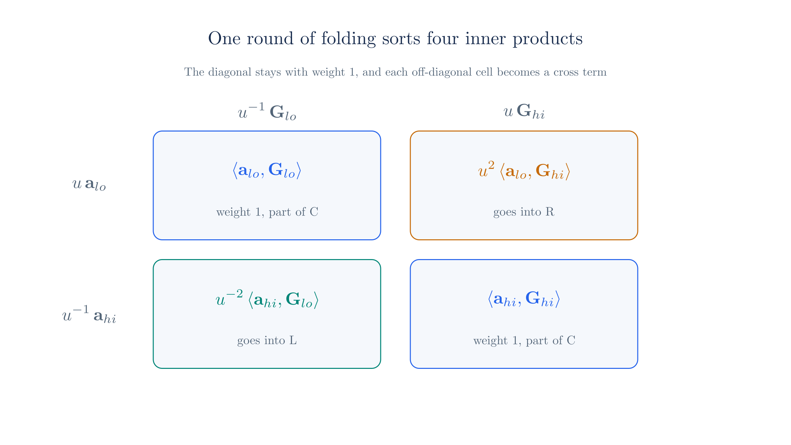
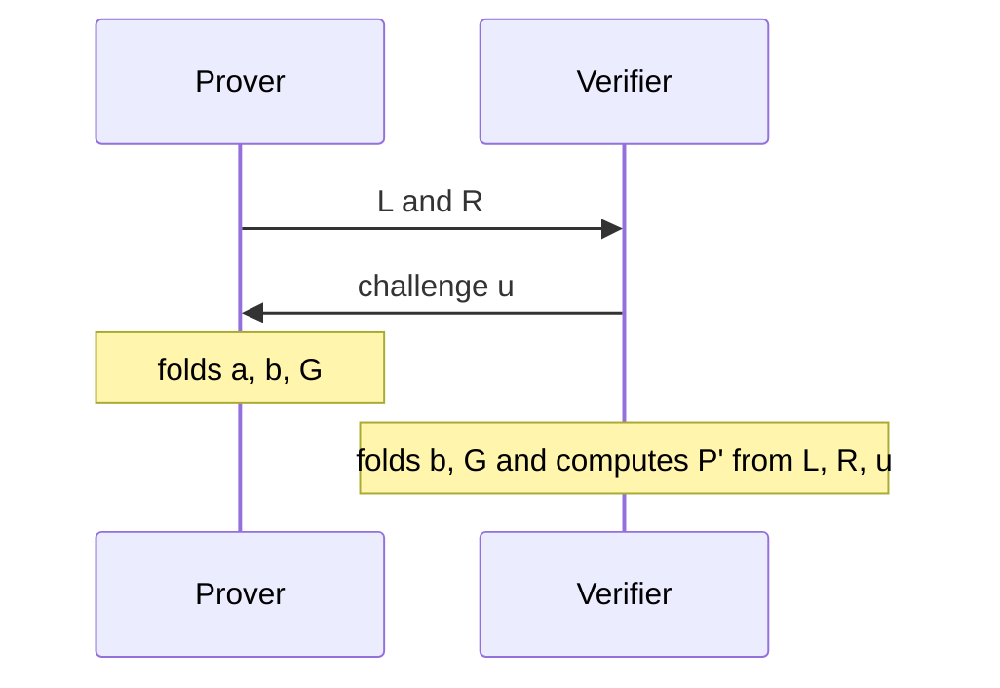

# The Inner Product Argument

The [previous chapter](./polynomial-commitments.md) reduced a polynomial evaluation to one statement about a secret vector, and it finished the exchange by revealing that vector. This chapter replaces the reveal with a proof whose size grows with the logarithm of the vector's length. The idea is to turn a claim about a vector of length $n$ into a claim of the same shape about a vector of length $n/2$, and to repeat this until one scalar is left, which the prover can send.

We derive one halving round in full, run the argument by hand on the toy curve, and then look at what cheating would take and what the verifier pays. The last sections compare this textbook form with the version in Ragu's code, which differs in several visible ways while proving the same claim.

## 1. The claim to prove

Section 9 of the previous chapter ended with this statement, where $U$ is an extra generator and $\v{x^n}$ is the vector of powers of $x$:

$$\text{given } \v{G},\ U,\ P,\ x, \text{ the prover knows } \v{a} \text{ such that } P = \dot{\v{a}}{\v{G}} + \dot{\v{a}}{\v{x^n}} \cdot U.$$

The halving step never uses the fact that the second vector consists of powers, so we write $\v{b}$ for it until Section 8 needs the powers again:

$$P = \dot{\v{a}}{\v{G}} + \dot{\v{a}}{\v{b}} \cdot U.$$

The verifier knows $\v{G}$, $\v{b}$, $U$ and $P$. Only the prover knows $\v{a}$. We keep the running example from the previous chapter, the polynomial $p(X) = 7 + 2X + 5X^2 + 3X^3$ at $x = 9$:

<!-- worked:setup -->

| Quantity | Value |
| --- | --- |
| Coefficient vector | $\v{a} = (7, 2, 5, 3)$ |
| Evaluation point | $x = 9$ |
| Power vector | $\v{b} = (1, 9, 38, 41)$ |
| Claimed value | $y = \dot{\v{a}}{\v{b}} = 37$ |
| Commitment | $C = \dot{\v{a}}{\v{G}} = (27,\,30)$ |
| Statement point | $P = C + 37 \cdot U = (5,\,29)$ |

<!-- /worked:setup -->

::: tip Notation
The general Bulletproofs relation has a secret $\v{b}$ with its own generators $\v{H}$. The [Ragu Book](https://github.com/tachyon-zcash/ragu/blob/3219e0865e8bff1f9d817bfe3850d9e94b64338c/book/src/protocol/prelim/bulletproofs.md?plain=1#L67-L72) states that form and then sets $\v{H}$ to zero for polynomial openings, because the powers of $x$ are public. We use only the reduced form. The book also writes $\v{f}$ and $Q$ where this site writes $\v{a}$ and $U$.
:::

## 2. Halving produces cross terms

To shorten $\v{a}$, the prover has to combine its entries. A natural way to do this is to split each vector into a lower and an upper half, written $\v{a}_{lo}, \v{a}_{hi}$ and $\v{G}_{lo}, \v{G}_{hi}$, and add the halves. Each half has length $n/2$, so the sums do too.

Now compare the commitment before and after. The original commitment pairs each half with its own half of the generators:

$$\dot{\v{a}}{\v{G}} = \dot{\v{a}_{lo}}{\v{G}_{lo}} + \dot{\v{a}_{hi}}{\v{G}_{hi}}.$$

The shortened vectors pair every half with every other half, because the inner product distributes over the sums:

$$\dot{\v{a}_{lo} + \v{a}_{hi}}{\v{G}_{lo} + \v{G}_{hi}} = \dot{\v{a}_{lo}}{\v{G}_{lo}} + \dot{\v{a}_{hi}}{\v{G}_{hi}} + \dot{\v{a}_{hi}}{\v{G}_{lo}} + \dot{\v{a}_{lo}}{\v{G}_{hi}}.$$

The last two terms are **cross terms**, and they are what stands between the short vectors and the original commitment. In this section and the next we use the second vector from the previous chapter, because the running vector has $\dot{\v{a}_{hi}}{\v{G}_{hi}} = \mathcal{O}$ by coincidence, and an identity point would hide the effect we want to see.

<!-- worked:naive -->

Take $\v{d} = (3, 1, 8, 4)$, whose commitment is $C_d = (6,\,23)$. It splits into $\v{d}_{lo} = (3, 1)$ and $\v{d}_{hi} = (8, 4)$, and the four inner products between the halves are:

| Piece | Point |
| --- | --- |
| $\dot{\v{d}_{lo}}{\v{G}_{lo}}$ | $(4,\,25)$ |
| $\dot{\v{d}_{hi}}{\v{G}_{hi}}$ | $(8,\,22)$ |
| $\dot{\v{d}_{hi}}{\v{G}_{lo}}$ | $(1,\,29)$ |
| $\dot{\v{d}_{lo}}{\v{G}_{hi}}$ | $(8,\,22)$ |

The first two pieces add up to $C_d$. The plain sums are $\v{d}_{lo} + \v{d}_{hi} = (11, 5)$ and $\v{G}_{lo} + \v{G}_{hi} = ((28,\,10),\ (18,\,10))$, and their inner product is $(30,\,23)$. That point is the sum of all four pieces, so it differs from $C_d$.

<!-- /worked:naive -->

The cross terms depend on $\v{a}$, so the verifier cannot compute them, and the prover has to send them. The statement of Section 1 also carries the claimed value $\dot{\v{a}}{\v{b}}$ as a multiple of $U$. If $\v{b}$ is split and summed in the same way, that inner product splits into the same four pieces, $\dot{\v{a}_{lo}}{\v{b}_{lo}} + \dot{\v{a}_{hi}}{\v{b}_{hi}}$ plus the cross pieces $\dot{\v{a}_{hi}}{\v{b}_{lo}}$ and $\dot{\v{a}_{lo}}{\v{b}_{hi}}$. So the prover sends two points that each pair one cross piece of the commitment with the matching cross piece of the value:

$$
\begin{aligned}
L &= \dot{\v{a}_{hi}}{\v{G}_{lo}} + \dot{\v{a}_{hi}}{\v{b}_{lo}} \cdot U, \\
R &= \dot{\v{a}_{lo}}{\v{G}_{hi}} + \dot{\v{a}_{lo}}{\v{b}_{hi}} \cdot U.
\end{aligned}
$$

With the plain sums, the shortened statement is then $P + L + R$, and Section 4 confirms these definitions through a full expansion. This creates a new problem, because the verifier cannot check how the prover built $L$ and $R$, and in particular the prover is free to choose their $U$ parts. If the way the halves are combined is fixed and known in advance, the prover can use this freedom to hide a false value:

<!-- worked:fixed-weight -->

Suppose the halves were added with weight 1, as in the plain sums above, so that the verifier updates the statement point to $P + L + R$ with $L$ and $R$ as just defined. For the running example, a prover who claims $y = 38$ instead of $37$ starts from $C + 38 \cdot U = (1,\,29)$, which carries one extra $U$. It sends the honest $L = (22,\,7)$ and, in place of the honest $R = (30,\,8)$, the point $R - U = (22,\,24)$. The extra $U$ in the statement and the missing $U$ in $R$ cancel, so the verifier ends up with the same point it would hold for the true claim $y = 37$, and the prover can continue honestly from there.

<!-- /worked:fixed-weight -->

The prover could make this correction because it knew the weight on $R$ before it sent $R$. The fix is to weight the halves with a random challenge that the verifier picks after the prover has sent the cross terms, so that the prover cannot tailor them to the weights. Section 6 shows how much this limits a cheater.

## 3. Choosing the weights

The weights must not disturb the two terms that make up the original commitment. Suppose we scale the upper half of $\v{a}$ by a scalar $\alpha$ and the upper half of $\v{G}$ by a scalar $\beta$. Expanding as before gives

$$\dot{\v{a}_{lo} + \alpha \v{a}_{hi}}{\v{G}_{lo} + \beta \v{G}_{hi}} = \dot{\v{a}_{lo}}{\v{G}_{lo}} + \alpha\beta\,\dot{\v{a}_{hi}}{\v{G}_{hi}} + \alpha\,\dot{\v{a}_{hi}}{\v{G}_{lo}} + \beta\,\dot{\v{a}_{lo}}{\v{G}_{hi}}.$$

For the second term to keep weight 1 we need $\alpha\beta = 1$, so $\alpha$ and $\beta$ must be inverses of each other. This is why inverses of the challenge appear throughout the argument. One half of the pair goes on the scalars and the other goes on the generators, and they cancel exactly on the terms we want to keep.

<!-- worked:weights -->

Take the weight $3$, whose inverse modulo 43 is $29$. Scaling both high halves by $3$ gives $(26,\,8)$. Removing the cross pieces, each of which carries weight $3$, leaves $(17,\,7)$, which is $\dot{\v{d}_{lo}}{\v{G}_{lo}} + 9\dot{\v{d}_{hi}}{\v{G}_{hi}}$ and not $C_d$. Scaling $\v{d}_{hi}$ by $29$ and $\v{G}_{hi}$ by $3$ gives $(4,\,6)$. Removing the cross pieces, which now carry weights $29$ and $3$, leaves $(6,\,23) = C_d$.

<!-- /worked:weights -->

The scale of each half is also free, as long as the product over a matching pair of halves stays 1. Like Bulletproofs and the Ragu Book, this chapter spreads a challenge $u$ over both halves, with weights $u, u^{-1}$ on the scalars and $u^{-1}, u$ on the generators. We use this symmetric form because the book uses it and because the polynomial $g(X)$ of Section 8, which later chapters rely on, comes from it. Section 9 returns to the one-sided form, which is what Ragu's code runs.

## 4. One round of folding

The second vector $\v{b}$ pairs with $\v{a}$ in the same way that $\v{G}$ does, so it needs the same weights as $\v{G}$ to keep $\dot{\v{a}}{\v{b}}$ intact. One round therefore defines, for a challenge $u$,

$$
\begin{aligned}
\v{a}' &= u\,\v{a}_{lo} + u^{-1}\v{a}_{hi}, \\
\v{b}' &= u^{-1}\v{b}_{lo} + u\,\v{b}_{hi}, \\
\v{G}' &= u^{-1}\v{G}_{lo} + u\,\v{G}_{hi}.
\end{aligned}
$$

We now find the point that these three vectors commit to. Expanding the first inner product term by term gives

$$
\begin{aligned}
\dot{\v{a}'}{\v{G}'} &= \dot{u\,\v{a}_{lo} + u^{-1}\v{a}_{hi}}{u^{-1}\v{G}_{lo} + u\,\v{G}_{hi}} \\
&= u u^{-1}\dot{\v{a}_{lo}}{\v{G}_{lo}} + u u\,\dot{\v{a}_{lo}}{\v{G}_{hi}} + u^{-1}u^{-1}\dot{\v{a}_{hi}}{\v{G}_{lo}} + u^{-1}u\,\dot{\v{a}_{hi}}{\v{G}_{hi}} \\
&= \dot{\v{a}}{\v{G}} + u^{2}\dot{\v{a}_{lo}}{\v{G}_{hi}} + u^{-2}\dot{\v{a}_{hi}}{\v{G}_{lo}}.
\end{aligned}
$$

The scalar inner product expands in exactly the same way, because $\v{b}'$ has the same weights as $\v{G}'$:

$$\dot{\v{a}'}{\v{b}'} = \dot{\v{a}}{\v{b}} + u^{2}\dot{\v{a}_{lo}}{\v{b}_{hi}} + u^{-2}\dot{\v{a}_{hi}}{\v{b}_{lo}}.$$



Next we form the point $P' = \dot{\v{a}'}{\v{G}'} + \dot{\v{a}'}{\v{b}'} \cdot U$ by adding the first expansion to $U$ times the second, and we collect terms by their power of $u$:

$$
\begin{aligned}
P' &= \dot{\v{a}}{\v{G}} + \dot{\v{a}}{\v{b}} \cdot U \\
&\quad + u^{-2}\left(\dot{\v{a}_{hi}}{\v{G}_{lo}} + \dot{\v{a}_{hi}}{\v{b}_{lo}} \cdot U\right) \\
&\quad + u^{2}\left(\dot{\v{a}_{lo}}{\v{G}_{hi}} + \dot{\v{a}_{lo}}{\v{b}_{hi}} \cdot U\right).
\end{aligned}
$$

The first line is $P$. The other two brackets are the two points the prover must send, and we name them

$$
\begin{aligned}
L &= \dot{\v{a}_{hi}}{\v{G}_{lo}} + \dot{\v{a}_{hi}}{\v{b}_{lo}} \cdot U, \\
R &= \dot{\v{a}_{lo}}{\v{G}_{hi}} + \dot{\v{a}_{lo}}{\v{b}_{hi}} \cdot U.
\end{aligned}
$$

This gives the update rule for the statement point:

$$P' = P + u^{-2} \cdot L + u^{2} \cdot R.$$

The verifier can compute everything on the right once it has $L$ and $R$, and it can fold $\v{G}$ and $\v{b}$ itself because they are public. Only $\v{a}'$ remains in the prover's hands. The result is a new claim with the same shape as the old one, at half the length:

$$P' = \dot{\v{a}'}{\v{G}'} + \dot{\v{a}'}{\v{b}'} \cdot U.$$

The order of the messages matters, because the prover must commit to $L$ and $R$ before it learns $u$:



## 5. A complete run on the toy curve

For $n = 4$ the argument takes $k = \log_2 n = 2$ rounds. We number rounds in the order they happen, write $\v{a}^{(j)}$ for the vector after round $j$, and start from $\v{a}^{(0)} = \v{a}$, $\v{b}^{(0)} = \v{b}$, $\v{G}^{(0)} = \v{G}$ and $P^{(0)} = P$. The challenges below are picked by hand so that the numbers avoid accidental coincidences. Fiat–Shamir, covered in [Statements and Challenges](./statements-and-challenges.md#_8-removing-the-verifier-with-fiat–shamir), would derive them from a transcript in a real proof.

### Round 1

The prover computes the cross terms from the secret vector:

<!-- worked:round1-prover -->

| Prover computes | Value |
| --- | --- |
| $\dot{\v{a}_{hi}}{\v{b}_{lo}}$ with $\v{a}_{hi} = (5, 3)$, $\v{b}_{lo} = (1, 9)$ | $32$ |
| $\dot{\v{a}_{lo}}{\v{b}_{hi}}$ with $\v{a}_{lo} = (7, 2)$, $\v{b}_{hi} = (38, 41)$ | $4$ |
| $L_1 = \dot{\v{a}_{hi}}{\v{G}_{lo}} + 32 \cdot U$ | $(22,\,7)$ |
| $R_1 = \dot{\v{a}_{lo}}{\v{G}_{hi}} + 4 \cdot U$ | $(30,\,8)$ |

<!-- /worked:round1-prover -->

After it receives $L_1$ and $R_1$, the verifier picks the challenge:

<!-- worked:round1-challenge -->

The verifier sends $u_1 = 15$. Its inverse is $u_1^{-1} = 23$, and the weights on the cross terms are $u_1^{-2} = 13$ and $u_1^{2} = 10$.

<!-- /worked:round1-challenge -->

Both parties fold what they hold. The last two rows of the next table compute the same point in two ways, once by the verifier from public values and once by the prover from the folded secret vector:

<!-- worked:round1-after -->

| Party | Computation | Result |
| --- | --- | --- |
| Prover | $\v{a}^{(1)} = 15\v{a}_{lo} + 23\v{a}_{hi}$ | $(5, 13)$ |
| Both | $\v{b}^{(1)} = 23\v{b}_{lo} + 15\v{b}_{hi}$ | $(34, 5)$ |
| Both | $\v{G}^{(1)} = 23\v{G}_{lo} + 15\v{G}_{hi}$ | $((6,\,23),\ (4,\,25))$ |
| Verifier | $P^{(1)} = P^{(0)} + 13 \cdot L_1 + 10 \cdot R_1$ | $(30,\,23)$ |
| Prover | $\dot{\v{a}^{(1)}}{\v{G}^{(1)}} + 20 \cdot U$ | $(30,\,23)$ |

<!-- /worked:round1-after -->

<!-- worked:round1-ip -->

The inner product changes the way the algebra predicts: $37 + 13 \cdot 32 + 10 \cdot 4 = 20$ modulo 43, and direct computation of $\dot{\v{a}^{(1)}}{\v{b}^{(1)}}$ gives $20$ as well.

<!-- /worked:round1-ip -->

### Round 2

The second round applies the same steps to vectors of length 2, so each half now has one entry:

<!-- worked:round2-prover -->

| Prover computes | Value |
| --- | --- |
| $\dot{\v{a}_{hi}}{\v{b}_{lo}}$ with $\v{a}_{hi} = (13)$, $\v{b}_{lo} = (34)$ | $12$ |
| $\dot{\v{a}_{lo}}{\v{b}_{hi}}$ with $\v{a}_{lo} = (5)$, $\v{b}_{hi} = (5)$ | $25$ |
| $L_2 = \dot{\v{a}_{hi}}{\v{G}_{lo}} + 12 \cdot U$ | $(28,\,21)$ |
| $R_2 = \dot{\v{a}_{lo}}{\v{G}_{hi}} + 25 \cdot U$ | $(14,\,9)$ |

<!-- /worked:round2-prover -->

<!-- worked:round2-challenge -->

The verifier sends $u_2 = 10$, with $u_2^{-1} = 13$, $u_2^{-2} = 40$ and $u_2^{2} = 14$.

<!-- /worked:round2-challenge -->

<!-- worked:round2-after -->

| Party | Computation | Result |
| --- | --- | --- |
| Prover | $\v{a}^{(2)} = 10\v{a}_{lo} + 13\v{a}_{hi}$ | $(4)$ |
| Both | $\v{b}^{(2)} = 13\v{b}_{lo} + 10\v{b}_{hi}$ | $(19)$ |
| Both | $\v{G}^{(2)} = 13\v{G}_{lo} + 10\v{G}_{hi}$ | $((20,\,25))$ |
| Verifier | $P^{(2)} = P^{(1)} + 40 \cdot L_2 + 14 \cdot R_2$ | $(14,\,22)$ |
| Prover | $\dot{\v{a}^{(2)}}{\v{G}^{(2)}} + 33 \cdot U$ | $(14,\,22)$ |

<!-- /worked:round2-after -->

### The final check

All three vectors now have one entry, so the prover can send its scalar without exposing a long vector. We write $\hat{a}$, $\hat{b}$ and $\hat{G}$ for the single entries left at the end. The claim $P^{(k)} = \dot{\v{a}^{(k)}}{\v{G}^{(k)}} + \dot{\v{a}^{(k)}}{\v{b}^{(k)}} \cdot U$ becomes

$$P^{(k)} = \hat{a} \cdot \hat{G} + \hat{a}\hat{b} \cdot U = \hat{a} \cdot (\hat{G} + \hat{b} \cdot U).$$

<!-- worked:final -->

The prover sends $\hat{a} = 4$. The verifier already holds $\hat{b} = 19$ and $\hat{G} = (20,\,25)$ from folding, and it checks one equation:

$$P^{(2)} = (14,\,22), \qquad \hat{a} \cdot (\hat{G} + \hat{b} \cdot U) = 4 \cdot ((20,\,25) + 19 \cdot U) = (14,\,22).$$

The two points match, so the verifier accepts.

<!-- /worked:final -->

Unrolling the update rule gives the whole check in one line, which is how an implementation evaluates it:

$$P + \sum_{j=1}^{k} \left(u_j^{-2} \cdot L_j + u_j^{2} \cdot R_j\right) = \hat{a} \cdot (\hat{G} + \hat{b} \cdot U).$$

<!-- worked:proof-contents -->

The whole proof is $L_1 = (22,\,7)$, $R_1 = (30,\,8)$, $L_2 = (28,\,21)$, $R_2 = (14,\,9)$ and $\hat{a} = 4$. For $n = 4$ that is four points and one scalar, against the four scalars of revealing $\v{a}$. The saving only appears at larger $n$, because the proof grows with $\log_2 n$.

<!-- /worked:proof-contents -->

::: tip Round labels
This site counts rounds upward from $j = 1$ and writes $\hat{G}$ for the final generator. The Ragu Book and the code label rounds differently, and Section 8 lines up the labellings.
:::

## 6. Why cheating fails

The verifier never sees $\v{a}$, so we need a reason to believe that a false claim cannot pass. We start with a prover who lies about the value and follows the protocol otherwise:

<!-- worked:honest-false -->

Claim $y = 38$ instead of $37$, so the statement point is $C + 38 \cdot U = (1,\,29)$, and fold honestly from $\v{a}$. Running the argument for all $1764$ pairs of nonzero challenges gives 1764 rejections and no acceptances, because the extra $1 \cdot U$ stays in the folded point in every round.

<!-- /worked:honest-false -->

A cheater can do more than this, because $L_j$ and $R_j$ can be any points it likes. To see the limits of that freedom, we track one number through the protocol.

### The gap

Assume for now that the prover builds every point from the public generators and knows the coefficients it used, and that nobody knows a relation among the generators. Then each point $X$ the prover handles has one expression $X = \dot{\v{c}}{\v{G}} + t \cdot U$, so the following number is well defined:

$$\text{gap}(X) = t - \dot{\v{c}}{\v{b}}.$$

The relation of Section 1 holds exactly when $\text{gap}(P) = 0$, since that says the coefficient of $U$ equals the inner product of the coefficients of $\v{G}$ with $\v{b}$. For the two statements of the running example:

<!-- worked:gap-values -->

The honest statement point $C + 37 \cdot U$ has coefficients $\v{a} = (7, 2, 5, 3)$ on $\v{G}$ and $37$ on $U$, so its gap is $37 - \dot{\v{a}}{\v{b}} = 37 - 37 = 0$. The false statement point $C + 38 \cdot U$ has the same coefficients on $\v{G}$ and $38$ on $U$, so its gap is $38 - 37 = 1$.

<!-- /worked:gap-values -->

The gap is linear in the point, which means $\text{gap}(X + r \cdot Y) = \text{gap}(X) + r\,\text{gap}(Y)$. It also has simple values on the generators, namely $\text{gap}(G_i) = -b_i$ and $\text{gap}(U) = 1$.

Now look at the right side of the final check. For a folded generator, linearity gives

$$\text{gap}(u^{-1} \cdot G_i + u \cdot G_{i + n/2}) = -(u^{-1}b_i + u\,b_{i + n/2}) = -b'_i,$$

so each folded generator has the folded entry of $\v{b}$ as its negative gap, and this repeats in every round. At the end $\text{gap}(\hat{G}) = -\hat{b}$, and therefore

$$\text{gap}\left(\hat{a} \cdot (\hat{G} + \hat{b} \cdot U)\right) = \hat{a}(-\hat{b} + \hat{b}) = 0$$

for every possible $\hat{a}$. Without any relation among the generators, two equal points have equal coefficients and so equal gaps. A passing proof therefore needs the left side of the check to have gap zero as well:

$$\text{gap}(P) + \sum_{j=1}^{k} \left(u_j^{-2}\,\text{gap}(L_j) + u_j^{2}\,\text{gap}(R_j)\right) = 0.$$

### Counting the challenges a cheater can survive

Let $e$ be the gap of the current statement point at the start of some round, and suppose $e \neq 0$. The prover fixes $L$ and $R$, and then the verifier picks $u$. The new gap is zero only if, with $w = u^2$,

$$e + w^{-1}\,\text{gap}(L) + w\,\text{gap}(R) = 0.$$

Multiplying by $w$ gives the polynomial equation $\text{gap}(R)\,w^2 + e\,w + \text{gap}(L) = 0$. Its middle coefficient is $e \neq 0$, so the polynomial is not zero, whatever the prover chose. By the [root count from Statements and Challenges](./statements-and-challenges.md#_4-counting-the-roots-of-a-polynomial) it has at most 2 roots $w$, and each root has at most 2 square roots $u$. At most 4 challenges in a round can therefore clear a nonzero gap, and the same bound holds for every vector length.

The gap argument can look abstract, so we now check it against the final check itself in the smallest case, a vector of length $n = 2$ with one round. The generators are $G_0$ and $G_1$, and the prover may build $P$, $L$ and $R$ from any coefficients it likes:

$$
\begin{aligned}
P &= p_0 \cdot G_0 + p_1 \cdot G_1 + p_U \cdot U, \\
L &= l_0 \cdot G_0 + l_1 \cdot G_1 + l_U \cdot U, \\
R &= r_0 \cdot G_0 + r_1 \cdot G_1 + r_U \cdot U.
\end{aligned}
$$

After one round with challenge $u$, the folded generator is $\hat{G} = u^{-1} \cdot G_0 + u \cdot G_1$ and the folded entry of $\v{b}$ is $\hat{b} = u^{-1}b_0 + u\,b_1$. The final check $P + u^{-2} \cdot L + u^{2} \cdot R = \hat{a} \cdot (\hat{G} + \hat{b} \cdot U)$ then compares two combinations of $G_0$, $G_1$ and $U$. With no known relation among the generators, the two sides are equal only if the coefficients match one generator at a time:

$$
\begin{aligned}
G_0:&\quad p_0 + u^{-2} l_0 + u^{2} r_0 = \hat{a}\,u^{-1}, \\
G_1:&\quad p_1 + u^{-2} l_1 + u^{2} r_1 = \hat{a}\,u, \\
U:&\quad p_U + u^{-2} l_U + u^{2} r_U = \hat{a}\,(u^{-1}b_0 + u\,b_1).
\end{aligned}
$$

The prover sends $\hat{a}$ after it sees $u$, so it can pick $\hat{a}$ to satisfy one equation. To see what remains, multiply the $G_0$ equation by $b_0$, the $G_1$ equation by $b_1$, and add them. The right side becomes $\hat{a}(u^{-1}b_0 + u\,b_1)$, which is the right side of the $U$ equation. Subtracting the sum from the $U$ equation removes $\hat{a}$ completely:

$$(p_U - p_0 b_0 - p_1 b_1) + u^{-2}(l_U - l_0 b_0 - l_1 b_1) + u^{2}(r_U - r_0 b_0 - r_1 b_1) = 0.$$

The three brackets are $\text{gap}(P)$, $\text{gap}(L)$ and $\text{gap}(R)$, so this is the equation $e + w^{-1}\,\text{gap}(L) + w\,\text{gap}(R) = 0$ from above, with $w = u^2$. Whatever $\hat{a}$ the prover sends, a passing challenge must solve it. The $G_0$ and $G_1$ equations must also give the same $\hat{a}$, which can only remove more challenges, so the gap equation is a necessary condition for passing. Here is a numeric case:

<!-- worked:two-entry -->

Take $\v{a} = (7, 2)$ and $\v{b} = (1, 9)$, whose true inner product is $25$, and the false claim $y = 26$. The statement point is $P = 7 \cdot G_0 + 2 \cdot G_1 + 26 \cdot U$, with gap $26 - 25 = 1$. The honest cross terms have $\v{G}$ parts $L = 2 \cdot G_0 + \ldots$ and $R = 7 \cdot G_1 + \ldots$, from $\v{a}_{hi} = (2)$ and $\v{a}_{lo} = (7)$. With these $\v{G}$ parts the first two equations both give $\hat{a} = 7u + 2u^{-1}$, so they never conflict, and only the gap equation decides. The honest $U$ parts are $l_U = 2$ and $r_U = 20$, which give $\text{gap}(L) = \text{gap}(R) = 0$, and the gap equation becomes $1 = 0$, so no challenge passes.

A cheater can choose other $U$ parts. With $l_U = 1$ and $r_U = 4$, the gaps are $\text{gap}(L) = 1 - 2 = 42$ and $\text{gap}(R) = 4 - 20 = 27$ modulo 43, and the quadratic is $27w^2 + w + 42 = 0$. Its roots are $w = 10$ and $w = 25$. Both are squares modulo 43, and their square roots are $u \in \{5, 15, 28, 38\}$. Running the check for all 42 nonzero challenges confirms that exactly these 4 pass. Trying all $1,849$ choices of the two $U$ parts in the same way, no choice passes more than $4$ of the 42 challenges.

<!-- /worked:two-entry -->

A false statement starts with a nonzero gap and must reach gap zero by the end, so the gap has to be cleared in one of the $k$ rounds. The chance of this is at most $4k$ divided by the number of nonzero challenges. On the toy curve this is a large fraction, which is one more way the toy curve is insecure. On a real curve the fraction is negligible:

<!-- worked:bound -->

For $n = 2^{13}$ over a Pasta scalar field, which has about $2^{254}$ elements, this bound is $52$ divided by about $2^{254}$, which is below $2^{-248}$.

<!-- /worked:bound -->

### Why the challenge must come after the cross terms

The count above relies on $L$ and $R$ being fixed before $u$. If the prover sees the challenge first, it can solve the equation for the point it still has to send. This is the attack of Section 2, with the known weight $u_1^{2}$ in place of the fixed weight 1:

<!-- worked:early-u -->

Suppose the prover knows $u_1 = 15$ before it sends $R_1$, and it wants to pass with the false statement $y = 38$, whose point carries an extra $1 \cdot U$. It replaces the honest $R_1 = (30,\,8)$ by $R_1 - u_1^{-2} \cdot 1 \cdot U = (28,\,10)$. The weight $u_1^{2}$ then turns the change into $-1 \cdot U$, and $P^{(1)}$ comes out as $(30,\,23)$, exactly the honest folded point. The rest of the run is honest, and the verifier accepts.

<!-- /worked:early-u -->

The same altered point does poorly when the challenge arrives afterwards:

<!-- worked:early-count -->

Now fix that altered $R_1$ first and let the challenge vary. Running the protocol for all 42 nonzero values of $u_1$ gives acceptance only at $u_1 \in \{15, 28\}$, the guess and its negative, which share the same square. The prover wins with probability $2/42$.

<!-- /worked:early-count -->

<!-- worked:early-gap -->

In this attack $\text{gap}(P) = 1$, $\text{gap}(L_1) = 0$ and $\text{gap}(R_1) = 30$. The equation $1 + 30 \cdot u_1^{2} = 0$ has the solutions $u_1^{2} = 10$, which are the two challenges just found.

<!-- /worked:early-gap -->

In a non-interactive proof this ordering becomes a requirement on the transcript. Every $L_j$ and $R_j$ must go into the hash before $u_j$ comes out, for the reason given in [the section on omitted transcript data](./statements-and-challenges.md#_9-omitting-data-from-the-transcript).

### Why the generators must have no known relation

The gap only makes sense if each point has one expression in the generators. On the toy curve every point is a known multiple of every other point, so the gap has no fixed meaning there, and the final scalar can absorb any error:

<!-- worked:forge-logs -->

Keep the false statement $y = 38$ and the honest $L_j, R_j$. With challenges $(15, 10)$ the folded point is $(7,\,6)$, and the right side of the check is a multiple of $\hat{G} + \hat{b} \cdot U = (30,\,23)$. Every point on the toy curve is a known multiple of $G_0$, and counting finds $(7,\,6) = 16 \cdot G_0$ and $(30,\,23) = 35 \cdot G_0$. The prover divides these logs to get $\hat{a} = 16 / 35 = 41$. Then $41 \cdot (30,\,23) = (7,\,6)$ and the verifier accepts the false value. This is the attack the discrete log relation assumption rules out on a real curve.

<!-- /worked:forge-logs -->

The argument above therefore rests on the following assumptions. The discrete log relation assumption from the [previous chapter](./polynomial-commitments.md#_4-why-a-prover-cannot-change-the-vector) holds for $\v{G}$ together with $U$. The prover builds its points from the generators with coefficients it knows. The challenges are uniform and come after the points they weight, which in a non-interactive proof means treating the transcript hash as a random oracle. This section gives the reasoning informally and is not a security proof.

Two limits of this argument matter later. The first is a real weakness of the protocol of Sections 1 to 5, which accepts some false evaluations. The argument shows only that $P$ has the form $\dot{\v{a}}{\v{G}} + \dot{\v{a}}{\v{b}} \cdot U$ for some $\v{a}$. [Section 9 of the previous chapter](./polynomial-commitments.md#a-commitment-with-a-hidden-multiple-of-u) showed that the textbook statement $P = C + y \cdot U$ has a gap when the commitment $C$ itself contains a multiple of $U$, and the halving argument inherits that gap unchanged. An honest commitment never contains one, since it is built from $\v{G}$ alone. A cheating prover can add $\delta \cdot U$ to its commitment and claim a value $\delta$ below the true one. Then $P$ has gap zero, because the hidden $\delta \cdot U$ makes up the difference, and the protocol accepts every time even though the polynomial behind the $\v{G}$ part of $C$ does not take the value $y$. So the relation proved here matches the evaluation claim only when $C$ has no $U$ component. [Section 10](#scaling-u-by-a-challenge) runs this attack with numbers and shows how the code closes the hole.

The second limit concerns what "sound" means. The argument shows that a false statement fails. Recursion needs the stronger property that the [PCD introduction](./pcd-intro.md#_7-why-a-false-header-has-no-valid-proof) called [knowledge soundness](./statements-and-challenges.md#_2-completeness-and-soundness), which says that a prover who passes actually knows a suitable $\v{a}$. This chapter assumes that property and does not argue it.

## 7. The verifier's linear cost

The proof is short, but the verifier still has to compute $\hat{G}$ and $\hat{b}$. Folding $\v{G}$ round by round costs about $n$ scalar multiplications in the first round, $n/2$ in the second, and so on. The verifier can do better by computing the final point in one step, which requires knowing the final weight of each original generator.

For $n = 4$ we can substitute one round into the other. The first round gives

$$\v{G}^{(1)} = \left(u_1^{-1} \cdot G_0 + u_1 \cdot G_2,\quad u_1^{-1} \cdot G_1 + u_1 \cdot G_3\right),$$

and the second round combines those two entries with weights $u_2^{-1}$ and $u_2$:

$$
\begin{aligned}
\hat{G} &= u_2^{-1} \cdot (u_1^{-1} \cdot G_0 + u_1 \cdot G_2) + u_2 \cdot (u_1^{-1} \cdot G_1 + u_1 \cdot G_3) \\
&= u_1^{-1}u_2^{-1} \cdot G_0 + u_1^{-1}u_2 \cdot G_1 + u_1 u_2^{-1} \cdot G_2 + u_1 u_2 \cdot G_3.
\end{aligned}
$$

Each generator's weight is a product with one factor per round. Round $j$ contributes $u_j$ if the generator sat in the upper half at that round and $u_j^{-1}$ if it sat in the lower half. Reading the index $i$ in binary, round 1 looks at the highest bit and the last round at the lowest. This defines the vector $\v{s}$ with

$$s_i = \prod_{j=1}^{k} u_j^{\pm 1}, \quad \text{with exponent } +1 \text{ when bit } k - j \text{ of } i \text{ is } 1, \text{ and } -1 \text{ otherwise},$$

and it gives $\hat{G} = \dot{\v{s}}{\v{G}}$. The vector $\v{b}$ folds with the same weights, so $\hat{b} = \dot{\v{s}}{\v{b}}$ for the same $\v{s}$. Here is the table for our run:

<!-- worked:s-table -->

| $i$ | Bits of $i$ | $s_i$ | Value |
| --- | --- | --- | --- |
| 0 | 00 | $u_1^{-1} u_2^{-1}$ | $41$ |
| 1 | 01 | $u_1^{-1} u_2$ | $15$ |
| 2 | 10 | $u_1 u_2^{-1}$ | $23$ |
| 3 | 11 | $u_1 u_2$ | $21$ |

With $(u_1, u_2) = (15, 10)$, the multi-scalar multiplication $\dot{\v{s}}{\v{G}}$ gives $(20,\,25)$, the same point as $\hat{G}$ from the round-by-round folding. The same weights applied to $\v{b}$ give $\dot{\v{s}}{\v{b}} = 19 = \hat{b}$.

<!-- /worked:s-table -->

Computing $\hat{G}$ this way is one **multi-scalar multiplication** (MSM) with $n$ terms. An MSM of that size is cheaper than folding, because a single MSM can share work across its terms, but its cost still grows linearly with $n$, and no shortcut is available, because the generators are independent points with no structure to exploit.

## 8. The polynomial g(X)

The scalar $\hat{b}$ is cheaper than $\hat{G}$, because $\v{b}$ has structure that $\v{G}$ lacks. Its entries are powers of $x$, so $b_{i + n/2} = x^{n/2} b_i$. Substituting this into the fold gives

$$b'_i = u^{-1} b_i + u\,b_{i + n/2} = (u^{-1} + u\,x^{n/2})\,b_i.$$

One round therefore multiplies the first half of $\v{b}$ by a single factor, and the result is still a power vector up to that factor.

<!-- worked:b-scaled -->

In the run of Section 5, $\v{b}^{(1)} = (34, 5)$. The predicted factor is $u_1^{-1} + u_1 x^2 = 23 + 15 \cdot 38 = 34$, and $34 \cdot (1, 9) = (34, 5)$ modulo 43.

<!-- /worked:b-scaled -->

Round $j$ acts on a vector of length $2^{k-j+1}$, so its factor uses the exponent $2^{k-j}$. Each round multiplies the first entry by its factor, and that entry starts as $b_0 = x^0 = 1$, so the final entry is the product of the factors of all $k$ rounds. Replacing $x$ with a variable defines the polynomial

$$g(X) = \prod_{j=1}^{k} \left(u_j^{-1} + u_j X^{2^{k-j}}\right),$$

and then $\hat{b} = g(x)$. The coefficients of this polynomial are the entries of $\v{s}$. To see this, expand the product by choosing one term from each factor. Choosing $u_j X^{2^{k-j}}$ adds $2^{k-j}$ to the power of $X$ and contributes $u_j$, while choosing $u_j^{-1}$ adds nothing and contributes $u_j^{-1}$. The coefficient of $X^i$ then comes from the single choice that matches the binary digits of $i$, which is the rule for $s_i$ from Section 7.

<!-- worked:g-poly -->

With $(u_1, u_2) = (15, 10)$, the polynomial is $g(X) = (23 + 15X^2)(13 + 10X)$. Multiplying it out gives coefficients $(41, 15, 23, 21)$, which is the $\v{s}$ of the table. At $x = 9$ the first factor is $23 + 15 \cdot 38 = 34$, the second is $13 + 10 \cdot 9 = 17$, and their product is $19 = \hat{b}$.

<!-- /worked:g-poly -->

Ordering mistakes are easy to make here, so we also check a longer case:

<!-- worked:order-check -->

The script behind this chapter repeats the comparison for $k = 3$ with eight generators and challenges $(3, 5, 7)$: round-by-round folding gives $\hat{G} = (25,\,2)$, and the coefficients of $g$ give the same point through one multi-scalar multiplication. The folded power vector and $g(9)$ also agree, at $37$.

<!-- /worked:order-check -->

Comparing with the Ragu Book needs one relabelling. The book [indexes rounds downward](https://github.com/tachyon-zcash/ragu/blob/3219e0865e8bff1f9d817bfe3850d9e94b64338c/book/src/protocol/prelim/bulletproofs.md?plain=1#L20), from $j = k$ to $j = 1$, so its $u_1$ is the last challenge, its $\v{G}^{(0)}$ is the final vector, and it [calls the final generator](https://github.com/tachyon-zcash/ragu/blob/3219e0865e8bff1f9d817bfe3850d9e94b64338c/book/src/protocol/prelim/bulletproofs.md?plain=1#L43) $G_0$. This site writes $\hat{G}$ instead, because $G_0$ already names the first public generator. The book's $u_j$ is therefore our $u_{k+1-j}$, and its exponent $2^{k-j}$ becomes $2^{j-1}$, so in the book's labels $g(X) = \prod_j (u_j^{-1} + u_j X^{2^{j-1}})$. The book's [listing of $\v{s}$](https://github.com/tachyon-zcash/ragu/blob/3219e0865e8bff1f9d817bfe3850d9e94b64338c/book/src/protocol/prelim/bulletproofs.md?plain=1#L43-L55) matches ours after this relabelling. For $k = 2$ the book's second entry is $u_1 u_2^{-1}$ in its labels. Its $u_1$ is our $u_2$ and its $u_2$ is our $u_1$, so in our labels that entry is $u_1^{-1}u_2$, which is the $s_1$ of the table above.

This also gives a compact statement of the verifier's costs. The expression $\hat{G} = \dot{\v{s}}{\v{G}}$ says that $\hat{G}$ is the Pedersen commitment to $g$, whose coefficient vector is $\v{s}$:

<!-- worked:costs -->

| Task for $n = 2^{13}$ | Operations |
| --- | --- |
| Computing $\hat{b} = g(x)$ with repeated squaring | $12$ squarings and $13$ factor multiplications in $\F_q$ |
| Computing $\v{s}$ from the challenges | about $8,192$ field multiplications |
| Computing $\hat{G} = \dot{\v{s}}{\v{G}}$ | $8,192$ scalar multiplications, one per generator |
| Combining the $L_j$ and $R_j$ | $26$ scalar multiplications |

<!-- /worked:costs -->

Everything in this table except the two rows involving all of $\v{s}$ is logarithmic in $n$. A recursive verifier cannot afford those rows, because it would have to perform them inside a circuit. The [accumulation chapter](./accumulation.md) works from this exact point. It notices that $\hat{G}$ is a claim about the commitment to a polynomial with a short description, namely the $k$ challenges, and it postpones checking that claim.

## 9. The code's one-sided fold

The remaining sections compare the form above with Ragu's implementation, which the code describes as [adapted from `halo2`](https://github.com/tachyon-zcash/ragu/blob/3219e0865e8bff1f9d817bfe3850d9e94b64338c/crates/ragu_pcd/src/ipa/mod.rs#L1-L16). The differences fall into two groups. This section covers how the code folds, and the next covers what statement it folds.

::: warning Reconstructed from code at commit 3219e08, not confirmed by the authors
The Ragu Book and the code differ here, and everything we say about the code in Sections 9 to 12 is our reading of it. The [book](https://github.com/tachyon-zcash/ragu/blob/3219e0865e8bff1f9d817bfe3850d9e94b64338c/book/src/protocol/prelim/bulletproofs.md?plain=1#L24-L31) uses the symmetric weights $u, u^{-1}$ of Section 4. The [prover code](https://github.com/tachyon-zcash/ragu/blob/3219e0865e8bff1f9d817bfe3850d9e94b64338c/crates/ragu_pcd/src/ipa/prover.rs#L132-L141) uses the one-sided weights below. This site teaches the symmetric form because the book uses it and because the $g(X)$ of later chapters comes from it. Where the question is what Ragu actually runs, the site follows the code.
:::

Section 3 showed that only the product of the two weights on a matching pair of halves is fixed, at 1, so the scale of each half is a free choice. The book spends this freedom on the symmetric split. The code instead uses the one-sided form from the display in Section 3, with the lower halves unweighted. To avoid mixing up the two conventions, we write $w$ for the challenge in this form, although the code calls it $u_j$:

$$
\begin{aligned}
\v{a}' &= \v{a}_{lo} + w^{-1}\v{a}_{hi}, \\
\v{b}' &= \v{b}_{lo} + w\,\v{b}_{hi}, \\
\v{G}' &= \v{G}_{lo} + w\,\v{G}_{hi}.
\end{aligned}
$$

These are the lines in [`prover.rs`](https://github.com/tachyon-zcash/ragu/blob/3219e0865e8bff1f9d817bfe3850d9e94b64338c/crates/ragu_pcd/src/ipa/prover.rs#L132-L135) that fold the two scalar vectors:

```rust
for i in 0..half {
    p_prime[i] = p_prime[i] + &(p_prime[i + half] * &u_j_inv);
    b[i] = b[i] + &(b[i + half] * &u_j);
}
```

Repeating the expansion from Section 4 with these weights gives the terms $w^{-1}L$ and $wR$, with the same $L$ and $R$:

$$
\begin{aligned}
\dot{\v{a}'}{\v{G}'} &= \dot{\v{a}_{lo}}{\v{G}_{lo}} + w\,\dot{\v{a}_{lo}}{\v{G}_{hi}} + w^{-1}\dot{\v{a}_{hi}}{\v{G}_{lo}} + \dot{\v{a}_{hi}}{\v{G}_{hi}}, \\
P' &= P + w^{-1} \cdot L + w \cdot R.
\end{aligned}
$$

Setting $w = u^2$ makes this update identical to the symmetric one. The folded vectors then differ only by a scale factor. Writing $\v{a}'_{\text{sym}}$ for the symmetric fold,

$$\v{a}'_{\text{sym}} = u\,\v{a}_{lo} + u^{-1}\v{a}_{hi} = u\left(\v{a}_{lo} + u^{-2}\v{a}_{hi}\right) = u\,\v{a}',$$

and likewise $\v{G}'_{\text{sym}} = u^{-1}\v{G}'$ and $\v{b}'_{\text{sym}} = u^{-1}\v{b}'$. The factors cancel in both inner products, which explains why the statement point does not change.

<!-- worked:code-fold -->

Run the same statement $P = (5,\,29)$ with the code's weights and the squared challenges $(w_1, w_2) = (10, 14)$, which are the squares of $(15, 10)$ modulo 43.

| Value | Symmetric form | One-sided form |
| --- | --- | --- |
| First-round cross terms | $L_1 = (22,\,7)$, $R_1 = (30,\,8)$ | $L_1 = (22,\,7)$, $R_1 = (30,\,8)$ |
| Point after round 1 | $(30,\,23)$ | $(30,\,23)$ |
| Point after round 2 | $(14,\,22)$ | $(14,\,22)$ |
| Vector after round 1 | $(5, 13)$ | $(29, 41)$ |
| Final scalar | $\hat{a} = 4$ | $35$ |
| Final $\v{b}$ entry | $\hat{b} = 19$ | $12$ |
| Final generator | $\hat{G} = (20,\,25)$ | $(6,\,8)$ |

The product of the challenges is $u_1 u_2 = 21$, and multiplying the one-sided scalar by it gives $35 \cdot 21 = 4 = \hat{a}$. Dividing the one-sided $\v{b}$ entry and generator by it gives $\hat{b}$ and $\hat{G}$ as well. Both forms pass their final checks.

<!-- /worked:code-fold -->

The one-sided form also changes the polynomial. In the [verifier code](https://github.com/tachyon-zcash/ragu/blob/3219e0865e8bff1f9d817bfe3850d9e94b64338c/crates/ragu_pcd/src/ipa/verifier.rs#L150-L176), `compute_b` and `compute_s` work with $\prod_{j=1}^{k} (1 + w_j X^{2^{k-j}})$, which equals the symmetric $g(X)$ times $\prod_j u_j$ when $w_j = u_j^2$:

<!-- worked:code-g -->

For $(w_1, w_2) = (10, 14)$, the code's polynomial is $(1 + 10X^2)(1 + 14X)$, with coefficients $(1, 14, 10, 11)$. Dividing them by $u_1 u_2 = 21$ gives $(41, 15, 23, 21)$, the coefficients of the symmetric $g$. At $x = 9$ the code's polynomial takes the value $12$, which is the one-sided $\v{b}$ entry from the table above.

<!-- /worked:code-g -->

The code's challenges are not literally squares, since a hash outputs $w_j$ directly. A uniform $w_j$ could be a non-square, so the one-sided form is not a change of variables for every challenge, though the expansion above holds for any nonzero $w$. The gap argument of Section 6 also carries over, with the simpler conclusion that a round has at most 2 surviving challenges.

## 10. The code's opening statement

The book opens $P = C + y \cdot U$ directly. The code makes three changes to the statement before it starts folding. Throughout, $C$ is the polynomial commitment and $v$ is the claimed value, which is the $y$ of the earlier sections.

### Moving the value into the constant coefficient

The polynomial $p(X) - v$ has a root at $x$ exactly when $p(x) = v$. Its coefficient vector differs from $\v{a}$ only in the constant entry, and its commitment is $C - v \cdot G_0$, where $G_0$ here is the first public generator. The verifier can compute this point itself. The claim then has the form "this commitment has inner product zero with $\v{b}$", so the starting point needs no $U$ term, since $0 \cdot U = \mathcal{O}$. The two forms are equivalent, because the verifier can move between $C$ and $C - v \cdot G_0$ on its own. The code follows halo2 here, and the zero form has one practical advantage. Any other polynomial with a root at $x$ can be added to the claim without changing the claimed value, which stays zero. The mask of the next subsection is such a polynomial.

### Adding a mask

The final scalar is a fixed linear combination of the coefficients, with weights the verifier can compute, so sending it reveals one piece of information about $\v{a}$. To hide that combination, the prover picks a random polynomial that has a root at $x$, commits to it, and adds a random multiple of it:

<!-- worked:mask -->

Start from the random vector $(11, 4, 19, 6)$, whose polynomial takes the value $26$ at $x = 9$. Subtracting that from the constant coefficient gives $\v{s}_{\text{mask}} = (28, 4, 19, 6)$, whose polynomial has a root at $9$. Its commitment is $S = (6,\,23)$.

<!-- /worked:mask -->

The notation $\v{s}_{\text{mask}}$ keeps this vector apart from the weight vector $\v{s}$ of Section 7. The code uses the letter $s$ for both, as `s_poly` and `compute_s`. Adding $\xi \cdot S$, for a challenge $\xi$ sampled after $S$, gives the statement that the code folds. We write a tilde on its starting point and vector, because a prime already means a folded value in this chapter:

$$\tilde{P} = C - v \cdot G_0 + \xi \cdot S, \qquad \tilde{\v{a}} = \v{a} + \xi\,\v{s}_{\text{mask}} - (v, 0, \ldots, 0).$$

The inner product of $\tilde{\v{a}}$ with $\v{b}$ is $p(x) + \xi \cdot 0 - v$, which is zero exactly when the claim is true.

<!-- worked:p-prime -->

With $\xi = 6$, the combined vector is $\v{a} + 6\v{s}_{\text{mask}} = (3, 26, 33, 39)$. It still evaluates to $37$ at $x = 9$, because the mask contributes zero there. Subtracting $v = 37$ from the constant coefficient gives $\tilde{\v{a}} = (9, 26, 33, 39)$, and direct evaluation gives $\dot{\tilde{\v{a}}}{\v{b}} = 0$. The verifier computes $\tilde{P} = C - 37 \cdot G_0 + 6 \cdot S = (23,\,24)$, and committing to $\tilde{\v{a}}$ directly gives $(23,\,24)$.

<!-- /worked:p-prime -->

The order matters for the same reason as before. If the mask did not vanish at $x$, it could shift the evaluation, and a prover who knew $\xi$ in advance could choose the mask to cover a false value. Fixing $S$ before $\xi$ removes that choice:

<!-- worked:xi-count -->

Suppose the prover claims the false value $v = 38$ and commits to the unadjusted mask $(11, 4, 19, 6)$, which takes the value $26$ at $x = 9$. The combination evaluates to the claimed value only if $37 + \xi \cdot 26 = 38$, so the prover needs $\xi = 5$. Running the full argument for all 43 values of $\xi$ gives acceptance at $\xi = 5$ and nowhere else, a chance of $1/43$.

<!-- /worked:xi-count -->

Section 11 shows the mask's effect on the final scalar in a full run. The [module documentation](https://github.com/tachyon-zcash/ragu/blob/3219e0865e8bff1f9d817bfe3850d9e94b64338c/crates/ragu_pcd/src/ipa/mod.rs#L1-L16) says the mask is retained for the folded coefficients, and also that the IPA at this commit has no Pedersen blinding, so neither the commitment nor the $L_j, R_j$ carry a blinding term. The mask is therefore not a claim that the argument is zero knowledge. This matches the [status recorded in the PCD introduction](./pcd-intro.md#proof-size-and-hiding-in-ragu), where the Ragu Book and code do not yet establish zero knowledge.

### Scaling U by a challenge

Section 6 ended by noting that a commitment with a hidden $U$ component, $C^* = \dot{\v{a}}{\v{G}} + \delta \cdot U$, can be opened to a false value when $U$ has a fixed weight, because the extra $\delta$ makes up the difference between the true evaluation and the claim.

The code handles this by sampling a challenge $z$ after $C$, $v$ and $S$ are in the transcript, and using $z \cdot U$ as the generator for inner products in every round. To see why this helps, follow the hidden term through the statement. Let $\tilde{\v{a}}$ be formed from the $\v{G}$ part of $C^*$, the mask and the claimed $v$, as in the previous subsection. The $\v{G}$ parts of $C^*$, $v \cdot G_0$ and $\xi \cdot S$ combine exactly as in the $\tilde{P}$ example, and the hidden term passes through unchanged:

$$\tilde{P} = C^* - v \cdot G_0 + \xi \cdot S = \dot{\tilde{\v{a}}}{\v{G}} + \delta \cdot U.$$

Running the argument with generator $z \cdot U$ in place of $U$ proves, by the gap argument of Section 6 with $U$ replaced by $z \cdot U$, that $\tilde{P}$ has the form

$$\tilde{P} = \dot{\tilde{\v{a}}}{\v{G}} + z\,\dot{\tilde{\v{a}}}{\v{b}} \cdot U.$$

With no known relation among $\v{G}$ and $U$, the two expressions for $\tilde{P}$ must have the same coefficient on $U$, which gives

$$\delta = z\,\dot{\tilde{\v{a}}}{\v{b}}.$$

There are two cases. If the claim is true, then $\dot{\tilde{\v{a}}}{\v{b}} = 0$, so the check forces $\delta = 0$, and a hidden $U$ term cannot help. If the claim is false, then $\dot{\tilde{\v{a}}}{\v{b}} \neq 0$, and only the single value $z = \delta / \dot{\tilde{\v{a}}}{\v{b}}$ passes. The prover chose $\delta$ and $v$ before it saw $z$, so it hits that value only by luck.

<!-- worked:z-count -->

The prover sends $C^* = C + 6 \cdot U = (14,\,22)$ and claims $v = 37 - 6 = 31$. The vector behind the $\v{G}$ part of $C^*$ still evaluates to $37$, so the claim is false for that vector. After subtracting $v$, the inner product is $\dot{\tilde{\v{a}}}{\v{b}} = 6$, and the spare $6 \cdot U$ in $C^*$ supplies the matching $U$ term as long as $U$ carries weight 1. The formula above predicts that only $z = \delta / \dot{\tilde{\v{a}}}{\v{b}} = 6/6 = 1$ passes. Running the argument for all 42 nonzero values of $z$ confirms acceptance at $z = 1$ only, which is the case where the scaling does nothing. A fixed, unscaled $U$ would therefore accept this claim every time, and a random $z$ accepts it with probability $1/42$.

<!-- /worked:z-count -->

The code's [comment on $z$](https://github.com/tachyon-zcash/ragu/blob/3219e0865e8bff1f9d817bfe3850d9e94b64338c/crates/ragu_pcd/src/ipa/prover.rs#L61-L63) gives this purpose in one line, saying that it ensures the prover did not interfere with the $U$ term in its commitments. The [Halo 2 background page](https://zcash.github.io/halo2/background/pc-ipa.html) reaches the same goal in a different way, by having the verifier select a random group element $U$ before the argument begins. Ragu fixes $U$ in its [public parameters](https://github.com/tachyon-zcash/ragu/blob/3219e0865e8bff1f9d817bfe3850d9e94b64338c/crates/ragu_pcd/src/ipa/mod.rs#L71-L79) and randomizes its weight instead. The book's description of the relation does not mention this step. The [accumulation chapter](./accumulation.md#the-weight-on-u) uses the same idea, with a challenge $\tau$ in place of $z$.

## 11. A complete run of the code's form

We can now run the code's protocol on the same claim. The challenges are again chosen by hand. The [verifier](https://github.com/tachyon-zcash/ragu/blob/3219e0865e8bff1f9d817bfe3850d9e94b64338c/crates/ragu_pcd/src/ipa/verifier.rs#L83-L90) starts from $\tilde{P}$, the [prover](https://github.com/tachyon-zcash/ragu/blob/3219e0865e8bff1f9d817bfe3850d9e94b64338c/crates/ragu_pcd/src/ipa/prover.rs#L108-L115) computes each $L_j, R_j$ with weight $z$ on $U$, and the check the [verifier comment](https://github.com/tachyon-zcash/ragu/blob/3219e0865e8bff1f9d817bfe3850d9e94b64338c/crates/ragu_pcd/src/ipa/verifier.rs#L124-L136) states is

$$\tilde{P} + \sum_{j=1}^{k} \left(w_j^{-1} \cdot L_j + w_j \cdot R_j\right) = c \cdot \hat{G} + (c\,\hat{b}\,z) \cdot U,$$

where $c$ is the code's name for the final scalar, and $\hat{G}$ and $\hat{b}$ are built with the one-sided weights. The code's labels differ from both the book's and ours. It counts rounds upward from $u_0$ rather than $u_1$, uses $G_0$ for the first public generator as this site does, and calls the final generator $G'_0$.

<!-- worked:code-run -->

| Step | Party | Value |
| --- | --- | --- |
| Transcript already holds $C$, $x$, $v$ | Both | $(27,\,30)$, $9$, $37$ |
| Send mask commitment | Prover | $S = (6,\,23)$ |
| Challenges | Verifier | $\xi = 6$, $z = 13$ |
| Compute $\tilde{P}$ | Both | $(23,\,24)$ |
| Send round 1 cross terms | Prover | $L_1 = (27,\,1)$, $R_1 = (11,\,30)$ |
| Challenge | Verifier | $w_1 = 14$ |
| Fold the coefficient vector and $\v{b}$ | Prover | $(39, 38)$ and $(17, 24)$ |
| Fold $\v{G}$ | Prover | $((5,\,2),\ (25,\,2))$ |
| Send round 2 cross terms | Prover | $L_2 = (30,\,23)$, $R_2 = (8,\,22)$ |
| Challenge | Verifier | $w_2 = 17$ |
| Fold the coefficient vector and $\v{b}$ | Prover | $(21)$ and $(38)$ |
| Fold $\v{G}$ | Prover | $((7,\,6))$ |
| Send final scalar | Prover | $c = 21$ |
| Compute $\hat{b}$ with `compute_b` | Verifier | $38$ |
| Compute $\v{s}$ with `compute_s` | Verifier | $(1, 17, 14, 23)$ |
| Compute $\hat{G} = \dot{\v{s}}{\v{G}}$ | Verifier | $(7,\,6)$ |
| Left side $\tilde{P} + \sum_j (w_j^{-1} \cdot L_j + w_j \cdot R_j)$ | Verifier | $(24,\,30)$ |
| Right side $c \cdot \hat{G} + (c \hat{b} z) \cdot U$ | Verifier | $(24,\,30)$ |

<!-- /worked:code-run -->

The verifier skips the round-by-round fold of $\v{G}$ and $\v{b}$. It computes both at the end from the challenges, as Sections 7 and 8 describe. At this commit the [compression verifier](https://github.com/tachyon-zcash/ragu/blob/3219e0865e8bff1f9d817bfe3850d9e94b64338c/crates/ragu_pcd/src/compress/batch/verifier.rs#L32-L34) computes the full linear MSM for $\hat{G}$, and the [accumulation chapter](./accumulation.md#_11-accumulation-in-ragu) covers the code's option to defer it.

The same run also shows what the mask of Section 10 does to the value the prover reveals at the end:

<!-- worked:mask-effect -->

Take the run above, with $\xi = 6$, $z = 13$ and $(w_1, w_2) = (14, 17)$, and repeat it with the mask set to zero. The final scalar becomes $33$ in place of $21$. Without the mask, the scalar is a fixed linear combination of $\v{a}$ whose weights anyone can compute from the public challenges. With the mask, it also depends on the random entries of $\v{s}_{\text{mask}}$, which the verifier never sees.

<!-- /worked:mask-effect -->

## 12. Comparing the two forms

The next table gathers the differences in one place. Both columns prove that a committed polynomial takes the value $v$ at $x$.

| Item | Ragu Book | Code at `3219e08` |
| --- | --- | --- |
| Value generator | $Q$, fixed | $z \cdot U$, with $U$ fixed and $z$ a challenge |
| Starting point | $P = C + y \cdot Q$ | $\tilde{P} = C - v \cdot G_0 + \xi \cdot S$ |
| Starting inner product | $y$ | $0$ |
| Mask | Not described | $\v{s}_{\text{mask}}$ with a root at $x$ |
| Weights on $\v{a}$ | $u, u^{-1}$ | $1, w^{-1}$ |
| Weights on $\v{b}$ and $\v{G}$ | $u^{-1}, u$ | $1, w$ |
| Update | $P + u^{-2} \cdot L + u^{2} \cdot R$ | $P + w^{-1} \cdot L + w \cdot R$ |
| Final weights | The vector $\v{s}$ of Section 8, the coefficients of $\prod_j (u_j^{-1} + u_j X^{2^{j-1}})$ in the book's round labels | The coefficients of $\prod_j (1 + w_j X^{2^{k-j}})$ |
| Proof contents | $L_j, R_j$, final $\v{a}$ entry | $S$, $L_j, R_j$, final scalar $c$ |

The Halo 2 background page uses yet another labelling, in which $L_j$ pairs the lower half of $\v{a}$ with the upper half of $\v{G}$. Its $L$ is therefore this chapter's $R$, so a reader comparing the sources should check the pairing and not only the letter. Later chapters on this site use the symmetric $g(X)$ of Section 8, and they point out the code's form where it matters.

## 13. Where this chapter leaves us

This chapter took the following steps:

1. Folding a vector in half creates two cross terms, and weights that are inverses of each other keep the original commitment intact.
2. One round sends $L$ and $R$, receives $u$, and turns $P$ into $P + u^{-2} \cdot L + u^{2} \cdot R$, which is a claim of the same shape at half the length.
3. After $k = \log_2 n$ rounds the prover sends one scalar, so the proof has $2k$ points and one scalar.
4. A false claim has a nonzero gap, and each round lets at most 4 challenges clear it, provided the generators have no known relation and each challenge follows its cross terms. This proves the relation of Section 1, which matches the evaluation claim only when $C$ has no hidden $U$ component.
5. The verifier's remaining cost is $\hat{G} = \dot{\v{s}}{\v{G}}$, an MSM of size $n$, while $\hat{b} = g(x)$ takes only $k$ factors because of the product form of $g$.
6. Ragu's code uses one-sided weights, moves the value into the constant coefficient, adds a mask, and scales $U$ by a challenge, and it proves the same evaluation claim.

The IPA opens one polynomial at one point, and a proof in Ragu needs many openings. The [next chapter](./batched-openings.md) reduces many evaluation claims to a single one, so that one IPA can finish the job.
