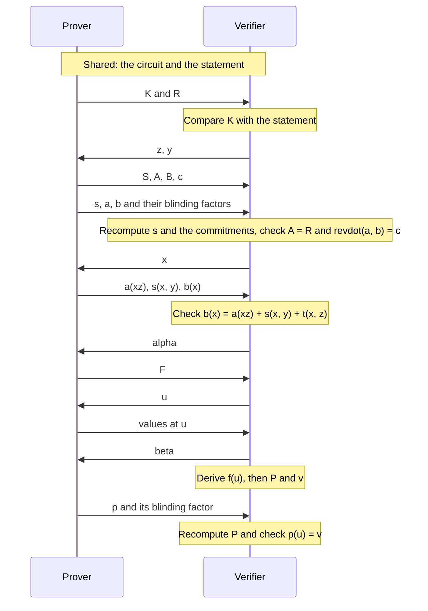

# The Complete Proof

The earlier chapters each built one part of a proof. This chapter puts them together and runs the result on the statement $x^3 + x + 5 = 35$ with $x = 3$, with every commitment computed on the toy curve and every check carried out.

The result is called a **NARK**, a non-interactive argument of knowledge. The name leaves out the S of SNARK because this proof is not succinct, and we look closely at where its size and its verification cost come from. Those costs are what the rest of the site works to remove, so the chapter ends with an exact list of the verifier steps that remain linear.

## 1. What the complete proof has to do

The earlier chapters supply these parts:

| Chapter | What it supplies |
| --- | --- |
| [Arithmetization](./arithmetization.md) | One equation, $\revdot{\v{r}}{\v{r} \circ \v{z^{4n}} + \v{t} + \v{s}} = \dot{\v{k}}{\v{y^{4n}}}$, that a valid witness satisfies |
| [Polynomial Encoding](./polynomial-encoding.md) | The polynomials $r$, $s$, $t$ and $k$ behind those vectors, and a protocol written in terms of oracles |
| [Polynomial Commitments](./polynomial-commitments.md) | A short commitment to take the place of each oracle |
| [The Inner Product Argument](./inner-product-argument.md) | A short proof of one evaluation claim |
| [Batched Openings](./batched-openings.md) | A reduction from many evaluation claims to one |
| [Statements and Challenges](./statements-and-challenges.md) | Fiat–Shamir, which replaces the verifier's challenges with hashes |

Assembling them raises three questions that no single chapter answered. The first is the order of the messages, since each challenge has to come after the data it tests. The second is how the verifier knows that the commitments it holds describe the right polynomials. The third is how much of each polynomial the verifier needs to see. The Ragu Book's [NARK](https://github.com/tachyon-zcash/ragu/blob/3219e0865e8bff1f9d817bfe3850d9e94b64338c/book/src/protocol/core/nark.md?plain=1#L212-L246) answers the third question by sending several whole polynomials in the clear. We follow that construction first, and Section 17 shows the shorter proof that the same parts can produce.

Because its verifier reads whole vectors, the book's NARK could skip several of its steps. The book gives it the shape of the verifier that recursion will need, in which the vectors are gone and only commitments and evaluation claims travel from one step to the next. A verifier that holds the vectors could check several things directly, so a few steps of this chapter's protocol duplicate checks it can already make:

- The left factor of the revdot product gets its own commitment $\bar{A}$, although in a standalone proof it equals the trace commitment $\bar{R}$ (Section 5).
- The prover sends the wiring commitment $S$ and the wiring vector $\v{s}$, although the verifier can compute $\v{s}$ from the circuit (Sections 5 and 6).
- A test at a random point ties the right factor to the trace, although the verifier could compare coefficients (Section 7).
- The values sent for that test become evaluation claims, which are batched and checked against commitments, although the verifier could evaluate the vectors it holds (Section 8).

We keep these steps because they are exactly the steps that survive when recursion removes the vectors, and the later chapters reuse this run. The sections below refer back to this list rather than justifying each step again.

::: warning Reconstructed from the Ragu Book and code at commit 3219e08, not confirmed by the authors
This chapter's protocol comes from the book. We found no standalone NARK in the code at this commit, and the word appears in the crates only as part of "SNARK". The closest code is [`verify_uncompressed`](https://github.com/tachyon-zcash/ragu/blob/3219e0865e8bff1f9d817bfe3850d9e94b64338c/crates/ragu_pcd/src/verify.rs#L1-L8), which holds a proof's polynomials and checks them directly, as the NARK does. It covers a much larger object, the proof of a recursive step, and its documentation calls it a test oracle and sends production verification through compression. Section 18 compares them.
:::

::: tip Notation
This chapter reuses three names, so we fix their meanings here. Following the book, $a(X)$ and $b(X)$ are the left and right factors of the product, while $a_i$ and $b_i$ remain the gate wires, which appear only inside $r(X)$. The polynomial $b(X)$ is the one that the polynomial encoding chapter called $f(X)$, because $f$ now means the combined quotient of [Batched Openings](./batched-openings.md). The letter $x$ means the random evaluation point here, and we say "the witness with $x = 3$" when we mean the secret input.
:::

## 2. The running example

The circuit is the one from the arithmetization chapter, with $n = 2$ gates, so every polynomial has $4n = 8$ coefficients. We reuse that chapter's challenges, $z = 5$ and $y = 7$, and the witness with $x = 3$. These are the polynomials the protocol works with:

<!-- worked:vectors -->

| Polynomial | Coefficients of $X^0, \ldots, X^7$ | Who can compute it |
| --- | --- | --- |
| $k(Y)$ | (0, 0, 0, 30, 0, 0, 0, 0) | Both, from the statement |
| $a(X) = r(X)$ | (9, 27, 9, 3, 3, 3, 0, 0) | Prover |
| $s(X, 7)$ | (0, 0, 6, 42, 37, 7, 42, 36) | Both, after $y$ |
| $t(X, 5)$ | (0, 0, 0, 0, 0, 0, 32, 24) | Both, after $z$ |
| $r(5X)$ | (9, 6, 10, 31, 26, 1, 0, 0) | Prover |
| $b(X) = r(5X) + s(X, 7) + t(X, 5)$ | (9, 6, 16, 30, 20, 8, 31, 17) | Prover |

<!-- /worked:vectors -->

A commitment to 8 coefficients needs 8 generators. We reuse the eight that the [polynomial commitments chapter](./polynomial-commitments.md#_10-replacing-the-oracles) introduced, the original $G_0, \ldots, G_3$ and the four points it added at unused $x$-coordinates, together with the existing $H$ and $U$. The added points are:

<!-- worked:generators -->

| Name | Point |
| --- | --- |
| $G_4$ | $(4,\,6)$ |
| $G_5$ | $(5,\,2)$ |
| $G_6$ | $(25,\,2)$ |
| $G_7$ | $(30,\,23)$ |

<!-- /worked:generators -->

## 3. Choosing how to check the revdot product

The protocol from the [polynomial encoding chapter](./polynomial-encoding.md#_13-polynomial-oracles) checks the revdot product by splitting the product $r(X)b(X)$ into $c_1(X)$ and $c_2(X)$. That split keeps every polynomial within the degree limit, but the prover pays for it, because computing a product of this size takes FFTs:

<!-- worked:fft -->

The [book counts](https://github.com/tachyon-zcash/ragu/blob/3219e0865e8bff1f9d817bfe3850d9e94b64338c/book/src/protocol/core/nark.md?plain=1#L176-L196) at least 3 FFTs, over a domain with at least $8n - 1$ points. For $4n = 2^{13}$, that is at least $16,383$ points, and the next power of two is $16,384$.

<!-- /worked:fft -->

There is a blunter alternative. If the prover sends the two vectors, the verifier can compute the revdot product itself with one multiplication per entry, and no product polynomial ever exists. This makes the proof much larger and removes the FFTs. The book [chooses this direct check for its NARK](https://github.com/tachyon-zcash/ragu/blob/3219e0865e8bff1f9d817bfe3850d9e94b64338c/book/src/protocol/core/nark.md?plain=1#L299-L308) and keeps the split for the places in the PCD tree where succinctness matters.

A shortcut that tests $a(x)b(x)$ at a random point against one committed polynomial does not work, for the reason from [Section 11 of the encoding chapter](./polynomial-encoding.md#_11-why-the-coefficient-is-out-of-reach). The product has degree up to $8n - 2$, and the generators limit commitments to degree below $4n$.

## 4. Committing before the challenges

The consolidated equation only means something if $r(X)$ is fixed before $z$ and $y$ are known, as the arithmetization chapter [showed](./arithmetization.md#why-a-false-witness-fails). So the first message commits to the trace, and it also commits to the public input polynomial:

$$K = \dot{\v{k}}{\v{G}}, \qquad \bar{R} = \dot{\v{r}}{\v{G}} + \gamma_r \cdot H.$$

The bar marks a hiding commitment with a blinding factor. The book blinds the polynomials that hold witness data and leaves the public ones unblinded, which is the same as using a blinding factor of zero. Section 13 discusses how much this blinding achieves.

<!-- worked:commit-first -->

The public input polynomial is $k(Y) = 30Y^3$, so $K = 30 \cdot G_3 = (27,\,1)$. The trace commitment with the blinding factor $\gamma_r = 17$ is $\bar{R} = \dot{\v{r}}{\v{G}} + 17 \cdot H = (22,\,24)$. Without the blinding term the same vector would commit to $(4,\,25)$.

<!-- /worked:commit-first -->

### Tying K to the statement

The oracle protocol treated $k(Y)$ as shared knowledge, whereas the NARK has the prover send $K$. A verifier who wants to know about the public value 35 therefore has to connect $K$ to that value, and the book's list of steps does not say how. Checking the evaluation claims about $K$ does not do the job on its own, since those claims say only that $K$ is consistent with itself:

<!-- worked:statement-tie -->

A prover with $x = 4$ can commit to $k'(Y) = 25Y^3$ instead of $30Y^3$, which is the instance of the statement $x^3 + x + 5 = 30$. Its $K = (8,\,22)$ differs from the correct $(27,\,1)$, while the claims about $K$ are all true, and every other check passes. The proof is valid for $30$ and says nothing about $35$, so a verifier that accepts $K$ without comparing it would be misled.

<!-- /worked:statement-tie -->

In our run the verifier closes this gap by recomputing $K$ from the statement. We add this as an explicit step.

::: warning The Ragu Book and the code differ here
The [book's NARK](https://github.com/tachyon-zcash/ragu/blob/3219e0865e8bff1f9d817bfe3850d9e94b64338c/book/src/protocol/core/nark.md?plain=1#L212-L214) has the prover commit to $k(Y)$ and then opens the commitment at $0$ and $y$. In the [code](https://github.com/tachyon-zcash/ragu/blob/3219e0865e8bff1f9d817bfe3850d9e94b64338c/crates/ragu_pcd/src/verify.rs#L159-L167) at commit `3219e08`, the uncompressed verifier computes $k(y)$ from the output header itself, and a [comment on the circuit code](https://github.com/tachyon-zcash/ragu/blob/3219e0865e8bff1f9d817bfe3850d9e94b64338c/crates/ragu_circuits/src/lib.rs#L321-L323) says that the verifier sets $k_0 = 1$. This chapter keeps the book's $K$, so that the run has the same shape as the book's protocol, and it adds the comparison above. The code's route needs no such comparison, because the prover never supplies the instance.
:::

The verifier now sends the challenges $z$ and $y$.

## 5. Building the two multiplicands

The challenges turn the bivariate polynomials into univariate ones, so the prover can now compute the wiring polynomial $s(X, y)$ and the right factor. It sends a commitment to each of these, together with the claimed revdot value:

$$S = \dot{\v{s}}{\v{G}}, \qquad \bar{B} = \dot{\v{b}}{\v{G}} + \gamma_b \cdot H, \qquad c = k(y).$$

It also sends $\bar{A}$, the commitment to the left factor. In a standalone NARK the left factor is the trace, so $a(X) = r(X)$ and $\bar{A} = \bar{R}$, which is the first duplicated step listed in Section 1. The book [notes this in a footnote](https://github.com/tachyon-zcash/ragu/blob/3219e0865e8bff1f9d817bfe3850d9e94b64338c/book/src/protocol/core/nark.md?plain=1#L248-L251). The two names exist because [during recursion they differ](https://github.com/tachyon-zcash/ragu/blob/3219e0865e8bff1f9d817bfe3850d9e94b64338c/book/src/protocol/core/nark.md?plain=1#L279-L283). There, $\bar{R}$ holds one step's trace, and $\bar{A}$ holds an aggregate of many revdot claims.

<!-- worked:commit-second -->

With the vectors from Section 2, the prover computes $S = (7,\,6)$ with no blinding, $\bar{B} = \dot{\v{b}}{\v{G}} + 29 \cdot H = (1,\,29)$, and $c = k(7) = 30 \cdot 7^3 = 13$ modulo 43. It also sets $\bar{A} = \bar{R} = (22,\,24)$.

<!-- /worked:commit-second -->

The verifier could compute $S$ alone, as Section 1 noted. The prover sends it anyway because the claims of Section 8 are claims about commitments, and $S$ has to be a commitment for those claims to include the wiring polynomial.

## 6. Checking the wiring and the revdot product directly

The prover now sends the three vectors $\v{s}$, $\v{a}$ and $\v{b}$, along with the blinding factors $\gamma_a$ and $\gamma_b$. This is the step that makes the proof long. In return, the verifier's checks need no evaluation argument, since it can recompute everything it was told. The recomputations rest only on the binding of the commitments, which Section 14 shows is what an attacker must break:

- It computes $\v{s}$ from the circuit and $y$, and compares. The book calls this the **wiring consistency** protocol. Comparing the sent $\v{s}$ with the verifier's own $\v{s}$ and with $S$ shows that $S$ belongs to the right circuit.
- It checks that $\bar{A} = \bar{R}$, because in this standalone protocol the [book defines](https://github.com/tachyon-zcash/ragu/blob/3219e0865e8bff1f9d817bfe3850d9e94b64338c/book/src/protocol/core/nark.md?plain=1#L219-L220) $\bar{A}$ to be $\bar{R}$. The book's verifier steps do not list this comparison, so we state it. Without it, a prover could pick a new $\v{a}$ after seeing $z$ and $y$, and the early commitment $\bar{R}$ would constrain nothing.
- It recomputes $S$, $\bar{A}$ and $\bar{B}$ from the vectors, which shows that the vectors are the ones the prover committed to.
- It computes $\revdot{\v{a}}{\v{b}}$ and compares it with $c$. The book calls this the **revdot product** protocol.

<!-- worked:direct-checks -->

| Check | Left | Right |
| --- | --- | --- |
| Recompute $\v{s}$ from the circuit and $y = 7$ | $(0, 0, 6, 42, 37, 7, 42, 36)$ | Sent $\v{s}$ is identical |
| Commit to the sent $\v{s}$ | $(7,\,6)$ | $S = (7,\,6)$ |
| Compare $\bar{A}$ with the earlier $\bar{R}$ | $\bar{A} = (22,\,24)$ | $\bar{R} = (22,\,24)$ |
| Commit to the sent $\v{a}$ with $\gamma_a = 17$ | $(22,\,24)$ | $\bar{A} = (22,\,24)$ |
| Commit to the sent $\v{b}$ with $\gamma_b = 29$ | $(1,\,29)$ | $\bar{B} = (1,\,29)$ |
| $\revdot{\v{a}}{\v{b}}$ | $13$ | $c = 13$ |

<!-- /worked:direct-checks -->

The order of the messages matters here even though the check looks like arithmetic on public data. The prover sent $\bar{R}$ before it knew $z$ and $y$, and the comparison $\bar{A} = \bar{R}$ together with the recomputation of $\bar{A}$ shows that the vector $\v{a}$ is the one behind that early commitment.

## 7. Tying b back to the trace

The revdot check accepts any $\v{b}$ that produces the right number, and a prover can always find such a vector, since one linear equation leaves most of the entries free. Nothing so far requires $\v{b}$ to be the specific vector $\v{r} \circ \v{z^{4n}} + \v{s} + \v{t}$. In polynomial form, the requirement is

$$b(X) = a(zX) + s(X, y) + t(X, z).$$

This is an identity between polynomials of degree below $4n$, so a test at one random point catches a difference, in the way the [encoding chapter](./polynomial-encoding.md#_1-what-polynomials-provide) described. The prover has already fixed all three commitments, so the verifier can send a random $x$. The prover sends the three values, and the verifier computes $t(x, z)$ alone and checks

$$b(x) = a(xz) + s(x, y) + t(x, z).$$

<!-- worked:tie -->

The verifier sends $x = 9$, so $xz = 9 \cdot 5 = 2$ modulo 43. The prover sends $a(2) = 9$, $s(9, 7) = 23$ and $b(9) = 35$. The verifier computes $t(9, 5) = 3$ alone and checks $9 + 23 + 3 = 35$.

<!-- /worked:tie -->

The dilation works as it did in the encoding chapter, with the value of $a(zX)$ at $x$ coming from the same polynomial at the point $xz$. No separate commitment to the dilated trace exists, so a prover cannot substitute a different trace in the right factor.

The verifier already holds $\v{a}$, $\v{b}$ and $\v{s}$, so this test is another of the duplicated steps from Section 1. The book [keeps the evaluation form](https://github.com/tachyon-zcash/ragu/blob/3219e0865e8bff1f9d817bfe3850d9e94b64338c/book/src/protocol/core/nark.md?plain=1#L285-L289) for the reason given there.

## 8. Batching the evaluation claims

The three values just sent, and the value $c$, are claims about committed polynomials. Section 1 listed them among the duplicated steps, and we check them through the machinery that recursion will rely on, since the accumulation chapters work on claims of exactly this form. The list has four claims, each about its own polynomial:

<!-- worked:claims -->

| Claim $i$ | Commitment | Point | Value | Quotient $q_i$, coefficients of $X^0, \ldots, X^6$ |
| --- | --- | --- | --- | --- |
| 0 | $\bar{A} = (22,\,24)$ | 2 | 9 | $(0, 8, 21, 9, 3, 0, 0)$ |
| 1 | $\bar{B} = (1,\,29)$ | 9 | 35 | $(22, 40, 17, 32, 30, 12, 17)$ |
| 2 | $S = (7,\,6)$ | 9 | 23 | $(36, 4, 38, 33, 33, 22, 36)$ |
| 3 | $K = (27,\,1)$ | 7 | 13 | $(8, 38, 30, 0, 0, 0, 0)$ |

<!-- /worked:claims -->

Claim 3 deserves a note, because it is the only place where $c$ meets the statement. Section 6 compared $\revdot{\v{a}}{\v{b}}$ with $c$, and that comparison says nothing about the public value until something ties $c$ to $k(Y)$. Claim 3 says that $K$ opens to $c$ at $y$, so it states $c = k(y)$, and together with the comparison of $K$ against the statement in Section 4 it connects the revdot check to the instance.

The book's list has two further claims, about $a(0)$ and $k(0)$, which tie down a constant wire our toy circuit does not have. Section 15 adds that wire and shows the six-claim form that [Batched Openings](./batched-openings.md#_1-why-a-proof-makes-many-claims) previewed.

Now we apply that chapter's reduction, using its weights, in which the first claim takes the highest power of $\alpha$ and $f$ takes the highest power of $\beta$. The quotients above come from synthetic division, which ignores the claimed value. The verifier sends $\alpha$ and the prover commits to the combined quotient:

<!-- worked:alpha -->

With $\alpha = 11$, the powers are $\alpha^3 = 41$, $\alpha^2 = 35$, $\alpha = 11$ and $1$. The combination $f(X) = 41\,q_0 + 35\,q_1 + 11\,q_2 + q_3$ has coefficients $(13, 4, 12, 3, 31, 17, 2)$, and with the blinding factor $\gamma_f = 5$ its commitment is $\bar{F} = (11,\,30)$.

<!-- /worked:alpha -->

The verifier sends a new point $u$, the prover sends one value per polynomial, and the verifier derives $f(u)$ from those values and the original claims:

$$f(u) = \sum_{i=0}^{3} \alpha^{3-i}\, \frac{p_i(u) - y_i}{u - x_i}.$$

<!-- worked:derive-f -->

At $u = 17$ the prover sends $a(17) = 42$, $b(17) = 29$, $s(17, 7) = 35$ and $k(17) = 29$. The verifier fills in the next table.

| $i$ | Value at $u$ | Claimed value $y_i$ | $u - x_i$ | $(p_i(u) - y_i)/(u - x_i)$ | Weight | Term |
| --- | --- | --- | --- | --- | --- | --- |
| 0 | 42 | 9 | 15 | 28 | 41 | 30 |
| 1 | 29 | 35 | 8 | 10 | 35 | 6 |
| 2 | 35 | 23 | 8 | 23 | 11 | 38 |
| 3 | 29 | 13 | 10 | 36 | 1 | 36 |

The last column sums to $f(17) = 24$, and the prover gets the same number by evaluating $f$.

<!-- /worked:derive-f -->

Finally the verifier sends $\beta$, and both parties combine the five inputs. The verifier computes $\bar{P}$ and $v$ from public data, while the prover computes the polynomial $p$ and its blinding factor:

$$
\begin{aligned}
\bar{P} &= \beta^4 \cdot \bar{F} + \beta^3 \cdot \bar{A} + \beta^2 \cdot \bar{B} + \beta \cdot S + K, \\
v &= \beta^4 f(u) + \beta^3 a(u) + \beta^2 b(u) + \beta\, s(u, y) + k(u), \\
\gamma &= \beta^4 \gamma_f + \beta^3 \gamma_a + \beta^2 \gamma_b.
\end{aligned}
$$

The polynomials $s$ and $k$ have no blinding factor, so they contribute nothing to $\gamma$.

<!-- worked:beta -->

Take $\beta = 23$. Each input carries its weight into the commitment, the value and the blinding factor.

| Input | Weight | Commitment | Value at $u$ | Blinding factor |
| --- | --- | --- | --- | --- |
| $\bar{F}$ | 40 | $(11,\,30)$ | 24 | 5 |
| $\bar{A}$ | 41 | $(22,\,24)$ | 42 | 17 |
| $\bar{B}$ | 13 | $(1,\,29)$ | 29 | 29 |
| $S$ | 23 | $(7,\,6)$ | 35 | 0 |
| $K$ | 1 | $(27,\,1)$ | 29 | 0 |
| Combined |  | $\bar{P} = (23,\,24)$ | $v = 23$ | $\gamma = 27$ |

<!-- /worked:beta -->

All the evaluation claims now rest on the single claim $(\bar{P}, u, v)$.

## 9. Revealing p

[Batched Openings](./batched-openings.md#_8-the-complete-protocol) noted that the book finishes its NARK by having the prover send $p$ in full, and it promised to return to that choice. The final step is:

<!-- worked:reveal -->

The prover sends $\v{p} = (17, 12, 34, 38, 23, 36, 30, 17)$ and $\gamma = 27$. Committing gives $\dot{\v{p}}{\v{G}} + 27 \cdot H = (23,\,24)$, which equals $\bar{P}$, and evaluating gives $p(17) = 23$, which equals $v$.

<!-- /worked:reveal -->

We built an [inner product argument](./inner-product-argument.md) for this exact kind of claim, so it is reasonable to ask why the NARK does not use one. The argument would prove the same thing with a logarithmic number of points, but in this protocol that saving is small, because the proof already contains other full vectors:

<!-- worked:reveal-tradeoff -->

For $4n = 2^{13}$, the part of the proof whose size grows with the circuit, which Section 12 calls the witness part, is $1,048,832$ bytes with $\v{p}$ revealed. Replacing the reveal with an argument of $26$ points and one scalar brings it to $787,520$ bytes, because the vectors $\v{s}$, $\v{a}$ and $\v{b}$ remain.

<!-- /worked:reveal-tradeoff -->

The verifier's work would not improve in growth either, since the argument leaves it with one MSM over all the generators, the same size as recomputing $\bar{P}$ from $\v{p}$.

The reveal also fits how the proof will be used. Sending $\v{p}$ places this polynomial in the witness part of the proof (Section 12), and the [split accumulation chapter](./split-accumulation.md) separates a proof's instance from its witness so that the expensive check on $(\bar{P}, u, v)$ can be postponed. The inner product argument comes back at the end of the recursion, when [compression](https://github.com/tachyon-zcash/ragu/blob/3219e0865e8bff1f9d817bfe3850d9e94b64338c/crates/ragu_pcd/src/compress/mod.rs#L1-L21) ends with one IPA opening on each curve. Section 17 runs the same replacement on our example, along with the replacements for the other vectors, which is where the saving appears.

## 10. The whole protocol

Here is the sequence of messages. The prover's reveals are grouped with the checks that use them.



The complete run on the toy curve is:

<!-- worked:run -->

| Step | Party | Value or check |
| --- | --- | --- |
| 0 | Both | Hold the circuit, which gives $s(X, Y)$ and $t(X, Z)$, and the statement, which gives $k(Y) = 30Y^3$ |
| 1 | Prover sends | $K = (27,\,1)$, $\bar{R} = (22,\,24)$ |
| 2 | Verifier checks | $K$ commits to the $k(Y)$ of the statement |
| 3 | Verifier sends | $z = 5$, $y = 7$ |
| 4 | Prover sends | $S = (7,\,6)$, $\bar{A} = (22,\,24)$, $\bar{B} = (1,\,29)$, $c = 13$ |
| 5 | Prover sends | $\v{s}$, $\v{a}$, $\v{b}$, $\gamma_a = 17$, $\gamma_b = 29$ |
| 6 | Verifier checks | Recomputes $\v{s}$ and $S$, checks $\bar{A} = \bar{R}$, recomputes $\bar{A}$ and $\bar{B}$, and finds $\revdot{\v{a}}{\v{b}} = 13 = c$ |
| 7 | Verifier sends | $x = 9$ |
| 8 | Prover sends | $a(2) = 9$, $s(9, 7) = 23$, $b(9) = 35$ |
| 9 | Verifier checks | $9 + 23 + t(9, 5) = 9 + 23 + 3 = 35$ |
| 10 | Verifier sends | $\alpha = 11$ |
| 11 | Prover sends | $\bar{F} = (11,\,30)$ |
| 12 | Verifier sends | $u = 17$ |
| 13 | Prover sends | Values at $u$: $42,\ 29,\ 35,\ 29$ |
| 14 | Verifier sends | $\beta = 23$ |
| 15 | Verifier derives | $f(17) = 24$, $\bar{P} = (23,\,24)$, $v = 23$ |
| 16 | Prover sends | $\v{p} = (17, 12, 34, 38, 23, 36, 30, 17)$, $\gamma = 27$ |
| 17 | Verifier checks | $\dot{\v{p}}{\v{G}} + 27 \cdot H = (23,\,24)$ and $p(17) = 23$ |

<!-- /worked:run -->

Each check in this table is an assertion in the script behind this chapter. The honest prover should also pass at every challenge, not only the ones we picked, so we tested that too:

<!-- worked:honest-count -->

We ran the whole protocol for all $43^2 = 1849$ pairs $(z, y)$ at two values of $x$, moving $u$ whenever it would land on a claim point. The verifier accepted all 3698 runs.

<!-- /worked:honest-count -->

## 11. Removing the interaction

The N in NARK means non-interactive, and the book treats this step as [a direct replacement of each challenge with a hash](https://github.com/tachyon-zcash/ragu/blob/3219e0865e8bff1f9d817bfe3850d9e94b64338c/book/src/protocol/core/nark.md?plain=1#L205-L206). The [Fiat–Shamir section of chapter 03](./statements-and-challenges.md#_8-removing-the-verifier-with-fiat–shamir) explains the transform, and the only thing this protocol adds is the list of what goes into the transcript. Each challenge must depend on every message that it tests, so the list follows the table above. The vectors $\v{s}$, $\v{a}$, $\v{b}$ and $\v{p}$ do not need to be absorbed, because the commitments already fix them, and $\bar{A}$ does not either, because it must equal the absorbed $\bar{R}$.

Here is a full run using the toy Poseidon sponge from [chapter 03](./statements-and-challenges.md#a-toy-poseidon), starting from the tag $(7, 29)$. The same witness and blinding factors now produce different challenges, so all the later values change:

<!-- worked:fs-run -->

| Messages absorbed | Values | Challenge squeezed |
| --- | --- | --- |
| $K$, $\bar{R}$ | $(27,\,1)$, $(22,\,24)$ | $z = 41$ |
| Nothing new |  | $y = 25$ |
| $S$, $\bar{B}$, $c$ | $(8,\,22)$, $(17,\,24)$, $7$ | $x = 13$ |
| $a(xz)$, $s(x, y)$, $b(x)$ | $42$, $4$, $34$ | $\alpha = 9$ |
| $\bar{F}$ | $(4,\,25)$ | $u = 16$ |
| Values at $u$ | $15$, $11$, $33$, $29$ | $\beta = 15$ |

The verifier replays the same absorptions from the proof, obtains the same six challenges, and accepts. Changing only the blinding factor of $\bar{R}$ from $17$ to $18$ changes the first absorbed message, and the six challenges become $(16, 24, 33, 7, 21, 2)$.

<!-- /worked:fs-run -->

[Repeated trials](./statements-and-challenges.md#_10-repeated-trials) still apply, since a cheater can try many blinding factors privately and look for a lucky set of challenges. The toy field's 43 outputs make that easy, and a 255-bit field does not.

## 12. The proof's two parts

Collecting the prover's messages, the book [divides the proof](https://github.com/tachyon-zcash/ragu/blob/3219e0865e8bff1f9d817bfe3850d9e94b64338c/book/src/protocol/core/nark.md?plain=1#L253-L272) into an **instance** part of constant size and a **witness** part of linear size. The linear witness is why this is a NARK and not a SNARK.

<!-- worked:proof-parts -->

| Part | Item | Value in our run |
| --- | --- | --- |
| Instance | $K, \bar{R}, S, \bar{A}, \bar{B}$ | $(27,\,1)$, $(22,\,24)$, $(7,\,6)$, $(22,\,24)$, $(1,\,29)$ |
| Instance | $c$ | 13 |
| Instance | $a(xz), s(x, y), b(x)$ | $9,\ 23,\ 35$ |
| Instance | $\bar{P}, u, v$ | $(23,\,24)$, $17$, $23$ |
| Witness | $\v{s}$ | $(0, 0, 6, 42, 37, 7, 42, 36)$ |
| Witness | $\v{a}$ | $(9, 27, 9, 3, 3, 3, 0, 0)$ |
| Witness | $\v{b}$ | $(9, 6, 16, 30, 20, 8, 31, 17)$ |
| Witness | $\gamma_a, \gamma_b$ | $17,\ 29$ |
| Witness | $\bar{F}$ | $(11,\,30)$ |
| Witness | Values at $u$ | $42,\ 29,\ 35,\ 29$ |
| Witness | $\v{p}, \gamma$ | $(17, 12, 34, 38, 23, 36, 30, 17)$, $27$ |

<!-- /worked:proof-parts -->

The challenges do not appear, because the verifier replays them from the transcript. The point $u$ is a challenge too, but it appears in the instance because $(\bar{P}, u, v)$ is one evaluation claim, and a later verifier that receives the claim needs all three parts of it.

This division can look odd, because $\bar{F}$ is a single point and the values at $u$ are four scalars, yet both sit in the witness, while $\bar{P}$, which is computed from $\bar{F}$, sits in the instance. The book places them there and describes them only as the prover's messages from the batching step, without giving a reason. Our reading is that the instance carries the reduced claim $(\bar{P}, u, v)$ directly, so a later verifier that takes the claim as given needs nothing else from the batching step. The point $\bar{F}$ and the values at $u$ are the inputs from which $\bar{P}$ and $v$ were derived, and only a check that derives them again reads those inputs, so they travel with the vectors that the same postponed check reads.

The sizes of the two parts are very different:

<!-- worked:proof-size -->

Take $4n = 2^{13}$ with 32-byte values, the size the [Ragu Book's analysis](https://github.com/tachyon-zcash/ragu/blob/3219e0865e8bff1f9d817bfe3850d9e94b64338c/book/src/protocol/analysis.md?plain=1#L38-L43) gives for its preferred threshold. The instance holds 6 points and 6 scalars, or $384$ bytes. The witness holds four vectors of $8,192$ entries and 8 more values, or $1,048,832$ bytes, which is about 1 MB.

<!-- /worked:proof-size -->

The division is not only a way of counting. The [split accumulation chapter](./split-accumulation.md) builds a verifier that reads the instance and leaves the witness to a later check.

The book's [witness list](https://github.com/tachyon-zcash/ragu/blob/3219e0865e8bff1f9d817bfe3850d9e94b64338c/book/src/protocol/core/nark.md?plain=1#L263) has no entry for the combined blinding factor $\gamma$ and writes $F$ with no bar, so this site follows the [PCS aggregation chapter](https://github.com/tachyon-zcash/ragu/blob/3219e0865e8bff1f9d817bfe3850d9e94b64338c/book/src/protocol/core/accumulation/pcs.md?plain=1#L45-L58) and [chapter 08](./batched-openings.md#_11-blinding-factors) in blinding $F$ and listing $\gamma$.

## 13. Hiding commitments and what the proof reveals

The commitments $\bar{R}$, $\bar{A}$, $\bar{B}$ and $\bar{F}$ carry blinding factors so that a commitment alone reveals nothing, for the reason given in [chapter 06](./polynomial-commitments.md#_6-hiding-the-vector). The difference is visible on our trace:

<!-- worked:hiding-guess -->

An observer who holds the unblinded commitment $(4,\,25)$ can build the trace for every candidate input and compare. Trying all 43 inputs gives exactly one match, $x = 3$. An observer who holds only $\bar{R} = (22,\,24)$ gets no such answer, because each of the 43 candidate traces has exactly one blinding factor that fits this point.

<!-- /worked:hiding-guess -->

This protection does not last, because the proof then sends the vectors:

<!-- worked:hiding-read -->

In our run the proof contains $\v{a} = (9, 27, 9, 3, 3, 3, 0, 0)$. The layout from the arithmetization chapter puts the wire $a_0$ at position 3, so anyone can read the secret input $x = 3$ straight from the proof.

<!-- /worked:hiding-read -->

So this NARK hides nothing. The book [says this openly](https://github.com/tachyon-zcash/ragu/blob/3219e0865e8bff1f9d817bfe3850d9e94b64338c/book/src/protocol/core/nark.md?plain=1#L291-L297), and it describes the omission as intentional, since Ragu intends to prevent leakage through rerandomization and not by making this NARK zero knowledge. It also says that a fold-level randomizer is still needed for that. This agrees with the [status recorded in chapter 02](./pcd-intro.md#proof-size-and-hiding-in-ragu), where neither the book nor the code yet establishes zero knowledge. The blinding factors in the book's protocol therefore do not provide privacy in this standalone form.

The code at commit `3219e08` does not hide either, which we reconstructed from the code and the authors have not confirmed. Its IPA omits Pedersen blinding, as [chapter 06 recorded](./polynomial-commitments.md#_6-hiding-the-vector), and its [compression module](https://github.com/tachyon-zcash/ragu/blob/3219e0865e8bff1f9d817bfe3850d9e94b64338c/crates/ragu_pcd/src/compress/mod.rs#L45-L46) states that a compressed proof is not hiding. Our toy run follows the book, so that the reader can see where blinding factors go.

## 14. Why cheating fails

The argument relies on the following assumptions, and it is informal. Nobody knows a relation among the generators, which is the [discrete log relation assumption](./polynomial-commitments.md#_4-why-a-prover-cannot-change-the-vector). Each challenge is uniform and comes after the messages it tests, which for a non-interactive proof means treating the transcript hash as a [random oracle](./statements-and-challenges.md#the-assumption). The verifier has also tied $K$ to the statement, as in Section 4.

We take the false witness with $x = 4$ and consider what its prover can try. All of the counts below come from running the same verifier function that accepted the run in Section 10.

### The prover follows every instruction

<!-- worked:cheat-honest -->

Take the false witness with $x = 4$, so $\v{r}' = (16, 21, 16, 4, 4, 4, 0, 0)$, and let the prover follow every instruction. At $z = 5$ and $y = 7$ the verifier computes $\revdot{\v{a}}{\v{b}} = 18$, while $k(7) = 13$, so the revdot check fails. Counting all pairs of challenges finds 43 of the 1849 where the two numbers happen to agree, the same count as in the [arithmetization chapter](./arithmetization.md#why-a-false-witness-fails).

<!-- /worked:cheat-honest -->

### The prover changes b

To reach the right revdot value, the prover has to send some vector other than the honest $\v{b}$.

<!-- worked:cheat-naive -->

The revdot check only looks at $\v{b}$, so the cheater can replace it with $\v{b}' = \v{b} + \v{d}$, where $\v{d}$ is any vector with $\revdot{\v{r}'}{\v{d}} = 13 - 18 = 38$. The most direct choice puts one entry at position 4, the partner of $r'_3 = 4$, giving $d_4 = 31$. The revdot check now passes. The check $b(x) = a(xz) + s(x, y) + t(x, z)$ then compares two polynomials that differ by $D(X) = 31X^4$, which has only the root $0$. Running the whole protocol at all 43 values of $x$ gives one acceptance, at $x = 0$.

<!-- /worked:cheat-naive -->

<!-- worked:cheat-best -->

The cheater does better by spreading the difference over all eight coefficients. Let $D(X)$ be a multiple of $(X-1)(X-2)\cdots(X-7)$, scaled so that $\revdot{\v{r}'}{\v{d}} = 38$, which gives $D(X) = 36 + 16X + 25X^2 + 14X^3 + 14X^4 + 2X^5 + 26X^6 + 39X^7$. Running the whole protocol at all 43 values of $x$ gives acceptance at exactly $x \in \{1, \ldots, 7\}$, which is 7 out of 43. A polynomial with 8 coefficients has at most 7 roots, so no choice of $D$ can do better, and for $4n = 2^{13}$ on a field of about $2^{254}$ elements the same limit gives a probability below $2^{-240}$.

<!-- /worked:cheat-best -->

### The prover lies about an evaluation

Outside those roots, the only way past the check in Section 7 is to send a false value.

<!-- worked:cheat-lie -->

At $x = 9$ this polynomial is not zero, since $D(9) = 13$. The cheater can still pass the check by sending $b(9) = 28$ in place of the true $41$, but that value is then a false evaluation claim about $\bar{B}$. The batching of the previous chapter catches it. Running all 43 values of $\beta$ with honest values at $u$ gives one acceptance, at $\beta = 0$, where the derived $f(u)$ drops out of $v$.

<!-- /worked:cheat-lie -->

[Chapter 08](./batched-openings.md#_9-why-cheating-fails) counted what the cheater gains by also shifting values at $u$ or by committing to a different $f$, and its reasoning applies to these claims unchanged. In this standalone NARK the verifier could also find the false value by evaluating the $\v{b}$ it holds. The count above measures the batched check alone because that is the check recursion keeps.

### The prover knows a challenge early

Every count above assumes the message order. The order is what stops a prover from solving for its messages:

<!-- worked:cheat-early -->

Suppose the prover knows $z = 5$ and $y = 7$ before it sends $\bar{R}$. Starting from the false trace, it changes only entry 0 by an unknown amount $\delta$. In the revdot product, entry 0 of $\v{r}$ multiplies entry 7 of $\v{b}$, and entry 7 of $\v{r}$ multiplies entry 0 of $\v{b}$. Since $r'_7 = 0$, the second product stays 0, and $b_7 = r'_7 z^7 + s_7 + t_7 = 36 + 24 = 17$ modulo 43 does not depend on $\delta$. So the revdot value grows by exactly $17\,\delta$, and the prover needs $17\,\delta = 38$, which gives $\delta = 25$, since $17 \cdot 25 = 38$ modulo 43. The result is $\v{r}'' = (41, 21, 16, 4, 4, 4, 0, 0)$. This vector is not a valid trace, because its gates do not hold. It still satisfies the consolidated equation at this one pair, and the verifier accepts the whole proof. The same vector, committed honestly before the challenges, passes the revdot check at only 44 of the 1849 pairs.

<!-- /worked:cheat-early -->

This is the reason each challenge has to depend on the commitments before it, and [chapter 03](./statements-and-challenges.md#_9-omitting-data-from-the-transcript) shows what happens if a transcript leaves them out.

### The prover knows a relation among the generators

Fixing $\bar{R}$ first only helps if the commitment really fixes the vector. Here is the same attack, carried out after the challenges by a prover that can open a commitment in two ways:

<!-- worked:cheat-binding -->

Suppose the prover commits to the false trace first, so $\bar{R} = (27,\,30)$, and only then learns $z$ and $y$. Because it knows the discrete logs of the toy generators, it can change entries 0 and 1 by $18$ and $8$ without moving the commitment. One such change gives $\v{r}'' = (34, 29, 16, 4, 4, 4, 0, 0)$, which commits to the same point and satisfies the consolidated equation at this pair. The verifier accepts, because each of its recomputations finds what it expects.

<!-- /worked:cheat-binding -->

On a real curve this requires solving discrete log, and the toy curve's small size is what makes it possible here.

## 15. The constant wire

The runs so far used four claims, while the book's list has six. The two extra claims, about $a(0)$ and $k(0)$, concern a wire that our two-gate circuit does not have, and this section adds it so that we can run the book's list as written. The cheating analysis above does not depend on it.

Our toy circuit moved its constant 5 into the instance, so that the output constraint read $a_0 + c_1 = 30$. A real circuit needs constants inside its constraints, and the arithmetization chapter [mentioned](./arithmetization.md#_13-the-arithmetization-in-ragu) how Ragu provides them, with a wire $d_0$ that holds the value 1. A constraint can then use $5 d_0$ wherever it needs the constant 5. The wire lives in an extra gate at position 0, the system gate, so the other two gates move up by one and $n$ becomes 3.

The constraints change too. We put the two constraints that involve the instance first, so that $k(Y)$ has its nonzero coefficients at the lowest powers of $Y$.

<!-- worked:one-constraints -->

The new constraint 0 says $d_0 = k_0$, and the instance supplies $k_0 = 1$. Constraint 1 is the output constraint, now written $c_2 + a_1 + 5 d_0 = k_1$ with $k_1 = 35$, so the constant 5 sits inside the constraint and multiplies the wire $d_0$. Constraints 2 to 4 are the old constraints 0 to 2 with every wire index raised by one, namely $a_1 = b_1$, $a_2 = c_1$ and $b_2 = a_1$.

<!-- /worked:one-constraints -->

The system gate also needs values for $a_0$, $b_0$ and $c_0$. Setting $b_0 = c_0 = 0$ satisfies its equation $a_0 b_0 = c_0$ for any $a_0$. Ragu fills $a_0$ with a random value, and the [book's local wiring chapter](https://github.com/tachyon-zcash/ragu/blob/3219e0865e8bff1f9d817bfe3850d9e94b64338c/book/src/protocol/local/wiring.md?plain=1#L85-L89) says that this value does not supply hiding. Its purpose is to keep combinations of commitments away from the identity point. We pick an arbitrary nonzero value for it:

<!-- worked:one-trace -->

Gate 0 holds $a_0 = 11$, $b_0 = 0$, $c_0 = 0$ and $d_0 = 1$. Gates 1 and 2 are the two gates from the arithmetization chapter. The instance is $k(Y) = 1 + 35Y$, and the trace is $\v{r} = (0, 9, 27, 9, 3, 11, 0, 3, 3, 0, 0, 1)$. Its constant coefficient is $r(0) = c_0 = 0$, and its top coefficient is $d_0 = 1$. Checking all 1849 challenge pairs confirms that the consolidated equation holds at every one.

<!-- /worked:one-trace -->

The polynomials now have $4n = 12$ coefficients, so this section uses four further generators, $G_8$ to $G_{11}$, which the script lists. The value $n = 3$ is not a power of two, which the inner product argument needs, as the [next chapter](./recursive-proofs.md) points out. The run below works anyway, because the verifier reads $\v{p}$ in full and no argument runs.

::: warning The Ragu Book and the code differ here
[Chapter 05 recorded](./polynomial-encoding.md#_17-the-encoding-in-ragu) that the NARK chapter checks $r(0) = 1$, while the code and the local wiring chapter have $c_0 = 0$ and $d_0 = 1$, which gives $r(0) = 0$. This site follows the code, as chapter 05 did, so our claim about $a(0)$ has the value 0. [Chapter 08's preview](./batched-openings.md#_1-why-a-proof-makes-many-claims) quoted the book's form with the value 1. We found no opening of $r$ at 0 in `verify_uncompressed`, and the [local wiring chapter](https://github.com/tachyon-zcash/ragu/blob/3219e0865e8bff1f9d817bfe3850d9e94b64338c/book/src/protocol/local/wiring.md?plain=1#L82-L84) explains that the gate equations already force $c_0 = 0$ once $d_0 = 1$, so we keep the claim here only to match the shape of the book's list.
:::

The wire $d_0$ sits at the top of the trace, position $4n - 1$, and its partner in the revdot product is position 0, so the constraint $d_0 = k_0$ puts the coefficient 1 on $X^0$ in $s(X, Y)$ with $Y^0$. This gives the identity $s(X, 0) = 1$, which the book [states as well](https://github.com/tachyon-zcash/ragu/blob/3219e0865e8bff1f9d817bfe3850d9e94b64338c/book/src/protocol/local/wiring.md?plain=1#L78-L80) and which the script confirms.

The claims list now has the six entries of chapter 08's preview, on four polynomials, so one value per polynomial still suffices at $u$. Here $\alpha = 11$ again, and the weights run from $\alpha^5$ down to 1:

<!-- worked:one-claims -->

| Claim $i$ | Polynomial | Point | Value | Weight |
| --- | --- | --- | --- | --- |
| 0 | $\bar{A}$ | 0 | 0 | 16 |
| 1 | $\bar{A}$ | 2 | 14 | 21 |
| 2 | $\bar{B}$ | 9 | 22 | 41 |
| 3 | $S$ | 9 | 39 | 35 |
| 4 | $K$ | 0 | 1 | 11 |
| 5 | $K$ | 7 | 31 | 1 |

<!-- /worked:one-claims -->

With the same challenges as before, the batching of Section 8 reduces these six claims to one claim, the revealed $\v{p}$ matches the derived $\bar{P}$ and $v$, and the verifier accepts.

The claim $k(0) = 1$ matters only for a verifier that takes $K$ from the prover without comparing it with the statement, which is how the book's list of steps reads. The wire $d_0$ is constrained only to equal $k_0$, so if nothing checks $k_0$, a prover can give the constant a different value and change the meaning of every constraint that uses it:

<!-- worked:one-attack -->

Take $x = 4$, which is false for the real statement, since $4^3 + 4 + 5 = 30$ modulo 43. A cheater sets $d_0 = 2$ and commits to $k'(Y) = 2 + 35Y$. Then $c_2 + a_1 + 5 d_0 = 21 + 4 + 10 = 35$, so every gate and constraint holds, and the consolidated equation holds at all 1849 challenge pairs. Run against the book's verifier as written, which takes $K$ from the prover and never compares it with the statement, this proof passes every check once the two constant claims are removed from the list. With the claims in the list, the false claim $k'(0) = 1$ remains. Keeping the other challenges fixed, the verifier rejects for 42 of the 43 values of $\beta$, and it accepts only at $\beta = 0$, which removes $f$ from $p$.

<!-- /worked:one-attack -->

The claim pins only one coefficient of $K$, so it does not rescue a verifier that skips the comparison altogether, since the attack of Section 4 changes a different coefficient. The verifier in this chapter makes that comparison, and the code computes $k(y)$ itself, and either one catches the attack without the claim:

<!-- worked:one-attack-tied -->

Our verifier from Section 4 rejects the same proof at its first step, because $K' = 2 \cdot G_0 + 35 \cdot G_1$ differs from the $K$ it computes from the statement. The code's route also rejects it, since the cheater's $c = k'(y)$ differs from the verifier's own $k(y)$ at all 43 values of $y$.

<!-- /worked:one-attack-tied -->

So in our protocol the claim $k(0) = 1$ is redundant, as the claim about $a(0)$ is, and we keep both to match the book's list. The rest of the chapter returns to the two-gate circuit.

## 16. What the verifier pays

Now we can go through the verifier's work, one step at a time. The next table gives each step's cost, and for sizes it uses $4n = 2^{13}$:

<!-- worked:costs -->

| Verifier step | Work | Growth |
| --- | --- | --- |
| Compute $\v{s}$ from the circuit | One term per wire in each constraint | Linear |
| Recompute $S$, $\bar{A}$, $\bar{B}$ | 3 MSMs of size $4n$, or $24,576$ scalar multiplications | Linear |
| Compute $\revdot{\v{a}}{\v{b}}$ | $4n$, or $8,192$ field multiplications | Linear |
| Compute $t(x, z)$ | Two geometric sums, using repeated squaring | Logarithmic |
| Compute $k(y)$ or compare $K$ | One term per public input | Size of the instance |
| Derive $f(u)$ | One inverse and a few multiplications per claim | Constant |
| Compute $\bar{P}$ and $v$ | Five scalar multiplications and field operations | Constant |
| Recompute $\bar{P}$ from $\v{p}$ | 1 MSM of size $4n$, or $8,192$ scalar multiplications | Linear |
| Evaluate $p(u)$ | $4n$, or $8,192$ field multiplications | Linear |

<!-- /worked:costs -->

The value $t(x, z)$ can be computed quickly because the sums in its definition are geometric. To see this, start from the definition and split it into two sums:

$$-t(x, z) = \sum_{i=0}^{n-1} z^{2n-1-i} x^{4n-1-i} + \sum_{i=0}^{n-1} z^{2n+i} x^{4n-1-i}.$$

Substituting $k = n - 1 - i$ turns the exponents into $2n - 1 - i = n + k$, $2n + i = 3n - 1 - k$ and $4n - 1 - i = 3n + k$. Factoring out the parts that do not depend on $k$ gives

$$-t(x, z) = x^{3n} z^{n} \sum_{k=0}^{n-1} (xz)^k + x^{3n} z^{3n-1} \sum_{k=0}^{n-1} (x/z)^k,$$

which matches the [book's form](https://github.com/tachyon-zcash/ragu/blob/3219e0865e8bff1f9d817bfe3850d9e94b64338c/book/src/protocol/local/arithmetization.md?plain=1#L170-L172) for nonzero $z$. Each geometric sum has a closed form that takes $O(\log n)$ multiplications, by repeated squaring.

<!-- worked:t-closed -->

At $x = 9$, $z = 5$ and $n = 2$, the first sum is $1 + xz = 3$ and the second is $1 + x/z = 20$. The formula gives $-t = 40$, so $t(9, 5) = 3$, which matches the direct sum over the entries of $\v{t}$.

<!-- /worked:t-closed -->

The wiring vector has no comparable shortcut, since its entries come from an arbitrary circuit:

<!-- worked:s-terms -->

Our circuit has 8 nonzero wiring coefficients across its four constraints. Each contributes one term $\text{coefficient} \cdot y^j x^{\text{position}}$, and at $x = 9$, $y = 7$ those terms are $(25, 2, 27, 6, 22, 13, 18, 39)$, which sum to $s(9, 7) = 23$. A circuit with more wiring has more terms, and no term can be skipped.

<!-- /worked:s-terms -->

The MSMs can be merged, though this only saves a constant factor. The verifier can pick a random $\rho$ and check that one combined vector commits to the same combination of the commitments, in place of recomputing each one. If any vector does not match its commitment, the difference is a nonzero polynomial in $\rho$, so a random $\rho$ exposes it. The [code's uncompressed verifier](https://github.com/tachyon-zcash/ragu/blob/3219e0865e8bff1f9d817bfe3850d9e94b64338c/crates/ragu_pcd/src/verify.rs#L695-L724) does this.

<!-- worked:recommit-batch -->

For our run take $\rho = 8$ and the four vectors $\v{a}, \v{b}, \v{s}, \v{p}$. The combined vector is $(41, 30, 38, 3, 39, 33, 28, 17)$ with blinding factor $9$, and it commits to $(18,\,21)$, the same point as $\rho^3 \cdot \bar{A} + \rho^2 \cdot \bar{B} + \rho \cdot S + \bar{P}$. One MSM of size $4n$ did the work of four.

<!-- /worked:recommit-batch -->

A verifier of this form is fine as a final check, but it cannot be placed inside a recursive proof at reasonable cost, because each of its linear steps would become part of a circuit. The [next chapter](./recursive-proofs.md) explains this problem in detail. The book groups the linear work into [three subprotocols](https://github.com/tachyon-zcash/ragu/blob/3219e0865e8bff1f9d817bfe3850d9e94b64338c/book/src/protocol/core/nark.md?plain=1#L268-L272), namely wiring consistency, the revdot product and the evaluation check.

## 17. A short proof from the same parts

We already have replacements for two of those three. The revdot product can use the split from [chapter 05](./polynomial-encoding.md#_12-splitting-the-product), at the cost of the prover's FFTs, and the evaluation check can use the inner product argument. Applying both shows what the third item leaves behind. Several objects of the long proof disappear. The split replaces the direct revdot check, so no right factor $b(X)$ is ever formed and the proof needs no commitment $\bar{B}$. The verifier only needs the single values $s(x, y)$ and $k(y)$, which it computes itself from the circuit and the statement, so the proof carries neither $\v{s}$ nor the commitments $S$ and $K$. The claims therefore concern only $r$, $c_1$ and $c_2$.

::: warning Reconstructed from code at commit 3219e08, not confirmed by the authors
This section is our own assembly of the [oracle protocol in the book](https://github.com/tachyon-zcash/ragu/blob/3219e0865e8bff1f9d817bfe3850d9e94b64338c/book/src/protocol/core/nark.md?plain=1#L144-L163) with the batching and IPA chapters. It omits blinding, as the IPA at this commit does, and it uses the symmetric IPA of [chapter 07](./inner-product-argument.md#_4-one-round-of-folding). Ragu does not run this exact protocol. Its [compression](https://github.com/tachyon-zcash/ragu/blob/3219e0865e8bff1f9d817bfe3850d9e94b64338c/crates/ragu_pcd/src/compress/mod.rs#L1-L21) follows the same pattern on a larger set of folded claims.
:::

The first thirteen steps mostly repeat chapter 05 and chapter 08, and now every oracle has become a commitment. Step 7 is the split check from [chapter 05](./polynomial-encoding.md#_13-polynomial-oracles), which with $4n = 8$ reads

$$r(x)\big(r(xz) + s(x, y) + t(x, z)\big) = x^{7} c_1(x^{-1}) + x^{8} c_2(x).$$

Step 7 of the next table evaluates each side of it separately:

<!-- worked:short-commit -->

| Step | Party | Value or check |
| --- | --- | --- |
| 1 | Prover sends | $R = (4,\,25)$ |
| 2 | Verifier sends | $z = 5$, $y = 7$ |
| 3 | Prover sends | $C_1 = (24,\,30)$ and $C_2 = (17,\,24)$, the commitments to $c_1(X)$ and $c_2(X)$ |
| 4 | Verifier sends | $x = 9$, so $xz = 2$ and $x^{-1} = 24$ |
| 5 | Prover sends | $r(9) = 5$, $r(2) = 9$, $c_1(0) = 13$, $c_1(24) = 6$, $c_2(9) = 30$ |
| 6 | Verifier computes | $s(9, 7) = 23$, $t(9, 5) = 3$, $k(7) = 13$ |
| 7 | Verifier checks | The split, with left side $5 \cdot (9 + 23 + 3) = 3$ and right side $9^7 c_1(24) + 9^8 c_2(9) = 36 \cdot 6 + 23 \cdot 30 = 3$, and the target, $c_1(0) = 13 = k(7)$ |
| 8 | Verifier sends | $\alpha = 11$ |
| 9 | Prover sends | $F = (20,\,6)$, the commitment to the combined quotient |
| 10 | Verifier sends | $u = 17$ |
| 11 | Prover sends | Values at $u$: $r(17) = 42$, $c_1(17) = 2$, $c_2(17) = 18$ |
| 12 | Verifier sends | $\beta = 23$ |
| 13 | Verifier derives | $f(17) = 29$, $P = (14,\,9)$, $v = 36$ |

<!-- /worked:short-commit -->

The prover now has to prove the claim $(P, u, v)$ without revealing $p$:

<!-- worked:short-p -->

The polynomial behind $P$ has coefficients $\v{p} = (28, 23, 28, 13, 37, 37, 24, 14)$. The statement point for the argument is $P + v \cdot U = (22,\,7)$.

<!-- /worked:short-p -->

The inner product argument takes $k = 3$ rounds for 8 coefficients. Its round challenges $u_j$ are unrelated to the batching point $u$, and we pick them by hand. At each round the prover sends $L_j$ and $R_j$, and both sides fold, as chapter 07 explained:

<!-- worked:short-ipa -->

| Round $j$ | $L_j$ | $R_j$ | $u_j$ | Folded point | Folded $\v{p}$ |
| --- | --- | --- | --- | --- | --- |
| 1 | $(6,\,23)$ | $(22,\,7)$ | 15 | $(25,\,29)$ | $(24, 35, 26, 1)$ |
| 2 | $(14,\,9)$ | $(20,\,6)$ | 10 | $(8,\,9)$ | $(19, 19)$ |
| 3 | $(28,\,21)$ | $(5,\,2)$ | 3 | $(8,\,22)$ | $(6)$ |

<!-- /worked:short-ipa -->

<!-- worked:short-final -->

The prover sends the final scalar $\hat{a} = 6$. The verifier computes the coefficients of $g(X)$ from the three challenges, which are $(28, 37, 5, 2, 22, 26, 7, 20)$, then $\hat{b} = g(17) = 30$ and $\hat{G} = (4,\,25)$ from one MSM over all eight generators. The left side of the check is $(8,\,22)$, and $\hat{a} \cdot (\hat{G} + \hat{b} \cdot U) = (8,\,22)$, so the verifier accepts.

<!-- /worked:short-final -->

<!-- worked:short-repeats -->

The last folded point and the left side of the final check are the same point by construction, because the verifier computes both from the statement point and the same $L_j$ and $R_j$. Several other points repeat points named earlier in the chapter. Among the points of the argument, $R_1$ equals the statement point $P + v \cdot U$, $L_2$ equals $P$, $R_2$ equals $F$, $R_3$ equals $G_5$, the folded point of round 3 equals the cheater's $K$ from Section 4, and $\hat{G}$ equals the unblinded trace commitment $R$. These matches have no meaning. The toy group has only 43 points and this chapter names a few dozen, so repeats are unavoidable, as [chapter 08](./batched-openings.md#_5-alpha-batching) noted for one of its commitments. On a curve with about $2^{255}$ points they would not occur.

<!-- /worked:short-repeats -->

The proof is now short:

<!-- worked:short-size -->

For $4n = 2^{13}$ this proof holds $30$ points and $9$ scalars, or $1,248$ bytes at 32 bytes each, in place of about 1 MB.

<!-- /worked:short-size -->

The verifier has not improved as much as the proof has. Here is its work:

<!-- worked:short-costs -->

| Verifier step | Work for $4n = 2^{13}$ | Growth |
| --- | --- | --- |
| Compute $s(x, y)$ | One term per nonzero wiring coefficient | **Linear** |
| Compute $t(x, z)$ | Two geometric sums | Logarithmic |
| Compute $k(y)$ | One term per public input | Size of the instance |
| Split and target checks | A few field operations | Constant |
| Derive $f(u)$, $P$ and $v$ | 5 inverses and 4 scalar multiplications | Constant |
| Combine the $L_j$ and $R_j$ | $26$ scalar multiplications | Logarithmic |
| Compute $\hat{b} = g(u)$ | $12$ squarings and $13$ factor multiplications | Logarithmic |
| Compute the coefficients of $g$ | About $8,192$ field multiplications | **Linear** |
| Compute $\hat{G}$ | 1 MSM of $8,192$ scalar multiplications | **Linear** |

<!-- /worked:short-costs -->

The rows marked linear come down to two costs, once we treat the coefficients of $g$ as part of computing $\hat{G}$:

1. **Computing $s(x, y)$.** The verifier has to read the whole circuit, because the wiring has no structure it can exploit.
2. **Computing $\hat{G} = \dot{\v{g}}{\v{G}}$,** where $\v{g}$ is the coefficient vector of $g(X)$. The generators have no structure either, as [chapter 07](./inner-product-argument.md#_7-the-verifier-s-linear-cost) explained.

The book writes $G_0$ for what this site calls $\hat{G}$. These two steps are the targets of what follows. The [accumulation chapter](./accumulation.md) postpones $\hat{G}$, and the chapter on [wiring and the registry](./wiring-and-registry.md) handles $s(x, y)$. The [revdot folding chapter](./revdot-folding.md) covers how most steps avoid the split and its FFTs.

## 18. The NARK in Ragu

As Section 1 noted, the code has no type or function for this standalone protocol, since Ragu's real proofs cover a recursive step with many polynomials. Several of its checks can still be located in the uncompressed verifier. The revdot check, step 6 of our run, appears for each claim the proof carries, here from [`crates/ragu_pcd/src/verify.rs`](https://github.com/tachyon-zcash/ragu/blob/3219e0865e8bff1f9d817bfe3850d9e94b64338c/crates/ragu_pcd/src/verify.rs#L176-L180) at commit `3219e08`:

```rust
let native_revdot_claims = {
    native::ky_values::<C::Profile, _>(&native_ky)
        .zip(builder.a.iter().zip(builder.b.iter()))
        .all(|(ky, (a, b))| Verifier::<B>::sparse_revdot(a, b) == ky)
};
```

::: warning Reconstructed from code at commit 3219e08, not confirmed by the authors
- **The factors.** The proof stores polynomials named [`AbA` and `AbB`](https://github.com/tachyon-zcash/ragu/blob/3219e0865e8bff1f9d817bfe3850d9e94b64338c/crates/ragu_pcd/src/proof/mod.rs#L405-L409) apart from its traces, which matches the separation of $\bar{A}$ from $\bar{R}$ that the book explains. We return to this in [revdot folding](./revdot-folding.md).
- **The commitments.** The [batched check](https://github.com/tachyon-zcash/ragu/blob/3219e0865e8bff1f9d817bfe3850d9e94b64338c/crates/ragu_pcd/src/verify.rs#L251-L262) compares the stored commitments with their polynomials, and it includes the polynomial $p$, as our step 17 does.
- **The instance.** The verifier [computes $k(y)$](https://github.com/tachyon-zcash/ragu/blob/3219e0865e8bff1f9d817bfe3850d9e94b64338c/crates/ragu_pcd/src/verify.rs#L159-L167) itself, as Section 4 described.
- **Derived values.** The [module documentation](https://github.com/tachyon-zcash/ragu/blob/3219e0865e8bff1f9d817bfe3850d9e94b64338c/crates/ragu_pcd/src/verify.rs#L10-L27) says that $c$ and $v$ are derived from the polynomials and never read from the proof, whereas the book's instance lists them as prover messages.
- **The status of this path.** The [same documentation](https://github.com/tachyon-zcash/ragu/blob/3219e0865e8bff1f9d817bfe3850d9e94b64338c/crates/ragu_pcd/src/verify.rs#L102-L105) calls this verifier a test oracle, available only with the `test-utils` feature. Production proofs go through compression, which [the chapter on compression in Ragu](./compression.md) covers.
:::

## 19. Where this chapter leaves us

This chapter took the following steps:

1. The prover commits to the instance and the trace before it sees $z$ and $y$, and the verifier ties $K$ to the statement.
2. The prover commits to $s(X, y)$ and to the right factor $b(X) = a(zX) + s(X, y) + t(X, z)$, then sends the vectors, so that the verifier can recompute the wiring, recompute the commitments and compute the revdot product directly.
3. A check at a random $x$ ties $b(X)$ to the trace, wiring and gate polynomials.
4. The evaluation claims batch into one claim $(\bar{P}, u, v)$, which the book's NARK finishes by revealing $p$.
5. The resulting proof has a constant-size instance and a linear-size witness, and it hides nothing, despite its blinding factors.
6. A cheater can pass only at rare challenges, as long as each challenge follows the messages it tests and nobody knows a relation among the generators.
7. Replacing the direct checks with the split and the inner product argument makes the proof logarithmic in size, and it leaves the verifier two linear steps, computing $s(x, y)$ and computing $\hat{G}$.

A verifier with linear steps can check a proof, but it cannot fit inside the next proof at reasonable cost. The [next chapter](./recursive-proofs.md) takes up proofs about verifiers, and shows why the two steps above block them.
