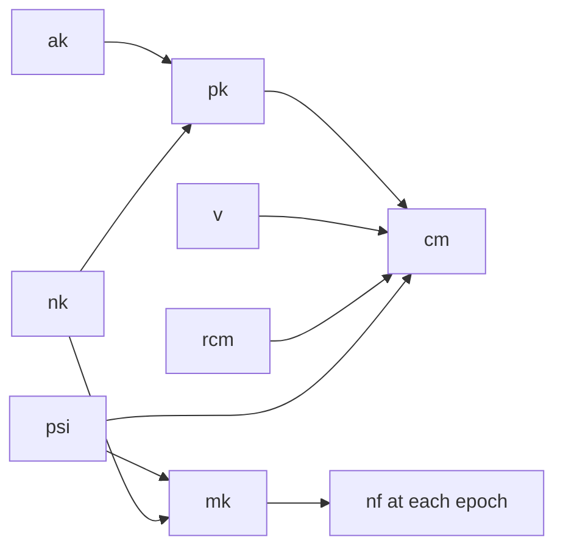

# Notes, Nullifiers, and Tachygrams

The earlier parts of this site built a proof system that can absorb other proofs. This chapter returns to the application that system serves. [Chapter 1](./scaling-zcash.md) described Tachyon in outline, with epochs, evolving nullifiers, and a window of retained values. Here we work out the objects themselves: which keys a wallet holds, what a note contains, how a note's nullifiers are derived for each epoch, why a spend publishes two of them, and why every action publishes exactly two values of a single kind.

We do not cover how a proof refers to the pool's history or how a spender shows absence from old epochs. The [next chapter](./pool-state.md) builds the pool state, [chapter 21](./oblivious-sync.md) covers absence proofs, and [chapter 22](./proof-tree.md) walks through the steps that prove all of this.

::: warning Status of these designs
Tachyon has not activated on mainnet and its design is still changing. Everything here describes the [Tachyon repository](https://github.com/tachyon-zcash/tachyon/tree/7e502548db33845dbaacdc0efe905d1a3c45e626) at commit `7e50254`, whose [shielded protocol ZIP](https://github.com/tachyon-zcash/tachyon/blob/7e502548db33845dbaacdc0efe905d1a3c45e626/book/src/zips/tachyon-shielded-protocol.md) is still an empty outline. The book's own [key hierarchy page](https://github.com/tachyon-zcash/tachyon/blob/7e502548db33845dbaacdc0efe905d1a3c45e626/book/src/keys.md?plain=1#L3) carries a note calling itself significantly outdated, and the book's analysis of nullifiers presents its choice as a [recommendation with an alternative](https://github.com/tachyon-zcash/tachyon/blob/7e502548db33845dbaacdc0efe905d1a3c45e626/book/src/nf-analysis.md?plain=1#L1026-L1039). Where the sources differ, we show both and follow the code unless we say otherwise. Tachyon also pins Ragu at [`0725b52`](https://github.com/tachyon-zcash/tachyon/blob/7e502548db33845dbaacdc0efe905d1a3c45e626/crates/tachyon/Cargo.toml#L74-L76), not at the `3219e08` that the earlier chapters read.
:::

## 1. Fields and stand-ins

Tachyon's objects live in two fields. Pallas, the curve used for spend authorization, has coordinates in $\F_p$ and scalars in $\F_q$. Poseidon's inputs and outputs, and therefore all tachygrams, are elements of $\F_p$, and signing keys are elements of $\F_q$. The toy curve $E$ from the [curves appendix](./appendix-curves.md) has the same shape, with coordinates in $\F_{31}$ and scalars in $\F_{43}$, so we use it for every signing key below.

The hashes need a different treatment. Tachyon uses Poseidon throughout, which [chapter 3](./statements-and-challenges.md#_11-poseidon-and-the-random-oracle-assumption) introduced, and each use has its own domain. In a field of 31 elements, unrelated hash outputs would collide constantly, and that would hide the behaviour we want to see. So the examples use a stand-in. We write $H_{\texttt{Tag}}(\ldots)$ for SHA-256 of the tag and inputs, reduced modulo 65,537, and a stand-in sponge produces four such values from one call. These numbers are not Poseidon outputs and are not elements of the toy field. They only show the structure, and the small range is useful later, because it lets us count a cheater's chances exhaustively.

## 2. The spending key and its two children

Spending a note requires two separate abilities. The owner has to authorize the spend with a signature, and the owner has to produce the note's nullifiers, which nobody else should be able to compute. The [deep dive](https://github.com/tachyon-zcash/tachyon/blob/7e502548db33845dbaacdc0efe905d1a3c45e626/book/src/revisit.md?plain=1#L81-L86) observes that these are the only two abilities the shielded protocol needs from its keys. Everything else in Orchard's key tree, including viewing keys and diversified addresses, supports delivering notes to recipients and detecting them, and [chapter 1](./scaling-zcash.md#_7-separating-note-delivery-from-the-shielded-protocol) explained that delivery has moved to a separate payment protocol.

The root is a [spending key](https://github.com/tachyon-zcash/tachyon/blob/7e502548db33845dbaacdc0efe905d1a3c45e626/crates/tachyon/src/keys/private.rs#L23-L40) $\mathsf{sk}$ of 32 random bytes, and each ability gets one child derived from it. The two derivations differ only in a one-byte domain, through BLAKE2b-512 with the Zcash expansion personalization:

$$\mathsf{ask} = \text{ToScalar}\big(\text{PRF}^{\text{expand}}_{\mathsf{sk}}(\texttt{0x21})\big), \qquad \mathsf{nk} = \text{ToBase}\big(\text{PRF}^{\text{expand}}_{\mathsf{sk}}(\texttt{0x22})\big).$$

The **spend authorizing key** $\mathsf{ask}$ is a scalar in $\F_q$, and its public point is the **spend validating key** $\mathsf{ak} = [\mathsf{ask}]\mathcal{G}$. The **nullifier key** $\mathsf{nk}$ is an element of $\F_p$, and it has no public counterpart.

One detail comes from RedPallas, the signature scheme that Orchard and Tachyon share. It requires $\mathsf{ak}$ to have a cleared sign bit in its compressed encoding. A point and its negative have the same $x$ and opposite signs of $y$, so if the derived point has the wrong sign, [the code negates $\mathsf{ask}$](https://github.com/tachyon-zcash/tachyon/blob/7e502548db33845dbaacdc0efe905d1a3c45e626/crates/tachyon/src/keys/private.rs#L89-L110), since $[-\mathsf{ask}]\mathcal{G} = -[\mathsf{ask}]\mathcal{G}$. On the toy curve we use the parity of $y$ as the sign.

<!-- worked:generator -->

Our generator $\mathcal{G}$ is the toy point $(1,\,2)$, and the wallet's $\mathsf{sk}$ is the text `alice-wallet-seed-7`, which stands in for 32 random bytes.

<!-- /worked:generator -->

<!-- worked:keys -->

| Key | Derivation | Stand-in value |
| --- | --- | --- |
| $\mathsf{ask}$, before normalizing | expand with `0x21`, in $\F_{43}$ | 19 |
| its public point | $[19]\mathcal{G}$ | $(27,\,1)$, with $y$ odd |
| $\mathsf{ask}$, normalized | negated, since $y$ was odd | 24 |
| $\mathsf{ak}$ | $[24]\mathcal{G}$ | $(27,\,30)$, with $y$ even |
| $\mathsf{nk}$ | expand with `0x22` | 40954 |

<!-- /worked:keys -->

The derivations from $\mathsf{sk}$ are not part of what proofs check. The deep dive says that [the circuits use $\mathsf{ak}$ and $\mathsf{nk}$ as witnesses and never constrain how they arose](https://github.com/tachyon-zcash/tachyon/blob/7e502548db33845dbaacdc0efe905d1a3c45e626/book/src/revisit.md?plain=1#L134-L142). A wallet standard chooses the path, and the protocol only needs the results to look like randomly sampled keys.

## 3. The payment key

A sender has to name the owner of a new note. Publishing $(\mathsf{ak}, \mathsf{nk})$ to the sender would give away the nullifier key, so the note carries a commitment to the pair. The [**payment key**](https://github.com/tachyon-zcash/tachyon/blob/7e502548db33845dbaacdc0efe905d1a3c45e626/crates/tachyon/src/keys/note.rs#L100-L125) is a hash of the coordinates of $\mathsf{ak}$ together with $\mathsf{nk}$:

$$\mathsf{pk} = \mathsf{Poseidon}_{\texttt{Tachyon-PkDerive}}(\mathsf{ak}_x,\ \mathsf{ak}_y,\ \mathsf{nk}).$$

With our keys, and the stand-in in place of Poseidon, this gives:

<!-- worked:payment-key -->

$$\mathsf{pk} = H_{\texttt{PkDerive}}(27,\ 30,\ 40954) = 35507.$$

If the same wallet walks to the next index for a second sender, it obtains $\mathsf{ak} = (14,\,22)$ and $\mathsf{nk} = 35396$, which give $\mathsf{pk} = 3270$. Nothing in the two payment keys shows that they belong to one wallet.

<!-- /worked:payment-key -->

Two facts about this hash shape the rest of the design. First, $\mathsf{pk}$ is a deterministic function of the pair, so one payment key handed to two senders would let them compare notes and link the payments. Since a hash admits no tweak, [unlinkability comes from minting a fresh address per sender](https://github.com/tachyon-zcash/tachyon/blob/7e502548db33845dbaacdc0efe905d1a3c45e626/book/src/keys.md?plain=1#L105-L107). The index that makes keys differ sits above $\mathsf{sk}$, which is why our second address started from a second seed. The book gives two reasons for preferring a hash over Orchard's diversified base. That trick has no known secure analogue under lattice assumptions, and [handing $\mathsf{ak}$ to senders](https://github.com/tachyon-zcash/tachyon/blob/7e502548db33845dbaacdc0efe905d1a3c45e626/book/src/revisit.md?plain=1#L160-L163) would let one who kept it attack it later with a quantum computer.

Second, the hash binds $\mathsf{nk}$ to the note's owner field, and Section 8 shows that this is what stops a spender from inventing a second nullifier sequence.

The wallet can also separate proving from signing. The [**proof authorizing key**](https://github.com/tachyon-zcash/tachyon/blob/7e502548db33845dbaacdc0efe905d1a3c45e626/crates/tachyon/src/keys/proof.rs#L13-L37) $\mathsf{pak} = (\mathsf{ak}, \mathsf{nk})$ gives a device what it needs to build proofs for every note paid to the matching payment key, and it cannot sign. A hardware wallet can therefore hold $\mathsf{ask}$ while another device does the proving. The [key hierarchy page](https://github.com/tachyon-zcash/tachyon/blob/7e502548db33845dbaacdc0efe905d1a3c45e626/book/src/keys.md?plain=1#L115) and a [code comment](https://github.com/tachyon-zcash/tachyon/blob/7e502548db33845dbaacdc0efe905d1a3c45e626/crates/tachyon/src/keys/proof.rs#L15-L17) call $\mathsf{nk}$ wallet-wide, so that one $\mathsf{pak}$ covers all of a wallet's notes. That does not fit a fresh $(\mathsf{ak}, \mathsf{nk})$ pair per sender, and the sources do not reconcile the two. The next table lists what each key allows, with the per-sender reading.

| Key | Secret? | What its holder can do |
| --- | --- | --- |
| $\mathsf{sk}$ | yes | everything below |
| $\mathsf{ask}$ | yes | sign for spends, after randomizing (Section 5) |
| $\mathsf{nk}$ | yes | compute nullifiers given a note's $\psi$, and so see when the note is spent |
| $\mathsf{pak} = (\mathsf{ak}, \mathsf{nk})$ | yes | build proofs for every note paid to this $\mathsf{pk}$, without signing |
| $\mathsf{pk}$ | shared with senders | receive notes, with no other ability |

::: warning Book and code: narrower delegation
**Book:** the [key hierarchy page](https://github.com/tachyon-zcash/tachyon/blob/7e502548db33845dbaacdc0efe905d1a3c45e626/book/src/keys.md?plain=1#L115-L120), marked as outdated, lists a per-note bundle $(\mathsf{ak}, \mathsf{mk})$ that would let a prover work on one note only, where $\mathsf{mk}$ is the per-note key of Section 6.

**Code at `7e50254`:** [`NoteSeed`](https://github.com/tachyon-zcash/tachyon/blob/7e502548db33845dbaacdc0efe905d1a3c45e626/crates/tachyon/src/stamp/proof/delegation.rs#L123-L149) and [`SpendAction`](https://github.com/tachyon-zcash/tachyon/blob/7e502548db33845dbaacdc0efe905d1a3c45e626/crates/tachyon/src/stamp/proof/stamp.rs#L202-L205) both witness a full $\mathsf{pak}$ and rederive $\mathsf{pk}$ from it, so a prover holding only $(\mathsf{ak}, \mathsf{mk})$ could not run them. A [comment on the type](https://github.com/tachyon-zcash/tachyon/blob/7e502548db33845dbaacdc0efe905d1a3c45e626/crates/tachyon/src/keys/proof.rs#L22-L26) also says that proof delegation is yet to be specified.

This site follows the code, and treats per-note proving delegation as unsettled. A sync service, by contrast, receives [only values and no key material](https://github.com/tachyon-zcash/tachyon/blob/7e502548db33845dbaacdc0efe905d1a3c45e626/crates/tachyon/src/keys/master.rs#L26-L27).
:::

## 4. Notes and commitments

A note has to record who owns it and what it is worth, and it needs enough randomness to stay hidden and to have nullifiers of its own. Tachyon's [note](https://github.com/tachyon-zcash/tachyon/blob/7e502548db33845dbaacdc0efe905d1a3c45e626/book/src/notes.md?plain=1#L13-L18) has exactly four fields:

$$\mathsf{Note} = (\mathsf{pk},\ v,\ \psi,\ \mathsf{rcm}).$$

Here $\mathsf{pk}$ is the payment key, and $v$ is a value in zatoshi between 0 and $2.1 \times 10^{15}$. The **nullifier trapdoor** $\psi$ gives the note its identity for nullifier derivation, and the **commitment trapdoor** $\mathsf{rcm}$ hides the note inside its commitment. Comparing with Orchard's note from [chapter 1](./scaling-zcash.md#_2-notes-and-commitments), the diversifier and transmission key have become $\mathsf{pk}$, and $\rho$ has gone. Section 9 returns to what removing $\rho$ costs.

The sender chooses $\psi$ and $\mathsf{rcm}$ and so knows all four fields, as the [threat model](https://github.com/tachyon-zcash/tachyon/blob/7e502548db33845dbaacdc0efe905d1a3c45e626/book/src/nf-analysis.md?plain=1#L86-L92) assumes. The recipient has to learn them as well, through whatever payment protocol the two wallets use. How to generate them is unsettled. The deep dive [says they should come from a standardized derivation](https://github.com/tachyon-zcash/tachyon/blob/7e502548db33845dbaacdc0efe905d1a3c45e626/book/src/revisit.md?plain=1#L194-L196) off a wallet key, the code comments say they [can come from a key negotiated out of band](https://github.com/tachyon-zcash/tachyon/blob/7e502548db33845dbaacdc0efe905d1a3c45e626/crates/tachyon/src/note.rs#L17-L18), and we found no standard at this commit. Suppose Bob pays Alice 25 zatoshi using the payment key above:

<!-- worked:note -->

| Field | Value | Who knows it |
| --- | --- | --- |
| $\mathsf{pk}$ | 35507 | Alice gave it to Bob |
| $v$ | 25 | Bob and Alice |
| $\psi$ | 625 | Bob and Alice |
| $\mathsf{rcm}$ | 61249 | Bob and Alice |

<!-- /worked:note -->

Bob cannot publish these values, so he publishes a [**note commitment**](https://github.com/tachyon-zcash/tachyon/blob/7e502548db33845dbaacdc0efe905d1a3c45e626/book/src/notes.md?plain=1#L22-L29) that fixes all four fields:

$$\mathsf{cm} = \mathsf{Poseidon}_{\texttt{Tachyon-CmDerive}}(\mathsf{rcm},\ \mathsf{pk},\ v,\ \psi).$$

Sapling and Orchard use variants of the Pedersen commitment, which rely on discrete log, and Tachyon [uses a hash alone](https://github.com/tachyon-zcash/tachyon/blob/7e502548db33845dbaacdc0efe905d1a3c45e626/book/src/revisit.md?plain=1#L188-L200). Each Tachyon use of Poseidon [starts its sponge](https://github.com/tachyon-zcash/tachyon/blob/7e502548db33845dbaacdc0efe905d1a3c45e626/crates/tachyon/src/digest/poseidon.rs#L44-L61) with a zero rate and with the 16-byte domain name as a number in the capacity cell. Different domains therefore behave as unrelated hash functions, even on identical inputs, and Section 11 relies on this. For our note:

<!-- worked:commitment -->

$$\mathsf{cm} = H_{\texttt{CmDerive}}(61249,\ 35507,\ 25,\ 625) = 55697.$$

<!-- /worked:commitment -->

<!-- worked:hiding -->

Changing only $\mathsf{rcm}$ to 10197 gives the commitment 15883, which looks unrelated to 55697 although the note has the same owner, value, and $\psi$.

<!-- /worked:hiding -->

A random $\mathsf{rcm}$ is what lets the commitment hide two notes with the same owner and value from each other, and hiding here assumes that Poseidon behaves like a pseudorandom function.

## 5. Randomizing the signing key for each action

A signature has to be checkable by everyone, so its verification key must be public. If that key were $\mathsf{ak}$, then every spend under that key would carry the same public key, and an observer could link them all. Spend authorization therefore [works as in Orchard](https://github.com/tachyon-zcash/tachyon/blob/7e502548db33845dbaacdc0efe905d1a3c45e626/book/src/revisit.md?plain=1#L165-L175). Each action picks a scalar $\alpha$ and signs with a randomized key,

$$\mathsf{rsk} = \mathsf{ask} + \alpha, \qquad \mathsf{rk} = \mathsf{ak} + [\alpha]\mathcal{G} = [\mathsf{ask} + \alpha]\mathcal{G}.$$

The second equation holds because scalar multiplication distributes over addition, so $\mathsf{rk}$ is exactly the public key of $\mathsf{rsk}$. The action publishes $\mathsf{rk}$, and the proof shows that it came from the $\mathsf{ak}$ inside the note's payment key.

Tachyon derives $\alpha$ from [per-action entropy $\theta$ and the note commitment](https://github.com/tachyon-zcash/tachyon/blob/7e502548db33845dbaacdc0efe905d1a3c45e626/crates/tachyon/src/entropy.rs#L19-L32), with $\alpha = \mathsf{Poseidon}_{\texttt{Tachyon-Spend}}(\theta,\ \mathsf{cm})$ [read as a scalar](https://github.com/tachyon-zcash/tachyon/blob/7e502548db33845dbaacdc0efe905d1a3c45e626/crates/tachyon/src/primitives/effect.rs#L19-L26), which is possible because $p < q$. This ties the key to the note, and it lets [a signing device recompute](https://github.com/tachyon-zcash/tachyon/blob/7e502548db33845dbaacdc0efe905d1a3c45e626/book/src/authorization.md?plain=1#L10) $\alpha$ from the note and $\theta$ without having to trust a value handed to it. Our stand-in output is far larger than 43, so here we reduce it modulo 43, which the real construction does not do.

<!-- worked:rk -->

| Quantity | Computation | Value |
| --- | --- | --- |
| $\theta$ | chosen by the signer | 4071 |
| $\alpha$ | $H_{\texttt{Spend}}(4071,\ 55697) = 1614$, reduced mod 43 | 23 |
| $\mathsf{rsk}$ | $24 + 23$ mod 43 | 4 |
| $\mathsf{rk}$ | $(27,\,30) + [23]\mathcal{G}$ | $(24,\,30)$ |
| check | $[4]\mathcal{G}$ | $(24,\,30)$ |

<!-- /worked:rk -->

<!-- worked:signature -->

A signature follows the Schnorr pattern. With nonce 9, the signer computes $R = [9]\mathcal{G} = (9,\,22)$, derives a challenge $c = 18$ from a hash of $R$, $\mathsf{rk}$, and the message, and returns $s = 9 + 18 \cdot 4 = 38$ modulo 43. The verifier checks $[s]\mathcal{G} = R + [c]\mathsf{rk}$, and both sides equal $(26,\,23)$. The verifier never used $\mathsf{ak}$.

<!-- /worked:signature -->

The public $\mathsf{rk}$ reveals nothing about $\mathsf{ak}$ when $\alpha$ is uniform, because adding a uniform multiple of the generator produces a uniform point whatever the starting key.

<!-- worked:unlinkable -->

We can test this exhaustively on the toy curve. Of the 42 points other than the identity, 21 have even $y$ and could be a normalized $\mathsf{ak}$. For each of those 21 candidates, exactly one $\alpha$ in $\F_{43}$ turns it into $(24,\,30)$. The published key is therefore equally consistent with every owner, and a second action by Alice with $\alpha = 32$ publishes the unrelated-looking $(6,\,23)$.

<!-- /worked:unlinkable -->

An output action has nothing to authorize, since creating a note spends nobody's money. It still has to look like a spend, so it also publishes a key and a signature, with [$\mathsf{rsk} = \alpha$ and $\mathsf{rk} = [\alpha]\mathcal{G}$](https://github.com/tachyon-zcash/tachyon/blob/7e502548db33845dbaacdc0efe905d1a3c45e626/crates/tachyon/src/action.rs#L141-L158), using the domain `Tachyon-Output` in place of `Tachyon-Spend`. Both shapes produce a uniform point. Each action also publishes a value commitment $\mathsf{cv}$, which the [chapter on the proof tree](./proof-tree.md) covers.

## 6. Deriving a note's nullifiers

Chapter 1 set out [what an epoch nullifier has to do](./scaling-zcash.md#_8-evolving-nullifiers). A note needs a different nullifier in each epoch, these values must look unrelated to anyone without the owner's secret, and each epoch must have exactly one valid value. A wallet might also need many of them at once, because a proof about an old note covers every epoch since its creation. These needs lead to a derivation in two stages.

The first stage combines the two secrets that make a nullifier belong to this owner and this note. It produces the note's [**master key**](https://github.com/tachyon-zcash/tachyon/blob/7e502548db33845dbaacdc0efe905d1a3c45e626/crates/tachyon/src/digest/poseidon.rs#L139-L151):

$$\mathsf{mk} = \mathsf{Poseidon}_{\texttt{Tachyon-NfMaster}}(\psi,\ \mathsf{nk}).$$

The sender knows $\psi$ and not $\mathsf{nk}$, and the wallet holds $\mathsf{nk}$ for many notes, so only the owner of this specific note has both. Doing this once also keeps $\mathsf{nk}$ out of later headers. In the proof tree, [`NoteSeed`](https://github.com/tachyon-zcash/tachyon/blob/7e502548db33845dbaacdc0efe905d1a3c45e626/crates/tachyon/src/stamp/proof/delegation.rs#L101-L114) computes $\mathsf{mk}$ and passes it on, and no later header carries $\mathsf{nk}$, although [`SpendAction`](https://github.com/tachyon-zcash/tachyon/blob/7e502548db33845dbaacdc0efe905d1a3c45e626/crates/tachyon/src/stamp/proof/stamp.rs#L202-L205) witnesses $\mathsf{pak}$ again to check the payment key. Our note gives:

<!-- worked:master-key -->

$$\mathsf{mk} = H_{\texttt{NfMaster}}(625,\ 40954) = 299.$$

<!-- /worked:master-key -->

The second stage turns $\mathsf{mk}$ and an epoch into nullifiers. One Poseidon permutation yields a whole rate's worth of output, so four values cost the same as one. Wasting three of them would be a poor use of a limited circuit, and Tachyon takes all four and assigns them to [four consecutive epochs](https://github.com/tachyon-zcash/tachyon/blob/7e502548db33845dbaacdc0efe905d1a3c45e626/book/src/nullifiers.md?plain=1#L20-L29). To find the value for epoch $e$, round down to the group's start $w = e - (e \bmod 4)$, run one sponge over $(\mathsf{mk}, w)$, and take the entry at position $e - w$:

$$\mathsf{Poseidon}_{\texttt{Tachyon-NfDerive}}(\mathsf{mk},\ w) = (\mathsf{nf}_w,\ \mathsf{nf}_{w+1},\ \mathsf{nf}_{w+2},\ \mathsf{nf}_{w+3}).$$

<!-- worked:group-example -->

For $e = 7$ we get $w = 7 - (7 \bmod 4) = 4$, so $\mathsf{nf}_7$ is the entry at position 3 of the group that starts at 4.

<!-- /worked:group-example -->

Here is the running note's sequence, created in epoch 3 and spent with target epoch 7, the same example as the [figure in chapter 1](./scaling-zcash.md#_9-catching-double-spends-without-the-full-history). We use "target epoch" for the epoch $e$ that a spend's proof reaches. The sources also call it the anchor's epoch or the present epoch.

<!-- worked:nullifier-table -->

| Epoch $e$ | Group start $w$ | Position $e - w$ | $\mathsf{nf}_e$ | Role for this spend |
| --- | --- | --- | --- | --- |
| 0 | 0 | 0 | 19392 | before the note existed |
| 1 | 0 | 1 | 15569 | before the note existed |
| 2 | 0 | 2 | 21425 | before the note existed |
| 3 | 0 | 3 | 14090 | tested for absence |
| 4 | 4 | 0 | 2976 | tested for absence |
| 5 | 4 | 1 | 63093 | tested for absence |
| 6 | 4 | 2 | 59553 | tested for absence |
| 7 | 4 | 3 | 55113 | published by the spend |
| 8 | 8 | 0 | 61177 | published by the spend |
| 9 | 8 | 1 | 32258 | never revealed |
| 10 | 8 | 2 | 31053 | never revealed |
| 11 | 8 | 3 | 34200 | never revealed |

<!-- /worked:nullifier-table -->

A value depends only on $(\mathsf{mk}, e)$, because each group absorbs its own $w$. Two derivations that overlap therefore [agree on the epochs they share](https://github.com/tachyon-zcash/tachyon/blob/7e502548db33845dbaacdc0efe905d1a3c45e626/crates/tachyon/src/keys/mod.rs#L75-L79), and the script asserts this for our note.

<!-- worked:two-inputs -->

Both inputs matter. A second note to Alice with $\psi = 58561$ has $\mathsf{mk} = 1991$ and $\mathsf{nf}_7 = 45091$, so her two notes do not share nullifiers. Bob knows the first note's $\psi$, but his own key 44055 gives $\mathsf{mk} = 2019$ and $\mathsf{nf}_7 = 55576$, where the true value is 55113. So the sender of a note cannot watch for its spend.

<!-- /worked:two-inputs -->

The privacy argument assumes that Poseidon, keyed by $\mathsf{mk}$, behaves as a pseudorandom function. Revealing some outputs then says nothing about the others, including the [pair revealed at spend time](https://github.com/tachyon-zcash/tachyon/blob/7e502548db33845dbaacdc0efe905d1a3c45e626/book/src/revisit.md?plain=1#L449-L453).

<!-- worked:epoch-space -->

The code [allows epoch indices](https://github.com/tachyon-zcash/tachyon/blob/7e502548db33845dbaacdc0efe905d1a3c45e626/crates/tachyon/src/constants.rs#L9-L23) up to 1,048,575, since a block height has 32 bits and an epoch has 4,096 blocks. At 75 seconds per block that range lasts about 10,207 years.

<!-- /worked:epoch-space -->

::: warning Book and code: the nullifier's inputs
**Deep dive:** [$\mathsf{mk} = \mathsf{Poseidon}^{\mathsf{mk}}(\mathsf{nk}, \psi)$ and $\mathsf{nf}_e = \mathsf{Poseidon}^{\mathsf{nf}}.\mathsf{Permute}(\mathsf{mk}, \lfloor e / \mathsf{Rate} \rfloor)[e \bmod \mathsf{Rate}]$](https://github.com/tachyon-zcash/tachyon/blob/7e502548db33845dbaacdc0efe905d1a3c45e626/book/src/revisit.md?plain=1#L264-L271), calling this the leading candidate.

**Nullifier page and code at `7e50254`:** [$\mathsf{mk}$ absorbs $\psi$ first](https://github.com/tachyon-zcash/tachyon/blob/7e502548db33845dbaacdc0efe905d1a3c45e626/crates/tachyon/src/digest/poseidon.rs#L149-L151), and [the sponge absorbs $w$](https://github.com/tachyon-zcash/tachyon/blob/7e502548db33845dbaacdc0efe905d1a3c45e626/crates/tachyon/src/keys/master.rs#L46-L51), the group-aligned epoch.

<!-- worked:group-input -->

For $e = 6$ the deep dive absorbs $\lfloor 6/4 \rfloor = 1$, while the code absorbs $w = 4$. In our stand-in the two choices give 35925 and 59553, so they are different functions, although each gives every epoch one fixed value.

<!-- /worked:group-input -->

This site follows the code. Comments in the code also lag behind it. [One](https://github.com/tachyon-zcash/tachyon/blob/7e502548db33845dbaacdc0efe905d1a3c45e626/crates/tachyon/src/keys/note.rs#L19-L29) still gives $\mathsf{nf} = F_{\mathsf{nk}}(\Psi \Vert e)$, [another](https://github.com/tachyon-zcash/tachyon/blob/7e502548db33845dbaacdc0efe905d1a3c45e626/crates/tachyon/src/primitives/epoch.rs#L16-L18) mentions a GGM tree, and [a third](https://github.com/tachyon-zcash/tachyon/blob/7e502548db33845dbaacdc0efe905d1a3c45e626/crates/tachyon/src/note.rs#L31-L34) calls the commitment scheme undecided while the function below it uses Poseidon.
:::

## 7. Why the wallet derives its own nullifiers

A reader might expect a design in which the wallet hands a sync service a key for a range of epochs, and the service computes the nullifiers itself. An earlier Tachyon design did this, and the book keeps it as [an archived page](https://github.com/tachyon-zcash/tachyon/blob/7e502548db33845dbaacdc0efe905d1a3c45e626/book/src/ggm.md?plain=1#L3-L4). The reason it was replaced is proof cost, which the following comparison makes concrete.

The archived design used the [GGM construction](https://github.com/tachyon-zcash/tachyon/blob/7e502548db33845dbaacdc0efe905d1a3c45e626/book/src/ggm.md?plain=1#L16-L35), which treats an epoch's bits as directions down a binary tree. A seed sits at the root, each node has two children given by hashes $G_0$ and $G_1$, and each leaf is a nullifier. Hashes are one-way, so holding a node gives access to the leaves below it and to nothing else, which is exactly a key for a range of epochs.

<!-- worked:ggm-run -->

Take a 3-bit epoch space and the seed 13625, with a stand-in hash for each $G_b$. To delegate epochs 2 and 3, a wallet hands over only the node at prefix `01`, which is $k_{01} = G_1(G_0(13625)) = 23515$. Walking one more level gives $G_0(23515) = 26563$ and $G_1(23515) = 19988$, which are exactly the nullifiers for those epochs, and one-way hashing keeps the holder away from all the others. The range of epochs 0 to 6 needs 3 prefixes (`0`, `10`, `110`). Over all ranges in this small space the worst case needs 4, reached by epochs 1 to 6, so the amount of delegated key material depends on the range.

<!-- /worked:ggm-run -->

The trouble is that each level of the tree costs one hash inside a proof, and proof steps are small. The [analysis](https://github.com/tachyon-zcash/tachyon/blob/7e502548db33845dbaacdc0efe905d1a3c45e626/book/src/nf-analysis.md?plain=1#L41-L54) counts it this way.

<!-- worked:step-budget -->

A step has $2^{11} = 2,048$ multiplication gates, and one Poseidon permutation costs 288 of them, so a step fits $\lfloor 2,048 / 288 \rfloor = 7$ permutations.

<!-- /worked:step-budget -->

<!-- worked:ggm-space -->

A binary tree over an epoch space of $2^{14}$ days, about 45 years, has depth 14, so one walk takes 14 permutations and overflows a step. A tree with higher arity near the root can cut the depth to 7, which just fits one walk.

<!-- /worked:ggm-space -->

The analysis [wants at least two nullifiers in one step](https://github.com/tachyon-zcash/tachyon/blob/7e502548db33845dbaacdc0efe905d1a3c45e626/book/src/nf-analysis.md?plain=1#L58-L60), since a spend publishes two, and a tree walk cannot provide that. It then tries other constructions and [recommends](https://github.com/tachyon-zcash/tachyon/blob/7e502548db33845dbaacdc0efe905d1a3c45e626/book/src/nf-analysis.md?plain=1#L4-L6) using a Poseidon permutation directly, with its rate-4 output. The analysis calls this Attempt 3, and it is the design of Section 6:

<!-- worked:nf-cost -->

| Design | Permutations for one nullifier | Nullifiers per step of 7 permutations |
| --- | --- | --- |
| GGM, binary tree of depth 14 | 14 | none, since one walk overflows a step |
| GGM, mixed arity, depth 7 | 7 | 1 |
| One hash per nullifier (Attempt 3 before batching) | 1 | 7 |
| Rate-4 squeeze (Attempt 3) | $1/4$ of a permutation | $7 \cdot 4 = 28$ |

<!-- /worked:nf-cost -->

This construction gives up the range key, because a plain hash has no partial key to hand out. [The trade](https://github.com/tachyon-zcash/tachyon/blob/7e502548db33845dbaacdc0efe905d1a3c45e626/book/src/revisit.md?plain=1#L258-L262) is that wallets derive and prove their own nullifiers, and they send the service explicit values. The service then holds a finite list and can compute nothing beyond it, and [chapter 21](./oblivious-sync.md) shows how the wallet later ties the service's work to its note.

::: warning Book and code: nullifiers per step
**Analysis page:** [$7 \cdot 4 = 28$ nullifier derivations per step](https://github.com/tachyon-zcash/tachyon/blob/7e502548db33845dbaacdc0efe905d1a3c45e626/book/src/nf-analysis.md?plain=1#L4-L6). The same page's [conclusion](https://github.com/tachyon-zcash/tachyon/blob/7e502548db33845dbaacdc0efe905d1a3c45e626/book/src/nf-analysis.md?plain=1#L1029-L1039) offers a MiMC-based alternative at about 50 to 68 per step, for those willing to accept the added dependency.

**Code at `7e50254`:** [`NF_DERIVATION_WIDTH`](https://github.com/tachyon-zcash/tachyon/blob/7e502548db33845dbaacdc0efe905d1a3c45e626/crates/tachyon/src/nullifier/mod.rs#L9-L10) is 16, so [`NullifierDerive`](https://github.com/tachyon-zcash/tachyon/blob/7e502548db33845dbaacdc0efe905d1a3c45e626/crates/tachyon/src/stamp/proof/delegation.rs#L152-L161) runs 4 sponges per window, and the step also binds the window to a committed sequence. The sources do not explain the choice of 16.

This site follows the code, and treats 28 as the analysis's upper count.
:::

## 8. How the commitment pins the nullifiers

Publishing a nullifier only prevents double spends if a spender has no choice about its value. If a spender could produce two nullifier sequences for one note, the second sequence would pass both the exclusion proof and the window, since neither has ever seen those values. The note commitment has to rule this out, and it does so [through a chain of hashes](https://github.com/tachyon-zcash/tachyon/blob/7e502548db33845dbaacdc0efe905d1a3c45e626/book/src/nullifiers.md?plain=1#L33-L37):

The proof's [`NoteSeed`](https://github.com/tachyon-zcash/tachyon/blob/7e502548db33845dbaacdc0efe905d1a3c45e626/crates/tachyon/src/stamp/proof/delegation.rs#L133-L149) step computes $\mathsf{pk}$ from the witnessed $\mathsf{pak}$, builds the note, and derives both $\mathsf{mk}$ and $\mathsf{cm}$ from the same $\psi$ and $\mathsf{nk}$. A seed can name any note it likes, so this step alone proves little. The claim closes later, when [`SpendableInit`](https://github.com/tachyon-zcash/tachyon/blob/7e502548db33845dbaacdc0efe905d1a3c45e626/crates/tachyon/src/stamp/proof/spendable.rs#L86-L92) requires $\mathsf{cm}$ to be a member of a creation stamp's tachygrams. The spender is therefore held to a commitment that already exists in the pool, and both inputs to $\mathsf{mk}$ sit behind that commitment.

To cheat, a spender would keep $\mathsf{cm}$ fixed while changing what lies behind it. Our small hash range allows us to try every possible change to one field at a time:

<!-- worked:cheat-table -->

| Field changed | Wrong values tried | Values that keep $\mathsf{cm}$ the same | What a match would give the cheater |
| --- | --- | --- | --- |
| $\mathsf{nk}$ (through $\mathsf{pk}$) | 65,536 | 1 | a second nullifier sequence |
| $\psi$ | 65,536 | 1 | a second nullifier sequence |
| $v$ | 65,536 | 2 | a different value for the same note |
| $\mathsf{rcm}$ | 65,536 | 2 | nothing useful, since the note is otherwise the same |

<!-- /worked:cheat-table -->

<!-- worked:cheat-reading -->

A random function into 65,537 values should produce about one match per row. The table shows 6 matches in total, and each of them is a real collision. With $\mathsf{nk} = 56813$, for example, the payment key still comes out as 35507, so the commitment stays 55697, while the master key 18682 yields $\mathsf{nf}_7 = 55179$ in place of 55113. On this toy scale a cheater could double spend.

<!-- /worked:cheat-reading -->

The attack succeeds here only because the range is small. The protection comes entirely from the assumption that nobody can find such a collision, so it needs a hash with a far larger range. Real Poseidon outputs have about 255 bits, and a search of the kind we just ran would be hopeless. Two further assumptions complete the argument. The proof system must not allow a false statement to verify, and the proof must really compute these hashes, which Section 13 qualifies, since these steps do not yet run as real circuits.

The remaining pieces follow the same pattern. [`SpendBind`](https://github.com/tachyon-zcash/tachyon/blob/7e502548db33845dbaacdc0efe905d1a3c45e626/crates/tachyon/src/stamp/proof/spend.rs#L76-L85) computes the published pair from the threaded $\mathsf{mk}$ and the epoch, so no nullifier is a free witness. It also compares the secret's commitment with the one the spendable lineage carries, and [the proof tree page](https://github.com/tachyon-zcash/tachyon/blob/7e502548db33845dbaacdc0efe905d1a3c45e626/book/src/proof-tree.md?plain=1#L353) notes what this rejects. A phantom note that reuses $\psi$ with a larger value has a different $\mathsf{cm}$, and that commitment was never published.

## 9. Reusing a trapdoor

Nothing in the protocol forces $\psi$ to be unique, because the pool holds an unordered set of values and gives notes no position to bind to. Orchard avoided this by setting a new note's $\rho$ to the nullifier of a spent note, and consensus already forbids repeated nullifiers. Tachyon [cannot enforce that binding](https://github.com/tachyon-zcash/tachyon/blob/7e502548db33845dbaacdc0efe905d1a3c45e626/book/src/revisit.md?plain=1#L468-L478), and a malicious sender can exploit this:

<!-- worked:faerie -->

Suppose Bob sends Alice a second note with value 9, a new $\mathsf{rcm} = 4977$, and the same $\psi = 625$. Its commitment 53772 differs from 55697, so it looks like a separate note. Since $\mathsf{pk}$ fixes the same $\mathsf{nk}$, both notes have $\mathsf{mk} = 299$ and the same $\mathsf{nf}_7 = 55113$ at every epoch. Once Alice spends one of them, the other can never be spent, because its nullifiers have already been published. A wallet detects this on receipt by computing one nullifier at a fixed reference epoch for each incoming note. With reference epoch 0, both notes give 19392, and the wallet rejects the second.

<!-- /worked:faerie -->

This is the **faerie gold** attack, in which a recipient holds money that turns out not to be spendable. It harms the recipient and creates no money, and Tachyon moves the defence out of consensus. A wallet's own note set is small, which keeps the comparison cheap.

::: warning Book and code: faerie gold
**Deep dive:** the attack remains [possible in principle](https://github.com/tachyon-zcash/tachyon/blob/7e502548db33845dbaacdc0efe905d1a3c45e626/book/src/revisit.md?plain=1#L468-L478), and resisting it becomes [the responsibility of the payment protocol](https://github.com/tachyon-zcash/tachyon/blob/7e502548db33845dbaacdc0efe905d1a3c45e626/book/src/revisit.md?plain=1#L100-L101), through the wallet check above.

**Code comments at `7e50254`:** they call the attack [moot under out-of-band payments](https://github.com/tachyon-zcash/tachyon/blob/7e502548db33845dbaacdc0efe905d1a3c45e626/crates/tachyon/src/keys/note.rs#L26-L29), and say that nullifiers [need no collision resistance](https://github.com/tachyon-zcash/tachyon/blob/7e502548db33845dbaacdc0efe905d1a3c45e626/crates/tachyon/src/nullifier/mod.rs#L19-L22). The nullifier page separately warns that [notes should not reuse $\psi$](https://github.com/tachyon-zcash/tachyon/blob/7e502548db33845dbaacdc0efe905d1a3c45e626/book/src/nullifiers.md?plain=1#L37).

We did not find a wallet check in the crate. This site follows the deep dive here, since the example above shows that the attack works, and out-of-band delivery does not change the arithmetic.
:::

## 10. Why a spend publishes two nullifiers

We can now return to the rule that [chapter 1](./scaling-zcash.md#_9-catching-double-spends-without-the-full-history) stated and tested with labels. A spend with target epoch $e$ proves that $\mathsf{nf}_j$ is absent from epoch $j$, for every closed epoch $j$ from the note's creation up to $e - 1$, and validators keep the tachygrams of the [current and preceding epochs](https://github.com/tachyon-zcash/tachyon/blob/7e502548db33845dbaacdc0efe905d1a3c45e626/book/src/tachygrams.md?plain=1#L55). Validators also [accept a stamp for epoch $e$](https://github.com/tachyon-zcash/tachyon/blob/7e502548db33845dbaacdc0efe905d1a3c45e626/book/src/revisit.md?plain=1#L1320-L1323) during epoch $e$ or epoch $e + 1$, because a transaction may still be waiting when a new epoch begins, and neither a miner nor a sync service can update the proof on the wallet's behalf.

A later proof looks for each nullifier only in the epoch with the same number. So the mechanism works only if a spend leaves a value where such a test will find it. The grace period threatens exactly this, because a spend with target $e$ may land in epoch $e + 1$.

<!-- worked:single-fail -->

Suppose instead that a spend published only $\mathsf{nf}_e$. A first spend with target 7 waits in the mempool and gets accepted in epoch 8, so 55113 lands in epoch 8. A second spend with target 8 now tests $\mathsf{nf}_7$ against epoch 7, where it is absent, and it publishes $\mathsf{nf}_8 = 61177$, which nobody has published. Both checks pass and the note is spent twice. Across all 111 scenarios, 48 get through in this way.

<!-- /worked:single-fail -->

Publishing $\mathsf{nf}_{e+1}$ as well closes this gap. Write $a$ for the epoch in which a spend is accepted, so that $a$ is either $e$ or $e + 1$. Both possibilities are covered by the pair, so a spend accepted in epoch $a$ always publishes $\mathsf{nf}_a$ during epoch $a$. The figure shows the three situations.

From this one fact, the double-spend argument takes two cases. Let a first spend have target $t_1$ and acceptance epoch $a_1$, and let a second spend of the same note have target $t_2$ and acceptance epoch $a_2 \ge a_1$.

**Case $t_2 > a_1$.** Epoch $a_1$ is closed and lies before the second target, so the second proof has to show $\mathsf{nf}_{a_1}$ absent from epoch $a_1$. The first spend put it there, so the proof cannot be built.

**Case $t_2 \le a_1$.** Combining $a_1 \le a_2$ with $a_2 \le t_2 + 1$ gives $t_2 \le a_1 \le t_2 + 1$, so $a_1$ is $t_2$ or $t_2 + 1$. The second spend publishes both $\mathsf{nf}_{t_2}$ and $\mathsf{nf}_{t_2+1}$, so it repeats $\mathsf{nf}_{a_1}$. The same inequalities give $a_2 - a_1 \le 1$, so epoch $a_1$ is still retained, and validators reject the duplicate. This is also why the window needs two epochs.

<!-- worked:window-fail -->

Take two spends with target 7, the first accepted in epoch 7 and the second in epoch 8. The colliding values 55113 and 61177 entered the pool during epoch 7, so a validator that kept only the current epoch would miss them when the second spend arrives.

<!-- /worked:window-fail -->

The argument assumes that a spender cannot choose nullifiers, which Section 8 covered, and that proofs cannot be forged. Here is every outcome for a first spend with target 7, using our note's values:

<!-- worked:case-table -->

| First spend: target | Second spend: target | Caught by | Reason |
| --- | --- | --- | --- |
| 7, accepted in 7 | 6, accepted in 7 | window | both publish $\mathsf{nf}_7 = 55113$ |
| 7, accepted in 7 | 7, accepted in 7 | window | both publish $\mathsf{nf}_7 = 55113$ |
| 7, accepted in 7 | 7, accepted in 8 | window | both publish $\mathsf{nf}_7 = 55113$ |
| 7, accepted in 7 | 8, accepted in 8 | exclusion proof | $\mathsf{nf}_7 = 55113$ is present in epoch 7 |
| 7, accepted in 7 | 8, accepted in 9 | exclusion proof | $\mathsf{nf}_7 = 55113$ is present in epoch 7 |
| 7, accepted in 7 | 9, accepted in 9 | exclusion proof | $\mathsf{nf}_7 = 55113$ is present in epoch 7 |
| 7, accepted in 7 | 9, accepted in 10 | exclusion proof | $\mathsf{nf}_7 = 55113$ is present in epoch 7 |
| 7, accepted in 8 | 7, accepted in 8 | window | both publish $\mathsf{nf}_7 = 55113$ |
| 7, accepted in 8 | 8, accepted in 8 | window | both publish $\mathsf{nf}_8 = 61177$ |
| 7, accepted in 8 | 8, accepted in 9 | window | both publish $\mathsf{nf}_8 = 61177$ |
| 7, accepted in 8 | 9, accepted in 9 | exclusion proof | $\mathsf{nf}_8 = 61177$ is present in epoch 8 |
| 7, accepted in 8 | 9, accepted in 10 | exclusion proof | $\mathsf{nf}_8 = 61177$ is present in epoch 8 |

<!-- /worked:case-table -->

<!-- worked:case-count -->

The script checks this on every pair of spends of our note, with targets from epoch 3 to epoch 9 and each spend accepted in its target epoch or the next. There are 111 such scenarios. In 72 of them $t_2 > a_1$ and the second proof cannot be built, and in the other 39 we have $t_2 \le a_1$ and consensus finds a shared value in its window. No scenario escapes. The two checks also overlap in 6 scenarios, where the first spend was accepted on time and the second targets and lands in the very next epoch, so the window would have caught it too.

<!-- /worked:case-count -->

::: warning Reconstructed from code at commit 7e50254, not confirmed by the authors
The rules come from the [deep dive's consensus section](https://github.com/tachyon-zcash/tachyon/blob/7e502548db33845dbaacdc0efe905d1a3c45e626/book/src/revisit.md?plain=1#L1376-L1399), which argues by listing the safe cases for each acceptance time. The single fact about $\mathsf{nf}_a$ and the two-case argument are our restatement. The [`SpendBind` step](https://github.com/tachyon-zcash/tachyon/blob/7e502548db33845dbaacdc0efe905d1a3c45e626/crates/tachyon/src/stamp/proof/spend.rs#L116-L131) derives the pair as described, and a [comment on the tachygram type](https://github.com/tachyon-zcash/tachyon/blob/7e502548db33845dbaacdc0efe905d1a3c45e626/crates/tachyon/src/primitives/tachygram.rs#L20-L22) states the window rule, but we did not find the window scan itself in the crate. The tachygram page adds a [second reason for scanning a whole epoch](https://github.com/tachyon-zcash/tachyon/blob/7e502548db33845dbaacdc0efe905d1a3c45e626/book/src/tachygrams.md?plain=1#L59), which the [next chapter](./pool-state.md) explains, since a stamp's anchor can advance within its epoch.
:::

Publishing the pair has a cost in the circuit. The two values do not always come from one sponge.

<!-- worked:pair-crossing -->

Our note's pair shows why. The value $\mathsf{nf}_7$ comes from the group at $w = 4$, while $\mathsf{nf}_8$ comes from the group at $w = 8$, so this pair needs two sponges. A spend with target 5 would find both $\mathsf{nf}_5$ and $\mathsf{nf}_6$ in the group at $w = 4$.

<!-- /worked:pair-crossing -->

A circuit's shape cannot depend on secret values, as [chapter 4](./arithmetization.md#_1-what-arithmetization-produces) explained, and [`SpendBind` runs two sponges in every case](https://github.com/tachyon-zcash/tachyon/blob/7e502548db33845dbaacdc0efe905d1a3c45e626/crates/tachyon/src/stamp/proof/spend.rs#L85). The pair also needs a following epoch, so the code [refuses a spend in the final epoch](https://github.com/tachyon-zcash/tachyon/blob/7e502548db33845dbaacdc0efe905d1a3c45e626/crates/tachyon/src/stamp/proof/spend.rs#L116-L119).

## 11. Tachygrams and output padding

Earlier Zcash pools keep commitments in a Merkle tree and nullifiers in a separate set. Tachyon instead treats [both as one kind of value](https://github.com/tachyon-zcash/tachyon/blob/7e502548db33845dbaacdc0efe905d1a3c45e626/book/src/revisit.md?plain=1#L486-L494), a **tachygram**, which is a 32-byte element of $\F_p$. A single structure can answer both questions a spend asks, namely whether a commitment is present and whether a nullifier is absent, and consensus does not need to know which kind a value is. This also helps privacy, as long as the published values give no other hint of their kinds.

Counting gives such a hint. A bundle already reveals its number of actions $n$, because each action has one signature. A spend publishes two nullifiers and an output has only one commitment, so without further care the total $t$ would reveal the split, with $s = t - n$ spends.

<!-- worked:arity -->

| Spends $s$ | Outputs $o$ | Tachygrams without padding | Observer computes $s = t - n$ | Tachygrams with padding |
| --- | --- | --- | --- | --- |
| 0 | 4 | 4 | $4 - 4 = 0$ | 8 |
| 1 | 3 | 5 | $5 - 4 = 1$ | 8 |
| 2 | 2 | 6 | $6 - 4 = 2$ | 8 |
| 3 | 1 | 7 | $7 - 4 = 3$ | 8 |
| 4 | 0 | 8 | $8 - 4 = 4$ | 8 |

<!-- /worked:arity -->

The deep dive [notes](https://github.com/tachyon-zcash/tachyon/blob/7e502548db33845dbaacdc0efe905d1a3c45e626/book/src/revisit.md?plain=1#L717-L723) that the leak is only about the count, since tachygrams never sit beside a particular action. To remove it, [each action publishes exactly two](https://github.com/tachyon-zcash/tachyon/blob/7e502548db33845dbaacdc0efe905d1a3c45e626/crates/tachyon/src/primitives/tachygram.rs#L16-L18). A spend publishes its pair. An output publishes its commitment and a **padding tachygram**, so the last column of the table is constant.

The pad cannot be any easily computed function of the commitment. To see what an observer could do if it were, start from a bundle's published list:

<!-- worked:bundle-size -->

Take one bundle ($B = 1$) with $N = 4$ actions, two of each kind. It publishes $2 \cdot 4 + 1 = 9$ tachygrams, and the stamp lists them in sorted order.

<!-- /worked:bundle-size -->

<!-- worked:bundle -->

| Published tachygram | Known only to the parties involved |
| --- | --- |
| 13229 | output 2, pad |
| 24937 | output 2, $\mathsf{cm}$ |
| 30698 | spend 2, $\mathsf{nf}_8$ |
| 31831 | output 1, $\mathsf{cm}$ |
| 40944 | spend 2, $\mathsf{nf}_7$ |
| 46656 | output 1, pad |
| 55113 | spend 1, $\mathsf{nf}_7$ |
| 55356 | fee change note, $\mathsf{cm}$ |
| 61177 | spend 1, $\mathsf{nf}_8$ |

<!-- /worked:bundle -->

<!-- worked:pad-test -->

Suppose outputs derived the pad as $H(\mathsf{cm})$. An observer holding the 9 published values hashes each one and looks for the result in the list, which takes 72 ordered comparisons. In our bundle with that design, the test finds exactly 2 matches, (31831, 52667) and (24937, 38763), and so the observer learns the output count. Run the same test on the values in the table above, where each pad comes from the note opening, and it finds no matches. To test the real relation, the observer would need the note's $\mathsf{rcm}$, $\mathsf{pk}$, $v$, and $\psi$.

<!-- /worked:pad-test -->

So Tachyon [derives the pad from the note opening](https://github.com/tachyon-zcash/tachyon/blob/7e502548db33845dbaacdc0efe905d1a3c45e626/crates/tachyon/src/digest/poseidon.rs#L126-L137), with the same four inputs as the commitment and a different domain:

$$\mathsf{tg}_\bot = \mathsf{Poseidon}_{\texttt{Tachyon-CmOutPad}}(\mathsf{rcm},\ \mathsf{pk},\ v,\ \psi).$$

The hiding that the commitment gets from $\mathsf{rcm}$ also hides any relation between the two values, and the domain tag from Section 4 is the only thing separating the pad from the commitment.

::: warning Book and code: the padding tachygram
**Deep dive:** [$\mathsf{tg}_\bot = H^{\mathsf{cm}_\bot}(r_\bot)$](https://github.com/tachyon-zcash/tachyon/blob/7e502548db33845dbaacdc0efe905d1a3c45e626/book/src/revisit.md?plain=1#L1447-L1448), where $r_\bot$ is an arbitrary preimage, and it calls this a dummy.

**Tachygram page and code at `7e50254`:** [the pad commits to the note opening](https://github.com/tachyon-zcash/tachyon/blob/7e502548db33845dbaacdc0efe905d1a3c45e626/book/src/tachygrams.md?plain=1#L18-L25), and [`OutputBind`](https://github.com/tachyon-zcash/tachyon/blob/7e502548db33845dbaacdc0efe905d1a3c45e626/crates/tachyon/src/stamp/proof/output.rs#L76-L87) computes both values from the note.

Both forms resist the pairing test, so the disagreement is about construction. This site follows the code.
:::

::: warning Sources differ: tachygrams per action
The [bundle page](https://github.com/tachyon-zcash/tachyon/blob/7e502548db33845dbaacdc0efe905d1a3c45e626/book/src/bundle.md?plain=1#L29) says an action is bound to one tachygram, and the [deep dive's accumulator section](https://github.com/tachyon-zcash/tachyon/blob/7e502548db33845dbaacdc0efe905d1a3c45e626/book/src/revisit.md?plain=1#L496-L501) defines one per action, while its [transaction section](https://github.com/tachyon-zcash/tachyon/blob/7e502548db33845dbaacdc0efe905d1a3c45e626/book/src/revisit.md?plain=1#L703-L715) and the code use two. As in [chapter 1](./scaling-zcash.md#_10-what-validators-store-now), this site follows the code, with two per action and one more per bundle.
:::

One value in the table falls outside the pairs. Each bundle's [fee change note](https://github.com/tachyon-zcash/tachyon/blob/7e502548db33845dbaacdc0efe905d1a3c45e626/book/src/fee.md?plain=1#L62-L68) publishes only its commitment, even when its value is zero, and so a stamp covering $N$ actions in $B$ bundles has [$2N + B$ tachygrams](https://github.com/tachyon-zcash/tachyon/blob/7e502548db33845dbaacdc0efe905d1a3c45e626/book/src/tachygrams.md?plain=1#L39-L40). The extra one appears once per bundle whatever the bundle does, so it adds nothing about the split. The [aggregation chapter](./aggregation-and-bundles.md) covers fees.

A stamp holds its tachygrams as a flat list, and [the wire format requires](https://github.com/tachyon-zcash/tachyon/blob/7e502548db33845dbaacdc0efe905d1a3c45e626/crates/tachyon/src/stamp/mod.rs#L325-L341) them to be unique and sorted by their byte encoding. Sorting erases the order in which actions contributed them, and in the code [a spend's step commits its pair as a set](https://github.com/tachyon-zcash/tachyon/blob/7e502548db33845dbaacdc0efe905d1a3c45e626/crates/tachyon/src/stamp/proof/stamp.rs#L228-L236). Every published value is also [required to be nonzero](https://github.com/tachyon-zcash/tachyon/blob/7e502548db33845dbaacdc0efe905d1a3c45e626/book/src/revisit.md?plain=1#L1458-L1462), which keeps each factor of the polynomial in the next section from degenerating. The [proof tree page](https://github.com/tachyon-zcash/tachyon/blob/7e502548db33845dbaacdc0efe905d1a3c45e626/book/src/proof-tree.md?plain=1#L349) gives a different reason, a collision with the note's own commitment, and we did not establish that one independently.

These privacy statements cover what the published values reveal. As [chapter 2](./pcd-intro.md#proof-size-and-hiding-in-ragu) records, Ragu's book and code do not yet establish zero knowledge, so a separate question remains about what a proof itself reveals.

## 12. One structure for both tests

We can now see why one kind of value is enough. A stamp's set of tachygrams corresponds to the polynomial whose [roots are its members](https://github.com/tachyon-zcash/tachyon/blob/7e502548db33845dbaacdc0efe905d1a3c45e626/book/src/tachygrams.md?plain=1#L44-L49), $f(X) = \prod_i (X - \mathsf{tg}_i)$. A value is present exactly when $f$ vanishes there, and absent when it does not, and neither test cares about the kind of value.

<!-- worked:poly-test -->

For our bundle, working modulo 65,537, $f(X) = \prod_i (X - \mathsf{tg}_i)$ gives $f(31831) = 0$ for output 1's commitment and $f(55113) = 0$ for spend 1's $\mathsf{nf}_7$. The test has no need to know which kind each root is. The value $\mathsf{nf}_9 = 32258$ was not published, and $f(32258) = 43890$.

<!-- /worked:poly-test -->

A spender uses the first kind of test to show that its commitment was published, and the second to show that an old nullifier was not. The [next chapter](./pool-state.md) develops these polynomials and their commitments.

## 13. Where these derivations run

Each object in this chapter is computed inside a step of the proof tree. [Chapter 22](./proof-tree.md) walks through them in order, and this table locates what we have covered:

| Step | Who runs it | What it does here |
| --- | --- | --- |
| [`NoteSeed`](https://github.com/tachyon-zcash/tachyon/blob/7e502548db33845dbaacdc0efe905d1a3c45e626/crates/tachyon/src/stamp/proof/delegation.rs#L115-L150) | wallet | derives $\mathsf{pk}$ from $\mathsf{pak}$, then $\mathsf{mk}$ and $\mathsf{cm}$ |
| [`NullifierDerive`](https://github.com/tachyon-zcash/tachyon/blob/7e502548db33845dbaacdc0efe905d1a3c45e626/crates/tachyon/src/stamp/proof/delegation.rs#L181-L250) | wallet | derives a window of nullifiers from $\mathsf{mk}$ |
| [`SpendBind`](https://github.com/tachyon-zcash/tachyon/blob/7e502548db33845dbaacdc0efe905d1a3c45e626/crates/tachyon/src/stamp/proof/spend.rs#L87-L145) | wallet | derives $\mathsf{nf}_e$ and $\mathsf{nf}_{e+1}$, and checks they are nonzero |
| [`SpendAction`](https://github.com/tachyon-zcash/tachyon/blob/7e502548db33845dbaacdc0efe905d1a3c45e626/crates/tachyon/src/stamp/proof/stamp.rs#L178-L236) | wallet | checks $\mathsf{pak}$ against $\mathsf{pk}$, derives $\alpha$ and $\mathsf{rk}$, and commits the pair |
| [`OutputBind`](https://github.com/tachyon-zcash/tachyon/blob/7e502548db33845dbaacdc0efe905d1a3c45e626/crates/tachyon/src/stamp/proof/output.rs#L51-L96) | wallet | derives $\mathsf{cm}$ and the pad from a note |

::: warning Reconstructed from code at commit 7e50254, not confirmed by the authors
At this commit, Tachyon [builds Ragu with its `mock` feature](https://github.com/tachyon-zcash/tachyon/blob/7e502548db33845dbaacdc0efe905d1a3c45e626/crates/tachyon/Cargo.toml#L74-L76), and these steps compute hashes natively. Comments mark the known gaps. A real circuit [needs a low-bit decomposition of each epoch](https://github.com/tachyon-zcash/tachyon/blob/7e502548db33845dbaacdc0efe905d1a3c45e626/crates/tachyon/src/stamp/proof/spend.rs#L121-L122) to find $w$, since [any field element can be written as $4q$](https://github.com/tachyon-zcash/tachyon/blob/7e502548db33845dbaacdc0efe905d1a3c45e626/crates/tachyon/src/stamp/proof/delegation.rs#L172-L174), and a [bit decomposition of $\alpha$](https://github.com/tachyon-zcash/tachyon/blob/7e502548db33845dbaacdc0efe905d1a3c45e626/crates/tachyon/src/stamp/proof/stamp.rs#L207-L209) to use it as a scalar. So our statements about what a proof forces describe the design that the steps declare, and we did not find real circuits enforcing them in this crate. The gate counts of Section 7 come from the analysis page, and they are estimates for those circuits.
:::

## 14. Where this chapter leaves us

This chapter took the following steps:

1. A wallet derives two children from $\mathsf{sk}$. The scalar $\mathsf{ask}$ authorizes spends through its public point $\mathsf{ak}$, and $\mathsf{nk}$ derives nullifiers. No proof constrains these derivations.
2. The payment key is a hash of $\mathsf{ak}$ and $\mathsf{nk}$, so it reveals neither of them, and wallets mint a fresh one per sender since a hash cannot be tweaked.
3. A note is $(\mathsf{pk}, v, \psi, \mathsf{rcm})$, its commitment is a domain-tagged Poseidon hash of those fields, and the sender knows all four fields but not $\mathsf{nk}$.
4. Each action signs with a key randomized by $\alpha$, so a published $\mathsf{rk}$ is consistent with every possible owner, and outputs use the same form with no spending authority.
5. A note's master key is $\mathsf{mk} = \mathsf{Poseidon}(\psi, \mathsf{nk})$, and one sponge over $\mathsf{mk}$ and a group start $w$ gives four consecutive epoch nullifiers. Cost in the proof is the reason this replaced the archived GGM tree.
6. Since $\psi$ and $\mathsf{nk}$ both sit behind $\mathsf{cm}$, a spender held to a published commitment has one nullifier sequence, assuming Poseidon resists collisions. Reused $\psi$ values remain a danger that the wallet must detect.
7. A spend accepted in epoch $a$ always publishes $\mathsf{nf}_a$ in epoch $a$. This single fact, the exclusion proof, and a two-epoch window together catch every double spend.
8. Commitments and nullifiers are published as one kind of value. Each action publishes two tachygrams and each bundle one more, derived so that an observer learns the number of actions and not the split between spends and outputs.

All of this is a design at one commit of a proposal that has not activated, and the steps above still run against a mock of Ragu. We have spoken of values being published in the pool without saying how a proof can refer to history that validators have forgotten. The [next chapter](./pool-state.md) builds that structure, starting from the hash chain of anchors.
