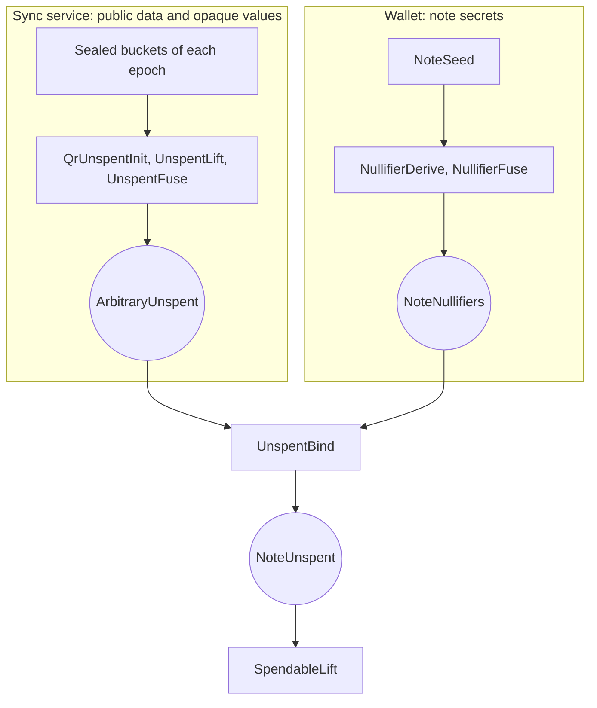

# Oblivious Sync

[Chapter 19](./notes-and-nullifiers.md) showed that a spend must prove one nullifier absent from each closed epoch since the note's creation, and [chapter 20](./pool-state.md) built the chain of anchors that those proofs refer to. This chapter opens the black box they left behind. It covers how an untrusted service can prove absence over a whole epoch without knowing which note the values belong to, how the wallet later ties that work to its note, and what the service learns along the way.

Two problems run through the chapter. Sections 2 to 7 show how the wallet can tie values that a stranger tested to its own nullifiers at the right epochs. Sections 8 to 13 deal with size, since an epoch's polynomial is far too large to open directly. Section 14 then takes stock of what the service sees.

::: warning Status of these designs
Tachyon has not activated on mainnet, and this part of its design is still changing. Everything here describes the [Tachyon repository](https://github.com/tachyon-zcash/tachyon/tree/7e502548db33845dbaacdc0efe905d1a3c45e626) at commit `7e50254`, which pins Ragu at [`0725b52`](https://github.com/tachyon-zcash/tachyon/blob/7e502548db33845dbaacdc0efe905d1a3c45e626/crates/tachyon/Cargo.toml#L74-L76) rather than the `3219e08` of the Ragu chapters. The [ZIP for the syncing service](https://github.com/tachyon-zcash/tachyon/blob/7e502548db33845dbaacdc0efe905d1a3c45e626/book/src/zips/oss.md?plain=1#L1-L11) is an empty outline, so no request format, service interface, or privacy policy is specified, and we found none in the crate.

The crate does contain the proof steps, but it [builds Ragu with its `mock` feature](https://github.com/tachyon-zcash/tachyon/blob/7e502548db33845dbaacdc0efe905d1a3c45e626/crates/tachyon/Cargo.toml#L74-L76) and calls its proof system the [mock Ragu application](https://github.com/tachyon-zcash/tachyon/blob/7e502548db33845dbaacdc0efe905d1a3c45e626/crates/tachyon/src/stamp/proof/mod.rs#L78), as [chapter 19](./notes-and-nullifiers.md#_13-where-these-derivations-run) recorded. These steps compute natively, and comments mark circuit work that remains, such as [boolean constraints on the sides](https://github.com/tachyon-zcash/tachyon/blob/7e502548db33845dbaacdc0efe905d1a3c45e626/crates/tachyon/src/stamp/proof/qr.rs#L663-L664). So what we say a step enforces describes the design the steps declare, and we did not find real circuits enforcing it.
:::

## 1. The work a spend needs

Take the running note of [chapter 19](./notes-and-nullifiers.md#_6-deriving-a-note-s-nullifiers), created in epoch 3 and spent with target epoch 7. Here is what its spend requires, with the same stand-in nullifiers:

<!-- worked:job -->

| Epoch $j$ | $\mathsf{nf}_j$ | What happens to it | Who can do the reading |
| --- | --- | --- | --- |
| 3 | 14090 | tested for absence from epoch 3 | the wallet or a service |
| 4 | 2976 | tested for absence from epoch 4 | the wallet or a service |
| 5 | 63093 | tested for absence from epoch 5 | the wallet or a service |
| 6 | 59553 | tested for absence from epoch 6 | the wallet or a service |
| 7 | 55113 | published by the spend | consensus checks its window |
| 8 | 61177 | published by the spend | consensus checks its window |

<!-- /worked:job -->

Each row that says "tested" needs someone to read a whole epoch's tachygrams, which is exactly the work that wallets were supposed to stop doing. Handing that work to a service is safe only if the values it receives are useless later. [Evolving nullifiers](./scaling-zcash.md#_8-evolving-nullifiers) provide this, because the pair published at the spend is unrelated to the values tested for earlier epochs, assuming Poseidon behaves as a pseudorandom function. [Chapter 19](./notes-and-nullifiers.md#_7-why-the-wallet-derives-its-own-nullifiers) explained why the wallet sends explicit values and no key.

We call this party the **sync service**, or the service. The book also says "delegate" and "oblivious syncing service (OSS)" for the same role.

## 2. Two branches that share no secrets

The service knows nothing about the note, so it cannot prove anything about the note. All it can prove is a statement about arbitrary field elements: "these values, at these epochs, do not appear in the pool." The code's name for such a proof is [`ArbitraryUnspent`](https://github.com/tachyon-zcash/tachyon/blob/7e502548db33845dbaacdc0efe905d1a3c45e626/crates/tachyon/src/stamp/proof/pool.rs#L46-L75), and its doc comment says that the tested values remain arbitrary until the wallet attributes them to a derivation.

The wallet holds the other half. As [chapter 19](./notes-and-nullifiers.md#_13-where-these-derivations-run) showed, it proves that a range of nullifiers really derives from the master key of a note with commitment $\mathsf{cm}$, which gives a `NoteNullifiers` proof. Neither proof says anything about the other, so a final wallet step has to connect them. The [proof tree page](https://github.com/tachyon-zcash/tachyon/blob/7e502548db33845dbaacdc0efe905d1a3c45e626/book/src/proof-tree.md?plain=1#L46-L52) calls that step `UnspentBind`, and it is the only place where the two meet:

Both branches build their commitments step by step, because neither fits in one proof step. So the binding has to compare two values that were accumulated separately, by different parties, over different ranges. The wallet's range also needs to be at least as wide as the service's, since it covers epochs the service never saw. What we need is a commitment that grows one epoch at a time and that supports a proof that one committed collection sits inside another. The [deep dive](https://github.com/tachyon-zcash/tachyon/blob/7e502548db33845dbaacdc0efe905d1a3c45e626/book/src/revisit.md?plain=1#L286-L308) calls this a "ranged nullifier commitment," and it rules out the vector commitment schemes it surveyed because they rely on RSA or bilinear groups.

::: warning Naming across the sources
The [delegation section of the nullifier page](https://github.com/tachyon-zcash/tachyon/blob/7e502548db33845dbaacdc0efe905d1a3c45e626/book/src/nullifiers.md?plain=1#L39-L76) writes $\Delta(X)$, $N(X)$, $C(X)$ and a range $e..e+d$ that includes both ends. The [deep dive](https://github.com/tachyon-zcash/tachyon/blob/7e502548db33845dbaacdc0efe905d1a3c45e626/book/src/revisit.md?plain=1#L342-L379) writes $g_S(X)$, $g_R(X)$, $q(X)$. The [code](https://github.com/tachyon-zcash/tachyon/blob/7e502548db33845dbaacdc0efe905d1a3c45e626/crates/tachyon/src/stamp/proof/pool.rs#L493-L548) calls the same three `elapsed`, `nf_seq`, and `complement`, and its ranges are half-open. We use $\Delta$, $N$, $C$ with half-open ranges.
:::

## 3. Testing containment with polynomials

[Chapter 20](./pool-state.md#_4-combining-and-dividing-sets) already has a tool for containment, since a polynomial divides another exactly when its roots form a sub-multiset, and a late random challenge checks the division. So the first thing to try is to give the service's values as roots. The service commits to $\Delta(X) = \prod_i (X - \delta_i)$, the wallet commits to $N(X) = \prod_j (X - \mathsf{nf}_j)$, and the wallet shows $N = C \cdot \Delta$ for a witnessed quotient $C$.

<!-- worked:toy-values -->

Our small examples use $\F_{43}$, so we reduce the nullifiers above modulo 43. That gives $\mathsf{nf}_3 = 29$, $\mathsf{nf}_4 = 9$, $\mathsf{nf}_5 = 12$, and $\mathsf{nf}_6 = 41$.

<!-- /worked:toy-values -->

This proves that the tested values are the note's, but it says nothing about which value was tested against which epoch. A later proof looks for each nullifier only in the epoch with the same number, as [chapter 19](./notes-and-nullifiers.md#_10-why-a-spend-publishes-two-nullifiers) stressed, so that loss is fatal.

<!-- worked:root-attack -->

Suppose an earlier spend of this note had target 3 and was accepted during epoch 4, so epoch 4 contains $\mathsf{nf}_3 = 29$ and $\mathsf{nf}_4 = 9$. Say epoch 4 publishes {29, 9, 17} and epoch 5 publishes {33, 6, 38}. A second spend must fail, and the honest test does fail, since $f_4(9) = 0$. The cheater swaps the two values and tests 12 against epoch 4 and 9 against epoch 5. Both tests pass, with $f_4(12) = 40$ and $f_5(9) = 24$. The tested multiset is still {9, 12}, and its polynomial $(X - 9)(X - 12) = X^{2} + 22X + 22$ did not change, so it divides the wallet's polynomial just as the honest one does.

<!-- /worked:root-attack -->

So each entry of the collection must carry its epoch as well as its value.

## 4. Putting the epoch into the factor

We want a polynomial factor that encodes the pair $(i, m)$, with the epoch $i$ and the value $m$, such that a product of factors determines which pairs went in. Polynomials over a field factor uniquely into irreducible pieces, up to multiplying the pieces by constants, so two goals follow. Each pair's factor should be irreducible, and the leftover constants should give a cheater no freedom.

The natural first attempt is the linear factor $(i+1)X + m$. The shift by one keeps the coefficient of $X$ nonzero at epoch 0. A linear polynomial is always irreducible, so the first goal holds, and the second one fails.

<!-- worked:linear-attack -->

For epochs 4 and 5 the linear factors are $5X + 9$ and $6X + 12$, and their product is $30X^{2} + 28X + 22$. Move the unit $r = 6/5 = 27$ from one factor to the other:

$$(5X + 9)(6X + 12) = \big(27(5X + 9)\big)\big(27^{-1}(6X + 12)\big) = (6X + 28)(5X + 10).$$

The right side reads as value 10 at epoch 4 and value 28 at epoch 5. Neither is the genuine nullifier, and the product is the same polynomial, so it passes every challenge.

<!-- /worked:linear-attack -->

To remove this freedom, Tachyon [cubes the linear term and subtracts a constant](https://github.com/tachyon-zcash/tachyon/blob/7e502548db33845dbaacdc0efe905d1a3c45e626/crates/tachyon/src/collections/indexed_multiset.rs#L8-L17):

$$F_{i,m}(X) = \big(m + (i+1)X\big)^3 - c, \qquad a = i + 1.$$

The constant $c$ does two jobs, and we can derive both.

**The constant removes the scaling freedom.** Suppose a second pair gives the same factor up to a constant $u$, so $(m' + a'X)^3 - c = u\big((m + aX)^3 - c\big)$. Write $Y = m + aX$, and express the other linear term through it as $m' + a'X = rY + s$, with $r = a'/a$ and $s = m' - rm$. Expanding the left side gives

$$r^3 Y^3 + 3r^2 s\, Y^2 + 3 r s^2\, Y + s^3 - c = uY^3 - uc.$$

Compare coefficients one power of $Y$ at a time. The $Y^2$ term gives $3r^2 s = 0$, and $r \neq 0$, so $s = 0$. The constant term then reads $-c = -uc$, which forces $u = 1$ whenever $c \neq 0$. The $Y^3$ term becomes $r^3 = 1$. So the two factors can agree only when $u = 1$ and $(a', m') = (ra, rm)$ for a cube root of unity $r$. Without the $-c$, the constant term would say nothing, and any $u$ would do, which is the same trick as in the linear case. Section 5 deals with the cube roots of unity that remain.

**A non-cube makes each factor irreducible.** A cubic over a field can only split by having a root, and $F_{i,m}$ has a root $x$ exactly when $(m + ax)^3 = c$, which requires $c$ to be a cube. So if $c$ is not a cube, $F_{i,m}$ has no root in the field and is irreducible. Non-cubes exist only when 3 divides $p - 1$, because otherwise cubing permutes the nonzero elements. Pasta satisfies this, and the code [fixes $c = 2$](https://github.com/tachyon-zcash/tachyon/blob/7e502548db33845dbaacdc0efe905d1a3c45e626/crates/tachyon/src/collections/indexed_multiset.rs#L80-L82), which it calls the smallest cubic non-residue.

<!-- worked:noncube -->

In $\F_{43}$ the nonzero cubes are 1, 2, 4, 8, 11, 16, 21, 22, 27, 32, 35, 39, 41, 42, which is 14 of the 42 nonzero elements. The value 2 is one of them, since $20^3 = 2$ here, so the toy field cannot use the code's constant. Its smallest non-cube is $c = 3$, and we use that. The real field does have $2$ as a non-cube, which we checked by computing $2^{(p-1)/3} \neq 1$ for the Pallas base field.

<!-- /worked:noncube -->

<!-- worked:factor-expand -->

With $i = 4$, $m = 9$, and $c = 3$ we have $a = i + 1 = 5$, and expanding the cube gives

$$\begin{aligned}F_{4,9}(X) &= (9 + 5X)^3 - 3 \\
&= 5^3 X^3 + 3 \cdot 5^2 \cdot 9\, X^2 + 3 \cdot 5 \cdot 9^2\, X + 9^3 - 3 \\
&= 39X^{3} + 30X^{2} + 11X + 38.\end{aligned}$$

<!-- /worked:factor-expand -->

Those four coefficients appear in [the same order in the code](https://github.com/tachyon-zcash/tachyon/blob/7e502548db33845dbaacdc0efe905d1a3c45e626/crates/tachyon/src/collections/indexed_multiset.rs#L85-L95). With irreducible factors and no spare constants, a product determines its multiset of pairs, which the code calls an **indexed multiset**.

<!-- worked:unique -->

We can test this on the toy field. Epochs 3 to 6 and all 43 values give 172 pairs, and they produce 172 different factors. Multiplying any two of them, repeats allowed, gives 14,878 products, and no two of those products are equal. So rescaling cannot produce a second set of pairs here.

<!-- /worked:unique -->

The non-cube requirement has a concrete purpose, because a factor that splits can divide a product without being one of its members.

<!-- worked:cube-fail -->

Here is the failure on the toy field, for the four pairs above and every candidate $(i, m)$ with $i$ from 0 to 29. With $c = 2$, which is a cube, $N(X)$ has the 11 distinct roots 5, 11, 12, 18, 28, 30, 32, 33, 39, 40, 42, and 11 false pairs have all of their three roots among them. The pair $(0,\ 35)$ is one, whose roots are 28, 40, 42, and its factor divides $N$ although it is no member of $N$. With $c = 3$, $N(X)$ has no roots in the field at all, and no false pair divides it except for the scaled copies of Section 5, which are the same polynomial.

<!-- /worked:cube-fail -->

The sources do not discuss why they chose a cube over a square of the linear term, so we leave that question open.

::: warning Reconstructed from code at commit 7e50254, not confirmed by the authors
The [deep dive's sketch](https://github.com/tachyon-zcash/tachyon/blob/7e502548db33845dbaacdc0efe905d1a3c45e626/book/src/revisit.md?plain=1#L389-L410) states that $Y^3 - c$ is irreducible and stays so under affine substitution, and that collisions need a cube root of unity. The rescaling attack on linear factors, the coefficient comparison above, and the attack with a cube for $c$ are our own explanation of why the form takes this shape.
:::

## 5. When two pairs share a factor

The derivation leaves one escape. If $\omega$ is a cube root of unity other than 1, then $(i, m)$ and the pair with $a' = \omega a$ and $m' = \omega m$ have the same factor, because $(\omega Y)^3 = Y^3$.

<!-- worked:omega -->

In $\F_{43}$ the cube roots of unity are 1, 6, and 36. Since $6 \cdot 1 = 6$, the epoch numbers $a = 1$ and $a = 6$ are one scaling apart, and the factors for $(0,\ 9)$ and $(5,\ 11)$ are the same polynomial, namely $X^{3} + 27X^{2} + 28X + 38$.

<!-- /worked:omega -->

A collision like this would matter if a valid epoch number $a'$ happened to equal $\omega a$. The code [states a bound](https://github.com/tachyon-zcash/tachyon/blob/7e502548db33845dbaacdc0efe905d1a3c45e626/crates/tachyon/src/collections/indexed_multiset.rs#L54-L69) that prevents it, namely keeping $a$ below $\lfloor\sqrt{p/3}\rfloor$. The reason takes three lines. Suppose $a' = \omega a$ with both numbers between 1 and that bound. A nontrivial $\omega$ satisfies $\omega^2 + \omega + 1 = 0$. Multiplying by $a^2$ gives

$$a'^2 + a'a + a^2 = a^2(\omega^2 + \omega + 1) \equiv 0 \pmod p.$$

As an ordinary integer, the left side is positive, and it is less than $3 \cdot p/3 = p$ because each of its three terms is below $p/3$. A positive integer below $p$ cannot be a multiple of $p$, so no such pair exists.

<!-- worked:omega-bound -->

On the toy field the bound is $\lfloor\sqrt{43/3}\rfloor = 3$, which is small, and the collision above has $1 + 6 + 6^2 = 43$, exactly the field size. For the Pallas base field the bound is about $2^{126}$, while the code has only $2^{20}$ epochs. Our window of epochs 3 to 6 lies above the toy bound, so we checked it directly, and Section 4 found no collision among those epochs.

<!-- /worked:omega-bound -->

The [deep dive](https://github.com/tachyon-zcash/tachyon/blob/7e502548db33845dbaacdc0efe905d1a3c45e626/book/src/revisit.md?plain=1#L405-L410) makes the same point more loosely, and adds that a real circuit does not range-check $i$ directly. It relies on the increments as ranges are built and on an out-of-range epoch leading to invalid anchors.

::: warning Reconstructed from code at commit 7e50254, not confirmed by the authors
The code states the bound without a derivation. The three-line argument above is ours.
:::

## 6. A full run on the toy curve

We can now run the whole binding. A wallet derives the range of epochs 3 to 6. Say it delegates epochs 4 and 5 to a service, keeping epoch 3 because that is the creation epoch, and epoch 6 because it has not reached the service yet. Real windows are larger, and Section 7 uses the true size. Over a delegated range, the [delegation section](https://github.com/tachyon-zcash/tachyon/blob/7e502548db33845dbaacdc0efe905d1a3c45e626/book/src/nullifiers.md?plain=1#L43-L74) defines

$$\Delta(X) = \prod_{i \in \text{delegated}} F_{i,\delta_i}(X), \qquad N(X) = \prod_{j \in \text{derived}} F_{j,\mathsf{nf}_j}(X), \qquad C(X) = \prod_{j \notin \text{delegated}} F_{j,\mathsf{nf}_j}(X),$$

and the claim is $N(X) = C(X) \cdot \Delta(X)$. The honest service tests the values it was given, so $\delta_i = \mathsf{nf}_i$:

<!-- worked:run-polys -->

| Polynomial | Epochs | Built by | Coefficients, highest degree first |
| --- | --- | --- | --- |
| $\Delta(X)$ | 4, 5 | the service | $39X^{6} + 6X^{5} + 14X^{4} + 14X^{3} + 37X^{2} + 38X + 18$ |
| $N(X)$ | 3, 4, 5, 6 | the wallet | $41X^{12} + 38X^{11} + 31X^{10} + 34X^{9} + 9X^{8} + 38X^{7} + 32X^{6} + 20X^{5} + 40X^{4} + 27X^{3} + 3X^{2} + 3X + 42$ |
| $C(X)$ | 3, 6 | the wallet | $22X^{6} + 2X^{5} + 40X^{4} + 28X^{3} + 14X^{2} + 4X + 31$ |

<!-- /worked:run-polys -->

A header has room only for short values, so each party's header holds a commitment. `UnspentBind` first checks that its witnessed $\Delta$ and $N$ [match the commitments](https://github.com/tachyon-zcash/tachyon/blob/7e502548db33845dbaacdc0efe905d1a3c45e626/crates/tachyon/src/stamp/proof/pool.rs#L529-L538) on the two input headers.

<!-- worked:run-commit -->

Each polynomial commits on the toy curve as in [chapter 6](./polynomial-commitments.md), with the extra generators of [chapter 20](./pool-state.md#_4-combining-and-dividing-sets) and more of the same kind, since $N$ needs 13: $\mathsf{Com}(\Delta) = (4,\,25)$, $\mathsf{Com}(C) = (28,\,10)$, and $\mathsf{Com}(N) = (22,\,24)$. A stand-in hash of those three points gives the challenge $z = 6$.

<!-- /worked:run-commit -->

The step then [checks the product at the challenge](https://github.com/tachyon-zcash/tachyon/blob/7e502548db33845dbaacdc0efe905d1a3c45e626/crates/tachyon/src/stamp/proof/pool.rs#L540-L548). The shared helper [`enforce_poly_product`](https://github.com/tachyon-zcash/tachyon/blob/7e502548db33845dbaacdc0efe905d1a3c45e626/crates/tachyon/src/relations/enforce.rs#L62-L84) absorbs all three commitments into the challenge, compares the evaluations, and records one opening claim per polynomial, which it leaves for the proof system to verify.

<!-- worked:run-check -->

At $z = 6$ the service's side evaluates factor by factor as $\Delta(6) = F_{4,9}(6) \cdot F_{5,12}(6) = 19 \cdot 36 = 39$. The wallet also has $C(6) = 18$ and $N(6) = 14$, and the identity holds, since $39 \cdot 18 = 14$ in $\F_{43}$.

<!-- /worked:run-check -->

The output is a `NoteUnspent` header. It keeps the segment's anchors and epochs, and it carries the wallet's $\mathsf{cm}$, so the anonymous claim now belongs to one note.

A dishonest service gains nothing, because its proof is about whatever it tested, and [the wallet's check leaves a diverging proof useless](https://github.com/tachyon-zcash/tachyon/blob/7e502548db33845dbaacdc0efe905d1a3c45e626/book/src/nullifiers.md?plain=1#L76). It can refuse to serve, and it cannot fool the wallet. A cheating wallet is the more serious case, and the argument there runs through the order of events, as in [chapter 3](./statements-and-challenges.md#_5-testing-polynomials-at-a-random-point). The commitments are fixed before $z$ exists, so a false claim is a fixed nonzero polynomial $N - \Delta' C$, and the challenge has to land on one of its roots. Here is every kind of attempt, with the honest $C$ committed:

<!-- worked:run-cheat -->

| The service's polynomial uses | Cases where a quotient exists | Challenges that pass, of 43 |
| --- | --- | --- |
| A wrong value at epoch 5, for each of the 42 wrong values | 0 | 2 in every case |
| The swap of Section 3, with 12 at epoch 4 and 9 at epoch 5 | 0 | 3 |
| Epoch 4 tested twice, standing in for epoch 5 | 0 | 3 |
| A genuine nullifier of epoch 7, which the window does not hold | 0 | 3 |

<!-- /worked:run-cheat -->

<!-- worked:run-cheat-note -->

The difference $N - \Delta' C$ has degree at most 12, so no attempt can pass more than 12 challenges, and the worst one here passes 3. A wrong value passes so few because $N - \Delta' C$ factors as $C$ and $F_{4,9}$, which have no roots in the field, times a difference of two cubes, which has degree 2. The proportion looks large only because the field has 43 elements.

<!-- /worked:run-cheat-note -->

The third row of that table needs one more fact. The wallet's $N$ has each epoch once, because [`NullifierFuse`](https://github.com/tachyon-zcash/tachyon/blob/7e502548db33845dbaacdc0efe905d1a3c45e626/crates/tachyon/src/stamp/proof/delegation.rs#L253-L273) requires contiguous ranges, which keeps it squarefree. A repeated factor in $\Delta$ therefore cannot divide it.

## 7. The real window size

The code's derivation unit is wider than our toy range. [`NF_DERIVATION_WIDTH`](https://github.com/tachyon-zcash/tachyon/blob/7e502548db33845dbaacdc0efe905d1a3c45e626/crates/tachyon/src/nullifier/mod.rs#L9-L10) is 16, so [`NullifierDerive`](https://github.com/tachyon-zcash/tachyon/blob/7e502548db33845dbaacdc0efe905d1a3c45e626/crates/tachyon/src/stamp/proof/delegation.rs#L152-L251) produces a group-aligned window of 16 epochs from 4 sponges, and `NullifierFuse` joins adjacent windows by multiplying their polynomials. Our note needs epoch 3 covered, so its first window starts at epoch 0. The factors for epochs 0 to 2, and for epochs the window [runs ahead of the evidence](https://github.com/tachyon-zcash/tachyon/blob/7e502548db33845dbaacdc0efe905d1a3c45e626/crates/tachyon/src/stamp/proof/pool.rs#L477-L480), go into the complement, which stays with the wallet.

<!-- worked:window16-field -->

The stand-in range of chapter 19 is the prime 65,537, and it cannot host this encoding. Since $65{,}536$ is not divisible by 3, cubing permutes that field and every element is a cube. So this section works modulo the next prime with the right shape, 65,539, which is 1 modulo 3 and whose smallest non-cube is $c = 2$. The nullifier values carry over unchanged.

<!-- /worked:window16-field -->

<!-- worked:window16 -->

| Polynomial | Epochs | Factors | Degree | Value at $z = 32194$ |
| --- | --- | --- | --- | --- |
| $\Delta(X)$ | 4, 5, 6 | 3 | 9 | 27584 |
| $C(X)$ | 0 to 3 and 7 to 15 | 13 | 39 | 52043 |
| $N(X)$ | 0 to 15 | 16 | 48 | 53395 |

<!-- /worked:window16 -->

<!-- worked:window16-check -->

The identity holds: $27584 \cdot 52043 \equiv 53395 \pmod{65{,}539}$. If the service instead tests 63094 at epoch 5, one more than the genuine 63093, then trying all 65,539 challenges finds 2 that pass, against the degree bound of 48. The window is well inside the injectivity bound here, which is $\lfloor\sqrt{65{,}539/3}\rfloor = 147$.

<!-- /worked:window16-check -->

Notice what `UnspentBind` does not compare. The [proof tree page](https://github.com/tachyon-zcash/tachyon/blob/7e502548db33845dbaacdc0efe905d1a3c45e626/book/src/proof-tree.md?plain=1#L318-L325) says it compares no bounds between the segment and the derivation. It does not need to, because each factor carries its own epoch. An epoch outside the derivation has no factor to divide out, so coverage follows from the identity.

::: warning Book and code: the steps around the bind
**Deep dive:** [`UnspentSeed`](https://github.com/tachyon-zcash/tachyon/blob/7e502548db33845dbaacdc0efe905d1a3c45e626/book/src/revisit.md?plain=1#L2337-L2339) creates an empty range, [`UnspentBind`](https://github.com/tachyon-zcash/tachyon/blob/7e502548db33845dbaacdc0efe905d1a3c45e626/book/src/revisit.md?plain=1#L2358-L2363) requires $[s_L, s_R) \subseteq [r_L, r_R)$, [`UnspentMerge`](https://github.com/tachyon-zcash/tachyon/blob/7e502548db33845dbaacdc0efe905d1a3c45e626/book/src/revisit.md?plain=1#L2398-L2420) joins results, and the creation epoch goes through [`NoteUnspentInit` and `SpendableReinit`](https://github.com/tachyon-zcash/tachyon/blob/7e502548db33845dbaacdc0efe905d1a3c45e626/book/src/revisit.md?plain=1#L2368-L2370).

**Proof tree page and code at `7e50254`:** [`QrUnspentInit` is the only seed](https://github.com/tachyon-zcash/tachyon/blob/7e502548db33845dbaacdc0efe905d1a3c45e626/book/src/proof-tree.md?plain=1#L182), so no empty segment exists. The join is [`UnspentFuse`](https://github.com/tachyon-zcash/tachyon/blob/7e502548db33845dbaacdc0efe905d1a3c45e626/crates/tachyon/src/stamp/proof/pool.rs#L271-L333). `UnspentBind` [compares no bounds](https://github.com/tachyon-zcash/tachyon/blob/7e502548db33845dbaacdc0efe905d1a3c45e626/crates/tachyon/src/stamp/proof/pool.rs#L505-L548) beyond a defensive check that the segment is not empty. The creation epoch uses an ordinary segment bound by `UnspentBind`, which [`QrSpendableInit`](https://github.com/tachyon-zcash/tachyon/blob/7e502548db33845dbaacdc0efe905d1a3c45e626/crates/tachyon/src/stamp/proof/spendable.rs#L108-L188) then consumes.

This site follows the code.
:::

## 8. Why one opening per epoch needs buckets

With the binding in place, we turn to what the service proves. A nullifier is absent from an epoch exactly when the [epoch polynomial](./pool-state.md#_4-combining-and-dividing-sets) $e(X)$ is nonzero there. Anyone can show that $e$ is the product of the stamp polynomials absorbed into the anchor chain, and the work is paid once and reused for every query. The obstacle is the degree of $e$, because opening a commitment with Ragu's [linear-time verifier](./inner-product-argument.md) costs time in proportion to it.

<!-- worked:scale -->

Take 100 two-input, two-output transactions per second as a hypothetical load, with 8 tachygrams each. An epoch of the code's 4,096 blocks lasts 307,200 seconds at 75 seconds per block, so it holds 245,760,000 tachygrams, and $e(X)$ has that degree.

<!-- /worked:scale -->

The deep dive [estimates](https://github.com/tachyon-zcash/tachyon/blob/7e502548db33845dbaacdc0efe905d1a3c45e626/book/src/revisit.md?plain=1#L878-L887) more than 16 minutes of verification at its own higher figure, and so it drops this approach.

<!-- worked:scale-book -->

The deep dive's figure of more than 480,000,000 tachygrams uses a two-week epoch, and it matches 483,840,000, which is 4 tachygrams per transaction. Two per action would give 967,680,000. Its later scale estimate does use 8 per transaction. Neither figure uses the code's epoch length.

<!-- /worked:scale-book -->

The fix is to split the epoch into buckets small enough to open, so that a query touches one. This only works if a value can find its own bucket without any list of the epoch's contents, and if nobody can leave a tachygram out of the bucket where it belongs. So the partition has to be a public rule computed from the value alone, and it has to be cheap to prove that a whole bucket obeys the rule. A rule based on hashing each member would cost one hash per member inside a proof, by our count, since the deep dive says only that its own choice is cheap to prove. Tachyon [instead classifies values by quadratic residuosity](https://github.com/tachyon-zcash/tachyon/blob/7e502548db33845dbaacdc0efe905d1a3c45e626/book/src/revisit.md?plain=1#L893-L916), because a polynomial identity can attest many members at once, as Section 10 shows.

<!-- worked:squares -->

In $\F_{43}$ the nonzero squares are 1, 4, 6, 9, 10, 11, 13, 14, 15, 16, 17, 21, 23, 24, 25, 31, 35, 36, 38, 40, 41, which is half of the 42 nonzero elements. The smallest non-residue is $n = 2$, and multiplying by it swaps the two halves. For example, $9$ is a square, and $2 \cdot 9 = 18$ is not. The value $3$ is not a square, and $2 \cdot 3 = 6$ is. So every nonzero $s$ has a root $y$ with either $y^2 = s$ or $y^2 = 2s$, and never both. The code uses $n = 5$, which is the [smallest non-residue of the real field](https://github.com/tachyon-zcash/tachyon/blob/7e502548db33845dbaacdc0efe905d1a3c45e626/crates/tachyon/src/collections/qr.rs#L33-L37).

<!-- /worked:squares -->

We write $n$ for this non-residue, since the sources use $c$ here as well as for the cube constant, which would be confusing.

## 9. Classifying a value

One split of the field gives two classes, and we need many. A **discriminant** $R$ is an offset that gives a different split, because $x$ is classified by whether $x + R$ is a square. [The rule](https://github.com/tachyon-zcash/tachyon/blob/7e502548db33845dbaacdc0efe905d1a3c45e626/book/src/revisit.md?plain=1#L935-L946) sets the bit $b = 1$ when $x + R$ is a square or zero, which we call the residue side, and $b = 0$ otherwise. A run of discriminants then gives each value a string of bits, its **QR profile**. Tachyon [uses consecutive offsets](https://github.com/tachyon-zcash/tachyon/blob/7e502548db33845dbaacdc0efe905d1a3c45e626/crates/tachyon/src/primitives/qr.rs#L15-L41), $R_j = R_0 + j$, from a first discriminant $R_0$ that a builder picks.

Here is chapter 20's [epoch 0](./pool-state.md#_4-combining-and-dividing-sets), with its stamps A, B, and C. The small-field search for a readable example chose the $R_0$ below.

<!-- worked:classify -->

| Tachygram $x$ | Stamp | $x + R_0$ | Side at $R_0 = 26$ | Root | $x + R_1$ | Side at $R_1 = 27$ |
| --- | --- | --- | --- | --- | --- | --- |
| 22 | A | 5 | 0 | 15 | 6 | 1 |
| 24 | A | 7 | 0 | 10 | 8 | 0 |
| 40 | A | 23 | 1 | 18 | 24 | 1 |
| 20 | B | 3 | 0 | 7 | 4 | 1 |
| 23 | B | 6 | 1 | 7 | 7 | 0 |
| 41 | B | 24 | 1 | 14 | 25 | 1 |
| 13 | C | 39 | 0 | 11 | 40 | 1 |
| 19 | C | 2 | 0 | 2 | 3 | 0 |
| 21 | C | 4 | 1 | 2 | 5 | 0 |

<!-- /worked:classify -->

The "Root" column gives $y$ with $y^2 = \kappa(x + R_0)$, where $\kappa = 1$ on the residue side and $\kappa = n$ on the other. It is what a prover supplies to show a value's side, and the next section needs it.

One value needs special handling, which is the one where the shifted value is zero.

<!-- worked:exceptional -->

The exceptional value at our discriminant is $x = -R_0 = 17$. Its shifted value is 0, so $y = 0$ satisfies $y^2 = 1 \cdot 0$ and also $y^2 = 2 \cdot 0$, which means a root alone would let it sit on either side.

<!-- /worked:exceptional -->

The rule files this value on the residue side, so a step that claims the non-residue side must also check that the shifted value is nonzero. Without that check, a cheater could move $-R$ to whichever side suited it.

## 10. Proving a split

A builder holds a set of tachygrams with a committed polynomial, and it wants to split them into a non-residue side and a residue side. The product $q_0(X)\,q_1(X) = f(X)$ shows that the two sides partition the set, and that check works as in Section 6. What remains is to show that each member sits on the side it claims, without one check per member.

Suppose every root $x_i$ of a polynomial $s(X)$ has a root $y_i$ with $y_i^2 = \kappa(x_i + R)$. Interpolate a polynomial $u(X)$ through the points $(x_i, y_i)$. Then $u(X)^2 - \kappa(X + R)$ vanishes at every $x_i$, because at $x_i$ it equals $y_i^2 - \kappa(x_i + R) = 0$. Consensus [forbids repeats within two epochs](https://github.com/tachyon-zcash/tachyon/blob/7e502548db33845dbaacdc0efe905d1a3c45e626/crates/tachyon/src/stamp/proof/qr.rs#L258-L260), so $s$ is squarefree. A polynomial that vanishes at every root of a squarefree $s$ is divisible by $s$, so a quotient $h$ exists with

$$u(X)^2 - \kappa(X + R) = s(X)\,h(X).$$

The reverse also holds, and that is what gives the identity force. If this identity holds for some $u$ and $h$, then evaluating at any root $x$ of $s$ gives $u(x)^2 = \kappa(x + R)$, so $u(x)$ is a root of the kind that only $x$'s true side allows. One identity, checked at one random point, therefore covers all the members at once.

The code [splits this into two steps](https://github.com/tachyon-zcash/tachyon/blob/7e502548db33845dbaacdc0efe905d1a3c45e626/crates/tachyon/src/stamp/proof/qr.rs#L347-L529). [`QrIntakeSplit`](https://github.com/tachyon-zcash/tachyon/blob/7e502548db33845dbaacdc0efe905d1a3c45e626/crates/tachyon/src/stamp/proof/qr.rs#L356-L412) checks the product, and it opens the non-residue side at $-R$ to show that it is nonzero there, which handles the exceptional value. [`QrSideDescend`](https://github.com/tachyon-zcash/tachyon/blob/7e502548db33845dbaacdc0efe905d1a3c45e626/crates/tachyon/src/stamp/proof/qr.rs#L443-L529) then extracts one side as a child, and it runs the identity above on the *other* side, the sibling. The reasoning is that the sibling's attestation is what protects the child. If every root of the sibling truly belongs to the sibling's class, then every member of the child's class must be in the child.

<!-- worked:split-run -->

Take stamp A as an intake, with members 22, 24, 40. At $R_0 = 26$ its non-residue side is $s(X) = X^{2} + 40X + 12$, with roots 22, 24, and its residue side is $X + 3$. To descend into the residue side, the prover attests the sibling $s$ at $\kappa = n = 2$. The roots from the table give $u(22) = 15$, $u(24) = 10$, so $u(X) = 19X + 27$. Then

$$\begin{aligned}u(X)^2 - 2(X + 26) &= 17X^{2} + 35X + 32 \\
&= (X^{2} + 40X + 12) \cdot (17),\end{aligned}$$

so $h(X) = 17$, a constant here because $s$ has degree 2. The commitments are $\mathsf{Com}(s) = (25,\,2)$, $\mathsf{Com}(u) = (26,\,23)$, and $\mathsf{Com}(h) = (20,\,6)$. A stand-in hash of those and $R_0$ gives $z = 10$, where both sides equal 18.

<!-- /worked:split-run -->

Now we can see why cheating fails. An absence proof goes wrong only if a published value is missing from the bucket that its own profile selects.

<!-- worked:split-cheat -->

Suppose a cheater wants 40 missing from the residue child, because later it will claim that 40 is absent. It moves 40 into the sibling, so the sibling polynomial gains the root 40. The identity then needs $u(40)^2 = 2(40 + 26) = 3$, and 3 is not a square, so no $u$ exists. Trying all 43 values for $u(40)$ and taking the quotient by long division, 0 of them divide exactly, and the best attempt passes 2 of the 43 challenges.

<!-- /worked:split-cheat -->

The crate's tests [reject a child short of a member](https://github.com/tachyon-zcash/tachyon/blob/7e502548db33845dbaacdc0efe905d1a3c45e626/crates/tachyon/tests/integration/qr.rs#L781) in this way. The attack the other way is harmless. If the cheater left a stray non-residue member in the residue child, then the sibling's identity would still hold, and the child would have one root too many. A stray can only make a later nonzero opening harder to pass.

::: warning Book and code: what a split attests
**Deep dive:** [one decomposition relation](https://github.com/tachyon-zcash/tachyon/blob/7e502548db33845dbaacdc0efe905d1a3c45e626/book/src/revisit.md?plain=1#L1003-L1043) proves both sides pure, with four polynomials $g^\mathsf{QR}, g^\mathsf{NQR}, h^\mathsf{QR}, h^\mathsf{NQR}$, and it says the output contains exactly the members of each class.

**Proof tree page and code at `7e50254`:** a split and a separate descent for each child, each attesting only the sibling, and the [child may carry a stray member](https://github.com/tachyon-zcash/tachyon/blob/7e502548db33845dbaacdc0efe905d1a3c45e626/book/src/proof-tree.md?plain=1#L219-L225).

This site follows the code. The deep dive's "exactly" is stronger than what each descent enforces, and the weaker form is enough for absence.
:::

The challenge in `QrSideDescend` also [absorbs $R$](https://github.com/tachyon-zcash/tachyon/blob/7e502548db33845dbaacdc0efe905d1a3c45e626/crates/tachyon/src/stamp/proof/qr.rs#L488-L501), through the point $[R]G_0$. $R$ is chosen by the prover, and it is not one of the committed polynomials, so without this a prover could [solve the identity for $R$ after seeing $z$](https://github.com/tachyon-zcash/tachyon/blob/7e502548db33845dbaacdc0efe905d1a3c45e626/crates/tachyon/tests/integration/qr.rs#L889). [Chapter 3](./statements-and-challenges.md#_9-omitting-data-from-the-transcript) showed the same failure in general.

## 11. Routing an epoch into buckets

Splitting one big polynomial in one step is impossible, since no step can hold it, so the partition has to grow out of small pieces. Each stamp or short run of stamps starts as a [**root intake**](https://github.com/tachyon-zcash/tachyon/blob/7e502548db33845dbaacdc0efe905d1a3c45e626/book/src/proof-tree.md?plain=1#L218), a bounded set of tachygrams at depth zero with a range of anchors. A round of routing [splits each intake and merges neighbours](https://github.com/tachyon-zcash/tachyon/blob/7e502548db33845dbaacdc0efe905d1a3c45e626/book/src/revisit.md?plain=1#L1047-L1071), and two intakes may merge only if they have the same profile, their anchor ranges meet, and the union fits the capacity. The merge is a [polynomial product](https://github.com/tachyon-zcash/tachyon/blob/7e502548db33845dbaacdc0efe905d1a3c45e626/crates/tachyon/src/stamp/proof/qr.rs#L254-L345), as in chapter 20.

Here is the network for our epoch.

<!-- worked:routing -->

| Round | Discriminant | Intakes, as profile: members (stamps covered) |
| --- | --- | --- |
| start |  | `root`: 22, 24, 40 (A); `root`: 20, 23, 41 (B); `root`: 13, 19, 21 (C) |
| 1 | $R_{0} = 26$ | `0`: 22, 24, 20 (AB); `0`: 13, 19 (C); `1`: 40, 23, 41, 21 (ABC) |
| 2 | $R_{1} = 27$ | `00`: 24, 19 (ABC); `01`: 22, 20, 13 (ABC) |

<!-- /worked:routing -->

<!-- worked:routing-result -->

With a capacity of 4 per intake the network ends with 3 buckets: `1` holding 40, 23, 41, 21, `00` holding 24, 19, `01` holding 22, 20, 13. Multiplying the three bucket polynomials gives back the epoch polynomial $e_0(X)$ of chapter 20, and no bucket has degree above 4, where $e_0$ has degree 9.

<!-- /worked:routing-result -->

The buckets have different depths. Profile `1` was complete after one round, because one intake covering all three stamps held all of it. Profile `0` still had two intakes after round 1, so only that branch went through another round. The deep dive calls this a [jagged frontier](https://github.com/tachyon-zcash/tachyon/blob/7e502548db33845dbaacdc0efe905d1a3c45e626/book/src/revisit.md?plain=1#L1089-L1130), and the crate has a [test with ragged depths](https://github.com/tachyon-zcash/tachyon/blob/7e502548db33845dbaacdc0efe905d1a3c45e626/crates/tachyon/tests/integration/qr.rs#L2652). The final profiles form a prefix partition, so every value matches exactly one of them.

Each final bucket also has to cover the whole epoch, or a tachygram of that profile could be missing. [`QrBucketSeal`](https://github.com/tachyon-zcash/tachyon/blob/7e502548db33845dbaacdc0efe905d1a3c45e626/crates/tachyon/src/stamp/proof/qr.rs#L572-L649) certifies this by computing the boundary digest into the next epoch, which [chapter 20](./pool-state.md#_9-covering-a-whole-epoch) explained. A bucket sealed before the final anchor lands on a value outside the accepted chain. The step [checks that the intake begins on a boundary digest](https://github.com/tachyon-zcash/tachyon/blob/7e502548db33845dbaacdc0efe905d1a3c45e626/crates/tachyon/src/stamp/proof/qr.rs#L625-L629), from an `anchor_final_prev` that it takes as a free witness, and consensus closes that gap later, as [chapter 20](./pool-state.md#_10-moving-a-proof-along-the-chain) explained.

<!-- worked:seal -->

For our epoch, the step takes $\mathsf{anchor\_final\_prev} = 0$ for epoch zero and checks the start against $H_\mathsf{ep}(0,\ 0) = 29$. The last intake ended on the final anchor 26, so the step computes $H_\mathsf{ep}(26,\ 1) = 40$. The bucket covers the half-open range from 29 to 40, using the stand-in values of chapter 20.

<!-- /worked:seal -->

An epoch with no stamps [seals an empty bucket](https://github.com/tachyon-zcash/tachyon/blob/7e502548db33845dbaacdc0efe905d1a3c45e626/crates/tachyon/src/stamp/proof/qr.rs#L208-L252) whose polynomial is 1, so it costs no more than any other.

The depth stays modest at real scale.

<!-- worked:depth-budget -->

The deep dive sizes this for 50,000 such transactions per second over two weeks, which is 483,840,000,000 tachygrams. At 8,000 tachygrams per bucket that is 60,480,000 buckets, and $\log_2$ of that is 25.8, so the honest depth stays below 26, inside the 32 positions the header allows.

<!-- /worked:depth-budget -->

The 8,000 comes from the deep dive, and we found no such constant in the crate, where capacity is [a parameter of the test fixtures](https://github.com/tachyon-zcash/tachyon/blob/7e502548db33845dbaacdc0efe905d1a3c45e626/crates/tachyon/tests/integration/fixtures.rs#L847-L875).

The choice of $R_0$ [does not affect soundness](https://github.com/tachyon-zcash/tachyon/blob/7e502548db33845dbaacdc0efe905d1a3c45e626/book/src/revisit.md?plain=1#L1138-L1155), because a proof certifies the buckets under whichever $R_0$ the builder used. It affects only balance, and the deep dive worries that a user who knew it could grind tachygrams into one bucket.

<!-- worked:grind -->

Across all 43 choices of $R_0$, the fullest of the four depth-2 classes holds on average 3.7 of our 9 tachygrams. With $R_0 = 26$ known in advance, a user could publish 9 of the 11 field elements with profile `11` and fill that class alone.

<!-- /worked:grind -->

So each builder [samples $R_0$ privately](https://github.com/tachyon-zcash/tachyon/blob/7e502548db33845dbaacdc0efe905d1a3c45e626/crates/tachyon/src/primitives/qr.rs#L15-L28) and keeps it unpublished until the epoch closes. A biased network hurts only its builder, and a wallet may use any valid network.

## 12. Testing a value against its bucket

The last step of the service's work is [`QrUnspentInit`](https://github.com/tachyon-zcash/tachyon/blob/7e502548db33845dbaacdc0efe905d1a3c45e626/crates/tachyon/src/stamp/proof/qr.rs#L704-L841), which takes a sealed bucket and a value and proves the value absent. First it opens the bucket's polynomial at the value and requires a nonzero result.

<!-- worked:open-absent -->

Test the value 4, which chapter 20 found absent from this epoch. Its shifted values are $4 + 26 = 30$ and $4 + 27 = 31$, and these give it the sides 0, 1. So its bucket is `01`, whose polynomial is $q(X) = X^{3} + 31X^{2} + 40X + 42$, and $q(4) = 31$ is nonzero. One opening of a polynomial of degree 3 has replaced an opening of degree 9.

<!-- /worked:open-absent -->

It must also show that this bucket is the right one, because any other bucket would open nonzero too.

<!-- worked:open-present -->

Now test 41, which stamp B published. Its sides lead to bucket `1`, where $q(41) = 0$, so the nonzero check fails and no proof exists. This is why the step must force the profile to match. Opened against the other buckets, 41 gives 30 in `00` and 35 in `01`, both nonzero, so without the profile check a cheater could prove absence of a value that was published.

<!-- /worked:open-present -->

To force the match, the step witnesses the value's side and root at [every one of 32 positions](https://github.com/tachyon-zcash/tachyon/blob/7e502548db33845dbaacdc0efe905d1a3c45e626/crates/tachyon/src/stamp/proof/qr.rs#L656-L702). With $s_j = x + R_0 + j$, it checks

$$r_j^2 = \big(n - (n - 1)\,b_j\big)\,s_j, \qquad b_j = 0 \implies s_j \neq 0.$$

The factor in the first equation equals $1$ when $b_j = 1$ and $n$ when $b_j = 0$, so this is the root check of Section 9. Since $n$ is a non-residue, only the value's true side has a root. The step runs all 32 positions because a [circuit's shape cannot depend on secret values](./arithmetization.md#_1-what-arithmetization-produces), and buckets differ in depth.

The bucket's depth $d$ selects how many sides to compare, through a mask $m_j$ of 32 bits. The [proof tree page](https://github.com/tachyon-zcash/tachyon/blob/7e502548db33845dbaacdc0efe905d1a3c45e626/book/src/proof-tree.md?plain=1#L252-L254) gives the checks:

$$\sum_j m_j = d, \qquad 2\sum_j j\, m_j = d(d-1), \qquad a_{j+1} = a_j + m_j(a_j + b_j), \qquad a_{32} = \mathsf{bits}.$$

The first two force the mask to be the first $d$ positions, since among bit vectors with $d$ ones only the leading positions reach the smallest possible index sum, which is $0 + 1 + \cdots + (d-1)$. Where a mask bit is set, the third line becomes $a_{j+1} = 2a_j + b_j$, which appends one bit, so $a$ builds the integer $\mathsf{bits}$ out of the value's own sides.

<!-- worked:mask -->

For depth 2 there are 496 ways to set two mask bits among 32 positions. The index sum must equal $d(d-1)/2 = 1$, and only the prefix $\{0, 1\}$ does. For the value 4, the first four sides are 0, 1, 0, 0, and the fold under the mask runs through $a = 0, 1, 1, 1$. It ends at 1, the integer that encodes `01`. The sides past the depth are computed and ignored.

<!-- /worked:mask -->

The output is a one-epoch segment. It tests a value against a bucket, so its `elapsed` polynomial holds the single factor $F_{\text{epoch},\,x}$, which is what Section 6 multiplied up. The step must also tie that factor to the value $x$ it opened, and the check has a trap.

<!-- worked:twin -->

Take the one-factor sequence for value 12 at epoch 5, and let the challenge be $z = 6$. If $z$ did not depend on the value, a cheater could set $m' = \omega(m + 6z) - 6z = 37$, using $\omega = 6$. The inner terms differ by the factor $\omega$, so their cubes agree, and $F_{5,37}(6) = F_{5,12}(6) = 36$. A sequence naming 12 would then pass for a test of 37, so the proof could test one value and record another.

<!-- /worked:twin -->

So the challenge [absorbs the point $[x]G_0$](https://github.com/tachyon-zcash/tachyon/blob/7e502548db33845dbaacdc0efe905d1a3c45e626/crates/tachyon/src/stamp/proof/qr.rs#L804-L812) as well as the sequence commitment, and $z$ then depends on the value. The crate has [a test for exactly this twin](https://github.com/tachyon-zcash/tachyon/blob/7e502548db33845dbaacdc0efe905d1a3c45e626/crates/tachyon/tests/integration/qr.rs#L2594).

## 13. Composing segments and keeping evidence

A segment for one epoch has to grow to cover many. [`UnspentLift`](https://github.com/tachyon-zcash/tachyon/blob/7e502548db33845dbaacdc0efe905d1a3c45e626/crates/tachyon/src/stamp/proof/pool.rs#L335-L463) appends the next epoch's bucket in one step, and [`UnspentFuse`](https://github.com/tachyon-zcash/tachyon/blob/7e502548db33845dbaacdc0efe905d1a3c45e626/crates/tachyon/src/stamp/proof/pool.rs#L271-L333) joins two segments on a shared boundary. Both check that the anchors and epochs meet, and that the new `elapsed` is the [product of the old polynomials](https://github.com/tachyon-zcash/tachyon/blob/7e502548db33845dbaacdc0efe905d1a3c45e626/book/src/proof-tree.md?plain=1#L183-L191). Each producer adds exactly one factor per epoch and labels it with its own epoch, so a segment over $[e_1, e_2)$ holds one factor for each epoch in that range. This is the property that lets `UnspentBind` skip comparing bounds. Here is a segment over chapter 20's epochs 0 and 1, and epoch 1 published nothing. Its bucket is empty, so any value passes the opening.

<!-- worked:segment -->

| Step | Value tested | Epochs covered | Anchors covered | `elapsed` |
| --- | --- | --- | --- | --- |
| `QrUnspentInit` on bucket `01` of epoch 0 | 4 | $[0, 1)$ | $[29, 40)$ | $X^{3} + 12X^{2} + 5X + 18$ |
| `UnspentLift` on the empty bucket of epoch 1 | 33 | $[0, 2)$ | $[29, 18)$ | $8X^{6} + 19X^{5} + 17X^{4} + 22X^{3} + 27X^{2} + 23X + 6$ |

<!-- /worked:segment -->

The segment stops at the entry anchor of the first epoch it does not cover, so the following epoch's nullifier is someone else's to test. When the lineage [lifts over the segment](https://github.com/tachyon-zcash/tachyon/blob/7e502548db33845dbaacdc0efe905d1a3c45e626/crates/tachyon/src/stamp/proof/spendable.rs#L190-L250), it comes to rest on that anchor. In the running note's case this leaves epoch 7, which consensus scans directly, and that is the handover promised in [chapter 19](./notes-and-nullifiers.md#_10-why-a-spend-publishes-two-nullifiers). The creation epoch works like any other, except that [`QrSpendableInit`](https://github.com/tachyon-zcash/tachyon/blob/7e502548db33845dbaacdc0efe905d1a3c45e626/crates/tachyon/src/stamp/proof/spendable.rs#L108-L188) also opens that epoch's bucket at $\mathsf{cm}$ and requires zero. That check needs no profile, since a root of any bucket is a tachygram the epoch published. The deep dive has [the wallet handle the creation epoch directly](https://github.com/tachyon-zcash/tachyon/blob/7e502548db33845dbaacdc0efe905d1a3c45e626/book/src/revisit.md?plain=1#L1255-L1261), which fits the rule that the service never sees $\mathsf{cm}$.

The routing network produces one proof per final bucket, and a builder would rather not store them all. So it [folds them into a tree](https://github.com/tachyon-zcash/tachyon/blob/7e502548db33845dbaacdc0efe905d1a3c45e626/book/src/proof-tree.md?plain=1#L265-L303), a Poseidon Merkle tree whose node has four children. Two proofs at a time go in through [`EvidenceTreeLeafPair`](https://github.com/tachyon-zcash/tachyon/blob/7e502548db33845dbaacdc0efe905d1a3c45e626/crates/tachyon/src/stamp/proof/evidence.rs#L123), and a builder short of four leaves [repeats one](https://github.com/tachyon-zcash/tachyon/blob/7e502548db33845dbaacdc0efe905d1a3c45e626/book/src/proof-tree.md?plain=1#L272). Each leaf digests the bucket's header, namely its [epoch, both anchors, $R_0$, depth, bits, and commitment](https://github.com/tachyon-zcash/tachyon/blob/7e502548db33845dbaacdc0efe905d1a3c45e626/crates/tachyon/src/digest/poseidon.rs#L239-L262). With our three buckets, the last repeats:

<!-- worked:tree -->

| Slot | Bucket | Commitment | Leaf digest (stand-in) |
| --- | --- | --- | --- |
| 0 | `1` | $(30,\,23)$ | 54687 |
| 1 | `00` | $(14,\,22)$ | 53629 |
| 2 | `01` | $(11,\,1)$ | 104 |
| 3 | `01` | $(11,\,1)$ | 104 |

<!-- /worked:tree -->

<!-- worked:tree-root -->

The node over these four slots hashes to the root 33444, and this one value stands for all the buckets. To serve a query for bucket `01`, a builder reveals the four children, the verifier rehashes them to 33444, and it then checks the bucket's fields against slot 2's digest.

<!-- /worked:tree-root -->

A query walks down with [`EvidenceTreeDescend`](https://github.com/tachyon-zcash/tachyon/blob/7e502548db33845dbaacdc0efe905d1a3c45e626/crates/tachyon/src/stamp/proof/evidence.rs#L411), and [`EvidenceTreeOpen`](https://github.com/tachyon-zcash/tachyon/blob/7e502548db33845dbaacdc0efe905d1a3c45e626/crates/tachyon/src/stamp/proof/evidence.rs#L499) replays the bucket as an ordinary `QrBucket`, which the steps above accept unchanged.

<!-- worked:tree-depth -->

A quaternary tree with depth 13 has $4^{13} = 2^{26}$ leaves, which is the deep dive's intended maximum, so an opening costs at most 13 node hashes and one leaf digest.

<!-- /worked:tree-depth -->

The leaf must bind the profile, for the reason in Section 12.

<!-- worked:tree-cheat -->

Suppose the leaf did not bind the profile, and a builder wanted to prove the published value 41 absent. It could offer the contents of bucket `00` under the label `1`. The profile check would pass, because the label is 41's true profile, and the opening would give 30, which is nonzero. With the profile in the leaf, that combination digests to 63923, which matches none of the slots, so the path check rejects it.

<!-- /worked:tree-cheat -->

A tree [claims nothing about which buckets it holds](https://github.com/tachyon-zcash/tachyon/blob/7e502548db33845dbaacdc0efe905d1a3c45e626/book/src/proof-tree.md?plain=1#L302-L304). A builder that omits a bucket can fail to answer a query, and it cannot answer wrongly, since each bucket carries its own whole-epoch claim. All of this evidence is [built from public data](https://github.com/tachyon-zcash/tachyon/blob/7e502548db33845dbaacdc0efe905d1a3c45e626/book/src/proof-tree.md?plain=1#L44), so anyone can check or replace a builder, and the [table of roles](https://github.com/tachyon-zcash/tachyon/blob/7e502548db33845dbaacdc0efe905d1a3c45e626/book/src/proof-tree.md?plain=1#L113-L134) marks these steps as possible for a wallet.

::: warning Book and code: the evidence tree's domain
**Deep dive:** a node [needs no domain constant](https://github.com/tachyon-zcash/tachyon/blob/7e502548db33845dbaacdc0efe905d1a3c45e626/book/src/revisit.md?plain=1#L1203-L1204), and leaves bind "sentinel endpoints."

**Proof tree page and code at `7e50254`:** nodes hash under [`Tachyon-EvidNode` and leaves under `Tachyon-QrBucket`](https://github.com/tachyon-zcash/tachyon/blob/7e502548db33845dbaacdc0efe905d1a3c45e626/crates/tachyon/src/digest/poseidon.rs#L230-L231), so that [no path can present a node as a bucket](https://github.com/tachyon-zcash/tachyon/blob/7e502548db33845dbaacdc0efe905d1a3c45e626/book/src/proof-tree.md?plain=1#L288). A [test rejects that attempt](https://github.com/tachyon-zcash/tachyon/blob/7e502548db33845dbaacdc0efe905d1a3c45e626/crates/tachyon/tests/integration/evidence.rs#L615). The endpoints are entry anchors.

This site follows the code.
:::

## 14. What the service learns

"Oblivious" refers to what the service does not know. The table separates what comes from the proof steps from what depends on policy.

| The service | What it rests on |
| --- | --- |
| sees each value it was given, with its epoch | the request itself, since [the code's witness](https://github.com/tachyon-zcash/tachyon/blob/7e502548db33845dbaacdc0efe905d1a3c45e626/crates/tachyon/src/stamp/proof/qr.rs#L766-L773) needs both |
| sees when a wallet asks, and for which range | the deep dive leaves [timing and range selection to wallets](https://github.com/tachyon-zcash/tachyon/blob/7e502548db33845dbaacdc0efe905d1a3c45e626/book/src/revisit.md?plain=1#L2451-L2453) |
| does not learn $\mathsf{cm}$, $\psi$, $\mathsf{mk}$, $\mathsf{nk}$, or the note's value | [no step it runs touches them](https://github.com/tachyon-zcash/tachyon/blob/7e502548db33845dbaacdc0efe905d1a3c45e626/book/src/proof-tree.md?plain=1#L108) |
| cannot compute any nullifier beyond the list | it has [values and no key](https://github.com/tachyon-zcash/tachyon/blob/7e502548db33845dbaacdc0efe905d1a3c45e626/book/src/revisit.md?plain=1#L453-L456), assuming Poseidon acts as a pseudorandom function |
| cannot tell from the values alone whether a request is real or a decoy | nothing it receives [is bound to a note](https://github.com/tachyon-zcash/tachyon/blob/7e502548db33845dbaacdc0efe905d1a3c45e626/book/src/revisit.md?plain=1#L259-L262) |
| does not learn the eventual spend anchor | [the wallet lifts and spends alone](https://github.com/tachyon-zcash/tachyon/blob/7e502548db33845dbaacdc0efe905d1a3c45e626/book/src/revisit.md?plain=1#L2451-L2452) |

The service can compare its list with everything published, so the wallet must never delegate a value that it will later publish.

<!-- worked:service-scan -->

Alice's spend sits in the bundle of [chapter 19](./notes-and-nullifiers.md#_11-tachygrams-and-output-padding), which publishes 13229, 24937, 30698, 31831, 40944, 46656, 55113, 55356, 61177. A service holding the list 2976, 63093, 59553 for epochs 4 to 6 compares that list with the bundle and finds no match. If Alice had also delegated epoch 7, the service would hold 55113 and would see it published, which would tie her request to this bundle.

<!-- /worked:service-scan -->

So a wallet that spends with target $e$ has to keep $\mathsf{nf}_e$ and $\mathsf{nf}_{e+1}$ out of every request, as [chapter 1](./scaling-zcash.md#_11-outsourcing-the-exclusion-proof) noted, which means a wallet that delegates ahead of time must spend with a target above everything it has delegated.

Beyond that, the sources point to measures and do not settle them. A range starts near a note's creation, so a request can suggest the note's age, and a stream of requests can reveal when a wallet stops asking. The deep dive suggests [standard ranges, decoys, and local continuation](https://github.com/tachyon-zcash/tachyon/blob/7e502548db33845dbaacdc0efe905d1a3c45e626/book/src/revisit.md?plain=1#L458-L460) to give different requests the same shape, and [different ranges to different services](https://github.com/tachyon-zcash/tachyon/blob/7e502548db33845dbaacdc0efe905d1a3c45e626/book/src/revisit.md?plain=1#L2398), so that none of them sees the whole sequence. None of this is specified.

::: warning Reconstructed from code at commit 7e50254, not confirmed by the authors
The rule about delegating ahead of a spend, and the inferences about age and stopping, are our reading of the steps and of the deep dive's remark on timing. The sources do not spell them out.
:::

The table covers what the service's inputs reveal. What a proof itself reveals is a separate question, because [chapter 2](./pcd-intro.md#_10-uncompressed-and-compressed-proofs) records that Ragu's book and code do not yet establish zero knowledge.

::: warning The sources differ on what the service holds
**Nullifier analysis:** the threat model says that the service [can derive nullifiers for a finite range](https://github.com/tachyon-zcash/tachyon/blob/7e502548db33845dbaacdc0efe905d1a3c45e626/book/src/nf-analysis.md?plain=1#L92), and its attempts say that it [receives a PCD proof attesting them](https://github.com/tachyon-zcash/tachyon/blob/7e502548db33845dbaacdc0efe905d1a3c45e626/book/src/nf-analysis.md?plain=1#L379-L380) in one place and [blindly trusts the list](https://github.com/tachyon-zcash/tachyon/blob/7e502548db33845dbaacdc0efe905d1a3c45e626/book/src/nf-analysis.md?plain=1#L147-L150) in another.

**Deep dive and code at `7e50254`:** the service receives [values and a range with no note-binding evidence](https://github.com/tachyon-zcash/tachyon/blob/7e502548db33845dbaacdc0efe905d1a3c45e626/book/src/revisit.md?plain=1#L259-L262). [`QrUnspentInit`](https://github.com/tachyon-zcash/tachyon/blob/7e502548db33845dbaacdc0efe905d1a3c45e626/crates/tachyon/src/stamp/proof/qr.rs#L763-L773) takes the value as a free witness and consumes no proof from the wallet. A [doc comment](https://github.com/tachyon-zcash/tachyon/blob/7e502548db33845dbaacdc0efe905d1a3c45e626/crates/tachyon/src/keys/master.rs#L26-L27) still says that a delegate receives "proven value windows," which this step does not take.

The [proof tree page](https://github.com/tachyon-zcash/tachyon/blob/7e502548db33845dbaacdc0efe905d1a3c45e626/book/src/proof-tree.md?plain=1#L403) also lists an `ArbitraryUnspent` segment among proofs that stay inside a wallet and need no rerandomization, while its own [roles section](https://github.com/tachyon-zcash/tachyon/blob/7e502548db33845dbaacdc0efe905d1a3c45e626/book/src/proof-tree.md?plain=1#L108) has the service build it. Those two statements fit only if the wallet runs the steps itself, so we treat rerandomization of a service's segment as unsettled.

This site follows the code on what the service receives.
:::

## 15. Why cheating fails

Each row assumes that proofs cannot be forged, which rests on the proof system of the earlier chapters. As the status note at the top of this chapter said, the steps do not yet run as real circuits, so this describes the design.

| A cheater tries to | What stops it | Assumption |
| --- | --- | --- |
| Pass off a value that is not the note's nullifier | $\Delta$ must divide the derivation's $N$ (Section 6) | Schwartz–Zippel, Fiat–Shamir, commitment binding, irreducible factors |
| Test a value at the wrong epoch | Each factor binds its epoch (Section 4) | $c$ is a non-cube, and epochs stay below the bound of Section 5 |
| Test a twin that matches only at $z$ | The challenge absorbs the value (Section 12) | Fiat–Shamir |
| Skip an epoch or test one twice | One factor per epoch, and a squarefree $N$ (Sections 6 and 13) | The same as the first row |
| Hide a tachygram from its bucket | The sibling's identity has no solution (Section 10) | Schwartz–Zippel, and $n$ is a non-residue |
| Open the wrong bucket | The profile check, and the profile in the leaf (Sections 12 and 13) | Poseidon collision resistance for the leaf |
| Stop an epoch's evidence early | The boundary digest misses the chain ([chapter 20](./pool-state.md#_9-covering-a-whole-epoch)) | Poseidon collision resistance |
| Pick a harmful $R_0$ | It affects balance only, and wallets may use another network (Section 11) | At least one honest network exists |
| Link a request to a spend | The published pair lies outside the list (Section 14) | Poseidon as a pseudorandom function, and a wallet that follows the rule |

## 16. Where this chapter leaves us

This chapter took the following steps:

1. A spend needs one absence proof per closed epoch, and the wallet can hand the reading to a service by sending explicit values.
2. The service proves a statement about arbitrary values, and the wallet proves its derivation. `UnspentBind` joins the two branches through a divisibility check.
3. Plain roots lose the epoch and linear factors can be rescaled, so each pair $(i, m)$ becomes the irreducible cubic $(m + (i+1)X)^3 - c$ with $c$ a non-cube, which makes a product determine its pairs.
4. The check $N = C \cdot \Delta$ runs at a challenge fixed after all three commitments, and $C$ holds the factors that the service never tested.
5. An epoch's polynomial is too large to open, so builders route its tachygrams into buckets by a profile of quadratic-residue bits that any value can compute for itself.
6. A polynomial identity attests all of one side's members at once, and each descent attests the sibling, so a child cannot lack a member of its own class.
7. Sealing makes each bucket cover the whole epoch, and an opening at a value with a matching profile proves absence for that epoch. Segments then compose across epochs, and an evidence tree lets a builder retain one proof.
8. The service sees values, epochs, and timing. It learns no field of the note as long as those values are never published, although a range and its timing can still hint at the note's age, and the policies that would hide such patterns are unspecified at this commit.

All of this describes one commit of a proposal that has not activated, whose service ZIP is empty, and whose steps still run against a mock of Ragu. We have now seen most of the proof steps one at a time, with several chapters in between. The [next chapter](./proof-tree.md) puts them in lifecycle order as PCD steps, from deriving nullifiers through bootstrapping, maintaining, and spending, and says who runs each.
