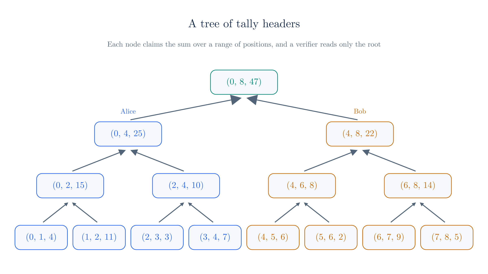
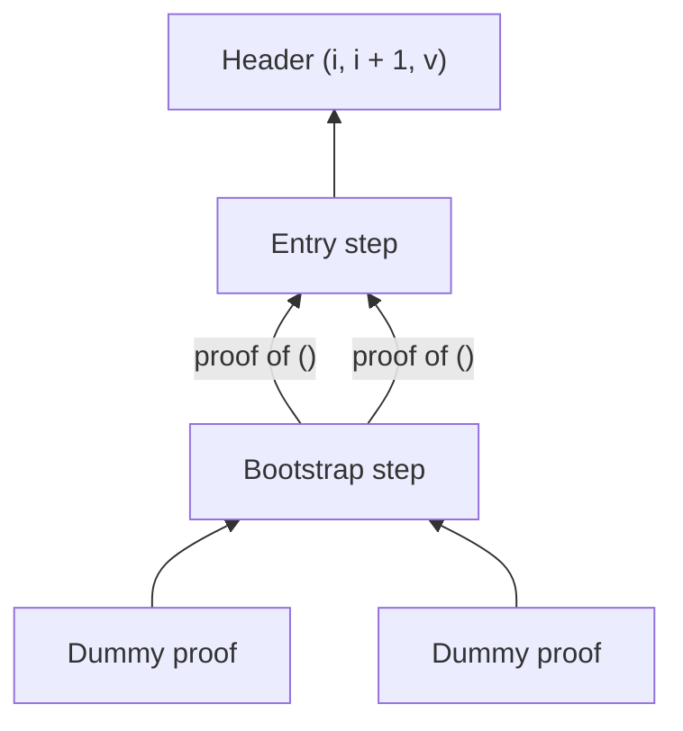
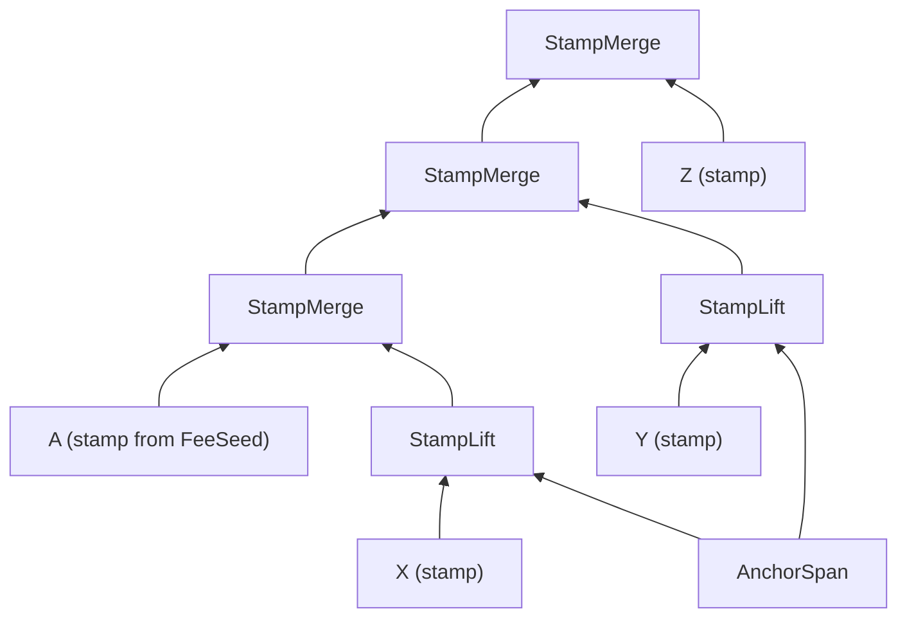
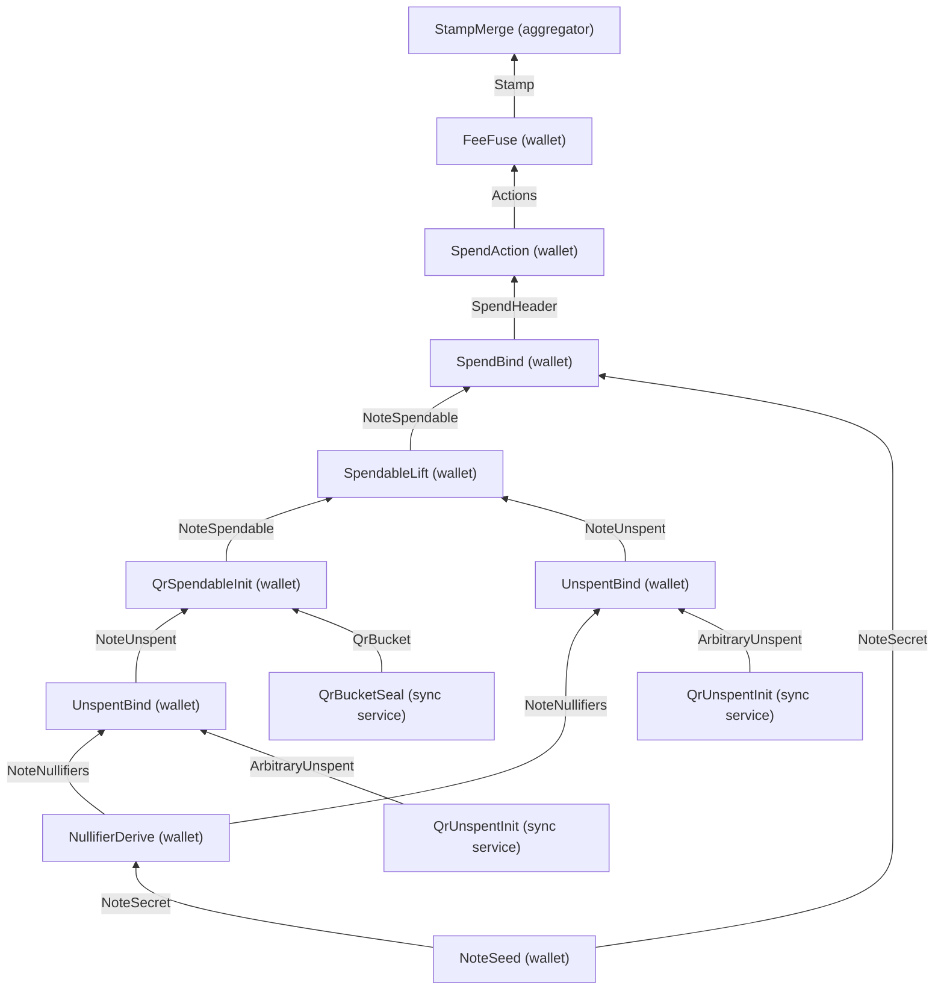

# An Introduction to Proof-Carrying Data

The [previous chapter](./scaling-zcash.md) described what Tachyon needs from its proofs. Proofs from many separate wallets should collapse into one proof that a miner can check quickly, and anyone should be able to continue that combining later. This chapter states that requirement precisely, as a goal called **proof-carrying data** (PCD). It does not yet explain how to build it.

We treat the proof as a black box throughout, and the rest of the site opens that box. Sections 2 to 7 work through a small sum on a tree, with no cryptography, so that each idea has concrete numbers. Sections 9 to 12 then use the same vocabulary to read Ragu's interface and Tachyon's aggregation.

## 1. The goal of proof-carrying data

A proof system lets a **prover** convince a **verifier** that a computation was carried out correctly. The verifier receives a **proof**, and checking it costs much less than rerunning the computation. For this chapter we rely on two promises from the proof system. An honest prover can always produce a proof that the verifier accepts, and a prover cannot produce an accepted proof of a false claim, except with negligible probability. The chapter on [statements and challenges](./statements-and-challenges.md) makes these promises more precise.

Now consider a miner facing thousands of shielded transactions, each built by a different wallet from its own secrets. Using a proof system once for each transaction, or once for all of them together, runs into three obstacles:

- **One prover would have to hold everything.** A single proof about a thousand transactions, produced in one run, would need one party holding the secrets of a thousand wallets. No such party exists, and no wallet would hand its secrets over.
- **Finished proofs would not build on each other.** If one more transaction arrives after the proof is done, the prover has to start again from the beginning.
- **Separate proofs would keep the verifier's work high.** With one proof per transaction, the miner performs one check per transaction, so the cost grows with the number of transactions.

Proof-carrying data avoids all three by changing what gets proved. We split the computation into steps arranged as a tree. Each node of the tree produces a piece of data together with a proof, and that proof covers the step at this node and every step below it. The data therefore carries evidence of its whole history, which is where the name comes from.

A PCD system should provide the following properties, each answering one of the obstacles above:

1. **Distributed work.** The party running a node needs the data and proofs of the nodes directly below it, plus its own private input. It does not need the private inputs of earlier nodes.
2. **Extension.** Anyone holding a finished node can use it as an input to a new node, and nobody repeats the earlier proving work.
3. **Succinctness.** The proof's size and the cost of checking it do not grow with the size of the tree.

Tachyon's aggregation is our running example. In Tachyon, a wallet proves that its transaction follows the rules and publishes the result as a **stamp**. An **aggregator** combines stamps from independent wallets into a single stamp, and validators check that one stamp in place of the separate ones. Tachyon has not activated on mainnet and its design is still changing, so everything this chapter says about it describes the [Tachyon repository](https://github.com/tachyon-zcash/tachyon/tree/7e502548db33845dbaacdc0efe905d1a3c45e626) at commit `7e50254`.

## 2. A toy computation

To see what each node of a tree claims, we need a computation whose intermediate results are easy to check by hand. Adding up a list has this property, because a subtotal is meaningful on its own and two subtotals combine by addition. Here is the list we will use:

<!-- worked:values -->

| Position $i$ | 0 | 1 | 2 | 3 | 4 | 5 | 6 | 7 |
| --- | --- | --- | --- | --- | --- | --- | --- | --- |
| Value $L_i$ | 4 | 11 | 3 | 7 | 6 | 2 | 9 | 5 |

The list has 8 entries, and its sum is 47.

<!-- /worked:values -->

Treat the list as fixed. A party holding position $i$ can read $L_i$, and other parties cannot. We want to reach one short statement about the total that a verifier can accept without ever seeing the list. Getting there requires deciding what each node claims, which is the subject of Section 3, and what rule a node must obey, which is the subject of Section 4. The proof itself enters in Section 6.

## 3. Headers

We call the data at a node its **header**. A header has two jobs. It has to give the next node enough information to apply its rule, and it has to stay small, because it travels up the tree with the proof.

The first candidate for a header is the subtotal alone. A join rule would then add two subtotals and output the result. This candidate fails in a way worth seeing:

<!-- worked:sum-only -->

Joining the entry with value 11 to itself produces a node that claims 22, and nothing in that header reveals the repeat. A tree with 8 leaves has 7 joins, and a prover can choose any entry for each leaf. Enumerating those choices gives 6435 multisets of entries, which reach 71 different root totals from 16 to 88. Only 47 is the true sum, yet every one of these trees passes a join rule that checks only addition.

<!-- /worked:sum-only -->

The trouble is that a bare subtotal does not say which entries went into it. No rule that reads only subtotals can reject a repeated entry, so the header has to record more. Adding the range of positions it covers fixes this. Our header becomes three numbers,

$$(\ell,\ h,\ s), \quad \text{which claims} \quad L_\ell + L_{\ell+1} + \cdots + L_{h-1} = s.$$

The range includes $\ell$ and excludes $h$, so a range ending at $h$ meets the next range exactly when that range starts at $h$. The header stays at three numbers however many entries it covers, because it records only the conclusion. It forgets the individual values and the order in which they were added. Choosing a header is therefore a decision about what to remember, and the guide is to keep exactly what later rules need to compare.

### The stamp header

A Tachyon stamp makes the same decision. Its [header](https://github.com/tachyon-zcash/tachyon/blob/7e502548db33845dbaacdc0efe905d1a3c45e626/crates/tachyon/src/stamp/proof/stamp.rs#L75-L89) has three fields:

- A commitment to the stamp's **action set**, which holds one digest for each action and fee the stamp covers.
- A commitment to its **tachygram set**. A [tachygram](https://github.com/tachyon-zcash/tachyon/blob/7e502548db33845dbaacdc0efe905d1a3c45e626/book/src/tachygrams.md) is a published value that commits to the creation or destruction of a note.
- An **anchor**, which [names a position](https://github.com/tachyon-zcash/tachyon/blob/7e502548db33845dbaacdc0efe905d1a3c45e626/book/src/anchor.md) in the history of the Tachyon pool.

The sets grow as stamps combine, but the header cannot, so it holds commitments instead of the sets themselves. A [commitment](./polynomial-commitments.md) is a short value that stands for a long list and cannot later be opened to a different one. The commitments play the part of our range, because they record what the stamp covers, and the anchor records where in the pool's history it stands.

## 4. Steps

A header's claim means nothing without rules saying how a header may be produced. We call such a rule a **step**. A step declares the headers it takes as input and the header it produces, and it states a check that must pass. It may also use private input known only to the party running it, which we call the **witness**.

Our computation needs two steps. The first has no inputs, and it starts a new header from a single entry. We call it `Entry`:

$$\text{witness } (i, v), \qquad \text{check } L_i = v, \qquad \text{output } (i,\ i + 1,\ v).$$

The second step takes two headers and combines them. We call it `Join`:

$$\text{inputs } (\ell_1, h_1, s_1),\ (\ell_2, h_2, s_2), \qquad \text{check } h_1 = \ell_2, \qquad \text{output } (\ell_1,\ h_2,\ s_1 + s_2).$$

The check $h_1 = \ell_2$ is the part that the sum-only header could not express. It rejects any pair of ranges that repeat, overlap, or skip entries. Before attaching any proof, we can test whether these two steps are strong enough, by listing everything they can ever produce:

<!-- worked:closure -->

Start from the 8 entry headers and apply the join rule until nothing new appears. The process produces 36 headers, one for each range of positions, and each one states the correct sum for its range. Of the 1296 ordered pairs of those headers, the rule accepts 84, namely the pairs whose ranges meet. Exactly one derived header covers the whole list, and it is $(0, 8, 47)$.

<!-- /worked:closure -->

This is the property we need from headers and steps together, because it means every header the rules can produce is true. The property has nothing to do with cryptography. It is a fact about the rules, and the application designer is responsible for it. The proof system's job comes later, and it is limited to making sure that nobody can present a header the rules could not have produced.

### The stamp merge step

The Tachyon step that combines stamps is [`StampMerge`](https://github.com/tachyon-zcash/tachyon/blob/7e502548db33845dbaacdc0efe905d1a3c45e626/crates/tachyon/src/stamp/proof/stamp.rs#L244-L325). Its declaration names one header type for both inputs and for the output:

```rust
impl Step for StampMerge {
    type Aux<'source> = ();
    type Left = Stamp;
    type Output = Stamp;
    type Right = Stamp;
```

The step performs three checks. The two input anchors must be equal, which plays the role of $h_1 = \ell_2$. The set polynomials in the witness must match the commitments in the input headers. Finally, each merged set polynomial must equal the product of its two inputs. Tachyon encodes a set as a polynomial whose roots are the members, so multiplying two such polynomials produces the union of the sets, and this check plays the role of $s_1 + s_2$. The [chapter on pool state](./pool-state.md) studies these polynomials.

## 5. Running the tree

We can now run the computation. Each row below is one node, with its leaves first:

<!-- worked:tree -->

| Node | Step | Inputs | What the step checks | Header $(\ell, h, s)$ |
| --- | --- | --- | --- | --- |
| E0 | Entry | none | $L_{0} = 4$ | $(0, 1, 4)$ |
| E1 | Entry | none | $L_{1} = 11$ | $(1, 2, 11)$ |
| E2 | Entry | none | $L_{2} = 3$ | $(2, 3, 3)$ |
| E3 | Entry | none | $L_{3} = 7$ | $(3, 4, 7)$ |
| E4 | Entry | none | $L_{4} = 6$ | $(4, 5, 6)$ |
| E5 | Entry | none | $L_{5} = 2$ | $(5, 6, 2)$ |
| E6 | Entry | none | $L_{6} = 9$ | $(6, 7, 9)$ |
| E7 | Entry | none | $L_{7} = 5$ | $(7, 8, 5)$ |
| J0 | Join | E0, E1 | $1 = 1$ and $4 + 11 = 15$ | $(0, 2, 15)$ |
| J1 | Join | E2, E3 | $3 = 3$ and $3 + 7 = 10$ | $(2, 4, 10)$ |
| J2 | Join | E4, E5 | $5 = 5$ and $6 + 2 = 8$ | $(4, 6, 8)$ |
| J3 | Join | E6, E7 | $7 = 7$ and $9 + 5 = 14$ | $(6, 8, 14)$ |
| J4 | Join | J0, J1 | $2 = 2$ and $15 + 10 = 25$ | $(0, 4, 25)$ |
| J5 | Join | J2, J3 | $6 = 6$ and $8 + 14 = 22$ | $(4, 8, 22)$ |
| J6 | Join | J4, J5 | $4 = 4$ and $25 + 22 = 47$ | $(0, 8, 47)$ |

<!-- /worked:tree -->



Reading up the tree, each row depends only on the rows it names as inputs. A node never looks further down, because its inputs' headers already summarize everything below them.

<!-- worked:shapes -->

The tree above is balanced, but the rule does not require that. A list of 8 entries has 429 binary tree shapes that keep the entries in order. Running all of them gives the same root header $(0, 8, 47)$ every time.

<!-- /worked:shapes -->

This freedom means the work can follow whoever holds the data:

<!-- worked:parties -->

Suppose Alice holds positions 0 to 3 and Bob holds the rest. Alice runs her subtree and hands over the header $(0, 4, 25)$ with its proof. Bob does the same with $(4, 8, 22)$. Carol, who holds neither half of the list, checks only that $4 = 4$ and $25 + 22 = 47$ before producing $(0, 8, 47)$.

<!-- /worked:parties -->

Carol needed neither Alice's values nor Bob's, which is the first property from Section 1 in miniature.

One particular shape deserves its own name. If each new node combines the previous result with one new entry, the tree becomes a chain:

<!-- worked:chain -->

| After appending position | Header |
| --- | --- |
| 0 | $(0, 1, 4)$ |
| 1 | $(0, 2, 15)$ |
| 2 | $(0, 3, 18)$ |
| 3 | $(0, 4, 25)$ |
| 4 | $(0, 5, 31)$ |
| 5 | $(0, 6, 33)$ |
| 6 | $(0, 7, 42)$ |
| 7 | $(0, 8, 47)$ |

<!-- /worked:chain -->

The chain form is **incrementally verifiable computation** (IVC), which [Valiant introduced](https://iacr.org/archive/tcc2008/49480001/49480001.pdf) before the general tree form. [Chiesa and Tromer's PCD](http://people.csail.mit.edu/tromer/papers/pcd.pdf) extended the idea to nodes with several inputs. A chain suits a single party working through a sequence, but it forces independent parties to wait for each other. Tachyon's wallets and aggregators work independently, so they need the tree.

A finished node can also feed more than one later node, because a header and its proof are ordinary data that anyone can copy. For example, the same partial result could enter two different trees. The history of a proof can therefore share nodes, and the literature describes it as a directed acyclic graph. "Tree" remains the common name, and it is accurate for the way we draw the inputs of any one node.

## 6. Attaching a proof

So far a verifier would have to trust whoever ran the nodes, or else rerun all of them. We now attach a proof to each node, so that a node's output is the pair of a header and a proof. The proof at a node establishes the following statement:

> There is a witness for which the declared step accepts these input headers and produces this output header, and each input header has a valid proof.

The last clause makes the statement recursive, which is the central idea of PCD. A node proves that its children's proofs verify, so a later verifier does not have to see those children. How a proof can contain a check of another proof is the subject of the [chapter on recursive proofs](./recursive-proofs.md). For now, we only note that this requires the verifier's own check to be small enough to include in a step.

Unwinding the statement at our root shows how much a single proof covers:

<!-- worked:unwind -->

The root $(0, 8, 47)$ says that the `Join` rule accepted $(0, 4, 25)$ and $(4, 8, 22)$, and that those two headers have valid proofs. Their own proofs in turn say that $(0, 2, 15)$ and $(2, 4, 10)$ were joined into $(0, 4, 25)$, and likewise on the right. Following every branch to the bottom reaches 8 `Entry` checks, each comparing one value with the list. The root's proof therefore stands for all 15 checks in the table, of which the verifier runs none.

<!-- /worked:unwind -->

The verifier's procedure has two parts. It runs the proof system's check on the header and proof, and then it compares the header with the question it actually wants answered. The second part is easy to overlook:

<!-- worked:partial -->

The header $(0, 7, 42)$ is also true and has a valid proof, because it is one of the derived headers. A verifier who wants the sum of the whole list must still confirm that the range runs from 0 to 8, and a verifier who accepted this header without looking would conclude that the total is 42.

<!-- /worked:partial -->

A valid proof shows that the rules produced this header, and the verifier still has to decide whether this header answers its question.

## 7. Why a false header has no valid proof

The argument rests on three assumptions:

1. The proof system keeps its promise from Section 1, so accepted proofs of false statements do not occur in practice.
2. The steps are correct, in the sense of Section 4, so a step with true input headers can only output a true header.
3. The verifier compares the final header with what it wants to know.

Suppose a prover holds an accepted proof for a false header. By assumption 1, the statement from Section 6 is true, so a declared step accepted some input headers and produced this one, and those inputs have valid proofs. By assumption 2, the inputs cannot all be true, or the output would be true as well. So at least one input is a false header with a valid proof, and the same reasoning applies to it. Each repetition moves one level down the tree. The descent eventually reaches a step with no inputs, such as `Entry`, whose check rejects a false entry directly. No false header can therefore have a valid proof.

Here is what each natural attempt to cheat runs into on the toy tree:

<!-- worked:cheats -->

| Attempt | Inputs and claim | Check that fails |
| --- | --- | --- |
| False entry | Claims $L_2 = 4$ | `Entry`: $L_2$ is 3 |
| Wrong addition | $(0, 1, 4)$, $(1, 2, 11)$, claims $s = 16$ | `Join`: $4 + 11 \neq 16$ |
| Repeated entry | $(1, 2, 11)$ twice | `Join`: $2 \neq 1$ |
| Overlapping ranges | $(0, 3, 18)$, $(2, 4, 10)$ | `Join`: $3 \neq 2$ |
| Skipped entry | $(0, 2, 15)$, $(3, 4, 7)$ | `Join`: $2 \neq 3$ |

<!-- /worked:cheats -->

In each case the prover cannot obtain a proof for the node where the falsehood first appears, so no later node can use it as an input.

Assumption 3 matters in Tachyon, because some of its steps leave a value unconstrained at the start. For instance, the anchor is a [free witness in the `FeeSeed` step](https://github.com/tachyon-zcash/tachyon/blob/7e502548db33845dbaacdc0efe905d1a3c45e626/crates/tachyon/src/stamp/proof/stamp.rs#L67-L71), so the proof does not by itself show that the anchor belongs to the real chain. Validators close this gap by [confirming the anchor against the consensus chain](https://github.com/tachyon-zcash/tachyon/blob/7e502548db33845dbaacdc0efe905d1a3c45e626/book/src/proof-tree.md?plain=1#L83-L84).

## 8. Succinctness

The statement in Section 6 could be met in a wasteful way, by having each node attach its children's proofs to its own. The pile of proofs would grow with the tree, and the verifier would check each one. We can compare that approach with the goal:

<!-- worked:cost -->

| Entries $n$ | Nodes $2n - 1$ | Proofs checked if every node's proof is kept | Proofs checked with PCD | Layers in a balanced tree |
| --- | --- | --- | --- | --- |
| 8 | 15 | 15 | 1 | 4 |
| 1,024 | 2,047 | 2,047 | 1 | 11 |
| 1,048,576 | 2,097,151 | 2,097,151 | 1 | 21 |

<!-- /worked:cost -->

The last column shows another benefit of a tree. With enough workers, each layer of a balanced tree can run at the same time, so the number of rounds grows with the logarithm of the number of entries.

Succinctness is not only a convenience for the final verifier. Each node has to check its children's proofs as part of its own statement. If checking a proof grew with the size of the history behind it, every level of the tree would cost more to prove than the one below, and the recursion would soon become impractical. A proof system usable for PCD therefore needs a check that stays small no matter how much history the proof covers. Most of the machinery on this site exists to meet this requirement, and much of the difficulty lies in making that check cheap enough to run inside another proof.

Headers obey the same constraint. Ragu fixes a maximum header size for each application, through the [`HEADER_SIZE` parameter](https://github.com/tachyon-zcash/ragu/blob/3219e0865e8bff1f9d817bfe3850d9e94b64338c/crates/ragu_pcd/src/lib.rs#L232). This is the practical reason that the stamp header holds commitments in place of its growing sets.

## 9. Fusion in Ragu

Ragu provides this model through a small set of concepts, described in the Ragu Book's [chapter on PCD](https://github.com/tachyon-zcash/ragu/blob/3219e0865e8bff1f9d817bfe3850d9e94b64338c/book/src/concepts/pcd.md). A [`Header`](https://github.com/tachyon-zcash/ragu/blob/3219e0865e8bff1f9d817bfe3850d9e94b64338c/crates/ragu_pcd/src/header.rs#L95-L123) defines the form of a node's data, and a [`Step`](https://github.com/tachyon-zcash/ragu/blob/3219e0865e8bff1f9d817bfe3850d9e94b64338c/crates/ragu_pcd/src/step/mod.rs#L148-L190) declares a left input header, a right input header, an output header, and a witness. The operation that runs a step on two inputs and produces a new node is called [`fuse`](https://github.com/tachyon-zcash/ragu/blob/3219e0865e8bff1f9d817bfe3850d9e94b64338c/crates/ragu_pcd/src/fuse/mod.rs#L74-L81).

::: warning Terminology: fuse and merge
The Ragu Book chose "fuse" for this operation so as to avoid the overloaded word "folding". Some code comments still call a step a "merging" operation, and the Tachyon book uses "merge" for what its aggregators do. This site uses **fuse** for Ragu's operation. It uses "merge" only inside the names of particular Tachyon steps, such as `StampMerge`, or when describing what those steps do to stamps.
:::

### Telling header types apart

A header type also has a **suffix**, a label that distinguishes it from other header types even when their contents look the same. To see why this is needed, extend the toy example:

<!-- worked:charge -->

Suppose a final step `Charge` adds a flat fee of 2. It consumes $(0, 8, 47)$ and outputs $(0, 8, 49)$. If `Charge` accepted its own output, a prover could apply it again to reach $(0, 8, 51)$, even though the fee is meant to apply once. The input and output contain three numbers of the same form, so the numbers cannot tell the two states apart. Giving the input and output different type labels, say `Tally` and `Charged`, solves this, because `Charge` accepts only a `Tally`.

<!-- /worked:charge -->

Tachyon uses suffixes in the same way. Its [`Actions`](https://github.com/tachyon-zcash/tachyon/blob/7e502548db33845dbaacdc0efe905d1a3c45e626/crates/tachyon/src/stamp/proof/stamp.rs#L46-L55) and `Stamp` headers contain identical fields, and `Actions` even reuses the encoding of `Stamp`. Only the suffix differs. The first represents actions before a fee is applied, and the second represents them afterward, so a step that requires a stamp cannot receive an unfinished set of actions by mistake.

### Choosing among many steps

The original PCD model has a single rule, applied at every node. An application with many kinds of transition must then fit them all into that one rule, and every node pays for the whole of it. Ragu instead lets the prover choose any registered step at each node and pay only for the chosen one. The [chapter on wiring and the registry](./wiring-and-registry.md) explains how the protocol supports this. Our toy application uses two steps, and Tachyon's [table of steps](https://github.com/tachyon-zcash/tachyon/blob/7e502548db33845dbaacdc0efe905d1a3c45e626/book/src/proof-tree.md?plain=1#L562-L601) lists a few dozen.

### Every node has two inputs

Supporting chains, leaves, and joins as separate cases would mean building separate mechanisms for them in the protocol. Ragu avoids this by giving every node exactly two inputs, which makes every computation a binary tree that may be unbalanced. `Join` fits this form directly. To fit the others, Ragu has a **unit header**, written `()`, which carries no data. A chain step such as "append one entry" declares `()` as its right input, and `Entry` declares it for both inputs.

An unused input still has to be filled with something that has a valid proof, because the unit header gets no exemption from the check on its children. So a question remains about what sits at the bottom of the recursion.

### The base case

The statement in Section 6 says that each input has a valid proof, but the first node has no earlier proofs to point to. Some node must skip that part of the statement, and a skipped check could be an opening for forgery, so Ragu confines it tightly.

Ragu performs the skip in exactly one internal step, called the bootstrap step. That step declares a private header type named `Dummy` for both inputs, and this type is what selects the base case. It takes two synthesized proofs that would not verify on their own, skips their claims, and outputs a valid proof of a unit header that attests nothing. Application code [cannot declare `Dummy`](https://github.com/tachyon-zcash/ragu/blob/3219e0865e8bff1f9d817bfe3850d9e94b64338c/crates/ragu_pcd/src/header.rs#L15-L27), so no application step can skip its children's checks. The [`seed` operation](https://github.com/tachyon-zcash/ragu/blob/3219e0865e8bff1f9d817bfe3850d9e94b64338c/crates/ragu_pcd/src/lib.rs#L627-L648) then starts a leaf by fusing a step with this bootstrap proof as both children, and it enforces those children's claims in the ordinary way.



::: warning Reconstructed from code at commit 7e50254, not confirmed by the authors
The Tachyon book says a step accepts ["up to two PCD inputs"](https://github.com/tachyon-zcash/tachyon/blob/7e502548db33845dbaacdc0efe905d1a3c45e626/book/src/proof-tree.md?plain=1#L4), and its table of steps marks some inputs as empty. The Ragu Book says every node has exactly two. The Tachyon code shows that these descriptions refer to the same thing. For example, [`FeeFuse`](https://github.com/tachyon-zcash/tachyon/blob/7e502548db33845dbaacdc0efe905d1a3c45e626/crates/tachyon/src/stamp/proof/stamp.rs#L521-L527) declares `type Right = ();`, and the [call that proves it](https://github.com/tachyon-zcash/tachyon/blob/7e502548db33845dbaacdc0efe905d1a3c45e626/crates/tachyon/src/stamp/mod.rs#L666-L678) passes the bootstrap proof as the right child. This site says that every node has two inputs, and treats an empty slot in the Tachyon table as a unit input. The Tachyon crate [pins a different Ragu revision](https://github.com/tachyon-zcash/tachyon/blob/7e502548db33845dbaacdc0efe905d1a3c45e626/crates/tachyon/Cargo.toml#L83), `0725b52`, whose interfaces differ in detail from those at `3219e08`.
:::

## 10. Uncompressed and compressed proofs

Section 8 asked for proofs whose size does not depend on the tree, and Ragu's proofs meet this in two different ways. The proof a node holds during fusing has a fixed shape, but the Ragu Book describes it as large, since it is not yet in succinct form. Ragu calls this the **uncompressed** mode. With additional work, the [`compress` operation](https://github.com/tachyon-zcash/ragu/blob/3219e0865e8bff1f9d817bfe3850d9e94b64338c/crates/ragu_pcd/src/compress/prover.rs#L60) produces a **compressed** proof that the book describes as orders of magnitude smaller, and a [code comment](https://github.com/tachyon-zcash/ragu/blob/3219e0865e8bff1f9d817bfe3850d9e94b64338c/crates/ragu_pcd/src/profile.rs#L10-L15) gives its size as a few kilobytes. The extra work makes compression worth doing only where a proof leaves the tree and goes to a third party. The [chapter on recursion in Ragu](./ragu-recursion.md) explains how it works.

The two modes raise two questions on which the sources do not yet agree. The first concerns what can happen to a compressed proof afterward.

::: warning Sources disagree: fusing a compressed proof
**Ragu Book:** [compression is terminal](https://github.com/tachyon-zcash/ragu/blob/3219e0865e8bff1f9d817bfe3850d9e94b64338c/book/src/concepts/pcd.md?plain=1#L126-L127), so a compressed proof can be verified but not fused further.

**Tachyon book:** [aggregators decompress](https://github.com/tachyon-zcash/tachyon/blob/7e502548db33845dbaacdc0efe905d1a3c45e626/book/src/aggregation.md?plain=1#L43-L44) a broadcast proof into a mutable format, merge, and recompress before broadcasting.

**Ragu code at `3219e08`:** the [profile comments](https://github.com/tachyon-zcash/ragu/blob/3219e0865e8bff1f9d817bfe3850d9e94b64338c/crates/ragu_pcd/src/profile.rs#L10-L15) describe the intended design. An aggregator's circuits would verify a wallet's compressed proof inside the circuit, so that the proof enters as witness data and not as a child, and an internal [`Decompress` step](https://github.com/tachyon-zcash/ragu/blob/3219e0865e8bff1f9d817bfe3850d9e94b64338c/crates/ragu_pcd/src/step/internal/decompress.rs#L1-L5) would output its header. Those circuits have [not landed yet](https://github.com/tachyon-zcash/ragu/blob/3219e0865e8bff1f9d817bfe3850d9e94b64338c/crates/ragu_pcd/src/profile.rs#L720-L736), and until they do the `Aggregator` profile declares nothing.

**Tachyon code at `7e50254`:** a [stamp holds a `ragu::Proof`](https://github.com/tachyon-zcash/tachyon/blob/7e502548db33845dbaacdc0efe905d1a3c45e626/crates/tachyon/src/stamp/mod.rs#L745) and merges by fusing it. We found no proof compression in the crate.

This site follows the Ragu code. A compressed proof cannot be fused today, decompression is planned, and our examples merge stamps while they are uncompressed.
:::

The second question concerns privacy. Everything in this chapter has been about correctness, and nothing has required the proof to hide its inputs.

::: warning Sources disagree: zero knowledge
**Tachyon book:** the stamp is a [recursive zero-knowledge proof](https://github.com/tachyon-zcash/tachyon/blob/7e502548db33845dbaacdc0efe905d1a3c45e626/book/src/bundle.md?plain=1#L39), and Ragu's [rerandomization](https://github.com/tachyon-zcash/tachyon/blob/7e502548db33845dbaacdc0efe905d1a3c45e626/book/src/bundle.md?plain=1#L35) conceals the private proof inputs.

**Ragu Book and code at `3219e08`:** the [book states](https://github.com/tachyon-zcash/ragu/blob/3219e0865e8bff1f9d817bfe3850d9e94b64338c/book/src/concepts/pcd.md?plain=1#L132-L136) that the current construction does not yet establish zero knowledge or unlinkability, because a proof still exposes child data and lacks a fold-level randomizer for the accumulator. The [comment on `rerandomize`](https://github.com/tachyon-zcash/ragu/blob/3219e0865e8bff1f9d817bfe3850d9e94b64338c/crates/ragu_pcd/src/lib.rs#L717-L724) says the same and calls the remaining work future work.

This site follows the Ragu code, and treats hiding as a goal that has not yet been met. When we say that a node does not need its children's witnesses, we mean only that it can do its work without them. We do not mean that the proof it receives conceals them.
:::

## 11. Aggregation in Tachyon

With this vocabulary we can follow one aggregate from start to finish. The Tachyon [book on aggregation](https://github.com/tachyon-zcash/tachyon/blob/7e502548db33845dbaacdc0efe905d1a3c45e626/book/src/aggregation.md) uses three names for the states a transaction's Tachyon **bundle** can be in. An **autonome** comes from a wallet and carries a complete stamp. An **aggregate** comes from an aggregator and carries a merged stamp that needs inputs from other transactions. An **adjunct** has had its stamp stripped and points to the aggregate that covers it.

### The inputs

Our example has three autonomes X, Y and Z, plus an aggregator's own bundle A. A real tachygram is a field element, and a real anchor is a hash value. In this table, three-digit numbers stand in for tachygrams, and $\alpha_{k}$ stands for the anchor at position $k$. We also write the sets out literally, which is what the real commitments stand for. An $a_k$ is an action digest, and an $f$ is a fee digest.

<!-- worked:stamp-bundles -->

| Bundle | Actions | Action set, with fee digest | Tachygrams | Anchor |
| --- | --- | --- | --- | --- |
| A | 0 | $\{f_{A}\}$ | $\{431\}$ | $\alpha_{15}$ |
| X | 1 | $\{a_{1},\ f_{X}\}$ | $\{254,\ 504,\ 766\}$ | $\alpha_{12}$ |
| Y | 2 | $\{a_{2},\ a_{3},\ f_{Y}\}$ | $\{149,\ 174,\ 196,\ 648,\ 940\}$ | $\alpha_{14}$ |
| Z | 1 | $\{a_{4},\ f_{Z}\}$ | $\{159,\ 474,\ 696\}$ | $\alpha_{15}$ |

<!-- /worked:stamp-bundles -->

These sizes follow [the book's rule](https://github.com/tachyon-zcash/tachyon/blob/7e502548db33845dbaacdc0efe905d1a3c45e626/book/src/bundle.md?plain=1#L191-L195). Each action publishes two tachygrams, and each bundle adds one more for its fee change note, so a stamp covering $N$ actions in $B$ bundles has $2N + B$ tachygrams. Bundle A has no actions of its own, which the book calls an **innocent** aggregate. Its stamp comes from `FeeSeed`, a step with unit inputs, and that step proves A's zero fee.

### The tree

The wallets chose their anchors independently, and `StampMerge` requires equal anchors because its output has a single anchor field. The aggregator therefore lifts the older stamps to a common position first. The step that does this, `StampLift`, shows that a step's two inputs need not have the same header type. Its left input is a stamp and its right input is an `AnchorSpan`, which is a separate PCD attesting to a run of anchors. The step moves the stamp from the span's start, or from any anchor the span lists as a member, to the span's end.



The same span serves both lifts, which is the node sharing that Section 5 described. Running the tree gives:

<!-- worked:stamp-run -->

| Step | Left | Right | What the step checks | Output anchor | Action digests | Tachygrams |
| --- | --- | --- | --- | --- | --- | --- |
| `StampLift` | X | span | $\alpha_{12}$ is the span's start | $\alpha_{15}$ | 2 | 3 |
| `StampLift` | Y | span | $\alpha_{14}$ is a member | $\alpha_{15}$ | 3 | 5 |
| `StampMerge` | A | lifted X | anchors match | $\alpha_{15}$ | 3 | 4 |
| `StampMerge` | previous | lifted Y | anchors match | $\alpha_{15}$ | 6 | 9 |
| `StampMerge` | previous | Z | anchors match | $\alpha_{15}$ | 8 | 12 |

The span runs from $\alpha_{12}$ to $\alpha_{15}$, with members $\{\alpha_{13},\ \alpha_{14},\ \alpha_{15}\}$. Merging A with the unlifted X would fail, because $15 \neq 12$.

<!-- /worked:stamp-run -->

The merged stamp [stays on the receiving bundle](https://github.com/tachyon-zcash/tachyon/blob/7e502548db33845dbaacdc0efe905d1a3c45e626/book/src/proof-tree.md?plain=1#L90) A and keeps A's fee. Literal sets would make the last row's header far larger than the first, which is why the real header has only commitments, and they have the same size in every row.

### The block

A miner who wants to use this aggregate must [include every bundle it covers](https://github.com/tachyon-zcash/tachyon/blob/7e502548db33845dbaacdc0efe905d1a3c45e626/book/src/aggregation.md?plain=1#L14-L15), and it strips the stamps from the covered ones:

<!-- worked:stamp-block -->

| Transaction | Name | Keeps its action and fee descriptors | Carries tachygrams and a proof |
| --- | --- | --- | --- |
| A | aggregate | yes | yes, the merged stamp |
| X | adjunct | yes | no, it points to A |
| Y | adjunct | yes | no, it points to A |
| Z | adjunct | yes | no, it points to A |

The block carries 1 proof where the four separate transactions carried 4. It still carries all 12 tachygrams and all 8 action and fee digests, because the verifier needs them. A validator collects the digests from the four transactions, takes the tachygrams and anchor from A's stamp, and checks the one proof against the header those values produce. If a miner leaves Z out of the block, the rebuilt action set has 6 digests instead of 8. The header no longer matches the one the proof was made for, so the proof fails.

<!-- /worked:stamp-block -->

This shows how a verifier uses the header in practice. The stamp [carries no proof header](https://github.com/tachyon-zcash/tachyon/blob/7e502548db33845dbaacdc0efe905d1a3c45e626/book/src/aggregation.md#action-set-indicator), so the verifier builds it from the published data, as the [verification code](https://github.com/tachyon-zcash/tachyon/blob/7e502548db33845dbaacdc0efe905d1a3c45e626/crates/tachyon/src/stamp/mod.rs#L1304-L1319) does. The validator also checks the anchor against the chain, which is the comparison that Section 7 required. So the part that aggregation removes is the proofs, while the public descriptors and tachygrams all remain on chain.

::: warning Reconstructed from code at commit 7e50254, not confirmed by the authors
Our toy `Join` rejected a repeated entry through its range check, but `StampMerge` has no comparable check. Its [product check](https://github.com/tachyon-zcash/tachyon/blob/7e502548db33845dbaacdc0efe905d1a3c45e626/crates/tachyon/src/stamp/proof/stamp.rs#L300-L314) establishes a multiset union, and we did not find a disjointness constraint in the step. The Tachyon book lists the merged sets as [exclusive](https://github.com/tachyon-zcash/tachyon/blob/7e502548db33845dbaacdc0efe905d1a3c45e626/book/src/aggregation.md?plain=1#L52), and the protection against repeats appears to come from outside the proof. Aggregators [choose a disjoint set of inputs](https://github.com/tachyon-zcash/tachyon/blob/7e502548db33845dbaacdc0efe905d1a3c45e626/book/src/network_roles/aggregator.md#choosing-what-to-merge), and [consensus rejects a stamp](https://github.com/tachyon-zcash/tachyon/blob/7e502548db33845dbaacdc0efe905d1a3c45e626/book/src/tachygrams.md#consensus-validation) that repeats a tachygram already published within a two-epoch window. This is another instance of the verifier's comparison from Section 7.
:::

### Removing a contributor

A step does not have to make its header cover more. Blocks keep arriving while an aggregator works, and the [aggregator's guide](https://github.com/tachyon-zcash/tachyon/blob/7e502548db33845dbaacdc0efe905d1a3c45e626/book/src/network_roles/aggregator.md#when-a-block-lands) describes how it recovers when some of its inputs get mined first:

<!-- worked:stamp-unmerge -->

Suppose a block includes X on its own while the aggregator is still working. The merged stamp holds 12 tachygrams, and publishing it now would repeat those of X. `StampUnmerge` takes the merged stamp and the stamp of X and produces a stamp with 9 tachygrams and 6 action digests, which covers A, Y and Z. Its header states less than its input did, which is permitted, because a step only has to establish the relation it declares between its inputs and its output.

<!-- /worked:stamp-unmerge -->

The chapter on [aggregation and bundles](./aggregation-and-bundles.md) covers fees, stripping, and the wire format in detail.

## 12. The rest of Tachyon's proof tree

Stamps sit at the top of a larger tree, and different parties run the nodes below them, which is the first property from Section 1 at full scale. The following graph traces [one spend](https://github.com/tachyon-zcash/tachyon/blob/7e502548db33845dbaacdc0efe905d1a3c45e626/book/src/proof-tree.md) in an epoch after its note's creation, up to an aggregate. Each box names a step, and each edge label names the header it passes on. We have simplified the graph by leaving out the steps that feed the sync service, the variants of some steps, and merging with other actions.



Three things from this chapter appear in this graph. The header type changes from step to step, so the suffixes keep each state separate. `NoteSecret` feeds two later steps, so the history shares nodes. Finally, the parties see different things. The sync service builds its `ArbitraryUnspent` segments [without holding the note or its commitment](https://github.com/tachyon-zcash/tachyon/blob/7e502548db33845dbaacdc0efe905d1a3c45e626/book/src/proof-tree.md?plain=1#L31), and only the wallet's `UnspentBind` step connects those segments to a note. The chapter on [the proof tree](./proof-tree.md) walks through each of these steps.

## 13. Where this chapter leaves us

This chapter took the following steps:

1. Proof-carrying data arranges a computation as a tree of nodes, where each node produces a header and a proof covering everything below it.
2. A header states what a node claims, and it has to hold enough for later rules to catch repeats and gaps while staying a fixed size.
3. A step is the rule relating input headers and a witness to an output header. Correct steps mean that every header they can produce is true.
4. A node's proof states that its step accepted its inputs and that those inputs have valid proofs. This recursion lets one proof stand for the whole tree, provided the verifier also compares the final header with what it wants to know.
5. Succinctness requires a proof check that stays small however much history the proof covers, because each node has to run that check on its children.
6. Ragu gives every node two inputs, confines the base case to one internal step, and separates large uncompressed proofs from small compressed ones that cannot currently be fused further.
7. Tachyon's aggregation applies this model to stamps, removing proofs from the chain while keeping every descriptor and tachygram public.

Everything here assumed a proof system that can prove a step's check and verify another proof inside a step. The rest of the site builds that system. The next chapter, [Statements and Challenges](./statements-and-challenges.md), starts with what it means to prove a statement and how random challenges make a large check small.
