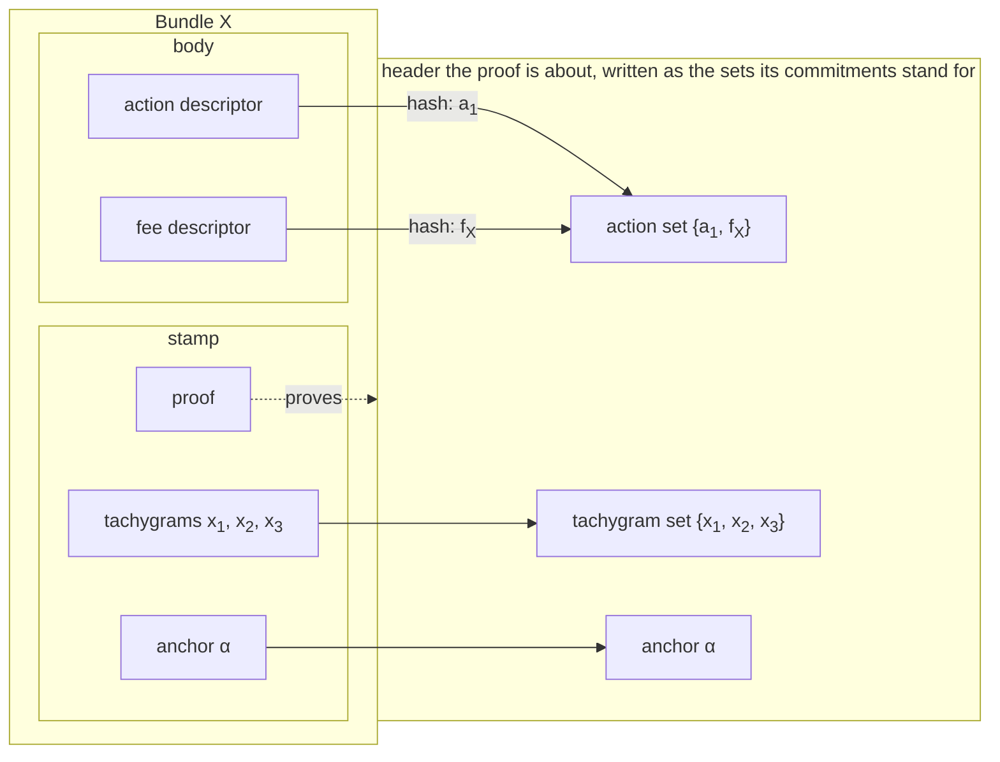
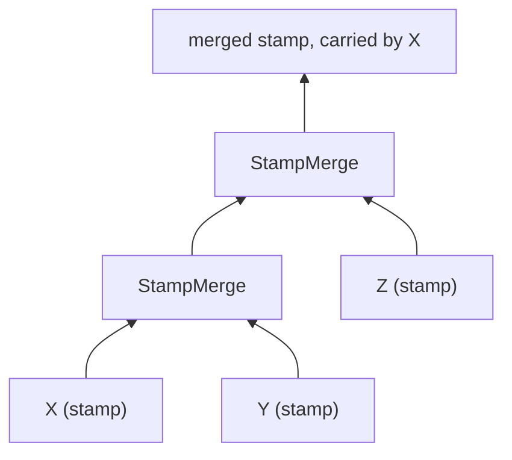
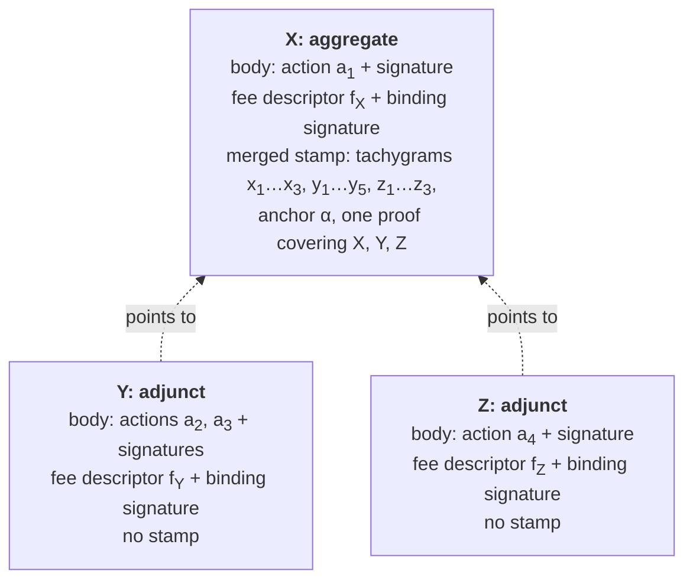
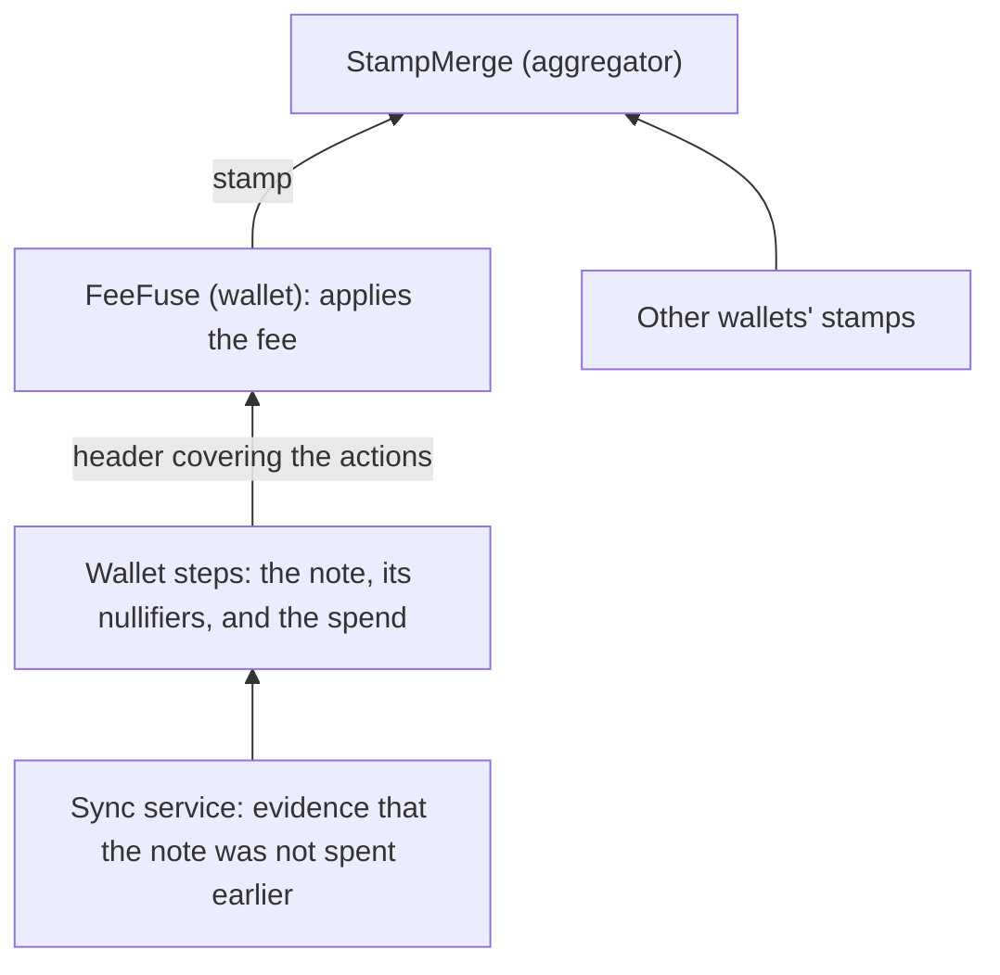

# An Introduction to Proof-Carrying Data

The [previous chapter](./scaling-zcash.md) described what Tachyon needs from its proofs. Proofs from many separate wallets should collapse into one proof that a validator can check quickly, and anyone should be able to continue that combining later. This chapter states that requirement precisely, as a goal called **proof-carrying data** (PCD). It does not yet explain how to build it.

We treat the proof as a black box throughout, and the rest of the site opens that box. Sections 2 to 8 work through a small sum on a tree, with no cryptography, so that each idea has concrete numbers. Section 9 introduces the names and limits of Ragu's version, Section 10 maps the same ideas onto Tachyon's aggregation, and Section 11 shows where aggregation sits among Tachyon's other proofs.

## 1. The goal of proof-carrying data

A proof system lets a **prover** convince a **verifier** that a computation was carried out correctly. The verifier receives a **proof**, and checking it costs much less than rerunning the computation. For this chapter we rely on two promises from the proof system. An honest prover can always produce a proof that the verifier accepts, and a prover cannot produce an accepted proof of a false claim, except with negligible probability. The chapter on [statements and challenges](./statements-and-challenges.md) makes these promises more precise.

Now consider a validator facing thousands of shielded transactions, each built by a different wallet from its own secrets. Using a proof system once for each transaction, or once for all of them together, runs into three obstacles:

- **One prover would have to hold everything.** A single proof about a thousand transactions, produced in one run, would need one party holding the secrets of a thousand wallets. No such party exists, and no wallet would hand its secrets over.
- **Finished proofs would not build on each other.** If one more transaction arrives after the proof is done, the prover has to start again from the beginning.
- **Separate proofs would keep the verifier's work high.** With one proof per transaction, the validator performs one check per transaction, so the cost grows with the number of transactions.

Proof-carrying data avoids all three by changing what gets proved. We split the computation into steps arranged as a tree. Each node of the tree produces a piece of data together with a proof, and that proof covers the step at this node and every step below it. The data therefore carries evidence of its whole history, which is where the name comes from.

A PCD system should provide the following properties, each answering one of the obstacles above:

1. **Distributed work.** The party running a node needs the data and proofs of the nodes directly below it, plus its own private input. It does not need the private inputs of earlier nodes.
2. **Extension.** Anyone holding a finished node can use it as an input to a new node, and nobody repeats the earlier proving work.
3. **Succinctness.** The proof's size and the cost of checking it do not grow with the size of the tree.

Tachyon's aggregation is the application we have in mind, and Section 10 returns to it. In Tachyon, a wallet proves that its transaction follows the rules and publishes the result as a **stamp**. An **aggregator** combines stamps from independent wallets into a single stamp, and validators check that one stamp in place of the separate ones. Tachyon has not activated on mainnet and its design is still changing, so everything this chapter says about it describes the [Tachyon repository](https://github.com/tachyon-zcash/tachyon/tree/7e502548db33845dbaacdc0efe905d1a3c45e626) at commit `7e50254`. That crate builds against a mock of Ragu, so when we say that a Tachyon step checks something or that a proof fails, we mean what the design expects. At this commit the [step bodies run natively](./proof-tree.md), with no real circuits, and we did not find a validator in the crate.

## 2. A toy computation

To see what each node of a tree claims, we need a computation whose intermediate results are easy to check by hand. Adding up a list has this property, because a subtotal is meaningful on its own and two subtotals combine by addition. Here is the list we will use:

<!-- worked:values -->

| Position $i$ | 0 | 1 | 2 | 3 | 4 | 5 | 6 | 7 |
| --- | --- | --- | --- | --- | --- | --- | --- | --- |
| Value $L_i$ | 4 | 11 | 3 | 7 | 6 | 2 | 9 | 5 |

The list has 8 entries, and its sum is 47.

<!-- /worked:values -->

Treat the list as fixed. A party holding position $i$ can read $L_i$, and other parties cannot. We want to reach one short statement about the total that a verifier can accept without ever seeing the list. Getting there requires deciding what each node claims, which is the subject of Section 3, and what rule a node must obey, which is the subject of Section 4. The proof itself enters in Section 6.

## 3. Headers

We call the data at a node its **header**. A header has two jobs. It has to give the next node enough information to apply its rule, and it has to stay small, because it travels up the tree with the proof.

The first candidate for a header is the subtotal alone. A rule for combining two nodes would then add their subtotals and output the result. The following example shows how this candidate fails:

<!-- worked:sum-only -->

Combining the entry with value 11 to itself produces a node that claims 22, and nothing in that header reveals the repeat. A tree with 8 leaves combines subtotals at 7 nodes, and a prover can choose any entry for each leaf. Enumerating those choices gives 6435 multisets of entries, which reach 71 different root totals from 16 to 88. Only 47 is the true sum, yet every one of these trees passes a rule that checks only addition.

<!-- /worked:sum-only -->

The trouble is that a bare subtotal does not say which entries went into it. No rule that reads only subtotals can reject a repeated entry, so the header has to record more. Adding the range of positions it covers fixes this. Our header becomes three numbers,

$$(\ell,\ h,\ s), \quad \text{which claims} \quad L_\ell + L_{\ell+1} + \cdots + L_{h-1} = s.$$

The range includes $\ell$ and excludes $h$, so a range ending at $h$ meets the next range exactly when that range starts at $h$. The header stays at three numbers however many entries it covers, because it records only the conclusion. It forgets the individual values and the order in which they were added. So choosing a header means deciding what to remember, and a good header keeps exactly the values that later rules need to compare.

## 4. Steps

A header's claim means nothing without rules saying how a header may be produced. We call such a rule a **step**. A step declares the headers it takes as input and the header it produces, and it states a check that must pass. It may also use private input known only to the party running it, which we call the **witness**.

Our computation needs two steps. The first has no inputs, and it starts a new header from a single entry. We call it `Entry`:

$$\text{witness } (i, v), \qquad \text{check } L_i = v, \qquad \text{output } (i,\ i + 1,\ v).$$

The second step takes two headers and combines them. We call it `Join`:

$$\text{inputs } (\ell_1, h_1, s_1),\ (\ell_2, h_2, s_2), \qquad \text{check } h_1 = \ell_2, \qquad \text{output } (\ell_1,\ h_2,\ s_1 + s_2).$$

The check $h_1 = \ell_2$ is the part that the sum-only header could not express. It rejects any pair of ranges that repeat, overlap, or skip entries. Before attaching any proof, we can test whether these two steps are strong enough, by listing everything they can ever produce:

<!-- worked:closure -->

Start from the 8 entry headers and apply the join rule until nothing new appears. The process produces 36 headers, one for each range of positions, and each one states the correct sum for its range. Of the 1296 ordered pairs of those headers, the rule accepts 84, namely the pairs whose ranges meet. Exactly one derived header covers the whole list, and it is $(0, 8, 47)$.

<!-- /worked:closure -->

This is the property we need from headers and steps together, because it means every header the rules can produce is true. The property has nothing to do with cryptography. It is a fact about the rules, and the application designer is responsible for it. The proof system's job comes later, and it is limited to making sure that nobody can present a header the rules could not have produced.

## 5. Running the tree

We can now run the computation. Each row below is one node, with its leaves first:

<!-- worked:tree -->

| Node | Step | Inputs | What the step checks | Header $(\ell, h, s)$ |
| --- | --- | --- | --- | --- |
| E0 | Entry | none | $L_{0} = 4$ | $(0, 1, 4)$ |
| E1 | Entry | none | $L_{1} = 11$ | $(1, 2, 11)$ |
| E2 | Entry | none | $L_{2} = 3$ | $(2, 3, 3)$ |
| E3 | Entry | none | $L_{3} = 7$ | $(3, 4, 7)$ |
| E4 | Entry | none | $L_{4} = 6$ | $(4, 5, 6)$ |
| E5 | Entry | none | $L_{5} = 2$ | $(5, 6, 2)$ |
| E6 | Entry | none | $L_{6} = 9$ | $(6, 7, 9)$ |
| E7 | Entry | none | $L_{7} = 5$ | $(7, 8, 5)$ |
| J0 | Join | E0, E1 | $1 = 1$ and $4 + 11 = 15$ | $(0, 2, 15)$ |
| J1 | Join | E2, E3 | $3 = 3$ and $3 + 7 = 10$ | $(2, 4, 10)$ |
| J2 | Join | E4, E5 | $5 = 5$ and $6 + 2 = 8$ | $(4, 6, 8)$ |
| J3 | Join | E6, E7 | $7 = 7$ and $9 + 5 = 14$ | $(6, 8, 14)$ |
| J4 | Join | J0, J1 | $2 = 2$ and $15 + 10 = 25$ | $(0, 4, 25)$ |
| J5 | Join | J2, J3 | $6 = 6$ and $8 + 14 = 22$ | $(4, 8, 22)$ |
| J6 | Join | J4, J5 | $4 = 4$ and $25 + 22 = 47$ | $(0, 8, 47)$ |

<!-- /worked:tree -->

Reading up the tree, each row depends only on the rows it names as inputs. A node never looks further down, because its inputs' headers already summarize everything below them.

<!-- worked:shapes -->

The tree above is balanced, but the rule does not require that. A list of 8 entries has 429 binary tree shapes that keep the entries in order. Running all of them gives the same root header $(0, 8, 47)$ every time.

<!-- /worked:shapes -->

This freedom means the work can follow whoever holds the data:

<!-- worked:parties -->

Suppose Alice holds positions 0 to 3 and Bob holds the rest. Alice runs her subtree and hands over the header $(0, 4, 25)$ with its proof. Bob does the same with $(4, 8, 22)$. Carol, who holds neither half of the list, checks only that $4 = 4$ and $25 + 22 = 47$ before producing $(0, 8, 47)$.

<!-- /worked:parties -->

Carol needed neither Alice's values nor Bob's, which is the first property from Section 1 in miniature.

One particular shape deserves its own name. If each new node combines the previous result with one new entry, the tree becomes a chain:

<!-- worked:chain -->

| After appending position | Header |
| --- | --- |
| 0 | $(0, 1, 4)$ |
| 1 | $(0, 2, 15)$ |
| 2 | $(0, 3, 18)$ |
| 3 | $(0, 4, 25)$ |
| 4 | $(0, 5, 31)$ |
| 5 | $(0, 6, 33)$ |
| 6 | $(0, 7, 42)$ |
| 7 | $(0, 8, 47)$ |

<!-- /worked:chain -->

The chain form is **incrementally verifiable computation** (IVC), which [Valiant introduced](https://iacr.org/archive/tcc2008/49480001/49480001.pdf) before the general tree form. [Chiesa and Tromer's PCD](http://people.csail.mit.edu/tromer/papers/pcd.pdf) extended the idea to nodes with several inputs. A chain suits a single party working through a sequence, but it forces independent parties to wait for each other. Tachyon needs both shapes. The exclusion proof from the previous chapter grows by one epoch at a time, which is a chain, while aggregation combines stamps from wallets that work independently, which needs a tree.

A finished node can also feed more than one later node, because a header and its proof are ordinary data that anyone can copy.

<!-- worked:dag -->

For example, Alice's header $(0, 4, 25)$ can be joined with $(4, 8, 22)$ to give $(0, 8, 47)$, and the same header, with the same proof, can also be joined with $(4, 7, 17)$ to give $(0, 7, 42)$. Nobody has to rebuild $(0, 4, 25)$ for the second use.

<!-- /worked:dag -->

The history of a proof can therefore share nodes, and the literature describes it as a directed acyclic graph. "Tree" remains the common name, and it is accurate for the way we draw the inputs of any one node.

## 6. Attaching a proof

So far a verifier would have to trust whoever ran the nodes, or else rerun all of them. We now attach a proof to each node, so that a node's output is the pair of a header and a proof. The proof at a node establishes the following statement:

> There is a witness for which the declared step accepts these input headers and produces this output header, and each input header has a valid proof.

The last clause makes the statement recursive, which is the central idea of PCD. A node proves that its children's proofs verify, so a later verifier does not have to see those children. How a proof can contain a check of another proof is the subject of the [chapter on recursive proofs](./recursive-proofs.md), and Section 8 says what this asks of the proof system.

Unwinding the statement at our root shows how much a single proof covers:

<!-- worked:unwind -->

The root $(0, 8, 47)$ says that the `Join` rule accepted $(0, 4, 25)$ and $(4, 8, 22)$, and that those two headers have valid proofs. Their own proofs in turn say that $(0, 2, 15)$ and $(2, 4, 10)$ were joined into $(0, 4, 25)$, and likewise on the right. Following every branch to the bottom reaches 8 `Entry` checks, each comparing one value with the list. The root's proof therefore stands for all 15 checks in the table, of which the verifier runs none.

<!-- /worked:unwind -->

The verifier's procedure has two parts. It runs the proof system's check on the header and proof, and then it compares the header with the question it actually wants answered. The second part matters even when every proof is valid:

<!-- worked:partial -->

The header $(0, 7, 42)$ is also true and has a valid proof, because it is one of the derived headers. A verifier who wants the sum of the whole list must still confirm that the range runs from 0 to 8, and a verifier who accepted this header without looking would conclude that the total is 42.

<!-- /worked:partial -->

A valid proof shows that the rules produced this header, and the verifier still has to decide whether this header answers its question.

## 7. Why a false header has no valid proof

The argument rests on three assumptions:

1. The proof system keeps its promise from Section 1, so accepted proofs of false statements do not occur in practice.
2. The steps are correct, in the sense of Section 4, so a step with true input headers can only output a true header.
3. The verifier compares the final header with what it wants to know.

Suppose a prover holds an accepted proof for a false header. By assumption 1, the statement from Section 6 is true, so a declared step accepted some input headers and produced this one, and those inputs have valid proofs. By assumption 2, the inputs cannot all be true, or the output would be true as well. So at least one input is a false header with a valid proof, and the same reasoning applies to it. Each repetition moves one level down the tree. The descent eventually reaches a step with no inputs, such as `Entry`, whose check rejects a false entry directly. A prover therefore cannot obtain a valid proof of a false header.

This descent is informal in one respect. Soundness makes accepted proofs of false statements infeasible to find, but such proofs can still exist, so "those inputs have valid proofs" does not by itself show that anyone holds them. The argument really needs a prover who produces a proof to know the child proofs as well. That is the **knowledge soundness** of the [next chapter](./statements-and-challenges.md#_2-completeness-and-soundness), and the [chapter on recursive proofs](./recursive-proofs.md) returns to this point.

Here is what each natural attempt to cheat runs into on the toy tree:

<!-- worked:cheats -->

| Attempt | Inputs and claim | Check that fails |
| --- | --- | --- |
| False entry | Claims $L_2 = 4$ | `Entry`: $L_2$ is 3 |
| Wrong addition | $(0, 1, 4)$, $(1, 2, 11)$, claims $s = 16$ | `Join`: $4 + 11 \neq 16$ |
| Repeated entry | $(1, 2, 11)$ twice | `Join`: $2 \neq 1$ |
| Overlapping ranges | $(0, 3, 18)$, $(2, 4, 10)$ | `Join`: $3 \neq 2$ |
| Skipped entry | $(0, 2, 15)$, $(3, 4, 7)$ | `Join`: $2 \neq 3$ |

<!-- /worked:cheats -->

In each case the prover cannot obtain a proof for the node where the falsehood first appears, so no later node can use it as an input.

## 8. Succinctness

The statement in Section 6 could be met in a wasteful way, by having each node attach its children's proofs to its own. The pile of proofs would grow with the tree, and the verifier would check each one. We can compare that approach with the goal:

<!-- worked:cost -->

| Entries $n$ | Proofs checked if every node keeps its proof, $2n - 1$ | Proofs checked with PCD |
| --- | --- | --- |
| 8 | 15 | 1 |
| 1,024 | 2,047 | 1 |
| 1,048,576 | 2,097,151 | 1 |

<!-- /worked:cost -->

<!-- worked:layers -->

A tree also saves time. A balanced tree over $n$ entries has $\log_2 n + 1$ layers, which is 4, 11 and 21 for the three sizes above. With enough workers, all the nodes of one layer can run at the same time, so the number of rounds grows with the logarithm of the number of entries.

<!-- /worked:layers -->

Succinctness is not only a convenience for the final verifier. Each node has to check its children's proofs as part of its own statement. If checking a proof grew with the size of the history behind it, every level of the tree would cost more to prove than the one below, and the recursion would soon become impractical. A proof system usable for PCD therefore needs a check that stays small no matter how much history the proof covers. Most of the machinery on this site exists to meet this requirement, and much of the difficulty lies in making that check cheap enough to run inside another proof. Headers face the same limit, which is why Section 10 will find commitments where the stamp's growing sets might have been.

## 9. Proof-carrying data in Ragu

Sections 2 to 8 described proof-carrying data in general. Ragu, the proof system this site studies, implements this model, and two of its choices matter before the rest of the site opens the box.

### Fusing in Ragu

The Ragu Book describes Ragu's version of the model in its [chapter on PCD](https://github.com/tachyon-zcash/ragu/blob/3219e0865e8bff1f9d817bfe3850d9e94b64338c/book/src/concepts/pcd.md). A [`Header`](https://github.com/tachyon-zcash/ragu/blob/3219e0865e8bff1f9d817bfe3850d9e94b64338c/crates/ragu_pcd/src/header.rs#L95-L123) type defines the form of a node's data, and a [`Step`](https://github.com/tachyon-zcash/ragu/blob/3219e0865e8bff1f9d817bfe3850d9e94b64338c/crates/ragu_pcd/src/step/mod.rs#L148-L190) declares a left input header, a right input header, an output header, and a witness. Ragu calls the operation that runs a step on two input nodes and produces a new header with its proof [`fuse`](https://github.com/tachyon-zcash/ragu/blob/3219e0865e8bff1f9d817bfe3850d9e94b64338c/crates/ragu_pcd/src/fuse/mod.rs#L74-L81).

The Ragu Book chose "fuse" to avoid the word "folding", which names a different operation in later chapters. The Tachyon book says "merge" for what its aggregators do. This site says **fuse** for Ragu's operation, and it keeps "merge" for particular Tachyon steps, such as `StampMerge`, and for what those steps do to stamps.

Every Ragu step has exactly two inputs. A step that needs fewer, such as `Entry`, fills the unused ones with the **unit header** `()`, which carries no data. The [chapter on recursive proofs](./recursive-proofs.md#_8-from-a-chain-to-a-tree) explains this choice and how the first nodes of a tree get started.

### Proof size and hiding in Ragu

Ragu meets the size requirement in two forms. The proof a node holds while fusing has a fixed size however large the tree behind it, but it is large, because it still contains data that a parent needs for its own work, which later chapters describe. When a proof leaves the tree for a party that only wants to check it, Ragu's [`compress` operation](https://github.com/tachyon-zcash/ragu/blob/3219e0865e8bff1f9d817bfe3850d9e94b64338c/crates/ragu_pcd/src/compress/prover.rs#L60) turns it into a proof that a [code comment](https://github.com/tachyon-zcash/ragu/blob/3219e0865e8bff1f9d817bfe3850d9e94b64338c/crates/ragu_pcd/src/profile.rs#L10-L15) puts at a few kilobytes. At the commit we read, a compressed proof cannot be fused any further. The sources disagree about how an aggregator will fuse proofs that arrive compressed, and the chapters on [recursion in Ragu](./ragu-recursion.md#_18-fusing-after-compression) and on [aggregation](./aggregation-and-bundles.md#decompression) set out each position.

Everything in this chapter concerns correctness, and nothing so far has required a proof to hide its inputs. The Tachyon book describes the stamp as a [recursive zero-knowledge proof](https://github.com/tachyon-zcash/tachyon/blob/7e502548db33845dbaacdc0efe905d1a3c45e626/book/src/bundle.md?plain=1#L39). The [Ragu Book states](https://github.com/tachyon-zcash/ragu/blob/3219e0865e8bff1f9d817bfe3850d9e94b64338c/book/src/concepts/pcd.md?plain=1#L132-L136) that the current construction does not yet establish zero knowledge, and the [code at `3219e08`](https://github.com/tachyon-zcash/ragu/blob/3219e0865e8bff1f9d817bfe3850d9e94b64338c/crates/ragu_pcd/src/lib.rs#L717-L724) agrees. This site follows the Ragu code and treats hiding as a goal that has not yet been met, which the [chapter on recursion in Ragu](./ragu-recursion.md#_16-rerandomization-and-zero-knowledge) examines. When we say that a node does not need its children's witnesses, we mean only that it can do its work without them.

## 10. Aggregation as proof-carrying data

We can now map the toy onto Tachyon's aggregation. Each wallet builds a stamp for its own transaction. From an aggregator's point of view that stamp is a leaf, although Section 11 shows the tree of wallet steps beneath it, and only the wallet can build it, because only the wallet holds the secrets those steps need. An aggregator then combines stamps without any secrets, because a merge reads only its children's headers and proofs.

Our example has three transactions, X, Y and Z. In the book's model, an aggregator [always merges onto a bundle of its own](https://github.com/tachyon-zcash/tachyon/blob/7e502548db33845dbaacdc0efe905d1a3c45e626/book/src/network_roles/aggregator.md?plain=1#L11-L13), so we let the aggregator be the party that built X. It merges the stamps of Y and Z, which other wallets have sent to the mempool, onto its own stamp.

### The stamp header

The previous chapter divided a transaction's Tachyon **bundle** into a body and a stamp. The body holds, for each action, a value commitment and a randomized signing key, which together form the action's **descriptor**. It also holds the max fee commitment and the fee, which form the bundle's **fee descriptor**, together with the signatures. The stamp holds the proof and the values that go with it. Here is where each part of the header of X's proof comes from:

<!-- worked:stamp-anatomy -->

<!-- /worked:stamp-anatomy -->

Hashing an action's descriptor gives its **action digest**, here $a_1$. Hashing the fee descriptor gives the **fee digest** $f_X$. A wallet signs a maximum fee once and [picks the actual fee later](./aggregation-and-bundles.md#_3-fees-chosen-after-signing), when the transaction goes out, so the signatures do not fix the fee. Putting the fee digest in the action set lets the proof fix it instead.

The header of the stamp's proof has [three fields](https://github.com/tachyon-zcash/tachyon/blob/7e502548db33845dbaacdc0efe905d1a3c45e626/crates/tachyon/src/stamp/proof/stamp.rs#L75-L89):

- A commitment to the **action set**, which holds the stamp's action digests and fee digests.
- A commitment to the **tachygram set**. A [tachygram](https://github.com/tachyon-zcash/tachyon/blob/7e502548db33845dbaacdc0efe905d1a3c45e626/book/src/tachygrams.md) is a published value that records the creation or destruction of a note.
- An **anchor**, which [names a state](https://github.com/tachyon-zcash/tachyon/blob/7e502548db33845dbaacdc0efe905d1a3c45e626/book/src/anchor.md) of the Tachyon pool that the stamp's spends refer to.

The sets grow as stamps combine, but Section 8 requires the header to stay small, so the header holds commitments in place of the sets. A [commitment](./polynomial-commitments.md) is a short value that stands for a long list and cannot later be opened to a different one. The [chapter on aggregation and bundles](./aggregation-and-bundles.md#_4-what-a-stamp-covers) gives the exact hashes and commitments.

The table below writes out each stamp's header as the sets that its commitments stand for. A real tachygram is a field element, so we use labels named after their bundle, and we assume that all three wallets built their stamps against the same anchor $\alpha$.

<!-- worked:stamp-bundles -->

| Bundle | Action set, with fee digest | Tachygrams | Anchor |
| --- | --- | --- | --- |
| X | $\{a_{1},\ f_{X}\}$ | $\{x_{1},\ x_{2},\ x_{3}\}$ | $\alpha$ |
| Y | $\{a_{2},\ a_{3},\ f_{Y}\}$ | $\{y_{1},\ y_{2},\ y_{3},\ y_{4},\ y_{5}\}$ | $\alpha$ |
| Z | $\{a_{4},\ f_{Z}\}$ | $\{z_{1},\ z_{2},\ z_{3}\}$ | $\alpha$ |

<!-- /worked:stamp-bundles -->

Each action publishes two tachygrams, and each bundle adds one more for its fee change note, so a stamp covering $N$ actions in $B$ bundles has $2N + B$ tachygrams and $N + B$ digests, as [the book's rule](https://github.com/tachyon-zcash/tachyon/blob/7e502548db33845dbaacdc0efe905d1a3c45e626/book/src/bundle.md?plain=1#L191-L195) states.

### Merging stamps

The Tachyon step that combines two stamps is [`StampMerge`](https://github.com/tachyon-zcash/tachyon/blob/7e502548db33845dbaacdc0efe905d1a3c45e626/crates/tachyon/src/stamp/proof/stamp.rs#L244-L325), and each part of it has a counterpart in the toy:

| Toy tally | Stamps |
| --- | --- |
| Header $(\ell, h, s)$ | Committed action set, committed tachygram set, and anchor |
| A leaf from `Entry` | A wallet's finished stamp |
| Check $h_1 = \ell_2$, so the inputs fit together | The two anchors are equal, so both inputs describe one state of the pool |
| Output $s_1 + s_2$ | Each output set combines the two input sets |
| The verifier confirms that the range runs from 0 to 8 | The validator rebuilds the action set from the block |

The anchor check is what makes two stamps fit together, because a merged stamp has a single anchor field and has to make all of its claims about one state of the pool. Unlike $h_1 = \ell_2$, it does not stop an input from being counted twice, and the note after the run below says what does. Stamps built against different anchors must first be moved to a common one, which the [chapter on pool state](./pool-state.md#_10-moving-a-proof-along-the-chain) explains.

To combine sets, Tachyon encodes each set as a polynomial whose roots are its members, and the step checks that each output polynomial equals the product of the two input polynomials. A product has the roots of both factors, so it encodes a **multiset union**, in which a member held by both inputs would appear twice. Honest inputs share no members, and for them this is the ordinary union.

<!-- worked:stamp-first-merge -->

Take the first merge, of X with Y. Both stamps have the anchor $\alpha$, so the anchor check passes and the output keeps it. The action sets combine as

$$\{a_{1},\ f_{X}\} \cup \{a_{2},\ a_{3},\ f_{Y}\} = \{a_{1},\ f_{X},\ a_{2},\ a_{3},\ f_{Y}\},$$

and the tachygram sets combine as

$$\{x_{1},\ x_{2},\ x_{3}\} \cup \{y_{1},\ y_{2},\ y_{3},\ y_{4},\ y_{5}\} = \{x_{1},\ x_{2},\ x_{3},\ y_{1},\ y_{2},\ y_{3},\ y_{4},\ y_{5}\}.$$

The output covers 5 digests and 8 tachygrams.

<!-- /worked:stamp-first-merge -->

The aggregator merges X with Y and then merges the result with Z:

<!-- worked:stamp-run -->

| Step | Left | Right | What the step checks | Output anchor | Action digests | Tachygrams |
| --- | --- | --- | --- | --- | --- | --- |
| `StampMerge` | X | Y | anchors match | $\alpha$ | 5 | 8 |
| `StampMerge` | previous | Z | anchors match | $\alpha$ | 7 | 11 |

<!-- /worked:stamp-run -->

The merged stamp [stays on the bundle that supplied the left input](https://github.com/tachyon-zcash/tachyon/blob/7e502548db33845dbaacdc0efe905d1a3c45e626/book/src/proof-tree.md?plain=1#L90), so the aggregator puts its own bundle X on the left. Its header is still two commitments and an anchor, the same size as in the first row.

::: warning Reconstructed from code at commit 7e50254, not confirmed by the authors
Our toy `Join` rejected a repeated entry through its range check. In `StampMerge` we found only the [product check](https://github.com/tachyon-zcash/tachyon/blob/7e502548db33845dbaacdc0efe905d1a3c45e626/crates/tachyon/src/stamp/proof/stamp.rs#L300-L314) and no constraint that the inputs are disjoint. The Tachyon book lists the merged sets as [exclusive](https://github.com/tachyon-zcash/tachyon/blob/7e502548db33845dbaacdc0efe905d1a3c45e626/book/src/aggregation.md?plain=1#L52), and the protection against repeats appears to come from the validator's checks on the published tachygrams, which the [chapter on aggregation and bundles](./aggregation-and-bundles.md#repeated-values) works through.
:::

### The block

A merged stamp replaces the proofs of the transactions it covers, but the transactions themselves still go into the block, each with its own body. The Tachyon book [names three states](https://github.com/tachyon-zcash/tachyon/blob/7e502548db33845dbaacdc0efe905d1a3c45e626/book/src/aggregation.md?plain=1#L21-L25) that a bundle can be in:

| State | Produced by | Stamp |
| --- | --- | --- |
| **autonome** | a wallet | its own, with a proof that covers only this bundle |
| **aggregate** | an aggregator | a merged stamp, with a proof that covers this bundle and others |
| **adjunct** | a miner, by stripping | none, replaced by a pointer to the aggregate that covers it |

An aggregator sends its aggregate to the mempool as an ordinary transaction. A miner who includes it in a block also includes Y and Z, strips their stamps, and points them at X. Their signatures do not cover their stamps, so stripping leaves those signatures valid. Y and Z start as autonomes and end as adjuncts, which exist only on chain. Here is the resulting block:

<!-- worked:stamp-block-structure -->

<!-- /worked:stamp-block-structure -->

<!-- worked:stamp-block -->

The block carries 1 proof where the 3 separate transactions carried 3. It still carries all 11 tachygrams, inside the stamp on X, and every action and fee descriptor, inside the bodies.

<!-- /worked:stamp-block -->

To check the one proof, a validator needs its header. The stamp on X carries its tachygrams and its anchor, but it [carries no commitment to its action set](https://github.com/tachyon-zcash/tachyon/blob/7e502548db33845dbaacdc0efe905d1a3c45e626/book/src/aggregation.md?plain=1#L144). The validator rebuilds that set from the bodies of X and of every adjunct that points to X, as the [verification code](https://github.com/tachyon-zcash/tachyon/blob/7e502548db33845dbaacdc0efe905d1a3c45e626/crates/tachyon/src/stamp/mod.rs#L1304-L1319) does, and checks the proof against the header those values produce.

<!-- worked:stamp-rebuild -->

The validator hashes the descriptors in each body. It gets $\{a_{1},\ f_{X}\}$ from X, $\{a_{2},\ a_{3},\ f_{Y}\}$ from Y and $\{a_{4},\ f_{Z}\}$ from Z, and their union is

$$\{a_{1},\ f_{X},\ a_{2},\ a_{3},\ f_{Y},\ a_{4},\ f_{Z}\}.$$

This set has 7 members and equals the action set in the last row of the run, so the proof verifies. If a miner leaves Z out of the block, the rebuilt set has 5 members instead of 7. If a miner instead adds a one-action bundle W that the stamp never covered and points it at X, the rebuilt set gains $a_{5}$ and $f_{W}$ and has 9 members. In both cases the rebuilt header differs from the one the proof was made for, so the proof fails.

<!-- /worked:stamp-rebuild -->

This rebuild is the comparison from Section 6 at work. There, a verifier who wanted the whole sum had to confirm that the range ran from 0 to 8, and here the validator confirms that the proof covers exactly the bundles in the block. This is why a miner who includes an aggregate [must include every bundle it covers](https://github.com/tachyon-zcash/tachyon/blob/7e502548db33845dbaacdc0efe905d1a3c45e626/book/src/aggregation.md?plain=1#L14-L15).

The validator also checks the anchor against the chain, because the step that starts a stamp takes its anchor as a [free witness](https://github.com/tachyon-zcash/tachyon/blob/7e502548db33845dbaacdc0efe905d1a3c45e626/crates/tachyon/src/stamp/proof/stamp.rs#L67-L71), meaning a witness value that no check constrains, so the proof alone cannot show that the anchor is real. That check is assumption 3 of Section 7 in Tachyon's setting.

The [chapter on aggregation and bundles](./aggregation-and-bundles.md) covers what this section leaves out, including fees, aggregates whose own bundle has no actions, what an aggregator does when some of its inputs are mined first, and the wire format.

## 11. The rest of Tachyon's proof tree

Stamps sit at the top of a larger tree, and different parties run its nodes, which is the first property from Section 1 at full scale. A wallet's own steps build its stamp from its notes and keys. An untrusted sync service supplies evidence that the note being spent was not spent in earlier epochs, and it does this [without seeing the note or its commitment](https://github.com/tachyon-zcash/tachyon/blob/7e502548db33845dbaacdc0efe905d1a3c45e626/book/src/proof-tree.md?plain=1#L31). In outline, one spend reaches an aggregate like this:

The last wallet step, `FeeFuse`, turns a header that covers the bundle's actions into a stamp by applying the fee chosen after signing. The [chapter on the proof tree](./proof-tree.md) walks through every step in this picture, after the chapters on [notes and nullifiers](./notes-and-nullifiers.md), [pool state](./pool-state.md), and [oblivious sync](./oblivious-sync.md) have built the objects those steps handle.

## 12. Where this chapter leaves us

This chapter took the following steps:

1. Proof-carrying data arranges a computation as a tree of nodes, where each node produces a header and a proof covering everything below it.
2. A header states what a node claims, and it has to hold enough for later rules to catch repeats and gaps while staying a fixed size.
3. A step is the rule relating input headers and a witness to an output header. Correct steps mean that every header they can produce is true.
4. A node's proof states that its step accepted its inputs and that those inputs have valid proofs. This recursion lets one proof stand for the whole tree, provided the verifier also compares the final header with what it wants to know.
5. Succinctness requires a proof check that stays small however much history the proof covers, because each node has to run that check on its children.
6. Ragu runs each step through an operation called fuse, with two inputs at every node. Its proofs keep a fixed size while fusing and shrink when compressed, and they do not yet hide their inputs.
7. Tachyon's aggregation applies this model to stamps. A validator rebuilds the merged stamp's header from the block, so aggregation removes proofs from the chain while keeping every descriptor and tachygram.

Everything here assumed a proof system that can prove a step's check and verify another proof inside a step. The rest of the site builds that system. The next chapter, [Statements and Challenges](./statements-and-challenges.md), starts with what it means to prove a statement and how random challenges make a large check small.
