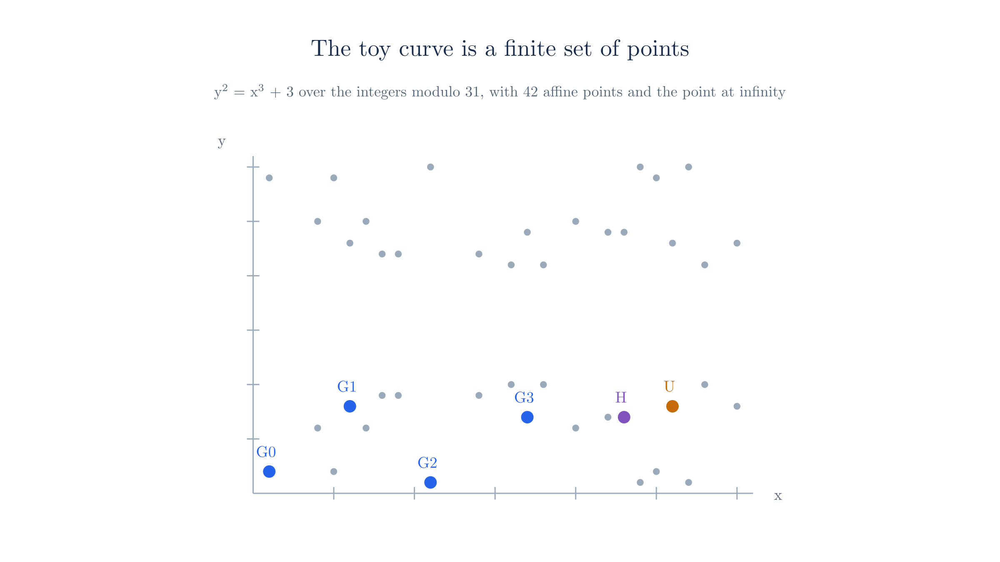

# Polynomial Commitments

The previous two chapters reduced a computation to claims about polynomials built from the prover's secret data. The protocol at the end of the [previous chapter](./polynomial-encoding.md#_13-polynomial-oracles) assumed an oracle for each of those polynomials, a black box that fixes the polynomial when the prover creates it and later answers questions such as "what is $r(x)$?" Real verifiers have no such box, so the verifier must check the claims some other way, and receiving the polynomials is not an option. A polynomial with thousands of coefficients is too large to send in every recursive step, and sending it would also expose secret data.

A polynomial commitment solves both problems. It replaces the polynomial with one short value that the prover cannot later change, which does the oracle's first job of fixing the polynomial. Each answer to a query, such as $r(x)$, $r(xz)$ or $c_2(x)$ from the previous chapter, then becomes an **opening**, a claimed value together with evidence that it matches the committed polynomial. The verifier plugs the opened values into the split check and the target check exactly as it used the oracle's answers.

This chapter builds the commitment Ragu uses. We start with a commitment to a vector, read a polynomial as its vector of coefficients, and then rewrite an evaluation $p(x) = y$ as a statement about an inner product. [Section 10](#_10-replacing-the-oracles) puts these pieces together and removes the oracles from the previous chapter's protocol. The next chapter proves the remaining statement with a short argument.

## 1. What a polynomial commitment provides

Suppose a prover holds a polynomial $p$ and a verifier holds nothing. The two parties want to run the following exchange:

1. The prover sends a short commitment $C$ to $p$.
2. The verifier later picks a point $x$.
3. The prover sends $y = p(x)$ along with a proof that $y$ is correct for the polynomial behind $C$.

The verifier gets evidence about $p$ from one evaluation because two different low-degree polynomials rarely agree at a random point, as [Statements and Challenges](./statements-and-challenges.md#testing-at-a-random-point) showed. This exchange only works if the prover fixes $p$ before seeing $x$, which means the prover must not be able to open $C$ to a second polynomial. A commitment with this property is called **binding**. When $p$ contains secrets, the commitment should also be **hiding**, which means $C$ reveals nothing about $p$.

A hash of the coefficients is binding and short, which makes it a natural first candidate. Hashes have no algebraic structure, however, so the only way to prove something about $p$ from its hash is to run the entire hash computation inside a proof. Ragu's [accumulation scheme](./accumulation.md) also needs to combine commitments directly, and the hash of a sum has no relation to the hashes of its parts. Elliptic curve points provide the missing structure, because adding two commitments gives a commitment to the sum. Sections 3 to 6 build this commitment and show why it has both properties. Sections 7 to 9 then connect it to polynomial evaluation.

## 2. The toy curve

The curve groups used in real systems have about $2^{255}$ elements, which makes their arithmetic unreadable on a page. Every worked example on this site uses a much smaller curve instead:

$$E: y^2 = x^3 + 3 \quad \text{over } \F_{31}.$$

<!-- worked:curve-size -->

This curve has 43 points including the identity $\mathcal{O}$.

<!-- /worked:curve-size -->

The [curves appendix](./appendix-curves.md) lists the parameters.

### Two different moduli

As [Statements and Challenges](./statements-and-challenges.md#_1-statements-instances-and-witnesses) noted, the worked examples use two different moduli. This section adds the point arithmetic behind that remark. Coordinates of points belong to the field the curve is defined over, so we compute with them modulo 31. The box below carries out one point doubling on coordinates, for readers who want to see the field arithmetic. Its result is the second row of the table that follows.

::: details Doubling a point by hand

<!-- worked:doubling -->

Doubling $G_0 = (1,\,2)$ uses the tangent slope, computed modulo 31: $s = 3x^2 / (2y) = 3 / 4 = 24$. The new coordinates are $x_3 = s^2 - 2x = 16$ and $y_3 = s(x - x_3) - y = 10$, so $2 \cdot G_0 = (16,\,10)$.

<!-- /worked:doubling -->

:::

Scalars count how many times we add a point to itself, and they behave differently. Adding a point to itself repeatedly eventually returns to $\mathcal{O}$, and the multiples then repeat:

<!-- worked:multiples -->

| $k$ | $k \cdot G_0$ |
| --- | --- |
| 1 | $(1,\,2)$ |
| 2 | $(16,\,10)$ |
| 3 | $(22,\,24)$ |
| 4 | $(24,\,30)$ |
| 41 | $(16,\,21)$ |
| 42 | $(1,\,29)$ |

One more addition gives $43 \cdot G_0 = \mathcal{O}$, and one after that gives $44 \cdot G_0 = G_0$. The multiples repeat with period 43, so only the value of a scalar modulo 43 affects the result.

<!-- /worked:multiples -->

The group has 43 elements, so scalars are computed modulo 43. Since 43 is prime, every point other than $\mathcal{O}$ generates the whole group in the same way. From here on, we write $\F_{43}$ for the scalars and treat point addition as a single operation.

### Public parameters



We fix six points as public parameters. A real system derives these points differently, as Section 4 explains. The next table picks points spaced across the $x$-coordinates, which keeps the example readable.

<!-- worked:generators -->

| Name | Point |
| --- | --- |
| $G_0$ | $(1,\,2)$ |
| $G_1$ | $(6,\,8)$ |
| $G_2$ | $(11,\,1)$ |
| $G_3$ | $(17,\,7)$ |
| $H$ | $(23,\,7)$ |
| $U$ | $(26,\,8)$ |

<!-- /worked:generators -->

The toy curve is deliberately insecure. Anyone can compute its discrete logs by counting, and Section 4 uses this weakness to show what goes wrong when a discrete log is known.

## 3. Committing to a vector

To commit to one scalar $a$, the prover could send $a \cdot G$ for a public generator $G$. This is binding, because the multiples of $G$ are all distinct until they repeat, so each point corresponds to exactly one scalar modulo the group order and the prover cannot open the point to a second scalar. It hides $a$ only when $a$ is hard to guess. Recovering $a$ from the point requires solving discrete log, but anyone with a short list of likely values can multiply each by $G$ and compare. Section 6 removes this limit.

A vector needs more than this, since sending one point per entry would produce a commitment as long as the vector. Adding those points into one point keeps the size constant. If we used the same generator for every entry, the sum would be $(\sum_i a_i) \cdot G$, which depends only on the sum of the entries and loses their positions.

<!-- worked:same-generator -->

The vectors $(7, 2, 5, 3)$ and $(7, 5, 3, 2)$ have the same entries in different positions. With $G_0$ in every position, both produce $17 \cdot G_0 = (20,\,6)$. With a separate generator for each position, they produce $(27,\,30)$ and $(4,\,25)$.

<!-- /worked:same-generator -->

A separate generator for each position avoids this collision, because moving a value to a different position changes which generator multiplies it. For $\v{a} \in \F_q^n$, where $q$ is the group order ($\F_{43}$ on the toy curve), and public generators $\v{G} = (G_0, \ldots, G_{n-1})$, this gives the **Pedersen vector commitment**

$$C = \dot{\v{a}}{\v{G}} = \sum_{i=0}^{n-1} a_i \cdot G_i.$$

Throughout this chapter, $n$ is the length of the committed vector. The previous chapter used $n$ for the number of gates, which is a different quantity, so this chapter writes the gate count as $N$. Section 7 shows that $n = 4N$.

Earlier chapters used $\langle \cdot, \cdot \rangle$ only between two vectors of scalars. Here we extend the notation to a vector of scalars and a vector of points, and $\dot{\v{a}}{\v{G}}$ means the sum of the scalar multiples $a_i \cdot G_i$, as the right side shows.

The result is one curve point regardless of $n$. Here is the computation for a vector of four entries:

<!-- worked:commit -->

Take $\v{a} = (7, 2, 5, 3)$. Scalars live in $\F_{43}$, and each point sum follows the curve addition law over $\F_{31}$.

| Term | Point | Running sum |
| --- | --- | --- |
| $7\cdot G_0$ | $(25,\,29)$ | $(25,\,29)$ |
| $2\cdot G_1$ | $(20,\,6)$ | $(27,\,30)$ |
| $5\cdot G_2$ | $(14,\,22)$ | $(30,\,23)$ |
| $3\cdot G_3$ | $(14,\,9)$ | $(27,\,30)$ |

The commitment is the single point $C = (27,\,30)$.

<!-- /worked:commit -->

## 4. Why a prover cannot change the vector

Suppose a prover opens the same commitment to two different vectors $\v{a}$ and $\v{a}'$. Subtracting the two expressions for $C$ gives

$$\sum_{i=0}^{n-1} (a_i - a_i') \cdot G_i = \mathcal{O},$$

where at least one coefficient is nonzero, since the vectors differ. A second opening therefore requires a nontrivial linear relation among the generators.

With only two generators, such a relation hands over the discrete log of one generator relative to the other, as the box below shows.

::: details From a relation to a discrete log

Suppose $d_0 \cdot G_0 + d_1 \cdot G_1 = \mathcal{O}$ with $d_1 \neq 0$. Moving the first term across and dividing by $d_1$ gives

$$G_1 = -\frac{d_0}{d_1} \cdot G_0,$$

which expresses $G_1$ as a known multiple of $G_0$.

:::

With more than two generators, a relation no longer hands over a discrete log in one step. We therefore assume directly that nobody can find any nontrivial relation among the generators. This is the **discrete log relation assumption**, and for generators chosen at random it is known to be no stronger than the discrete log assumption itself. If nobody can find a relation among the generators, nobody can open a commitment in two ways, so binding rests on this assumption. It also explains how real systems choose generators. If someone produced $G_1$ by multiplying $G_0$ by a chosen scalar, that person would know the relation and could forge openings, so real generators come from a hash whose output has no known relation to the other points.

On the toy curve we can compute such a relation directly, so we can run the argument above in reverse to produce a forgery:

<!-- worked:forgery -->

Counting multiples of $G_0$ shows that $G_1 = 30\cdot G_0$, so $30\cdot G_0 - G_1 = \mathcal{O}$. Adding this relation to the honest vector gives $\v{a}' = (7+30,\ 2-1,\ 5,\ 3) = (37, 1, 5, 3)$ with scalars reduced modulo 43. Computing $\dot{\v{a}'}{\v{G}}$ gives $(27,\,30)$, the same point as $C$, so this commitment now has two valid openings.

<!-- /worked:forgery -->

The change to entry 0 and the change to entry 1 cancel exactly, so the later terms and the total stay the same. The box below compares the two computations term by term.

::: details The forgery, term by term

<!-- worked:forgery-check -->

| Part of the sum | Honest vector | Forged vector |
| --- | --- | --- |
| Entry 0 term | $7 \cdot G_0 = (25,\,29)$ | $37 \cdot G_0 = (5,\,29)$ |
| Entry 1 term | $2 \cdot G_1 = (20,\,6)$ | $1 \cdot G_1 = (6,\,8)$ |
| Sum of entries 0 and 1 | $(27,\,30)$ | $(27,\,30)$ |
| Entries 2 and 3 | Unchanged | Unchanged |
| Commitment | $(27,\,30)$ | $(27,\,30)$ |

<!-- /worked:forgery-check -->

:::

A prover who can do this on a real curve could change the committed polynomial after seeing the challenge. On a curve of 255 bits, no known method finds such a relation in practice.

## 5. Adding commitments

Anyone holding two commitments can combine them into a commitment to a combination of the vectors, without seeing the vectors. The next example scales one commitment, adds another, and compares the result with a commitment computed directly from the vectors:

<!-- worked:homomorphism -->

Take a second vector $\v{b} = (3, 1, 8, 4)$, whose commitment is $C_b = (6,\,23)$, and the scalar $r = 6$. Working only with the two points, we compute $6 \cdot C_b$ and add $C$, which gives $C + 6 \cdot C_b = (7,\,6)$. Working only with the vectors, we form $\v{a} + 6\v{b} = (7 + 6\cdot 3,\ 2 + 6\cdot 1,\ 5 + 6\cdot 8,\ 3 + 6\cdot 4) = (25, 8, 10, 27)$ modulo 43 and commit to it directly, which gives $(7,\,6)$. The two routes reach the same point, and the first route never looked at either vector.

<!-- /worked:homomorphism -->

The agreement is not a coincidence of these numbers. Point addition is commutative and scalar multiplication distributes over it, so we can regroup the terms of a commitment by generator, as the box below writes out. The result is two identities that hold for any vectors $\v{a}, \v{b}$ and any scalar $r$:

$$\dot{\v{a}}{\v{G}} + \dot{\v{b}}{\v{G}} = \dot{\v{a} + \v{b}}{\v{G}}, \qquad r \cdot \dot{\v{a}}{\v{G}} = \dot{r\v{a}}{\v{G}}.$$

::: details Regrouping the terms by generator

Adding two commitments and collecting the two terms that share each generator gives

$$\sum_i a_i \cdot G_i + \sum_i b_i \cdot G_i = \sum_i (a_i \cdot G_i + b_i \cdot G_i) = \sum_i (a_i + b_i) \cdot G_i.$$

Multiplying a commitment by a scalar $r$ regroups in the same way:

$$r \cdot \sum_i a_i \cdot G_i = \sum_i (r a_i) \cdot G_i.$$

:::

Pedersen commitments are therefore **linearly homomorphic**, meaning anyone can compute a commitment to a linear combination of vectors from the commitments alone.

Much of the later construction depends on this property. Batched openings and accumulation both replace many committed polynomials with one random linear combination, and the verifier can compute the combined commitment using only group operations.

## 6. Hiding the vector

The commitment above is deterministic, so anyone who can guess $\v{a}$ can recompute $C$ and test the guess. An observer holding $C$ can try one candidate after another:

<!-- worked:guess-test -->

| Guess | Recomputed commitment | Matches $C$ |
| --- | --- | --- |
| $(3, 1, 8, 4)$ | $(6,\,23)$ | No |
| $(7, 5, 3, 2)$ | $(4,\,25)$ | No |
| $(7, 2, 5, 3)$ | $(27,\,30)$ | Yes |

<!-- /worked:guess-test -->

This matters whenever the vector comes from a small set of likely values. Adding a term with a random **blinding factor** $\gamma$ and one more generator $H$ prevents this test:

$$\bar{C} = \dot{\v{a}}{\v{G}} + \gamma \cdot H.$$

The same vector now produces a different point for each blinding factor:

<!-- worked:hiding -->

Committing to $\v{a}$ with blinding factors $\gamma = 20$ and $\gamma = 29$ gives $(28,\,21)$ and $(18,\,21)$. Both differ from the unblinded $C = (27,\,30)$, and without the blinding factor an observer cannot test a guessed vector against either point.

<!-- /worked:hiding -->

The observer in fact learns nothing at all about $\v{a}$, because every candidate vector explains a given blinded point with exactly one blinding factor. The next example shows this for one specific point:

<!-- worked:hiding-any -->

Take the blinded commitment $\bar{C} = (28,\,21)$ made from $\v{a}$ with $\gamma = 20$. The unrelated vector $\v{b} = (3, 1, 8, 4)$ also explains this point, using $\gamma = 41$: $\dot{\v{b}}{\v{G}} + 41 \cdot H = (28,\,21)$. An observer sees one point, and every candidate vector has exactly one blinding factor that fits it.

<!-- /worked:hiding-any -->

The prover draws $\gamma$ uniformly at random, so every candidate vector is equally consistent with the point the observer sees, and the point alone says nothing about which vector the prover used. The box below gives the counting argument behind this. A predictable $\gamma$ would break this, because an observer could then subtract $\gamma \cdot H$ and test guesses as before.

::: details Why each candidate fits exactly once

Fix any point $\bar{C}$ and any candidate vector $\v{a}$. The difference $\bar{C} - \dot{\v{a}}{\v{G}}$ is some group element, and because $H$ generates the group, exactly one $\gamma$ satisfies $\gamma \cdot H$ equal to that difference. So every candidate vector explains $\bar{C}$ with exactly one blinding factor.

The prover draws $\gamma$ uniformly at random from $\F_q$, so the term $\gamma \cdot H$ is a uniformly random point whatever $\v{a}$ is, and $\bar{C}$ is therefore a uniformly random point as well. Since every candidate fits with exactly one $\gamma$ and all values of $\gamma$ are equally likely, $\bar{C}$ alone gives no information about $\v{a}$.

:::

The two properties rest on different foundations. Hiding holds even against an observer with unlimited computing power, because the counting argument uses no hardness assumption. Binding holds only because finding a relation among the generators is computationally hard, and Section 4 showed that a prover who could count discrete logs would break it.

The other properties carry over. An opening now consists of the pair $(\v{a}, \gamma)$, and binding still holds under the same assumption once $H$ joins the list of generators, because two openings would again produce a relation among the points. Adding two blinded commitments gives a blinded commitment to the sum of the vectors, whose blinding factor is the sum of the two blinding factors.

::: warning The Ragu Book and the code differ here
The [Ragu Book's NARK chapter](https://github.com/tachyon-zcash/ragu/blob/3219e0865e8bff1f9d817bfe3850d9e94b64338c/book/src/protocol/core/nark.md) describes hiding commitments with blinding factors. The [IPA module](https://github.com/tachyon-zcash/ragu/blob/3219e0865e8bff1f9d817bfe3850d9e94b64338c/crates/ragu_pcd/src/ipa/mod.rs#L1-L16) at commit `3219e08` states that "Pedersen blinding with generator `W` is omitted for now because compression currently proves unblinded relations", and its `commit` function has no blinding term. This site reads the book as the intended design and the code as the current state of the implementation. The authors have not confirmed this reading.
:::

## 7. Committing to a polynomial

A polynomial of degree less than $n$ is determined by its coefficients, which gives a direct route from vectors to polynomials:

$$p(X) = \sum_{i=0}^{n-1} a_i X^i \quad\longleftrightarrow\quad \v{a} = (a_0, \ldots, a_{n-1}).$$

A commitment to $p$ is the Pedersen commitment to $\v{a}$. Adding commitments now corresponds to adding polynomials, because adding polynomials adds their coefficients. The degree bound comes from the number of generators, so a set of $n$ generators can commit only to polynomials of degree below $n$. A polynomial of lower degree fits by treating its missing coefficients as zero:

<!-- worked:padding -->

The polynomial $6 + X$ has degree 1, so its vector is padded with zeros to $(6, 1, 0, 0)$. Its commitment is $6 \cdot G_0 + 1 \cdot G_1 = (25,\,2)$, because the zero entries contribute $\mathcal{O}$.

<!-- /worked:padding -->

The same limit supplies the degree bounds that the [previous chapter](./polynomial-encoding.md#_13-polynomial-oracles) assumed for its oracles. A circuit with $N$ gates has polynomials with $4N$ coefficients and oracles with degree bound $4N - 1$. Committing with $4N$ generators enforces that bound, because the committed vector has one entry for each power $X^0, \ldots, X^{4N-1}$ and no entry for any higher power. So whatever point the prover sends, any opening of it describes a polynomial of degree at most $4N - 1$. The committed vectors therefore have length $n = 4N$, and Section 10 runs this on the previous chapter's polynomials.

The argument in the next chapter halves the vector in each round, which is why $n$ is a power of two.

## 8. Writing an evaluation as an inner product

Next we need a way to express $p(x) = y$ in terms of the committed vector. Expanding the definition of $p$ at a point $x$ gives

$$p(x) = \sum_{i=0}^{n-1} a_i x^i = \dot{\v{a}}{\v{x^n}}, \qquad \text{where } \v{x^n} = (1, x, x^2, \ldots, x^{n-1}).$$

An evaluation is therefore an inner product between the secret coefficient vector and a public vector, since anyone can compute the powers of $x$. The rewriting matters because the claim is now linear in $\v{a}$. Each coefficient appears once, multiplied by a value the verifier already knows, and this is the same kind of expression as the commitment itself.

<!-- worked:evaluation -->

Let $p(X) = 7 + 2X + 5X^2 + 3X^3$ over $\F_{43}$, whose coefficient vector is the $\v{a}$ from Section 3, and take $x = 9$.

| $i$ | $a_i$ | $x^i$ | $a_i x^i$ |
| --- | --- | --- | --- |
| 0 | 7 | 1 | 7 |
| 1 | 2 | 9 | 18 |
| 2 | 5 | 38 | 18 |
| 3 | 3 | 41 | 37 |

The last column sums to $y = 37$ modulo 43. Direct substitution into $p$ gives $p(9) = 37$, the same value.

<!-- /worked:evaluation -->

### Evaluations of linear combinations

[Statements and Challenges](./statements-and-challenges.md#combining-evaluation-claims) showed that evaluation is linear in the coefficients, so a claim about $p + rq$ at $x$ follows from claims about $p$ and $q$ at $x$. In the vector notation of this section, for coefficient vectors $\v{a}$ and $\v{b}$ and any scalar $r$,

$$\dot{\v{a} + r\v{b}}{\v{x^n}} = \dot{\v{a}}{\v{x^n}} + r\dot{\v{b}}{\v{x^n}}.$$

Section 5 showed that commitments obey the same rule, $C + r \cdot C_b = \dot{\v{a} + r\v{b}}{\v{G}}$. The new point is that the two rules use the same coefficients. A verifier holding two commitments and two claimed evaluations can therefore compute both the commitment to the combined polynomial and its claimed value, without seeing either polynomial, and the two results describe the same polynomial.

<!-- worked:combination -->

Read $\v{b}$ as the polynomial $q(X) = 3 + X + 8X^2 + 4X^3$, the same $q$ that Statements and Challenges used. The verifier holds $C$ and $C_b$ together with the claims $p(9) = 37$ and $q(9) = 7$. From the points alone it computes $C + 6 \cdot C_b = (7,\,6)$, as in Section 5, and from the claims alone it computes $37 + 6 \cdot 7 = 36$ modulo 43. These two values belong together. The point $(7,\,6)$ commits to $(25, 8, 10, 27)$, and that polynomial takes the value $36$ at $x = 9$.

<!-- /worked:combination -->

The chapter on batched openings uses this fact to reduce many evaluation claims to one.

## 9. Combining the commitment and the claim

The prover must now show two facts about one vector at once. The vector $\v{a}$ must open the commitment $C$, and its inner product with the powers of $x$ must equal $y$. Proving these facts separately would not be enough, since a prover could satisfy the first with one vector and the second with another. The two facts must apply to the same vector, so we package them into a single point. This section builds that statement, shows two ways it fails when its assumptions break, explains why the evaluation point must come after the commitment, and then runs the whole exchange on the toy curve.

### Deriving the combined statement

Taking the extra generator $U$, the prover and verifier both compute

$$P = C + y \cdot U,$$

and the prover claims to know $\v{a}$ satisfying

$$P = \dot{\v{a}}{\v{G}} + \dot{\v{a}}{\v{x^n}} \cdot U.$$

The verifier can compute $P$ from public values alone, because it holds $C$ and $y$. The right side has the shape of a Pedersen commitment to the $n + 1$ entries $(a_0, \ldots, a_{n-1}, \dot{\v{a}}{\v{x^n}})$ under the generators $(G_0, \ldots, G_{n-1}, U)$, which lets us reuse the binding argument of Section 4 with the longer list of generators.

That argument compares two openings of $P$. An honest commitment supplies one opening, the committed vector together with the claimed $y$, and any vector that satisfies the claimed equation supplies another. If the two openings differ, subtracting them gives a relation among $\v{G}$ and $U$. A prover who knows no such relation can therefore satisfy the equation only with the committed vector, and only when $y$ is the true value $p(x)$. One equation enforces both facts, because the same $\v{a}$ appears in both of its terms. The box below writes out the subtraction.

::: details Comparing the two openings of P

To run the argument, we need two openings of $P$ to compare. Suppose the prover committed honestly, so it knows a vector $\v{a}_0$ with $C = \dot{\v{a}_0}{\v{G}}$, and the true value is $p(x) = \dot{\v{a}_0}{\v{x^n}}$. Substituting this $C$ into the definition of $P$ gives

$$P = \dot{\v{a}_0}{\v{G}} + y \cdot U,$$

so the entries $(\v{a}_0, y)$ form one opening of $P$, whatever value $y$ the prover claimed. Now suppose the prover also produces some vector $\v{a}$ that satisfies the claimed equation. That equation says $(\v{a}, \dot{\v{a}}{\v{x^n}})$ is a second opening of the same point. Subtracting the second expression for $P$ from the first, exactly as in Section 4, gives

$$\dot{\v{a}_0 - \v{a}}{\v{G}} + \big(y - \dot{\v{a}}{\v{x^n}}\big) \cdot U = \mathcal{O}.$$

If any coefficient on the left is nonzero, this is a relation among $\v{G}$ and $U$. A prover who knows no such relation must therefore have every coefficient equal to zero. The $\v{G}$ coefficients give $\v{a} = \v{a}_0$, so the vector in the claim is the committed vector. The $U$ coefficient then gives $y = \dot{\v{a}_0}{\v{x^n}} = p(x)$, so the claimed value is the true one.

:::

Here is the statement point for the running example:

<!-- worked:claim -->

The statement point is $P = C + 37\cdot U = (5,\,29)$. Treating it as a five-entry commitment to $(7, 2, 5, 3,\ 37)$ under the generators $(G_0, G_1, G_2, G_3, U)$ gives $(5,\,29)$, the same point. A prover claiming $y = 38$ instead has the statement point $C + 38\cdot U = (1,\,29)$, which does not match the honest computation from the coefficients.

<!-- /worked:claim -->

::: tip A coincidence on the toy curve
The statement point $P$ above is the same point as the forged entry-0 term in the term-by-term forgery table of Section 4, although nothing connects the two computations. With so few points on the toy curve, unrelated computations often collide like this. On a real curve with about $2^{255}$ points, such collisions essentially never happen.
:::

### Forging a claim with a known relation to U

The derivation needs $U$ to have no known relation to $\v{G}$, and not only the generators in $\v{G}$ to have none among themselves. If a prover knows the relations, it can run the argument in reverse, as it did for the forged opening in Section 4. On the toy curve the prover can count the discrete log of every generator relative to $G_0$. Writing each point in the equation for $P$ as a multiple of $G_0$ then turns that equation into one linear equation over $\F_{43}$ in the entries of the vector, and the prover solves it for one entry. The box below carries out this arithmetic for a false claimed value, keeping three entries of the honest vector and solving for the first.

::: details Solving for the forged vector

<!-- worked:forged-claim -->

Counting gives the discrete logs of $G_1, G_2, G_3$ and $U$ relative to $G_0$: $30$, $28$, $25$ and $5$. The prover wants to claim the false value $y = 38$, whose statement point is $C + 38 \cdot U = (1,\,29)$. Counting once more shows that this point is $42 \cdot G_0$.

Next, the prover writes every point in the equation $P = \dot{\v{a}}{\v{G}} + \dot{\v{a}}{\v{x^n}} \cdot U$ as a multiple of $G_0$. Each term $a_i \cdot G_i$ contributes $a_i$ times the discrete log of $G_i$, and the inner product with the powers $(1, 9, 38, 41)$ of $x = 9$ gets multiplied by the discrete log of $U$, which is $5$. Comparing the multiples of $G_0$ on both sides gives one linear equation over $\F_{43}$:

$$a_0 + 30a_1 + 28a_2 + 25a_3 + 5(a_0 + 9a_1 + 38a_2 + 41a_3) \equiv 42 \pmod{43}.$$

Collecting the terms for each entry and reducing modulo 43 gives

$$6a_0 + 32a_1 + 3a_2 + 15a_3 \equiv 42 \pmod{43}.$$

The prover keeps entries 1 to 3 of the honest vector, $a_1 = 2$, $a_2 = 5$ and $a_3 = 3$. Their terms add up to $32 \cdot 2 + 3 \cdot 5 + 15 \cdot 3 = 38$ modulo 43, so $6a_0 \equiv 42 - 38 = 4$, and dividing by $6$ gives $a_0 = 15$. The forged vector is therefore $(15, 2, 5, 3)$.

<!-- /worked:forged-claim -->

:::

The next table checks the forged vector from the box against the false statement point.

<!-- worked:forged-claim-check -->

| Quantity | Value |
| --- | --- |
| Forged vector $\v{a}'$ | $(15, 2, 5, 3)$ |
| Inner product $\dot{\v{a}'}{\v{x^n}}$ | $2$ |
| $\dot{\v{a}'}{\v{G}} + 2 \cdot U$ | $(1,\,29)$ |
| False statement point $C + 38 \cdot U$ | $(1,\,29)$ |

The last two rows agree, so the check passes, although the forged vector does not open $C$ and its inner product is $2$ rather than $38$.

The honest vector gives a second opening $(\v{a},\ 38)$ of the same point, as in the derivation of the combined statement. Subtracting the forged opening from it leaves the relation $(7 - 15) \cdot G_0 + (38 - 2) \cdot U = 35 \cdot G_0 + 36 \cdot U = \mathcal{O}$. The prover can cancel these two terms only because it knows $U = 5 \cdot G_0$, which turns $36 \cdot U$ into $8 \cdot G_0$.

<!-- /worked:forged-claim-check -->

### A commitment with a hidden multiple of U

The derivation has a second requirement that is easy to miss. It started from an honest commitment, one built from $\v{G}$ alone, and so it took $(\v{a}_0, y)$ as one opening of $P$. Nothing in the statement checks that $C$ has this form. A prover can send $C^* = \dot{\v{a}_0}{\v{G}} + \delta \cdot U$ for some $\delta$ of its choice. Substituting this into the definition of $P$ gives

$$P = C^* + y \cdot U = \dot{\v{a}_0}{\v{G}} + (y + \delta) \cdot U,$$

so the opening of $P$ that the prover knows is $(\v{a}_0, y + \delta)$ rather than $(\v{a}_0, y)$. Running the same subtraction as before now forces $y + \delta = p(x)$, which means the claimed value $y$ is $\delta$ below the value of the polynomial in the $\v{G}$ part of $C^*$. The toy curve shows this with $\delta = 6$:

<!-- worked:hidden-u -->

The prover keeps the honest vector $\v{a} = (7, 2, 5, 3)$ but sends $C^* = C + 6 \cdot U = (14,\,22)$ in place of $C$. The polynomial in the $\v{G}$ part of $C^*$ is still $p$, so its value at $x = 9$ is $37$. The prover claims $y = 37 - 6 = 31$ instead.

| Quantity | Value |
| --- | --- |
| Statement point $C^* + 31 \cdot U$ | $(5,\,29)$ |
| Inner product $\dot{\v{a}}{\v{x^n}}$ | $37$ |
| $\dot{\v{a}}{\v{G}} + 37 \cdot U$ | $(5,\,29)$ |

The last two rows agree, so the honest vector satisfies the textbook statement for the false claim $31$. The hidden $6 \cdot U$ and the claimed $31 \cdot U$ add up to the $37 \cdot U$ that the true value needs.

<!-- /worked:hidden-u -->

The prover is still bound to something. It fixed $\delta$ when it sent $C^*$, before it saw $x$, so at every point the only value it can defend is the true value minus the same $\delta$:

<!-- worked:hidden-u-shift -->

At $x = 2$ the same $C^*$ passes only with the claim $p(2) - 6 = 12 - 6 = 6$. These accepted values belong to the polynomial $p - 6$, whose coefficient vector is $(1, 2, 5, 3)$. Its ordinary commitment would be $C - 6 \cdot G_0$, a point built from $\v{G}$ alone, and no vector the prover knows opens $C^*$ under $\v{G}$ alone.

<!-- /worked:hidden-u-shift -->

So the textbook statement still ties the prover to one polynomial, but that polynomial is not the one whose $\v{G}$ coefficients make up the commitment. A verifier that treats $C^*$ as a commitment to $p$, for example by adding it to other commitments as in Section 5, would then combine a commitment to one polynomial with values of another. [Section 6 of the next chapter](./inner-product-argument.md#_6-why-cheating-fails) shows that the halving argument inherits this gap, and [its Section 10](./inner-product-argument.md#scaling-u-by-a-challenge) closes it by giving $U$ a weight $z$ that the verifier chooses after $C^*$, so that a hidden $\delta \cdot U$ no longer matches the claim except by luck.

### Choosing the point after the commitment

The verifier must also choose $x$ after the prover sends $C$. [Statements and Challenges](./statements-and-challenges.md#testing-at-a-random-point) showed that a prover who knows the point in advance can pass the test with a different polynomial, and a commitment does not change this, because the prover can commit honestly to the wrong polynomial:

<!-- worked:early-point -->

Suppose the protocol requires a commitment to $p$, and the prover learns the point $x = 9$ before it commits. It can commit instead to $p'(X) = p(X) + (X - 9) = 41 + 3X + 5X^2 + 3X^3$, whose commitment is $C' = (16,\,10)$. This is an honest commitment to $p'$, and an honest opening gives $p'(9) = 37$, the same value as $p(9)$, so the check at $9$ cannot tell the two apart. At any other point the two values differ by $x - 9 \neq 0$, and checking all 43 points of $\F_{43}$ confirms that $p'$ and $p$ agree only at $9$. If the verifier picks $x$ after receiving $C'$, the substitution passes with probability $1/43$.

<!-- /worked:early-point -->

Sending $C$ before the verifier picks $x$ removes this option, but only because the commitment is binding. Once $C$ is sent and $x$ is known, the only route to a different answer is a second opening of $C$, and Section 4 showed that a second opening needs a relation among the generators.

### A complete run with the coefficients revealed

We can now run the whole exchange on the toy curve. In this version the prover finishes by revealing the coefficients, which gives the verifier everything it needs to check the equation directly:

<!-- worked:reveal-run -->

| Step | Party | Value or check |
| --- | --- | --- |
| 1 | Prover commits | $C = (27,\,30)$ |
| 2 | Verifier sends a challenge | $x = 9$ |
| 3 | Prover sends the claimed value | $y = 37$ |
| 4 | Prover reveals the coefficients | $\v{a} = (7, 2, 5, 3)$ |
| 5 | Verifier computes the statement point | $P = C + 37 \cdot U = (5,\,29)$ |
| 6 | Verifier computes the power vector | $\v{x^n} = (1, 9, 38, 41)$ |
| 7 | Verifier computes the inner product | $\dot{\v{a}}{\v{x^n}} = 37$ |
| 8 | Verifier checks the equation | $\dot{\v{a}}{\v{G}} + 37 \cdot U = (5,\,29)$, which equals $P$ |

<!-- /worked:reveal-run -->

This run confirms the claim, but steps 4 and 8 are the problem. Step 4 sends all $n$ coefficients, which exposes them and removes the size benefit of the commitment. Step 8 costs the verifier one group operation per generator. The next chapter replaces the reveal with a short argument, which makes the proof small and keeps the coefficients secret. That argument still leaves the verifier with work that grows linearly with $n$, and the recursion chapters deal with this cost. The saving in size alone is large at Ragu's scale.

<!-- worked:sizes -->

Ragu's circuits have at most $2^{11}$ gates, a limit set by the [production rank](https://github.com/tachyon-zcash/ragu/blob/3219e0865e8bff1f9d817bfe3850d9e94b64338c/crates/ragu_circuits/src/polynomials/mod.rs#L123-L127) at commit `3219e08`. The previous chapter's polynomials have four coefficients per gate, so the committed vectors have length $n = 4 \cdot 2^{11} = 2^{13}$. With 32-byte values, revealing the coefficients costs $8,192 \times 32 = 262,144$ bytes. The argument of the next chapter halves the vector once per round, which takes $13$ rounds, and it sends two points per round. Those $26$ group elements cost $832$ bytes, plus a small constant number of extra values.

<!-- /worked:sizes -->

In its textbook form, the statement that argument must prove is

$$\text{given } \v{G},\ U,\ P,\ x, \text{ the prover knows } \v{a} \text{ such that } P = \dot{\v{a}}{\v{G}} + \dot{\v{a}}{\v{x^n}} \cdot U.$$

The next chapter starts from this form and later replaces $U$ by a challenge multiple $z \cdot U$, which closes the hidden-$U$ gap shown above.

## 10. Replacing the oracles

We can now return to the protocol of the [previous chapter](./polynomial-encoding.md#_13-polynomial-oracles) and remove its oracles. An oracle did two jobs. It fixed a polynomial at the moment the prover sent it, and it later answered queries about that polynomial. A commitment does the first job if the prover sends it at the same moment the oracle was sent. An opening does the second, because each query becomes a claim $(C, x, y)$ that the statement at the end of Section 9 can prove.

<!-- worked:replace-gens -->

The previous chapter's toy run had 2 gates, so each of $r(X)$, $c_1(X)$ and $c_2(X)$ has $4 \cdot 2 = 8$ coefficients, as Section 7 explained, and needs 8 generators. Section 2 fixed only 4, so we add 4 more points at unused $x$-coordinates, the same ones that the [NARK chapter](./nark.md) uses later.

| Name | Point |
| --- | --- |
| $G_4$ | $(4,\,6)$ |
| $G_5$ | $(5,\,2)$ |
| $G_6$ | $(25,\,2)$ |
| $G_7$ | $(30,\,23)$ |

<!-- /worked:replace-gens -->

The commitments then take the places of the oracles in the message order. The prover commits to the trace before it sees $z$ and $y$, and it commits to the two pieces of the product before it sees $x$. We leave out blinding factors here so that the points stay readable.

<!-- worked:replace-commit -->

| Step | Party | Message |
| --- | --- | --- |
| 1 | Prover commits to $r(X)$ | $C_r = (4,\,25)$ |
| 2 | Verifier sends challenges | $z = 5$, $y = 7$ |
| 3 | Prover commits to $c_1(X)$ and $c_2(X)$ | $C_{c_1} = (24,\,30)$, $C_{c_2} = (17,\,24)$ |
| 4 | Verifier sends challenge | $x = 9$ |

<!-- /worked:replace-commit -->

The verifier's five oracle queries become five opening claims. Each claim names a commitment, a point and a value, and the power vector of the point is the public vector in that statement. Two rows deserve a closer look. The query for $r(xz)$ uses the same commitment $C_r$ at a second point, so the dilation needs no extra commitment. The query for $c_1(0)$ is an evaluation at the point 0, whose power vector has a 1 in position 0 and zeros elsewhere, so the inner product picks out the constant coefficient that the target check reads.

<!-- worked:replace-claims -->

| Oracle query | Commitment | Point | Power vector | Value |
| --- | --- | --- | --- | --- |
| $r(x)$ | $C_r$ | $9$ | $(1, 9, 38, 41, 25, 10, 4, 36)$ | $5$ |
| $r(xz)$ | $C_r$ | $2$ | $(1, 2, 4, 8, 16, 32, 21, 42)$ | $9$ |
| $c_1(x^{-1})$ | $C_{c_1}$ | $24$ | $(1, 24, 17, 21, 31, 13, 11, 6)$ | $6$ |
| $c_1(0)$ | $C_{c_1}$ | $0$ | $(1, 0, 0, 0, 0, 0, 0, 0)$ | $13$ |
| $c_2(x)$ | $C_{c_2}$ | $9$ | $(1, 9, 38, 41, 25, 10, 4, 36)$ | $30$ |

<!-- /worked:replace-claims -->

The values match the oracle answers of the [previous chapter's run](./polynomial-encoding.md#_14-a-complete-run), so the verifier plugs them into the split check and the target check exactly as before:

<!-- worked:replace-checks -->

The split check compares $r(x)\big(r(xz) + s(x, y) + t(x, z)\big)$ with $x^{4N-1} c_1(x^{-1}) + x^{4N} c_2(x)$, where $N = 2$ is the gate count, so the powers are $x^{7}$ and $x^{8}$. The verifier computes $s(9, 7) = 23$ and $t(9, 5) = 3$ itself, as in step 10 of the previous chapter's run, along with $x^{7} = 36$ and $x^{8} = 23$. Substituting the opened values gives $5 \cdot (9 + 23 + 3) = 3$ on the left and $36 \cdot 6 + 23 \cdot 30 = 3$ on the right, the same equality as step 11 there. The target check compares the opened $c_1(0) = 13$ with $k(7) = 13$, as in step 12.

<!-- /worked:replace-checks -->

Both checks pass. The only change is that each value now arrives with a proof that it matches a commitment the prover sent earlier. Running five separate arguments for five claims is wasteful, and the chapter on [batched openings](./batched-openings.md) merges them into one.

## 11. Comparison with KZG

The most widely known alternative is **KZG**, which takes a different route to the same interface. KZG uses the same kind of powers-of-$\tau$ setup as [Groth16 in the previous chapter](./polynomial-encoding.md#_8-enforcing-the-test-in-groth16), which publishes the points $G, \tau G, \tau^2 G, \ldots$ for a secret scalar $\tau$, and the commitment to $p$ is the point $p(\tau) \cdot G$. To open at $x$, the prover sends $\pi = q(\tau) \cdot G$, a commitment to the quotient $q(X) = (p(X) - y)/(X - x)$, which is a polynomial exactly when $p(x) = y$. Multiplying through, an honest quotient satisfies $p(X) - y = q(X)(X - x)$.

The verifier checks this relation at $\tau$. It cannot compute $p(\tau)$ or $q(\tau)$, but it holds them hidden as scalars of the points $C$ and $\pi$, and the pairing $e$ that Groth16 used in that section can multiply two hidden scalars. The box below writes out the check.

::: details The KZG pairing check

The check is

$$e(C - y \cdot G,\ G) = e(\pi,\ \tau G - x \cdot G).$$

Bilinearity means $e(a \cdot G, b \cdot G)$ depends only on the product $ab$, so the left side stands for $(p(\tau) - y) \cdot 1$ and the right side for $q(\tau)(\tau - x)$. The verifier computes $\tau G - x \cdot G$ from the public point $\tau G$, so it never needs $\tau$ itself.

:::

KZG proofs are one group element, and their verification cost does not depend on $n$. In exchange, KZG requires pairing-friendly curves and a trusted setup, because anyone who learns $\tau$ can forge openings. Ragu avoids a trusted setup and uses the Pasta curves, which Zcash already deploys in Orchard. The cost of that choice is a verifier whose work grows linearly with $n$, and most of the recursion chapters exist to manage this cost.

## 12. The commitment in Ragu

The core of Ragu's commitment function matches the definition from Section 3. The function asserts that the coefficient count is exactly $n$ and then runs a multi-scalar multiplication over the generators, here from [`crates/ragu_pcd/src/ipa/mod.rs`](https://github.com/tachyon-zcash/ragu/blob/3219e0865e8bff1f9d817bfe3850d9e94b64338c/crates/ragu_pcd/src/ipa/mod.rs#L116-L125) at commit `3219e08`:

```rust
pub fn commit<B: SelectableBackend>(&self, poly: &[C::Scalar]) -> C::Projective {
    assert_eq!(poly.len(), self.n as usize);
    msm::multiexp::<C, B>(poly, &self.g)
}
```

::: warning Reconstructed from code at commit 3219e08, not confirmed by the authors
The Ragu Book writes the opening relation as in Section 9, with a generator $Q$ in place of $U$. The [prover code](https://github.com/tachyon-zcash/ragu/blob/3219e0865e8bff1f9d817bfe3850d9e94b64338c/crates/ragu_pcd/src/ipa/prover.rs#L65-L73), adapted from `halo2`, proves an equivalent statement in a different form, namely that a related polynomial has a root at $x$. The [next chapter](./inner-product-argument.md#_10-the-code-s-opening-statement) compares the two forms step by step.
:::

## 13. Where this chapter leaves us

This chapter took the following steps:

1. A Pedersen vector commitment compresses a vector into one curve point, with one generator per position.
2. Binding holds as long as nobody knows a relation among the generators, and a blinding factor adds hiding.
3. Commitments add in the same way as the vectors behind them.
4. A polynomial is committed through its coefficient vector, and its evaluation at $x$ is an inner product with the powers of $x$.
5. The point $P = C + y \cdot U$ combines the commitment and the claimed value into one statement about one vector.
6. A random $x$ chosen after the commitment makes one evaluation meaningful, because distinct low-degree polynomials rarely agree there.
7. Each oracle of the previous chapter becomes a commitment sent at the same point in the protocol, and each oracle query becomes an opening claim $(C, x, y)$, as [Section 10](#_10-replacing-the-oracles) showed. For a circuit with $N$ gates, committing with $n = 4N$ generators enforces the degree bound $4N - 1$ that the oracles assumed.

Nothing yet makes the proof of the final statement short. The next chapter supplies that step by halving the vector repeatedly.
