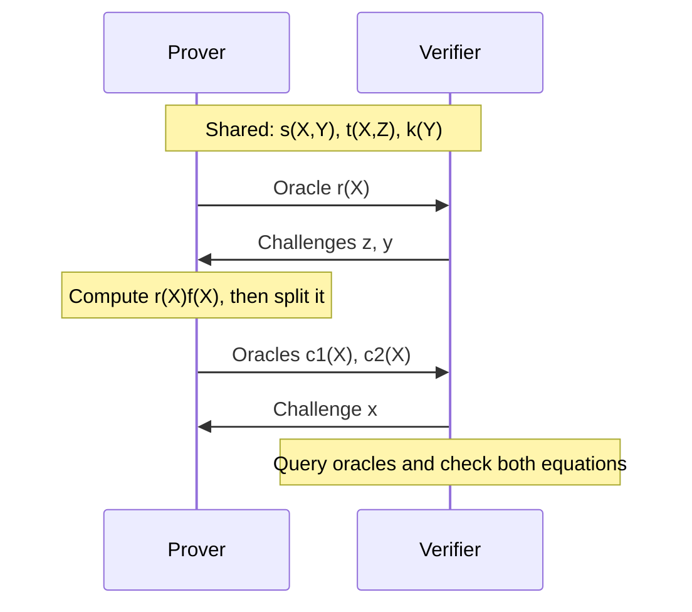

# QAP and Polynomial Encoding

The [arithmetization chapter](./arithmetization.md) ended with two ways to write the same statement, a list of R1CS rows and Ragu's single consolidated equation. Neither form helps the verifier yet, because checking either one means looking at the whole witness. This chapter turns those equations into statements about polynomials, which a verifier can test at a single random point.

There are two routes, and we take them in order. The first is the **quadratic arithmetic program** (QAP), the standard reduction behind systems such as Groth16, which ends in a divisibility test with a quotient polynomial. The second is the route Ragu takes, which reads the claim from one coefficient of a product and needs no division. We run both on the statement $x^3 + x + 5 = 35$ over $\F_{43}$, the scalar field of the toy curve. No curve points appear in this chapter, because commitments come in the next one.

## 1. What polynomials provide

Suppose two polynomials of degree at most $d$ differ. Their difference is a nonzero polynomial of degree at most $d$, so it has at most $d$ roots, and the two polynomials agree on at most $d$ points. This is the one-variable case of the Schwartz–Zippel lemma from [Statements and Challenges](./statements-and-challenges.md#_5-testing-polynomials-at-a-random-point). So a check at one random point says something about every coefficient at once, and a verifier can learn whether two large polynomials are equal without reading either of them.

To use this fact, we have to express "all the constraints hold" as an equality of polynomials. Each route does this differently. A QAP assigns each constraint row to its own point of the field, so a true statement makes a polynomial vanish at all of those points. Ragu has already merged its constraints into one scalar equation, so it only has to place that scalar where a verifier can reach it.

Three symbols need care in this chapter. In the arithmetization chapter, $x$ was the secret input, and we keep that meaning when we write "the witness with $x = 3$". Once we reach Ragu's split in Section 12, $x$ also names a random evaluation point, as it does in the commitments chapter, and the context will always say which is meant. The random point of the QAP test is called $\tau$. Finally, $\v{w}$ is the R1CS vector, and we write its entries in bold as $\v{w}_\ell$, so that they stay separate from the wires $w_1$ and $w_2$ of the flattened computation.

## 2. The R1CS starting point

The R1CS form of our statement uses a vector $\v{w}$ holding the constant 1, the public output, and the three private values. Three public matrices with $m$ rows define the constraints, and row $i$ requires

$$\Big(\sum_\ell A_{i\ell}\,\v{w}_\ell\Big)\Big(\sum_\ell B_{i\ell}\,\v{w}_\ell\Big) = \sum_\ell C_{i\ell}\,\v{w}_\ell.$$

For our statement there are three rows:

<!-- worked:r1cs-start -->

$$A = \begin{bmatrix}0 & 0 & 1 & 0 & 0 \\ 0 & 0 & 0 & 1 & 0 \\ 5 & 0 & 1 & 0 & 1\end{bmatrix},\quad B = \begin{bmatrix}0 & 0 & 1 & 0 & 0 \\ 0 & 0 & 1 & 0 & 0 \\ 1 & 0 & 0 & 0 & 0\end{bmatrix},\quad C = \begin{bmatrix}0 & 0 & 0 & 1 & 0 \\ 0 & 0 & 0 & 0 & 1 \\ 0 & 1 & 0 & 0 & 0\end{bmatrix},$$

with $\v{w} = (1, 35, 3, 9, 27)$. The three rows give $A\v{w} = (3, 9, 35)$, $B\v{w} = (3, 3, 1)$ and $C\v{w} = (9, 27, 35)$, and multiplying the first two entrywise gives the third.

<!-- /worked:r1cs-start -->

These $m$ equations are what we have to compress. In a real circuit $m$ can be many thousands, so the verifier should not have to examine them one by one.

## 3. Interpolating the rows

We want one polynomial that carries all the rows. A polynomial can store one value at each point of the field, so we can give each row its own point. Fix a set of $m$ distinct points $D = \{\rho_0, \ldots, \rho_{m-1}\}$, called the **domain**, and let row $i$ live at $\rho_i$. Our example uses $D = \{1, 2, 3\}$.

The most direct idea is to interpolate the vector $A\v{w}$ itself, finding a polynomial whose value at $\rho_i$ is entry $i$ of $A\v{w}$. That polynomial would hold the right values, but it would mix the circuit with the witness in a way the verifier cannot pull apart, and nothing would show that it came from the matrix $A$. We keep the two separate by interpolating the matrix alone. Each column of $A$ belongs to one wire, so we build one polynomial per column:

$$A_\ell(\rho_i) = A_{i\ell} \quad \text{for every row } i.$$

The polynomials $B_\ell$ and $C_\ell$ come from the columns of $B$ and $C$ in the same way. Since $m$ points determine a unique polynomial of degree at most $m - 1$, these polynomials exist and depend only on the circuit.

To construct them, we first build a polynomial for each domain point that equals 1 at that point and 0 at the others. A product of factors $(X - \rho_j)$ over all $j \neq i$ is zero at every other point, and dividing by its value at $\rho_i$ scales it to 1 there:

$$L_i(X) = \prod_{j \neq i} \frac{X - \rho_j}{\rho_i - \rho_j}.$$

These are the **Lagrange basis polynomials** for $D$. For our domain they are

<!-- worked:lagrange -->

$$\begin{aligned}
L_0(X) &= \frac{(X-2)(X-3)}{(1-2)(1-3)} = \frac{X^2 - 5X + 6}{2} = 3 + 19X + 22X^2,\\
L_1(X) &= \frac{(X-1)(X-3)}{(2-1)(2-3)} = \frac{X^2 - 4X + 3}{-1} = 40 + 4X + 42X^2,\\
L_2(X) &= \frac{(X-1)(X-2)}{(3-1)(3-2)} = \frac{X^2 - 3X + 2}{2} = 1 + 20X + 22X^2.
\end{aligned}$$

Dividing by 2 modulo 43 means multiplying by 22, and dividing by $-1$ means negating. As a spot check, $L_0(1) = 1$, $L_0(2) = 0$ and $L_0(3) = 0$.

<!-- /worked:lagrange -->

Any column can now be written as a sum of basis polynomials, each weighted by that column's entry for the row:

$$A_\ell(X) = \sum_{i=0}^{m-1} A_{i\ell}\, L_i(X).$$

At $X = \rho_i$ only the term with $L_i$ survives, which gives $A_{i\ell}$ as required. The nonzero columns of our three matrices produce the following polynomials, and every column not listed is all zeros and gives the zero polynomial.

<!-- worked:columns -->

| Polynomial | Column entries | In the basis | Coefficients |
| --- | --- | --- | --- |
| $A_0$ | $(0, 0, 5)$ | $5L_2$ | $5 + 14X + 24X^2$ |
| $A_2$ | $(1, 0, 1)$ | $L_0 + L_2$ | $4 + 39X + X^2$ |
| $A_3$ | $(0, 1, 0)$ | $L_1$ | $40 + 4X + 42X^2$ |
| $A_4$ | $(0, 0, 1)$ | $L_2$ | $1 + 20X + 22X^2$ |
| $B_0$ | $(0, 0, 1)$ | $L_2$ | $1 + 20X + 22X^2$ |
| $B_2$ | $(1, 1, 0)$ | $L_0 + L_1$ | $23X + 21X^2$ |
| $C_1$ | $(0, 0, 1)$ | $L_2$ | $1 + 20X + 22X^2$ |
| $C_3$ | $(1, 0, 0)$ | $L_0$ | $3 + 19X + 22X^2$ |
| $C_4$ | $(0, 1, 0)$ | $L_1$ | $40 + 4X + 42X^2$ |

<!-- /worked:columns -->

## 4. Adding the witness

The column polynomials describe the circuit, so we now bring in the witness. Multiply each column polynomial by its wire value and add:

$$A(X) = \sum_\ell \v{w}_\ell\, A_\ell(X), \qquad B(X) = \sum_\ell \v{w}_\ell\, B_\ell(X), \qquad C(X) = \sum_\ell \v{w}_\ell\, C_\ell(X).$$

To see what these sums hold, evaluate $A(X)$ at a domain point and use the defining property of the column polynomials:

$$A(\rho_i) = \sum_\ell \v{w}_\ell\, A_\ell(\rho_i) = \sum_\ell \v{w}_\ell\, A_{i\ell} = (A\v{w})_i.$$

So $A(X)$ takes the value of row $i$ of $A\v{w}$ at the point $\rho_i$, and the same holds for $B$ and $C$. Row $i$ of the R1CS is therefore the equation $A(\rho_i)B(\rho_i) = C(\rho_i)$, and the $m$ rows hold exactly when this equation holds at all $m$ domain points.

<!-- worked:combine -->

For $\v{w} = (1, 35, 3, 9, 27)$, the sums come out as

$$\begin{aligned}
A(X) &= 17 + 19X + 10X^2,\\
B(X) &= 1 + 3X + 42X^2,\\
C(X) &= 24 + 33X + 38X^2.
\end{aligned}$$

| $\rho_i$ | $A(\rho_i)$ | $B(\rho_i)$ | $C(\rho_i)$ | $A(\rho_i)B(\rho_i) - C(\rho_i)$ |
| --- | --- | --- | --- | --- |
| 1 | 3 | 3 | 9 | 0 |
| 2 | 9 | 3 | 27 | 0 |
| 3 | 35 | 1 | 35 | 0 |

The columns for $A$, $B$ and $C$ reproduce $A\v{w}$, $B\v{w}$ and $C\v{w}$ from Section 2.

<!-- /worked:combine -->

## 5. The vanishing polynomial and the quotient

Define $P(X) = A(X)B(X) - C(X)$. The rows hold exactly when $P$ is zero at every point of $D$. That is still $m$ separate facts, and a check at one random point would not capture them, because a random point is almost never in $D$. We need an equivalent statement that holds as an identity across the whole field.

The factor theorem provides it. If a polynomial is zero at $\rho$, then $X - \rho$ divides it. Since the points of $D$ are distinct, $P$ is zero on all of $D$ exactly when $P$ is divisible by the product of those factors. This product is the **vanishing polynomial** of the domain:

$$V(X) = \prod_{i=0}^{m-1} (X - \rho_i).$$

The rows therefore hold exactly when there is a polynomial $h(X)$, called the **quotient**, with

$$A(X)B(X) - C(X) = h(X)\,V(X).$$

The factors $A$ and $B$ each have degree at most $m - 1$, so $P$ has degree at most $2(m - 1)$. Since $V$ has degree $m$, the quotient has degree at most $m - 2$. The column polynomials and $V$ together make up the QAP. A witness satisfies the QAP when the quotient exists, and this equation is the polynomial form of the R1CS.

<!-- worked:p-poly -->

With $m = 3$ rows, the degree of $P$ is at most 4, and multiplying and subtracting gives $P(X) = 36 + 37X + 12X^2 + 11X^3 + 33X^4$. Substituting gives $P(1) = 0$, $P(2) = 0$ and $P(3) = 0$, even though the coefficients of $P$ are not zero.

<!-- /worked:p-poly -->

The next step divides $P$ by $V$.

<!-- worked:division -->

Expanding the product gives $V(X) = (X-1)(X-2)(X-3) = X^3 - 6X^2 + 11X - 6$, which is $37 + 11X + 37X^2 + X^3$ modulo 43. Long division removes one leading term at a time:

| Current polynomial | Next term of $h$ | Subtract | Result |
| --- | --- | --- | --- |
| $36 + 37X + 12X^2 + 11X^3 + 33X^4$ | $33X$ | $17X + 19X^2 + 17X^3 + 33X^4$ | $36 + 20X + 36X^2 + 37X^3$ |
| $36 + 20X + 36X^2 + 37X^3$ | $37$ | $36 + 20X + 36X^2 + 37X^3$ | $0$ |

The last column ends at 0, so the division is exact and $h(X) = 37 + 33X$, which has degree $m - 2 = 1$ as predicted.

<!-- /worked:division -->

## 6. Testing the identity at one point

The equation $P(X) = h(X)V(X)$ is now an equality of polynomials, so Section 1 applies. If the two sides are different polynomials, their difference has degree at most $2(m - 1)$, and they agree on at most that many points. A verifier who picks a random $\tau$ after the prover has fixed $A$, $B$, $C$ and $h$ can compare the two sides at $\tau$ alone. The chance of missing a difference is at most $2(m - 1)/|\F_q|$.

<!-- worked:qap-test -->

Take $\tau = 11$. The prover has already fixed its polynomials, so the two sides are

| Value | At $\tau$ |
| --- | --- |
| $A(\tau)$ | 17 |
| $B(\tau)$ | 42 |
| $C(\tau)$ | 40 |
| $A(\tau)B(\tau) - C(\tau)$ | 29 |
| $h(\tau)$ | 13 |
| $V(\tau)$ | 32 |
| $h(\tau)V(\tau)$ | 29 |

The fourth and last rows agree. Checking every one of the 43 values of $\tau$ confirms that the honest polynomials pass at all of them, as an identity should.

<!-- /worked:qap-test -->

This test replaces all $m$ rows with one comparison of field elements, because the domain and the vanishing polynomial packed the rows into a single identity.

## 7. Why a cheater's quotient does not exist

Take a statement the witness does not satisfy, and follow what happens to the quotient.

<!-- worked:no-quotient -->

Keep the public value 35 and try $x = 4$, which gives $\v{w} = (1, 35, 4, 16, 21)$. Now $A\v{w} = (4, 16, 30)$, $B\v{w} = (4, 4, 1)$ and $C\v{w} = (16, 21, 35)$. The first two rows hold, and the last gives $30 \cdot 1 = 30$ against 35. The polynomial built from this witness is $P'(X) = 17 + 12X + 3X^2 + 34X^3 + 20X^4$, with $P'(1) = 0$ and $P'(2) = 0$ but $P'(3) = 38$. Dividing by $V(X)$ leaves the quotient $25 + 20X$ and the remainder $38 + 29X + 19X^2$. The remainder is not zero, so no polynomial $h$ satisfies $P'(X) = h(X)V(X)$.

<!-- /worked:no-quotient -->

A failing row at $\rho_i$ means $P'(\rho_i) \neq 0$, while any multiple of $V$ is zero there. This mismatch is why no $h$ can work, whatever the prover tries. The prover can still present some polynomial as its quotient and hope that the test at $\tau$ misses the difference. On the toy field we can count every such attempt. We leave the domain points out of the count, because $V$ is zero there and a test at such a point says nothing about the quotient. A real field has so many elements that a random $\tau$ lands in $D$ with negligible probability.

<!-- worked:guess-h -->

| Values of $\tau$ where the guess passes | Number of candidate quotients |
| --- | --- |
| 0 | 909 |
| 1 | 160 |
| 2 | 780 |

The table covers all $43^2 = 1849$ candidate polynomials $h$ of degree at most 1, each tried at the 40 values of $\tau$ outside the domain. No candidate passes at more than 2 of them, which is 2/40. Averaged over all candidates, a random guess passes at a rate of 1 in 43.

<!-- /worked:guess-h -->

The count stays low because $P' - hV$ is a nonzero polynomial of low degree whatever $h$ the prover chooses. This argument only works if the prover commits to its polynomials before learning $\tau$, and the next example shows what happens otherwise.

<!-- worked:known-tau -->

Suppose the prover with $x = 4$ learns $\tau = 11$ before answering. It computes $P'(11) = 4$ and $V(11) = 32$, divides to get 27, and presents the constant polynomial $h(X) = 27$. The check at $\tau = 11$ passes because $27 \cdot 32 = 4$ modulo 43. At $\tau = 12$ the same $h$ gives $27$ against $P'(12) = 33$, so this forgery only works at the point the prover knew in advance.

<!-- /worked:known-tau -->

The test also assumes that $A$, $B$ and $C$ really are combinations of the column polynomials with one shared witness. If the prover could present any three polynomials, it could set all of them to zero, and the identity would hold with $h = 0$ for any statement. A complete QAP-based system therefore has to enforce three things: the prover fixes its polynomials before $\tau$ is known, each polynomial has the required form, and all three use the same $\v{w}$.

## 8. Enforcing the test in Groth16

[Groth16](https://eprint.iacr.org/2016/260) enforces these requirements by keeping $\tau$ secret from everyone. A setup ceremony publishes elliptic curve points that encode powers of $\tau$, in the style of the KZG setup from [Section 10 of the polynomial commitments chapter](./polynomial-commitments.md), together with points derived from the column polynomials and further secret values. The prover can only form linear combinations of these points, so it can evaluate its polynomials at $\tau$ inside the group without knowing $\tau$. The further secret values are what force a single shared witness into all three polynomials.

The verifier checks the identity using pairings, the bilinear maps mentioned in that same section. The resulting proof is three group elements, and verification uses three pairings. We do not need the details of the construction here, only the list of things it relies on, which the next section examines.

## 9. The cost of QAP

Each ingredient of the QAP route has a cost, and several of those costs conflict with what Ragu needs.

**The prover works over a special domain.** Interpolating and multiplying term by term, as we did above, takes time quadratic in $m$. Real provers use the fast Fourier transform (FFT), which requires the domain to be a set of roots of unity. This choice also gives $V$ a compact form.

<!-- worked:unity -->

In $\F_{43}$ the value $\omega = 6$ satisfies $6^3 = 216 = 1$ modulo 43, so its powers form the domain $\{1, 6, 36\}$, and the vanishing polynomial collapses to $V(X) = X^3 - 1$. Repeating the construction on this domain with the same witness gives different polynomials, for example $A(X) = 30 + 7X + 9X^2$, and the exact quotient $h(X) = 11 + 42X$. The same field has no domain of size 4, because 4 does not divide $43 - 1 = 42$. Real proof systems pick fields whose multiplicative group has a large power of two in its order for this reason.

<!-- /worked:unity -->

The product is also larger than the circuit, because $A(X)B(X)$ has about twice the degree of its factors. Holding $P$ by its values therefore takes a domain about twice the size of $D$.

<!-- worked:scale -->

For a circuit of $m = 2^{16} = 65,536$ rows, $P(X)$ has degree up to $2(m-1) = 131,070$. Representing it requires a domain with more than 131,070 points, and the next power of two is $2^{17} = 131,072$.

<!-- /worked:scale -->

Groth16 provers avoid part of this cost, because $P$ is known to vanish on $D$ and the quotient $h$ has degree below $m$. Evaluating on one shifted copy of $D$, called a coset, is enough to recover $h$, so these provers run their FFTs at size $m$ rather than $2m$. They still have to run several of them, over a field with the required roots of unity.

**The setup requires trust.** Anyone who learns $\tau$ or the other secret values can forge proofs, as Section 7 showed on a small scale. Groth16 also ties its setup to one circuit, so a new circuit needs a new setup. Ragu's [overview](https://github.com/tachyon-zcash/ragu/blob/3219e0865e8bff1f9d817bfe3850d9e94b64338c/book/src/protocol/index.md) sets out to avoid a trusted setup, and its non-uniform model lets a prover switch among many circuits without verification keys.

**The verifier needs pairings.** The pairing check is what makes the secret $\tau$ usable. Ragu works over the Pasta curves, which are not pairing-friendly, so this check is not available to it.

**The circuit description has to exist as polynomials.** Before any proof, someone has to compute the column polynomials $A_\ell$, $B_\ell$ and $C_\ell$. The same overview lists this among the things its construction avoids, since Ragu never builds sparse R1CS matrices or a QAP reduction, while its cost model stays close to that of QAP-based SNARKs.

Ragu therefore has to reach a polynomial test some other way, using only the commitments from the next chapter.

## 10. The consolidated equation as a coefficient

Ragu starts from a different place. A QAP keeps the rows separate until the very end and uses the domain to pack them together. Ragu has already combined its gates and constraints using the challenges $z$ and $y$, which left one scalar equation in [Section 12 of the arithmetization chapter](./arithmetization.md):

$$\revdot{\v{r}}{\v{r} \circ \v{z^{4n}} + \v{t} + \v{s}} = \dot{\v{k}}{\v{y^{4n}}}.$$

No domain and no vanishing polynomial are needed, since there are no separate rows left to pack. The remaining job is to let the verifier check this one equation without seeing $\v{r}$. Section 7 of that chapter already supplied the link to polynomials, because the revdot product of two vectors of length $4n$ is the coefficient of $X^{4n-1}$ in the product of the polynomials with those coefficient vectors. So we read every vector in the equation as a list of coefficients.

The witness vector becomes the **trace polynomial**. With $\v{d} = \v{0}$ and the layout from the arithmetization chapter, it is

$$r(X) = \sum_{i=0}^{n-1} \big( c_i X^i + a_i X^{2n-1-i} + b_i X^{2n+i} \big).$$

The dilated vector $\v{r} \circ \v{z^{4n}}$ multiplies coefficient $k$ by $z^k$, which is the effect of substituting $zX$ for $X$, because $r_k (zX)^k = (r_k z^k) X^k$. So the dilated vector is the coefficient vector of $r(zX)$, and no new data is involved.

The public vectors $\v{s}$ and $\v{t}$ depend on the challenges, and the circuit is fixed before the challenges exist. We therefore describe them with polynomials in two variables, and substitute a challenge for the second variable once it is known. Placing each coefficient at the partner position worked out in that chapter gives the **wiring polynomial** and the **gate polynomial**:

$$s(X, Y) = \sum_{j=0}^{4n-1} Y^j \sum_{i=0}^{n-1} \big( u_{j,i} X^{2n+i} + v_{j,i} X^{2n-1-i} + w_{j,i} X^{4n-1-i} \big),$$

$$t(X, Z) = -\sum_{i=0}^{n-1} \big( Z^{2n-1-i} + Z^{2n+i} \big) X^{4n-1-i}.$$

The vector $\v{s}$ is the coefficient vector of $s(X, y)$, and $\v{t}$ is the coefficient vector of $t(X, z)$. On the right side of the equation, the **public input polynomial** $k(Y) = \sum_j k_j Y^j$ gives $\dot{\v{k}}{\v{y^{4n}}} = k(y)$.

::: warning The Ragu Book's NARK chapter uses the other layout
The [NARK chapter](https://github.com/tachyon-zcash/ragu/blob/3219e0865e8bff1f9d817bfe3850d9e94b64338c/book/src/protocol/core/nark.md) writes $r(X) = \sum_i (c_i X^i + b_i X^{2n-1-i} + a_i X^{2n+i})$ and puts $u_{j,i}$ at $X^{2n-1-i}$ and $v_{j,i}$ at $X^{2n+i}$ in $s(X, Y)$. The [wiring code](https://github.com/tachyon-zcash/ragu/blob/3219e0865e8bff1f9d817bfe3850d9e94b64338c/crates/ragu_circuits/src/wiring/mod.rs#L13-L22) at commit `3219e08` puts the coefficients of the $a$ wires at $X^{2n+i}$ in $s(X, Y)$, as above. The two forms differ only by swapping the names $\v{a}$ and $\v{b}$. This site follows the code, as the arithmetization chapter did.
:::

Now collect the second factor into one polynomial,

$$f(X) = r(zX) + s(X, y) + t(X, z).$$

The name $f$ is local to this chapter, and $f(X)$ is the right vector of the consolidated equation in polynomial form. By the coefficient rule, the equation now reads

$$\text{the coefficient of } X^{4n-1} \text{ in } r(X)f(X) \text{ equals } k(y).$$

Here are the polynomials for our witness at $z = 5$ and $y = 7$, the challenges from the arithmetization chapter:

<!-- worked:right-factor -->

| Polynomial | Coefficients of $X^0, \ldots, X^7$ |
| --- | --- |
| $r(X)$ | $(9, 27, 9, 3, 3, 3, 0, 0)$ |
| $r(5X)$ | $(9, 6, 10, 31, 26, 1, 0, 0)$ |
| $s(X, 7)$ | $(0, 0, 6, 42, 37, 7, 42, 36)$ |
| $t(X, 5)$ | $(0, 0, 0, 0, 0, 0, 32, 24)$ |
| $f(X)$ | $(9, 6, 16, 30, 20, 8, 31, 17)$ |

The vector for $f(X)$ is the combined right vector from Section 12 of the arithmetization chapter, now read as coefficients.

<!-- /worked:right-factor -->

The coefficient of $X^7$ in the product collects every pair of exponents that adds to 7:

<!-- worked:middle -->

| $i$ | Coefficient of $X^i$ in $r$ | $7 - i$ | Coefficient of $X^{7-i}$ in $f$ | Product |
| --- | --- | --- | --- | --- |
| 0 | 9 | 7 | 17 | 24 |
| 1 | 27 | 6 | 31 | 20 |
| 2 | 9 | 5 | 8 | 29 |
| 3 | 3 | 4 | 20 | 17 |
| 4 | 3 | 3 | 30 | 4 |
| 5 | 3 | 2 | 16 | 5 |
| 6 | 0 | 1 | 6 | 0 |
| 7 | 0 | 0 | 9 | 0 |

The last column sums to 13 modulo 43. On the other side, $k(Y) = 30Y^3$ because only $k_3$ is nonzero, so $k(7) = 30 \cdot 7^3 = 13$ modulo 43.

<!-- /worked:middle -->

## 11. Why the coefficient is out of reach

We can expand the whole product to see where this coefficient sits.

<!-- worked:product -->

The full product has 15 coefficients:

| Power of $X$ | 0 | 1 | 2 | 3 | 4 | 5 | 6 | 7 | 8 | 9 | 10 | 11 | 12 | 13 | 14 |
| --- | --- | --- | --- | --- | --- | --- | --- | --- | --- | --- | --- | --- | --- | --- | --- |
| Coefficient | 38 | 39 | 0 | 9 | 18 | 29 | 14 | **13** | 9 | 29 | 39 | 15 | 8 | 0 | 0 |

The entry for $X^7$ is 13, the value the consolidated equation requires. Every other entry is a by-product of the multiplication that the check does not constrain. The two highest coefficients are zero in this example because $\v{d} = \v{0}$ leaves $r$ with degree 5.

<!-- /worked:product -->

In general, the product has degree up to $8n - 2$. Two obstacles keep the verifier from checking the coefficient directly. The first is that the commitments in the next chapter let a verifier learn evaluations of a committed polynomial, and one coefficient in the middle of a polynomial is not an evaluation at any point. The second is size. A commitment with $4n$ generators holds at most $4n$ coefficients, as [Section 7 of the commitments chapter](./polynomial-commitments.md) explained, and the product needs almost twice as many. Doubling the number of generators would fix the second obstacle, but it would make every commitment in the system about twice as expensive, and all of that would serve to expose one coefficient.

## 12. Splitting the product

A single reshaping of the product removes both obstacles. For the size problem, cut the product into a lower half with the $4n$ coefficients of $X^0$ through $X^{4n-1}$, and an upper half with the rest:

$$r(X)f(X) = c_{\mathrm{lo}}(X) + X^{4n}\, c_{\mathrm{hi}}(X).$$

Both pieces have degree below $4n$, so each fits within a single commitment. The coefficient we want is the top coefficient of $c_{\mathrm{lo}}$, which is still not an evaluation.

The one coefficient of a polynomial that evaluation can reach is the constant term, because substituting $X = 0$ removes all the others. So we reverse the coefficients of the lower half, which moves the top coefficient to the bottom:

$$c_1(X) = X^{4n-1}\, c_{\mathrm{lo}}(X^{-1}), \qquad c_2(X) = c_{\mathrm{hi}}(X).$$

To see that this is a reversal, write $c_{\mathrm{lo}}(X) = \sum_{k=0}^{4n-1} \lambda_k X^k$ and multiply through:

$$c_1(X) = X^{4n-1} \sum_{k=0}^{4n-1} \lambda_k X^{-k} = \sum_{k=0}^{4n-1} \lambda_k X^{4n-1-k}.$$

The coefficient $\lambda_{4n-1}$ is attached to $X^0$, so $c_1(0) = \lambda_{4n-1}$, and the consolidated equation has become

$$c_1(0) = k(y).$$


<!-- worked:split -->

For our product, $c_{\mathrm{lo}}$ has coefficients $(38, 39, 0, 9, 18, 29, 14, 13)$ and $c_{\mathrm{hi}}$ has coefficients $(9, 29, 39, 15, 8, 0, 0)$. Reversing the lower half gives $c_1(X)$ with coefficients $(13, 14, 29, 18, 9, 0, 39, 38)$, so $c_1(0) = 13$, which is the required value $k(7)$. We set $c_2 = c_{\mathrm{hi}}$.

<!-- /worked:split -->

The notation is close to the wires of the arithmetization chapter, but the meaning is different. The polynomials $c_1(X)$ and $c_2(X)$ are unrelated to the wire values $c_0, c_1, \ldots$, and we will always write the polynomials with their argument. The wires now appear only inside $r(X)$.

The verifier also needs a way to know that $c_1$ and $c_2$ really came from the product. Since reversing twice restores the original, we can recover the lower half from $c_1$ by substituting $X^{-1}$ into its definition and multiplying by $X^{4n-1}$:

$$X^{4n-1} c_1(X^{-1}) = X^{4n-1} \cdot X^{-(4n-1)}\, c_{\mathrm{lo}}(X) = c_{\mathrm{lo}}(X).$$

Substituting this into the cut gives one equation that ties the two new polynomials to the product:

$$r(X)f(X) = X^{4n-1} c_1(X^{-1}) + X^{4n} c_2(X).$$

The verifier has to evaluate this at a nonzero point, since it uses $X^{-1}$.

<!-- worked:reversal-check -->

At $x = 9$, the inverse is $x^{-1} = 24$, because $9 \cdot 24 = 216 = 1$ modulo 43. Then $c_1(24) = 6$, $x^7 = 36$, and $36 \cdot 6 = 1$ modulo 43, which equals $c_{\mathrm{lo}}(9)$ computed directly.

<!-- /worked:reversal-check -->

## 13. Polynomial oracles

So far we have written the checks in terms of polynomials the verifier does not hold. The usual way to separate this reasoning from the cryptography is to pretend for the moment that the verifier has an **oracle** for each polynomial the prover sends. An oracle is a black box that fixes a polynomial when the prover creates it, and that afterward answers any question of the form "what is the value at this point?" The verifier never sees the coefficients. A protocol built this way is called a **polynomial interactive oracle proof**, or polynomial IOP.

This separation lets us check the logic of the protocol now. The [next chapter](./polynomial-commitments.md) replaces each oracle with a commitment, and later chapters provide the evaluation proofs.

The order of messages carries much of the protocol's soundness. The prover fixes $r(X)$ before seeing the challenges $z$ and $y$, as the argument in the arithmetization chapter required. It fixes $c_1(X)$ and $c_2(X)$ before seeing $x$, because the split check is a random test of those polynomials.



In the protocol, $x$ is this random evaluation point, as in the commitments chapter, and the verifier picks it nonzero. The verifier asks the oracles for $r(x)$ and $r(xz)$, then for $c_1(x^{-1})$ and $c_1(0)$, then for $c_2(x)$. It computes $s(x, y)$, $t(x, z)$ and $k(y)$ by itself, because these polynomials are public. Then it checks two equations:

$$r(x)\big(r(xz) + s(x, y) + t(x, z)\big) = x^{4n-1} c_1(x^{-1}) + x^{4n} c_2(x),$$

$$c_1(0) = k(y).$$

The first is the **split check**, and the second is the **target check**. The dilation helps in the first check, because the verifier gets the value of $r(zX)$ at $x$ by asking the same oracle about the point $xz$. No separate polynomial is involved, so the prover cannot substitute a different trace in the second factor.

The verifier's local work differs among the three public polynomials. The value $t(x, z)$ has a [short closed form](https://github.com/tachyon-zcash/ragu/blob/3219e0865e8bff1f9d817bfe3850d9e94b64338c/book/src/protocol/local/arithmetization.md), since each of its sums is a geometric series, and $k(y)$ is cheap when the public input vector is sparse. Computing $s(x, y)$ directly costs time linear in the circuit size, and the chapter on [wiring and the registry](./wiring-and-registry.md) studies how to avoid this.

## 14. A complete run

Here is the whole protocol on the witness with $x = 3$, with the oracles written out so that we can follow them. The secret input now sits inside $r(X)$, and the $x$ in the table is the random point.

<!-- worked:run -->

| Step | Party | Value or check |
| --- | --- | --- |
| 1 | Both | Hold $s(X, Y)$, $t(X, Z)$ and $k(Y) = 30Y^3$ |
| 2 | Prover sends oracle | $r(X) = 9 + 27X + 9X^2 + 3X^3 + 3X^4 + 3X^5$ |
| 3 | Verifier sends challenges | $z = 5$, $y = 7$ |
| 4 | Prover computes | $f(X) = r(5X) + s(X, 7) + t(X, 5)$ and the product $r(X)f(X)$ |
| 5 | Prover sends oracles | $c_1(X) = 13 + 14X + 29X^2 + 18X^3 + 9X^4 + 39X^6 + 38X^7$ and $c_2(X) = 9 + 29X + 39X^2 + 15X^3 + 8X^4$ |
| 6 | Verifier sends challenge | $x = 9$, so $xz = 2$ and $x^{-1} = 24$ |
| 7 | Verifier queries $r$ | $r(9) = 5$ and $r(2) = 9$ |
| 8 | Verifier queries $c_1$ | $c_1(24) = 6$ and $c_1(0) = 13$ |
| 9 | Verifier queries $c_2$ | $c_2(9) = 30$ |
| 10 | Verifier computes locally | $s(9, 7) = 23$, $t(9, 5) = 3$, $k(7) = 13$ |
| 11 | Verifier checks the split | $5 \cdot (9 + 23 + 3) = 3$ and $36 \cdot 6 + 23 \cdot 30 = 3$ |
| 12 | Verifier checks the target | $c_1(0) = 13 = k(7)$ |

Both checks pass. Repeating step 11 at all 42 nonzero values of $x$ shows that the honest polynomials pass at every one.

<!-- /worked:run -->

## 15. Why cheating fails

The argument assumes that oracles are fixed when sent, and that the challenges are uniform and arrive after the messages they test. The commitments of the next chapter provide the first assumption, under the discrete log relation assumption. [Fiat–Shamir](./statements-and-challenges.md) provides the second in a non-interactive proof, treating its hash as a random oracle. Inside this model, the argument only counts roots of polynomials.

A prover with a false witness has to send some $r'(X)$ before seeing $z$ and $y$. The arithmetization chapter showed that a random pair $(z, y)$ rarely makes the true coefficient equal to $k(y)$.

<!-- worked:lucky -->

For the false witness with $x = 4$, counting all pairs finds 43 of the 1849 that do so.

<!-- /worked:lucky -->

Outside those lucky pairs, the honest split fails the target check, so the prover has to lie about the split. The most direct lie changes only the coefficient the target check reads.

<!-- worked:cheat-naive -->

Take the false witness with $x = 4$ from Section 7, so $r'(X) = 16 + 21X + 16X^2 + 4X^3 + 4X^4 + 4X^5$, at the same $z = 5$ and $y = 7$. The coefficient of $X^7$ in $r'(X)f'(X)$ is 18, while $k(7) = 13$, so the honest split would fail the target check. The prover can change the constant term of $c_1$ to 13 and leave everything else alone, which fixes the target check. The two sides of the split check then differ by $5X^7$, and the verifier rejects at all 42 nonzero values of $x$.

<!-- /worked:cheat-naive -->

This lie is the easiest to catch, since the error sits on one power of $X$. Any polynomials $c_1$ and $c_2$ that pass the target check must describe a polynomial other than $r'(X)f'(X)$, because they disagree with it on the coefficient of $X^{4n-1}$. Whatever they are, the two sides of the split check form a nonzero polynomial difference, so the prover's best option is to give that difference as many roots as possible.

<!-- worked:cheat-best -->

The prover can do better by spreading the difference over many powers of $X$. Let $\Delta(X)$ be a polynomial of degree 15 whose coefficient of $X^7$ is 5, which is the amount the true coefficient must change by. Writing $\Delta$ as a multiple of $(X-1)(X-2)\cdots(X-15)$ gives it the 15 roots $1, \ldots, 15$. The prover then splits $r'(X)f'(X) - \Delta(X)$ instead of the true product, and the new $c_1$ has $c_1(0) = 13$, as the target check requires. The split check now compares $r'(x)f'(x)$ with $r'(x)f'(x) - \Delta(x)$, so it passes exactly where $\Delta(x) = 0$. Testing every nonzero $x$ finds 15 passing values out of 42, which is the most a polynomial of degree 15 allows. For $n = 2^{11}$ on a field of about $2^{255}$ elements, the same limit of $8n - 1$ roots gives a probability below $2^{-240}$.

<!-- /worked:cheat-best -->

The limit here is $8n - 1$ rather than $8n - 2$. The honest $c_2$ has only $4n - 1$ coefficients, but a commitment has room for $4n$, so a cheater can use one more.

As with the QAP, the order of messages is essential.

<!-- worked:cheat-early -->

Suppose the prover also knows $x = 9$ before sending $c_1$ and $c_2$. Changing the constant term of $c_1$ moved the split check by $5x^7$, and adding a constant $e$ to $c_2$ moves it by $ex^8$ in the other direction. Choosing $e = 5 / 9 = 34$ cancels the two at this one point. The forged pair passes both checks at $x = 9$, and testing the other nonzero values confirms that it passes at no other point.

<!-- /worked:cheat-early -->

## 16. Comparing the two routes

Both routes turn many constraints into one polynomial test at a random point, and they differ in how they reach that test.

| | QAP | Ragu's encoding |
| --- | --- | --- |
| How the rows combine | One point of the domain per row | Powers of the challenges $z$ and $y$ |
| Form of the claim | $P(X)$ is divisible by $V(X)$ | One coefficient of $r(X)f(X)$ equals $k(y)$ |
| Extra polynomials from the prover | The quotient $h(X)$ | The pieces $c_1(X)$ and $c_2(X)$ |
| How the verifier reaches the claim | Compares $P(\tau)$ with $h(\tau)V(\tau)$ | Reads $c_1(0)$ and tests the split at $x$ |
| Witness encoding | Values at domain points | Coefficients of $r(X)$ |
| Random values | One point $\tau$, secret in Groth16 | $z$, $y$ and $x$, all public |
| Tying factors to one witness | Secret setup values in Groth16 | One oracle $r$, queried at $x$ and $xz$ |

The central difference is division against extraction. The QAP has to show that a whole polynomial vanishes across a domain, and a quotient is the evidence for that. Ragu's claim concerns one number, so the prover has no quotient to compute and only has to move that number to a place evaluation can reach.

This does not make the multiplication free. Splitting the product still requires the prover to compute it, and for large polynomials that takes FFTs on a domain of about $8n$ points. The Ragu Book's [structured vectors chapter](https://github.com/tachyon-zcash/ragu/blob/3219e0865e8bff1f9d817bfe3850d9e94b64338c/book/src/protocol/prelim/structured_vectors.md) notes that Ragu only needs this at the places in the PCD tree where succinctness is required, so a prover can skip it elsewhere. The Book's overview also credits this design with largely avoiding the encoding of witnesses at domain points, without using the sum-check protocol.

## 17. The encoding in Ragu

The split appears in the compression step of the code as a short function, here from [`crates/ragu_pcd/src/compress/revdot/prover.rs`](https://github.com/tachyon-zcash/ragu/blob/3219e0865e8bff1f9d817bfe3850d9e94b64338c/crates/ragu_pcd/src/compress/revdot/prover.rs#L51-L70) at commit `3219e08`. Its $n$ counts all the coefficients, so it plays the role of our $4n$:

```rust
let q = c.split_off(n);
c.reverse();
(c, q)
```

The [verifier](https://github.com/tachyon-zcash/ragu/blob/3219e0865e8bff1f9d817bfe3850d9e94b64338c/crates/ragu_pcd/src/compress/revdot/verifier.rs#L123-L127) recomputes the right side of the split check from the claimed evaluations and rejects on a mismatch.

::: warning Naming differs across the Ragu Book and the code
The Book's NARK chapter calls the two pieces $c_1$ and $c_2$ and the evaluation point $x$. Its structured vectors chapter and the code call the pieces $p$ and $q$, and the [compression chapter](https://github.com/tachyon-zcash/ragu/blob/3219e0865e8bff1f9d817bfe3850d9e94b64338c/book/src/protocol/recursion/compression.md) and the code call the point $r$. This site uses $c_1$, $c_2$ and $x$ here, because $r$ already names the trace polynomial and $p$ is used for other polynomials.
:::

::: warning The Ragu Book and the code differ on the public constant
The NARK chapter adds a third check, $r(0) = 1$ together with $k(0) = 1$, and says that the first element of the witness is the public constant `ONE`. The Book's [local wiring chapter](https://github.com/tachyon-zcash/ragu/blob/3219e0865e8bff1f9d817bfe3850d9e94b64338c/book/src/protocol/local/wiring.md) instead places `ONE` in the wire $d_0$ and says that $c_0 = 0$ ensures $r(0) = 0$. The [trace assembly code](https://github.com/tachyon-zcash/ragu/blob/3219e0865e8bff1f9d817bfe3850d9e94b64338c/crates/ragu_circuits/src/trace.rs#L140-L143) at commit `3219e08` leaves $c_0 = 0$ and sets $d_0 = 1$, which agrees with the wiring chapter, so this site follows that form.

<!-- worked:toy-one -->

Our toy circuit has no `ONE` wire. Its $r(0) = c_0$ is the wire value 9 and its $k(0)$ is 0, so the run in Section 14 leaves this check out.

<!-- /worked:toy-one -->

:::

::: warning Reconstructed from code at commit 3219e08, not confirmed by the authors
The split in this chapter is not the only way Ragu checks a revdot claim. The Book's NARK chapter presents the oracle protocol above and then builds its concrete NARK differently. In that NARK, the verifier receives the two vectors and recomputes their revdot product directly, which avoids the prover's FFTs at the cost of a larger proof. The [uncompressed verifier](https://github.com/tachyon-zcash/ragu/blob/3219e0865e8bff1f9d817bfe3850d9e94b64338c/crates/ragu_pcd/src/verify.rs#L175-L180) follows this form. The split appears in compression, where the [prover](https://github.com/tachyon-zcash/ragu/blob/3219e0865e8bff1f9d817bfe3850d9e94b64338c/crates/ragu_pcd/src/compress/revdot/prover.rs#L331-L345) applies it to a random combination of folded claims instead of a single product. We return to the direct form in [the complete proof](./nark.md) and to folded claims in [revdot folding](./revdot-folding.md).
:::

## 18. Where this chapter leaves us

This chapter took the following steps:

1. A QAP interpolates each column of the R1CS matrices over a domain, so that row $i$ becomes an equation at the point $\rho_i$.
2. The rows hold exactly when $A(X)B(X) - C(X)$ is divisible by the vanishing polynomial $V(X)$, which reduces them to one identity with a quotient $h(X)$.
3. A false witness has no quotient, so a prover can only pass by luck, or by knowing the test point in advance.
4. Groth16 enforces the QAP test with a secret $\tau$, a trusted setup and pairings, and Ragu uses none of those.
5. Ragu reads its consolidated equation as the coefficient of $X^{4n-1}$ in $r(X)\big(r(zX) + s(X, y) + t(X, z)\big)$.
6. Splitting the product and reversing the lower half turns that coefficient into the constant term $c_1(0)$, and a split check at a random $x$ ties $c_1$ and $c_2$ to the product.
7. Written with oracles, the protocol is a polynomial IOP whose soundness depends on the order of its messages.

Every oracle in this protocol is still an assumption. The [next chapter](./polynomial-commitments.md) builds the commitment that replaces each oracle with one curve point.
