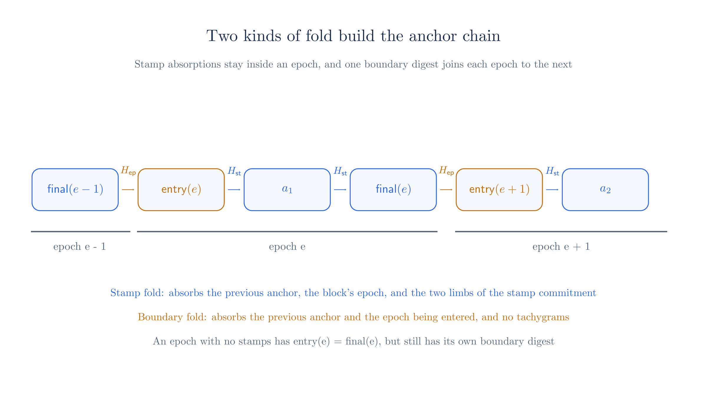
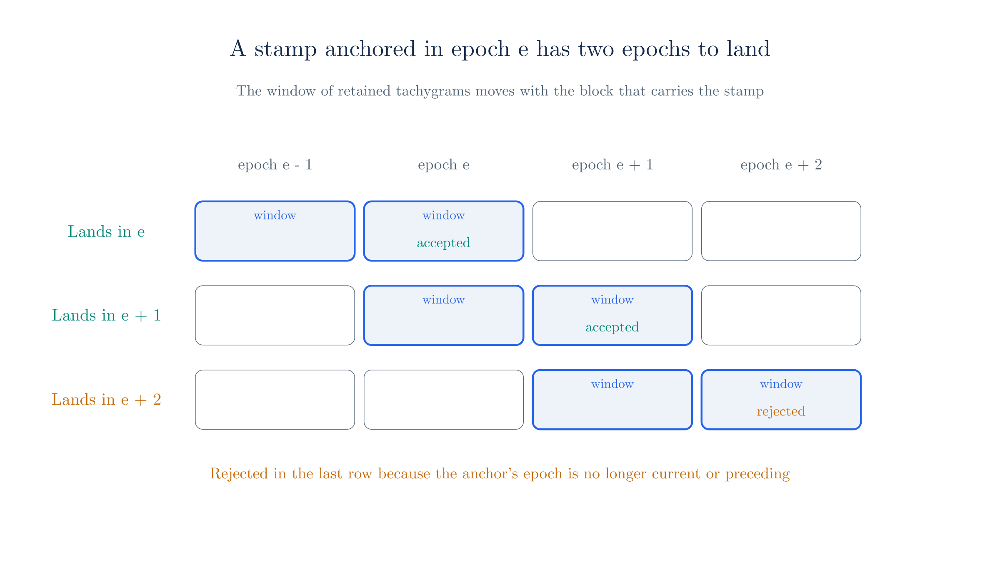

# Pool State and Anchors

[Chapter 1](./scaling-zcash.md) ended its account of validator state with a promise. Validators forget old tachygrams, yet a spender still has to prove facts about them, so a proof needs some way to refer to history that validators no longer hold. This chapter builds that reference. Each stamp's tachygrams become a polynomial, the polynomial becomes one curve point, and the curve point goes into a hash chain whose current state is called the **anchor**.

We also cover the rule that consensus applies around this chain, which is the two-epoch window for duplicate tachygrams. [Chapter 20](./notes-and-nullifiers.md) explains what a tachygram is and why a spend publishes two nullifiers, so here we treat tachygrams as opaque field elements. [Chapter 22](./oblivious-sync.md) then uses this chapter's objects to prove that a nullifier is absent from a whole epoch.

::: warning Status of these rules
Tachyon has not activated on mainnet, and this part of its design is still changing. Everything here describes Tachyon commit [`7e50254`](https://github.com/tachyon-zcash/tachyon/tree/7e502548db33845dbaacdc0efe905d1a3c45e626), which pins Ragu at [`0725b52`](https://github.com/tachyon-zcash/tachyon/blob/7e502548db33845dbaacdc0efe905d1a3c45e626/crates/tachyon/Cargo.toml#L74-L76) rather than the `3219e08` used in the Ragu chapters. The [accumulator ZIP](https://github.com/tachyon-zcash/tachyon/blob/7e502548db33845dbaacdc0efe905d1a3c45e626/book/src/zips/tachyon-accumulator.md) is an empty outline, so no normative specification exists yet. Our sources are the book's [anchor](https://github.com/tachyon-zcash/tachyon/blob/7e502548db33845dbaacdc0efe905d1a3c45e626/book/src/anchor.md) and [tachygrams](https://github.com/tachyon-zcash/tachyon/blob/7e502548db33845dbaacdc0efe905d1a3c45e626/book/src/tachygrams.md) pages, its [deep dive](https://github.com/tachyon-zcash/tachyon/blob/7e502548db33845dbaacdc0efe905d1a3c45e626/book/src/revisit.md), and the `tachyon` crate.

The crate implements the fold functions and the proof steps, but we did not find a validator in it. The window and the anchor lookup appear only in the book and in [doc comments](https://github.com/tachyon-zcash/tachyon/blob/7e502548db33845dbaacdc0efe905d1a3c45e626/crates/tachyon/src/primitives/tachygram.rs#L20-L22), and the crate's own comment calls its proof system the [mock Ragu application](https://github.com/tachyon-zcash/tachyon/blob/7e502548db33845dbaacdc0efe905d1a3c45e626/crates/tachyon/src/stamp/proof/mod.rs#L78). Later sections mark the places where the sources disagree.

Every description in this chapter of what a proof step or a code check does is reconstructed from code at commit 7e50254, not confirmed by the authors. This covers the refused commitments of Section 3, `StampUnmerge` in Section 4, `QrBucketSeal` in Section 9, and `AnchorSpanSeed`, `AnchorSpanFuse` and the lift equation in Section 10.
:::

## 1. What the pool state has to do

Start from the Orchard design in [chapter 1](./scaling-zcash.md). There an anchor is a Merkle root over note commitments, and a spender proves that a commitment sits at some leaf under a recent root. Tachyon cannot reuse this directly, for two reasons. Its published values include nullifiers as well as commitments, and spends have to prove absence as well as presence, which a Merkle path over unsorted leaves does not provide. It also [assigns notes no canonical position](https://github.com/tachyon-zcash/tachyon/blob/7e502548db33845dbaacdc0efe905d1a3c45e626/book/src/revisit.md?plain=1#L470-L471), since a stamp publishes an unordered set.

The replacement has to meet four requirements:

1. A proof must be able to test whether a value belongs to a published batch, in either direction, without validators holding the batch.
2. A proof must be able to name a point in history with one short value, and validators must be able to check that the point is real.
3. That value must also fix which epoch the point belongs to, because each epoch has its own nullifiers.
4. A validator's work per stamp must stay small, or the savings from aggregation would vanish here.

The first requirement leads to a polynomial whose roots are the batch. The second and third lead to a hash chain that absorbs a short commitment to each polynomial along with an epoch number. The fourth explains why the chain absorbs a commitment the stamp already carries, instead of asking validators to rebuild anything larger. Sections 2 to 5 take the polynomial, and Sections 6 to 10 take the chain.

The deep dive calls the first object the "tachygram accumulator." We avoid that name, because the accumulator of [chapter 11](./accumulation.md) is a different object, and say **set commitment** as the code's `TachygramSetCommit` does.

## 2. Encoding a set as a polynomial

A stamp publishes a batch of tachygrams. As [the tachygrams page counts](https://github.com/tachyon-zcash/tachyon/blob/7e502548db33845dbaacdc0efe905d1a3c45e626/book/src/tachygrams.md?plain=1#L40), a stamp covering $N$ actions in $B$ bundles holds $2N + B$ of them, so a single-action autonome holds three.

[Chapter 20](./notes-and-nullifiers.md#_12-one-structure-for-both-tests) already introduced the polynomial whose roots are a stamp's tachygrams, and showed that one evaluation tests presence or absence. The book calls it the [set polynomial](https://github.com/tachyon-zcash/tachyon/blob/7e502548db33845dbaacdc0efe905d1a3c45e626/book/src/tachygrams.md?plain=1#L44-L49) and writes it as

$$\mathsf{tachygram\_acc}(X) = \prod_i \big(X - \mathsf{tg}_i\big).$$

Tachygrams are elements of $\F_p$, the base field of Pallas, and this polynomial has coefficients in the same field. Chapter 20 worked over a larger prime so that its hash outputs stayed distinct. This chapter moves to $\F_{43}$, because the next sections commit to the polynomial on the toy curve of [chapter 6](./polynomial-commitments.md), and that curve's scalar field is $\F_{43}$. The small values below stand in for real tachygrams, which are hash outputs. What is new here is how the polynomial behaves under reordering and repetition, since both matter once stamps are merged.

<!-- worked:set-poly -->

Take a stamp A with the three tachygrams $22$, $24$, $40$. Multiplying the factors one at a time, with coefficients reduced modulo 43, gives

$$\begin{aligned}
(X - 22)(X - 24) &= X^2 - 46X + 528 = X^{2} + 40X + 12,\\
(X^{2} + 40X + 12)(X - 40) &= X^3 + (40 - 40)X^2 + (12 - 40 \cdot 40)X - 12 \cdot 40\\
&= X^3 + 0 \cdot X^2 - 1588X - 480 = X^{3} + 3X + 36.
\end{aligned}$$

<!-- /worked:set-poly -->

As in chapter 20, a zero means the value is in the set, and a nonzero result means it is not.

<!-- worked:set-eval -->

| Value $x$ | In the set | $\mathsf{tachygram\_acc}(x)$ |
| --- | --- | --- |
| 22 | yes | 0 |
| 24 | yes | 0 |
| 40 | yes | 0 |
| 20 | no | 12 |
| 6 | no | 12 |

<!-- /worked:set-eval -->

<!-- worked:set-count -->

Running through all 43 field elements, the polynomial is zero at exactly 3 of them, which are the three tachygrams. All 6 orderings of the three factors expand to the same coefficients, so the polynomial records the set and no order.

<!-- /worked:set-count -->

Two properties of this encoding matter later. It ignores order, as the count above shows, which fits a stamp whose tachygrams carry no positions. It also holds a multiset rather than a set, because a repeated value becomes a repeated factor while a membership test sees only whether the value is a root.

<!-- worked:set-multi -->

For example, the multiset $\{22, 22, 24\}$ gives $X^{3} + 18X^{2} + 35X + 37$. It has a double root at $22$, and evaluating it there still gives $0$, the same answer as a single occurrence.

<!-- /worked:set-multi -->

## 3. Committing to the set

The polynomial has as many coefficients as the stamp has tachygrams, plus one, so it does not fit in a hash chain that should take a short input. The Pedersen commitment of [chapter 6](./polynomial-commitments.md) compresses it to one curve point, and it has the additional advantage that the proof system can open such a commitment at a point. The Tachyon code [commits to the coefficients directly](https://github.com/tachyon-zcash/tachyon/blob/7e502548db33845dbaacdc0efe905d1a3c45e626/crates/tachyon/src/primitives/sets.rs#L141-L146) with Ragu's fixed generators on Vesta:

$$C = \sum_i c_i \cdot G_i, \qquad \mathsf{tachygram\_acc}(X) = \sum_i c_i X^i.$$

Vesta's scalar field is $\F_p$, so the coefficients act directly as scalars. Here is the same computation with the toy curve's four generators.

<!-- worked:commit -->

| Coefficient of | Value | Generator | Term | Running sum |
| --- | --- | --- | --- | --- |
| $X^0$ | 36 | $G_0$ | $(25,\,2)$ | $(25,\,2)$ |
| $X^1$ | 3 | $G_1$ | $(24,\,30)$ | $(22,\,7)$ |
| $X^2$ | 0 | $G_2$ | $\mathcal{O}$ | $(22,\,7)$ |
| $X^3$ | 1 | $G_3$ | $(17,\,7)$ | $(23,\,24)$ |

The commitment is $C_A = (23,\,24)$. Coefficients live in $\F_{43}$, like the tachygrams, and the coordinates of $C_A$ live in $\F_{31}$.

<!-- /worked:commit -->

The code labels this commitment "deterministic (untrapdoored)," which means it has no blinding term $r \cdot H$. A blinding term would stop anyone else from reproducing the point, and validators have to reproduce it. The tachygrams are published in the stamp in any case, so a blind would hide nothing.

The code also refuses two commitments that are valid curve points. [`Anchor::next_stamp`](https://github.com/tachyon-zcash/tachyon/blob/7e502548db33845dbaacdc0efe905d1a3c45e626/crates/tachyon/src/primitives/anchor.rs#L65-L81), the function that advances the hash chain of Section 6, refuses to absorb the identity point, and it also refuses the commitment to an empty set.

<!-- worked:empty -->

On the toy curve, the empty set has the constant polynomial $1$, so its commitment is $1 \cdot G_0 = (1,\,2)$. That point is a valid curve point, and it differs from $\mathcal{O}$, so the code needs a separate check for it.

<!-- /worked:empty -->

The code's comments state these rejections without giving a reason, but we can see what each one excludes. By the count $2N + B$ of Section 2, every real stamp covers at least one bundle and so holds at least one tachygram, which means an empty commitment can only come from a malformed stamp. Refusing it stops such a stamp from adding a step to the chain that publishes nothing.

The identity point is the commitment to the all-zero coefficient vector, since every term $0 \cdot G_i$ is $\mathcal{O}$. No set polynomial has that vector, because every set polynomial is monic and so has leading coefficient 1. A nonzero coefficient vector that committed to $\mathcal{O}$ would be a discrete-log relation among the generators, which [chapter 6](./polynomial-commitments.md) assumes nobody can find. So, like the empty-set check, the identity check excludes only inputs that no honest stamp produces.

## 4. Combining and dividing sets

Aggregators merge stamps, and [chapter 2](./pcd-intro.md) showed the `StampMerge` step doing this at the level of headers. We can now see what the merge does to the polynomials. The union of two multisets is the product of their polynomials, because the roots of a product are the roots of its factors with multiplicities added.

Point addition cannot compute this. A Pedersen commitment is additive, so $C_A + C_B$ commits to the sum $f_A + f_B$ and not to the product. The merge step therefore has to establish the product some other way. It witnesses all three polynomials and [tests the identity](https://github.com/tachyon-zcash/tachyon/blob/7e502548db33845dbaacdc0efe905d1a3c45e626/book/src/revisit.md?plain=1#L546-L547) $p(r) = f_A(r)\,f_B(r)$ at a challenge $r$ derived after all three commitments are fixed. The three values in that identity come from opening $C_A$, $C_B$ and $C_{AB}$ at $r$ with the opening argument of [chapter 7](./inner-product-argument.md), so each value is bound to the polynomial behind its commitment and not to one the prover picks afterwards.

<!-- worked:union -->

Stamp B has the tachygrams $20$, $23$, $41$, so $f_B(X) = X^{3} + 2X^{2} + 30X + 17$. Writing $f_A$ for the polynomial of stamp A above, the union is

$$p(X) = f_A(X)\,f_B(X) = X^{6} + 2X^{5} + 33X^{4} + 16X^{3} + 33X^{2} + 13X + 10.$$

A product of degree 6 has 7 coefficients, which needs more than our four generators, so this example adds three more curve points, $G_4 = (4,\,6)$, $G_5 = (5,\,2)$ and $G_6 = (7,\,6)$. The commitment to the union is $C_{AB} = (17,\,24)$.

At the challenge $r = 11$, the check reads $p(11) = 27$ against $f_A(11) \cdot f_B(11) = 24 \cdot 28 = 27$, and the two sides agree.

<!-- /worked:union -->

The order of events is what gives the test its force. If $p \neq f_A f_B$, the difference $p - f_A f_B$ is a nonzero polynomial whose degree is at most the larger of $\deg p$ and $\deg f_A + \deg f_B$, so Schwartz–Zippel from [chapter 3](./statements-and-challenges.md) bounds the number of challenges that pass. Here is that bound in a cheating attempt.

<!-- worked:union-cheat -->

Suppose a prover claims a union $p'$ with the root $40$ replaced by $31$. Then $p'(40) = 5$, so $40$ would look absent from the merged set, and $p'(31) = 0$, so $31$ would look present. Trying every challenge in $\F_{43}$, the false product passes at exactly 5 of the 43 values, namely 20, 22, 23, 24, 41.

The bound explains this count. Both $p'$ and $f_A f_B$ are monic of degree 6, so their leading terms cancel and the difference has degree at most 5. Here the two products share every factor except one, so the difference factors as

$$p'(X) - f_A(X)f_B(X) = (X - 22)(X - 24)\,f_B(X)\,\big((X - 31) - (X - 40)\big) = 9\,(X - 22)(X - 24)\,f_B(X).$$

Its roots are the five values that the two products share, and those are exactly the passing challenges, so this example meets the bound of 5. The chance 5/43 is large here only because the field is tiny. On a field of about $2^{254}$ elements, the same bound is negligible.

<!-- /worked:union-cheat -->

Division is the reverse. A quotient exists with zero remainder exactly when the divisor's multiset is contained in the dividend's, and this is how `StampUnmerge` from [chapter 24](./aggregation-and-bundles.md#_11-when-a-block-lands) removes a contributor. An aggregator needs that step when a block includes one of its inputs on its own, because publishing the aggregate would then repeat that input's tachygrams. The step never divides inside the proof. It witnesses the quotient $q$ along with the dividend $p$ and the divisor $f_B$, and it [proves $p = q \cdot f_B$](https://github.com/tachyon-zcash/tachyon/blob/7e502548db33845dbaacdc0efe905d1a3c45e626/crates/tachyon/src/stamp/proof/stamp.rs#L815-L828) with the same product test as the union, at a challenge derived after all three commitments are fixed.

<!-- worked:quotient -->

Dividing $p$ by $f_B$ returns $f_A$ with remainder zero, which removes stamp B from the union. Dividing $p$ by $X - 13$ leaves the nonzero remainder $3$, because $13$ is not in the set.

<!-- /worked:quotient -->

The same product gives one polynomial for a whole epoch, which matters for exclusion proofs. Testing a nullifier against every stamp of an epoch would take one query per stamp, so the deep dive [multiplies all the stamp polynomials of the epoch](https://github.com/tachyon-zcash/tachyon/blob/7e502548db33845dbaacdc0efe905d1a3c45e626/book/src/revisit.md?plain=1#L850-L871) into an epoch polynomial $e(X)$. A nullifier is absent exactly when $e$ is nonzero there.

<!-- worked:epoch-product -->

Section 7 builds a chain whose epoch 0 holds stamps A, B and C, where stamp C has the tachygrams $13$, $19$ and $21$. Their product $e_0(X)$ has degree 9. It gives $e_0(41) = 0$ for a value published in stamp B, and $e_0(4) = 37$ for a value that does not appear in the epoch.

<!-- /worked:epoch-product -->

The degree of $e(X)$ grows with the traffic of the epoch, which is why [chapter 22](./oblivious-sync.md) splits it into buckets. An empty epoch has $e(X) = 1$, which has no roots.

## 5. Checking a commitment against the published list

A stamp publishes both the list of tachygrams and the set commitment. Binding only tells us that the commitment opens to one polynomial, and it does not say that this polynomial has the published list as its roots. A prover who commits to a different polynomial could add a root or remove one, and [the deep dive stresses this point](https://github.com/tachyon-zcash/tachyon/blob/7e502548db33845dbaacdc0efe905d1a3c45e626/book/src/revisit.md?plain=1#L549-L557). So someone has to compare them, and the sources describe two ways of doing it.

<!-- worked:recompute -->

Suppose stamp A publishes the list $22$, $24$, $40$ but carries a commitment to the polynomial with roots $22$, $24$, $31$. That commitment is $(16,\,10)$.

- **Recomputation.** The validator builds $f_A$ from the list and commits to it, which gives $(23,\,24)$. The two points differ, so it rejects the stamp.
- **Evaluation at a random point.** The validator picks a point $r = 11$ after it sees the commitment, so the prover cannot choose the commitment to suit $r$. It computes $(11 - 22)(11 - 24)(11 - 40) = 24$ from the list. The polynomial behind the carried commitment gives $21$ at $r = 11$, so an opening to the value 24 fails. The two polynomials agree at 2 of the 43 challenges, which is the prover's chance of getting past this test.

<!-- /worked:recompute -->

::: warning The sources differ on how the commitment is checked
The [deep dive](https://github.com/tachyon-zcash/tachyon/blob/7e502548db33845dbaacdc0efe905d1a3c45e626/book/src/revisit.md?plain=1#L559-L571) has the verifier evaluate the product of $(r - \mathsf{tg}_i)$ at a random point and check a commitment opening, and it presents this as avoiding the group operations of a recomputation. The [bundle page](https://github.com/tachyon-zcash/tachyon/blob/7e502548db33845dbaacdc0efe905d1a3c45e626/book/src/bundle.md?plain=1#L189) instead says full validation recomputes the commitment from the list. The code [does the same](https://github.com/tachyon-zcash/tachyon/blob/7e502548db33845dbaacdc0efe905d1a3c45e626/crates/tachyon/src/bundle/mod.rs#L737-L758), by building the polynomial, committing, and comparing points. This site follows the code. The proof itself is [verified against the carried commitment](https://github.com/tachyon-zcash/tachyon/blob/7e502548db33845dbaacdc0efe905d1a3c45e626/crates/tachyon/src/stamp/mod.rs#L1296-L1298) and does not read the list, so a validator must compare the list and the commitment separately in either design.
:::

Once this check has passed, later work can rely on the point alone, and this is why [the stamp carries it](https://github.com/tachyon-zcash/tachyon/blob/7e502548db33845dbaacdc0efe905d1a3c45e626/book/src/bundle.md?plain=1#L183-L189). Advancing the chain reads the carried point and never touches the tachygrams again.

## 6. Folding stamps into a hash chain

We now need one short value that names a point in history. Consider what a validator holds after pruning, which is no tachygrams from old epochs. A proof made today has to convince it that some old set commitment was really published, and the validator cannot look that up.

A hash chain solves this with very little state. Each new state is a hash of the previous state and the new data, so one state fixes the whole sequence behind it, assuming the hash resists collisions. A validator needs to compare only the final value, while a prover can recompute any part of the sequence inside a proof by supplying the inputs. Poseidon suits this, because [chapter 3](./statements-and-challenges.md) chose it for being cheap inside circuits.

Before writing the hash down, we separate two ways in which a stamp touches the chain. [Chapter 2](./pcd-intro.md#_10-aggregation-as-proof-carrying-data) listed an anchor among the three fields of a stamp's header. That **carried anchor** names a state that already existed before the stamp was published, and the stamp's spends make their claims about the pool as it stood at that state. A wallet starts from the state it saw when it built its proofs, and Section 10 shows how it can move the carried anchor to a later state before publishing. When a validator accepts the stamp, it does something different with it, because it absorbs the stamp's set commitment into the chain and so produces a new state. A stamp therefore points back at an old state and also creates a new one, and the two values are usually different.

The [anchor page](https://github.com/tachyon-zcash/tachyon/blob/7e502548db33845dbaacdc0efe905d1a3c45e626/book/src/anchor.md?plain=1#L17-L21) calls each step a **fold**. This word has nothing to do with the folding of proofs in earlier chapters, since here it means one hash. A stamp in a block of epoch $e$ gives the **stamp absorption**

$$\mathsf{anchor}' = \mathsf{Poseidon}_\mathtt{Tachyon\text{-}AnchorSt}\big(\mathsf{anchor},\ e,\ \mathsf{tg}_\mathsf{lo},\ \mathsf{tg}_\mathsf{hi}\big),$$

and we write this as $H_\mathsf{st}$ for short. Each input is there for a reason, so we take them in turn.

**The epoch.** The epoch is the [epoch of the block containing the stamp](https://github.com/tachyon-zcash/tachyon/blob/7e502548db33845dbaacdc0efe905d1a3c45e626/book/src/anchor.md?plain=1#L9), which a validator [reads from the height](https://github.com/tachyon-zcash/tachyon/blob/7e502548db33845dbaacdc0efe905d1a3c45e626/crates/tachyon/src/primitives/block_height.rs#L49-L53). Absorbing it at every step [lets a proof learn the epoch of a chain segment](https://github.com/tachyon-zcash/tachyon/blob/7e502548db33845dbaacdc0efe905d1a3c45e626/book/src/revisit.md?plain=1#L800-L801) from the segment itself, with no outside help. This is the epoch of the absorption. The stamp's carried anchor names an earlier state, which can lie in the preceding epoch, as Section 11 shows.

**The limbs.** The last two inputs encode the set commitment. Poseidon works over $\F_p$, while the coordinates of a Vesta point lie in the other Pasta field, as [chapter 13](./curve-cycles.md) explained. A coordinate may not fit in $\F_p$ as an element, and the point also needs a bit for the sign of $y$. The code therefore takes the [32-byte compressed encoding](https://github.com/tachyon-zcash/tachyon/blob/7e502548db33845dbaacdc0efe905d1a3c45e626/crates/tachyon/src/digest/poseidon.rs#L192-L213) and reads each half as a 128-bit integer. Both integers lie far below the modulus, and the pair determines the point.

The toy curve has the same shape, with coordinates in $\F_{31}$ and a hash working in $\F_{43}$. Since 31 is smaller than 43, a toy coordinate would always fit in the hash field, so the toy does not reproduce the problem that the limbs solve. We split a six-bit encoding into two three-bit limbs anyway, so that the toy fold takes the same inputs as the real one.

<!-- worked:limbs -->

For $C_A = (23,\,24)$, the coordinate $23$ fits in five bits, and we place the parity of $y = 24$ in a sixth bit. The encoding is $23 + 32 \cdot 0 = 23$. Splitting it into a low and a high part of three bits each gives $\mathsf{tg}_\mathsf{lo} = 7$ and $\mathsf{tg}_\mathsf{hi} = 2$, since $23 = 7 + 8 \cdot 2$. Checking all 42 affine points of the toy curve shows that each one gets a different encoding, so the pair of limbs determines the point.

<!-- /worked:limbs -->

**The domain.** The string `Tachyon-AnchorSt` is a [tag placed in the sponge's capacity](https://github.com/tachyon-zcash/tachyon/blob/7e502548db33845dbaacdc0efe905d1a3c45e626/crates/tachyon/src/digest/poseidon.rs#L5-L7), as with every Tachyon Poseidon hash. Section 7 needs it to tell two kinds of fold apart.

The deep dive writes this fold more loosely as [$H(\mathsf{anchor}_\mathsf{old} \,\|\, i \,\|\, \mathsf{tgacc})$](https://github.com/tachyon-zcash/tachyon/blob/7e502548db33845dbaacdc0efe905d1a3c45e626/book/src/revisit.md?plain=1#L794-L798), and we use the code's form.

Real Poseidon values are numbers of about 254 bits, which are hard to follow on a page, so the rest of this chapter uses a stand-in. $H_\mathsf{st}$ and $H_\mathsf{ep}$ below are SHA-256 with the domain string as a prefix, reduced modulo 43. They copy only the structure of the chain, and with only 43 outputs they collide often, which Section 9 uses to show what a collision would buy.

<!-- worked:absorb -->

The chain starts from the genesis state 29, which is the entry anchor of epoch 0 that Section 7 derives as $H_\mathsf{ep}(0,\ 0)$. Stamp A lands in epoch 0, so the new anchor is $H_\mathsf{st}(29,\ 0,\ 7,\ 2) = 22$. Absorbing B after A gives 3, while absorbing A after B gives 18, so the anchor records the order of stamps even though each stamp's own polynomial does not. Claiming epoch 1 for stamp A would give 27 instead of 22, and that value does not appear anywhere in the chain below.

<!-- /worked:absorb -->

The [`order_matters` test](https://github.com/tachyon-zcash/tachyon/blob/7e502548db33845dbaacdc0efe905d1a3c45e626/crates/tachyon/src/primitives/anchor.rs#L132-L151) in the code asserts the same dependence on order.

The deep dive also [explains why the chain ticks per stamp](https://github.com/tachyon-zcash/tachyon/blob/7e502548db33845dbaacdc0efe905d1a3c45e626/book/src/revisit.md?plain=1#L837-L845) rather than per block. A stamp already carries its commitment, so one hash is enough. A per-block fold would need a block-wide commitment, and validators would have to rebuild it from every tachygram in the block with an expensive multi-scalar multiplication.

## 7. Crossing epoch boundaries

Stamp folds alone do not mark where an epoch ends, and an epoch with no stamps would leave no trace at all. Section 9 needs a point in the chain that a proof can recognize as a boundary, so the chain gets a second kind of fold. [When the chain enters epoch $e + 1$](https://github.com/tachyon-zcash/tachyon/blob/7e502548db33845dbaacdc0efe905d1a3c45e626/book/src/anchor.md?plain=1#L29-L31), it applies a **boundary digest**

$$\mathsf{anchor}' = \mathsf{Poseidon}_\mathtt{Tachyon\text{-}AnchorEp}\big(\mathsf{anchor},\ e + 1\big),$$

which we write as $H_\mathsf{ep}$. It absorbs no tachygrams, and it absorbs the epoch being entered rather than the epoch being left. Since the two folds hash under different tags, an output of one matches an output of the other only through a Poseidon collision, so a proof step can confirm that an anchor is a boundary digest when the prover supplies its preimage.

Two positions around each boundary [have names](https://github.com/tachyon-zcash/tachyon/blob/7e502548db33845dbaacdc0efe905d1a3c45e626/book/src/anchor.md?plain=1#L35):

- The **entry anchor** of epoch $e$ is the first anchor of $e$. It equals $H_\mathsf{ep}(\mathsf{final}(e-1),\ e)$ for $e \geq 1$, and $H_\mathsf{ep}(0,\ 0)$ for epoch zero, which the code [sets as the default anchor](https://github.com/tachyon-zcash/tachyon/blob/7e502548db33845dbaacdc0efe905d1a3c45e626/crates/tachyon/src/primitives/anchor.rs#L116-L122).
- The **final anchor** of epoch $e$ is the last anchor inside $e$. It equals the entry anchor when the epoch published no stamp.

The single fold from $\mathsf{final}(e)$ to $\mathsf{entry}(e+1)$ is the **crossing**. The deep dive calls the entry anchor the [epoch sentinel](https://github.com/tachyon-zcash/tachyon/blob/7e502548db33845dbaacdc0efe905d1a3c45e626/book/src/revisit.md?plain=1#L803-L818), and we use the anchor page's names, which the code follows.

Here is a complete run. The code's epochs have 4096 blocks, and we use 4 so that several epochs fit on the page. Blocks not listed carry no stamp. Epoch 0 has three stamps, with two of them in block 2. Epoch 1 is empty, epoch 2 has two stamps, and the table ends with the first stamp of epoch 3.

<!-- worked:chain -->

| Block | Epoch | Fold | Input | New anchor |
| --- | --- | --- | --- | --- |
| (start) | 0 | $H_\mathsf{ep}$ | $(0,\ 0)$ | 29 |
| 0 | 0 | $H_\mathsf{st}$, stamp A | $(29,\ 0,\ 7,\ 2)$ | 22 |
| 2 | 0 | $H_\mathsf{st}$, stamp B | $(22,\ 0,\ 1,\ 1)$ | 3 |
| 2 | 0 | $H_\mathsf{st}$, stamp C | $(3,\ 0,\ 4,\ 6)$ | 26 |
| 4 | 1 | $H_\mathsf{ep}$ | $(26,\ 1)$ | 40 |
| 8 | 2 | $H_\mathsf{ep}$ | $(40,\ 2)$ | 18 |
| 8 | 2 | $H_\mathsf{st}$, stamp D | $(18,\ 2,\ 4,\ 7)$ | 17 |
| 11 | 2 | $H_\mathsf{st}$, stamp E | $(17,\ 2,\ 0,\ 5)$ | 7 |
| 12 | 3 | $H_\mathsf{ep}$ | $(7,\ 3)$ | 38 |
| 12 | 3 | $H_\mathsf{st}$, stamp F | $(38,\ 3,\ 6,\ 5)$ | 41 |

<!-- /worked:chain -->

<!-- worked:entry-final -->

| Epoch | Stamps | Entry anchor | Final anchor |
| --- | --- | --- | --- |
| 0 | A, B, C | 29 | 26 |
| 1 | none | 40 | 40 |
| 2 | D, E | 18 | 7 |

<!-- /worked:entry-final -->

The empty epoch shows what the boundary digest provides. Epoch 1 has no stamps, yet it has its own value in the chain, and epoch 2's entry anchor differs from it. As the deep dive puts it, [even an empty epoch has two distinct boundaries](https://github.com/tachyon-zcash/tachyon/blob/7e502548db33845dbaacdc0efe905d1a3c45e626/book/src/revisit.md?plain=1#L816-L817). So each state in the chain belongs to one epoch, determined by the most recent boundary digest. The deep dive writes this map as [$\mathsf{Epoch}(\mathsf{anchor})$](https://github.com/tachyon-zcash/tachyon/blob/7e502548db33845dbaacdc0efe905d1a3c45e626/book/src/revisit.md?plain=1#L820-L823).

The run also lets us put numbers on the two roles of a stamp from Section 6.

<!-- worked:carried -->

Stamp B lands in block 2. Suppose its wallet built its proofs while the state after block 0, 22, was the latest, so that B carries the anchor 22. When the validator absorbs B, the chain moves from 22 to 3. The carried value 22 names a state that existed before B, and the value 3 is a new state that B's absorption creates. Stamp C in the same block could carry 22 as well, even though its absorption starts from 3.

<!-- /worked:carried -->

Section 8 explains why the example uses a state at the end of a block, and Section 10 explains how a stamp that carries an old anchor can move it forward before publication.

## 8. End-of-block anchors

Every proof about the pool ends on an anchor that consensus has to look up, so the set of states that consensus accepts decides where a proof may end. A block may contain several stamps, so the chain passes through several states within one block. The anchor page says that [consensus acknowledges only the state at the end of a block](https://github.com/tachyon-zcash/tachyon/blob/7e502548db33845dbaacdc0efe905d1a3c45e626/book/src/anchor.md?plain=1#L5-L7), and this site follows that rule, although the sources disagree on it, as the box below records. The same page uses the word "anchor" in both a narrow and a broad sense, so we fix our terms here. We say "anchor" for every state of the chain, as the code does, and "end-of-block anchor" for a state that ends a block.

The anchor page gives no reason for the rule. Our own guess, which no source states, is that the inner states depend on how a miner orders the block's stamps, so a wallet cannot predict them. A block with no stamp [leaves the state unchanged unless the block starts a new epoch](https://github.com/tachyon-zcash/tachyon/blob/7e502548db33845dbaacdc0efe905d1a3c45e626/book/src/anchor.md?plain=1#L11), so its end-of-block anchor is the same as the previous block's, or the new entry anchor when the block opens an epoch.

Proofs still handle inner states. A note's creation proof computes [the state immediately after its creation stamp](https://github.com/tachyon-zcash/tachyon/blob/7e502548db33845dbaacdc0efe905d1a3c45e626/book/src/proof-tree.md?plain=1#L25-L26), which is probably not the end of a block, so it [has to be lifted to an end-of-block state](https://github.com/tachyon-zcash/tachyon/blob/7e502548db33845dbaacdc0efe905d1a3c45e626/book/src/anchor.md?plain=1#L45) before consensus sees it. Section 10 explains lifting.

::: warning The sources disagree on which states consensus accepts, and the question is open
The [anchor page](https://github.com/tachyon-zcash/tachyon/blob/7e502548db33845dbaacdc0efe905d1a3c45e626/book/src/anchor.md?plain=1#L5) says consensus may acknowledge only end-of-block states, with a comment in the source asking "should? must?". A [code comment](https://github.com/tachyon-zcash/tachyon/blob/7e502548db33845dbaacdc0efe905d1a3c45e626/crates/tachyon/src/stamp/proof/pool.rs#L14-L18) agrees that validators check anchors against a "published per-block anchor sequence." The [deep dive](https://github.com/tachyon-zcash/tachyon/blob/7e502548db33845dbaacdc0efe905d1a3c45e626/book/src/revisit.md?plain=1#L1320-L1321) asks only that the target anchor occur in canonical chain history, and it allows the target to be [a sentinel or an ordinary anchor](https://github.com/tachyon-zcash/tachyon/blob/7e502548db33845dbaacdc0efe905d1a3c45e626/book/src/revisit.md?plain=1#L1337-L1339). The [test simulator](https://github.com/tachyon-zcash/tachyon/blob/7e502548db33845dbaacdc0efe905d1a3c45e626/crates/tachyon/tests/integration/fixtures.rs#L400-L414) indexes every state, including inner ones. This site follows the anchor page and the code comment.

The sources also place the crossing differently. The [deep dive](https://github.com/tachyon-zcash/tachyon/blob/7e502548db33845dbaacdc0efe905d1a3c45e626/book/src/revisit.md?plain=1#L813-L814) has the last block of the old epoch commit to the new entry anchor. The [anchor page](https://github.com/tachyon-zcash/tachyon/blob/7e502548db33845dbaacdc0efe905d1a3c45e626/book/src/anchor.md?plain=1#L11) and the [simulator](https://github.com/tachyon-zcash/tachyon/blob/7e502548db33845dbaacdc0efe905d1a3c45e626/crates/tachyon/tests/integration/fixtures.rs#L508-L519) apply it at the start of the first block of the new epoch, before that block's stamps, and this site follows them.
:::

The placement matters for the run from Section 7.

<!-- worked:placement-short -->

With the crossing at the start of the new epoch, which this site follows, block 8 opens epoch 2 by crossing to the entry anchor 18 and then absorbs stamp D, so it ends on 17. The entry anchor 18 is therefore never an end-of-block value. Section 10 shows what this means for proofs that end on an entry anchor, and it compares the other placement there.

<!-- /worked:placement-short -->

## 9. Covering a whole epoch

An exclusion proof has to show that a nullifier is absent from all of an epoch's stamps. Section 4 gave the test, which evaluates the epoch polynomial $e(X)$, the product of the epoch's stamp polynomials, at the nullifier. What Section 4 left open is how the proof knows that it multiplied the right stamps. The validator holds no list of an epoch's stamps, only the chain.

The chain supplies that link. In its simplest form, an epoch exclusion proof walks the chain itself. It starts at the epoch's entry anchor and, for each stamp in turn, recomputes the stamp fold from the stamp's set commitment, while it multiplies the polynomial behind that commitment into a running product. Each multiplication is checked with the product test of Section 4, at a challenge derived after the commitments are fixed, and the factor's value in that test comes from opening the same commitment that the fold just absorbed. The anchor where the walk ends then certifies which commitments went into the product, because by collision resistance no other sequence of commitments leads to the same anchor, and the product tests tie the running product to those commitments. [Chapter 22](./oblivious-sync.md) splits the product into buckets to keep each opening small, but every bucket walks the chain in this way.

<!-- worked:epoch-walk -->

Here is the walk for epoch 0 of the run, testing the value 41 from stamp B.

| Step | Anchor | Running product | Product at $41$ |
| --- | --- | --- | --- |
| start at $\mathsf{entry}(0)$ | 29 | $1$ | 1 |
| absorb stamp A | 22 | $f_A$ | 22 |
| absorb stamp B | 3 | $f_A f_B$ | 0 |
| absorb stamp C | 26 | $f_A f_B f_C = e_0$ | 0 |
| crossing into epoch 1 | 40 | $e_0$ | 0 |

<!-- /worked:epoch-walk -->

This walk has a weakness, and the boundary digest exists to fix it. Suppose a prover stops the walk early. The stamps it left out may contain the nullifier it claims is absent. Every state along the way is a genuine chain state, so checking the end of the walk against consensus would reveal nothing wrong, as long as that state is an end-of-block value.

Consensus can only confirm that an anchor exists, and it cannot confirm that a walk ending at that anchor was complete. So the walk has to end on something that only a complete walk can reach. The step [`QrBucketSeal`](https://github.com/tachyon-zcash/tachyon/blob/7e502548db33845dbaacdc0efe905d1a3c45e626/crates/tachyon/src/stamp/proof/qr.rs#L585-L603), which [chapter 22](./oblivious-sync.md) discusses in full, does this by performing the crossing itself. It takes the last state of the walk, computes the boundary digest into the next epoch, and uses the result as the end of its range. This is the last row of the table above.

<!-- worked:short-seal -->

Suppose a prover runs this walk for epoch 0 and stops after stamp A, at anchor 22, leaving out B and C. Its product is then only $f_A$, and $f_A(41) = 22$ is nonzero, so the value 41 from stamp B would look absent from epoch 0. The anchor 22 is a real end-of-block value from block 0, so a consensus check on it would pass. Now perform the crossing from it. The result is $H_\mathsf{ep}(22,\ 1) = 14$, while the true entry anchor of epoch 1 is 40 = $H_\mathsf{ep}(26,\ 1)$. The value 14 appears nowhere in the chain, so nothing built on it can reach a published anchor.

<!-- /worked:short-seal -->

The code contains [a test of exactly this situation](https://github.com/tachyon-zcash/tachyon/blob/7e502548db33845dbaacdc0efe905d1a3c45e626/crates/tachyon/tests/integration/qr.rs#L1947-L1974). It seals a short run, gets a value the pool never published, and asserts that value's absence from the published chain.

The argument depends on the fact that the chain has only one boundary digest into each epoch. A different input to the crossing gives a different output unless the hash collides. Our stand-in shows what the collision would have to look like.

<!-- worked:short-count -->

Our stand-in hash has only 43 outputs, so we can count the inputs that would rescue the short run. Of the 43 possible states $x$, the crossing $H_\mathsf{ep}(x,\ 1)$ lands on 40 for 3 of them. They are the true final anchor 26 and the colliding values 8 and 37. A collision like this is what a cheater would need, and on the real field finding one means breaking Poseidon.

<!-- /worked:short-count -->

Stopping early is one way to leave stamps out of the walk. Starting late is the mirror image, and the crossing at the end does not catch it.

<!-- worked:late-start -->

Suppose instead that a prover starts the walk for epoch 0 at the state 22, just after stamp A, and folds only B and C. Its product is $f_B f_C$, and $f_B(24) f_C(24) = 3$ is nonzero, so the value 24 from stamp A would look absent. The walk passes through 3 and ends at 26, which is the true final anchor, and the crossing gives $H_\mathsf{ep}(26,\ 1) = 40$, the true entry anchor of epoch 1. The check at the end of the walk passes, so the defense has to come from the start.

<!-- /worked:late-start -->

So the seal checks the start of the walk as well as its end. The prover supplies a state $x$ that it claims is $\mathsf{final}(e-1)$, the last anchor of the previous epoch, and the code names this witness `anchor_final_prev`. The step then [checks that hashing $x$ into epoch $e$ gives the walk's first anchor](https://github.com/tachyon-zcash/tachyon/blob/7e502548db33845dbaacdc0efe905d1a3c45e626/crates/tachyon/src/stamp/proof/qr.rs#L625-L629), which is the condition that $H_\mathsf{ep}(x,\ e)$ equals that anchor. This means the walk must begin at the output of a boundary digest into its own epoch. The true entry anchor passes, because it is exactly such an output. A state inside the epoch is the output of a stamp fold, which hashes under the other domain tag, and Section 7 noted that an output of one fold matches an output of the other only through a Poseidon collision.

<!-- worked:late-count -->

The seal asks the prover for a state $x$ with $H_\mathsf{ep}(x,\ 0) = 22$. In the chain, 22 is the output $H_\mathsf{st}(29,\ 0,\ 7,\ 2)$ of a stamp fold, so any such $x$ is a collision between the two domains. Our stand-in has only 43 outputs, and 2 such inputs exist, namely 14 and 42. For the genuine start 29, the only input is $x = 0$, as Section 7 defined. On the real field, finding any $x$ for a stamp-fold output means breaking Poseidon across domains.

<!-- /worked:late-count -->

[Chapter 22](./oblivious-sync.md) builds the walk for an epoch from several pieces, and the step that joins two pieces [requires the first piece's end to equal the second piece's start](https://github.com/tachyon-zcash/tachyon/blob/7e502548db33845dbaacdc0efe905d1a3c45e626/crates/tachyon/src/stamp/proof/qr.rs#L311-L314). Only the first piece therefore has a start of its own, and the seal checks that one.

The checks at both ends are why [both ends of an exclusion proof's range are entry anchors](https://github.com/tachyon-zcash/tachyon/blob/7e502548db33845dbaacdc0efe905d1a3c45e626/book/src/proof-tree.md?plain=1#L241), and the range excludes its upper end. An entry anchor belongs to the epoch it opens, so the range $[\mathsf{entry}(e),\ \mathsf{entry}(e+1))$ covers exactly epoch $e$. The ranges of consecutive epochs meet on entry anchors, because each range ends on the entry anchor where the next one begins.

The anchor page also [warns about a related gap](https://github.com/tachyon-zcash/tachyon/blob/7e502548db33845dbaacdc0efe905d1a3c45e626/book/src/anchor.md?plain=1#L37). The value $H_\mathsf{ep}(x,\ e)$ is a boundary digest for any $x$ whatsoever, so the seal's check shows that the walk starts at some boundary digest into $e$, but not that it starts at the entry anchor of $e$. A prover could invent $x$ and begin the walk from $H_\mathsf{ep}(x,\ e)$. The next section explains why this is acceptable.

## 10. Moving a proof along the chain

Several proof steps [take their starting anchor as a free witness](https://github.com/tachyon-zcash/tachyon/blob/7e502548db33845dbaacdc0efe905d1a3c45e626/book/src/proof-tree.md?plain=1#L160-L161), which at first looks like a hole, since a prover can put anything there. It works because the proof's obligations pass along the chain until they reach consensus.

Suppose a proof shows that a run of folds leads from state $a$ to state $b$, and consensus later confirms that $b$ is in the chain. By collision resistance, the preimage of $b$ can only be the true predecessor, and the same argument applies to that predecessor in turn. So one consensus check at the far end pins every state, epoch, and set commitment along the way. A wrong witness does not break the proof. It only leads to an anchor that consensus does not recognize.

<!-- worked:free-witness -->

For instance, a wallet could witness the predecessor 23 in place of 22 for stamp B. The fold then gives 6, which is not in the chain, so the proof runs without complaint and the error surfaces only when consensus looks up the anchor.

<!-- /worked:free-witness -->

The same logic covers the [epoch witnessed in `AnchorSpanSeed`](https://github.com/tachyon-zcash/tachyon/blob/7e502548db33845dbaacdc0efe905d1a3c45e626/crates/tachyon/src/stamp/proof/pool.rs#L173-L177). The epoch is an input to every stamp fold, as Section 6 showed with stamp A, so a span built with the wrong epoch holds anchors that are not on the published chain.

It also covers the invented boundary digest that Section 9 left open at the lower end of the seal. A walk that starts from $H_\mathsf{ep}(x,\ e)$ for an invented $x$ begins at a state that is not on the chain. The stamps it folds may be genuine, but each fold hashes the previous state together with the stamp, so a wrong first state changes the next output, and that wrong output changes the one after it. Every state the walk produces is therefore off the chain unless some fold collides, and its crossing misses the published entry anchor of $e + 1$.

<!-- worked:invented-start -->

Take epoch 0 of the run and suppose a prover witnesses $x = 4$ in place of the true $x = 0$. The seal accepts a walk that starts at $H_\mathsf{ep}(4,\ 0) = 42$. The table follows two such walks, one that folds the genuine stamps A, B and C, and one that leaves out stamp B so that the value 41 would look absent.

| Step | Folding A, B, C | Folding A and C only |
| --- | --- | --- |
| start at $H_\mathsf{ep}(4,\ 0)$ | 42 | 42 |
| absorb stamp A | 20 | 20 |
| absorb stamp B | 6 | (skipped) |
| absorb stamp C | 35 | 0 |
| crossing into epoch 1 | 31 | 5 |

None of these values appears in the chain table of Section 7, whose states are 29, 22, 3, 26, 40, 18, 17, 7, 38 and 41. The crossings 31 and 5 both miss the published entry anchor 40. We tried all 42 invented values of $x$, and none of them makes the walk that skips B end at 40.

<!-- /worked:invented-start -->

The general rule is that a wallet's proofs about a note form a sequence of proof steps that ends at the anchor its stamp carries when published, and consensus looks that anchor up. An invented starting state anywhere in that sequence leads to an anchor that the lookup does not find.

A late start inside the epoch is different, because every state it passes through is genuine. The lookup at the far end cannot catch a walk made only of real states, and that is why Section 9 needed the seal's domain check to stop it.

This structure lets a stamp's anchor move forward. A wallet [may move its stamp closer to the chain's latest anchor](https://github.com/tachyon-zcash/tachyon/blob/7e502548db33845dbaacdc0efe905d1a3c45e626/book/src/proof-tree.md?plain=1#L76) before publishing, and aggregators need [all their inputs at the same anchor](https://github.com/tachyon-zcash/tachyon/blob/7e502548db33845dbaacdc0efe905d1a3c45e626/book/src/network_roles/aggregator.md?plain=1#L52-L54). Moving is safe within an epoch because of what a stamp's claims depend on. Every spend under a stamp proved its nullifiers absent from the epochs before the anchor's epoch $e$, and it published the nullifier pair derived at $e$. Neither claim refers to the anchor's position inside $e$, so any later anchor in the same epoch supports the same claims. Moving a stamp therefore needs only a proof that the old anchor lies on the path to the new one, inside one epoch, and an **anchor span** provides it. The [span's header](https://github.com/tachyon-zcash/tachyon/blob/7e502548db33845dbaacdc0efe905d1a3c45e626/book/src/proof-tree.md?plain=1#L163-L174) holds a start, an end, and a commitment to a **members polynomial** $M(X)$ whose roots are the anchors produced inside the span.

The steps reuse the tools from earlier in this chapter. `AnchorSpanSeed` folds one stamp and commits to $X - \mathsf{anchor}'$. `AnchorSpanFuse` requires the first span's end to equal the second span's start, and it proves that the combined members polynomial is the product of the two. The [lift](https://github.com/tachyon-zcash/tachyon/blob/7e502548db33845dbaacdc0efe905d1a3c45e626/crates/tachyon/src/stamp/proof/stamp.rs#L456-L461) then opens $M$ at the stamp's anchor $a$ and checks

$$M(a) \cdot (a - \mathsf{anchor\_start}) = 0.$$

The first factor vanishes for a member and the second for the start, so the product vanishes exactly for anchors in the span. The polynomial does not record the order of its members, so the lift always outputs the span's end rather than a chosen member.

<!-- worked:span -->

Take epoch 2 from the run above. A span starts at the entry anchor 18 and folds stamps D and E, producing the members 17 and 7. Its members polynomial is

$$M(X) = (X - 17)(X - 7) = X^{2} + 19X + 33.$$

| Stamp anchor $a$ | Position | $M(a)$ | $a - $ start | Product | Result |
| --- | --- | --- | --- | --- | --- |
| 18 | span start | 11 | 0 | 0 | lifts to 7 |
| 17 | member | 0 | 42 | 0 | lifts to 7 |
| 7 | member, span end | 0 | 32 | 0 | stays at 7 |
| 26 | final anchor of epoch 0 | 42 | 8 | 35 | rejected |

Among all 43 field elements, exactly 3 pass this check.

<!-- /worked:span -->

A span cannot cross an epoch boundary, and this is deliberate. `AnchorSpanSeed` [folds only with $H_\mathsf{st}$](https://github.com/tachyon-zcash/tachyon/blob/7e502548db33845dbaacdc0efe905d1a3c45e626/crates/tachyon/src/stamp/proof/pool.rs#L136-L146), so no span contains a crossing.

<!-- worked:span-cross -->

In our run, a span over epoch 2 ends at 7, and a span over the stamp in epoch 3 starts at 38. The fuse requires those two values to match, and they do not, because the crossing sits between them.

<!-- /worked:span-cross -->

The code [tests this failure](https://github.com/tachyon-zcash/tachyon/blob/7e502548db33845dbaacdc0efe905d1a3c45e626/crates/tachyon/tests/integration/proof.rs#L304-L330) with the error "spans do not share a vertex." A stamp needs this restriction because each spend beneath it [derived its nullifier pair at the anchor's epoch](https://github.com/tachyon-zcash/tachyon/blob/7e502548db33845dbaacdc0efe905d1a3c45e626/book/src/proof-tree.md?plain=1#L385). If a lift could cross a boundary, the published pair would no longer match the epoch the anchor implies. To move a note into a later epoch, a wallet instead keeps a separate proof about the note itself, which [chapter 23](./proof-tree.md) calls a spendable. The steps of chapter 23 advance that proof across the boundary by proving the note's nullifier absent from the epoch it crosses, and the wallet builds a new stamp at the end.

::: warning Reconstructed from code at commit 7e50254, not confirmed by the authors
Section 9 ended every exclusion range on an entry anchor, and with the code's placement of the crossing, an entry anchor is an end-of-block value only if the first block of its epoch carries no stamp. When that block does carry a stamp, a proof whose final anchor is an entry anchor needs one more lift to a later state in the same epoch before consensus accepts it. The span example above shows such a lift, from the entry anchor of epoch 2 to the span's end, and in the run that entry anchor is not an end-of-block value because block 8 carries stamp D. We did not find this stated in the book. It follows from combining the simulator's placement with the end-of-block rule, and it is one reason to treat this rule as unsettled.

The deep dive's placement of the crossing, from the Section 8 box, avoids this case, because there the last block of each epoch ends on the next epoch's entry anchor. The table compares the end-of-block states that the two placements give in the run from Section 7.

<!-- worked:placement -->

| Block | Epoch | End-of-block state, crossing at the start of the new epoch (code, `anchor.md`) | End-of-block state, crossing at the end of the old epoch (deep dive) |
| --- | --- | --- | --- |
| 3 | 0 | 26 | 40 |
| 7 | 1 | 40 | 18 |
| 11 | 2 | 7 | 38 |

<!-- /worked:placement -->

<!-- worked:placement-note -->

The table lists only the blocks where the two placements disagree, and each of them is the last block of an epoch. With the code's placement, that block ends on its own epoch's final anchor, such as 26 for epoch 0. With the deep dive's placement, it ends on the next epoch's entry anchor, such as 40 for epoch 1. So under the code's placement the entry anchor of epoch 2, 18, is never an end-of-block value, because block 8 carries a stamp, and under the deep dive's placement the final anchor of epoch 2, 7, never is. Under both placements, the state 3 just after stamp B is never an end-of-block value, because stamp C follows it in the same block.

<!-- /worked:placement-note -->

:::

## 11. The consensus window

We can now state what a validator does with a stamp and why it needs a window. The deep dive [lists most of the steps](https://github.com/tachyon-zcash/tachyon/blob/7e502548db33845dbaacdc0efe905d1a3c45e626/book/src/revisit.md?plain=1#L1317-L1329). We rephrase them and add the [duplicate check](https://github.com/tachyon-zcash/tachyon/blob/7e502548db33845dbaacdc0efe905d1a3c45e626/book/src/tachygrams.md?plain=1#L55) and the [absorption](https://github.com/tachyon-zcash/tachyon/blob/7e502548db33845dbaacdc0efe905d1a3c45e626/book/src/revisit.md?plain=1#L834-L835). No source fixes the order across all six, and no validator code exists to check it against.

1. Look up the stamp's anchor in the chain and obtain its epoch $e$.
2. Require $e$ to be the epoch of the current block or the one before it.
3. Check the set commitment against the published tachygrams, as in Section 5, and check the action digests in the same way.
4. Verify the proof against the action commitment, the set commitment, and the anchor.
5. Check each tachygram against the retained window, inserting it as it passes.
6. Absorb the set commitment into the chain under the current block's epoch.

Step 4 establishes the note's history, but only up to a limit that needs care. For a note created before epoch $e$, the proof shows that the note's nullifiers were absent in every complete epoch before $e$, and [it makes no claim about epoch $e$ itself](https://github.com/tachyon-zcash/tachyon/blob/7e502548db33845dbaacdc0efe905d1a3c45e626/book/src/revisit.md?plain=1#L1354-L1357), even when the anchor sits late in that epoch. A note created in epoch $e$ needs no exclusion range at all, because no complete epoch lies between its creation and the anchor. In both cases nothing in the proof rules out a repeat inside epoch $e$, so the window of step 5 must catch any such repeat, which means it must hold all of epoch $e$.

The [tachygrams page](https://github.com/tachyon-zcash/tachyon/blob/7e502548db33845dbaacdc0efe905d1a3c45e626/book/src/tachygrams.md?plain=1#L57-L61) explains why the anchor's position inside epoch $e$ cannot narrow that scan, which is the point chapter 20 left to this chapter. One might hope to scan only the blocks after the anchor, but Section 10 lets a stamp built at an early state of an epoch be lifted to a later one, so the carried anchor tells a validator where the stamp ended up and not where the wallet built it. In the span example of Section 10, a stamp that carries the span's end could have been built at the span's start, before stamps D and E were absorbed, and its spends then say nothing about D and E. So consensus compares the stamp's tachygrams against the whole of epoch $e$. Step 2 lets a stamp anchored in epoch $e$ land during epoch $e + 1$, so all of epoch $e$ must still be retained while $e + 1$ is current, and the window therefore spans two epochs. The same page gives a second reason for two epochs, the grace period behind the pair of nullifiers, which [chapter 20](./notes-and-nullifiers.md#_10-why-a-spend-publishes-two-nullifiers) covered.

The window moves with the block being validated, so old values leave it at each boundary. Here is what the run from Section 7 retains.

<!-- worked:retained -->

| Current epoch | Window | Stamps retained | Tachygrams retained |
| --- | --- | --- | --- |
| 0 | $\{0\}$ | A, B, C | 9 |
| 1 | $\{0,\ 1\}$ | A, B, C | 9 |
| 2 | $\{1,\ 2\}$ | D, E | 6 |
| 3 | $\{2,\ 3\}$ | D, E, F | 9 |

<!-- /worked:retained -->

<!-- worked:retained-note -->

The value $19$ from stamp C is therefore rejected if a stamp republishes it in epoch 1, and it passes this check in epoch 2, because epoch 0 has left the window. Forgetting epoch 0 at that point is safe for spends. A spend accepted in epoch 2 targets epoch 1 or 2, so its exclusion proof already covers epoch 0.

<!-- /worked:retained-note -->

[Chapter 20](./notes-and-nullifiers.md#_10-why-a-spend-publishes-two-nullifiers) already enumerated the double-spend cases and showed that every second spend either repeats a nullifier the window still holds or fails its exclusion proof. The [deep dive's case analysis](https://github.com/tachyon-zcash/tachyon/blob/7e502548db33845dbaacdc0efe905d1a3c45e626/book/src/revisit.md?plain=1#L1385-L1399) reaches the same conclusion, so we do not repeat it here.

Validators process candidates [in a fixed order](https://github.com/tachyon-zcash/tachyon/blob/7e502548db33845dbaacdc0efe905d1a3c45e626/book/src/revisit.md?plain=1#L1380-L1383), checking and inserting each value before the next. A candidate can therefore conflict with the retained window, an earlier bundle in its block, or an earlier value in its own bundle. This also gives a useful property to the polynomials of Section 4. Although a set polynomial is a multiset encoding in general, no accepted epoch can repeat a tachygram, so the code [treats each epoch's product as square-free](https://github.com/tachyon-zcash/tachyon/blob/7e502548db33845dbaacdc0efe905d1a3c45e626/crates/tachyon/src/stamp/proof/summary.rs#L5).

Step 2 gives aggregators a deadline. A stamp anchored in epoch $e$ [cannot be published after the end of epoch $e + 1$](https://github.com/tachyon-zcash/tachyon/blob/7e502548db33845dbaacdc0efe905d1a3c45e626/book/src/network_roles/aggregator.md?plain=1#L104), and since lifts cannot cross a boundary, an aggregate in progress at that point has to be rebuilt.

## 12. What validators keep

A validator keeps two things, and they grow differently. The first is the window, whose size [chapter 1](./scaling-zcash.md) already estimated, and which stops growing because it holds only two epochs. The second is the anchor chain, which the deep dive says [validators keep unpruned](https://github.com/tachyon-zcash/tachyon/blob/7e502548db33845dbaacdc0efe905d1a3c45e626/book/src/revisit.md?plain=1#L831-L833), so that they can look up any anchor a stamp names. Each state is [32 bytes](https://github.com/tachyon-zcash/tachyon/blob/7e502548db33845dbaacdc0efe905d1a3c45e626/book/src/bundle.md?plain=1#L183).

The chain's growth depends on how many stamps reach the chain. Every stamp costs the validator one fold, so aggregation always reduces the folds per block. Whether it also reduces storage depends on which states a validator keeps. If it keeps every inner state, storage grows with the number of stamps, but if consensus acknowledges only end-of-block states, as Section 8 assumed, a validator could keep one state per block whatever the number of stamps. The table therefore gives an upper limit for storage.

<!-- worked:chain-cost -->

At the 75-second block target there are 420,480 blocks per year. Take the hypothetical 100 transactions per second from [chapter 1](./scaling-zcash.md), which is 7,500 transactions per block. These inputs are illustrative.

| Case | Folds per block | Anchors per year, if validators keep every inner state | Size at 32 bytes each, if validators keep every inner state |
| --- | --- | --- | --- |
| Every transaction is an autonome | 7,500 | 3,153,600,000 | 100.9 GB |
| One aggregate per block | 1 | 420,480 | 13.5 MB |

<!-- /worked:chain-cost -->

The sources we read do not say whether validators keep inner states. Section 10's warning also showed that the end-of-block rule is itself unsettled, because under it some exclusion proofs need an extra lift, and if consensus accepts inner states after all, validators must keep them. We therefore treat the storage difference as open. The compute difference is not open. One fold costs one Poseidon hash, so in the first row a validator computes one hash per transaction in every block, against a single hash in the second row. In both rows the cost grows with the number of stamps rather than the number of tachygrams.

The pruned tachygrams still have to exist somewhere, or nobody could build exclusion proofs, which is the data availability question that [chapter 1](./scaling-zcash.md) left open.

## 13. Why cheating fails

The following table collects the attacks this chapter has considered. Each row assumes that the stamp's proof cannot be forged, which rests on the soundness of the proof system from earlier chapters.

| A cheater tries to | What stops it | Assumption |
| --- | --- | --- |
| Publish a list that differs from the committed polynomial | Recomputing the commitment (Section 5) | Commitment binding (discrete log, [chapter 6](./polynomial-commitments.md)) |
| Merge stamps into a false product | The identity test at a late challenge (Section 4) | Fiat–Shamir challenge, Schwartz–Zippel, commitment binding |
| Claim a stamp with an invented history | The lookup of the final anchor (Section 10) | Poseidon collision resistance |
| Claim the wrong epoch for a fold | The epoch is hashed in, so the state falls off the chain (Section 6) | Poseidon collision resistance |
| Pass a stamp fold off as a crossing | Different domain tags (Section 7) | Poseidon collision resistance across domains |
| Seal an exclusion proof before the end of an epoch | The crossing misses the published entry anchor (Section 9) | Poseidon collision resistance |
| Start an exclusion walk partway through an epoch | The seal requires the walk to start at a boundary digest into its epoch, and pieces join end to start (Section 9) | Poseidon collision resistance across domains |
| Lift a stamp from outside a span | The members check (Section 10) | Commitment binding, Poseidon collision resistance |
| Lift a stamp across an epoch boundary | Spans fold only under `Tachyon-AnchorSt`, and the fuse needs one span's end to equal the next span's start (Section 10) | Poseidon collision resistance across domains |
| Publish a stale stamp | The anchor's epoch must be current or preceding (Section 11) | Correct validators |
| Spend a note twice | The window and the exclusion proof together (Section 11 and [chapter 20](./notes-and-nullifiers.md#_10-why-a-spend-publishes-two-nullifiers)) | Nullifiers are determined by the note and epoch ([chapter 20](./notes-and-nullifiers.md)) |

Most of these rows rest on the same mechanism. A proof may witness history freely, but a false history leads to an anchor that differs from the one consensus holds, and reaching the real anchor from a false history would take a Poseidon collision.

## 14. Where this chapter leaves us

This chapter took the following steps:

1. A stamp's tachygrams become the roots of $\mathsf{tachygram\_acc}(X)$, so that one evaluation tests membership or absence.
2. A deterministic Pedersen commitment shrinks that polynomial to one point. Validators check the point against the published list, and the sources differ on whether they recompute it or test it at a random point.
3. Union is polynomial multiplication and removal is division, checked at a challenge fixed after the commitments. Multiplying an epoch's stamps gives one polynomial for the whole epoch.
4. A stamp carries an anchor naming an earlier state, and separately its absorption creates a new state. A Poseidon hash chain absorbs each stamp's commitment and its block's epoch under the domain `Tachyon-AnchorSt`, and a boundary digest under `Tachyon-AnchorEp` joins each epoch's final anchor to the next epoch's entry anchor.
5. Consensus acknowledges end-of-block states. The sources disagree on the exact rule and on which block holds the crossing, so we follow the anchor page and the code.
6. An exclusion proof for an epoch walks the chain from the entry anchor, multiplying each absorbed stamp's polynomial into a running product, and ends on the crossing it computes, because only a complete walk reaches the published entry anchor. The walk must also start at a boundary digest, which rules out a late start from a state inside the epoch.
7. Proof steps may witness anchors freely, since one consensus check at the far end pins every earlier state. Anchor spans move stamps forward within an epoch and cannot cross a boundary.
8. Consensus accepts a stamp anchored in the current or preceding epoch and rejects any tachygram already in those two epochs. The window must cover the whole of the anchor's epoch because the stamp may have been lifted, and together with the exclusion proof it stops every double spend that chapter 20 enumerated.

This chapter showed the exclusion proof only in its simplest form, and the epoch polynomial is too large to open directly. The next chapter, [Oblivious Sync](./oblivious-sync.md), shows how an untrusted service proves absence over a whole epoch by splitting that polynomial into small buckets, and what the service learns while doing so.
