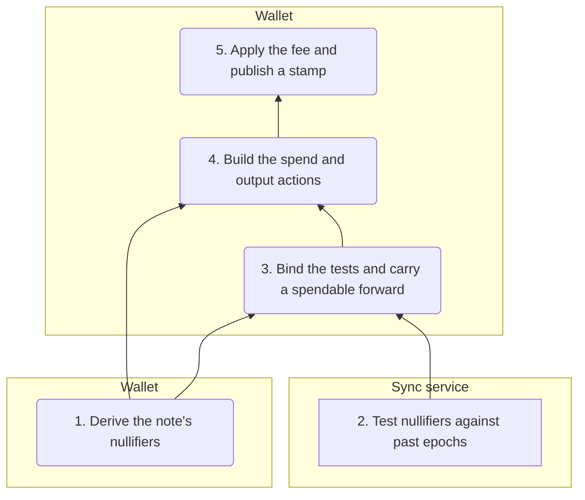
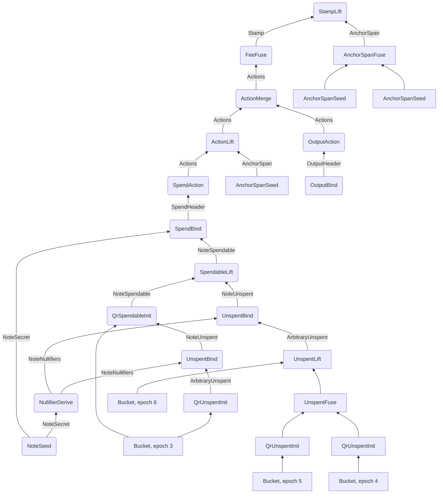

# The Proof Tree

[Chapter 2](./pcd-intro.md#_11-the-rest-of-tachyon-s-proof-tree) sketched the steps behind one spend as a small graph, and promised a closer look. [Chapter 20](./notes-and-nullifiers.md) has since built the keys, notes, and nullifiers, [chapter 21](./pool-state.md) built the anchor chain and the set polynomials, and [chapter 22](./oblivious-sync.md) built the polynomials that let a sync service test nullifiers for a wallet. This chapter puts those objects into their places. It follows one note through its whole life, step by step, and at each step says what the step takes in, what it checks, what it emits, and who runs it.

We treat the sync service's buckets as a black box, opening each one only at the values we need, and we show the segments built from them in full. Fees and stamps get the steps that produce them, and [chapter 24](./aggregation-and-bundles.md) covers the fee algebra and what aggregators and miners do with the result.

::: warning Status of this design
Tachyon has not activated on mainnet and its design is still changing. This chapter describes the [Tachyon repository](https://github.com/tachyon-zcash/tachyon/tree/7e502548db33845dbaacdc0efe905d1a3c45e626) at commit `7e50254`, and any later commit may differ. Its [shielded protocol ZIP](https://github.com/tachyon-zcash/tachyon/blob/7e502548db33845dbaacdc0efe905d1a3c45e626/book/src/zips/tachyon-shielded-protocol.md) is an empty outline, so our sources are the book's [proof tree](https://github.com/tachyon-zcash/tachyon/blob/7e502548db33845dbaacdc0efe905d1a3c45e626/book/src/proof-tree.md), [authorization](https://github.com/tachyon-zcash/tachyon/blob/7e502548db33845dbaacdc0efe905d1a3c45e626/book/src/authorization.md), and [fee](https://github.com/tachyon-zcash/tachyon/blob/7e502548db33845dbaacdc0efe905d1a3c45e626/book/src/fee.md) pages, together with the `tachyon` crate.

These steps run against a mock of Ragu. The crate [enables the `mock` feature](https://github.com/tachyon-zcash/tachyon/blob/7e502548db33845dbaacdc0efe905d1a3c45e626/crates/tachyon/Cargo.toml#L74-L76) of Ragu at `0725b52`, not at the `3219e08` of the Ragu chapters. In that revision, [the mock's `fuse`](https://github.com/tachyon-zcash/ragu/blob/0725b5244371c37e9c19a80b0f660ce11ac5f74a/src/mock/application.rs#L87-L118) runs a step's body natively, discards the recorded polynomial openings, and returns a hash record in place of a proof. It does not verify the child proofs. So when we say that a step checks something, we mean that its body at this commit checks it natively, and that the design expects a circuit to enforce the same relation. We did not find real circuits for these steps.
:::

## 1. Steps, headers, and parties

The vocabulary comes from [chapter 2](./pcd-intro.md#fusing-in-ragu). A step declares a left input header, a right input header, a witness, and an output header, and running it with Ragu's `fuse` produces a new header with a proof. An unused input is the unit header `()`, and Ragu fills it with a [bootstrap proof](./recursive-proofs.md#the-base-case-in-ragu). A step with two unit inputs starts through Ragu's `seed`, which supplies that proof for both. Here is one declaration, trimmed to the lines that matter:

```rust
impl Step for SpendBind {
    type Left = NoteSpendable;
    type Output = SpendHeader;
    type Right = NoteSecret;
    type Witness<'source> = (value::Trapdoor,);
```

This [declaration](https://github.com/tachyon-zcash/tachyon/blob/7e502548db33845dbaacdc0efe905d1a3c45e626/crates/tachyon/src/stamp/proof/spend.rs#L89-L97) says nearly everything the next sections need about a step, because the Rust types force the shape of the tree. `SpendBind` cannot accept anything except a proved `NoteSpendable` on its left and a proved `NoteSecret` on its right. The [suffix](./wiring-and-registry.md#header-types-and-suffixes) on each header type enforces this in the proof, so two types with the same fields stay distinct. Later sections build both, but in brief a `NoteSpendable` is a proved position of an unspent note on the chain of anchors, and a `NoteSecret` holds the note's private opening.

A header does not have to be public. It is visible only to whoever receives that node's data. The [`NoteSecret` header](https://github.com/tachyon-zcash/tachyon/blob/7e502548db33845dbaacdc0efe905d1a3c45e626/crates/tachyon/src/stamp/proof/delegation.rs#L31-L49) carries a full note opening and a master key, which is safe only because the wallet that built it [never hands it to anyone](https://github.com/tachyon-zcash/tachyon/blob/7e502548db33845dbaacdc0efe905d1a3c45e626/book/src/proof-tree.md?plain=1#L354). The tree therefore has private nodes low down and a public node at the top.

Three parties [run the tree](https://github.com/tachyon-zcash/tachyon/blob/7e502548db33845dbaacdc0efe905d1a3c45e626/book/src/proof-tree.md?plain=1#L6-L10). A **wallet** holds keys and note data, a **sync service** holds the nullifier values a wallet shared with it along with public pool history, and an **aggregator** merges stamps. Validators run no step and only check the final proof. The crate [registers 38 steps](https://github.com/tachyon-zcash/tachyon/blob/7e502548db33845dbaacdc0efe905d1a3c45e626/crates/tachyon/src/stamp/proof/mod.rs#L34-L75) and 16 header types, and the book's [table of steps](https://github.com/tachyon-zcash/tachyon/blob/7e502548db33845dbaacdc0efe905d1a3c45e626/book/src/proof-tree.md?plain=1#L562-L601) agrees with the code's declarations.

### The shape of the tree

Before we look at any single step, it helps to see where each one sits. A spend has to establish three kinds of fact. The note exists in the pool, it has not been spent in any epoch since it was created, and its owner authorizes the spend. The tree gathers these facts in five phases, and each phase hands a header to the next.



The wallet derives its nullifiers in Section 3. In Section 4 the sync service tests values for absence without knowing whose they are, and the wallet claims those tests for its note, which is the one place where the two branches meet, since they share no secret. Section 5 ties the note to the pool and carries it forward to the epoch of the spend. Sections 6 to 8 turn the note into actions, and Sections 9 to 11 add the fee and publish. Section 12 covers the aggregator's two steps, which act on published stamps, and Section 13 redraws the tree node by node for our running note.

## 2. The running example

We keep Alice's note from chapter 20, with value 25, created in epoch 3 and spent with target epoch 7. All of its numbers carry over, including the stand-in hash, which is SHA-256 of a tag and inputs reduced modulo 65,537. Three kinds of arithmetic appear in this chapter, and it helps to know which is which before the numbers start.

- **Hash outputs** are integers below 65,537. They stand in for Poseidon outputs.
- **Polynomials live modulo 65,539.** A batch of 16 epochs gives polynomials with one cubic factor per epoch, and those factors are built from full-sized hash values, so the polynomials cannot use the toy curve's small field. The nullifier factors of Section 3 also need a constant that has no cube root, which rules out 65,537 itself, as the next paragraph shows. [Chapter 22](./oblivious-sync.md#_7-the-real-window-size) made the same move for the same reasons.
- **Points and scalars** use the toy curve $E$, so signing keys and value commitments are real curve arithmetic, and their scalars are reduced modulo 43.

Here is why 65,537 does not work for the polynomials.

<!-- worked:fields -->

Modulo 65,537 every element is a cube, because $65537 \equiv 2 \pmod 3$ and so cubing permutes the field. The next prime congruent to 1 modulo 3 is 65,539, and there $2^{(p-1)/3} = 32641 \neq 1$, so 2 is not a cube.

<!-- /worked:fields -->

Every hash output is below 65,537, so it is also a valid element of $\F_{65539}$, and whenever one enters a polynomial we read it there unchanged. For example, the action set of Section 6 has a hash output as its only root, and the table there writes that polynomial both as $X$ minus the hash output and in the form reduced modulo 65,539. When a hash output becomes a curve scalar, such as the randomizer $\alpha$, we reduce it modulo 43 instead.

Set commitments are also a stand-in. Chapter 21 ran the Pedersen form on the toy curve, but coefficients this large do not fit the toy curve's 43 scalars. This chapter relies only on two properties of a commitment, that the same polynomial gives the same value and that a different polynomial gives a different value, so we use a hash of the coefficients, which has both properties at this scale.

Here is the pool history that the note lives through. The epochs have stamps with made-up tachygrams, and the chain follows chapter 21's folds, $H_\mathsf{st}$ for a stamp and $H_\mathsf{ep}$ for a boundary.

<!-- worked:pool -->

| Epoch | Stamps | Tachygrams | Entry anchor | Final anchor |
| --- | --- | --- | --- | --- |
| 3 | 3 | 11 | 10108 | 19102 |
| 4 | 2 | 6 | 63008 | 8359 |
| 5 | 1 | 3 | 58408 | 2572 |
| 6 | 0 | 0 | 23281 | 23281 |
| 7 | 3 | 9 | 45926 | 41305 |

<!-- /worked:pool -->

<!-- worked:pool-note -->

The second stamp of epoch 3 is Bob's, and its 5 tachygrams include Alice's commitment 55697. Epoch 6 published nothing, so its entry and final anchors are both 23281. Epoch 7 is still open. We write $a_1, a_2, a_3$ for the anchors after its three stamps, which are 58791, 25925 and 41305. In the same way, the anchor after epoch 3's first stamp, just before Bob's, is 37649, and the anchor after Bob's stamp is 62652.

<!-- /worked:pool-note -->

## 3. Deriving nullifiers

This is phase 1 on the map, and it runs entirely in the wallet. A spend must publish nullifiers that nobody can choose, and before that it must test the note's earlier nullifiers against each past epoch. Both needs start from the same secret, so the tree computes that secret once, in a private node that later steps can consume as often as they like.

### `NoteSeed`

[`NoteSeed`](https://github.com/tachyon-zcash/tachyon/blob/7e502548db33845dbaacdc0efe905d1a3c45e626/crates/tachyon/src/stamp/proof/delegation.rs#L118-L150) has two unit inputs. It witnesses the note's value and trapdoors along with the proof authorizing key $\mathsf{pak} = (\mathsf{ak}, \mathsf{nk})$, and it emits a `NoteSecret` holding $(\mathsf{cm}, \text{note}, \mathsf{mk})$.

The point of the step is the pairing. Deriving $\mathsf{pk}$ from $\mathsf{pak}$ pins $\mathsf{nk}$, so the same $\mathsf{nk}$ and $\psi$ reach both $\mathsf{mk}$ and $\mathsf{cm}$, as [chapter 20](./notes-and-nullifiers.md#_8-how-the-commitment-pins-the-nullifiers) explained. After this step, $\mathsf{nk}$ appears in no header.

<!-- worked:note-seed -->

| Quantity | Computation | Value |
| --- | --- | --- |
| witness | $v$, $\psi$, $\mathsf{rcm}$, $\mathsf{ak}$, $\mathsf{nk}$ | 25, 625, 61249, $(27,\,30)$, 40954 |
| $\mathsf{pk}$ | $H_{\texttt{PkDerive}}(27,\ 30,\ 40954)$ | 35507 |
| $\mathsf{mk}$ | $H_{\texttt{NfMaster}}(625,\ 40954)$ | 299 |
| $\mathsf{cm}$ | $H_{\texttt{CmDerive}}(\mathsf{rcm},\ \mathsf{pk},\ v,\ \psi) = H_{\texttt{CmDerive}}(61249,\ 35507,\ 25,\ 625)$ | 55697 |

<!-- /worked:note-seed -->

The code's `CmDerive` takes its inputs in the order $(\mathsf{rcm}, \mathsf{pk}, v, \psi)$, which differs from the order in which we list a note's fields. Every commitment in this chapter uses the code's order.

The step does not show that this note exists, since anyone can seed an invented note. That question closes later, when a lineage has to find $\mathsf{cm}$ in the pool.

### `NullifierDerive`

Later steps need many nullifiers at once, and they need to compare them with a sync service's work without revealing $\mathsf{mk}$. So [`NullifierDerive`](https://github.com/tachyon-zcash/tachyon/blob/7e502548db33845dbaacdc0efe905d1a3c45e626/crates/tachyon/src/stamp/proof/delegation.rs#L183-L251) takes the `NoteSecret` and derives a whole batch of [16 nullifiers](https://github.com/tachyon-zcash/tachyon/blob/7e502548db33845dbaacdc0efe905d1a3c45e626/crates/tachyon/src/nullifier/mod.rs#L9-L10) from 4 sponges. The code calls such a batch a window, but it has nothing to do with the two-epoch consensus window that validators keep, so like chapter 20 we say batch.

The batch's start epoch is a witness, and the step requires it to be a multiple of 4, so that each sponge covers one aligned group. The step then writes the start epoch onto its output, so whatever start the wallet picks, the header labels the batch honestly. The output header, `NoteNullifiers`, holds $(\mathsf{cm}, \text{first epoch}, \text{commitment}, \text{last epoch})$ and no key material. Unlike the segments of Section 4, this header stores its last epoch [inclusively](https://github.com/tachyon-zcash/tachyon/blob/7e502548db33845dbaacdc0efe905d1a3c45e626/crates/tachyon/src/stamp/proof/delegation.rs#L219-L227), as the start plus 15. For Alice's note we take the batch starting at epoch 0:

<!-- worked:batch -->

| Sponge input $w$ | $\mathsf{nf}_w$ | $\mathsf{nf}_{w+1}$ | $\mathsf{nf}_{w+2}$ | $\mathsf{nf}_{w+3}$ |
| --- | --- | --- | --- | --- |
| 0 | 19392 | 15569 | 21425 | 14090 |
| 4 | 2976 | 63093 | 59553 | 55113 |
| 8 | 61177 | 32258 | 31053 | 34200 |
| 12 | 38278 | 13189 | 16353 | 22206 |

<!-- /worked:batch -->

The commitment has to record each nullifier together with its epoch. [Chapter 22](./oblivious-sync.md#_3-testing-containment-with-polynomials) showed the double spend that bare nullifiers would allow, and it derived the encoding that the code uses for a pair $(i, m)$ of an epoch and a member, the [**indexed factor**](./oblivious-sync.md#_4-putting-the-epoch-into-the-factor)

$$F_{i,m}(X) = \big(m + (i+1)X\big)^3 - 2.$$

Two properties from that chapter matter here. The constant 2 is not a cube, so $F_{i,m}$ has no root and is irreducible. And two different pairs give different factors as long as $i + 1$ stays below $\lfloor\sqrt{p/3}\rfloor$, a bound that the code states and [chapter 22 §5](./oblivious-sync.md#_5-when-two-pairs-share-a-factor) derives. Here $i$ is the absolute epoch number, counted from the start of the chain, not a position inside the batch. Together these properties mean that one product of factors divides another exactly when its pairs are among the other's.

<!-- worked:factor-bound -->

On our field that bound is $\lfloor\sqrt{65539/3}\rfloor = 147$, so $i + 1$ must stay below 147. The epochs in this chapter run from 0 to 31, well inside it.

<!-- /worked:factor-bound -->

<!-- worked:factor -->

For epoch 3 the member is $\mathsf{nf}_3 = 14090$ and $i + 1 = 4$, so working modulo 65,539,

$$F_{3,\,14090}(X) = (14090 + 4X)^3 - 2 = 64X^{3} + 20930X^{2} + 60089X + 45458.$$

Trying all 65,539 field elements finds no root, so this cubic has no linear factor, and a cubic with no linear factor is irreducible.

<!-- /worked:factor -->

We keep chapter 22's names for the three polynomials. The wallet's batch polynomial is $N(X) = \prod_e F_{e,\,\mathsf{nf}_e}(X)$, the product of one factor per epoch in the batch. The service's polynomial is $\Delta$, and the quotient that links them is $C$, for complement. The code calls them `nf_seq`, `elapsed`, and `complement`.

`NullifierDerive` commits to $N$, and it has to show that the committed polynomial really is the product of the 16 factors it derived. Expanding the whole product inside a step would be expensive, so the step checks one evaluation instead. The prover commits to $N$ before any challenge exists, the challenge comes from a hash of that commitment, and the step compares the opening at the challenge with the product of the 16 factors evaluated there. A wrong polynomial of the same degree can agree with the true product at no more points than that degree, so a challenge chosen after the commitment almost never lands on one of them.

<!-- worked:derive-open -->

The batch polynomial has degree $3 \cdot 16 = 48$, and its stand-in commitment is 13205. The challenge derived from that commitment is $z = 18216$. The opening gives $N(18216) = 9095$, and the step gets the same value by evaluating the 16 factors directly from the sponge outputs. Suppose a prover commits instead to a polynomial with the member at epoch 5 replaced by 29467. Testing every challenge shows that this false polynomial agrees with the true product at 2 of the 65,539 points, which is within the degree bound of 48.

<!-- /worked:derive-open -->

### `NullifierFuse`

A note older than 16 epochs needs more than one batch. [`NullifierFuse`](https://github.com/tachyon-zcash/tachyon/blob/7e502548db33845dbaacdc0efe905d1a3c45e626/crates/tachyon/src/stamp/proof/delegation.rs#L276-L324) joins two batches of the same $\mathsf{cm}$. It requires the second to start one epoch after the first ends, and it checks that the combined polynomial is the product of the two.

<!-- worked:nullifier-fuse -->

The first batch covers epochs 0 to 15, both included. A second batch starting at epoch 16 passes the contiguity check, since $16 = 15 + 1$. At the challenge $z = 55334$ the product check reads $978 = 22570 \cdot 40967$ modulo 65,539. A batch starting at epoch 12 would also be group-aligned, but it would repeat four epochs, and the check rejects it because $12 \neq 15 + 1$.

<!-- /worked:nullifier-fuse -->

The contiguity check matters because an overlap would put two factors for the same epoch into the product, and the header would then label the batch wrongly. With contiguous batches, the product holds exactly one factor per epoch in its range. Our note needs only the first batch, so the rest of the run does not use this step.

::: warning Reconstructed from code at commit 7e50254, not confirmed by the authors
The step's [doc comment](https://github.com/tachyon-zcash/tachyon/blob/7e502548db33845dbaacdc0efe905d1a3c45e626/crates/tachyon/src/stamp/proof/delegation.rs#L152-L179) gives the commit-then-open argument for `NullifierDerive`, and the [`NullifierFuse` comment](https://github.com/tachyon-zcash/tachyon/blob/7e502548db33845dbaacdc0efe905d1a3c45e626/crates/tachyon/src/stamp/proof/delegation.rs#L253-L272) gives the one-member-per-epoch invariant. The false batch polynomial and the overlapping batch are our examples, checked on the stand-in field only.
:::

## 4. Testing past epochs

The derivation so far says nothing about whether the note was spent. A note carried into a later epoch has to show that it was not spent in each epoch it crosses, and this section covers phase 2 of the map and the start of phase 3, where the two branches meet.

Doing that work requires the whole epoch's tachygrams, which a wallet does not want to fetch, so the tree splits the job at a deliberate seam. A service tests values it was given without knowing whose they are, and the wallet then claims those tests for its note.

### Segments from the sync service

The service's product is an [`ArbitraryUnspent` segment](https://github.com/tachyon-zcash/tachyon/blob/7e502548db33845dbaacdc0efe905d1a3c45e626/crates/tachyon/src/stamp/proof/pool.rs#L46-L98), whose header holds $(\text{anchor start}, \text{epoch start}, \mathsf{elapsed}, \text{epoch next}, \text{anchor next})$. A segment covers whole epochs. It includes its starting epoch and the entry anchor of that epoch, and it excludes its ending epoch and anchor, which are the next epoch and that epoch's entry anchor. So two segments can meet end to start, and both ends of every segment sit on entry anchors. The field `elapsed` commits to the service's polynomial $\Delta$, which holds one indexed factor for each covered epoch. To the service each tested value is an arbitrary field element.

Chapter 22 explains how a service [tests a value against an epoch](./oblivious-sync.md#_12-testing-a-value-against-its-bucket). For this chapter one fact is enough. An opening of the epoch's contents at a value gives zero if and only if the value was published in that epoch. A real network routes tachygrams into many buckets by quadratic residue. To keep the numbers short we use one bucket per epoch holding everything, which is the depth-zero case.

<!-- worked:exclusion -->

| Epoch $e$ | Tested value $\mathsf{nf}_e$ | Bucket opened at that value | Absent |
| --- | --- | --- | --- |
| 3 | 14090 | 30223 | yes |
| 4 | 2976 | 2643 | yes |
| 5 | 63093 | 16446 | yes |
| 6 | 59553 | 1 | yes |

<!-- /worked:exclusion -->

Epoch 6 published nothing, so its bucket polynomial is the empty product, the constant 1. That polynomial is nonzero everywhere, so every value is absent from it.

Three steps build segments. [`QrUnspentInit`](https://github.com/tachyon-zcash/tachyon/blob/7e502548db33845dbaacdc0efe905d1a3c45e626/crates/tachyon/src/stamp/proof/qr.rs#L761-L775) starts one from a bucket and a value, [`UnspentFuse`](https://github.com/tachyon-zcash/tachyon/blob/7e502548db33845dbaacdc0efe905d1a3c45e626/crates/tachyon/src/stamp/proof/pool.rs#L280-L288) joins two that meet on a boundary, and [`UnspentLift`](https://github.com/tachyon-zcash/tachyon/blob/7e502548db33845dbaacdc0efe905d1a3c45e626/crates/tachyon/src/stamp/proof/pool.rs#L360-L375) appends one more epoch. [Chapter 22](./oblivious-sync.md#_13-composing-segments-and-keeping-evidence) describes how a service composes them. Here is a run for Alice's note, using all three:

<!-- worked:segments -->

| Step | Runs on | Output: anchor start, epoch start, elapsed, epoch next, anchor next |
| --- | --- | --- |
| `QrUnspentInit` | bucket of epoch 3, $\mathsf{nf}_3$ | $(10108,\ 3,\ 30057,\ 4,\ 63008)$ |
| `QrUnspentInit` | bucket of epoch 4, $\mathsf{nf}_4$ | $(63008,\ 4,\ 34607,\ 5,\ 58408)$ |
| `QrUnspentInit` | bucket of epoch 5, $\mathsf{nf}_5$ | $(58408,\ 5,\ 58805,\ 6,\ 23281)$ |
| `UnspentFuse` | the two segments above | $(63008,\ 4,\ 21136,\ 6,\ 23281)$ |
| `UnspentLift` | that segment, bucket of epoch 6, $\mathsf{nf}_6$ | $(63008,\ 4,\ 48724,\ 7,\ 45926)$ |

<!-- /worked:segments -->

<!-- worked:segments-note -->

The fuse checks that the anchors meet at 58408 and the epochs meet at 5, and then checks that the joined $\Delta$ is the product of the two inputs' polynomials at $z = 37557$, where it reads $8718 = 50038 \cdot 36200$. The lift's product check at $z = 45485$ reads $13237 = 50076 \cdot 39192$. Each segment holds plain numbers, so nothing in the table mentions a note.

<!-- /worked:segments-note -->

### `UnspentBind`

The wallet now has to show that those plain numbers really are its nullifiers, each at its own epoch. [`UnspentBind`](https://github.com/tachyon-zcash/tachyon/blob/7e502548db33845dbaacdc0efe905d1a3c45e626/crates/tachyon/src/stamp/proof/pool.rs#L495-L561) does this by division, and [chapter 22](./oblivious-sync.md#_6-a-full-run-on-the-toy-curve) ran it in full on the small field. In brief, the step takes a segment on the left and a `NoteNullifiers` on the right. It checks that its witnessed $\Delta$ and $N$ match the commitments on those two input headers, witnesses the complement $C$, and checks

$$N(X) = C(X) \cdot \Delta(X)$$

at a challenge fixed after all three commitments. Because the factors are irreducible, this identity holds only if every factor in $\Delta$ is one of the note's genuine (epoch, nullifier) pairs. A value that a cheater tests at the wrong epoch has no matching factor in $N$, which is what stops the double spend of chapter 22 §3. The step needs to compare no epoch bounds, because each factor carries its own epoch.

Last, the step writes the derivation's $\mathsf{cm}$ onto its output, a `NoteUnspent`. This is the first point at which the service's work is linked to a note.

<!-- worked:unspent-bind -->

For the segment covering epochs 4 to 6, the batch polynomial $N$ has degree 48 and the segment's $\Delta$ has degree 9. Dividing leaves remainder 0 and a complement $C$ of degree 39, which is the product of the 13 factors for epochs 0 to 3 and 7 to 15. The step checks $N = C \cdot \Delta$ at a challenge $z = 26729$, where it reads $37717 = 20861 \cdot 12666$, and outputs $(55697,\ 63008,\ 4,\ 7,\ 45926)$, whose first entry is $\mathsf{cm}$. The segment for epoch 3 binds the same way, with a complement of degree 45, and gives $(55697,\ 10108,\ 3,\ 4,\ 63008)$.

<!-- /worked:unspent-bind -->

## 5. Starting and lifting a lineage

A bound segment shows that some of the note's nullifiers are absent from some epochs. It does not yet show that the note exists, since anyone can seed an invented note, and it gives the wallet no position on the anchor chain from which a spend can proceed. The rest of phase 3 supplies both. Its result is a `NoteSpendable` header, $(\mathsf{cm}, \text{current epoch}, \text{anchor})$. We call the chain of `NoteSpendable` headers that follows one note from its creation to its spend the note's **lineage**.

[Two steps can start a lineage](https://github.com/tachyon-zcash/tachyon/blob/7e502548db33845dbaacdc0efe905d1a3c45e626/crates/tachyon/src/stamp/proof/spendable.rs#L1-L9), and they differ in where they leave it. `SpendableInit` is the simpler one and serves only a spend inside the creation epoch, so we show it first. Our running note starts with `QrSpendableInit`, which consumes the test of epoch 3 from Section 4, and `SpendableLift` then carries the lineage across the later epochs. The figure marks where each of these steps leaves the lineage, together with the two lifts of Sections 8 and 11.


### `SpendableInit`, for a spend in the creation epoch

[`SpendableInit`](https://github.com/tachyon-zcash/tachyon/blob/7e502548db33845dbaacdc0efe905d1a3c45e626/crates/tachyon/src/stamp/proof/spendable.rs#L73-L106) takes $\mathsf{cm}$ from a `NoteNullifiers` header. It witnesses the creation stamp's tachygrams, the anchor just before that stamp, and the epoch.

It makes two checks. It opens the creation stamp's set polynomial at $\mathsf{cm}$ and requires zero, which shows that the note was published in that stamp. It then folds the stamp's commitment onto the witnessed predecessor, so the output anchor is the chain state immediately after the creation stamp.

Alice's note is spent in epoch 7, so it does not take this route. The numbers below show what the step would emit if she spent the note in epoch 3.

<!-- worked:spendable-init -->

The creation polynomial gives 0 at $\mathsf{cm} = 55697$, so the membership check passes. Its commitment stands in as 47595, and the witnessed predecessor is 37649, so the step computes $H_\mathsf{st}(37649,\ 3,\ 47595) = 62652$ and emits $(\mathsf{cm}, e, \text{anchor}) = (55697,\ 3,\ 62652)$.

<!-- /worked:spendable-init -->

The predecessor and the epoch are free witnesses, which looks like a hole until we follow the anchor forward.

<!-- worked:spendable-init-wrong -->

A wrong predecessor 37650 gives 9731, and a wrong epoch 4 gives 21577. The step accepts both, since nothing in it can tell, but neither value appears in the chain.

<!-- /worked:spendable-init-wrong -->

So a wrong witness produces a valid-looking header whose anchor consensus will not recognize when the spend is published, as [chapter 21](./pool-state.md#_10-moving-a-proof-along-the-chain) explained.

This step [tests no nullifier](https://github.com/tachyon-zcash/tachyon/blob/7e502548db33845dbaacdc0efe905d1a3c45e626/crates/tachyon/src/stamp/proof/spendable.rs#L66-L69). The only stamp its position covers is the one that created the note, and a spend cannot appear in the pool before its note does. A second spend later in the creation epoch is caught by the [duplicate check of the consensus window](./pool-state.md#_11-the-consensus-window), which rejects any tachygram already published in the current or previous epoch.

A spendable from this step can spend only inside its creation epoch. It rests after a stamp, and `SpendableLift`, at the end of this section, starts only from an entry anchor.

### `QrSpendableInit`

A note that will outlive its creation epoch starts through [`QrSpendableInit`](https://github.com/tachyon-zcash/tachyon/blob/7e502548db33845dbaacdc0efe905d1a3c45e626/crates/tachyon/src/stamp/proof/spendable.rs#L132-L188). This route has to test the creation epoch itself, and it is worth seeing why the later segments are not enough.

<!-- worked:missed-spend -->

Suppose Alice had already spent the note in a later stamp of epoch 3. That spend would have published $\mathsf{nf}_3 = 14090$ and $\mathsf{nf}_4 = 2976$, and both values would sit in epoch 3's data. Now follow a second spend at epoch 7. The segment for epoch 4 tests 2976 against epoch 4's bucket only, where the opening is 2643, so it reports the value absent, and it is right, because the value went into epoch 3. The segments for epochs 5 and 6 test values that nobody published. The second spend publishes 55113 and 61177, which match neither earlier value, and the consensus window at epoch 7 holds only epochs 6 and 7 anyway. Every one of these checks passes. The only test that finds the first spend is 14090 against epoch 3 itself, where the opening of epoch 3's data, with that spend included, gives 0.

<!-- /worked:missed-spend -->

So the lineage must test $\mathsf{nf}_3$ against epoch 3, the epoch in which a spend would have published it. `QrSpendableInit` makes that test the lineage's first step.

The step takes two inputs. Its left input is the note's `NoteUnspent` for epoch 3, which shows that $\mathsf{nf}_3$ is absent from that epoch. Its right input is a sealed bucket of epoch 3.

It then makes two checks. It opens the bucket at $\mathsf{cm}$ and requires zero, which shows that the note was created in epoch 3. It also requires the segment and the bucket to cover the same range of anchors, so that the bucket's stamps are the ones consensus will eventually pin. In a real network the bucket holding $\mathsf{cm}$ and the bucket that tested $\mathsf{nf}_3$ will usually differ, and only their anchors have to agree.

The output rests on the entry anchor of the next epoch, which is what a lift needs.

<!-- worked:qr-spendable-init -->

For our note, the opening of epoch 3's bucket at 55697 gives 0, and the bound segment for epoch 3 from Section 4 has the same extent as the bucket, running from 10108 to 63008. So the step emits $(55697,\ 4,\ 63008)$, which rests on the entry anchor of epoch 4.

<!-- /worked:qr-spendable-init -->

### `SpendableLift`

[`SpendableLift`](https://github.com/tachyon-zcash/tachyon/blob/7e502548db33845dbaacdc0efe905d1a3c45e626/crates/tachyon/src/stamp/proof/spendable.rs#L214-L250) has no witness at all. It compares a `NoteSpendable` with a `NoteUnspent` in three equalities, and moves the lineage to the segment's far end.

<!-- worked:lift-checks -->

| Check | Spendable | Segment | Result |
| --- | --- | --- | --- |
| same note | $\mathsf{cm} = 55697$ | $\mathsf{cm} = 55697$ | equal |
| same epoch | $e = 4$ | epoch start $4$ | equal |
| same position | anchor 63008 | anchor start 63008 | equal |
| output | | | $(55697,\ 7,\ 45926)$ |

<!-- /worked:lift-checks -->

Each check closes a particular gap. The epoch check stops a lineage from skipping an epoch, and the anchor check welds the segment to the lineage's position. The commitment check stops the following:

<!-- worked:value-drift -->

Recall the second note from [chapter 20](./notes-and-nullifiers.md#_9-reusing-a-trapdoor) with the same $\psi$. It has the same $\mathsf{mk}$ and so the same nullifiers, which means a segment bound through its derivation tests identical values. The `cm` check still separates them. With a new $\mathsf{rcm}$ and value 9, its commitment is 53772, and 53772 $\neq$ 55697 stops the lift, so a spender cannot move absence evidence from a note worth 9 to a note worth 25, or the reverse.

<!-- /worked:value-drift -->

The anchor check is what confines a `SpendableInit` lineage to its creation epoch. The [book's maintenance section](https://github.com/tachyon-zcash/tachyon/blob/7e502548db33845dbaacdc0efe905d1a3c45e626/book/src/proof-tree.md?plain=1#L30) and the [comment on the lift](https://github.com/tachyon-zcash/tachyon/blob/7e502548db33845dbaacdc0efe905d1a3c45e626/crates/tachyon/src/stamp/proof/spendable.rs#L198-L201) both say that only a lineage resting on an entry anchor can lift.

<!-- worked:lift-rejects -->

A spendable from `SpendableInit` cannot take this route. Its anchor 62652 is the state after the creation stamp and the segment for epoch 3 starts at 10108, while the segment for epoch 4 starts at 63008. Neither matches, so the third check fails.

<!-- /worked:lift-rejects -->

One lift can consume a segment crossing [any number of epochs](https://github.com/tachyon-zcash/tachyon/blob/7e502548db33845dbaacdc0efe905d1a3c45e626/book/src/proof-tree.md?plain=1#L52), so the wallet's cost does not have to grow with the note's age, apart from the batches it derives. The lineage now certifies every epoch before 7. It says nothing about epoch 7 itself, which is left to [the consensus window](./pool-state.md#_11-the-consensus-window).

## 6. Spending

With a spendable at epoch 7, the wallet starts phase 4 of the map. A spend has to do two different things. It has to publish a nullifier pair and a value commitment, which requires the note's secrets, and it has to produce a randomized signing key tied to the note's owner, which requires $\mathsf{ak}$.

These could be one step except for a budget. The [book counts](https://github.com/tachyon-zcash/tachyon/blob/7e502548db33845dbaacdc0efe905d1a3c45e626/book/src/proof-tree.md?plain=1#L370-L378) a Poseidon permutation at about a seventh of a step and a scalar multiplication at about a quarter, so we can add up each step's work. A share above 1 does not fit, because every step runs in one circuit of fixed size, which the recursion chapters [fixed in advance](./recursive-proofs.md#_6-why-the-circuit-cannot-keep-growing) at Ragu's limit of $2^{11}$ gates.

<!-- worked:budget -->

| Step | Permutations | Scalar multiplications | Share of one step |
| --- | --- | --- | --- |
| `OutputBind` | 2 | 2 | 0.79 |
| `OutputAction` | 2 | 1 | 0.54 |
| `SpendBind` | 2 | 2 | 0.79 |
| `SpendAction` | 3 | 1 | 0.68 |

<!-- /worked:budget -->

<!-- worked:budget-note -->

Each share adds a seventh per permutation and a quarter per scalar multiplication, so for `OutputBind` it is $2 \cdot \tfrac{1}{7} + 2 \cdot \tfrac{1}{4} \approx 0.79$. Doing a spend in one step would need 5 permutations and 3 scalar multiplications, which comes to 1.46 of a step before any polynomial opening. An output would need 1.32. Splitting each action in two brings every part under 1.

<!-- /worked:budget-note -->

### `SpendBind`

[`SpendBind`](https://github.com/tachyon-zcash/tachyon/blob/7e502548db33845dbaacdc0efe905d1a3c45e626/crates/tachyon/src/stamp/proof/spend.rs#L89-L145) takes the `NoteSpendable` on its left and the same `NoteSecret` from Section 3 on its right, which is an instance of the node sharing from [chapter 2](./pcd-intro.md#_5-running-the-tree).

Its first check is that the secret's commitment equals the lineage's. Two facts were established separately up to here. The lineage showed that its note was minted and unspent, and the secret showed that its $\mathsf{mk}$ and value belong to its note. The equality says that these are the same note. A phantom note reusing $\psi$ with a larger value has a different $\mathsf{cm}$ and fails here.

The step then derives the pair from $\mathsf{mk}$ at the lineage's epoch and the next, with [one sponge each](https://github.com/tachyon-zcash/tachyon/blob/7e502548db33845dbaacdc0efe905d1a3c45e626/crates/tachyon/src/stamp/proof/spend.rs#L85), and [requires both to be nonzero](https://github.com/tachyon-zcash/tachyon/blob/7e502548db33845dbaacdc0efe905d1a3c45e626/crates/tachyon/src/stamp/proof/spend.rs#L126-L131). The code reserves zero because two zero tachygrams would collide whatever they stood for. Last, it commits the value. The value commitment follows the [book's formula](https://github.com/tachyon-zcash/tachyon/blob/7e502548db33845dbaacdc0efe905d1a3c45e626/book/src/authorization.md?plain=1#L122),

$$\mathsf{cv} = [v]\mathcal{V} + [\mathsf{rcv}]\mathcal{R},$$

with $v$ positive for a spend and negative for an output, and a fresh random trapdoor $\mathsf{rcv}$. A [book footnote](https://github.com/tachyon-zcash/tachyon/blob/7e502548db33845dbaacdc0efe905d1a3c45e626/book/src/authorization.md?plain=1#L126) says that this sampling may later change.

<!-- worked:value-gens -->

On the toy curve we take $\mathcal{V} = (6,\,8)$ and $\mathcal{R} = (11,\,1)$. This chapter is the first to commit a value, so this pair is the shared toy pair for value commitments, and later chapters reuse it.

<!-- /worked:value-gens -->

<!-- worked:spend-bind -->

| Output field | Source | Value |
| --- | --- | --- |
| $\mathsf{cm}$ | spendable, checked equal to the secret's | 55697 |
| $\mathsf{nf}_\text{current}$ | $\mathsf{mk} = 299$ at epoch 7 | 55113 |
| $\mathsf{nf}_\text{next}$ | $\mathsf{mk} = 299$ at epoch 8 | 61177 |
| anchor | spendable | 45926 |
| $\mathsf{pk}$ | the secret's note | 35507 |
| $\mathsf{cv}$ | $[v]\mathcal{V} + [\mathsf{rcv}]\mathcal{R}$ with $v = 25$ and a fresh $\mathsf{rcv} = 38$, so $[25]\mathcal{V} + [38]\mathcal{R}$ | $(30,\,8)$ |

<!-- /worked:spend-bind -->

Nothing in the pair is a witness. [Chapter 20](./notes-and-nullifiers.md#_10-why-a-spend-publishes-two-nullifiers) explained why a spend publishes two nullifiers.

### `SpendAction`

[`SpendAction`](https://github.com/tachyon-zcash/tachyon/blob/7e502548db33845dbaacdc0efe905d1a3c45e626/crates/tachyon/src/stamp/proof/stamp.rs#L180-L240) takes the `SpendHeader` from `SpendBind`. It witnesses the action entropy $\theta$, the key $\mathsf{pak}$, and two set polynomials.

Its first check [requires $\mathsf{pak}$ to derive the header's $\mathsf{pk}$](https://github.com/tachyon-zcash/tachyon/blob/7e502548db33845dbaacdc0efe905d1a3c45e626/crates/tachyon/src/stamp/proof/stamp.rs#L202-L205). This check is the only thing that ties $\mathsf{ak}$ to the note, because `SpendBind` never saw $\mathsf{ak}$.

The step then derives $\alpha$ and $\mathsf{rk}$ as in [chapter 20](./notes-and-nullifiers.md#_5-randomizing-the-signing-key-for-each-action), and it hashes $(\mathsf{cv}, \mathsf{rk})$ into an action digest.

Last, it builds the stamp's first two sets, using the root polynomials of chapter 21. The action set has one root, the digest, and the tachygram set has two, the nullifier pair. A relation called [`enforce_poly_roots`](https://github.com/tachyon-zcash/tachyon/blob/7e502548db33845dbaacdc0efe905d1a3c45e626/crates/tachyon/src/relations/enforce.rs#L108-L120) checks each witnessed polynomial against its roots. It opens the polynomial at a challenge derived from its commitment, and compares the opening with the product of $(z - \text{root})$.

<!-- worked:spend-action -->

| Quantity | Computation | Value |
| --- | --- | --- |
| check on $\mathsf{pak}$ | $H_{\texttt{PkDerive}}(27,\ 30,\ 40954)$ against the header | 35507 matches |
| $\alpha$ | $H_{\texttt{Spend}}(\theta,\ \mathsf{cm}) = H_{\texttt{Spend}}(4071,\ 55697)$, reduced mod 43 | 23 |
| $\mathsf{rk}$ | $\mathsf{ak} + [23]\mathcal{G}$ | $(24,\,30)$ |
| action digest $d$ | $H_{\texttt{ActionDg}}(\mathsf{cv},\ \mathsf{rk})$ | 52188 |
| action set | $X - 52188$, as $X + 13351$ | committed as 63623 |
| tachygram set | $(X - 55113)(X - 61177)$, as $X^{2} + 14788X + 59685$ | committed as 49309 |

<!-- /worked:spend-action -->

<!-- worked:pak-reject -->

A prover who holds a different spend validating key $(14,\,22)$, together with the right $\mathsf{nk}$, computes 61293 in place of 35507, and the first row fails.

<!-- /worked:pak-reject -->

The output header type is `Actions`, $(\text{action commit}, \text{tachygram commit}, \text{anchor})$. Notice what it drops. The commitment $\mathsf{cm}$, the key $\mathsf{pk}$, and the epoch do not appear, and neither does anything recording the note's age. The [book points out](https://github.com/tachyon-zcash/tachyon/blob/7e502548db33845dbaacdc0efe905d1a3c45e626/book/src/proof-tree.md?plain=1#L360) that the published pair sits at the epochs of the live range, whatever the note's age, so no later step reads a position that would reveal how long the note has existed.

## 7. Outputs

Phase 4 also covers outputs. Creating a note needs no lineage, since nothing about the past has to be shown. It still has to look like a spend to an observer, so it also takes two steps and ends in the same header type.

[`OutputBind`](https://github.com/tachyon-zcash/tachyon/blob/7e502548db33845dbaacdc0efe905d1a3c45e626/crates/tachyon/src/stamp/proof/output.rs#L53-L96) has unit inputs and witnesses the new note and $\mathsf{rcv}$. From the same note fields $(\mathsf{pk}, v, \psi, \mathsf{rcm})$ it derives two values, the commitment and a padding tachygram, so that an output publishes two tachygrams like a spend. It [requires both to be nonzero](https://github.com/tachyon-zcash/tachyon/blob/7e502548db33845dbaacdc0efe905d1a3c45e626/crates/tachyon/src/stamp/proof/output.rs#L89-L92) for the same reason as `SpendBind`. It then commits the negated value.

[`OutputAction`](https://github.com/tachyon-zcash/tachyon/blob/7e502548db33845dbaacdc0efe905d1a3c45e626/crates/tachyon/src/stamp/proof/stamp.rs#L107-L158) derives $\alpha$ under the `Tachyon-Output` domain, sets $\mathsf{rk} = [\alpha]\mathcal{G}$, and builds the two sets. It witnesses no key. The recipient's payment key [rides inside $\mathsf{cm}$](https://github.com/tachyon-zcash/tachyon/blob/7e502548db33845dbaacdc0efe905d1a3c45e626/book/src/proof-tree.md?plain=1#L367), and the sender cannot be asked to prove anything about a key it does not hold.

Suppose Alice pays 18 zatoshi to Carol:

<!-- worked:output -->

| Step | Quantity | Computation | Value |
| --- | --- | --- | --- |
| `OutputBind` | witness | $\mathsf{pk}_\text{Carol}$, $v$, $\psi$, $\mathsf{rcm}$, $\mathsf{rcv}$ | 17495, 18, 43263, 37299, 34 |
| `OutputBind` | $\mathsf{cm}$ | $H_{\texttt{CmDerive}}(\mathsf{rcm},\ \mathsf{pk}_\text{Carol},\ v,\ \psi) = H_{\texttt{CmDerive}}(37299,\ 17495,\ 18,\ 43263)$ | 36798 |
| `OutputBind` | pad | $H_{\texttt{CmOutPad}}$ on the same four inputs in the same order | 56347 |
| `OutputBind` | $\mathsf{cv}$ | $[-v]\mathcal{V} + [\mathsf{rcv}]\mathcal{R} = [-18]\mathcal{V} + [34]\mathcal{R}$ | $(17,\,7)$ |
| `OutputAction` | witness | $\theta$ | 51472 |
| `OutputAction` | $\alpha$ | $H_{\texttt{Output}}(\theta,\ \mathsf{cm}) = H_{\texttt{Output}}(51472,\ 36798)$, reduced mod 43 | 17 |
| `OutputAction` | $\mathsf{rk}$ | $[17]\mathcal{G}$ | $(20,\,6)$ |
| `OutputAction` | digest $d$ | $H_{\texttt{ActionDg}}(\mathsf{cv},\ \mathsf{rk})$ | 40891 |

<!-- /worked:output -->

The anchor in `OutputAction` is a free witness, because an output has no chain state to thread. The wallet [usually gives it the same anchor](https://github.com/tachyon-zcash/tachyon/blob/7e502548db33845dbaacdc0efe905d1a3c45e626/book/src/proof-tree.md?plain=1#L68) as its spends, so that the merge in the next section needs no lift. So both action types publish a $\mathsf{cv}$, an $\mathsf{rk}$, a signature, and two tachygrams, and [chapter 20](./notes-and-nullifiers.md#_11-tachygrams-and-output-padding) showed why the counts reveal nothing about the split.

## 8. Moving and merging actions

The last part of phase 4 brings the actions together. A transaction with several actions needs them combined into one `Actions` node, and combining requires a shared anchor, because the output header has a single anchor field. In our run the spend's actions rest on the entry anchor of epoch 7, which consensus may not accept as a published anchor. Under the anchor page's rule, an entry anchor counts as an [end-of-block state](./pool-state.md#_8-end-of-block-anchors) only if the first block of its epoch carries no stamp, and a wallet [would rather sit near the latest anchor](https://github.com/tachyon-zcash/tachyon/blob/7e502548db33845dbaacdc0efe905d1a3c45e626/book/src/proof-tree.md?plain=1#L76) in any case. The wallet therefore chooses an anchor for the bundle and moves the spend there.

[`ActionLift`](https://github.com/tachyon-zcash/tachyon/blob/7e502548db33845dbaacdc0efe905d1a3c45e626/crates/tachyon/src/stamp/proof/stamp.rs#L475-L516) does the move. Its left input is the `Actions` and its right input is an [`AnchorSpan`](./pool-state.md#_10-moving-a-proof-along-the-chain), the proved run of anchors from chapter 21. It applies chapter 21's membership check $M(a) \cdot (a - \text{start}) = 0$, which accepts an anchor that is the span's start or one of its members, and it outputs the span's end.

<!-- worked:action-lift -->

Here the spend's actions rest on the entry anchor of epoch 7, 45926, and the wallet plans to anchor its bundle at $a_1 = 58791$. The span from 45926 to 58791 has the members polynomial $M(X) = X - 58791$. The check $M(a) \cdot (a - \text{start})$ evaluates to $(45926 - 58791) \cdot 0 = 0$, so the lift outputs the same sets at anchor 58791. An anchor from before the span, such as 23281, gives 25959, and the step rejects it.

<!-- /worked:action-lift -->

Chapter 21's restriction applies here. A span runs within one epoch, because no span contains a boundary digest. A wallet moves a note across an epoch with `SpendableLift`, before the spend, and moves its actions within the epoch with `ActionLift`, after it.

[`ActionMerge`](https://github.com/tachyon-zcash/tachyon/blob/7e502548db33845dbaacdc0efe905d1a3c45e626/crates/tachyon/src/stamp/proof/stamp.rs#L331-L410) then takes two `Actions` headers and requires their anchors to be equal. It witnesses four input polynomials, two sets from each side, and checks that they match the four commitments on the input headers.

The merged sets are the [union of chapter 21](./pool-state.md#_4-combining-and-dividing-sets), so each merged polynomial must be the product of its two inputs. The step checks this with [`enforce_poly_product`](https://github.com/tachyon-zcash/tachyon/blob/7e502548db33845dbaacdc0efe905d1a3c45e626/crates/tachyon/src/relations/enforce.rs#L62-L84). That relation absorbs all three commitments into the challenge, so the polynomials are fixed before the challenge exists.

<!-- worked:merge -->

Both inputs now sit at anchor 58791, so the anchor check passes. The merged action set has the roots 52188 and 40891, and at $z = 61893$ its check reads $63659 = 9705 \cdot 21002$. The merged tachygram set has the roots 55113, 61177, 36798 and 56347, and at $z = 11199$ its check reads $26949 = 29399 \cdot 28926$. The output header is $(51068,\ 37081,\ 58791)$.

<!-- /worked:merge -->

The code's [`Plan::prove`](https://github.com/tachyon-zcash/tachyon/blob/7e502548db33845dbaacdc0efe905d1a3c45e626/crates/tachyon/src/stamp/mod.rs#L484-L700) follows this order. It binds and acts on each spend, lifts it along any spans to the plan's anchor, proves each output at that anchor, and merges everything.

## 9. Applying the fee

Phase 5 of the map starts here. An `Actions` header cannot be published, because validators accept only a `Stamp`. The step between them applies the fee.

The design wants a particular freedom at this point. [A wallet signs a maximum fee once](https://github.com/tachyon-zcash/tachyon/blob/7e502548db33845dbaacdc0efe905d1a3c45e626/book/src/fee.md?plain=1#L3-L5) and chooses the actual fee later, at or below that maximum, so changing the fee needs no further trip to a signing device. To make this work, the bundle carries a **max fee note**, an opening $(\mathsf{pk}, \mathsf{maxfee}, \psi, \mathsf{rcm})$ that is never spent and is published only as a value commitment

$$\mathsf{cv}_\text{maxfee} = [-\mathsf{maxfee}]\mathcal{V} + [r]\mathcal{R},$$

whose blind $r$ is a hash of $\mathsf{pk}$, $\psi$, and $\mathsf{rcm}$. The value enters with a minus sign, like an output's, because the bundle reserves it to pay out. When the fee is chosen, the unused part returns as a **fee change note** worth $\mathsf{maxfee} - \text{fee}$, with the same other fields. [Chapter 24](./aggregation-and-bundles.md#_3-fees-chosen-after-signing) explains why these two notes have this shape and how they keep the signed balance valid at any fee. Here we need only the step that uses them.

[`FeeFuse`](https://github.com/tachyon-zcash/tachyon/blob/7e502548db33845dbaacdc0efe905d1a3c45e626/crates/tachyon/src/stamp/proof/stamp.rs#L523-L645) takes `Actions` on the left, and its right input is the unit header, as in Section 1. It witnesses the max fee note, the fee, and the set polynomials.

It rederives $r$ and $\mathsf{cv}_\text{maxfee}$ from the note, so the commitment the wallet signed is the one the proof uses. It checks that the change $\mathsf{maxfee} - \text{fee}$ lies in range, which keeps field arithmetic from wrapping around. It computes a fee digest from $\mathsf{cv}_\text{maxfee}$ and the fee, and the commitment of the change note.

Last, it multiplies each set by one more factor, the fee digest into the action set and the change commitment into the tachygram set. The output type is `Stamp`, which has the same fields as `Actions` and a different suffix.

<!-- worked:fee-setup -->

Alice's bundle spends 25 and creates an output of 18. She reserves a maximum fee of 5, which leaves a value balance of $v^{\mathsf{bal}} = 25 - 18 - 5 = 2$. We let those 2 zatoshi leave the shielded pool, for example to a transparent output in the same transaction. That is a choice made for the example, and a balance of zero would work the same way. The max fee note has the opening $(\mathsf{pk}, \mathsf{maxfee}, \psi, \mathsf{rcm}) = (35507,\ 5,\ 60800,\ 61996)$. Its $\mathsf{pk}$ is Alice's own payment key, so the change note that inherits it returns the unused fee to her.

<!-- /worked:fee-setup -->

<!-- worked:fee-fuse -->

| Quantity | Computation | Value |
| --- | --- | --- |
| $r$ | $H_{\texttt{FeeBlind}}(35507,\ 60800,\ 61996) = 62558$, reduced mod 43 | 36 |
| $\mathsf{cv}_\text{maxfee}$ | $[-5]\mathcal{V} + [36]\mathcal{R}$ | $(16,\,21)$ |
| fee | chosen by the wallet, at most 5 | 3 |
| fee digest | $H_{\texttt{FeeDg}}(16,\ 21,\ 3)$ | 3423 |
| change note value | $5 - 3$ | 2 |
| change commitment | $H_{\texttt{CmDerive}}(61996,\ 35507,\ 2,\ 60800)$ | 57384 |
| output action set | three roots: 52188, 40891, 3423 | committed as 11619 |
| output tachygram set | five roots, two per action and the change commitment | committed as 35000 |

<!-- /worked:fee-fuse -->

The change in type is what makes the fee happen exactly once. `FeeFuse` [accepts only `Actions`](https://github.com/tachyon-zcash/tachyon/blob/7e502548db33845dbaacdc0efe905d1a3c45e626/book/src/fee.md?plain=1#L136-L137) and emits a `Stamp`, so a second application has no valid input. [Chapter 15's `Charge` example](./wiring-and-registry.md#header-types-and-suffixes) showed the same idea in miniature.

A bundle with no actions has nothing to fuse, so a second step starts a `Stamp` directly. [`FeeSeed`](https://github.com/tachyon-zcash/tachyon/blob/7e502548db33845dbaacdc0efe905d1a3c45e626/crates/tachyon/src/stamp/proof/stamp.rs#L651-L720) has unit inputs and requires a zero maximum fee, so the change note is the max fee note itself, and it witnesses its anchor. Aggregators use it for an [innocent aggregate](./aggregation-and-bundles.md#_1-what-aggregation-removes-and-what-it-keeps), which is a bundle with no actions of its own that carries other bundles' merged stamps.

Choosing a different fee reruns `FeeFuse` and nothing else.

<!-- worked:fee-change -->

If the wallet raises the fee to 4, the fee digest becomes 26792 and the change note, now worth 1, has the commitment 44424. So both set commitments change, to 32475 and 55453, and `FeeFuse` has to run again.

<!-- /worked:fee-change -->

The signatures are a different matter. Neither the signed data nor the key that the binding signature checks mentions the fee, so both stay valid. [Chapter 24](./aggregation-and-bundles.md#choosing-the-fee) checks this on its bundle Y, which uses the same $\mathcal{V}$ and $\mathcal{R}$, by proving it at three fees and finding the same bundle commitment each time.

These steps [prove a local relation](https://github.com/tachyon-zcash/tachyon/blob/7e502548db33845dbaacdc0efe905d1a3c45e626/book/src/fee.md?plain=1#L112-L114), which is that the change and the digest match the opening. They do not show that the fee is funded. That comes from outside the proof, in the next section.

## 10. Authorization outside the proof

A bundle also needs authorization that the proof does not provide. The [authorization page](https://github.com/tachyon-zcash/tachyon/blob/7e502548db33845dbaacdc0efe905d1a3c45e626/book/src/authorization.md?plain=1#L3) lists three layers, namely per-action signatures, value commitments, and a binding signature, and each covers a gap that the proof leaves open.

### Action signatures

The proof shows that $\mathsf{rk}$ equals $\mathsf{ak} + [\alpha]\mathcal{G}$ for the $\mathsf{ak}$ behind the note's payment key. A prover holding only $\mathsf{pak}$ can produce that proof, so the proof alone does not show that the owner agreed. Spending therefore also needs a signature under $\mathsf{rk}$, which requires the secret key $\mathsf{rsk} = \mathsf{ask} + \alpha$ and so requires $\mathsf{ask}$.

This is what separates a proving device from a custody device. The [custody device](https://github.com/tachyon-zcash/tachyon/blob/7e502548db33845dbaacdc0efe905d1a3c45e626/book/src/authorization.md?plain=1#L10) receives each note and $\theta$, recomputes $\mathsf{cm}$, $\alpha$, and $\mathsf{rk}$ for itself, and signs. Chapter 20 ran this signature on the same $\mathsf{rk}$. An output's $\mathsf{rsk}$ is $\alpha$, so no custody is needed there.

Each signature covers the transaction [sighash](https://github.com/tachyon-zcash/tachyon/blob/7e502548db33845dbaacdc0efe905d1a3c45e626/book/src/authorization.md?plain=1#L109-L114). That hash includes a [bundle commitment](https://github.com/tachyon-zcash/tachyon/blob/7e502548db33845dbaacdc0efe905d1a3c45e626/book/src/authorization.md?plain=1#L78-L96) over the actions, the value balance, $\mathsf{cv}_\text{maxfee}$, and the memo. The fee is not included, and neither is the stamp, since aggregation strips it.

A signature also binds its action to the note, even though the action shows no tachygram. The reason is that $\alpha$ is derived from $\mathsf{cm}$ inside the proof, so $\mathsf{rk}$ depends on $\mathsf{cm}$ through $\alpha$, and a signature under $\mathsf{rk}$ cannot be moved to an action for a different note.

### The binding signature

No step adds up values, so the proof cannot show that a bundle balances. Value commitments let validators check it from public data instead. A validator adds every action's $\mathsf{cv}$ and $\mathsf{cv}_\text{maxfee}$, and subtracts the public value balance, which gives a key

$$\mathsf{bvk} = \sum_i \mathsf{cv}_i + \mathsf{cv}_\text{maxfee} - [v^{\mathsf{bal}}]\mathcal{V}.$$

When the values balance, the $\mathcal{V}$ terms cancel and $\mathsf{bvk} = [\mathsf{bsk}]\mathcal{R}$, where $\mathsf{bsk}$ is the sum of all the blinds. Only the wallet that planned the bundle knows all those blinds, and its [binding signature](https://github.com/tachyon-zcash/tachyon/blob/7e502548db33845dbaacdc0efe905d1a3c45e626/crates/tachyon/src/bundle/mod.rs#L250-L262) under $\mathsf{bsk}$ shows that the two agree.

<!-- worked:binding-cancel -->

In Alice's bundle the $\mathcal{V}$ coefficients are 25 from the spend, $-18$ from the output, $-5$ from $\mathsf{cv}_\text{maxfee}$, and $-2$ from subtracting the value balance, and $25 - 18 - 5 - 2 = 0$. The $\mathcal{R}$ coefficients are the three blinds, so collecting terms gives $\mathsf{bvk} = [0]\mathcal{V} + [38 + 34 + 36]\mathcal{R}$.

<!-- /worked:binding-cancel -->

<!-- worked:binding -->

For Alice's bundle the validator adds $\mathsf{cv}$ of the spend, $\mathsf{cv}$ of the output, and $\mathsf{cv}_\text{maxfee}$, which gives $(18,\,21)$, and subtracts $[2]\mathcal{V}$ to reach $\mathsf{bvk} = (28,\,21)$. The planner's key is $\mathsf{bsk} = 38 + 34 + 36 = 22$ modulo 43, and $[22]\mathcal{R} = (28,\,21)$, so the two agree.

<!-- /worked:binding -->

[Chapter 24](./aggregation-and-bundles.md#the-binding-signature) expands this sum step by step, shows that a false balance leaves a $\mathcal{V}$ term that only a discrete log could remove, and follows the fee into the transaction's accounting.

::: warning Book and code: what shows the balance
**Bundle page:** it lists among the things [the proof establishes](https://github.com/tachyon-zcash/tachyon/blob/7e502548db33845dbaacdc0efe905d1a3c45e626/book/src/bundle.md?plain=1#L47-L51) that "action balance effect matches pool balance effect."

**Fee page, authorization page, and code at `7e50254`:** the [fee steps prove no funding](https://github.com/tachyon-zcash/tachyon/blob/7e502548db33845dbaacdc0efe905d1a3c45e626/book/src/fee.md?plain=1#L112-L114), and no step sums $\mathsf{cv}$ values. Validators [derive $\mathsf{bvk}$](https://github.com/tachyon-zcash/tachyon/blob/7e502548db33845dbaacdc0efe905d1a3c45e626/crates/tachyon/src/keys/public.rs#L122-L129) from public data and check the signature. The proof contributes something narrower, which is that each $\mathsf{cv}$ commits to the value of the note behind it.

This site follows the code. Separately, the authorization page's [detailed sequence diagram](https://github.com/tachyon-zcash/tachyon/blob/7e502548db33845dbaacdc0efe905d1a3c45e626/book/src/authorization.md?plain=1#L266) carries a comment calling itself significantly outdated. It hashes the commitment's inputs in a different order from the [code](https://github.com/tachyon-zcash/tachyon/blob/7e502548db33845dbaacdc0efe905d1a3c45e626/crates/tachyon/src/stamp/proof/output.rs#L76-L87), and it gives an output one tachygram rather than two. We use the code's forms.
:::

## 11. Publishing a stamp

Phase 5 ends with publication. Stamps keep arriving while a wallet proves, so it [may lift again](https://github.com/tachyon-zcash/tachyon/blob/7e502548db33845dbaacdc0efe905d1a3c45e626/book/src/proof-tree.md?plain=1#L76-L81) before publishing. [`StampLift`](https://github.com/tachyon-zcash/tachyon/blob/7e502548db33845dbaacdc0efe905d1a3c45e626/crates/tachyon/src/stamp/proof/stamp.rs#L433-L466) has the same check as `ActionLift` on the other header type. For the span it consumes, the book says that ["consensus and sync services publish spans as an epoch progresses"](https://github.com/tachyon-zcash/tachyon/blob/7e502548db33845dbaacdc0efe905d1a3c45e626/book/src/proof-tree.md?plain=1#L79), and its [roles table](https://github.com/tachyon-zcash/tachyon/blob/7e502548db33845dbaacdc0efe905d1a3c45e626/book/src/proof-tree.md?plain=1#L115-L116) lists an aggregator and a sync service as builders of spans, with a wallet as a possible one.

<!-- worked:stamp-lift -->

Stamps have landed since the wallet chose $a_1$, so it lifts along a span from $a_1 = 58791$ to $a_3 = 41305$. Two `AnchorSpanSeed` steps and one `AnchorSpanFuse` build the span, whose members polynomial has roots 25925 and 41305. The stamp's anchor 58791 is the span's start, so the product $M(58791) \cdot 0$ vanishes although $M(58791) = 48924$, and the output anchor is 41305.

<!-- /worked:stamp-lift -->

A validator has to check the proof against a header, and the published bundle [does not carry the action commitment](https://github.com/tachyon-zcash/tachyon/blob/7e502548db33845dbaacdc0efe905d1a3c45e626/book/src/fee.md?plain=1#L120-L123), so the validator first [rebuilds the header](https://github.com/tachyon-zcash/tachyon/blob/7e502548db33845dbaacdc0efe905d1a3c45e626/crates/tachyon/src/bundle/mod.rs#L822-L858) from what it can see. That is the comparison that [chapter 2](./pcd-intro.md#_6-attaching-a-proof) required of every verifier. The validator sees the published tachygrams, each action's published $(\mathsf{cv}, \mathsf{rk})$, which is its **action descriptor** as [chapter 2](./pcd-intro.md#the-stamp-header) defined it, the fee descriptor $(\mathsf{cv}_\text{maxfee}, \text{fee})$, and the anchor.

Two rules turn this data into a header. First, the validator counts the published tachygrams and requires two per action plus one, because every action publishes a pair and `FeeFuse` adds the change commitment. Second, it rehashes each action descriptor into the same digest that `SpendAction` and `OutputAction` built, and the fee descriptor into the fee digest of Section 9, and it rebuilds both sets from those values. Here is what happens with Alice's bundle:

<!-- worked:validate -->

| Validator step | Computation | Result |
| --- | --- | --- |
| signatures | action signatures under each $\mathsf{rk}$, binding under $\mathsf{bvk}$ | accepted |
| tachygram count | $5 = 2 \cdot 2 + 1$ for 2 actions | accepted |
| tachygram set | rebuild from the 5 published values | 35000, matches the stamp |
| action set | hash the 2 action descriptors and the fee descriptor, rebuild | 11619, matches the stamp |
| proof | verify against $(11619,\ 35000,\ 41305)$ | accepted, in the design |
| anchor | look up 41305 in the chain | found, in epoch 7 |

<!-- /worked:validate -->

The crate's verification stops short of the chain, so the anchor row follows [the book](https://github.com/tachyon-zcash/tachyon/blob/7e502548db33845dbaacdc0efe905d1a3c45e626/book/src/proof-tree.md?plain=1#L83-L84) and [chapter 21](./pool-state.md#_11-the-consensus-window). The proof row says "in the design" because a mock cannot really perform it.

<!-- worked:validate-note -->

If a miner dropped the output's descriptor, the validator would rebuild the action commitment as 32339 instead of 11619. The header would then differ from the one the proof covers, so the proof would fail.

<!-- /worked:validate-note -->

Once the anchor checks out, it closes the free witnesses below it, as chapter 21 argued. Two kinds of free witness depend on this. `SpendableInit` takes its predecessor anchor and its epoch on trust, as Section 5 showed, and each bucket that the sync service seals takes its starting anchor on trust, as [chapter 22](./oblivious-sync.md#_11-routing-an-epoch-into-buckets) describes. Each of these values is folded into the anchors that later steps compute. If any of them had been false, the folds would have reached a value that appears nowhere in the chain, as the wrong predecessor and the wrong epoch of Section 5 did, and the lookup would fail. The output's free anchor closes the same way, because the merge forced it to equal the spend's.

### Rerandomizing before release

A proof built from private inputs could reveal a link back to them. So the book requires that [every proof leaving the process that built it](https://github.com/tachyon-zcash/tachyon/blob/7e502548db33845dbaacdc0efe905d1a3c45e626/book/src/proof-tree.md?plain=1#L397-L403) be rerandomized, while intermediate nodes that stay in the wallet skip it. The code at `7e50254` calls `rerandomize` only where a stamp is released, at the end of [`Plan::prove`](https://github.com/tachyon-zcash/tachyon/blob/7e502548db33845dbaacdc0efe905d1a3c45e626/crates/tachyon/src/stamp/mod.rs#L684-L687), [`lift`](https://github.com/tachyon-zcash/tachyon/blob/7e502548db33845dbaacdc0efe905d1a3c45e626/crates/tachyon/src/stamp/mod.rs#L1005-L1009), [`merge`](https://github.com/tachyon-zcash/tachyon/blob/7e502548db33845dbaacdc0efe905d1a3c45e626/crates/tachyon/src/stamp/mod.rs#L1126-L1127), and [`unmerge`](https://github.com/tachyon-zcash/tachyon/blob/7e502548db33845dbaacdc0efe905d1a3c45e626/crates/tachyon/src/stamp/mod.rs#L1249-L1250).

::: warning Sources disagree: what rerandomizing achieves
**Tachyon book:** rerandomizing [replaces the proof with an unrelated one](https://github.com/tachyon-zcash/tachyon/blob/7e502548db33845dbaacdc0efe905d1a3c45e626/book/src/proof-tree.md?plain=1#L401) that verifies against the same header, so the released proof has no correlation with its private lineage.

**Ragu code at `3219e08`:** a [comment on `rerandomize`](https://github.com/tachyon-zcash/ragu/blob/3219e0865e8bff1f9d817bfe3850d9e94b64338c/crates/ragu_pcd/src/lib.rs#L717-L724) says that unlinkability is the intent, that today it is not achieved, and that the remaining work is in the future.

**Mock at `0725b52`:** [`rerandomize`](https://github.com/tachyon-zcash/ragu/blob/0725b5244371c37e9c19a80b0f660ce11ac5f74a/src/mock/proof.rs#L137-L147) fills in a tag and keeps the rest of the record.

**Segments:** the book's rule covers every proof that leaves the process that built it, and its [roles section](https://github.com/tachyon-zcash/tachyon/blob/7e502548db33845dbaacdc0efe905d1a3c45e626/book/src/proof-tree.md?plain=1#L108) has the service hand each `ArbitraryUnspent` segment to the wallet. Yet the [rerandomization passage](https://github.com/tachyon-zcash/tachyon/blob/7e502548db33845dbaacdc0efe905d1a3c45e626/book/src/proof-tree.md?plain=1#L403) lists a segment among the proofs that stay inside a wallet, and the code has no call that rerandomizes a segment. We read the service's segments as released without it.

As in [chapter 2](./pcd-intro.md#proof-size-and-hiding-in-ragu), this site treats hiding as a goal that has not yet been met. When this chapter says a header drops a value, it means only that the header no longer carries it. It does not mean that the proof conceals it.
:::

## 12. The aggregator's steps

The map ends at a published stamp, but the tree can keep growing above it. Once published, stamps can be combined by anyone holding them. [Chapter 2](./pcd-intro.md#_10-aggregation-as-proof-carrying-data) followed this at the level of whole bundles. Two steps do the work, and we name them here so that the roster in Section 13 is complete.

[`StampMerge`](https://github.com/tachyon-zcash/tachyon/blob/7e502548db33845dbaacdc0efe905d1a3c45e626/crates/tachyon/src/stamp/proof/stamp.rs#L246-L325) has the same body as `ActionMerge`, applied to two stamps, so Section 8's product check is also its check. [`StampUnmerge`](https://github.com/tachyon-zcash/tachyon/blob/7e502548db33845dbaacdc0efe905d1a3c45e626/crates/tachyon/src/stamp/proof/stamp.rs#L763-L839) runs the other way. It witnesses a quotient and requires the merged stamp's polynomial to equal the divisor times that quotient, in both sets, which removes one stamp's contents from an aggregate.

Aggregators need no secret, since these steps read only commitments and the polynomials rebuilt from published values, and the aggregated stamp has the same shape as any other stamp. [Chapter 24](./aggregation-and-bundles.md#_5-merging-stamps) runs both steps on example stamps and follows what aggregators and miners do with them.

## 13. The whole tree

Here is the run, with each node labelled by the party that runs it. It fills in the map of Section 1. Rounded boxes belong to the wallet and square boxes to the sync service. Buckets appear as inputs, and chapter 22 opens them.



<!-- worked:node-count -->

Counting only what the graph shows, this one spend and one output take 23 nodes, of which the wallet runs 14 and the sync service 9. The buckets add more, on the service side, and chapter 22 describes the steps that build them. The published result is one proof, whose header a validator can rebuild.

<!-- /worked:node-count -->

::: warning Reconstructed from code at commit 7e50254, not confirmed by the authors
The book draws a [similar tree](https://github.com/tachyon-zcash/tachyon/blob/7e502548db33845dbaacdc0efe905d1a3c45e626/book/src/proof-tree.md?plain=1#L405-L479), and the crate's test helper [`spendable_at`](https://github.com/tachyon-zcash/tachyon/blob/7e502548db33845dbaacdc0efe905d1a3c45e626/crates/tachyon/tests/integration/fixtures.rs#L1557-L1580) takes the same route to a spendable. The exact mix of fuses and lifts here, the two sets of spans, and the assignment of spans and of epoch 3's segment to the sync service are our choices. The book allows a wallet or an aggregator to build spans as well, and the deep dive has the wallet [prove the creation epoch's exclusion itself](https://github.com/tachyon-zcash/tachyon/blob/7e502548db33845dbaacdc0efe905d1a3c45e626/book/src/revisit.md?plain=1#L1255-L1258).
:::

Following the fields shows where each commitment stops and where each anchor moves. The epoch column writes the batch $[0, 15]$ with both ends included, as `NoteNullifiers` stores it, and the segments as half-open ranges such as $[4, 7)$, as `NoteUnspent` stores them.

<!-- worked:thread -->

| Node | Header type | $\mathsf{cm}$ | Epoch | Anchor |
| --- | --- | --- | --- | --- |
| `NoteSeed` | `NoteSecret` | 55697 | | |
| `NullifierDerive` | `NoteNullifiers` | 55697 | $[0, 15]$ | |
| `UnspentBind` | `NoteUnspent` | 55697 | $[3, 4)$ | 10108 to 63008 |
| `QrSpendableInit` | `NoteSpendable` | 55697 | 4 | 63008 |
| `UnspentBind` | `NoteUnspent` | 55697 | $[4, 7)$ | 63008 to 45926 |
| `SpendableLift` | `NoteSpendable` | 55697 | 7 | 45926 |
| `SpendBind` | `SpendHeader` | 55697 | | 45926 |
| `SpendAction` | `Actions` | gone | | 45926 |
| `ActionLift` | `Actions` | gone | | 58791 |
| `ActionMerge` | `Actions` | gone | | 58791 |
| `FeeFuse` | `Stamp` | gone | | 58791 |
| `StampLift` | `Stamp` | gone | | 41305 |

<!-- /worked:thread -->

The whole registered set divides into families:

<!-- worked:roster -->

| Family | Steps | Who runs them | Covered in |
| --- | --- | --- | --- |
| Deriving nullifiers (3) | `NoteSeed`, `NullifierDerive`, `NullifierFuse` | wallet | Section 3 |
| Holding a spendable (4) | `SpendableInit`, `QrSpendableInit`, `UnspentBind`, `SpendableLift` | wallet | Sections 4 and 5 |
| Spends, outputs, merging (6) | `SpendBind`, `SpendAction`, `OutputBind`, `OutputAction`, `ActionMerge`, `ActionLift` | wallet | Sections 6 to 8 |
| Applying the fee (2) | `FeeFuse`, `FeeSeed` | wallet; `FeeSeed` also aggregator | Section 9 |
| Moving and combining stamps (3) | `StampMerge`, `StampLift`, `StampUnmerge` | wallet and aggregator; `StampLift` also possible for the sync service; `StampUnmerge` aggregator only | Sections 11 and 12 |
| Anchor spans (2) | `AnchorSpanSeed`, `AnchorSpanFuse` | sync service, aggregator; wallet possible | Section 8 |
| Absence segments (3) | `QrUnspentInit`, `UnspentFuse`, `UnspentLift` | sync service; wallet possible | Section 4 |
| Stamp summaries (2) | `SummarySeed`, `SummaryAdvance` | sync service; wallet possible | named only here; [chapter 22](./oblivious-sync.md) treats a run of stamps as one intake |
| Routing into buckets (7) | `QrSummaryIntake`, `QrStampIntakeSeed`, `QrEmptyIntakeSeed`, `QrIntakeMerge`, `QrIntakeSplit`, `QrSideDescend`, `QrBucketSeal` | sync service; wallet possible | [chapter 22](./oblivious-sync.md) |
| Evidence trees (6) | `EvidenceTreeLeafPair`, `EvidenceTreePairFuse`, `EvidenceTreeFuse`, `EvidenceTreeCap`, `EvidenceTreeDescend`, `EvidenceTreeOpen` | sync service; wallet possible | [chapter 22](./oblivious-sync.md) |

<!-- /worked:roster -->

<!-- worked:roster-count -->

Tachyon registers 38 steps at this commit. The book's table gives 14 of them to a wallet alone, and it assigns 20 to the sync service, none of which reads a note, although a wallet may run those itself.

<!-- /worked:roster-count -->

The evidence-tree steps collect an epoch's sealed buckets under one Merkle root and open it again for a query, ending in the same bucket header that `QrUnspentInit` consumes, as reconstructed from code at commit `7e50254` and not confirmed by the authors. [Chapter 22](./oblivious-sync.md#the-evidence-tree) describes the tree.

## 14. Why cheating fails

This table collects the attempts from the chapter, and it states what each defence rests on. The first row is the property the whole tree exists for. It assembles [chapter 1's double-spend argument](./scaling-zcash.md#_9-catching-double-spends-without-the-full-history) from this chapter's steps, where the exclusion proof covers the closed epochs and the consensus window covers the target epoch and the one after it. Every row also assumes that the proof system does not accept a false statement, and that the steps run as real circuits, which the status note at the top qualifies.

| A cheater tries to | What stops it | Assumption |
| --- | --- | --- |
| Spend the note again in a later epoch | `SpendableLift` needs bound segments covering every epoch from creation to the target, `QrSpendableInit` covers the creation epoch, and `UnspentBind` ties each tested value to $\mathsf{nf}_e$ at epoch $e$, so the nullifier that the first spend published fails its epoch's test (Sections 4 and 5). A second spend within one epoch of the first meets the [consensus window](./pool-state.md#_11-the-consensus-window) instead | Poseidon collision resistance, irreducible factors, a correct consensus window |
| Spend an invented note | `SpendableInit` or `QrSpendableInit` needs $\mathsf{cm}$ in a stamp, and the anchor has to reach the chain | Poseidon collision resistance, correct consensus lookup |
| Choose a second nullifier sequence | $\mathsf{nk}$ and $\psi$ both sit behind $\mathsf{cm}$ at `NoteSeed` | Poseidon collision resistance |
| Commit a false nullifier batch | The opening at a challenge fixed after the commitment | Fiat–Shamir, Schwartz–Zippel, commitment binding |
| Test another epoch's nullifier for absence | $F_{i,m}$ does not divide $N$ at `UnspentBind` ([chapter 22](./oblivious-sync.md#_4-putting-the-epoch-into-the-factor)) | Irreducible factors, indices below the bound |
| Skip an epoch or use a detached segment | The epoch and anchor equalities at `SpendableLift` | Poseidon collision resistance |
| Move evidence to a different note with the same $\psi$ | The `cm` equality at `SpendableLift` and `SpendBind` | Poseidon collision resistance |
| Stop an epoch's evidence short, or start it late | The bucket seal of [chapter 22](./oblivious-sync.md#_11-routing-an-epoch-into-buckets) checks that its range starts on a boundary digest and computes the next one, which misses the chain if the range stops early ([chapter 21](./pool-state.md#_9-covering-a-whole-epoch)) | Poseidon collision resistance |
| Use someone else's $\mathsf{ak}$ | `SpendAction` rederives $\mathsf{pk}$ from $\mathsf{pak}$ | Poseidon collision resistance |
| Spend without the owner's approval | A valid $\mathsf{rk}$ needs a signature under $\mathsf{ask} + \alpha$ | Discrete log, signature security |
| Create value | The $\mathcal{V}$ term survives in $\mathsf{bvk}$ ([chapter 24](./aggregation-and-bundles.md#the-binding-signature)) | Discrete log between $\mathcal{V}$ and $\mathcal{R}$ |
| Apply a fee twice, or publish with no fee | Header suffixes separate `Actions` from `Stamp` | Suffixes enforced by the proof system |
| Drop an action from a published stamp | The rebuilt header differs from the proved one | Commitment binding |

Most of these fall into two patterns. A value that matters is derived inside a step and never witnessed, so changing it requires a hash collision. A value that is witnessed gets carried forward until consensus or a later equality can compare it with something fixed.

The second pattern means that many steps accept bad input on their own and rely on a later check to reject it. `SpendableInit` accepts a wrong predecessor anchor, as Section 5 showed, and only the consensus lookup in Section 11 catches it, because the wrong anchor leads to a value that is not in the chain. So the security argument runs along the whole path from leaf to published stamp, and reading one step in isolation can make it look weaker than it is.

## 15. Where this chapter leaves us

This chapter took the following steps:

1. A step in Ragu's terms declares its input headers, witness, and output, and the types force the tree's shape. Low nodes hold private headers that their wallet keeps, and the published node holds only commitments and an anchor.
2. `NoteSeed` pairs $\mathsf{cm}$ with $\mathsf{mk}$, and `NullifierDerive` commits a batch of (epoch, nullifier) pairs as a product of chapter 22's indexed factors, checked at one opening.
3. A sync service builds note-blind `ArbitraryUnspent` segments, and `UnspentBind` divides them out of the wallet's batch polynomial, which ties each tested value to the note.
4. A lineage starts at `SpendableInit` for a spend inside the creation epoch, or at `QrSpendableInit`, which also tests the creation epoch and rests on an entry anchor so that `SpendableLift` can move it across whole epochs.
5. A spend takes two steps because of the step budget. `SpendBind` derives the pair and the value commitment, and `SpendAction` proves $\mathsf{rk}$ and builds the two sets. An output has the same shape, with no key and no lineage.
6. `ActionLift` and `ActionMerge` align and combine actions, and `FeeFuse` turns `Actions` into a `Stamp` exactly once, with a fee chosen after signing.
7. Signatures and value commitments sit outside the proof. Action signatures require $\mathsf{ask}$, and the binding signature shows that the bundle balances, which no step shows.
8. A validator rebuilds the header from published data, verifies the proof against it, and looks up the anchor, which closes every free witness below.
9. All of this describes a design at one commit, running natively against a mock of Ragu, and rerandomization has not yet been shown to provide the hiding that the Tachyon book expects of it.

The tree ends at a published stamp, one per bundle unless someone combines them. The next chapter, [Aggregation and Bundles](./aggregation-and-bundles.md), follows those stamps through aggregators and miners, and it covers the fee notes, stripping, the bundle format, and how fees reach the block.
