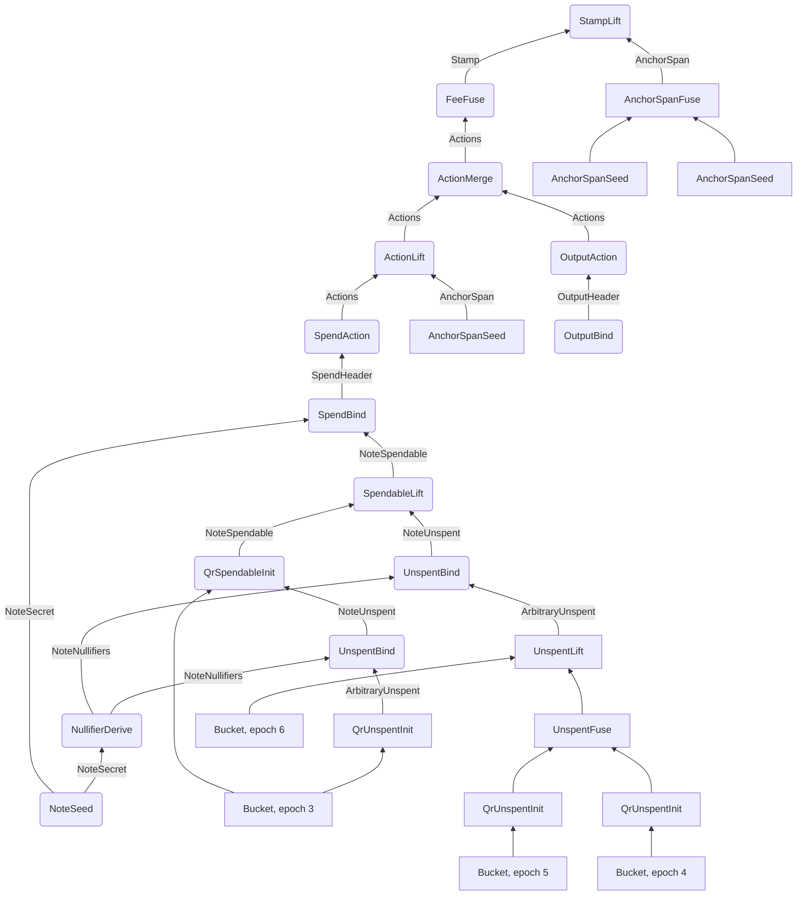

# The Proof Tree

[Chapter 2](./pcd-intro.md#_11-the-rest-of-tachyon-s-proof-tree) sketched the steps behind one spend as a small graph, and promised a closer look. [Chapter 19](./notes-and-nullifiers.md) has since built the keys, notes, and nullifiers, and [chapter 20](./pool-state.md) built the anchor chain and the set polynomials. This chapter puts those objects into their places. It follows one note through its whole life, step by step, and at each step says what the step takes in, what it checks, what it emits, and who runs it.

We treat absence evidence as a black box. [Chapter 21](./oblivious-sync.md) explains how a sync service proves that a value is missing from an epoch, and here we use only the header that service hands over. Fees and stamps get the steps that produce them, and [chapter 23](./aggregation-and-bundles.md) covers what aggregators and miners do with the result.

::: warning Status of this design
Tachyon has not activated on mainnet and its design is still changing. This chapter describes the [Tachyon repository](https://github.com/tachyon-zcash/tachyon/tree/7e502548db33845dbaacdc0efe905d1a3c45e626) at commit `7e50254`, and any later commit may differ. Its [shielded protocol ZIP](https://github.com/tachyon-zcash/tachyon/blob/7e502548db33845dbaacdc0efe905d1a3c45e626/book/src/zips/tachyon-shielded-protocol.md) is an empty outline, so our sources are the book's [proof tree](https://github.com/tachyon-zcash/tachyon/blob/7e502548db33845dbaacdc0efe905d1a3c45e626/book/src/proof-tree.md), [authorization](https://github.com/tachyon-zcash/tachyon/blob/7e502548db33845dbaacdc0efe905d1a3c45e626/book/src/authorization.md), and [fee](https://github.com/tachyon-zcash/tachyon/blob/7e502548db33845dbaacdc0efe905d1a3c45e626/book/src/fee.md) pages, together with the `tachyon` crate.

These steps run against a mock of Ragu. The crate [enables the `mock` feature](https://github.com/tachyon-zcash/tachyon/blob/7e502548db33845dbaacdc0efe905d1a3c45e626/crates/tachyon/Cargo.toml#L74-L76) of Ragu at `0725b52`, not at the `3219e08` of the Ragu chapters. In that revision, [the mock's `fuse`](https://github.com/tachyon-zcash/ragu/blob/0725b5244371c37e9c19a80b0f660ce11ac5f74a/src/mock/application.rs#L87-L118) runs a step's body natively, discards the recorded polynomial openings, and returns a hash record in place of a proof. It does not verify the child proofs. So when we say that a step checks something, we mean that its body at this commit checks it natively, and that the design expects a circuit to enforce the same relation. We did not find real circuits for these steps.
:::

## 1. Steps, headers, and parties

The vocabulary comes from [chapter 2](./pcd-intro.md#fusing-in-ragu). A step declares a left input header, a right input header, a witness, and an output header, and running it with Ragu's `fuse` produces a new header with a proof. An unused input is the unit header `()`. A step with two unit inputs starts through Ragu's `seed`, which supplies the bootstrap proof for both. Here is one declaration, trimmed to the lines that matter:

```rust
impl Step for SpendBind {
    type Left = NoteSpendable;
    type Output = SpendHeader;
    type Right = NoteSecret;
    type Witness<'source> = (value::Trapdoor,);
```

This [declaration](https://github.com/tachyon-zcash/tachyon/blob/7e502548db33845dbaacdc0efe905d1a3c45e626/crates/tachyon/src/stamp/proof/spend.rs#L89-L97) says nearly everything the next sections need about a step, because the Rust types force the shape of the tree. `SpendBind` cannot accept anything except a proved `NoteSpendable` on its left and a proved `NoteSecret` on its right. The [suffix](./wiring-and-registry.md#header-types-and-suffixes) on each header type enforces this in the proof, so two types with the same fields stay distinct.

A header does not have to be public. It is visible only to whoever receives that node's data. The [`NoteSecret` header](https://github.com/tachyon-zcash/tachyon/blob/7e502548db33845dbaacdc0efe905d1a3c45e626/crates/tachyon/src/stamp/proof/delegation.rs#L31-L49) carries a full note opening and a master key, which is safe only because the wallet that built it [never hands it to anyone](https://github.com/tachyon-zcash/tachyon/blob/7e502548db33845dbaacdc0efe905d1a3c45e626/book/src/proof-tree.md?plain=1#L354). The tree therefore has private nodes low down and a public node at the top.

Three parties [run the tree](https://github.com/tachyon-zcash/tachyon/blob/7e502548db33845dbaacdc0efe905d1a3c45e626/book/src/proof-tree.md?plain=1#L6-L10). A **wallet** holds keys and note data, a **sync service** holds the nullifier values a wallet shared with it along with public pool history, and an **aggregator** merges stamps. The book's roles table gives validators no step, and they check the final proof, although [one sentence](https://github.com/tachyon-zcash/tachyon/blob/7e502548db33845dbaacdc0efe905d1a3c45e626/book/src/proof-tree.md?plain=1#L79) says that consensus also publishes spans. We follow the table.

The crate [registers 38 steps](https://github.com/tachyon-zcash/tachyon/blob/7e502548db33845dbaacdc0efe905d1a3c45e626/crates/tachyon/src/stamp/proof/mod.rs#L34-L75) and 16 header types. We compared the book's [table of steps](https://github.com/tachyon-zcash/tachyon/blob/7e502548db33845dbaacdc0efe905d1a3c45e626/book/src/proof-tree.md?plain=1#L562-L601) with the code's declarations, and the left input, right input, and output of all 38 agree.

## 2. The running example

We keep Alice's note from chapter 19, with value 25, created in epoch 3 and spent with target epoch 7. All of its numbers carry over, including the stand-in hash, which is SHA-256 of a tag and inputs reduced modulo 65,537. Two more stand-ins are new to this chapter.

- **Polynomials live modulo 65,539.** The nullifier factors of the next section need a value with no cube root. Modulo 65,537 every element has a cube root, because $65537 \equiv 2 \pmod 3$, so we move up to the next prime, which is congruent to 1 modulo 3 and in which 2 has no cube root.
- **Set commitments are hashes of coefficients.** Chapter 20 ran the Pedersen form on the toy curve, but coefficients this large do not fit the toy curve's 43 scalars. This chapter relies only on two properties of a commitment, that the same polynomial gives the same value and that a different polynomial gives a different value, and the hash provides both at this scale.

Signing keys and value commitments remain real arithmetic on the toy curve $E$. Here is the pool history that the note lives through. The epochs have stamps with made-up tachygrams, and the chain follows chapter 20's folds, $H_\mathsf{st}$ for a stamp and $H_\mathsf{ep}$ for a boundary.

<!-- worked:pool -->

| Epoch | Stamps | Tachygrams | Entry anchor | Final anchor |
| --- | --- | --- | --- | --- |
| 3 | 3 | 11 | 10108 | 19102 |
| 4 | 2 | 6 | 63008 | 8359 |
| 5 | 1 | 3 | 58408 | 2572 |
| 6 | 0 | 0 | 23281 | 23281 |
| 7 | 3 | 9 | 45926 | 41305 |

<!-- /worked:pool -->

<!-- worked:pool-note -->

The second stamp of epoch 3 is Bob's, and its 5 tachygrams include Alice's commitment 55697. Epoch 6 published nothing, so its entry and final anchors are both 23281. Epoch 7 is still open. We write $a_1, a_2, a_3$ for the anchors after its three stamps, which are 58791, 25925 and 41305.

<!-- /worked:pool-note -->

## 3. Deriving nullifiers

A note's lineage has to end by publishing nullifiers that nobody can choose, and along the way it has to test earlier nullifiers against each past epoch. Both needs start from the same secret, so the tree computes that secret once, in a private node that later steps can consume as often as they like.

### `NoteSeed`

[`NoteSeed`](https://github.com/tachyon-zcash/tachyon/blob/7e502548db33845dbaacdc0efe905d1a3c45e626/crates/tachyon/src/stamp/proof/delegation.rs#L118-L150) has two unit inputs. It witnesses the note's value and trapdoors along with the proof authorizing key $\mathsf{pak} = (\mathsf{ak}, \mathsf{nk})$, and it emits a `NoteSecret` holding $(\mathsf{cm}, \text{note}, \mathsf{mk})$. The point of the step is the pairing. Deriving $\mathsf{pk}$ from $\mathsf{pak}$ pins $\mathsf{nk}$, so the same $\mathsf{nk}$ and $\psi$ reach both $\mathsf{mk}$ and $\mathsf{cm}$, as [chapter 19](./notes-and-nullifiers.md#_8-how-the-commitment-pins-the-nullifiers) explained. After this step, $\mathsf{nk}$ appears in no header.

<!-- worked:note-seed -->

| Quantity | Computation | Value |
| --- | --- | --- |
| witness | $v$, $\psi$, $\mathsf{rcm}$, $\mathsf{ak}$, $\mathsf{nk}$ | 25, 625, 61249, $(27,\,30)$, 40954 |
| $\mathsf{pk}$ | $H_{\texttt{PkDerive}}(27,\ 30,\ 40954)$ | 35507 |
| $\mathsf{mk}$ | $H_{\texttt{NfMaster}}(625,\ 40954)$ | 299 |
| $\mathsf{cm}$ | $H_{\texttt{CmDerive}}(61249,\ 35507,\ 25,\ 625)$ | 55697 |

<!-- /worked:note-seed -->

The step does not show that this note exists, since anyone can seed an invented note. That question closes later, when a lineage has to find $\mathsf{cm}$ in the pool.

### `NullifierDerive`

Later steps need many nullifiers at once, and they need to compare them with a sync service's work without revealing $\mathsf{mk}$. So [`NullifierDerive`](https://github.com/tachyon-zcash/tachyon/blob/7e502548db33845dbaacdc0efe905d1a3c45e626/crates/tachyon/src/stamp/proof/delegation.rs#L183-L251) takes the `NoteSecret`, derives a whole window of [16 nullifiers](https://github.com/tachyon-zcash/tachyon/blob/7e502548db33845dbaacdc0efe905d1a3c45e626/crates/tachyon/src/nullifier/mod.rs#L9-L10) from 4 sponges, and emits a commitment to the window. The header it emits, `NoteNullifiers`, holds $(\mathsf{cm}, \text{epoch start}, \text{commitment}, \text{epoch end})$, with no key material. The start epoch is a witness, but it must be a multiple of 4, and it is written on the header so that any choice labels its window honestly. For Alice's note we take the window starting at epoch 0:

<!-- worked:window -->

| Sponge input $w$ | $\mathsf{nf}_w$ | $\mathsf{nf}_{w+1}$ | $\mathsf{nf}_{w+2}$ | $\mathsf{nf}_{w+3}$ |
| --- | --- | --- | --- | --- |
| 0 | 19392 | 15569 | 21425 | 14090 |
| 4 | 2976 | 63093 | 59553 | 55113 |
| 8 | 61177 | 32258 | 31053 | 34200 |
| 12 | 38278 | 13189 | 16353 | 22206 |

<!-- /worked:window -->

The commitment has to hold pairs of an epoch and a nullifier, and not nullifiers alone. Section 5 shows the double spend that would otherwise follow. A natural encoding of a pair $(i, m)$ is the linear factor $m + (i+1)X$, but linear factors fail.

<!-- worked:linear-collision -->

The linear factor $m + (i+1)X$ has the root $-m/(i+1)$, so the pair (epoch 3, member 14090) and the pair (epoch 7, member 28180) share a root, and the two factors differ only by a constant multiple. Divisibility cannot tell them apart. Their cubic factors have different coefficients, and the leading terms alone already differ, at 64 against 512.

<!-- /worked:linear-collision -->

The code instead uses an [**indexed factor**](https://github.com/tachyon-zcash/tachyon/blob/7e502548db33845dbaacdc0efe905d1a3c45e626/crates/tachyon/src/collections/indexed_multiset.rs#L8-L17),

$$F_{i,m}(X) = \big(m + (i+1)X\big)^3 - c,$$

where $c$ has no cube root in the field. If $F_{i,m}$ had a root $x$, then $m + (i+1)x$ would be a cube root of $c$, and none exists. In the real field $c = 2$.

<!-- worked:factor -->

For epoch 3 the member is $\mathsf{nf}_3 = 14090$ and $i + 1 = 4$, so working modulo 65,539,

$$F_{3,\,14090}(X) = (14090 + 4X)^3 - 2 = 64X^{3} + 20930X^{2} + 60089X + 45458.$$

Trying all 65,539 field elements finds no root, so this cubic has no linear factor, and a cubic with no linear factor is irreducible.

<!-- /worked:factor -->

An irreducible factor is what makes division meaningful. Polynomials factor uniquely into irreducibles, so one product of such factors divides another exactly when its factors are among the other's, with multiplicity. Divisibility therefore tests multiset containment of $(i, m)$ pairs. The window's **sequence polynomial** is the product over its members, $g(X) = \prod_e F_{e, \mathsf{nf}_e}(X)$.

<!-- worked:cube-root -->

Two cubic factors can still coincide when the ratio of their linear terms is a cube root of unity. Modulo 65,539 such a root is $\zeta = 32641$, so a collision needs $j + 1 = \zeta(i + 1)$ or $j + 1 = \zeta^2(i + 1)$ for two epoch indices. None of the 240 ordered pairs in our window satisfies this. The code's comment gives $i + 1$ below $\sqrt{p/3}$ as enough to rule out every such pair. That bound is 147 for our stand-in field, and it exceeds $2^{125}$ for the real $p$, while epoch indices stay below $2^{20}$.

<!-- /worked:cube-root -->

The step binds the commitment to the sponge outputs with one opening. The prover commits to $g$ before a challenge exists, the challenge comes from a hash of that commitment, and the step compares the opening with the factors it computes itself.

<!-- worked:derive-open -->

The sequence has degree $3 \cdot 16 = 48$, and its stand-in commitment is 13205. The challenge derived from that commitment is $z = 18216$. The opening gives $g(18216) = 9095$, and the step gets the same value by evaluating the 16 factors directly from the sponge outputs. Suppose a prover commits instead to a sequence with the member at epoch 5 replaced by 29467. Testing every challenge shows that this false sequence agrees with the true product at 2 of the 65,539 points, which is within the degree bound of 48.

<!-- /worked:derive-open -->

### `NullifierFuse`

A note older than a window needs more than one. [`NullifierFuse`](https://github.com/tachyon-zcash/tachyon/blob/7e502548db33845dbaacdc0efe905d1a3c45e626/crates/tachyon/src/stamp/proof/delegation.rs#L276-L324) joins two ranges of the same $\mathsf{cm}$, requires that they be contiguous, and checks that the combined polynomial is their product.

<!-- worked:nullifier-fuse -->

A second window starting at epoch 16 passes the contiguity check, since $16 = 15 + 1$. At the challenge $z = 55334$ the product check reads $978 = 22570 \cdot 40967$ modulo 65,539. A window starting at epoch 12 would also be group-aligned, but it would repeat four epochs, and the check rejects it because $12 \neq 16$.

<!-- /worked:nullifier-fuse -->

The contiguity check keeps the product free of repeated factors. Our note needs only the first window, so the rest of the run does not use this step.

::: warning Reconstructed from code at commit 7e50254, not confirmed by the authors
The code's comment gives the irreducibility and the collision bound, and the [proof tree page](https://github.com/tachyon-zcash/tachyon/blob/7e502548db33845dbaacdc0efe905d1a3c45e626/book/src/proof-tree.md?plain=1#L181) says the factor carries its epoch. The sources do not explain why a cube is needed in place of a linear factor. The explanation through shared roots is our own, and so is the plain-factor attack in Section 5. We checked both on the stand-in field only.
:::

## 4. Bootstrapping a spendable

The derivation so far could describe an invented note. The next step has to tie $\mathsf{cm}$ to the pool, and to give the wallet a position on the anchor chain from which a spend can proceed. The result is a `NoteSpendable` header, $(\mathsf{cm}, \text{current epoch}, \text{anchor})$, and [two steps can start one](https://github.com/tachyon-zcash/tachyon/blob/7e502548db33845dbaacdc0efe905d1a3c45e626/crates/tachyon/src/stamp/proof/spendable.rs#L1-L9). They differ in where they leave the lineage.


### `SpendableInit`, for a spend in the creation epoch

[`SpendableInit`](https://github.com/tachyon-zcash/tachyon/blob/7e502548db33845dbaacdc0efe905d1a3c45e626/crates/tachyon/src/stamp/proof/spendable.rs#L73-L106) takes $\mathsf{cm}$ from a `NoteNullifiers` header and witnesses the creation stamp's tachygrams, the anchor just before that stamp, and the epoch. It opens the set polynomial at $\mathsf{cm}$ and requires zero, and it folds the stamp's commitment onto the witnessed predecessor. The output anchor is the state immediately after the creation stamp.

<!-- worked:spendable-init -->

The creation polynomial gives 0 at $\mathsf{cm} = 55697$, so the membership check passes. Its commitment stands in as 47595, and the witnessed predecessor is 37649, so the step computes $H_\mathsf{st}(37649,\ 3,\ 47595) = 62652$ and emits $(\mathsf{cm}, e, \text{anchor}) = (55697,\ 3,\ 62652)$.

<!-- /worked:spendable-init -->

The predecessor and the epoch are free witnesses, which looks like a hole until we follow the anchor forward.

<!-- worked:spendable-init-wrong -->

A wrong predecessor 37650 gives 9731, and a wrong epoch 4 gives 21577. The step accepts both, since nothing in it can tell, but neither value appears in the chain.

<!-- /worked:spendable-init-wrong -->

So a wrong witness produces a valid-looking header whose anchor consensus will not recognize when the spend is published, as [chapter 20](./pool-state.md#_10-moving-a-proof-along-the-chain) explained. This step [tests no nullifier](https://github.com/tachyon-zcash/tachyon/blob/7e502548db33845dbaacdc0efe905d1a3c45e626/crates/tachyon/src/stamp/proof/spendable.rs#L66-L69), because the only stamp its position covers is the one that created the note. A double spend within the creation epoch runs into the duplicate window instead.

A spendable from this step can spend only inside its creation epoch. It rests after a stamp, and the next section's lift starts only from an entry anchor.

## 5. Maintaining a spendable

A note carried into a later epoch has to show that it was not spent in each epoch it crosses. Doing that work requires the whole epoch's tachygrams, which a wallet does not want to fetch, so the tree splits the job at a deliberate seam. A service tests values it was given without knowing whose they are, and the wallet then claims those tests for its note.

### Segments from the sync service

The service's product is an [`ArbitraryUnspent` segment](https://github.com/tachyon-zcash/tachyon/blob/7e502548db33845dbaacdc0efe905d1a3c45e626/crates/tachyon/src/stamp/proof/pool.rs#L46-L98), whose header holds $(\text{anchor start}, \text{epoch start}, \mathsf{elapsed}, \text{epoch next}, \text{anchor next})$. It covers whole epochs, half-open on both axes, with entry anchors at both ends, and `elapsed` commits to one indexed factor for each covered epoch. To the service each tested value is an arbitrary field element.

Chapter 21 explains how buckets produce these segments. For this chapter one fact is enough, namely that an opening of the epoch's contents at a value gives zero if and only if the value was published. A real network routes tachygrams into many buckets by quadratic residue. To keep the numbers short we use one bucket per epoch holding everything, which is the depth-zero case.

<!-- worked:exclusion -->

| Epoch $e$ | Tested value $\mathsf{nf}_e$ | Bucket opened at that value | Absent |
| --- | --- | --- | --- |
| 3 | 14090 | 30223 | yes |
| 4 | 2976 | 2643 | yes |
| 5 | 63093 | 16446 | yes |
| 6 | 59553 | 1 | yes |

<!-- /worked:exclusion -->

Three steps build segments. [`QrUnspentInit`](https://github.com/tachyon-zcash/tachyon/blob/7e502548db33845dbaacdc0efe905d1a3c45e626/crates/tachyon/src/stamp/proof/qr.rs#L761-L775) starts one from a bucket and a value, [`UnspentFuse`](https://github.com/tachyon-zcash/tachyon/blob/7e502548db33845dbaacdc0efe905d1a3c45e626/crates/tachyon/src/stamp/proof/pool.rs#L280-L288) joins two that meet on a boundary, and [`UnspentLift`](https://github.com/tachyon-zcash/tachyon/blob/7e502548db33845dbaacdc0efe905d1a3c45e626/crates/tachyon/src/stamp/proof/pool.rs#L360-L375) appends one more epoch. Here is a run for Alice's note, using all three:

<!-- worked:segments -->

| Step | Runs on | Output: anchor start, epoch start, elapsed, epoch next, anchor next |
| --- | --- | --- |
| `QrUnspentInit` | bucket of epoch 3, $\mathsf{nf}_3$ | $(10108,\ 3,\ 30057,\ 4,\ 63008)$ |
| `QrUnspentInit` | bucket of epoch 4, $\mathsf{nf}_4$ | $(63008,\ 4,\ 34607,\ 5,\ 58408)$ |
| `QrUnspentInit` | bucket of epoch 5, $\mathsf{nf}_5$ | $(58408,\ 5,\ 58805,\ 6,\ 23281)$ |
| `UnspentFuse` | the two segments above | $(63008,\ 4,\ 21136,\ 6,\ 23281)$ |
| `UnspentLift` | that segment, bucket of epoch 6, $\mathsf{nf}_6$ | $(63008,\ 4,\ 48724,\ 7,\ 45926)$ |

<!-- /worked:segments -->

<!-- worked:segments-note -->

The fuse checks that the anchors meet at 58408 and the epochs meet at 5, and then checks $C(z) = L(z) \cdot R(z)$ at $z = 37557$, where it reads $8718 = 50038 \cdot 36200$. The lift's product check at $z = 45485$ reads $13237 = 50076 \cdot 39192$. Each segment holds plain numbers, so nothing in the table mentions a note.

<!-- /worked:segments-note -->

### `UnspentBind`

The wallet now has to show that those plain numbers really are its nullifiers, each at its own epoch. [`UnspentBind`](https://github.com/tachyon-zcash/tachyon/blob/7e502548db33845dbaacdc0efe905d1a3c45e626/crates/tachyon/src/stamp/proof/pool.rs#L495-L561) does this by division. It takes a segment on the left and a `NoteNullifiers` on the right, ties each committed polynomial to its witnessed form, witnesses a **complement**, and checks

$$g(X) = \mathsf{elapsed}(X) \cdot \text{complement}(X).$$

Since the factors are irreducible, this holds only if every factor in `elapsed` is one of the note's genuine (epoch, nullifier) pairs. The step needs to compare no bounds, because the factors carry their epochs. It then writes the derivation's $\mathsf{cm}$ onto the output, a `NoteUnspent`, which is the first time the service's work is linked to a note.

<!-- worked:unspent-bind -->

Dividing the window polynomial, which has degree 48, by the composed `elapsed` of degree 9 leaves remainder 0 and a complement of degree 39, namely the 13 factors for epochs 0 to 3 and 7 to 15. At the challenge $z = 26729$ the check reads $37717 = 12666 \cdot 20861$. The step outputs $(55697,\ 63008,\ 4,\ 7,\ 45926)$, whose first entry is $\mathsf{cm}$. The segment for epoch 3 binds the same way, with a complement of degree 45, and gives $(55697,\ 10108,\ 3,\ 4,\ 63008)$.

<!-- /worked:unspent-bind -->

We can now see why the factor holds the epoch.

<!-- worked:epoch-attack -->

Suppose Alice already spent the note with target 5, so epoch 5 now holds $\mathsf{nf}_5$ and $\mathsf{nf}_6$. An honest test at epoch 5 gives $0$, and the segment cannot be built. She now tries a second spend with target 7 and tests a different one of her nullifiers at epoch 5, namely $\mathsf{nf}_9 = 32258$, which gives 62419, so the bucket reports absence.

With plain factors $X - \mathsf{nf}_e$ the tested values $\{\mathsf{nf}_3, \mathsf{nf}_4, \mathsf{nf}_9, \mathsf{nf}_6\}$ all come from the window, the division leaves remainder 0, and the double spend goes through. With indexed factors, $F_{5,\,32258}$ does not divide the window polynomial, because the window holds $F_{5,\,63093}$ and $F_{9,\,32258}$. The division now leaves a nonzero remainder. If she commits to the honest complement anyway and hopes for a lucky challenge, then testing all 65,539 challenges shows that the check passes at exactly 2 of them.

<!-- /worked:epoch-attack -->

The complement also explains how the rest of the window is used. It holds epochs below the lineage and epochs ahead of it, including 7 and 8, whose nullifiers the spend will later publish.

### `QrSpendableInit`

A note that will outlive its creation epoch starts through [`QrSpendableInit`](https://github.com/tachyon-zcash/tachyon/blob/7e502548db33845dbaacdc0efe905d1a3c45e626/crates/tachyon/src/stamp/proof/spendable.rs#L132-L188). This route has to cover the creation epoch itself, since a spend later in epoch 3 would otherwise go unnoticed by every later test. So the left input is the note's `NoteUnspent` for that epoch, which shows that $\mathsf{nf}_3$ is absent, and the right input is a sealed bucket. The step opens the bucket at $\mathsf{cm}$ for zero, and it requires the segment and the bucket to have the same extent, so that the bucket's stamps are the ones consensus will eventually pin. In a real network the bucket holding $\mathsf{cm}$ and the bucket that tested $\mathsf{nf}_3$ will usually differ, and only their anchors have to agree.

<!-- worked:qr-spendable-init -->

For our note, the opening of epoch 3's bucket at 55697 gives 0, and the bound segment from the last section has the same extent as the bucket, running from 10108 to 63008. So the step emits $(55697,\ 4,\ 63008)$, which rests on the entry anchor of epoch 4.

<!-- /worked:qr-spendable-init -->

### `SpendableLift`

[`SpendableLift`](https://github.com/tachyon-zcash/tachyon/blob/7e502548db33845dbaacdc0efe905d1a3c45e626/crates/tachyon/src/stamp/proof/spendable.rs#L214-L250) has no witness at all. It compares a `NoteSpendable` with a `NoteUnspent`, in three equalities, and moves the lineage to the segment's far end.

<!-- worked:lift-checks -->

| Check | Spendable | Segment | Result |
| --- | --- | --- | --- |
| same note | $\mathsf{cm} = 55697$ | $\mathsf{cm} = 55697$ | equal |
| same epoch | $e = 4$ | epoch start $4$ | equal |
| same position | anchor 63008 | anchor start 63008 | equal |
| output | | | $(55697,\ 7,\ 45926)$ |

<!-- /worked:lift-checks -->

Each check closes a particular gap. The epoch check stops a lineage from skipping an epoch, and the anchor check welds the segment to the lineage's position. The commitment check stops the following:

<!-- worked:value-drift -->

Recall the second note from [chapter 19](./notes-and-nullifiers.md#_9-reusing-a-trapdoor) with the same $\psi$. It has the same $\mathsf{mk}$ and so the same nullifiers, which means a segment bound through its derivation tests identical values. The `cm` check still separates them. With a new $\mathsf{rcm}$ and value 9, its commitment is 53772, and 53772 $\neq$ 55697 stops the lift, so a spender cannot move absence evidence from a note worth 9 to a note worth 25, or the reverse.

<!-- /worked:value-drift -->

The anchor check is what confines the first bootstrap to its epoch.

<!-- worked:lift-rejects -->

A spendable from `SpendableInit` cannot take this route. Its anchor 62652 is the state after the creation stamp and the segment for epoch 3 starts at 10108, while the segment for epoch 4 starts at 63008. Neither matches, so the third check fails.

<!-- /worked:lift-rejects -->

At this commit, the [book's maintenance section](https://github.com/tachyon-zcash/tachyon/blob/7e502548db33845dbaacdc0efe905d1a3c45e626/book/src/proof-tree.md?plain=1#L30) and the [comment on the lift](https://github.com/tachyon-zcash/tachyon/blob/7e502548db33845dbaacdc0efe905d1a3c45e626/crates/tachyon/src/stamp/proof/spendable.rs#L198-L201) agree that only a lineage resting on an entry anchor can lift.

One lift can consume a segment crossing [any number of epochs](https://github.com/tachyon-zcash/tachyon/blob/7e502548db33845dbaacdc0efe905d1a3c45e626/book/src/proof-tree.md?plain=1#L52), so the wallet's cost does not have to grow with the note's age, apart from the windows it derives. The lineage now certifies every epoch before 7. It says nothing about epoch 7 itself, which is left to [the consensus window](./pool-state.md#_11-the-consensus-window).

## 6. Spending

A spend has to do two different things. It has to publish a nullifier pair and a value commitment, which requires the note's secrets, and it has to produce a randomized signing key tied to the note's owner, which requires $\mathsf{ak}$. These could be one step except for a budget. The [book counts](https://github.com/tachyon-zcash/tachyon/blob/7e502548db33845dbaacdc0efe905d1a3c45e626/book/src/proof-tree.md?plain=1#L370-L378) a Poseidon permutation at about a seventh of a step and a scalar multiplication at about a quarter, so we can add up each step's work.

<!-- worked:budget -->

| Step | Permutations | Scalar multiplications | Share of one step |
| --- | --- | --- | --- |
| `OutputBind` | 2 | 2 | 0.79 |
| `OutputAction` | 2 | 1 | 0.54 |
| `SpendBind` | 2 | 2 | 0.79 |
| `SpendAction` | 3 | 1 | 0.68 |

<!-- /worked:budget -->

<!-- worked:budget-note -->

Doing a spend in one step would need 5 permutations and 3 scalar multiplications, which comes to 1.46 of a step before any polynomial opening. An output would need 1.32. Splitting each action in two brings every part under 1.

<!-- /worked:budget-note -->

### `SpendBind`

[`SpendBind`](https://github.com/tachyon-zcash/tachyon/blob/7e502548db33845dbaacdc0efe905d1a3c45e626/crates/tachyon/src/stamp/proof/spend.rs#L89-L145) takes the `NoteSpendable` on its left and the same `NoteSecret` from Section 3 on its right, which is an instance of the node sharing from [chapter 2](./pcd-intro.md#_5-running-the-tree). The secret's commitment has to equal the lineage's, and this equality connects two facts established separately, namely that the lineage's note was minted and unspent, and that the secret's $\mathsf{mk}$ and value belong to that note. A phantom note reusing $\psi$ with a larger value has a different $\mathsf{cm}$ and fails here.

The step then derives the pair from $\mathsf{mk}$ at the lineage's epoch and the next, with [one sponge each](https://github.com/tachyon-zcash/tachyon/blob/7e502548db33845dbaacdc0efe905d1a3c45e626/crates/tachyon/src/stamp/proof/spend.rs#L85), requires both to be nonzero, and commits the value. The value commitment follows the [book's formula](https://github.com/tachyon-zcash/tachyon/blob/7e502548db33845dbaacdc0efe905d1a3c45e626/book/src/authorization.md?plain=1#L122),

$$\mathsf{cv} = [v]\mathcal{V} + [\mathsf{rcv}]\mathcal{R},$$

with $v$ positive for a spend and negative for an output, and a fresh random trapdoor $\mathsf{rcv}$. A [book footnote](https://github.com/tachyon-zcash/tachyon/blob/7e502548db33845dbaacdc0efe905d1a3c45e626/book/src/authorization.md?plain=1#L126) says that this sampling may later change.

<!-- worked:value-gens -->

On the toy curve we take $\mathcal{V} = (6,\,8)$ and $\mathcal{R} = (11,\,1)$.

<!-- /worked:value-gens -->

<!-- worked:spend-bind -->

| Output field | Source | Value |
| --- | --- | --- |
| $\mathsf{cm}$ | spendable, checked equal to the secret's | 55697 |
| $\mathsf{nf}_\text{current}$ | $\mathsf{mk} = 299$ at epoch 7 | 55113 |
| $\mathsf{nf}_\text{next}$ | $\mathsf{mk} = 299$ at epoch 8 | 61177 |
| anchor | spendable | 45926 |
| $\mathsf{pk}$ | the secret's note | 35507 |
| $\mathsf{cv}$ | $[25]\mathcal{V} + [38]\mathcal{R}$ | $(30,\,8)$ |

<!-- /worked:spend-bind -->

Nothing in the pair is a witness. [Chapter 19](./notes-and-nullifiers.md#_10-why-a-spend-publishes-two-nullifiers) explained why a spend publishes two nullifiers.

### `SpendAction`

[`SpendAction`](https://github.com/tachyon-zcash/tachyon/blob/7e502548db33845dbaacdc0efe905d1a3c45e626/crates/tachyon/src/stamp/proof/stamp.rs#L180-L240) takes the `SpendHeader` and witnesses the action entropy $\theta$, the key $\mathsf{pak}$, and two set polynomials. It first [requires $\mathsf{pak}$ to derive the header's $\mathsf{pk}$](https://github.com/tachyon-zcash/tachyon/blob/7e502548db33845dbaacdc0efe905d1a3c45e626/crates/tachyon/src/stamp/proof/stamp.rs#L202-L205), and this check is the only thing that ties $\mathsf{ak}$ to the note. Then it derives $\alpha$ and $\mathsf{rk}$ as in [chapter 19](./notes-and-nullifiers.md#_5-randomizing-the-signing-key-for-each-action), hashes $(\mathsf{cv}, \mathsf{rk})$ into an action digest, and builds the stamp's first two sets.

The sets use the root polynomials of chapter 20. A relation called [`enforce_poly_roots`](https://github.com/tachyon-zcash/tachyon/blob/7e502548db33845dbaacdc0efe905d1a3c45e626/crates/tachyon/src/relations/enforce.rs#L108-L120) opens the witnessed polynomial at a challenge derived from its commitment, and compares the opening with the product of $(z - \text{root})$. The action set has one root and the tachygram set has two.

<!-- worked:spend-action -->

| Quantity | Computation | Value |
| --- | --- | --- |
| check on $\mathsf{pak}$ | $H_{\texttt{PkDerive}}(27,\ 30,\ 40954)$ against the header | 35507 matches |
| $\alpha$ | $H_{\texttt{Spend}}(4071,\ 55697)$, reduced mod 43 | 23 |
| $\mathsf{rk}$ | $\mathsf{ak} + [23]\mathcal{G}$ | $(24,\,30)$ |
| action digest $d$ | $H_{\texttt{ActionDg}}(\mathsf{cv},\ \mathsf{rk})$ | 52188 |
| action set | $X - 52188$, as $X + 13351$ | committed as 63623 |
| tachygram set | $(X - 55113)(X - 61177)$, as $X^{2} + 14788X + 59685$ | committed as 49309 |

<!-- /worked:spend-action -->

<!-- worked:pak-reject -->

A prover who holds a different spend validating key $(14,\,22)$, together with the right $\mathsf{nk}$, computes 61293 in place of 35507, and the first row fails.

<!-- /worked:pak-reject -->

The output header type is `Actions`, $(\text{action commit}, \text{tachygram commit}, \text{anchor})$. Notice what it drops. The commitment $\mathsf{cm}$, the key $\mathsf{pk}$, and the epoch do not appear, and neither does anything recording the note's age. The [book points out](https://github.com/tachyon-zcash/tachyon/blob/7e502548db33845dbaacdc0efe905d1a3c45e626/book/src/proof-tree.md?plain=1#L360) that the published pair sits at the epochs of the live range, whatever the note's age, so no later step reads a position that would reveal how long the note has existed.

## 7. Outputs

Creating a note needs no lineage, since nothing about the past has to be shown. It still has to look like a spend to an observer, so it also takes two steps and ends in the same header type.

[`OutputBind`](https://github.com/tachyon-zcash/tachyon/blob/7e502548db33845dbaacdc0efe905d1a3c45e626/crates/tachyon/src/stamp/proof/output.rs#L53-L96) has unit inputs and witnesses the new note and $\mathsf{rcv}$. It derives the commitment and the padding tachygram from one opening, requires both to be nonzero, and commits the negated value. [`OutputAction`](https://github.com/tachyon-zcash/tachyon/blob/7e502548db33845dbaacdc0efe905d1a3c45e626/crates/tachyon/src/stamp/proof/stamp.rs#L107-L158) derives $\alpha$ under the `Tachyon-Output` domain, sets $\mathsf{rk} = [\alpha]\mathcal{G}$, and builds the two sets. It witnesses no key, because the recipient's payment key [rides inside $\mathsf{cm}$](https://github.com/tachyon-zcash/tachyon/blob/7e502548db33845dbaacdc0efe905d1a3c45e626/book/src/proof-tree.md?plain=1#L367), and the sender cannot be asked to prove anything about it. Suppose Alice pays 18 zatoshi to Carol:

<!-- worked:output -->

| Step | Quantity | Computation | Value |
| --- | --- | --- | --- |
| `OutputBind` | $\mathsf{cm}$ | $H_{\texttt{CmDerive}}(37299,\ 17495,\ 18,\ 43263)$ | 36798 |
| `OutputBind` | pad | $H_{\texttt{CmOutPad}}(37299,\ 17495,\ 18,\ 43263)$ | 56347 |
| `OutputBind` | $\mathsf{cv}$ | $[-18]\mathcal{V} + [18]\mathcal{R}$ | $(25,\,29)$ |
| `OutputAction` | $\alpha$ | $H_{\texttt{Output}}(51472,\ 36798)$, reduced mod 43 | 17 |
| `OutputAction` | $\mathsf{rk}$ | $[17]\mathcal{G}$ | $(20,\,6)$ |
| `OutputAction` | digest $d$ | $H_{\texttt{ActionDg}}(\mathsf{cv},\ \mathsf{rk})$ | 43682 |

<!-- /worked:output -->

The anchor in `OutputAction` is a free witness, because an output has no chain state to thread. The wallet [usually gives it the same anchor](https://github.com/tachyon-zcash/tachyon/blob/7e502548db33845dbaacdc0efe905d1a3c45e626/book/src/proof-tree.md?plain=1#L68) as its spends, so that the merge in the next section needs no lift. Both action types publish a $\mathsf{cv}$, an $\mathsf{rk}$, a signature, and two tachygrams, and [chapter 19](./notes-and-nullifiers.md#_11-tachygrams-and-output-padding) showed why the counts reveal nothing about the split.

## 8. Moving and merging actions

A transaction with several actions needs them combined into one `Actions` node, and combining requires a shared anchor, because the output header has a single anchor field. In our run the spend's actions rest on $\mathsf{entry}(7)$, which consensus may not accept as a published anchor. Under the anchor page's rule, an entry anchor counts as an [end-of-block state](./pool-state.md#_8-end-of-block-anchors) only if the first block of its epoch carries no stamp, and a wallet [would rather sit near the latest anchor](https://github.com/tachyon-zcash/tachyon/blob/7e502548db33845dbaacdc0efe905d1a3c45e626/book/src/proof-tree.md?plain=1#L76) in any case. The wallet therefore chooses an anchor for the bundle and moves the spend there.

[`ActionLift`](https://github.com/tachyon-zcash/tachyon/blob/7e502548db33845dbaacdc0efe905d1a3c45e626/crates/tachyon/src/stamp/proof/stamp.rs#L475-L516) does the move. Its left input is the `Actions` and its right input is an [`AnchorSpan`](./pool-state.md#_10-moving-a-proof-along-the-chain), the proved run of anchors from chapter 20. It requires the anchor to be the span's start or a member, by checking $M(a) \cdot (a - \text{start}) = 0$, and it outputs the span's end.

<!-- worked:action-lift -->

Here the spend's actions rest on $\mathsf{entry}(7) = 45926$, and the wallet plans to anchor its bundle at $a_1 = 58791$. The span from 45926 to 58791 has the members polynomial $M(X) = X - 58791$. The check $M(a) \cdot (a - \text{start})$ evaluates to $(45926 - 58791) \cdot 0 = 0$, so the lift outputs the same sets at anchor 58791. An anchor from before the span, such as 23281, gives 25959, and the step rejects it.

<!-- /worked:action-lift -->

The same restriction from chapter 20 applies here, because no span contains a boundary digest. A wallet moves a note across an epoch with `SpendableLift`, before the spend, and moves its actions within the epoch with `ActionLift`, after it.

[`ActionMerge`](https://github.com/tachyon-zcash/tachyon/blob/7e502548db33845dbaacdc0efe905d1a3c45e626/crates/tachyon/src/stamp/proof/stamp.rs#L331-L410) then takes two `Actions` headers. It requires equal anchors, ties the four witnessed input polynomials to the four header commitments, and checks that each merged set is the product of its inputs, which is the union of [chapter 20](./pool-state.md#_4-combining-and-dividing-sets). The check is [`enforce_poly_product`](https://github.com/tachyon-zcash/tachyon/blob/7e502548db33845dbaacdc0efe905d1a3c45e626/crates/tachyon/src/relations/enforce.rs#L62-L84), which absorbs all three commitments into the challenge so that the polynomials are fixed before the challenge exists.

<!-- worked:merge -->

Both inputs now sit at anchor 58791, so the anchor check passes. The merged action set has the roots 52188 and 43682, and at $z = 33689$ its check reads $40527 = 47040 \cdot 55546$. The merged tachygram set has the roots 55113, 61177, 36798 and 56347, and at $z = 11199$ its check reads $26949 = 29399 \cdot 28926$. The output header is $(40362,\ 37081,\ 58791)$.

<!-- /worked:merge -->

The code's [`Plan::prove`](https://github.com/tachyon-zcash/tachyon/blob/7e502548db33845dbaacdc0efe905d1a3c45e626/crates/tachyon/src/stamp/mod.rs#L484-L700) follows this order. It binds and acts on each spend, lifts it along any spans to the plan's anchor, proves each output at that anchor, and merges everything.

## 9. Applying the fee

An `Actions` header cannot be published, because validators accept only a `Stamp`. The step between them applies the fee, and the design wants a particular freedom here. [A wallet signs a maximum fee once](https://github.com/tachyon-zcash/tachyon/blob/7e502548db33845dbaacdc0efe905d1a3c45e626/book/src/fee.md?plain=1#L3-L5) and can choose the actual fee later, at or below that maximum, with the difference returning as change. Changing the fee then needs no further trip to a signing device.

To allow this, the bundle commits to the maximum through a [**max fee note**](https://github.com/tachyon-zcash/tachyon/blob/7e502548db33845dbaacdc0efe905d1a3c45e626/book/src/fee.md?plain=1#L22-L35), an opening $(\mathsf{pk}, \mathsf{maxfee}, \psi, \mathsf{rcm})$ that is published only as

$$\mathsf{cv}_\text{maxfee} = [-\mathsf{maxfee}]\mathcal{V} + [r]\mathcal{R}, \qquad r = \mathsf{Poseidon}_{\texttt{Tachyon-FeeBlind}}(\mathsf{pk},\ \psi,\ \mathsf{rcm}).$$

This note is never spent. The blind binds the change note's owner into the commitment that gets signed. The **fee change note** $(\mathsf{pk}, \mathsf{maxfee} - \text{fee}, \psi, \mathsf{rcm})$ takes the other fields, and it appears on chain only as a commitment among the tachygrams.

[`FeeFuse`](https://github.com/tachyon-zcash/tachyon/blob/7e502548db33845dbaacdc0efe905d1a3c45e626/crates/tachyon/src/stamp/proof/stamp.rs#L523-L645) takes `Actions` on the left and a unit input on the right, and it witnesses the max fee note, the fee, and the set polynomials. It rederives $r$ and $\mathsf{cv}_\text{maxfee}$, checks that the change lies in range, computes a fee digest and the change commitment, and multiplies each set by one more factor. The output type is `Stamp`, with the same fields as `Actions` and a different suffix.

<!-- worked:fee-setup -->

Alice's bundle spends 25 and creates an output of 18. She reserves a maximum fee of 5, which leaves a value balance of $25 - 18 - 5 = 2$.

<!-- /worked:fee-setup -->

<!-- worked:fee-fuse -->

| Quantity | Computation | Value |
| --- | --- | --- |
| $r$ | $H_{\texttt{FeeBlind}}(35507,\ 44984,\ 1464) = 24307$, reduced mod 43 | 12 |
| $\mathsf{cv}_\text{maxfee}$ | $[-5]\mathcal{V} + [12]\mathcal{R}$ | $(28,\,21)$ |
| fee | chosen by the wallet, at most 5 | 3 |
| fee digest | $H_{\texttt{FeeDg}}(28,\ 21,\ 3)$ | 14071 |
| change note value | $5 - 3$ | 2 |
| change commitment | $H_{\texttt{CmDerive}}(1464,\ 35507,\ 2,\ 44984)$ | 16688 |
| output action set | three roots: 52188, 43682, 14071 | committed as 13924 |
| output tachygram set | five roots, $2N + B = 2 \cdot 2 + 1$ | committed as 44311 |

<!-- /worked:fee-fuse -->

The change in type is what makes the fee happen exactly once. `FeeFuse` [accepts only `Actions`](https://github.com/tachyon-zcash/tachyon/blob/7e502548db33845dbaacdc0efe905d1a3c45e626/book/src/fee.md?plain=1#L136-L137) and emits a `Stamp`, so a second application has no valid input, as [chapter 15's `Charge` example](./wiring-and-registry.md#header-types-and-suffixes) showed in miniature. A bundle with no actions has nothing to fuse, so [`FeeSeed`](https://github.com/tachyon-zcash/tachyon/blob/7e502548db33845dbaacdc0efe905d1a3c45e626/crates/tachyon/src/stamp/proof/stamp.rs#L651-L720) starts a `Stamp` directly. It requires a zero maximum fee, so the fee change note is the max fee note itself, and it witnesses its anchor. Aggregators use it for an [innocent aggregate](./aggregation-and-bundles.md#_1-what-aggregation-removes-and-what-it-keeps), whose bundle has no actions.

<!-- worked:fee-change -->

If the wallet raises the fee to 4, the fee digest becomes 48510 and the change note, now worth 1, has the commitment 54660. So both set commitments change, to 57197 and 37899, and `FeeFuse` has to run again. The sighash stays 29677, and $\mathsf{bvk}$ stays $(18,\,10)$, so no signature has to be made again.

<!-- /worked:fee-change -->

These steps [prove a local relation](https://github.com/tachyon-zcash/tachyon/blob/7e502548db33845dbaacdc0efe905d1a3c45e626/book/src/fee.md?plain=1#L112-L114), which is that the change and the digest match the opening. They do not show that the fee is funded. That comes from the next section.

## 10. Authorization outside the proof

A bundle also needs authorization that the proof does not provide. The [authorization page](https://github.com/tachyon-zcash/tachyon/blob/7e502548db33845dbaacdc0efe905d1a3c45e626/book/src/authorization.md?plain=1#L3) lists three layers, namely per-action signatures, value commitments, and a binding signature, and each covers a gap that the proof leaves open.

### Action signatures

The proof shows that $\mathsf{rk}$ equals $\mathsf{ak} + [\alpha]\mathcal{G}$ for the $\mathsf{ak}$ behind the note's payment key, but a prover holding only $\mathsf{pak}$ can produce that proof. Spending therefore also needs a signature under $\mathsf{rk}$, which requires $\mathsf{rsk} = \mathsf{ask} + \alpha$ and so requires $\mathsf{ask}$. This is what separates a proving device from a custody device. The [custody device](https://github.com/tachyon-zcash/tachyon/blob/7e502548db33845dbaacdc0efe905d1a3c45e626/book/src/authorization.md?plain=1#L10) receives each note and $\theta$, recomputes $\mathsf{cm}$, $\alpha$, and $\mathsf{rk}$ for itself, and signs. Chapter 19 ran this signature on the same $\mathsf{rk}$. An output's $\mathsf{rsk}$ is $\alpha$, so no custody is needed there.

Each signature covers the transaction [sighash](https://github.com/tachyon-zcash/tachyon/blob/7e502548db33845dbaacdc0efe905d1a3c45e626/book/src/authorization.md?plain=1#L109-L114), which includes a [bundle commitment](https://github.com/tachyon-zcash/tachyon/blob/7e502548db33845dbaacdc0efe905d1a3c45e626/book/src/authorization.md?plain=1#L78-L96) over the actions, the value balance, $\mathsf{cv}_\text{maxfee}$, and the memo. The fee is not included, and neither is the stamp, since aggregation strips it. Because $\alpha$ is derived from $\mathsf{cm}$ inside the proof, $\mathsf{rk}$ is itself a commitment to $\mathsf{cm}$, so a signature binds its action to the note even though the action shows no tachygram.

### The binding signature

No step adds up values, so the proof cannot show that a bundle balances. Value commitments allow validators to check that from public data. Summing commitments sums values and trapdoors separately,

$$\sum_i \mathsf{cv}_i = \Big[\sum_i v_i\Big]\mathcal{V} + \Big[\sum_i \mathsf{rcv}_i\Big]\mathcal{R}.$$

A validator knows the claimed value balance, so it subtracts that term. Including the max fee note as [one more output](https://github.com/tachyon-zcash/tachyon/blob/7e502548db33845dbaacdc0efe905d1a3c45e626/book/src/authorization.md?plain=1#L165-L171), the validator computes

$$\begin{aligned}
\mathsf{bvk} &= \sum_i \mathsf{cv}_i + \mathsf{cv}_\text{maxfee} - [\mathsf{value\_balance}]\mathcal{V} \\
&= \Big[\sum_i v_i - \mathsf{maxfee} - \mathsf{value\_balance}\Big]\mathcal{V} + \Big[\sum_i \mathsf{rcv}_i + r\Big]\mathcal{R}.
\end{aligned}$$

If the values balance, the first bracket vanishes and $\mathsf{bvk} = [\mathsf{bsk}]\mathcal{R}$ with $\mathsf{bsk} = \sum_i \mathsf{rcv}_i + r$. The planner knows every trapdoor, so it can sign under that key, and the [signature](https://github.com/tachyon-zcash/tachyon/blob/7e502548db33845dbaacdc0efe905d1a3c45e626/crates/tachyon/src/bundle/mod.rs#L250-L262) shows that it knows the discrete log of $\mathsf{bvk}$ to base $\mathcal{R}$.

<!-- worked:binding -->

| Quantity | Computation | Value |
| --- | --- | --- |
| $\mathsf{bsk}$ | $38 + 18 + 12$ mod 43 | 25 |
| $\sum \mathsf{cv}$ | $(30,\,8) + (25,\,29) + (28,\,21)$ | $(28,\,10)$ |
| $\mathsf{bvk}$ | $(28,\,10) - [2]\mathcal{V}$ | $(18,\,10)$ |
| check | $[25]\mathcal{R}$ | $(18,\,10)$ |

<!-- /worked:binding -->

<!-- worked:binding-sig -->

With the stand-in sighash 29677 and nonce point $(11,\,30)$, the challenge is 25 and the response is 22, and both sides of $[s]\mathcal{R} = R + [c]\mathsf{bvk}$ equal $(28,\,21)$.

<!-- /worked:binding-sig -->

Cheating on the balance leaves a $\mathcal{V}$ term behind.

<!-- worked:binding-cheat -->

Now suppose Alice claims a value balance of 12 in place of 2, taking 10 more from the pool. The validator computes $\mathsf{bvk}' = (6,\,23)$, and the surviving term is $[33]\mathcal{V}$. Of the 43 possible claims in the toy field, only the true one makes $\mathsf{bvk}$ equal $[\mathsf{bsk}]\mathcal{R}$. The signature fails unless Alice can find the discrete log of $\mathsf{bvk}'$ to base $\mathcal{R}$. On the toy curve she can, by counting, because $\mathcal{V} = [41]\mathcal{R}$ gives her the key 2 for the false balance. So this protection rests on the hardness of discrete log.

<!-- /worked:binding-cheat -->

The fee enters neither key. The [balance equation](https://github.com/tachyon-zcash/tachyon/blob/7e502548db33845dbaacdc0efe905d1a3c45e626/book/src/fee.md?plain=1#L144-L148) accounts for it at the transaction level, because the pool's net outflow is $\sum v_\text{in} - \sum v_\text{out} - (\mathsf{maxfee} - \text{fee})$, which equals the value balance plus the fee.

<!-- worked:balance -->

For our bundle this gives $25 - 18 - (5 - 3) = 2 + 3 = 5$, so 5 zatoshi leave the pool, and the fee change note keeps 2 inside it.

<!-- /worked:balance -->

::: warning Book and code: what shows the balance
**Bundle page:** it lists among the things [the proof establishes](https://github.com/tachyon-zcash/tachyon/blob/7e502548db33845dbaacdc0efe905d1a3c45e626/book/src/bundle.md?plain=1#L47-L51) that "action balance effect matches pool balance effect."

**Fee page, authorization page, and code at `7e50254`:** the [fee steps prove no funding](https://github.com/tachyon-zcash/tachyon/blob/7e502548db33845dbaacdc0efe905d1a3c45e626/book/src/fee.md?plain=1#L112-L114), and no step sums $\mathsf{cv}$ values. Validators [derive $\mathsf{bvk}$](https://github.com/tachyon-zcash/tachyon/blob/7e502548db33845dbaacdc0efe905d1a3c45e626/crates/tachyon/src/keys/public.rs#L122-L129) from public data and check the signature. The proof contributes something narrower, which is that each $\mathsf{cv}$ commits to the value of the note behind it.

This site follows the code. Separately, the authorization page's [detailed sequence diagram](https://github.com/tachyon-zcash/tachyon/blob/7e502548db33845dbaacdc0efe905d1a3c45e626/book/src/authorization.md?plain=1#L266) carries a comment calling itself significantly outdated. It hashes the commitment's inputs in a different order from the [code](https://github.com/tachyon-zcash/tachyon/blob/7e502548db33845dbaacdc0efe905d1a3c45e626/crates/tachyon/src/stamp/proof/output.rs#L76-L87), and it gives an output one tachygram rather than two. We use the code's forms.
:::

## 11. Publishing a stamp

Stamps keep arriving while a wallet proves, so it [may lift again](https://github.com/tachyon-zcash/tachyon/blob/7e502548db33845dbaacdc0efe905d1a3c45e626/book/src/proof-tree.md?plain=1#L76-L81) before publishing. [`StampLift`](https://github.com/tachyon-zcash/tachyon/blob/7e502548db33845dbaacdc0efe905d1a3c45e626/crates/tachyon/src/stamp/proof/stamp.rs#L433-L466) has the same check as `ActionLift` on the other header type. The book says spans are published as an epoch progresses, and a wallet builds its own span for anything newer.

<!-- worked:stamp-lift -->

Stamps have landed since the wallet chose $a_1$, so it lifts along a span from $a_1 = 58791$ to $a_3 = 41305$. Two `AnchorSpanSeed` steps and one `AnchorSpanFuse` build the span, whose members polynomial has roots 25925 and 41305. The stamp's anchor 58791 is the span's start, so the product $M(58791) \cdot 0$ vanishes although $M(58791) = 48924$, and the output anchor is 41305.

<!-- /worked:stamp-lift -->

The header holds only commitments and an anchor, and the published bundle [does not carry the action commitment](https://github.com/tachyon-zcash/tachyon/blob/7e502548db33845dbaacdc0efe905d1a3c45e626/book/src/fee.md?plain=1#L120-L123). A validator [rebuilds the header](https://github.com/tachyon-zcash/tachyon/blob/7e502548db33845dbaacdc0efe905d1a3c45e626/crates/tachyon/src/bundle/mod.rs#L822-L858) from what it can see, which is the comparison that [chapter 2](./pcd-intro.md#_6-attaching-a-proof) required of every verifier. The crate's verification stops short of the chain, so the anchor row comes from [the book](https://github.com/tachyon-zcash/tachyon/blob/7e502548db33845dbaacdc0efe905d1a3c45e626/book/src/proof-tree.md?plain=1#L83-L84) and [chapter 20](./pool-state.md#_11-the-consensus-window). Here is what happens with Alice's bundle, where "in the design" marks the row that a mock cannot really perform:

<!-- worked:validate -->

| Validator step | Computation | Result |
| --- | --- | --- |
| signatures | action signatures under each $\mathsf{rk}$, binding under $\mathsf{bvk}$ | accepted |
| arity | $5 = 2 \cdot 2 + 1$ | accepted |
| tachygram set | rebuild from the 5 published values | 44311, matches the stamp |
| action set | rebuild from 2 action and 1 fee descriptors | 13924 |
| proof | verify against $(13924,\ 44311,\ 41305)$ | accepted, in the design |
| anchor | look up 41305 in the chain | found, in epoch 7 |

<!-- /worked:validate -->

<!-- worked:validate-note -->

If a miner dropped the output's descriptor, the validator would rebuild the action commitment as 57289 instead of 13924. The header would then differ from the one the proof covers, so the proof would fail.

<!-- /worked:validate-note -->

Once the anchor checks out, it closes the free witnesses below it. The seal's lower boundary, the predecessor witnessed at each seed, and the epochs absorbed along the way all had to be genuine for the folds to reach a published value, as chapter 20 argued. An output's free anchor closes the same way, because the merge forced it to equal the spend's.

### Rerandomizing before release

A proof built from private inputs could reveal a link back to them, so the book requires that [every proof leaving the process that built it](https://github.com/tachyon-zcash/tachyon/blob/7e502548db33845dbaacdc0efe905d1a3c45e626/book/src/proof-tree.md?plain=1#L397-L403) be rerandomized. The code calls `rerandomize` in [`Plan::prove`](https://github.com/tachyon-zcash/tachyon/blob/7e502548db33845dbaacdc0efe905d1a3c45e626/crates/tachyon/src/stamp/mod.rs#L684-L687), [`lift`](https://github.com/tachyon-zcash/tachyon/blob/7e502548db33845dbaacdc0efe905d1a3c45e626/crates/tachyon/src/stamp/mod.rs#L1005-L1009), [`merge`](https://github.com/tachyon-zcash/tachyon/blob/7e502548db33845dbaacdc0efe905d1a3c45e626/crates/tachyon/src/stamp/mod.rs#L1126-L1127), and [`unmerge`](https://github.com/tachyon-zcash/tachyon/blob/7e502548db33845dbaacdc0efe905d1a3c45e626/crates/tachyon/src/stamp/mod.rs#L1249-L1250). Intermediate nodes that stay in the wallet skip it.

::: warning Sources disagree: what rerandomizing achieves
**Tachyon book:** rerandomizing [replaces the proof with an unrelated one](https://github.com/tachyon-zcash/tachyon/blob/7e502548db33845dbaacdc0efe905d1a3c45e626/book/src/proof-tree.md?plain=1#L401) that verifies against the same header, so the released proof has no correlation with its private lineage.

**Ragu code at `3219e08`:** a [comment on `rerandomize`](https://github.com/tachyon-zcash/ragu/blob/3219e0865e8bff1f9d817bfe3850d9e94b64338c/crates/ragu_pcd/src/lib.rs#L717-L724) says that unlinkability is the intent, that today it is not achieved, and that the remaining work is in the future.

**Mock at `0725b52`:** [`rerandomize`](https://github.com/tachyon-zcash/ragu/blob/0725b5244371c37e9c19a80b0f660ce11ac5f74a/src/mock/proof.rs#L137-L147) fills in a tag and keeps the rest of the record.

As in [chapter 2](./pcd-intro.md#proof-size-and-hiding-in-ragu), this site treats hiding as a goal that has not yet been met. When this chapter says a header drops a value, it means only that the header no longer carries it. It does not mean that the proof conceals it.
:::

## 12. The aggregator's steps

Once published, stamps can be combined by anyone holding them. [Chapter 2](./pcd-intro.md#_10-aggregation-as-proof-carrying-data) followed this at the level of whole bundles, and [chapter 23](./aggregation-and-bundles.md) takes up what it means for blocks and fees. Two steps belong here for completeness. [`StampMerge`](https://github.com/tachyon-zcash/tachyon/blob/7e502548db33845dbaacdc0efe905d1a3c45e626/crates/tachyon/src/stamp/proof/stamp.rs#L246-L325) has the same body as `ActionMerge` on stamps, and [`StampUnmerge`](https://github.com/tachyon-zcash/tachyon/blob/7e502548db33845dbaacdc0efe905d1a3c45e626/crates/tachyon/src/stamp/proof/stamp.rs#L763-L839) requires a witnessed quotient for which the dividend is the product of the divisor and the quotient, in both sets.

<!-- worked:aggregate -->

Suppose an aggregator holds Dave's stamp with one action, which has 2 action and fee digests and 3 tachygrams, at the same anchor 41305. `StampMerge` multiplies the sets, which gives degrees 5 and 8, and the merged tachygram set has the commitment 490. If a block then includes Dave's transaction alone, `StampUnmerge` divides by his stamp. The quotient has remainder 0 and commitment 44311, which is exactly Alice's tachygram commitment again. Dividing by a value that was never in the stamp leaves a nonzero remainder.

<!-- /worked:aggregate -->

Aggregators need no secret, since these steps read only commitments and the polynomials rebuilt from published values, and the aggregated stamp has the same shape as any other stamp.

## 13. The whole tree

Here is the run, with each node labelled by the party that runs it. Rounded boxes belong to the wallet and square boxes to the sync service. Buckets appear as inputs, and chapter 21 opens them.



<!-- worked:node-count -->

Counting only what the graph shows, this one spend and one output take 23 nodes, of which the wallet runs 14 and the sync service 9. The buckets add more, on the service side, and chapter 21 describes the steps that build them. The published result is one proof, whose header a validator can rebuild.

<!-- /worked:node-count -->

::: warning Reconstructed from code at commit 7e50254, not confirmed by the authors
The book draws a [similar tree](https://github.com/tachyon-zcash/tachyon/blob/7e502548db33845dbaacdc0efe905d1a3c45e626/book/src/proof-tree.md?plain=1#L405-L479), and the crate's test helper [`spendable_at`](https://github.com/tachyon-zcash/tachyon/blob/7e502548db33845dbaacdc0efe905d1a3c45e626/crates/tachyon/tests/integration/fixtures.rs#L1557-L1580) takes the same route to a spendable. The exact mix of fuses and lifts here, the two sets of spans, and the assignment of spans and of epoch 3's segment to the sync service are our choices. The book allows a wallet or an aggregator to build spans as well, and the deep dive has the wallet [prove the creation epoch's exclusion itself](https://github.com/tachyon-zcash/tachyon/blob/7e502548db33845dbaacdc0efe905d1a3c45e626/book/src/revisit.md?plain=1#L1255-L1258).
:::

Following the fields shows where each commitment stops and where each anchor moves:

<!-- worked:thread -->

| Node | Header type | $\mathsf{cm}$ | Epoch | Anchor |
| --- | --- | --- | --- | --- |
| `NoteSeed` | `NoteSecret` | 55697 | | |
| `NullifierDerive` | `NoteNullifiers` | 55697 | 0 to 15 | |
| `UnspentBind` | `NoteUnspent` | 55697 | 3 to 4 | 10108 to 63008 |
| `QrSpendableInit` | `NoteSpendable` | 55697 | 4 | 63008 |
| `UnspentBind` | `NoteUnspent` | 55697 | 4 to 7 | 63008 to 45926 |
| `SpendableLift` | `NoteSpendable` | 55697 | 7 | 45926 |
| `SpendBind` | `SpendHeader` | 55697 | | 45926 |
| `SpendAction` | `Actions` | gone | | 45926 |
| `ActionLift` | `Actions` | gone | | 58791 |
| `ActionMerge` | `Actions` | gone | | 58791 |
| `FeeFuse` | `Stamp` | gone | | 58791 |
| `StampLift` | `Stamp` | gone | | 41305 |

<!-- /worked:thread -->

The whole registered set divides into families:

<!-- worked:roster -->

| Family | Steps | Who runs them | Covered in |
| --- | --- | --- | --- |
| Deriving nullifiers (3) | `NoteSeed`, `NullifierDerive`, `NullifierFuse` | wallet | Section 3 |
| Holding a spendable (4) | `SpendableInit`, `QrSpendableInit`, `UnspentBind`, `SpendableLift` | wallet | Sections 4 and 5 |
| Spends, outputs, merging (6) | `SpendBind`, `SpendAction`, `OutputBind`, `OutputAction`, `ActionMerge`, `ActionLift` | wallet | Sections 6 to 8 |
| Applying the fee (2) | `FeeFuse`, `FeeSeed` | wallet; `FeeSeed` also aggregator | Section 9 |
| Moving and combining stamps (3) | `StampMerge`, `StampLift`, `StampUnmerge` | wallet and aggregator; `StampLift` also possible for the sync service; `StampUnmerge` aggregator only | Sections 11 and 12 |
| Anchor spans (2) | `AnchorSpanSeed`, `AnchorSpanFuse` | sync service, aggregator; wallet possible | Section 8 |
| Absence segments (3) | `QrUnspentInit`, `UnspentFuse`, `UnspentLift` | sync service; wallet possible | Section 5 |
| Stamp summaries (2) | `SummarySeed`, `SummaryAdvance` | sync service; wallet possible | named only here; [chapter 21](./oblivious-sync.md) treats a run of stamps as one intake |
| Routing into buckets (7) | `QrSummaryIntake`, `QrStampIntakeSeed`, `QrEmptyIntakeSeed`, `QrIntakeMerge`, `QrIntakeSplit`, `QrSideDescend`, `QrBucketSeal` | sync service; wallet possible | [chapter 21](./oblivious-sync.md) |
| Evidence trees (6) | `EvidenceTreeLeafPair`, `EvidenceTreePairFuse`, `EvidenceTreeFuse`, `EvidenceTreeCap`, `EvidenceTreeDescend`, `EvidenceTreeOpen` | sync service; wallet possible | [chapter 21](./oblivious-sync.md) |

<!-- /worked:roster -->

<!-- worked:roster-count -->

Tachyon registers 38 steps at this commit. The book's table gives 14 of them to a wallet alone, and it assigns 20 to the sync service, none of which reads a note, although a wallet may run those itself.

<!-- /worked:roster-count -->

## 14. Why cheating fails

This table collects the attempts from the chapter, and it states what each defence rests on. Every row also assumes that the proof system does not accept a false statement, and that the steps run as real circuits, which the status note at the top qualifies.

| A cheater tries to | What stops it | Assumption |
| --- | --- | --- |
| Spend an invented note | `SpendableInit` or `QrSpendableInit` needs $\mathsf{cm}$ in a stamp, and the anchor has to reach the chain | Poseidon collision resistance, correct consensus lookup |
| Choose a second nullifier sequence | $\mathsf{nk}$ and $\psi$ both sit behind $\mathsf{cm}$ at `NoteSeed` | Poseidon collision resistance |
| Commit a false nullifier window | The opening at a challenge fixed after the commitment | Fiat–Shamir, Schwartz–Zippel, commitment binding |
| Test another epoch's nullifier for absence | $F_{i,m}$ does not divide $g$ at `UnspentBind` | Irreducible factors, indices below the bound |
| Skip an epoch or use a detached segment | The epoch and anchor equalities at `SpendableLift` | Poseidon collision resistance |
| Move evidence to a different note with the same $\psi$ | The `cm` equality at `SpendableLift` and `SpendBind` | Poseidon collision resistance |
| Stop an epoch's evidence short | The seal's crossing misses the published entry anchor | Poseidon collision resistance ([chapter 20](./pool-state.md#_9-covering-a-whole-epoch)) |
| Use someone else's $\mathsf{ak}$ | `SpendAction` rederives $\mathsf{pk}$ from $\mathsf{pak}$ | Poseidon collision resistance |
| Spend without the owner's approval | A valid $\mathsf{rk}$ needs a signature under $\mathsf{ask} + \alpha$ | Discrete log, signature security |
| Create value | The $\mathcal{V}$ term survives in $\mathsf{bvk}$ | Discrete log between $\mathcal{V}$ and $\mathcal{R}$ |
| Apply a fee twice, or publish with no fee | Header suffixes separate `Actions` from `Stamp` | Suffixes enforced by the proof system |
| Drop an action from a published stamp | The rebuilt header differs from the proved one | Commitment binding |

Most of these fall into two patterns. A value that matters is derived inside a step and never witnessed, so changing it requires a hash collision. A value that is witnessed gets carried forward until consensus or a later equality can compare it with something fixed. Reading the tree bottom-up, each step adds one equality or one identity, and the argument rests on the whole chain, so a single step's checks mean little alone.

## 15. Where this chapter leaves us

This chapter took the following steps:

1. A step in Ragu's terms declares its input headers, witness, and output, and the types force the tree's shape. Low nodes hold private headers that their wallet keeps, and the published node holds only commitments and an anchor.
2. `NoteSeed` pairs $\mathsf{cm}$ with $\mathsf{mk}$, and `NullifierDerive` commits a window of (epoch, nullifier) pairs as a product of irreducible cubic factors, so that divisibility tests containment.
3. A spendable starts at `SpendableInit` for a spend inside the creation epoch, or at `QrSpendableInit`, which also tests the creation epoch and rests on an entry anchor so that it can lift.
4. A sync service builds note-blind `ArbitraryUnspent` segments. `UnspentBind` divides them out of the wallet's window and `SpendableLift` moves the lineage across whole epochs, with the epoch index blocking the use of a nullifier from another epoch.
5. A spend takes two steps because of the step budget. `SpendBind` derives the pair and the value commitment, and `SpendAction` proves $\mathsf{rk}$ and builds the two sets. An output has the same shape, with no key and no lineage.
6. `ActionLift` and `ActionMerge` align and combine actions, and `FeeFuse` turns `Actions` into a `Stamp` exactly once, with a fee chosen after signing.
7. Signatures and value commitments sit outside the proof. Action signatures require $\mathsf{ask}$, and the binding signature shows that the bundle balances, which no step shows.
8. A validator rebuilds the header from published data, verifies the proof against it, and looks up the anchor, which closes every free witness below.
9. All of this describes a design at one commit, running natively against a mock of Ragu, and rerandomization has not yet been shown to provide the hiding that the Tachyon book expects of it.

The tree ends at a published stamp, one per bundle unless someone combines them. The next chapter, [Aggregation and Bundles](./aggregation-and-bundles.md), follows those stamps through aggregators and miners, and it covers stripping, the bundle format, and how fees reach the block.
