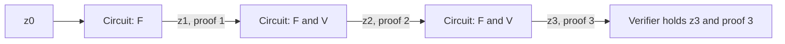
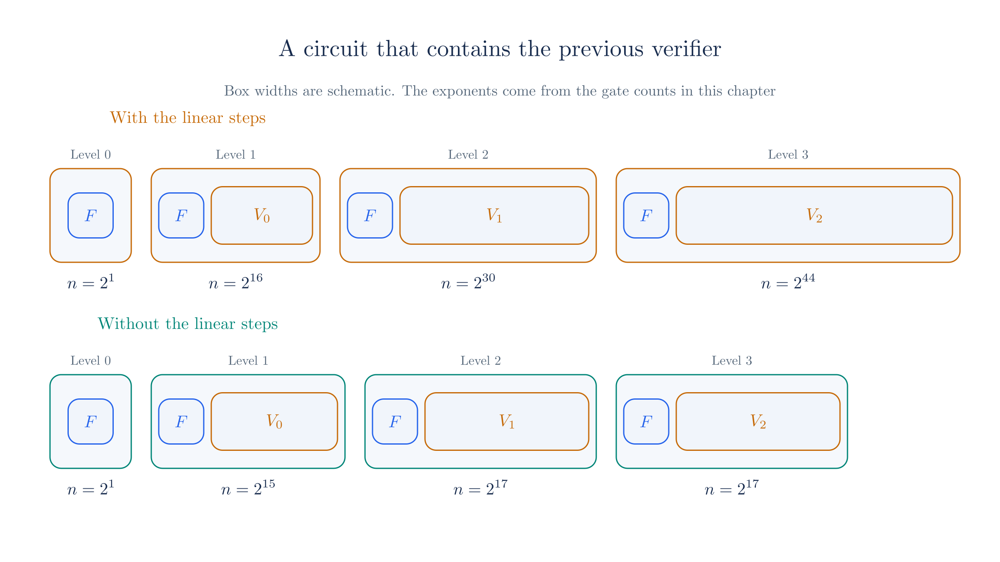
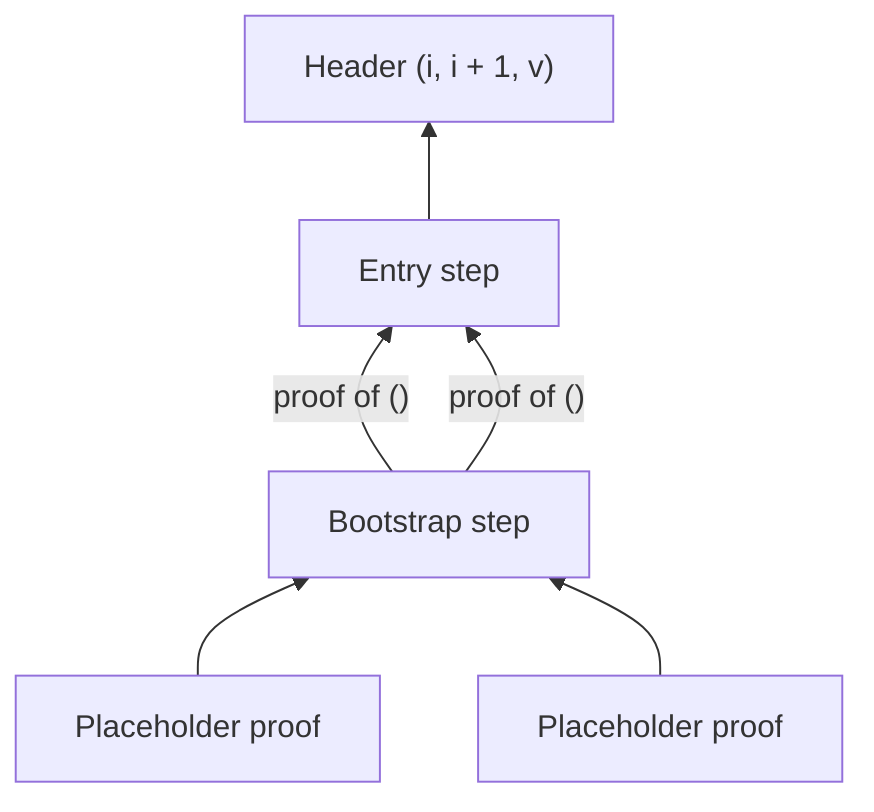

# Recursive Proofs

[Chapter 02](./pcd-intro.md#_6-attaching-a-proof) set a goal in which a node's proof covers the node's own step and also the proofs of its children, and it left open how one proof can contain a check of another. [Chapter 09](./nark.md) then built a complete proof and listed what its verifier pays. This chapter connects the two. We write the verifier as gates, place those gates inside the circuit of the next step, and measure the result.

The measurement shows that Chapter 09's verifier cannot work in this role, and it pins down the reason. We begin with a chain of steps and then move to trees, base cases, and initial states. The chapters that follow repair the verifier, so this one ends with a precise list of what they have to deliver.

## 1. A chain of steps

We start with the simplest shape, a sequence of states in which each state comes from the previous one. Call the rule the **step function** $F$ and the states $z_0, z_1, z_2, \ldots$, so that $z_{i+1} = F(z_i)$. A step function may also take a private input at each step. The Ragu Book's [example](https://github.com/tachyon-zcash/ragu/blob/3219e0865e8bff1f9d817bfe3850d9e94b64338c/book/src/protocol/core/accumulation/index.md?plain=1#L36-L41) is a blockchain virtual machine, whose state is the chain's state and whose private input is the next batch of transactions. Proving such a sequence one step at a time is the **incrementally verifiable computation** (IVC) that [Chapter 02](./pcd-intro.md#_5-running-the-tree) named.

For numbers we reuse the cubic from the [arithmetization chapter](./arithmetization.md), now applied repeatedly over $\F_{43}$. The step function is $F(z) = z^3 + z + 5$, and it has no private input. Starting from the chapter's value 3, the states are:

<!-- worked:chain -->

| $i$ | 0 | 1 | 2 | 3 | 4 | 5 |
| --- | --- | --- | --- | --- | --- | --- |
| $z_i$ | 3 | 35 | 1 | 7 | 11 | 14 |

<!-- /worked:chain -->

The first transition is the statement that Chapter 09 proved. Now suppose a verifier wants to know $z_5$ and does not want to run the steps itself. The tools we have so far offer two ways to arrange the proving, and the next table compares them. Each application of $F$ takes the 2 gates of our circuit, and a circuit with $n$ gates needs $4n$ generators, where $n$ is a power of two.

<!-- worked:alternatives -->

| Steps | Gates if one circuit holds every step | Generators that circuit needs | Proofs to check if each step has its own | Proofs to check with recursion |
| --- | --- | --- | --- | --- |
| 1 | $2$ | $8$ | 1 | 1 |
| 3 | $6$ | $32$ | 3 | 1 |
| 1,024 | $2,048$ | $8,192$ | 1,024 | 1 |

<!-- /worked:alternatives -->

One large circuit needs generators in proportion to the whole computation, and its prover must know the number of steps in advance and hold every private input at once. Giving each step its own proof avoids those problems, but the verifier's work then grows with the length of the chain. The last column is the target. It asks for one proof to check however long the chain becomes, with a prover who handles one step at a time.

## 2. A proof about a verifier

Consider the prover at step $i + 1$. It holds the state $z_i$ and a proof $\pi_i$ that this state is correct. It could check $\pi_i$ itself, compute $z_{i+1}$, and then prove that it did both of those things. A verifier of the new proof would then have no reason to look at $\pi_i$, because the new proof already says that $\pi_i$ passed its check. This idea only requires us to treat the verifier $V$ as one more computation to be proved, and it gives the following relation:

$$
\text{public: } z_{i+1}, \qquad \text{witness: } (z_i,\ \pi_i), \qquad \text{checks: } F(z_i) = z_{i+1} \ \text{ and } \ V(z_i, \pi_i) = 1.
$$

The old proof $\pi_i$ now sits in the witness, in the same place that a secret input usually sits. The old state $z_i$ sits there as well, which means the verifier of the new proof sees neither of them. The same value of $z_i$ must feed both checks, or else the prover could verify a proof about one state and apply $F$ to a different one. In a circuit, this means that both checks read one wire. The book [writes this relation](https://github.com/tachyon-zcash/ragu/blob/3219e0865e8bff1f9d817bfe3850d9e94b64338c/book/src/protocol/core/accumulation/index.md?plain=1#L52-L57) as the plainest way to build IVC from a succinct proof system.



The two boxes labeled "F and V" look the same, but they hold different circuits. The V in the first one checks a proof from the circuit that holds only F, while the V in the second checks a proof from a circuit that itself contains a verifier. Section 6 asks whether these circuits eventually stop changing, which is what a single reusable circuit would need.

Unwinding the relation shows what a single proof covers:

<!-- worked:unwind -->

The proof $\pi_2$ says that $1 = F(35)$ and that $\pi_1$ verifies for $35$. The proof $\pi_1$ in turn says that $35 = F(3)$. A verifier holding $z_2 = 1$ and $\pi_2$ runs one check, and it covers both applications of $F$.

<!-- /worked:unwind -->

Everything now depends on writing $V$ as gates, so we do that next.

## 3. Writing the verifier as gates

A circuit in the sense of the [arithmetization chapter](./arithmetization.md#_3-gates) is a list of multiplication gates $a_i b_i = c_i$ and linear constraints among the wires. Multiplying a wire by a constant or adding two wires costs no gate, because linear constraints can absorb those operations. Each other multiplication costs one gate, and so does an inversion, since proving that $a'$ inverts $a$ takes the single gate $a \cdot a' = 1$.

We take the [short proof from Chapter 09](./nark.md#_17-a-short-proof-from-the-same-parts), since it has the smallest verifier we have seen, and call it the level-0 proof. It covers $z_1 = 35$ with the hand-picked challenges of that chapter. The level-1 circuit has to establish that $z_2 = F(z_1)$ and that the level-0 proof verifies.

Most of the verifier gates below belong to the split check, which is step 7 of that chapter's run. The verifier compares the two sides of

$$
r(x)\,\bigl(r(xz) + s(x, y) + t(x, z)\bigr) = x^{4n-1}\, c_1(x^{-1}) + x^{4n}\, c_2(x),
$$

and it also checks the target $c_1(0) = k(y)$, where $k(y)$ is the public input written as a polynomial in $y$.

<!-- worked:split-recap -->

With $4n = 8$, $x = 9$ and $z = 5$, the run had $r(x) = 5$, $r(xz) = 9$, $s(x, y) = 23$, $t(x, z) = 3$, $c_1(x^{-1}) = 6$ and $c_2(x) = 30$, and the powers $x^7 = 36$ and $x^8 = 23$.

<!-- /worked:split-recap -->

The third gate in the next table computes the inner proof's public input $k(y)$ from the wire that holds $z_1$, and it costs one gate. The box explains why $k(y)$ has the form shown in the table.

::: details Where the public-input gate comes from

<!-- worked:k-gate -->

The form of this gate comes from Chapter 09. The short proof uses Chapter 09's circuit without the constant wire. Its last constraint, the one weighted by $Y^3$, reads $z_0 + z_0^3 = z_1 - 5$, because the constant 5 of the step moves to the public side. Chapter 09 wrote the start value as $x$, but here $x$ names a challenge, so we use the chain's $z_0$ instead. The instance is therefore $k(Y) = (z_1 - 5)\,Y^3$, which for $z_1 = 35$ is the $30Y^3$ of that chapter. The circuit computes $y^3$ with 2 gates and multiplies it by $z_1 - 5$. Forming $z_1 - 5$ from the wire $z_1$ is a linear operation and costs nothing, so the product costs the one gate shown.

<!-- /worked:k-gate -->

:::

Here are some of the level-1 circuit's gates, with the wires holding these values. The wires use Chapter 09's hand-picked challenges. A real level-1 circuit would derive them with the hash gates priced later in this section.

<!-- worked:example-gates -->

| Part | Left wire | Right wire | Output wire | What the gate computes |
| --- | --- | --- | --- | --- |
| Step | 35 | 35 | 21 | $z_1 \cdot z_1$ |
| Step | 21 | 35 | 4 | $z_1^2 \cdot z_1$ |
| Verifier | 30 | 42 | 13 | $k(y) = (z_1 - 5) \cdot y^3$ |
| Verifier | 5 | 35 | 3 | $r(x) \cdot (r(xz) + s(x, y) + t(x, z))$ |
| Verifier | 36 | 6 | 1 | $x^{4n-1} \cdot c_1(x^{-1})$ |
| Verifier | 23 | 30 | 2 | $x^{4n} \cdot c_2(x)$ |

<!-- /worked:example-gates -->

<!-- worked:example-eqs -->

Three linear constraints then finish this part, and they cost no gates. The step requires $4 + 35 + 5 = 1$ modulo 43, which is the public $z_2$. The split check requires $1 + 2 = 3$. The target check requires the proof's $c_1(0) = 13$ to equal the computed $k(7) = 13$.

<!-- /worked:example-eqs -->

The third row is where the two checks of Section 2 meet. The inner proof's public input $k(y)$ is computed from the same wire $z_1$ that the step's gates read. In a standalone run, $z_1$ was a known number and $k(y)$ was a matter of arithmetic. Inside this circuit $z_1$ is a wire, so the multiplication by $y^3$ needs a gate of its own.

The level-1 circuit is our own teaching construction and not a Ragu circuit. We only build and check its gates, and we do not prove it, because the toy curve's 43 points are too few to serve as distinct generators for a circuit of this size.

### Point operations

The verifier also adds and scales points, and those operations reduce to gates in the same way. Adding two points takes three gates, because the prover supplies the slope of the line through them as a witness and the circuit only has to check it and build the result. Doubling a point takes a fourth gate, because the tangent slope needs the square of a coordinate. The box gives the three gates.

::: details The gates for adding two points

Adding $(x_1, y_1)$ and $(x_2, y_2)$ uses a slope $\lambda$, which the prover supplies as a witness, and three gates that check it and build the result:

$$
\lambda \cdot (x_2 - x_1) = y_2 - y_1, \qquad \lambda \cdot \lambda = x_3 + x_1 + x_2, \qquad \lambda \cdot (x_1 - x_3) = y_3 + y_1.
$$

These formulas assume $x_1 \neq x_2$, and a circuit must deal with that case separately. Doubling computes $x_1^2$ for the tangent slope, which is the fourth gate.

:::

Ragu's [point gadget](https://github.com/tachyon-zcash/ragu/blob/3219e0865e8bff1f9d817bfe3850d9e94b64338c/crates/ragu_primitives/src/point.rs#L198-L259) uses the same formulas. A scalar multiplication repeats these operations once per bit of the scalar. In the plainest form each lower bit doubles the running point, adds the base point, and selects one of the two results according to the bit, which costs one gate per coordinate. Each bit also needs one gate to show that it is 0 or 1.

::: warning The toy curve's fields do not line up here
The polynomials in our proof have coefficients in $\F_{43}$, so its circuit has wires in $\F_{43}$. The commitments are points on $E$, whose coordinates lie in $\F_{31}$, and a wire in $\F_{43}$ cannot directly do arithmetic modulo 31. The verifier's group operations therefore do not fit in this circuit as written. Emulating the other field is possible but costs far more than the gate counts below. We set this aside until the [curve cycles chapter](./curve-cycles.md), which removes the mismatch. To count gates at their native cost, the next example runs on the partner curve $E'$, whose coordinates do lie in $\F_{43}$.
:::

<!-- worked:scalar-mul -->

The toy proof's scalars are elements of $\F_{43}$, which have 6 bits. The curve $E$ cannot run inside this circuit, so we measure the cost per bit on $E'$ and apply it to 6-bit scalars. Take the point $P' = (12,\,31)$ on $E'$ and the scalar $23$, written in binary as $10111$. The circuit spends 5 gates to show that the digits are bits, 16 on doublings, 12 on additions and 8 on selecting by each bit, for a total of 41 gates. Its output wires hold $(20,\,40)$, which equals $23 \cdot P'$ computed outside the circuit. Counting gates bit by bit gives $10b - 9$ gates for a scalar of $b$ bits, which is $2,541$ gates for a 255-bit scalar and $51$ gates for the toy proof's 6-bit scalars. We use $51$ as the stand-in price for each of the toy proof's scalar multiplications. The stand-in is needed because the scalars of $E'$ itself have only 5 bits, since $E'$ has 31 points.

<!-- /worked:scalar-mul -->

::: details Counting the gates per bit

<!-- worked:scalar-mul-count -->

For a scalar of $b$ bits whose top bit is 1, the circuit starts the running point at $P'$, so the top bit needs no doubling, addition or selection. Each of the other $b - 1$ bits costs 4 gates for the doubling, 3 for the addition and 2 for the selection, and every one of the $b$ bits costs 1 gate for its bit check. So the scalar costs $b + (4 + 3 + 2)(b - 1) = 10b - 9$ gates here. For the toy proof's 6-bit scalars that gives $10 \cdot 6 - 9 = 51$, and for a 255-bit scalar it gives $2,541$.

<!-- /worked:scalar-mul-count -->

A scalar whose top bit may be 0 needs a few extra gates to handle that case, which does not change how the cost grows with $b$.

:::

This count describes our plain construction and not an optimized one. Real circuits lower the cost per scalar multiplication, and the [endoscalars chapter](./endoscalars.md) covers Ragu's main technique. Sections 4 and 6 show that this kind of saving does not change the conclusion.

### The hash

A non-interactive verifier [gets its challenges by hashing the transcript](./statements-and-challenges.md#_7-removing-the-verifier-with-fiat–shamir), so the level-1 circuit has to do the hashing too. It may look tempting to save those gates by giving the circuit its challenges as inputs and leaving the hash to whoever verifies the outer proof. The trouble is that the outer verifier does not hold the inner transcript, and the prover fills in every witness wire:

<!-- worked:free-challenge -->

Take the false trace with $z_0 = 4$ and the statement 35. Of the 1,849 pairs $(z, y)$, 43 satisfy the revdot equation for this trace, the same count as in [Chapter 09](./nark.md#the-prover-follows-every-instruction). All of them have $y = 0$, because the gates of this trace hold and only the constraint weighted by $y^3$ fails. If the circuit read its challenges from the witness, the prover could set $(z, y) = (5, 0)$, and every field check in the level-1 circuit would pass. At the hand-picked pair $(5, 7)$, the same false trace fails.

<!-- /worked:free-challenge -->

A circuit therefore recomputes each challenge from the inner proof's messages, using gates. This is the reason for choosing a hash like Poseidon, whose only nonlinear operation is a small power. Here is what that costs on the toy sponge:

<!-- worked:hash-cost -->

Replaying the transcript for $4n = 8$ takes 17 permutations of the toy sponge. The sponge has 32 S-boxes per permutation, each computing $v^5$ with 3 gates, so the replay costs $1,632$ gates.

<!-- /worked:hash-cost -->

## 4. What the verifier costs

We now have a gate price for every row of [Chapter 09's cost table](./nark.md#_17-a-short-proof-from-the-same-parts). The first measurement is for the toy proof itself, with 6-bit scalars:

<!-- worked:toy-costs -->

| Verifier step | Gates for $4n = 8$ | Growth in $n$ |
| --- | --- | --- |
| Compute $s(x, y)$ | $14$ | **Linear** |
| Compute $t(x, z)$ | $20$ | Logarithmic |
| Compute $k(y)$ | $3$ | Constant |
| Split and target checks | $9$ | Logarithmic |
| Derive $f(u)$ and $v$ | $17$ | Constant |
| IPA scalars and $\hat{b} = g(u)$ | $17$ | Logarithmic |
| Compute the coefficients of $g$ | $9$ | **Linear** |
| Replay the transcript | $1,632$ | Logarithmic |
| Scalar multiplications for $P$, $v \cdot U$, the $L_j$ and $R_j$, and the final check | $612$ | Logarithmic |
| Compute $\hat{G}$ | $408$ | **Linear** |
| Total | $2,741$ |  |

<!-- /worked:toy-costs -->

<!-- worked:toy-total -->

The step itself took 2 gates, and verifying the proof of that same step takes $2,741$. The field rows of this table come from running the gates on the values of the Chapter 09 proof, and the script confirms that each count from the run equals the formula for that row. The hash row is 17 permutations at 96 gates each. The last two rows are scalar multiplications at 51 gates each, 12 of them in the first and 8 in the second.

<!-- /worked:toy-total -->

The table prices each row as if it computed its own powers. A real circuit would share them, since $y^3$ appears in both the $s(x, y)$ row and the $k(y)$ row, and $x^{4n-1}$ appears in both the $s(x, y)$ row and the split row. Sharing would save a handful of gates and would not change how any row grows.

The three bold rows decide how the verifier grows. Computing $s(x, y)$ takes a gate for each power of $x$ and $y$ and for each wiring term, each coefficient of $g$ takes one gate, and $\hat{G}$ takes one scalar multiplication per generator. The box traces the toy counts to these gates.

::: details Where the three bold counts come from

<!-- worked:linear-rows -->

For $s(x, y)$, the circuit first needs the powers $x^2, \ldots, x^{7}$, which take 6 gates, and the powers $y^2, \ldots, y^{3}$ for the 4 constraints, which take 2. Our circuit has 8 wiring terms. Each one multiplies a power of $y$ by a power of $x$, which takes a gate, except the 2 terms of the first constraint, whose power of $y$ is $y^0 = 1$. Multiplying by the wiring coefficient is free because the coefficient is a constant. That gives $6 + 2 + 6 = 14$ gates.

For the coefficients of $g$, the first coefficient is the product of the 3 inverted challenges $u_j^{-1}$, which takes 2 gates, and each of the other 7 coefficients is an earlier coefficient times one $u_j^2$, which takes one gate. That gives $2 + 7 = 9$.

The point $\hat{G}$ is a sum of 8 generators, each scaled by one coefficient of $g$, so it costs 8 scalar multiplications at 51 gates each, which is $408$.

<!-- /worked:linear-rows -->

:::

At this tiny size the fixed costs dominate, so the table says little about growth. To see the growth, we move to the size that Ragu uses. Its [production rank](https://github.com/tachyon-zcash/ragu/blob/3219e0865e8bff1f9d817bfe3850d9e94b64338c/crates/ragu_circuits/src/polynomials/mod.rs#L123-L127) gives polynomials $2^{13}$ coefficients and circuits at most $2^{11}$ gates. We keep the same plain gadgets with 255-bit scalars, and we assume that a larger circuit has the same density of wiring as our toy. Both choices are ours and not Ragu's. Under that assumption the counts above become formulas in $n$. The bold rows grow in proportion to $n$, and the other rows grow only with $k = \log_2 4n$, the number of rounds of the inner product argument. The box derives each formula.

::: details Counting each row at any size

<!-- worked:linear-general -->

The same counting works for any $n$. The powers of $x$ take $4n - 2$ gates. If a circuit keeps our density of $2n$ constraints and $4n$ wiring terms, with two terms in the first constraint, the powers of $y$ take $2n - 2$ gates and the wiring terms take $4n - 2$. So $s(x, y)$ costs $(4n - 2) + (2n - 2) + (4n - 2) = 10n - 6$ gates, which is 14 at $n = 2$. With $k = \log_2 4n$ challenges, the coefficients of $g$ cost $(k - 1) + (4n - 1)$ gates, and $\hat{G}$ costs $4n \cdot m$ for a scalar multiplication of $m$ gates.

<!-- /worked:linear-general -->

<!-- worked:log-rows -->

The other rows depend on $n$ only through $k = \log_2 4n$, the number of rounds of the inner product argument. Two of them, the scalar multiplications and the transcript replay, hold almost all of their gates, and Section 6 relies on both, so we derive their counts. The scalar multiplications come from three places. Forming $P$ takes 3 multiplications by $\beta$, one for each of the three commitments folded into the running point, and $v \cdot U$ takes one more, which makes the 4 that Chapter 09's cost table lists. Each of the $k$ rounds of the inner product argument scales $L_j$ by $u_j^{-2}$ and $R_j$ by $u_j^2$, which makes $2k$. The final equation scales $\hat{G}$ by $\hat{a}$ and $U$ by $\hat{a}\hat{b}$, which makes 2. The total is $4 + 2k + 2 = 2k + 6$, or 32 at $k = 13$.

For the hash, recall that the toy sponge holds 2 field elements of input at a time and [permutes only when it has to](./statements-and-challenges.md#_10-poseidon-and-the-random-oracle-assumption), which happens when a third element arrives or when a challenge is requested. A squeeze after new input yields 2 challenges. So a group of $e$ absorbed elements followed by a squeeze costs $\lceil e / 2 \rceil$ permutations in all, the last of which is the squeeze. The transcript has five such groups before the inner product argument. Of these, the 3 elements of the domain tag and the 2 coordinates of $R$ take 3, the 4 coordinates of $C_1$ and $C_2$ take 2, the 5 evaluations take 3, the 2 coordinates of $F$ take 1, and the 3 values at $u$ take 2, which makes 11. Each round of the argument then absorbs the 4 coordinates of $L_j$ and $R_j$ and squeezes $u_j$, which takes 2. The total is $2k + 11$ permutations.

<!-- /worked:log-rows -->

:::

<!-- worked:other-field -->

The five small field rows of the toy table, which compute $t(x, z)$, $k(y)$, the split and target checks, $f(u)$ and $v$, and the IPA scalars and $\hat{b}$, together cost $14k + 24$ gates. That is 66 at $k = 3$, matching the toy table, and 206 at $k = 13$, or 0.001 percent of the production verifier's gates, so none of the conclusions below depend on them. The next table merges them into one row, and the box below lists their parts for readers who want them.

::: details Parts of the five field rows

Each of these rows is a fixed number of inversions and products plus a few powers computed by square-and-multiply. A power $x^e$ computed that way costs one squaring for each bit of $e$ after the first, plus one product for each further bit that is 1. The exponent $4n - 1 = 2^k - 1$ has $k$ bits, all equal to 1, so $x^{4n-1}$ costs $(k - 1) + (k - 1) = 2k - 2$ gates.

The split and target checks show how the counting goes. The inversion that gives $x^{-1}$ costs 1 gate. The circuit computes $x^{4n-1}$ with $2k - 2$ gates, and one more product turns that into $x^{4n}$. The split check then needs the three products shown in the table of example gates, and the target check is a linear comparison that costs nothing. So the row costs $1 + (2k - 2) + 1 + 3 = 2k + 3$ gates, which is 9 at $k = 3$, as in the toy table. The other rows follow the same pattern.

| Verifier step | Parts | Gates |
| --- | --- | --- |
| Compute $t(x, z)$ | $3$ inversions, $8$ products, and $5$ powers by square-and-multiply | $6k + 2$ |
| Compute $k(y)$ | $y^2$, $y^3$, then one product | $3$ |
| Split and target checks | $1$ inversion, $2k - 2$ for $x^{4n-1}$, $1$ for $x^{4n}$, $3$ products | $2k + 3$ |
| Derive $f(u)$ and $v$ | $5$ inversions and $5$ products for the quotients, $4$ for $\alpha$, $3$ for $\beta$ | $17$ |
| IPA scalars and $\hat{b}$ | $k$ inversions, $2k$ squares, $2k - 1$ for $g(u)$, $k - 1$ powers of $u$, $1$ for $\hat{a} \hat{b}$ | $6k - 1$ |

:::

<!-- /worked:other-field -->

The next table collects a formula for every row at the production size.

<!-- worked:prod-costs -->

| Verifier step | How the count arises, with $k = \log_2 4n$ | Gates for $4n = 2^{13}$, 255-bit scalars | Growth in $n$ |
| --- | --- | --- | --- |
| Compute $s(x, y)$ | $(4n - 2) + (2n - 2) + (4n - 2)$ | $20,474$ | **Linear** |
| Other field work: $t(x, z)$, $k(y)$, the split and target checks, $f(u)$ and $v$, the IPA scalars and $\hat{b}$ | $14k + 24$ | $206$ | Logarithmic |
| Compute the coefficients of $g$ | $(k - 1) + (4n - 1)$ | $8,203$ | **Linear** |
| Replay the transcript | $(2k + 11)$ permutations at $96$ gates | $3,552$ | Logarithmic |
| Scalar multiplications for $P$, $v \cdot U$, the $L_j$ and $R_j$, and the final check | $(2k + 6) \cdot m$ | $81,312$ | Logarithmic |
| Compute $\hat{G}$ | $4n \cdot m$ | $20,815,872$ | **Linear** |
| Total |  | $20,929,619$ |  |

<!-- /worked:prod-costs -->

<!-- worked:prod-budget -->

The linear rows account for $20,844,549$ of the $20,929,619$ gates, which is 99.6 percent. A circuit at this size has room for $n = 2,048$ gates. The coefficients of $g$ alone need $8,203$, and $\hat{G}$ would exceed the limit even if a scalar multiplication cost one gate, because there are $8,192$ of them.

<!-- /worked:prod-budget -->

The bold rows are the two costs that [Chapter 09 identified](./nark.md#_17-a-short-proof-from-the-same-parts), namely computing $s(x, y)$ and computing $\hat{G}$, with the coefficients of $g$ counted as part of $\hat{G}$. The last sentence above needs no cost model, because it only compares two counts. A verifier that performs $4n$ scalar multiplications cannot fit in a circuit of $n$ gates.

## 5. Why the linear steps cannot be dropped

Since these steps are the whole problem, it is natural to ask what happens if the circuit leaves them out and reads the two values from the proof. Each attempt opens a specific attack. We start with $s(x, y)$, which is the verifier's only contact with the circuit it thinks it is checking:

<!-- worked:drop-s -->

The start value $z_0 = 4$ does not satisfy our statement, since $4^3 + 4 + 5 = 30$, not 35. It does satisfy a different circuit, $z_0^3 + 13 z_0 = 30$, which differs from ours in one wiring coefficient. A prover who builds its proof from that other circuit passes the split and target checks if the verifier reads $s(x, y) = 24$ from the proof. When the verifier computes the value from our circuit it gets $23$, and the split check fails.

<!-- /worked:drop-s -->

So without its own value of $s(x, y)$, the verifier cannot tell which circuit a proof belongs to. The point $\hat{G}$ plays a comparable role in the [inner product argument](./inner-product-argument.md). It connects the final equation to the public generators:

<!-- worked:drop-g -->

Suppose the prover lies about the batched value and claims $v = 37$ where the truth is $36$, keeping every $L_j$, $R_j$ and $\hat{a} = 6$ from the honest run. If the verifier computes $\hat{G} = (4,\,25)$ itself, then of the 43 possible values of $v$ only $36$ passes the final equation with this $\hat{a}$. If the verifier accepts $\hat{G}$ from the proof, the prover can solve that equation for the point, which gives $\hat{G}' = \hat{a}^{-1} \cdot (\text{left side}) - \hat{b} \cdot U = (16,\,21)$. This takes only point additions and scalar multiplications, and it succeeds for all 43 values of $v$.

<!-- /worked:drop-g -->

A prover facing the honest $\hat{G}$ could still look for a different $\hat{a}$, but that means solving a discrete log, which the toy curve permits and a real curve does not. The false $\hat{G}'$ needs no such thing. Both linear steps therefore have to happen somewhere, and the question left is whether they have to happen inside every step's circuit.

They do not, because the attacks above exploit a verifier that trusts the prover's value, and a verifier can avoid that without computing the value at once. It can record the prover's value as a claim and have the claim checked later. A false claim stays false while it waits, so the later check still catches it:

<!-- worked:drop-g-later -->

In our example the prover's claim is $\hat{G} = (16,\,21)$ for the challenges $(15, 10, 3)$, and the true MSM gives $(4,\,25)$.

<!-- /worked:drop-g-later -->

One MSM performed by anyone, at any later time, exposes this claim. This idea comes from [Halo](https://eprint.iacr.org/2019/1021). We could read only that paper's abstract, so our account of it follows the Ragu Book. Halo's insight was that the circuit can [carry such a claim forward in its instance](https://github.com/tachyon-zcash/ragu/blob/3219e0865e8bff1f9d817bfe3850d9e94b64338c/book/src/protocol/index.md?plain=1#L143-L168), and that two claims can be merged into one by a cheap random check. Only the last claim in a long history then needs its MSM, and a single MSM ends up standing for every earlier one. The relation from Section 2 gains an object called an **accumulator**, which holds the postponed claims. The checks become $F(z_i) = z_{i+1}$ together with a [check that the accumulator was updated correctly](https://github.com/tachyon-zcash/ragu/blob/3219e0865e8bff1f9d817bfe3850d9e94b64338c/book/src/protocol/core/accumulation/index.md?plain=1#L87-L92), and the final verifier decides the last accumulator itself. The [next chapter](./accumulation.md) builds this for $\hat{G}$, and the chapter on [wiring and the registry](./wiring-and-registry.md) does the corresponding work for $s(x, y)$.

## 6. Why the circuit cannot keep growing

So far we have priced one level of recursion. Now let $n_i$ be the number of gates at level $i$, and let $f$ be the gates of the step itself. A circuit at level $i + 1$ holds the step and a verifier for level $i$, so with $V(n)$ standing for the gates of a verifier for an $n$-gate circuit,

$$n_{i+1} = f + V(n_i).$$

Suppose first that the verifier is linear, with $V(n) = c \cdot n$ for some constant $c$. Each level multiplies the previous size by $c$ and adds $f$, so after $i$ levels the start has been multiplied by $c^i$ and each earlier copy of $f$ by a smaller power of $c$. The box writes out the first few levels.

::: details Expanding the recurrence

$$
\begin{aligned}
n_1 &= f + c\, n_0, \\
n_2 &= f + c\,(f + c\, n_0) = f + c f + c^2 n_0, \\
n_i &= c^i n_0 + f\,(1 + c + c^2 + \cdots + c^{i-1}).
\end{aligned}
$$

:::

If $c < 1$, those powers of $c$ shrink, their sum converges, and the size settles near $f / (1 - c)$. If $c \geq 1$, the size grows without limit, and for $c > 1$ it grows exponentially with the level. Our rows give the value of $c$:

<!-- worked:slope -->

Counting the coefficient of $n$ in our rows gives 10 gates per $n$ for $s(x, y)$, 4 for the coefficients of $g$, and $4m$ for $\hat{G}$, where $m$ is the cost of one scalar multiplication. So $c = 14 + 4m$. With $m = 2,541$ that is $c = 10,178$, and even the impossible $m = 1$ gives $c = 18$.

<!-- /worked:slope -->

No improvement to scalar multiplication can bring $c$ below 1, because the verifier has $4n$ of them to perform for a circuit of $n$ gates. This is why the optimized gadgets of Section 3 do not change the conclusion.

Section 5 ended with a way to move the two linear steps out of the circuit by postponing them as claims, and the next chapters build it. For now we measure only the rows that would stay in the circuit, so that we know whether moving the linear steps is worth the trouble, and we come back to the cost of moving them after the table. The rows left in the circuit grow with $\log n$, so the recurrence becomes $n_{i+1} = f + a \log_2 n_i + b$ for some constants $a$ and $b$. A logarithm grows more slowly than its input, so there is a size at which a circuit is large enough to hold the verifier of a circuit of its own size.

The next table runs both recurrences from our 2-gate step, rounding each circuit up to the power of two it needs.

<!-- worked:growth -->

| Level | Gates with the linear steps in the circuit | Size $n$ needed | Gates with the linear steps moved out | Size $n$ needed |
| --- | --- | --- | --- | --- |
| 0 | $2$ | $2^{1}$ | $2$ | $2^{1}$ |
| 1 | $52,543$ | $2^{16}$ | $32,192$ | $2^{15}$ |
| 2 | $667,136,930$ | $2^{30}$ | $106,224$ | $2^{17}$ |
| 3 | $1.1 \times 10^{13}$ | $2^{44}$ | $116,800$ | $2^{17}$ |
| 4 | $1.8 \times 10^{17}$ | $2^{58}$ | $116,800$ | $2^{17}$ |
| 5 | $2.9 \times 10^{21}$ | $2^{72}$ | $116,800$ | $2^{17}$ |

<!-- /worked:growth -->



<!-- worked:growth-fixed -->

With the linear steps moved out, the size settles at $n = 2^{17}$ and stays there, because a circuit of that size can verify a proof from a circuit of the same size. At that size $k = 19$, and the scalar multiplications and the transcript replay hold $116,508$ of the $116,800$ gates, so what remains in the circuit is almost entirely group operations and hashing.

The last two columns leave out a cost. Moving a linear step out of the circuit does not make it disappear, because the circuit must then check that the postponed claim was handled correctly. The [next chapter prices](./accumulation.md#what-each-party-pays) the verifier's side of the merge that postpones $\hat{G}$ at $2k + 3$ scalar multiplications. Adding those to the verifier at every level moves the settled size from $2^{17}$ to $2^{18}$, and whatever replaces the computation of $s(x, y)$ adds more. So the settled size in the table is a lower bound. What this section needs is only that some settled size exists, and it does, because each added cost is still logarithmic.

<!-- /worked:growth-fixed -->

For a chain with one step function, once the size stops changing, one fixed circuit serves every step, and that circuit verifies proofs made by itself. The prover's work per step is then constant, and the proof's history can be arbitrarily long. A growing circuit would also fail for a blunter reason, since a circuit can never exceed the size allowed by the public generators, which are [fixed in advance](./polynomial-commitments.md#public-parameters).

Even the lower bound is far above Ragu's limit of $2^{11}$ gates. That gap comes from our plain gadgets and our single large circuit. The later chapters close it with other techniques, and the [chapter on recursion in Ragu](./ragu-recursion.md) assembles them.

## 7. What succinct verification has to mean

Section 6 showed that the in-circuit part of the verifier has to grow more slowly than the circuit it verifies, which makes the requirement from [Chapter 02](./pcd-intro.md#_8-succinctness) precise. One point remains to add. The requirement concerns the work done inside the circuit and not the length of the proof. Ragu's proofs [stay large while they are being fused](./pcd-intro.md#proof-size-and-hiding-in-ragu), and this is allowed, provided that the circuit does not read all of a proof's contents.

### Two routes to a succinct verifier

There have been two main routes to a verifier like this. Earlier recursive systems [used proofs with a constant-time verifier](https://github.com/tachyon-zcash/ragu/blob/3219e0865e8bff1f9d817bfe3850d9e94b64338c/book/src/protocol/index.md?plain=1#L126-L139), so the verifier could be encoded directly and the circuit converged. The book describes the resulting systems as barely practical, and they needed very large curves, complicated assumptions, and trusted setups. Those proofs were pairing-based SNARKs. A pairing is an extra map, available only on certain curves, that lets a verifier check a polynomial evaluation in constant time, and recursing on such proofs required a cycle of two curves that both have one. The known cycles of that kind use large curves on which arithmetic is slow. [Chapter 01](./scaling-zcash.md) explained why Tachyon rules out a trusted setup.

The second route is Halo's, which the end of Section 5 described. It keeps the linear verifier, postpones the expensive steps as claims, and merges the claims so that one final MSM settles all of them. Ragu follows this route.

## 8. From a chain to a tree

A chain makes each prover wait for the one before it, so independent parties need the tree form from [Chapter 02](./pcd-intro.md#_5-running-the-tree). The change to the relation is direct. A node now has a left and a right input, each with its own state and proof, and the step function combines them. Following the book's [2-arity PCD](https://github.com/tachyon-zcash/ragu/blob/3219e0865e8bff1f9d817bfe3850d9e94b64338c/book/src/protocol/core/accumulation/index.md?plain=1#L197-L207), we write

$$
\text{public: } z, \qquad \text{witness: } (z_L, \pi_L, z_R, \pi_R), \qquad \text{checks: } F(z_L, z_R) = z, \ \ V(z_L, \pi_L) = 1, \ \ V(z_R, \pi_R) = 1.
$$

Chapter 02's tally is a computation of this form:

<!-- worked:carol -->

Carol from Chapter 02 joined $(0, 4, 25)$ and $(4, 8, 22)$ into $(0, 8, 47)$. Her circuit checks $4 = 4$ and $25 + 22 = 47$, and it runs the verifier twice, once on the proof of each input header.

<!-- /worked:carol -->

Each verifier reads a child proof, and that proof may come from a leaf or from a large subtree. It may also come from a different step, since a `Join` can take a header made by `Entry` or by another `Join`. The verifier therefore has to be the same at every node and accept a child proof whatever step and whatever depth produced it, while the step part of each circuit can differ. A tree with several step functions thus has several circuits that share one verifier, and Section 6's picture of one circuit verifying its own proofs becomes several circuits verifying each other's proofs. Once the verifier is uniform in this way, [all 429 tree shapes](./pcd-intro.md#_5-running-the-tree) over Chapter 02's list can use it.

A uniform verifier runs into the first attack of Section 5. The value $s(x, y)$ depends on the circuit, so a verifier that accepts proofs from `Entry` and from `Join` needs the right $s(x, y)$ for whichever circuit produced the child. That attack showed that the verifier cannot read this value, or the choice of circuit, from the proof, since a prover would then pick a circuit that its false witness satisfies. It has to learn which circuit made a child without trusting the prover, and the chapter on [wiring and the registry](./wiring-and-registry.md) explains how Ragu does this.

Having two verifiers changes the recurrence to $n_{i+1} = f + 2 V(n_i)$:

<!-- worked:tree-growth -->

With the linear steps, level 1 already needs $2^{17}$ gates, where the chain needed $2^{16}$, and level 2 needs $2^{32}$. With them moved out, the size again settles, now at $n = 2^{18}$ compared with the chain's $2^{17}$. Doubling the verifier work added 1 to the exponent.

<!-- /worked:tree-growth -->

So a second input is a small price once the verifier is sublinear, and it makes the linear case worse. With a tree, accumulation has to do slightly more work as well, because a node holds two incoming accumulators and [merges both](https://github.com/tachyon-zcash/ragu/blob/3219e0865e8bff1f9d817bfe3850d9e94b64338c/book/src/protocol/core/accumulation/index.md?plain=1#L232-L239) into one.

Ragu takes this form for every node. As [Chapter 02 said](./pcd-intro.md#fusing-in-ragu), a step that needs fewer than two inputs fills the others with the unit header `()`. Supporting chains, leaves, and joins as separate cases would mean a separate mechanism for each, so Ragu gives every node two inputs instead. A unit input still needs a proof for the node's verifier to check, and Section 9 explains where that proof comes from and counts the proofs in each shape of the tally. The [proof tree chapter](./proof-tree.md#_1-steps-headers-and-parties) applies the same rule to Tachyon's steps, where an unused input is also the unit header.

## 9. The base case

The relations above say that every state has a proof behind it, but the first state has no earlier proof to point to. The circuit needs some way to skip the verifier at the start, and that skip is a dangerous thing to add, since any prover who can trigger it escapes the check. To see how the design of the skip decides what a proof means, consider three versions of the rule for our chain. In each version the flag is a witness wire in the step circuit that consumes the previous proof, and when it is set, that circuit skips its verifier.

In the first design the header holds only the state $z$, and nothing restricts when the prover sets the flag. It can raise the flag at any step, skip the verifier there, and claim any output of $F$ without any history. A header like this cannot even say how many steps happened. The second design adds a step counter $i$ to the header and lets the flag work only at $i = 0$, so a proof at step $i$ really does cover $i$ applications of $F$. It still leaves the start value open, so the prover may begin wherever it likes.

The third design closes that gap by carrying the start value $z_0$ in the header. The flag checks $z = z_0$ at $i = 0$, and every later step copies $z_0$ from its input header to its output header unchanged. Without the copying rule a step could replace $z_0$ along the way, and the field would record nothing. With it, the verifier can compare $z_0$ with the start it cares about. This comparison is the same one that [Chapter 02 required](./pcd-intro.md#_7-why-a-false-header-has-no-valid-proof) of any verifier. A valid proof shows only that the rules produced this header, so the verifier has to confirm that the header is the one it wanted.

The next table confirms this reasoning by counting, for each design, the states that a valid proof can claim, at step 5 for the two designs that count steps.

<!-- worked:base-designs -->

| Design | Base-case rule | Header | States a valid proof can claim |
| --- | --- | --- | --- |
| 1 | The prover sets a flag, and the flag skips the verifier | $z$ | 29 of 43 (any value in the image of $F$) |
| 2 | The flag requires $i = 0$ | $(i, z)$ | 15 of 43 at $i = 5$ |
| 3 | The flag requires $i = 0$ and $z = z_0$, and each step copies $z_0$ unchanged | $(i, z_0, z)$ | 1 value at $i = 5$, namely $z_5 = 14$, once the verifier requires $z_0 = 3$ |

<!-- /worked:base-designs -->

<!-- worked:base-count -->

The counts come from running each rule over all of $\F_{43}$. In the first design a flagged step may take any of the 43 field elements as its input, and $F$ maps them onto 29 values, so those are the states a proof can claim. In the second design the prover still picks any start, but then has to apply $F$ 5 times to reach $i = 5$. Each application shrinks the set of reachable values, from 43 to 29, 22, 19, 17 and finally 15. The third design has 43 headers at $i = 5$, one for each start, and the verifier's comparison with $z_0 = 3$ leaves one.

<!-- /worked:base-count -->

The level-0 proof from Chapter 09 has no check on its start at all. Its public input is 35 and its start value is secret, so it shows only that something maps to 35. That is what the statement of that chapter said, and it is a reasonable statement on its own, though a chain that needs a particular start would have to add one of these rules.

### The base case in Ragu

Ragu does not place a skip in each step's circuit. It performs the skip once, in an internal step called the bootstrap step. That step takes two placeholder proofs, skips their checks, and outputs a valid proof of the unit header, which attests nothing. Application steps cannot use this skip, so each leaf starts by fusing its own step with the bootstrap proof as both children, and its circuit checks those children like any others. The application has no flag to set. A leaf's truth comes from the checks in the application's own step and from the verifier's final comparison, as in the third design. For the tally's `Entry` step this looks as follows:



::: warning The Ragu Book's two descriptions differ, and the code matches one
**Book, [accumulation chapter](https://github.com/tachyon-zcash/ragu/blob/3219e0865e8bff1f9d817bfe3850d9e94b64338c/book/src/protocol/core/accumulation/index.md?plain=1#L125-L138):** at $i = 0$, the accumulators take a placeholder value, the previous instance is one that satisfies its checks by construction, and the fuse circuit skips the rest of its work.

**Book, [PCD chapter](https://github.com/tachyon-zcash/ragu/blob/3219e0865e8bff1f9d817bfe3850d9e94b64338c/book/src/concepts/pcd.md?plain=1#L106-L117), and code at `3219e08`:** the base case lives in one internal step. Its [placeholder proofs do not verify on their own](https://github.com/tachyon-zcash/ragu/blob/3219e0865e8bff1f9d817bfe3850d9e94b64338c/crates/ragu_pcd/src/proof/mod.rs#L1021-L1030), and Ragu [runs that step once](https://github.com/tachyon-zcash/ragu/blob/3219e0865e8bff1f9d817bfe3850d9e94b64338c/crates/ragu_pcd/src/lib.rs#L507-L516) when the application is set up. The bootstrap step's input type, which the code calls `Dummy`, is private to Ragu, and application code [cannot declare it](https://github.com/tachyon-zcash/ragu/blob/3219e0865e8bff1f9d817bfe3850d9e94b64338c/crates/ragu_pcd/src/header.rs#L15-L27). Each leaf [starts by fusing](https://github.com/tachyon-zcash/ragu/blob/3219e0865e8bff1f9d817bfe3850d9e94b64338c/crates/ragu_pcd/src/lib.rs#L627-L648) its step with the bootstrap proof as both children, and that fuse enforces the children's claims in the ordinary way. The [chapter on recursion in Ragu](./ragu-recursion.md) shows which internal check the bootstrap step relaxes.

**Reconstructed from code at commit 3219e08, not confirmed by the authors.** This site follows the code. We read the accumulation chapter's version as a simplified account for teaching IVC.
:::

With unit inputs backed by the bootstrap proof, we can count the work for both shapes of the 8-entry tally. A chain needs a step of its own. [Chapter 02's chain](./pcd-intro.md#_5-running-the-tree) combines the previous result with one new entry, but `Join` cannot do that directly, because the new entry would first need its own `Entry` node. A chain step instead reads the entry as a witness. We call it `Append`:

$$\text{inputs } (\ell, h, s),\ (), \qquad \text{witness } v, \qquad \text{check } L_h = v, \qquad \text{output } (\ell,\ h + 1,\ s + v).$$

<!-- worked:append -->

For example, `Append` takes $(0, 4, 25)$ and the unit header, checks $L_{4} = 6$, and outputs $(0, 5, 31)$.

<!-- /worked:append -->

A chain then starts with one `Entry` node, whose two inputs are both unit headers, and continues with one `Append` per remaining entry, each with a unit header on its right. So a chain is a lopsided tree. The balanced tree uses one `Entry` leaf per entry and the `Join` nodes above them. Every node verifies two proofs, and each unit input contributes a bootstrap proof to that count:

<!-- worked:tree-shapes -->

For the 8-entry tally, the balanced tree has 15 nodes (8 `Entry` and 7 `Join`), so its circuits verify 30 proofs, 16 of them bootstrap proofs behind unit inputs. The chain has 8 nodes (1 `Entry` and 7 `Append`), and its circuits verify 16 proofs, 9 of them bootstrap proofs. Both shapes end with one proof for the final verifier.

<!-- /worked:tree-shapes -->

The chain uses fewer nodes, while the balanced tree lets separate parties work at the same time. The same verifier serves both, because it accepts a child proof from `Entry`, `Join` or `Append` alike.

## 10. Tracking initial states

The third design works for a chain because a chain has one start. A tree has one start for each leaf, and a verifier may care which leaves went into the result, yet the header must [stay a fixed size](./pcd-intro.md#_8-succinctness). The book's answer is to [keep a Merkle root of the initial states](https://github.com/tachyon-zcash/ragu/blob/3219e0865e8bff1f9d817bfe3850d9e94b64338c/book/src/protocol/core/accumulation/index.md?plain=1#L219-L223). Each leaf's header holds a hash of its start value, and each node's circuit hashes its children's roots to get its own. The cost is one hash per node, and the root stays one field element however many leaves it covers. Here is that calculation on the first four values of Chapter 02's list, using the [toy sponge](./statements-and-challenges.md#a-toy-poseidon) as $H$.

<!-- worked:init-tag -->

An `Entry` leaf has no input state, so we treat the entry it checks, $L_i$, as its start value. A leaf's root is $H(L_i, \tau)$, with the start value first and a fixed tag $\tau = 18$ second. The tag separates the hashes at leaves from the hashes at joins, which take two roots instead.

<!-- /worked:init-tag -->

Each join hashes the two roots below it, and the top of the table is the root that the final header would carry:

<!-- worked:init-root -->

| Node | Inputs | Root in the header |
| --- | --- | --- |
| Leaf 0 | $H(4, \tau)$ | 20 |
| Leaf 1 | $H(11, \tau)$ | 39 |
| Leaf 2 | $H(3, \tau)$ | 41 |
| Leaf 3 | $H(7, \tau)$ | 14 |
| Join | $H(20, 39)$ | 8 |
| Join | $H(41, 14)$ | 32 |
| Top | $H(8, 32)$ | 10 |

<!-- /worked:init-root -->

A verifier who knows the four start values can recompute the root and compare it with the final header, and this check is sensitive to the start values:

<!-- worked:init-count -->

Replacing the start value of leaf 2 with each of the other 42 values changes the root in 39 cases. The remaining 3 cases are collisions, which a hash with only 43 outputs cannot avoid, and a 255-bit output makes finding one infeasible.

<!-- /worked:init-count -->

::: warning The Ragu Book and the code differ here
**Book:** the protocol [maintains a root of initial states](https://github.com/tachyon-zcash/ragu/blob/3219e0865e8bff1f9d817bfe3850d9e94b64338c/book/src/protocol/core/accumulation/index.md?plain=1#L219-L223) on each side of the cycle and [updates it in each step](https://github.com/tachyon-zcash/ragu/blob/3219e0865e8bff1f9d817bfe3850d9e94b64338c/book/src/protocol/core/accumulation/index.md?plain=1#L238).

**Code at `3219e08`:** we found no such value. The [instance shared by the internal circuits](https://github.com/tachyon-zcash/ragu/blob/3219e0865e8bff1f9d817bfe3850d9e94b64338c/crates/ragu_pcd/src/internal/native/unified.rs#L276-L331) holds commitments, challenges and the values $c$ and $v$, and the phrase appears nowhere else in the crates.

**Reconstructed from code at commit 3219e08, not confirmed by the authors.** This site follows the code, in which initial states belong to the application. Any record of where a computation began goes in the application's header, under rules set by its steps. Reading the code this way, the examples we already have fit the same pattern. Chapter 02's tally records a range of positions, and its `Entry` step checks each value against the list. The book's [getting-started guide](https://github.com/tachyon-zcash/ragu/blob/3219e0865e8bff1f9d817bfe3850d9e94b64338c/book/src/guide/getting_started.md?plain=1#L35-L46) builds a Merkle tree in application headers and steps, which is the calculation above carried out by an application. In each case the application chooses what to record and what the verifier compares.
:::

## 11. Why cheating fails

The argument from [Chapter 02](./pcd-intro.md#_7-why-a-false-header-has-no-valid-proof) walks down the tree from a false header to a step whose check rejects it. Recursion needs a slightly stronger property than that walk first suggests, because of what the relation claims about $\pi_i$. Accepted proofs of false statements exist as mathematical objects, and they are only hard to find. On the toy curve, [Chapter 09 found one](./nark.md#the-prover-knows-a-relation-among-the-generators) by using a relation among the generators. So the claim "there exists some $\pi_i$ that verifies" says little on its own, since it is usually true.

What the walk needs is the claim that the prover knows such a $\pi_i$. The K in NARK stands for this, and [Chapter 03](./statements-and-challenges.md#_3-an-interactive-proof) gave the informal idea with Schnorr's protocol. A prover able to produce an accepted proof must be able to produce a witness for it. Here the witness contains the previous proof, so the same reasoning applies again at the level below, until the walk reaches the base case. The walk therefore ends at a step whose own check rejects the false header, unless the prover has broken one of the assumptions below.

The argument assumes the following:

1. Nobody knows a relation among the generators, which is the [discrete log relation assumption](./polynomial-commitments.md#_4-why-a-prover-cannot-change-the-vector).
2. The transcript hash behaves as a random oracle. [Ragu makes this assumption about Poseidon](https://github.com/tachyon-zcash/ragu/blob/3219e0865e8bff1f9d817bfe3850d9e94b64338c/book/src/protocol/prelim/assumptions.md?plain=1#L26-L30). The assumption has to stretch further here than in a standalone proof, because the circuit contains the hash that the verifier replays, while an actual random oracle could not be written as gates.
3. The circuit wires its checks together as Sections 2, 3 and 5 require.
4. The steps are correct, and the verifier compares the final header with what it wants to know, as in Chapter 02.

Each assumption rules out an attack that this chapter or an earlier one has already run, and the next table pairs them up:

| Assumption | The attack it rules out | Where we ran it |
| --- | --- | --- |
| 1. No known relation among the generators | An accepted proof of a false statement, built from a relation among the toy curve's generators | [Chapter 09](./nark.md#the-prover-knows-a-relation-among-the-generators) |
| 2. The hash behaves as a random oracle | A prover who learns the challenges before committing, and solves for a false trace that passes at them | [Chapter 09](./nark.md#the-prover-knows-a-challenge-early) |
| 3. The state is one wire | A proof about one state, paired with $F$ applied to a different state | Section 2 |
| 3. Each challenge comes from the hash | A false trace that passes because the prover chose $y = 0$ | Section 3 |
| 3. The circuit computes $s(x, y)$ and $\hat{G}$ itself, or carries each forward as a claim that is checked later | A proof for a different circuit, and a solved $\hat{G}'$ that passes for every $v$ | Section 5 |
| 4. The base case is confined and the verifier compares the final header | A flag the prover raises at will, or a chain that starts from a value nobody wanted | Section 9 |

The rows for assumptions 3 and 4 point to checks that the level-1 circuit or the final verifier performs, and removing any one of those checks reopens the attack beside it. Assumptions 1 and 2 are different, because no check can enforce them. They hold for a real curve and a real hash, and the toy curve shows what happens when the first one fails. The walk down the tree needs all of them at once.

This is an informal argument. Formal treatments have to account for repeating the extraction over the depth of the recursion and for the hash appearing in the circuit, and this site leaves those out.

## 12. Recursion in Ragu

The operation that builds these proofs is [`fuse`](https://github.com/tachyon-zcash/ragu/blob/3219e0865e8bff1f9d817bfe3850d9e94b64338c/crates/ragu_pcd/src/fuse/mod.rs#L74-L81), whose signature names the pieces of the relation in Section 8:

```rust
pub fn fuse<'source, RNG: CryptoRng, S: Step<C>>(
    &self,
    rng: &mut RNG,
    step: S,
    witness: S::Witness<'source>,
    left: Pcd<C, R, S::Left>,
    right: Pcd<C, R, S::Right>,
) -> Result<(Pcd<C, R, S::Output>, S::Aux<'source>)> {
```

Here, $F$ is the `step`, and $(z_L, \pi_L)$ and $(z_R, \pi_R)$ are `left` and `right`, each a proof carrying its header data. The result is the new header with its new proof.

::: warning Reconstructed from code at commit 3219e08, not confirmed by the authors
With at most $2^{11}$ gates per circuit, Ragu's verifier cannot fit in one circuit. Ragu [divides its work among several internal circuits](https://github.com/tachyon-zcash/ragu/blob/3219e0865e8bff1f9d817bfe3850d9e94b64338c/book/src/protocol/recursion/index.md?plain=1#L19-L34), and the [circuit for the application's step](https://github.com/tachyon-zcash/ragu/blob/3219e0865e8bff1f9d817bfe3850d9e94b64338c/crates/ragu_pcd/src/fuse/_01_application.rs#L37-L44) holds only the step. So a Ragu proof is really a set of claims about several circuits, and [revdot folding](./revdot-folding.md) explains how they combine. The book's [accumulation chapter](https://github.com/tachyon-zcash/ragu/blob/3219e0865e8bff1f9d817bfe3850d9e94b64338c/book/src/protocol/core/accumulation/index.md?plain=1#L132-L147) describes one application circuit and one fuse circuit per curve, and we read that fuse circuit as a summary of those internal circuits. The [chapter on recursion in Ragu](./ragu-recursion.md) names the internal circuits and shows where each check of Section 3, such as the $k(y)$ gate and the transcript replay, takes place.
:::

Recursion is often used to hide data as well, but that benefit is not available yet, because a Ragu proof still exposes its children's data, as [Chapter 02 recorded](./pcd-intro.md#proof-size-and-hiding-in-ragu).

## 13. Where this chapter leaves us

This chapter took the following steps:

1. IVC applies a step function repeatedly and keeps one proof, whose relation checks the step and also checks a verifier run on the previous proof.
2. A verifier can be written as gates, with its field arithmetic, its group operations, and the hash that replays its transcript all inside the circuit. A shared wire ties the inner proof's public input to the step's state.
3. Chapter 09's verifier has two linear costs, computing $s(x, y)$ and computing $\hat{G}$. At Ragu's circuit size the second cannot fit, whatever a scalar multiplication costs.
4. Neither step can be dropped. Without its own $s(x, y)$, the verifier cannot tell which circuit a proof belongs to, and without its own $\hat{G}$, a prover can pass with a false value.
5. With a linear verifier the circuit grows at every level, and with a sublinear one it settles at a fixed size, so that one circuit can verify its own proofs.
6. Trees use a relation with two inputs and two verifiers. The verifier must accept a child proof from any step at any depth, and then every tree shape can use it.
7. The base case has to be confined so that no prover can skip a verifier at will. Ragu confines it to one internal step and leaves initial states to the application, although the book describes a tracked root.

The later chapters have to deliver a verifier that meets the following requirements:

1. The computation of $\hat{G}$ and the computation of $s(x, y)$ leave the circuit. Each is postponed as a claim that travels with the proof, and someone still performs it in the end.
2. The part of the verifier that stays in the circuit grows more slowly than the circuit, so that the circuit settles at a fixed size, and that size fits Ragu's limit of $2^{11}$ gates.
3. One verifier accepts child proofs from every step circuit of the application.
4. The base case stays confined, so that no application step can skip a child's check.
5. Headers stay a fixed size, and the application records whatever a verifier needs to compare at the end.

The [next chapter](./accumulation.md) starts with the first requirement. It postpones the computation of $\hat{G}$ by turning it into a claim that travels with the proof, and it shows how two such claims merge into one.
