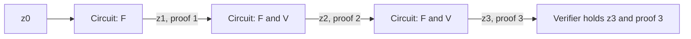

# Recursive Proofs

[Chapter 02](./pcd-intro.md#_6-attaching-a-proof) set a goal in which a node's proof covers the node's own step and also the proofs of its children, and it left open how one proof can contain a check of another. [Chapter 09](./nark.md) then built a complete proof and listed what its verifier pays. This chapter connects the two. We write the verifier as gates, place those gates inside the circuit of the next step, and measure the result.

The measurement shows that Chapter 09's verifier cannot work in this role, and it pins down the reason. We begin with a chain of steps and then move to trees, base cases, and initial states. The chapters that follow repair the verifier, so this one ends with a precise list of what they have to deliver.

## 1. A chain of steps

We start with the simplest shape, a sequence of states in which each state comes from the previous one. Call the rule the **step function** $F$ and the states $z_0, z_1, z_2, \ldots$, so that $z_{i+1} = F(z_i)$. A step function may also take a private input at each step. The Ragu Book's [example](https://github.com/tachyon-zcash/ragu/blob/3219e0865e8bff1f9d817bfe3850d9e94b64338c/book/src/protocol/core/accumulation/index.md?plain=1#L36-L41) is a blockchain virtual machine, whose state is the chain's state and whose private input is the next batch of transactions. Proving such a sequence one step at a time is the **incrementally verifiable computation** (IVC) that [Chapter 02](./pcd-intro.md#_5-running-the-tree) named.

For numbers we reuse the cubic from the [arithmetization chapter](./arithmetization.md), now applied repeatedly over $\F_{43}$. The step function is $F(z) = z^3 + z + 5$, and it has no private input. Starting from the chapter's value 3, the states are:

<!-- worked:chain -->

| $i$ | 0 | 1 | 2 | 3 | 4 | 5 |
| --- | --- | --- | --- | --- | --- | --- |
| $z_i$ | 3 | 35 | 1 | 7 | 11 | 14 |

<!-- /worked:chain -->

The first transition is the statement that Chapter 09 proved. Now suppose a verifier wants to know $z_5$ and does not want to run the steps itself. The tools we have so far offer two ways to arrange the proving, and the next table compares them. Each application of $F$ takes the 2 gates of our circuit, and a circuit with $n$ gates needs $4n$ generators, where $n$ is a power of two.

<!-- worked:alternatives -->

| Steps | Gates if one circuit holds every step | Generators that circuit needs | Proofs to check if each step has its own | Proofs to check with recursion |
| --- | --- | --- | --- | --- |
| 1 | $2$ | $8$ | 1 | 1 |
| 3 | $6$ | $32$ | 3 | 1 |
| 1,024 | $2,048$ | $8,192$ | 1,024 | 1 |

<!-- /worked:alternatives -->

One large circuit needs generators in proportion to the whole computation, and its prover must know the number of steps in advance and hold every private input at once. Giving each step its own proof avoids those problems, but the verifier's work then grows with the length of the chain. The last column is the target. It asks for one proof to check however long the chain becomes, with a prover who handles one step at a time.

## 2. A proof about a verifier

Consider the prover at step $i + 1$. It holds the state $z_i$ and a proof $\pi_i$ that this state is correct. It could check $\pi_i$ itself, compute $z_{i+1}$, and then prove that it did both of those things. A verifier of the new proof would then have no reason to look at $\pi_i$, because the new proof already says that $\pi_i$ passed its check. This idea only requires us to treat the verifier $V$ as one more computation to be proved, and it gives the following relation:

$$
\text{public: } z_{i+1}, \qquad \text{witness: } (z_i,\ \pi_i), \qquad \text{checks: } F(z_i) = z_{i+1} \ \text{ and } \ V(z_i, \pi_i) = 1.
$$

The old proof $\pi_i$ now sits in the witness, in the same place that a secret input usually sits. The old state $z_i$ sits there as well, which means the verifier of the new proof sees neither of them. The same value of $z_i$ must feed both checks, or else the prover could verify a proof about one state and apply $F$ to a different one. In a circuit, this means that both checks read one wire. The book [writes this relation](https://github.com/tachyon-zcash/ragu/blob/3219e0865e8bff1f9d817bfe3850d9e94b64338c/book/src/protocol/core/accumulation/index.md?plain=1#L52-L57) as the plainest way to build IVC from a succinct proof system.



Unwinding the relation shows what a single proof covers:

<!-- worked:unwind -->

The proof $\pi_2$ says that $1 = F(35)$ and that $\pi_1$ verifies for $35$. The proof $\pi_1$ in turn says that $35 = F(3)$. A verifier holding $z_2 = 1$ and $\pi_2$ runs one check, and it covers both applications of $F$.

<!-- /worked:unwind -->

Everything now depends on writing $V$ as gates, so we do that next.

## 3. Writing the verifier as gates

A circuit in the sense of the [arithmetization chapter](./arithmetization.md#_3-gates) is a list of multiplication gates $a_i b_i = c_i$ and linear constraints among the wires. Multiplying a wire by a constant or adding two wires costs no gate, because linear constraints can absorb those operations. Each other multiplication costs one gate, and so does an inversion, since proving that $a'$ inverts $a$ takes the single gate $a \cdot a' = 1$.

We take the [short proof from Chapter 09](./nark.md#_17-a-short-proof-from-the-same-parts), since it has the smallest verifier we have seen, and call it the level-0 proof. It covers $z_1 = 35$ with the hand-picked challenges of that chapter. The level-1 circuit has to establish that $z_2 = F(z_1)$ and that the level-0 proof verifies. Here are some of its gates, with the wires holding the values from the Chapter 09 run:

<!-- worked:example-gates -->

| Part | Left wire | Right wire | Output wire | What the gate computes |
| --- | --- | --- | --- | --- |
| Step | 35 | 35 | 21 | $z_1 \cdot z_1$ |
| Step | 21 | 35 | 4 | $z_1^2 \cdot z_1$ |
| Verifier | 30 | 42 | 13 | $k(y) = (z_1 - 5) \cdot y^3$ |
| Verifier | 5 | 35 | 3 | $r(x) \cdot (r(xz) + s(x, y) + t(x, z))$ |
| Verifier | 36 | 6 | 1 | $x^{4n-1} \cdot c_1(x^{-1})$ |
| Verifier | 23 | 30 | 2 | $x^{4n} \cdot c_2(x)$ |

<!-- /worked:example-gates -->

<!-- worked:example-eqs -->

Three linear constraints then finish this part, and they cost no gates. The step requires $4 + 35 + 5 = 1$ modulo 43, which is the public $z_2$. The split check requires $1 + 2 = 3$. The target check requires the proof's $c_1(0) = 13$ to equal the computed $k(7) = 13$.

<!-- /worked:example-eqs -->

The third row is where the two checks of Section 2 meet. The inner proof's public input $k(y)$ is computed from the same wire $z_1$ that the step's gates read. In a standalone run, $z_1$ was a known number and $k(y)$ was a matter of arithmetic. Inside this circuit $z_1$ is a wire, so this multiplication needs a gate of its own.

The level-1 circuit is our own teaching construction and not a Ragu circuit. We only build and check its gates, and we do not prove it, because the toy curve's 43 points are too few to serve as distinct generators for a circuit of this size.

### Point operations

The verifier also adds and scales points, and those operations reduce to gates in the same way. Adding $(x_1, y_1)$ and $(x_2, y_2)$ uses a slope $\lambda$, which the prover supplies as a witness, and three gates that check it and build the result:

$$
\lambda \cdot (x_2 - x_1) = y_2 - y_1, \qquad \lambda \cdot \lambda = x_3 + x_1 + x_2, \qquad \lambda \cdot (x_1 - x_3) = y_3 + y_1.
$$

These formulas assume $x_1 \neq x_2$, and a circuit must deal with that case separately. Doubling takes a fourth gate, because it computes $x^2$ for the tangent slope. Ragu's [point gadget](https://github.com/tachyon-zcash/ragu/blob/3219e0865e8bff1f9d817bfe3850d9e94b64338c/crates/ragu_primitives/src/point.rs#L198-L259) uses these same formulas. A scalar multiplication repeats these operations once per bit of the scalar. In the plainest form each lower bit doubles the running point, adds the base point, and selects one of the two results according to the bit, which costs two more gates. Each bit also needs one gate to show that it is 0 or 1.

::: warning The toy curve's fields do not line up here
The polynomials in our proof have coefficients in $\F_{43}$, so its circuit has wires in $\F_{43}$. The commitments are points on $E$, whose coordinates lie in $\F_{31}$, and a wire in $\F_{43}$ cannot directly do arithmetic modulo 31. The verifier's group operations therefore do not fit in this circuit as written. Emulating the other field is possible but costs far more than the gate counts below. We set this aside until the [curve cycles chapter](./curve-cycles.md), which removes the mismatch. To count gates at their native cost, the next example runs on the partner curve $E'$, whose coordinates do lie in $\F_{43}$.
:::

<!-- worked:scalar-mul -->

Take the point $P' = (12,\,31)$ on $E'$ and the scalar $23$, written in binary as $10111$. The circuit spends 5 gates to show that the digits are bits, 16 on doublings, 12 on additions and 8 on selecting by each bit, for a total of 41 gates. Its output wires hold $(20,\,40)$, which equals $23 \cdot P'$ computed outside the circuit. In general a scalar of $b$ bits costs $10b - 9$ gates here. That is 51 gates for the 6-bit scalars of $\F_{43}$ and $2,541$ gates for a 255-bit scalar.

<!-- /worked:scalar-mul -->

This count describes our plain construction and not an optimized one. Real circuits lower the cost per scalar multiplication, and the [endoscalars chapter](./endoscalars.md) covers Ragu's main technique. Sections 4 and 6 show that this kind of saving does not change the conclusion.

### The hash

A non-interactive verifier [gets its challenges by hashing the transcript](./statements-and-challenges.md#_8-removing-the-verifier-with-fiat–shamir), so the level-1 circuit has to do the hashing too. It may look tempting to save those gates by giving the circuit its challenges as inputs and leaving the hash to whoever verifies the outer proof. The trouble is that the outer verifier does not hold the inner transcript, and the prover fills in every witness wire:

<!-- worked:free-challenge -->

Take the false trace with $x = 4$ and the statement 35. Of the 1849 pairs $(z, y)$, 43 satisfy the revdot equation for this trace, the same count as in [Chapter 09](./nark.md#the-prover-follows-every-instruction). All of them have $y = 0$, because the gates of this trace hold and only the constraint weighted by $y^3$ fails. If the circuit read its challenges from the witness, the prover could set $(z, y) = (5, 0)$, and every field check in the level-1 circuit would pass. At the hand-picked pair $(5, 7)$, the same false trace fails.

<!-- /worked:free-challenge -->

A circuit therefore recomputes each challenge from the inner proof's messages, using gates. This is the reason for choosing a hash like Poseidon, whose only nonlinear operation is a small power. Here is what that costs on the toy sponge:

<!-- worked:hash-cost -->

Replaying the transcript for $4n = 8$ takes 17 permutations of the toy sponge. The sponge has 32 S-boxes per permutation, each computing $v^5$ with 3 gates, so the replay costs $1,632$ gates.

<!-- /worked:hash-cost -->

## 4. What the verifier costs

We now have a gate price for every row of [Chapter 09's cost table](./nark.md#_17-a-short-proof-from-the-same-parts). The first measurement is for the toy proof itself, with 6-bit scalars:

<!-- worked:toy-costs -->

| Verifier step | Gates for $4n = 8$ | Growth in $n$ |
| --- | --- | --- |
| Compute $s(x, y)$ | $14$ | **Linear** |
| Compute $t(x, z)$ | $20$ | Logarithmic |
| Compute $k(y)$ | $3$ | Constant |
| Split and target checks | $9$ | Logarithmic |
| Derive $f(u)$ and $v$ | $17$ | Constant |
| IPA scalars and $\hat{b} = g(u)$ | $17$ | Logarithmic |
| Compute the coefficients of $g$ | $9$ | **Linear** |
| Replay the transcript | $1,632$ | Logarithmic |
| Scalar multiplications for $P$, $v \cdot U$, the $L_j$ and $R_j$, and the final check | $612$ | Logarithmic |
| Compute $\hat{G}$ | $408$ | **Linear** |
| Total | $2,741$ |  |

<!-- /worked:toy-costs -->

<!-- worked:toy-total -->

The step itself took 2 gates, and verifying the proof of that same step takes $2,741$. The field rows of this table come from running the gates on the values of the Chapter 09 proof, and a check confirms that the trace and the formula agree. The hash row is 17 permutations at 96 gates each, and the scalar multiplications count 20 at 51 gates each.

<!-- /worked:toy-total -->

At this tiny size the fixed costs dominate, so the table says little about growth. To see the growth, we move to the size that Ragu uses. Its [production rank](https://github.com/tachyon-zcash/ragu/blob/3219e0865e8bff1f9d817bfe3850d9e94b64338c/crates/ragu_circuits/src/polynomials/mod.rs#L123-L127) gives polynomials $2^{13}$ coefficients and circuits at most $2^{11}$ gates. We keep the same plain gadgets with 255-bit scalars, and we assume that a larger circuit has the same density of wiring as our toy, with $2n$ constraints and $4n$ wiring terms. Both choices are ours and not Ragu's.

<!-- worked:prod-costs -->

| Verifier step | Gates for $4n = 2^{13}$, 255-bit scalars | Growth in $n$ |
| --- | --- | --- |
| Compute $s(x, y)$ | $20,474$ | **Linear** |
| Compute $t(x, z)$ | $80$ | Logarithmic |
| Compute $k(y)$ | $3$ | Constant |
| Split and target checks | $29$ | Logarithmic |
| Derive $f(u)$ and $v$ | $17$ | Constant |
| IPA scalars and $\hat{b} = g(u)$ | $77$ | Logarithmic |
| Compute the coefficients of $g$ | $8,203$ | **Linear** |
| Replay the transcript | $3,552$ | Logarithmic |
| Scalar multiplications for $P$, $v \cdot U$, the $L_j$ and $R_j$, and the final check | $81,312$ | Logarithmic |
| Compute $\hat{G}$ | $20,815,872$ | **Linear** |
| Total | $20,929,619$ |  |

<!-- /worked:prod-costs -->

<!-- worked:prod-budget -->

The linear rows account for $20,844,549$ of the $20,929,619$ gates, which is 99.6 percent. A circuit at this size has room for $n = 2,048$ gates. The coefficients of $g$ alone need $8,203$, and $\hat{G}$ would exceed the limit even if a scalar multiplication cost one gate, because there are $8,192$ of them.

<!-- /worked:prod-budget -->

The bold rows are the two costs that [Chapter 09 identified](./nark.md#_17-a-short-proof-from-the-same-parts), namely computing $s(x, y)$ and computing $\hat{G}$, with the coefficients of $g$ counted as part of $\hat{G}$. The last sentence above needs no cost model, because it only compares two counts. A verifier that performs $4n$ scalar multiplications cannot fit in a circuit of $n$ gates.

## 5. Why the linear steps cannot be dropped

Since these steps are the whole problem, it is natural to ask what happens if the circuit leaves them out and reads the two values from the proof. Each attempt opens a specific attack. We start with $s(x, y)$, which is the verifier's only contact with the circuit it thinks it is checking:

<!-- worked:drop-s -->

The value $x = 4$ does not satisfy our statement, since $4^3 + 4 + 5 = 30$, not 35. It does satisfy a different circuit, $x^3 + 13 x = 30$, which differs from ours in one wiring coefficient. A prover who builds its proof from that other circuit passes the split and target checks if the verifier reads $s(x, y) = 24$ from the proof. When the verifier computes the value from our circuit it gets $23$, and the split check fails.

<!-- /worked:drop-s -->

So without its own value of $s(x, y)$, the verifier cannot tell which circuit a proof belongs to. The point $\hat{G}$ plays a comparable role in the [inner product argument](./inner-product-argument.md). It connects the final equation to the public generators:

<!-- worked:drop-g -->

Suppose the prover lies about the batched value and claims $v = 37$ where the truth is $36$, keeping every $L_j$, $R_j$ and $\hat{a} = 6$ from the honest run. If the verifier computes $\hat{G} = (4,\,25)$ itself, then of the 43 possible values of $v$ only $36$ passes the final equation with this $\hat{a}$. If the verifier accepts $\hat{G}$ from the proof, the prover can solve that equation for the point, which gives $\hat{G}' = \hat{a}^{-1} \cdot (\text{left side}) - \hat{b} \cdot U = (16,\,21)$. This takes only point additions and scalar multiplications, and it succeeds for all 43 values of $v$.

<!-- /worked:drop-g -->

A prover facing the honest $\hat{G}$ could still look for a different $\hat{a}$, but that means solving a discrete log, which the toy curve permits and a real curve does not. The false $\hat{G}'$ needs no such thing. Both linear steps therefore have to happen somewhere, and the question left is whether they have to happen inside every step's circuit.

## 6. Why the circuit cannot keep growing

So far we have priced one level of recursion. Now let $n_i$ be the number of gates at level $i$, and let $f$ be the gates of the step itself. A circuit at level $i + 1$ holds the step and a verifier for level $i$, so with $V(n)$ standing for the gates of a verifier for an $n$-gate circuit,

$$n_{i+1} = f + V(n_i).$$

Suppose first that the verifier is linear, with $V(n) = c \cdot n$ for some constant $c$. Expanding the first few levels shows the pattern:

$$
\begin{aligned}
n_1 &= f + c\, n_0, \\
n_2 &= f + c\,(f + c\, n_0) = f + c f + c^2 n_0, \\
n_i &= c^i n_0 + f\,(1 + c + c^2 + \cdots + c^{i-1}).
\end{aligned}
$$

If $c < 1$, the sum converges and the size settles near $f / (1 - c)$. If $c \geq 1$, the size grows without limit, and for $c > 1$ it grows exponentially with the level. Our rows give the value of $c$:

<!-- worked:slope -->

Counting the coefficient of $n$ in our rows gives 10 gates per $n$ for $s(x, y)$, 4 for the coefficients of $g$, and $4m$ for $\hat{G}$, where $m$ is the cost of one scalar multiplication. So $c = 14 + 4m$. With $m = 2,541$ that is $c = 10,178$, and even the impossible $m = 1$ gives $c = 18$.

<!-- /worked:slope -->

No improvement to scalar multiplication can bring $c$ below 1, because the verifier has $4n$ of them to perform for a circuit of $n$ gates. This is why the optimized gadgets of Section 3 do not change the conclusion. Now compare a verifier without the linear steps. Its remaining rows grow with $\log n$, so the recurrence becomes $n_{i+1} = f + a \log_2 n_i + b$. A logarithm grows more slowly than its input, so there is a size at which a circuit is large enough to hold the verifier of a circuit of its own size.

The next table runs both recurrences from our 2-gate step, rounding each circuit up to the power of two it needs.

<!-- worked:growth -->

| Level | Gates with the linear steps | Size $n$ needed | Gates without them | Size $n$ needed |
| --- | --- | --- | --- | --- |
| 0 | $2$ | $2^{1}$ | $2$ | $2^{1}$ |
| 1 | $52,543$ | $2^{16}$ | $32,192$ | $2^{15}$ |
| 2 | $667,136,930$ | $2^{30}$ | $106,224$ | $2^{17}$ |
| 3 | $1.1 \times 10^{13}$ | $2^{44}$ | $116,800$ | $2^{17}$ |
| 4 | $1.8 \times 10^{17}$ | $2^{58}$ | $116,800$ | $2^{17}$ |
| 5 | $2.9 \times 10^{21}$ | $2^{72}$ | $116,800$ | $2^{17}$ |

<!-- /worked:growth -->


<!-- worked:growth-fixed -->

Without the linear steps, the size settles at $n = 2^{17}$ and stays there, because a circuit of that size can verify a proof from a circuit of the same size.

<!-- /worked:growth-fixed -->

Once the size stops changing, one fixed circuit serves every step, and that circuit verifies proofs made by itself. The prover's work per step is then constant, and the proof's history can be arbitrarily long. A growing circuit would also fail for a blunter reason, since a circuit can never exceed the size allowed by the public generators, which are [fixed in advance](./polynomial-commitments.md#public-parameters).

The settled size in this table, $2^{17}$, is well above Ragu's limit of $2^{11}$ gates. That gap comes from our plain gadgets and our single large circuit. The later chapters close it with other techniques, and the [chapter on recursion in Ragu](./ragu-recursion.md) assembles them.

## 7. What succinct verification has to mean

The requirement from [Chapter 02](./pcd-intro.md#_8-succinctness) can now be stated precisely. The number of gates in the part of the verifier that runs inside the circuit must grow slower than the circuit it verifies. This concerns the in-circuit work and not the length of the proof. Ragu's proofs [stay large while they are being fused](./pcd-intro.md#_10-uncompressed-and-compressed-proofs), and this is allowed, provided that the circuit does not read all of a proof's contents.

There have been two main routes to a verifier like this. Earlier recursive systems [used proofs with a constant-time verifier](https://github.com/tachyon-zcash/ragu/blob/3219e0865e8bff1f9d817bfe3850d9e94b64338c/book/src/protocol/index.md?plain=1#L126-L139), so the verifier could be encoded directly and the circuit converged. The book describes the resulting systems as barely practical, and they needed very large curves, complicated assumptions, and trusted setups. [Chapter 01](./scaling-zcash.md) explained why Tachyon rules out a trusted setup.

The second route came from [Halo](https://eprint.iacr.org/2019/1021). We could read only that paper's abstract, so our account of it follows the Ragu Book. Halo keeps the linear verifier, and it relies on something Section 5 did not rule out, which is postponing the expensive steps, since a false claim can still be recorded and caught later:

<!-- worked:drop-g-later -->

In our example the prover's claim is $\hat{G} = (16,\,21)$ for the challenges $(15, 10, 3)$, and the true MSM gives $(4,\,25)$.

<!-- /worked:drop-g-later -->

One MSM performed by anyone, at any later time, exposes this claim. Halo's insight was that the circuit can [carry such a claim forward in its instance](https://github.com/tachyon-zcash/ragu/blob/3219e0865e8bff1f9d817bfe3850d9e94b64338c/book/src/protocol/index.md?plain=1#L143-L168), and that two claims can be merged into one by a cheap random check. Only the last claim in a long history then needs its MSM, and a single MSM ends up standing for every earlier one. The relation from Section 2 gains an object called an **accumulator**, which holds the postponed claims. The checks become $F(z_i) = z_{i+1}$ together with a [check that the accumulator was updated correctly](https://github.com/tachyon-zcash/ragu/blob/3219e0865e8bff1f9d817bfe3850d9e94b64338c/book/src/protocol/core/accumulation/index.md?plain=1#L87-L92), and the final verifier decides the last accumulator itself. The [next chapter](./accumulation.md) builds this for $\hat{G}$, and the chapter on [wiring and the registry](./wiring-and-registry.md) does the corresponding work for $s(x, y)$.

## 8. From a chain to a tree

A chain makes each prover wait for the one before it, so independent parties need the tree form from [Chapter 02](./pcd-intro.md#_5-running-the-tree). The change to the relation is direct. A node now has a left and a right input, each with its own state and proof, and the step function combines them. Following the book's [2-arity PCD](https://github.com/tachyon-zcash/ragu/blob/3219e0865e8bff1f9d817bfe3850d9e94b64338c/book/src/protocol/core/accumulation/index.md?plain=1#L197-L207), we write

$$
\text{public: } z, \qquad \text{witness: } (z_L, \pi_L, z_R, \pi_R), \qquad \text{checks: } F(z_L, z_R) = z, \ \ V(z_L, \pi_L) = 1, \ \ V(z_R, \pi_R) = 1.
$$

Chapter 02's tally is a computation of this form:

<!-- worked:carol -->

Carol from Chapter 02 joined $(0, 4, 25)$ and $(4, 8, 22)$ into $(0, 8, 47)$. Her circuit checks $4 = 4$ and $25 + 22 = 47$, and it runs the verifier twice, once on the proof of each input header.

<!-- /worked:carol -->

Each verifier reads a child proof, and that proof may come from a leaf or from a large subtree. The verifier cannot tell the difference, because a child proof looks the same at every depth. So the same circuit must serve every node, and this is why [all 429 tree shapes](./pcd-intro.md#_5-running-the-tree) over Chapter 02's list can use it. Having two verifiers changes the recurrence to $n_{i+1} = f + 2 V(n_i)$:

<!-- worked:tree-growth -->

With the linear steps, level 1 already needs $2^{17}$ gates, where the chain needed $2^{16}$, and level 2 needs $2^{32}$. Without them the size again settles, now at $n = 2^{18}$ compared with the chain's $2^{17}$. Doubling the verifier work added 1 to the exponent.

<!-- /worked:tree-growth -->

So a second input is a small price once the verifier is sublinear, and it makes the linear case worse. With a tree, accumulation has to do slightly more work as well, because a node holds two incoming accumulators and [merges both](https://github.com/tachyon-zcash/ragu/blob/3219e0865e8bff1f9d817bfe3850d9e94b64338c/book/src/protocol/core/accumulation/index.md?plain=1#L232-L239) into one.

Ragu takes this form for every node. As [Chapter 02 explained](./pcd-intro.md#every-node-has-two-inputs), a chain step declares a unit header for its right input, so a chain is a lopsided tree, and each node verifies two proofs whether or not both inputs carry data. For the 8-entry tally, this gives:

<!-- worked:tree-shapes -->

| Shape | Nodes | Inputs carrying a tally | Unit inputs | Proofs verified inside circuits | Proofs the final verifier checks |
| --- | --- | --- | --- | --- | --- |
| Balanced tree | 15 | 14 | 16 | 30 | 1 |
| Chain | 8 | 7 | 9 | 16 | 1 |

<!-- /worked:tree-shapes -->

Both shapes end with one proof to check. The chain uses fewer nodes, while the balanced tree lets separate parties work at the same time, and a single circuit design supports both.

## 9. The base case

The relations above say that every state has a proof behind it, but the first state has no earlier proof to point to. The circuit needs some way to skip the verifier at the start, and that skip is a dangerous thing to add, since any prover who can trigger it escapes the check. To see how the design of the skip decides what a proof means, consider three versions of the rule for our chain. Each row comes from computing everything that the rule can produce over $\F_{43}$.

<!-- worked:base-designs -->

| Design | Base-case rule | Header | Values a proof can claim for $z_5$ |
| --- | --- | --- | --- |
| 1 | The prover sets a flag, and the flag skips the verifier | $z$ | 29 of 43, any output of $F$, at any claimed step |
| 2 | The flag requires $i = 0$ | $(i, z)$ | 15 of 43 |
| 3 | The flag requires $i = 0$ and $z = z_0$ | $(i, z_0, z)$ | 43 headers overall, and exactly 1 once the verifier requires $z_0 = 3$, namely $z_5 = 14$ |

<!-- /worked:base-designs -->

In the first design the prover can raise the flag at any time, so the verifier gets skipped and any output of $F$ can be claimed without any history. Adding a step counter fixes that, because the flag now works only at step 0 and the proof really does cover five applications of $F$. It still leaves the start value open, so the prover may begin wherever it likes, and the second row counts the values reachable that way. The third design carries the start value in the header, and then the verifier can compare it with the value it cares about. This comparison is the same one that [Chapter 02 required](./pcd-intro.md#_7-why-a-false-header-has-no-valid-proof) of any verifier. A valid proof shows only that the rules produced this header, so the verifier has to confirm that the header is the one it wanted.

The level-0 proof from Chapter 09 has no check on its start at all. Its public input is 35 and its start value is secret, so it shows only that something maps to 35. That is what the statement of that chapter said, and it is a reasonable statement on its own, though a chain that needs a particular start would have to add one of these rules.

### The base case in Ragu

Ragu does not place a skip in each step's circuit. [Chapter 02 described](./pcd-intro.md#the-base-case) its arrangement, in which a single internal `Bootstrap` step takes synthesized proofs and produces a unit proof that attests nothing, and every leaf uses that proof as an ordinary child. Two more details of the code explain how narrow this is. The condition is computed from the [input suffixes](https://github.com/tachyon-zcash/ragu/blob/3219e0865e8bff1f9d817bfe3850d9e94b64338c/crates/ragu_pcd/src/header.rs#L146-L154), and no application step can declare the reserved `Dummy` suffix. What the condition releases is the final check on the folded value $c$, in the [`collapse` circuit](https://github.com/tachyon-zcash/ragu/blob/3219e0865e8bff1f9d817bfe3850d9e94b64338c/crates/ragu_pcd/src/internal/native/circuits/collapse.rs#L278-L286) and in its [counterpart on the nested side](https://github.com/tachyon-zcash/ragu/blob/3219e0865e8bff1f9d817bfe3850d9e94b64338c/crates/ragu_pcd/src/internal/nested/circuits/collapse.rs#L234-L241). The application has no flag to set. A leaf's truth comes from the checks in the application's own step and from the verifier's final comparison, as in the third design.

::: warning The Ragu Book's two descriptions differ, and the code matches one
**Book, [accumulation chapter](https://github.com/tachyon-zcash/ragu/blob/3219e0865e8bff1f9d817bfe3850d9e94b64338c/book/src/protocol/core/accumulation/index.md?plain=1#L125-L138):** at $i = 0$, the accumulators take a placeholder value, the previous instance is one that satisfies its checks by construction, and the fuse circuit skips the rest of its work.

**Book, [PCD chapter](https://github.com/tachyon-zcash/ragu/blob/3219e0865e8bff1f9d817bfe3850d9e94b64338c/book/src/concepts/pcd.md?plain=1#L106-L117), and code at `3219e08`:** the base case lives in one internal step. Its [dummy proofs do not verify on their own](https://github.com/tachyon-zcash/ragu/blob/3219e0865e8bff1f9d817bfe3850d9e94b64338c/crates/ragu_pcd/src/proof/mod.rs#L1021-L1030), [`finalize` runs it once](https://github.com/tachyon-zcash/ragu/blob/3219e0865e8bff1f9d817bfe3850d9e94b64338c/crates/ragu_pcd/src/lib.rs#L507-L516) when the application is set up, and the circuits still run with the final check on $c$ relaxed on each side of the cycle, as far as we can read them. Each later leaf is an ordinary fuse whose child claims are enforced.

This site follows the code. We read the accumulation chapter's version as a simplified account for teaching IVC.
:::

## 10. Tracking initial states

The third design works for a chain because a chain has one start. A tree has one start for each leaf, and a verifier may care which leaves went into the result, yet the header must [stay a fixed size](./pcd-intro.md#_8-succinctness). The book's answer is to [keep a Merkle root of the initial states](https://github.com/tachyon-zcash/ragu/blob/3219e0865e8bff1f9d817bfe3850d9e94b64338c/book/src/protocol/core/accumulation/index.md?plain=1#L219-L223). Each leaf's header holds a hash of its start value, and each node's circuit hashes its children's roots to get its own. The cost is one hash per node, and the root stays one field element however many leaves it covers. Here is that calculation on the first four values of Chapter 02's list, using the [toy sponge](./statements-and-challenges.md#a-toy-poseidon) as $H$ and a fixed tag to mark leaves:

<!-- worked:init-root -->

| Node | Inputs | Root in the header |
| --- | --- | --- |
| Leaf 0 | $H(4, 3)$ | 11 |
| Leaf 1 | $H(11, 3)$ | 22 |
| Leaf 2 | $H(3, 3)$ | 26 |
| Leaf 3 | $H(7, 3)$ | 32 |
| Join | $H(11, 22)$ | 18 |
| Join | $H(26, 32)$ | 16 |
| Top | $H(18, 16)$ | 24 |

<!-- /worked:init-root -->

A verifier who knows the four start values can recompute the root and compare it with the final header, and this check is sensitive to the start values:

<!-- worked:init-count -->

Replacing the start value of leaf 2 with each of the other 42 values changes the root in 41 cases. The remaining case is a collision, which a hash with only 43 outputs cannot avoid, and a 255-bit output makes finding one infeasible.

<!-- /worked:init-count -->

::: warning The Ragu Book and the code differ here
**Book:** the protocol [maintains a root of initial states](https://github.com/tachyon-zcash/ragu/blob/3219e0865e8bff1f9d817bfe3850d9e94b64338c/book/src/protocol/core/accumulation/index.md?plain=1#L219-L223) on each side of the cycle and [updates it in each step](https://github.com/tachyon-zcash/ragu/blob/3219e0865e8bff1f9d817bfe3850d9e94b64338c/book/src/protocol/core/accumulation/index.md?plain=1#L238).

**Code at `3219e08`:** we found no such value. The [instance shared by the internal circuits](https://github.com/tachyon-zcash/ragu/blob/3219e0865e8bff1f9d817bfe3850d9e94b64338c/crates/ragu_pcd/src/internal/native/unified.rs#L276-L331) holds commitments, challenges and the values $c$ and $v$, and the phrase appears nowhere else in the crates.

This site follows the code, in which initial states belong to the application. Any record of where a computation began goes in the application's header, under rules set by its steps.
:::

::: warning Reconstructed from code at commit 3219e08, not confirmed by the authors
Reading the code this way, the examples we already have fit the same pattern. Chapter 02's tally records a range of positions, and its `Entry` step checks each value against the list. The book's [getting-started guide](https://github.com/tachyon-zcash/ragu/blob/3219e0865e8bff1f9d817bfe3850d9e94b64338c/book/src/guide/getting_started.md?plain=1#L35-L46) builds a Merkle tree in application headers and steps, which is the calculation above carried out by an application. Tachyon's `FeeSeed` step [leaves its anchor as a free witness](./pcd-intro.md#_7-why-a-false-header-has-no-valid-proof), and the Tachyon book says that validators confirm it against the chain. In each case the application chooses what to record and what the verifier compares.
:::

## 11. Why cheating fails

The argument from [Chapter 02](./pcd-intro.md#_7-why-a-false-header-has-no-valid-proof) walks down the tree from a false header to a step whose check rejects it. Recursion needs a slightly stronger property than that walk first suggests, because of what the relation claims about $\pi_i$. Accepted proofs of false statements exist as mathematical objects, and they are only hard to find. On the toy curve, [Chapter 09 found one](./nark.md#the-prover-knows-a-relation-among-the-generators) by using a relation among the generators. So the claim "there exists some $\pi_i$ that verifies" says little on its own, since it is usually true.

What the walk needs is the claim that the prover knows such a $\pi_i$. The K in NARK stands for this, and [Chapter 03](./statements-and-challenges.md#_3-an-interactive-proof) gave the informal idea with Schnorr's protocol. A prover able to produce an accepted proof must be able to produce a witness for it. Here the witness contains the previous proof, so the same reasoning applies again at the level below, until the walk reaches the base case. The walk therefore ends at a step whose own check rejects the false header, unless the prover has broken one of the assumptions below.

The argument assumes the following:

1. Nobody knows a relation among the generators, which is the [discrete log relation assumption](./polynomial-commitments.md#_4-why-a-prover-cannot-change-the-vector).
2. The transcript hash behaves as a random oracle. [Ragu makes this assumption about Poseidon](https://github.com/tachyon-zcash/ragu/blob/3219e0865e8bff1f9d817bfe3850d9e94b64338c/book/src/protocol/prelim/assumptions.md?plain=1#L26-L30). The assumption has to stretch further here than in a standalone proof, because the circuit contains the hash that the verifier replays, while an actual random oracle could not be written as gates.
3. The circuit wires its checks together as Sections 2, 3 and 5 require. The state is one wire, each challenge comes from the hash, and the wiring value comes from the correct circuit.
4. The steps are correct, and the verifier compares the final header with what it wants to know, as in Chapter 02.

Under these assumptions, a changed inner proof leaves the level-1 circuit with no satisfying witness:

<!-- worked:tamper -->

Starting from the honest level-0 proof, we changed each of its five evaluations to each of the 42 other values and ran the field checks of the level-1 circuit, which makes 210 altered proofs. All 210 left the circuit unsatisfied. We also kept the proof and replaced its public state $z_1 = 35$ with each of the 42 other values, and all 42 failed the target check. In these runs the challenges stay fixed, and a real transcript would also change them.

<!-- /worked:tamper -->

This is an informal argument. Formal treatments have to account for repeating the extraction over the depth of the recursion and for the hash appearing in the circuit, and this site leaves those out.

## 12. Recursion in Ragu

The operation that builds these proofs is [`fuse`](https://github.com/tachyon-zcash/ragu/blob/3219e0865e8bff1f9d817bfe3850d9e94b64338c/crates/ragu_pcd/src/fuse/mod.rs#L74-L81), whose signature names the pieces of the relation in Section 8:

```rust
pub fn fuse<'source, RNG: CryptoRng, S: Step<C>>(
    &self,
    rng: &mut RNG,
    step: S,
    witness: S::Witness<'source>,
    left: Pcd<C, R, S::Left>,
    right: Pcd<C, R, S::Right>,
) -> Result<(Pcd<C, R, S::Output>, S::Aux<'source>)> {
```

Here, $F$ is the `step`, and $(z_L, \pi_L)$ and $(z_R, \pi_R)$ are `left` and `right`, each a proof carrying its header data. The result is the new header with its new proof.

::: warning Reconstructed from code at commit 3219e08, not confirmed by the authors
- **Shared state wires.** A step's circuit [exposes the left, right and output headers](https://github.com/tachyon-zcash/ragu/blob/3219e0865e8bff1f9d817bfe3850d9e94b64338c/crates/ragu_pcd/src/step/internal/adapter.rs#L87-L90) as its output, and the `collapse` circuit [computes each child's $k(y)$ and enforces it](https://github.com/tachyon-zcash/ragu/blob/3219e0865e8bff1f9d817bfe3850d9e94b64338c/crates/ragu_pcd/src/internal/native/circuits/collapse.rs#L193-L201), which plays the part of the $k(y)$ gate in Section 3.
- **Replayed challenges.** The [`hashes_1` circuit](https://github.com/tachyon-zcash/ragu/blob/3219e0865e8bff1f9d817bfe3850d9e94b64338c/crates/ragu_pcd/src/internal/native/circuits/hashes_1.rs#L1-L12) starts the replay of the transcript inside a circuit, as Section 3 required.
- **No single verifier circuit.** With at most $2^{11}$ gates per circuit, the verifier cannot fit in one. Ragu [divides its work among internal circuits](https://github.com/tachyon-zcash/ragu/blob/3219e0865e8bff1f9d817bfe3850d9e94b64338c/book/src/protocol/recursion/index.md?plain=1#L19-L34), and the [application circuit](https://github.com/tachyon-zcash/ragu/blob/3219e0865e8bff1f9d817bfe3850d9e94b64338c/crates/ragu_pcd/src/fuse/_01_application.rs#L37-L44) holds only the step. So a Ragu proof is really a set of claims about several circuits, and [revdot folding](./revdot-folding.md) explains how they combine. The book's [accumulation chapter](https://github.com/tachyon-zcash/ragu/blob/3219e0865e8bff1f9d817bfe3850d9e94b64338c/book/src/protocol/core/accumulation/index.md?plain=1#L132-L147) describes one application circuit and one fuse circuit per curve, and we read that fuse circuit as a summary of those internal circuits.
:::

Recursion is also often used to hide data, because an inner proof sits in the outer proof's witness and a zero-knowledge outer proof would conceal it. That benefit is not available yet. As [Chapter 02 recorded](./pcd-intro.md#_10-uncompressed-and-compressed-proofs), neither the Ragu Book nor the code at `3219e08` establishes zero knowledge, and a proof still exposes child data. Tachyon, which has not activated on mainnet and whose design is still changing, depends on fusing in the way this section describes, through a [different Ragu revision](https://github.com/tachyon-zcash/tachyon/blob/7e502548db33845dbaacdc0efe905d1a3c45e626/crates/tachyon/Cargo.toml#L83).

## 13. Where this chapter leaves us

This chapter took the following steps:

1. IVC applies a step function repeatedly and keeps one proof, whose relation checks the step and also checks a verifier run on the previous proof.
2. A verifier can be written as gates, with its field arithmetic, its group operations, and the hash that replays its transcript all inside the circuit. A shared wire ties the inner proof's public input to the step's state.
3. Chapter 09's verifier has two linear costs, computing $s(x, y)$ and computing $\hat{G}$. At Ragu's circuit size the second cannot fit, whatever a scalar multiplication costs.
4. Neither step can be dropped. Without its own $s(x, y)$, the verifier cannot tell which circuit a proof belongs to, and without its own $\hat{G}$, a prover can pass with a false value.
5. With a linear verifier the circuit grows at every level, and with a sublinear one it settles at a fixed size, so that one circuit can verify its own proofs.
6. Trees use a relation with two inputs and two verifiers, and the settled circuit handles every tree shape.
7. The base case has to be confined so that no prover can skip a verifier at will. Ragu confines it to one internal step and leaves initial states to the application, although the book describes a tracked root.

The two linear steps still have to happen somewhere. The [next chapter](./accumulation.md) postpones the computation of $\hat{G}$ by turning it into a claim that travels with the proof, and it shows how two such claims merge into one.
