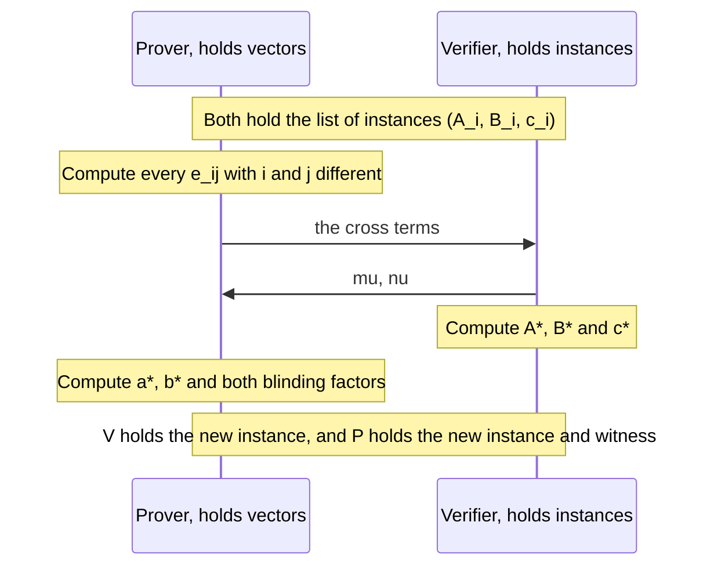

# Revdot Folding

The [split accumulation chapter](./split-accumulation.md#_2-sorting-the-verifier-s-work-by-what-it-reads) sorted the verifier's work by what it reads, and it folded the evaluation claims. One row of its table stayed open, which was the revdot product $\revdot{\v{a}}{\v{b}}$. That product reads two whole witness vectors, so a recursive verifier cannot compute it, and this chapter folds it instead.

A revdot claim contains a product of two unknown vectors, so it does not combine linearly as an evaluation claim does. [Chapter 12 ended](./split-accumulation.md#_9-folding-schemes) with the first sign of this, a cross term that the prover has to supply. We start from that example and find that its single challenge stops working at three claims. Repairing it leads to the error matrix and the challenges $\mu$ and $\nu$. We then remove the two costs that this fold would place in a circuit, namely the commitment sums and the quadratic field arithmetic, and we finish with the different fold that Ragu's code runs at each step.

::: warning The Ragu Book and the code differ here
**Book, [revdot chapter](https://github.com/tachyon-zcash/ragu/blob/3219e0865e8bff1f9d817bfe3850d9e94b64338c/book/src/protocol/core/accumulation/revdot.md?plain=1#L95-L137):** an error matrix with two challenges per layer, and [$(M, N) = (7, 19)$ for 133 claims](https://github.com/tachyon-zcash/ragu/blob/3219e0865e8bff1f9d817bfe3850d9e94b64338c/book/src/protocol/core/accumulation/revdot.md?plain=1#L262-L266).

**Code at `3219e08`, and the book's [recursion chapter](https://github.com/tachyon-zcash/ragu/blob/3219e0865e8bff1f9d817bfe3850d9e94b64338c/book/src/protocol/recursion/index.md?plain=1#L26) and [endoscalar ledger](https://github.com/tachyon-zcash/ragu/blob/3219e0865e8bff1f9d817bfe3850d9e94b64338c/book/src/protocol/extensions/endoscalar.md?plain=1#L197-L214):** the fuse uses a [quotient fold](https://github.com/tachyon-zcash/ragu/blob/3219e0865e8bff1f9d817bfe3850d9e94b64338c/crates/ragu_pcd/src/internal/fold_revdot.rs#L1-L12) with one challenge per layer, and [$(M, N) = (7, 14)$](https://github.com/tachyon-zcash/ragu/blob/3219e0865e8bff1f9d817bfe3850d9e94b64338c/crates/ragu_pcd/src/internal/native/mod.rs#L144-L149) on the native side. Compression [still uses an error matrix](https://github.com/tachyon-zcash/ragu/blob/3219e0865e8bff1f9d817bfe3850d9e94b64338c/crates/ragu_pcd/src/compress/revdot/fold.rs#L1-L19).

This site follows the code for what Ragu does. Sections 2 to 9 nevertheless teach the matrix, because it is the general construction, compression needs it, and the quotient fold is easiest to understand as a change to it. Section 10 makes that change, and Section 11 compares all the forms.
:::

::: warning Reconstructed from code at commit 3219e08, not confirmed by the authors
The toy runs and the attacks are our own, checked by the script behind this page. The gate counts for the code's fold in Section 10 are our reading of its functions, and the authors have not published them. The code's comments credit the quotient identity to [ProtoGalaxy](https://eprint.iacr.org/2023/1106), which we could not read, so we derive the identity here without relying on that paper.
:::

::: tip Terminology
The book writes $n$ for the number of claims. Here $n$ remains the number of gates, as in every earlier chapter, so we write $m$ for the number of claims. The book uses "cross term" and "error term" [interchangeably](https://github.com/tachyon-zcash/ragu/blob/3219e0865e8bff1f9d817bfe3850d9e94b64338c/book/src/protocol/core/accumulation/revdot.md?plain=1#L80-L93) for an off-diagonal product. The code says "error terms" for the quotient coefficients of Section 10, which are different numbers, so we say cross term for a product and quotient coefficient for the code's values. The book's spot-check point is called $\beta$, which is also the batching challenge of [chapter 08](./batched-openings.md#_7-beta-batching), so we rename the spot-check point $\theta$. We continue to say that claims fold and that a [fuse](./pcd-intro.md#_9-fusion-in-ragu) is the PCD operation containing the folds.
:::

## 1. The claim that remains

A step of the proof from [chapter 09](./nark.md#_5-building-the-two-multiplicands) ends up holding two commitments and a target value, and it needs to know that the committed vectors have that revdot product. Following the [book's relation](https://github.com/tachyon-zcash/ragu/blob/3219e0865e8bff1f9d817bfe3850d9e94b64338c/book/src/protocol/core/accumulation/revdot.md?plain=1#L6-L17), a **revdot claim** has the instance $(\bar{A}, \bar{B}, c)$ and the witness $(\v{a}, \v{b}, \gamma_a, \gamma_b)$, and it holds when

$$\dot{\v{a}}{\v{G}} + \gamma_a \cdot H = \bar{A}, \qquad \dot{\v{b}}{\v{G}} + \gamma_b \cdot H = \bar{B}, \qquad \revdot{\v{a}}{\v{b}} = c.$$

<!-- worked:one-claim -->

Chapter 09's proof gives the instance $(\bar{A}, \bar{B}, c) = ((22,\,24),\ (1,\,29),\ 13)$ and the witness $\v{a} = (9, 27, 9, 3, 3, 3, 0, 0)$, $\v{b} = (9, 6, 16, 30, 20, 8, 31, 17)$, $\gamma_a = 17$, $\gamma_b = 29$. Checking the claim takes both parts. The two commitments recompute to the stated points, and $\revdot{\v{a}}{\v{b}} = 13$.

<!-- /worked:one-claim -->

The earlier chapters offer two ways to check such a claim, and each has a cost in the wrong place:

<!-- worked:two-routes -->

| Route | Who pays | Work for one claim, $4n = 2^{13}$ | What travels |
| --- | --- | --- | --- |
| Direct check (chapter 09) | Verifier | 8,192 field multiplications and 2 MSMs of size 8,192 | Both vectors |
| Split (chapter 05) | Prover | At least 3 FFTs over 16,384 points, about 114,688 multiplications each | Two commitments and a few values |

<!-- /worked:two-routes -->

The direct check cannot go in a circuit, since a recursive verifier [reads only instances](./split-accumulation.md#_5-the-three-algorithms). The split suits a verifier, but the prover would run its FFTs at every step of a long computation, and the book [wants to confine that](https://github.com/tachyon-zcash/ragu/blob/3219e0865e8bff1f9d817bfe3850d9e94b64338c/book/src/protocol/prelim/structured_vectors.md?plain=1#L98-L101) to the places in the tree where a short proof is needed.

Chapter 12 suggests a third route, in which we reduce many claims to one claim of the same form and leave the last one to a decider. The reduction has to handle many claims at once, because a fuse in Ragu's standard profile [has 86 native and 72 nested revdot claims](https://github.com/tachyon-zcash/ragu/blob/3219e0865e8bff1f9d817bfe3850d9e94b64338c/crates/ragu_pcd/src/internal/tests.rs#L1416-L1417). The book [names their sources](https://github.com/tachyon-zcash/ragu/blob/3219e0865e8bff1f9d817bfe3850d9e94b64338c/book/src/protocol/core/accumulation/revdot.md?plain=1#L24-L33), which are the consolidated equation of each circuit, the [stage checks](./staging.md), and the accumulators of the previous step.

[Chapter 09 listed two linear costs](./nark.md#_17-a-short-proof-from-the-same-parts) as targets for this part of the site. This chapter does not address either of them directly. The cost of $\hat{G}$ already [left the recursive path](./split-accumulation.md#_8-why-a-nark-is-enough) in chapter 12. The cost of computing $s(x, y)$ remains after this chapter too, because a fold says nothing about whether $\bar{B}$ was built from the right circuit, and the [wiring chapter](./wiring-and-registry.md) deals with that. What this chapter removes is the need for the split and its FFTs at most steps, as chapter 09 promised.

## 2. Two claims and one cross term

Start with two claims and weight the second by a challenge $r$, as chapter 12 did. The commitments combine by [linearity](./polynomial-commitments.md#_5-adding-commitments), so anyone can compute $\bar{A}_0 + r \cdot \bar{A}_1$ and $\bar{B}_0 + r \cdot \bar{B}_1$. The value needs more care, because the revdot product is linear in each argument separately. Expanding both arguments gives four products:

$$
\begin{aligned}
\revdot{\v{a}_0 + r\v{a}_1}{\v{b}_0 + r\v{b}_1}
&= \revdot{\v{a}_0}{\v{b}_0} + r\revdot{\v{a}_0}{\v{b}_1} + r\revdot{\v{a}_1}{\v{b}_0} + r^2\revdot{\v{a}_1}{\v{b}_1} \\
&= c_0 + r E + r^2 c_1.
\end{aligned}
$$

The outer two products are the claimed values, which the verifier holds. The middle two involve one claim's $\v{a}$ and the other claim's $\v{b}$, which no claim says anything about, so the prover supplies their sum $E$.

<!-- worked:two-claims -->

Chapter 12 used inner products, so we reverse its $\v{b}$ vectors to write the same numbers as revdot products. Take $\v{a}_0 = (2, 5)$, $\v{b}_0 = (3, 7)$ with $c_0 = 29$, and $\v{a}_1 = (4, 6)$, $\v{b}_1 = (8, 1)$ with $c_1 = 9$. The two products that mix the claims are $\revdot{\v{a}_0}{\v{b}_1} = 42$ and $\revdot{\v{a}_1}{\v{b}_0} = 3$, so $E = 42 + 3 = 2$ modulo 43, as chapter 12 found. At $r = 9$ the folded vectors are $(38, 16)$ and $(32, 16)$, their revdot product is $2$, and $c_0 + r E + r^2 c_1 = 29 + 9 \cdot 2 + 38 \cdot 9 = 2$.

<!-- /worked:two-claims -->

The new claim is $(\bar{A}_0 + r \cdot \bar{A}_1,\ \bar{B}_0 + r \cdot \bar{B}_1,\ c_0 + r E + r^2 c_1)$, which has the same form as the old ones. The prover has to send $E$ before it learns $r$, and the next count shows why:

<!-- worked:two-count -->

Suppose the prover states the false $c_0 = 30$. The two sides then differ by $1 + r(E' - E)$, where $E'$ is the value it sends. We tried all 43 values of $E'$ against all 43 values of $r$. The honest $E' = 2$ never passes, and each of the other 42 values passes at exactly one $r$. If the prover could choose $E'$ after seeing $r$, then it could solve this linear equation and pass every time.

<!-- /worked:two-count -->

So a false claim survives only if $r$ lands on one root. The argument is the [root count of chapter 03](./statements-and-challenges.md#_4-counting-the-roots-of-a-polynomial), applied to a polynomial in $r$ whose constant term is the false claim's error.

## 3. Three claims break the single challenge

The natural extension gives claim $i$ the weight $r^i$ on both sides. Bilinearity gives one product for each pair, and we write the products as

$$e_{i,j} = \revdot{\v{a}_i}{\v{b}_j}, \qquad \text{so that } e_{i,i} = c_i \text{ for a true claim.}$$

Expanding for $m = 3$ and collecting powers of $r$ gives

$$
\begin{aligned}
\revdot{\sum_i r^i \v{a}_i}{\sum_j r^j \v{b}_j}
&= \sum_{i,j} r^{i+j} e_{i,j} \\
&= c_0 + r(e_{0,1} + e_{1,0}) + r^2(e_{0,2} + c_1 + e_{2,0}) + r^3(e_{1,2} + e_{2,1}) + r^4 c_2.
\end{aligned}
$$

Look at the coefficient of $r^2$. It adds the claim $c_1$ to two cross terms, and the verifier can check only this sum. If $c_1$ is false, the prover can move the error into a cross term, which it controls, and the polynomial in $r$ stays exactly right. To see this we need real claims, so we take three proofs of the step function $F(z) = z^3 + z + 5$ from [chapter 12's chain](./split-accumulation.md#_6-a-run-on-the-toy-curve):

<!-- worked:three-claims -->

| Claim | Statement | $\v{a}_i$ | $\v{b}_i$ | $\bar{A}_i$ | $\bar{B}_i$ | $c_i$ |
| --- | --- | --- | --- | --- | --- | --- |
| 0 | $35 = F(3)$ | $(9, 27, 9, 3, 3, 3, 0, 0)$ | $(9, 6, 16, 30, 20, 8, 31, 17)$ | $(22,\,24)$ | $(1,\,29)$ | 13 |
| 1 | $1 = F(35)$ | $(21, 4, 21, 35, 35, 35, 0, 0)$ | $(21, 21, 39, 40, 19, 38, 26, 37)$ | $(7,\,25)$ | $(27,\,30)$ | 35 |
| 2 | $7 = F(1)$ | $(1, 1, 1, 1, 1, 1, 0, 0)$ | $(1, 33, 27, 31, 10, 41, 9, 7)$ | $(27,\,30)$ | $(6,\,23)$ | 39 |

<!-- /worked:three-claims -->

The first two rows are the claims printed in chapters 09 and 12. The third row uses its own blinding factors, since this curve has so few points that repeated factors can land two different vectors on one commitment. Now we attack the fold:

<!-- worked:collision -->

Put chapter 09's false witness with $x = 4$ in the middle slot, between the two later proofs of the table above. Its vectors give $18$ while its statement requires $c_1 = 13$, so this claim is false by $5$. The honest cross terms are $E_1 = 26$, $E_2 = 11$ and $E_3 = 26$, and the fold rejects at all 42 nonzero values of $r$. The cheater sends $E_2' = 11 + 5 = 16$ instead, before it knows $r$. At $r = 9$ both sides equal $15$, and running all 43 values of $r$ gives 43 passes. The output is a true claim, because the vectors $\v{a}^*$ and $\v{b}^*$ really have that revdot product, so the decider accepts it too.

<!-- /worked:collision -->

The challenge did nothing here, because the error and its cancellation carried the same power of $r$ for every $r$. Two claims escaped this problem because each of their diagonal entries has a power of $r$ to itself, and that stops being true at three claims. We therefore need weights under which no cross term can share a monomial with a diagonal entry.

## 4. Two challenges and the error matrix

Give the two sides independent weights, say $\lambda_i$ on $\v{a}_i$ and $\eta_j$ on $\v{b}_j$. Bilinearity gives

$$\revdot{\sum_i \lambda_i \v{a}_i}{\sum_j \eta_j \v{b}_j} = \sum_{i,j} \lambda_i \eta_j\, e_{i,j}.$$

With $\lambda_i = \lambda^i$ and $\eta_j = \eta^j$ for two independent challenges, every cell has its own monomial $\lambda^i \eta^j$, and the collision disappears. The book makes the same choice in a different form. It [takes two challenges](https://github.com/tachyon-zcash/ragu/blob/3219e0865e8bff1f9d817bfe3850d9e94b64338c/book/src/protocol/core/accumulation/revdot.md?plain=1#L60-L70) $\mu$ and $\nu$, and it sets

$$\lambda_i = \mu^{-i}, \qquad \eta_j = (\mu\nu)^j,$$

so that $\lambda = \mu^{-1}$ and $\eta = \mu\nu$. Multiplying the weights gives

$$\lambda_i \eta_j = \mu^{-i} \mu^{j} \nu^{j} = \mu^{j-i} \nu^{j}.$$

On the diagonal $\mu$ cancels and the weight is $\nu^i$. The pair of exponents $(j - i,\ j)$ determines the cell $(i, j)$, so no two cells share a monomial. The array of all the $e_{i,j}$ is called the **error matrix**. The folded claim is

$$\bar{A}^* = \sum_i \mu^{-i} \cdot \bar{A}_i, \qquad \bar{B}^* = \sum_j (\mu\nu)^j \cdot \bar{B}_j, \qquad c^* = \sum_{i,j} \mu^{j-i} \nu^j e_{i,j},$$

where the verifier fills the diagonal of the last sum with its own $c_i$ and the prover supplies the other $m^2 - m$ entries.


We can test the repair against the attack that just succeeded:

<!-- worked:two-challenge-cheat -->

We replay the cheat of Section 3, with the same false claim and the same shift of $5$ on the cross term in cell $(0, 2)$. The diagonal error now has weight $\nu$ and the shift has weight $\mu^2 \nu^2$, so the two cancel only where $\mu^2 \nu = 1$ or $\nu = 0$. Across all 1,806 pairs with $\mu \neq 0$ the fold passes at 84, which is 0.047 of them. Half of those have $\nu = 0$, where $\v{b}^*$ reduces to $\v{b}_0$ and the other claims drop out of the check.

<!-- /worked:two-challenge-cheat -->

Section 9 counts the cheater's other options, and Section 11 shows that the book's other chapters write the same family of weights in other ways.

## 5. One fold on the toy curve

Here are the [book's steps](https://github.com/tachyon-zcash/ragu/blob/3219e0865e8bff1f9d817bfe3850d9e94b64338c/book/src/protocol/core/accumulation/revdot.md?plain=1#L104-L130), in the order that the argument above requires:



Take the three true claims of Section 3. The prover computes the error matrix. The bold entries match the $c_i$ in the instances, so the prover leaves them out of its message and sends the other six.

<!-- worked:matrix -->

| $e_{i,j}$ | $\v{b}_0$ | $\v{b}_1$ | $\v{b}_2$ |
| --- | --- | --- | --- |
| $\v{a}_0$ | **13** | 37 | 19 |
| $\v{a}_1$ | 35 | **35** | 27 |
| $\v{a}_2$ | 36 | 27 | **39** |

<!-- /worked:matrix -->

<!-- worked:weights -->

The verifier sends $\mu = 6$ and $\nu = 13$, so $\mu^{-1} = 36$ and $\mu\nu = 35$. The weights on the $\v{a}_i$ are $(1, 36, 6)$, and the weights on the $\v{b}_j$ are $(1, 35, 21)$. Each cell of the next table is the matching weight times the entry above:

| $\mu^{j-i}\nu^j e_{i,j}$ | $j = 0$ | $j = 1$ | $j = 2$ |
| --- | --- | --- | --- |
| $i = 0$ | 13 | 5 | 12 |
| $i = 1$ | 13 | 25 | 30 |
| $i = 2$ | 1 | 37 | 12 |

All nine cells sum to $c^* = 19$.

<!-- /worked:weights -->

Both parties then finish their sides, and each part of the new claim comes from the same weights:

<!-- worked:fold-result -->

| Part | Computed from | Result |
| --- | --- | --- |
| $\bar{A}^*$ | $1 \cdot \bar{A}_0 + 36 \cdot \bar{A}_1 + 6 \cdot \bar{A}_2$ | $(1,\,2)$ |
| $\bar{B}^*$ | $1 \cdot \bar{B}_0 + 35 \cdot \bar{B}_1 + 21 \cdot \bar{B}_2$ | $(5,\,29)$ |
| $c^*$ | The nine cells above | 19 |
| $\v{a}^*$ | Prover, the same weights on the vectors | $(40, 5, 40, 22, 22, 22, 0, 0)$ |
| $\v{b}^*$ | Prover, the same weights on the vectors | $(34, 15, 13, 17, 35, 6, 12, 40)$ |
| $\gamma_a^*, \gamma_b^*$ | Prover, the same weights on the blinding factors | $36,\ 28$ |

<!-- /worked:fold-result -->

The verifier's three rows touch only instances and cross terms. The blinding factors follow the vectors because each commitment is linear in its vector and its blinding factor together, as [chapter 06 showed](./polynomial-commitments.md#_5-adding-commitments).

<!-- worked:fold-check -->

The decider now has one claim to check. It computes $\revdot{\v{a}^*}{\v{b}^*} = 19$, which equals $c^*$, and it recomputes both commitments, which gives $(1,\,2)$ and $(5,\,29)$. Three revdot products and six commitment checks have become one and two.

<!-- /worked:fold-check -->

An honest prover should pass whatever the challenges are, and it does:

<!-- worked:honest-count -->

Repeating the fold for all 1,806 pairs $(\mu, \nu)$ with $\mu \neq 0$ gives a true output claim every time.

<!-- /worked:honest-count -->

## 6. An accumulator of revdot claims

The output has the same form as each input, so it can [serve as an accumulator](./split-accumulation.md#_4-an-accumulator-with-two-parts). The book [says exactly this](https://github.com/tachyon-zcash/ragu/blob/3219e0865e8bff1f9d817bfe3850d9e94b64338c/book/src/protocol/core/accumulation/revdot.md?plain=1#L97-L102). The instance of the accumulator is $(\bar{A}, \bar{B}, c)$ and its witness is $(\v{a}, \v{b}, \gamma_a, \gamma_b)$, and each step places the old accumulator in the list along with the step's new claims. This explains the two names [chapter 09 kept apart](./nark.md#_5-building-the-two-multiplicands), since $\bar{R}$ holds one step's trace while $\bar{A}$ can hold an aggregate of many claims.

The accumulator sits beside the one from chapter 12, and the book [lists both](https://github.com/tachyon-zcash/ragu/blob/3219e0865e8bff1f9d817bfe3850d9e94b64338c/book/src/protocol/core/accumulation/index.md?plain=1#L187-L188) in the accumulator of one curve. Here is a chain over the first three proofs, which folds one new claim at each step:

<!-- worked:chain -->

| Step | New claim from | Cross terms $(e_{0,1}, e_{1,0})$ | $(\mu, \nu)$ | Accumulator instance | $\v{a}$ | $\v{b}$ |
| --- | --- | --- | --- | --- | --- | --- |
| Start | Proof of $35 = F(3)$ |  |  | $((22,\,24),\ (1,\,29),\ 13)$ | $(9, 27, 9, 3, 3, 3, 0, 0)$ | $(9, 6, 16, 30, 20, 8, 31, 17)$ |
| Fold 1 | Proof of $1 = F(35)$ | $(37,\ 35)$ | $(21,\ 8)$ | $((30,\,23),\ (14,\,9),\ 32)$ | $(10, 19, 10, 19, 19, 19, 0, 0)$ | $(11, 8, 32, 42, 30, 28, 13, 41)$ |
| Fold 2 | Proof of $7 = F(1)$ | $(8,\ 14)$ | $(31,\ 4)$ | $((4,\,25),\ (4,\,6),\ 25)$ | $(35, 1, 35, 1, 1, 1, 0, 0)$ | $(6, 15, 26, 16, 23, 38, 11, 6)$ |

<!-- /worked:chain -->

Every vector still has 8 entries, because each fold takes a linear combination of vectors of that length. Suppose the chain stops here:

<!-- worked:decider -->

The decider receives the last accumulator. It finds $\revdot{\v{a}}{\v{b}} = 25 = c$, and with $\gamma_a = 42$ and $\gamma_b = 30$ both commitments recompute to the instance. It accepts.

<!-- /worked:decider -->

The decider's work is two MSMs of size $4n$ and one revdot product, once for the whole history. The prover pays for the cross terms at each step, and we can compare that with the alternative it avoids:

<!-- worked:prover-cost -->

A fold of one accumulator and one new claim needs $2$ cross terms, at 8,192 multiplications each for dense vectors of $2^{13}$ entries, so 16,384 multiplications. The split of chapter 05 needs at least 3 FFTs of about 114,688 multiplications each, or 344,064, and then the prover still has to commit to two more polynomials.

<!-- /worked:prover-cost -->

The second figure counts radix-2 FFTs at $\tfrac{N}{2} \log_2 N$ multiplications over $N$ points, which is the usual estimate. The fold needs no product polynomial, since each cross term is one number computed with one pass over the vectors, and so most steps never run an FFT. The split comes back only in Section 11, where a proof leaves the tree.

## 7. Replacing the commitment sums with evaluations

The verifier of Section 5 computes $\bar{A}^*$ and $\bar{B}^*$, which takes $2m$ scalar multiplications. Inside a circuit those are operations on [points whose coordinates lie in the wrong field](./curve-cycles.md#_1-two-fields-in-one-commitment). Chapter 13 could defer each one to the other circuit, but the book [takes a different route](https://github.com/tachyon-zcash/ragu/blob/3219e0865e8bff1f9d817bfe3850d9e94b64338c/book/src/protocol/core/accumulation/revdot.md?plain=1#L139-L172) that reuses a mechanism we already have.

The relation $\bar{A}^* = \sum_i \mu^{-i} \cdot \bar{A}_i$ between commitments says that the polynomials behind them satisfy $a^*(X) = \sum_i \mu^{-i}\, a_i(X)$, as long as the commitments are binding. An identity between polynomials can be [tested at a random point](./polynomial-encoding.md#_1-what-polynomials-provide). So the prover names $\bar{A}^*$ without the verifier computing it, the verifier sends a random $\theta$, and the prover reports the values $a_i(\theta)$ and $a^*(\theta)$. The verifier then checks

$$a^*(\theta) = \sum_i \mu^{-i}\, a_i(\theta).$$

This is field arithmetic, which a circuit handles natively. It only means something if the reported values are true, so each value becomes an evaluation claim, $(\bar{A}_i, \theta, a_i(\theta))$ for each $i$ and $(\bar{A}^*, \theta, a^*(\theta))$ for the output. The $\bar{B}$ side works in the same way. That makes $2(m + 1)$ claims, which join the list that [chapter 12's accumulator](./split-accumulation.md#_5-the-three-algorithms) folds anyway.

<!-- worked:spot-check -->

Take $\theta = 22$ for the fold of Section 5. The prover sends these values:

| Polynomial | Value at $\theta$ | Weight | Polynomial | Value at $\theta$ | Weight |
| --- | --- | --- | --- | --- | --- |
| $a_0$ | 16 | 1 | $b_0$ | 39 | 1 |
| $a_1$ | 5 | 36 | $b_1$ | 8 | 35 |
| $a_2$ | 6 | 6 | $b_2$ | 1 | 21 |
| $a^*$ | 17 |  | $b^*$ | 39 |  |

Field arithmetic alone confirms both sums: $1 \cdot 16 + 36 \cdot 5 + 6 \cdot 6 = 17$ and $1 \cdot 39 + 35 \cdot 8 + 21 \cdot 1 = 39$ modulo 43.

<!-- /worked:spot-check -->

<!-- worked:spot-batch -->

The list now holds 8 claims, all at the single point $\theta = 22$. Running the fold of chapter 12 with $\alpha = 11$, $u = 17$ and $\beta = 25$ gives $\bar{F} = (25,\,2)$, $f(17) = 33$ and the output $((28,\,21),\ 17,\ 42)$. Its witness $\v{p} = (22, 30, 5, 36, 41, 17, 35, 5)$ with $\gamma = 7$ commits to the same point and evaluates to the same value.

<!-- /worked:spot-batch -->

The challenge $\theta$ has to come after the prover names $\bar{A}^*$ and $\bar{B}^*$, for the reason that every test at a random point needs. A wrong commitment shows up as a nonzero difference polynomial:

<!-- worked:spot-cheat -->

Suppose the prover names $\bar{A}^* = (14,\,22)$, a commitment to $\v{a}^*$ with its entry 4 raised by one, and reports true values for it. The linear check then fails at every $\theta$ except 0. A difference that vanishes at $1, \ldots, 7$ does as well as a difference can, and it passes at those 7 of the 43 values. Outside those roots the prover has to report a false value at $\theta$, which makes that entry of the list a false evaluation claim for chapter 08 to catch.

<!-- /worked:spot-cheat -->

The saving comes from how [chapter 08's batching](./batched-openings.md#_7-beta-batching) charges for its inputs. Its point combination takes one scalar multiplication per polynomial, however many points that polynomial is queried at, and the [book makes this argument](https://github.com/tachyon-zcash/ragu/blob/3219e0865e8bff1f9d817bfe3850d9e94b64338c/book/src/protocol/core/accumulation/revdot.md?plain=1#L174-L181) for why the total falls:

<!-- worked:spot-count -->

For the fold above with $m = 3$, computing the commitment sums directly takes $2m = 6$ scalar multiplications in the circuit. In the batched form each of the 8 polynomials takes one power of $\beta$, so the proof's own $\bar{A}_i$ and $\bar{B}_i$ cost nothing extra when the list already contains them, and only $\bar{A}^*$ and $\bar{B}^*$ are new. That makes $2$ new scalar multiplications in place of $6$, and they happen in the circuit on the other curve.

<!-- /worked:spot-count -->

## 8. Two layers

The circuit still has to compute $c^*$, which has $m^2$ terms. Factoring the weights lets it compute each level of the sum by repeated multiply-and-add, which is Horner's rule:

$$c^* = \sum_{i} \mu^{-i} \Big( \sum_{j} (\mu\nu)^j e_{i,j} \Big).$$

Each inner sum over $m$ entries takes $m - 1$ multiplications, and the outer sum takes $m - 1$ more, for a total of $m(m - 1) + (m - 1) = m^2 - 1$. Precomputing $\mu\nu$ and $\mu^{-1}$ adds two, which gives the book's $m^2 + 1$ constraints.

<!-- worked:horner -->

For the matrix of Section 5, the three inner sums at $\mu\nu = 35$ are $(30, 21, 37)$, which take $2$ multiplications per row. The outer sum at $\mu^{-1} = 36$ takes $2$ more and gives $c^* = 19$, the same value as before. That is $8 = 3^2 - 1$ multiplications, plus the $2$ that precomputed $\mu\nu$ and $\mu^{-1}$.

<!-- /worked:horner -->

Quadratic growth is a problem because of the [limit of $2^{11}$ gates per circuit](./recursive-proofs.md#_12-recursion-in-ragu). The book's [example of 133 claims](https://github.com/tachyon-zcash/ragu/blob/3219e0865e8bff1f9d817bfe3850d9e94b64338c/book/src/protocol/core/accumulation/revdot.md?plain=1#L183-L198) would need far more than that, and it notes that smaller circuits also lead to smaller commitments and faster verifiers later on. Since the cost is the square of the list's length, shorter lists help, so we can fold in stages.

### The two-layer reduction

Divide the $M \cdot N$ claims into $N$ groups of $M$ claims each. The [book's steps](https://github.com/tachyon-zcash/ragu/blob/3219e0865e8bff1f9d817bfe3850d9e94b64338c/book/src/protocol/core/accumulation/revdot.md?plain=1#L214-L241) are then as follows:

1. **First layer.** The prover sends the cross terms within each group, which are $N \cdot M(M - 1)$ values. The verifier sends $\mu$ and $\nu$. Applying Section 4 to each group $g$ gives one intermediate claim $(\bar{A}^{(g)}, \bar{B}^{(g)}, c^{(g)})$.
2. **Second layer.** The prover computes the cross terms $e_{g,h} = \revdot{\v{a}^{(g)}}{\v{b}^{(h)}}$ between the intermediate claims and sends these $N(N - 1)$ values. The verifier sends fresh challenges $\mu'$ and $\nu'$. Applying Section 4 to the $N$ intermediate claims gives the final claim.

The second layer's diagonal consists of the values $c^{(g)}$, which the verifier computed in the first layer. Cross terms between claims in different groups never appear individually. They are bundled into the $e_{g,h}$, which is why the count drops.


### A run with six claims

We extend the chain to six proofs and take $(M, N) = (3, 2)$:

<!-- worked:six-claims -->

| Group | Slot | Statement | $\bar{A}$ | $\bar{B}$ | $c$ |
| --- | --- | --- | --- | --- | --- |
| 0 | 0 | $35 = F(3)$ | $(22,\,24)$ | $(1,\,29)$ | 13 |
| 0 | 1 | $1 = F(35)$ | $(7,\,25)$ | $(27,\,30)$ | 35 |
| 0 | 2 | $7 = F(1)$ | $(27,\,30)$ | $(6,\,23)$ | 39 |
| 1 | 0 | $11 = F(7)$ | $(22,\,7)$ | $(20,\,25)$ | 3 |
| 1 | 1 | $14 = F(11)$ | $(20,\,25)$ | $(7,\,6)$ | 7 |
| 1 | 2 | $11 = F(14)$ | $(5,\,29)$ | $(8,\,22)$ | 38 |

<!-- /worked:six-claims -->

<!-- worked:layer-one -->

The prover sends $2 \cdot 3 \cdot 2 = 12$ cross terms, listed row by row with the diagonal left out. The verifier then sends $\mu = 6$ and $\nu = 13$, and both sides compute one intermediate instance per group. Group 0 holds the claims of Section 5, so its result is the one we already found.

| Group $g$ | Cross terms $e^{(g)}_{i,j}$ | $\bar{A}^{(g)}$ | $\bar{B}^{(g)}$ | $c^{(g)}$ |
| --- | --- | --- | --- | --- |
| 0 | 37; 19; 35; 27; 36; 27 | $(1,\,2)$ | $(5,\,29)$ | 19 |
| 1 | 31; 22; 9; 13; 13; 12 | $(5,\,29)$ | $(5,\,29)$ | 1 |

<!-- /worked:layer-one -->

<!-- worked:layer-two -->

The prover now computes the cross terms between the two intermediate claims, $e_{0,1} = 3$ and $e_{1,0} = 33$, and sends them. The verifier sends fresh challenges $\mu' = 29$ and $\nu' = 10$. The diagonal entries are the $c^{(g)}$ that both sides already hold, so $c^* = 19 + 32 \cdot 3 + 3 \cdot 33 + 10 \cdot 1 = 9$ modulo 43.

<!-- /worked:layer-two -->

<!-- worked:layer-final -->

The final instance is $((20,\,25),\ (20,\,6),\ 9)$. The prover's vectors are $\v{a}^* = (13, 29, 13, 21, 21, 21, 0, 0)$ and $\v{b}^* = (41, 33, 25, 35, 10, 41, 36, 21)$, whose revdot product is $9$, and the decider accepts. The prover sent $12 + 2 = 14$ cross terms, where a single layer over six claims would have needed $6 \cdot 5 = 30$. The book's count for $(M, N) = (3, 2)$ is $23$ constraints against $37$.

<!-- /worked:layer-final -->

### Choosing M and N

Applying Horner's rule at each layer gives the [book's count](https://github.com/tachyon-zcash/ragu/blob/3219e0865e8bff1f9d817bfe3850d9e94b64338c/book/src/protocol/core/accumulation/revdot.md?plain=1#L247-L266). The first layer costs $N(M^2 - 1)$ for its groups plus $2$ for the precomputed values, and the second costs $N^2 - 1$ plus $2$. The total is

$$\big(N M^2 - N + 2\big) + \big(N^2 + 1\big) = N M^2 + N^2 - N + 3.$$

The term $N M^2$ favours small groups and the term $N^2$ favours few groups, so a balance exists:

<!-- worked:param-table -->

| $M$ | $N$ | Room for | Constraints |
| --- | --- | --- | --- |
| One layer |  | 133 | 17,690 |
| $19$ | $7$ | 133 | 2,572 |
| $8$ | $17$ | 136 | 1,363 |
| $7$ | $19$ | 133 | 1,276 |
| $6$ | $23$ | 138 | 1,337 |
| $5$ | $27$ | 135 | 1,380 |

<!-- /worked:param-table -->

<!-- worked:param-note -->

Among all $M$ from 2 to 66, each with the smallest $N$ that gives room for 133 claims, the book's pair $(7, 19)$ has the lowest count, 1,276. That is 93% below the single layer, and the book reports the same two counts.

<!-- /worked:param-note -->

## 9. Why cheating fails

This argument is informal. The toy curve permits forgeries, since [every discrete log is known](./batched-openings.md#binding-at-the-end), so the counts below model a prover who holds real vectors and does not use those relations, except in the last example.

### A false claim with honest cross terms

<!-- worked:cheat-honest -->

Take the false list of Section 3 and let the prover send every cross term honestly. The stated $c^*$ then differs from the true product by the diagonal error alone, $(13 - 18)\,\nu = 38\,\nu$, which is zero only at $\nu = 0$. The fold passes at 42 of the 1,806 pairs, all of them with $\nu = 0$, where the second and third claims drop out.

<!-- /worked:cheat-honest -->

Those passes are a real weakness of $\nu = 0$, but a random challenge rarely takes that value. A false claim in slot 0 has weight $\nu^0 = 1$ and no such exception.

### Choosing the cross terms

<!-- worked:cheat-best -->

A cheater can also move the cross terms away from their honest values. The difference between the two sides then becomes a polynomial in $\mu$ and $\nu$, nonzero because of the diagonal error, and multiplying by $\mu^{m-1}$ clears the negative powers and leaves total degree at most $3(m - 1) = 6$. The Schwartz–Zippel bound therefore allows at most $258$ of the $43^2$ pairs. The best attack we found raises $e_{0,1}$ by $22$ and $e_{2,1}$ by $32$. The difference becomes $\nu(38 + 22\mu + 32\mu^{-1})$, which vanishes for every $\nu$ at $\mu = 3$ and $\mu = 7$, and it passes at 126 of the 1,806 pairs. The best of 300 random choices of offsets passes at 83.

<!-- /worked:cheat-best -->

<!-- worked:cheat-real -->

On a 255-bit field, $m = 133$ gives a bound of $3 \cdot 132 / 2^{254}$, which is below $2^{-245}$.

<!-- /worked:cheat-real -->

### Sending cross terms after the challenges

Every count so far assumes that the prover fixes its cross terms first, which in a non-interactive proof means that the [transcript absorbs them](./statements-and-challenges.md#_9-omitting-data-from-the-transcript) before it produces $\mu$ and $\nu$:

<!-- worked:cheat-late -->

At $\mu = 6$ and $\nu = 13$, the false list fails with honest cross terms. A prover who already knows these challenges raises $e_{0,2}$ by $42$, which solves one linear equation, and the fold passes. The same shift committed in advance passes at only 84 of the 1,806 pairs.

<!-- /worked:cheat-late -->

### Two layers and fresh challenges

A false claim survives the first layer as a false intermediate claim, which the second layer then treats as an ordinary false claim in its diagonal:

<!-- worked:cheat-layers -->

Now place the false claim in group 0 of the six-claim run, with honest cross terms. At $\mu = 6$ and $\nu = 13$ the group's stated value $c^{(0)} = 39$ differs from the true product by $21$, and over all pairs the first layer passes at 42 of 1,806. That error sits in a diagonal slot of the second layer, in the group with weight 1, so with honest cross terms the second layer passes at 0 of its 1,806 pairs.

<!-- /worked:cheat-layers -->

The book [explains the fresh challenges](https://github.com/tachyon-zcash/ragu/blob/3219e0865e8bff1f9d817bfe3850d9e94b64338c/book/src/protocol/core/accumulation/revdot.md?plain=1#L243-L245) by noting that the root-counting argument applies separately at each layer. That argument needs each layer's messages to come before that layer's challenges, and the second layer's messages depend on the first layer's result, so reusing the challenges breaks the order:

<!-- worked:cheat-reuse -->

Suppose the second layer reused $\mu$ and $\nu$. The prover learns them before it sends the second layer's cross terms, so it can compute the error in $c^{(0)}$ and cancel it through $e_{0,1}$. At $\mu = 6$ and $\nu = 13$ the shift is $8$. Doing this at every pair with $\mu, \nu \neq 0$ passes all 1,764 of them. With fresh challenges the same message is fixed first, and it passes at 42 of the 1,806 pairs $(\mu', \nu')$.

<!-- /worked:cheat-reuse -->

### A false claim reaches the decider

As in [chapter 12](./split-accumulation.md#a-false-claim-travels-to-the-decider), the verifier checks arithmetic and has no way to know that a claim is true:

<!-- worked:cheat-carry -->

Start the chain of Section 6 from the false claim in place of the true one, keeping every later step honest.

| Step | Stated $c$ | True $\revdot{\v{a}}{\v{b}}$ | Stated minus true |
| --- | --- | --- | --- |
| Start | 13 | 18 | 38 |
| Fold 1 | 7 | 12 | 38 |
| Fold 2 | 41 | 3 | 38 |

The verifier computes each new instance and sees nothing wrong. The accumulator sits in slot 0, whose diagonal weight is $\nu^0 = 1$, so the gap of $38$ passes through each fold unchanged. The decider rejects the last accumulator because its product differs from its stated value.

<!-- /worked:cheat-carry -->

A chain that never runs the decider has therefore established nothing about its revdot claims. The target $c_i$ of a new claim must also come from the statement and not from the prover, which is the [lesson of chapter 09](./nark.md#tying-k-to-the-statement), and the old accumulator's instance must be tied to the previous proof, as [chapter 12 showed](./split-accumulation.md#dropping-the-accumulator). A [comment in the code](https://github.com/tachyon-zcash/ragu/blob/3219e0865e8bff1f9d817bfe3850d9e94b64338c/crates/ragu_pcd/src/internal/fold_revdot.rs#L205-L207) records the first of these two requirements.

### Binding at the decider

The decider's check means something only because $\bar{A}^*$ can be opened in one way:

<!-- worked:cheat-binding -->

Using the known discrete logs of the toy generators, a prover can state the false $c^* = 20$ for the fold of Section 5 and present $\v{a}^* = (22, 40, 40, 22, 22, 22, 0, 0)$. This vector commits to the same $\bar{A}^* = (1,\,2)$, and its revdot product with $\v{b}^*$ is $20$, so the decider accepts it.

<!-- /worked:cheat-binding -->

On a real curve, such a vector would give a discrete log relation among the generators.

### Assumptions

The reasoning relies on the [discrete log relation assumption](./polynomial-commitments.md#_4-why-a-prover-cannot-change-the-vector), and it treats the transcript hash as a [random oracle](./statements-and-challenges.md#the-assumption), with each challenge drawn after the data it tests. It assumes that the circuit takes each target from the statement or the previous proof, and that the decider runs honestly. Private retries under Fiat–Shamir [add to these chances](./statements-and-challenges.md#_10-repeated-trials). We do not analyse Ragu's scheme as a whole here.

## 10. The quotient fold in Ragu's fuse

The matrix has one remaining cost, which the table at the end of this section measures. The prover sends one field element per off-diagonal cell, and each of those values enters the circuit. The verifier uses them only through the weighted sum $c^*$, so we can ask whether a shorter message could determine that sum. The code at `3219e08` answers this by [changing the weights](https://github.com/tachyon-zcash/ragu/blob/3219e0865e8bff1f9d817bfe3850d9e94b64338c/crates/ragu_pcd/src/internal/fold_revdot.rs#L1-L26).

### The derivation

Treat the claims as the values of one curve through the points $0, 1, \ldots, m - 1$. Let $L_i(T)$ be the Lagrange basis polynomial that equals 1 at $T = i$ and 0 at the other nodes, and define

$$\v{A}(T) = \sum_i L_i(T)\, \v{a}_i, \qquad \v{B}(T) = \sum_i L_i(T)\, \v{b}_i, \qquad K(T) = \sum_i L_i(T)\, c_i.$$

<!-- worked:q-basis -->

For three claims the nodes are $0, 1, 2$, and the basis polynomials over $\F_{43}$ have these coefficients of $T^0, T^1, T^2$: $L_0 = (1, 20, 22)$, $L_1 = (0, 2, 42)$ and $L_2 = (0, 21, 22)$. The vanishing polynomial is $Z(T) = T(T - 1)(T - 2)$, with coefficients $(0, 2, 40, 1)$.

<!-- /worked:q-basis -->

At the node $T = i$ these reduce to $\v{a}_i$, $\v{b}_i$ and $c_i$. So the difference

$$R(T) = \revdot{\v{A}(T)}{\v{B}(T)} - K(T)$$

equals $e_{i,i} - c_i$ at node $i$, and it vanishes at every node exactly when all the claims are true. A polynomial that vanishes at all $m$ nodes is a multiple of $Z(T) = \prod_i (T - i)$. Bilinearity gives the first term of $R(T)$ as

$$\revdot{\v{A}(T)}{\v{B}(T)} = \sum_{i,j} L_i(T) L_j(T)\, e_{i,j},$$

which has degree at most $2m - 2$. Since $Z$ has degree $m$, the quotient $Q(T) = R(T) / Z(T)$ has degree at most $m - 2$, and therefore only $m - 1$ coefficients. This is the shorter message. The prover sends the coefficients of $Q$, and the verifier sends one challenge $\mu$. Evaluating at $\mu$ gives the new claim, with weights $\lambda_i = L_i(\mu)$ on both sides:

$$\bar{A}^* = \sum_i \lambda_i \cdot \bar{A}_i, \qquad \bar{B}^* = \sum_i \lambda_i \cdot \bar{B}_i, \qquad c^* = K(\mu) + Z(\mu)\, Q(\mu).$$

The value is right because $\revdot{\v{A}(\mu)}{\v{B}(\mu)} = K(\mu) + R(\mu) = K(\mu) + Z(\mu) Q(\mu)$. Notice that the prover's work has not shrunk, since the sum over $i, j$ still needs every product, including the diagonal.

### A run with three claims

We reuse the matrix of Section 5, so the two folds can be compared directly:

<!-- worked:q-divide -->

Using the matrix of Section 5 in the expansion gives the coefficients of $T^0, \ldots, T^4$ below.

| Polynomial | Coefficients |
| --- | --- |
| $\revdot{\v{A}(T)}{\v{B}(T)}$ | $(13, 13, 37, 27, 31)$ |
| $K(T)$ | $(13, 31, 34)$ |
| $R(T)$ | $(0, 25, 3, 27, 31)$ |

Dividing by $Z(T)$ leaves no remainder and gives $Q(T) = 34 + 31T$. The prover commits to these two coefficients before it sees the challenge.

<!-- /worked:q-divide -->

<!-- worked:q-run -->

The verifier sends $\mu = 20$. The three weights are $\lambda_i = L_i(20)$, which gives $(42, 27, 18)$, and the same weights apply on both sides, so $\bar{A}^* = (22,\,7)$ and $\bar{B}^* = (8,\,22)$. The verifier computes $K(20) = 0$, $Z(20) = 3$ and $Q(20) = 9$, so the new value is $c^* = 0 + 3 \cdot 9 = 27$. The prover's folded vectors are $\v{a}^* = (17, 13, 17, 14, 14, 14, 0, 0)$ and $\v{b}^* = (17, 37, 18, 17, 28, 36, 16, 33)$, and their revdot product is $27$. All 43 values of $\mu$ pass for these honest claims. The prover sent two field elements where the error matrix needed six.

<!-- /worked:q-run -->

### Why one challenge is enough

Section 3 showed that one challenge with weights $r^i$ fails, so we need to see what has changed. Suppose claim $i$ is false. For any quotient $Q$ the prover might send, the difference between the two sides is

$$\revdot{\v{A}(T)}{\v{B}(T)} - K(T) - Z(T)\,Q(T),$$

and at node $i$ the last term vanishes because $Z(i) = 0$. The difference there equals $e_{i,i} - c_i$, which is not zero. So no choice of $Q$ can make this polynomial zero, and it has at most $2m - 2$ roots. In Section 3 the prover's message shared a power of $r$ with the false claim and could cancel it. Here the message is multiplied by $Z$, which is zero at the place where the false claim shows up.

<!-- worked:q-count -->

Take the false list of Section 3, with slot 1 false by $5$. We tried all $43^2 = 1,849$ values of the two quotient coefficients against all 43 values of $\mu$. The best choice passes at 4 values of $\mu$, which is the bound $2m - 2 = 4$. Every choice passes at $\mu = 0$ and $\mu = 2$, because at a node the weights select one claim and $Z$ vanishes, so the fold checks only the claim in that slot. No choice passes at $\mu = 1$, the node of the false claim.

<!-- /worked:q-count -->

The passes at nodes show the fold's weak spot. The [code's comments](https://github.com/tachyon-zcash/ragu/blob/3219e0865e8bff1f9d817bfe3850d9e94b64338c/crates/ragu_pcd/src/internal/fold_revdot.rs#L28-L36) note it too, and they rely on a challenge hitting a node only with probability $m / |S|$. The message order matters as before:

<!-- worked:q-late -->

At $\mu = 20$ the cheater needs $Q(20) = 30$, and one linear equation in the two coefficients provides it. This is why the code fixes the quotient before the challenge.

<!-- /worked:q-late -->

<!-- worked:q-bound -->

The code's comments give each layer a failure bound of $(2m - 2)/|S|$ for a challenge uniform on a set $S$, and they put the nested challenges at $|S| = 2^{143}$. For $m = 14$ this is $26/2^{143}$, which is below $2^{-138}$.

<!-- /worked:q-bound -->

### Two layers in the code

The code still folds in two layers. The second layer treats the groups' values as its targets and has a fresh challenge $\mu'$:

<!-- worked:q-layers -->

For the six claims of Section 8 with the groups unchanged, the first layer commits to $Q_0 = (34, 31)$ and $Q_1 = (10, 15)$. At $\mu = 20$ the groups give values $c^{(0)} = 27$ and $c^{(1)} = 37$. The second layer has two inputs, so its quotient has the single coefficient $3$. At $\mu' = 33$ the final value is $c^* = 42$, which equals the revdot product of the final vectors. The prover sent $2 \cdot 2 + 1 = 5$ field elements, where Section 8 sent 14.

<!-- /worked:q-layers -->

Its comments [give the reason](https://github.com/tachyon-zcash/ragu/blob/3219e0865e8bff1f9d817bfe3850d9e94b64338c/crates/ragu_pcd/src/internal/fold_revdot.rs#L82-L87) for keeping two layers. The number of carried coefficients is $b - 1$ for any split of a budget of $b$ slots, while the prover's count of revdot products depends on the split, and the choice of seven per group sits near the minimum. So the two layers now serve the prover more than the circuit. The next table applies the counts to the native parameters:

<!-- worked:q-costs -->

| For 98 slots, $(M, N) = (7, 14)$ | Book's two-layer error matrix | Code's quotient fold | Quotient fold with one layer |
| --- | --- | --- | --- |
| Field elements the prover commits to | 770 | 97 | 97 |
| Revdot products the prover computes | 770 | 882 | 9,604 |
| Multiplication gates for the scalar fold | 871 | 262 | 484 |

<!-- /worked:q-costs -->

The last row of the first column uses the book's formula, and the other two use our count of the multiplications in the code's [`Basis`](https://github.com/tachyon-zcash/ragu/blob/3219e0865e8bff1f9d817bfe3850d9e94b64338c/crates/ragu_pcd/src/internal/fold_revdot.rs#L302-L370), which is $3m - 5$ per layer for the basis and $2m - 1$ per group. These rows cover only the folding of scalars. The circuit also computes the targets $k(y)$, and another circuit [checks the folded evaluations](https://github.com/tachyon-zcash/ragu/blob/3219e0865e8bff1f9d817bfe3850d9e94b64338c/crates/ragu_pcd/src/internal/native/circuits/compute_v.rs#L509-L531).

<!-- worked:q-nested -->

By the same count, the nested side's $(M, N) = (8, 10)$ has room for $80$ claims, commits to $79$ coefficients, and uses 213 multiplication gates for its scalar folds.

<!-- /worked:q-nested -->

### Locating the fold in the code

The formula $c^* = K(\mu) + Z(\mu) Q(\mu)$ appears in [`corrected`](https://github.com/tachyon-zcash/ragu/blob/3219e0865e8bff1f9d817bfe3850d9e94b64338c/crates/ragu_pcd/src/internal/fold_revdot.rs#L358-L369), where `target` is $K(\mu)$, the loop is Horner's rule for $Q(\mu)$, and `self.z` is $Z(\mu)$:

```rust
let target = self.linear(dr, targets)?;
if quotient.is_empty() {
    return Ok(target);
}
let mut q = quotient.last().expect("quotient").clone();
for coefficient in quotient[..quotient.len() - 1].iter().rev() {
    q = q.mul(dr, r)?.add(dr, coefficient);
}
let correction = self.z.mul(dr, &q)?;
Ok(target.add(dr, &correction))
```

::: warning Reconstructed from code at commit 3219e08, not confirmed by the authors
- **Parameters.** The native side has [14 groups of 7](https://github.com/tachyon-zcash/ragu/blob/3219e0865e8bff1f9d817bfe3850d9e94b64338c/crates/ragu_pcd/src/internal/native/mod.rs#L144-L149), which gives 98 slots for its [86 claims](https://github.com/tachyon-zcash/ragu/blob/3219e0865e8bff1f9d817bfe3850d9e94b64338c/crates/ragu_pcd/src/internal/tests.rs#L1416), and the nested side has [10 groups of 8](https://github.com/tachyon-zcash/ragu/blob/3219e0865e8bff1f9d817bfe3850d9e94b64338c/crates/ragu_pcd/src/internal/nested/mod.rs#L175-L180) for its 72. [Unused slots stay zero](https://github.com/tachyon-zcash/ragu/blob/3219e0865e8bff1f9d817bfe3850d9e94b64338c/crates/ragu_pcd/src/internal/fold_revdot.rs#L137-L143).
- **Order of messages.** The [fuse](https://github.com/tachyon-zcash/ragu/blob/3219e0865e8bff1f9d817bfe3850d9e94b64338c/crates/ragu_pcd/src/fuse/mod.rs#L154-L210) absorbs the first layer's stage commitment and squeezes $\mu$, then absorbs the second layer's and squeezes $\mu'$, then absorbs the commitment for $A$ and $B$ and squeezes $x$. The quotient coefficients sit in [`inner_error`](https://github.com/tachyon-zcash/ragu/blob/3219e0865e8bff1f9d817bfe3850d9e94b64338c/crates/ragu_pcd/src/internal/native/stages/inner_error.rs#L25-L33) and `outer_error` stages, which the [staging chapter](./staging.md) explains.
- **The circuit.** The [`collapse` circuit](https://github.com/tachyon-zcash/ragu/blob/3219e0865e8bff1f9d817bfe3850d9e94b64338c/crates/ragu_pcd/src/internal/native/circuits/collapse.rs#L250-L287) checks that each group folds to the value witnessed in `outer_error`, and that those values fold to the instance's $c$. Its comments state that this last check is [waived for the bootstrap step](./recursive-proofs.md#the-base-case-in-ragu), which takes only dummy inputs.
- **The spot check.** The code has no separate $\theta$. It [reuses $x$](https://github.com/tachyon-zcash/ragu/blob/3219e0865e8bff1f9d817bfe3850d9e94b64338c/crates/ragu_pcd/src/internal/native/circuits/compute_v.rs#L499-L508), and it checks $A$ at $xz$ and $B$ at $x$, because each trace's $b$ contains $r_i(Xz)$. Both checks then read the same values $r_i(xz)$, which saves separate queries.
- **The commitments.** The prover computes $A$'s commitment with a [small MSM over the children's commitments](https://github.com/tachyon-zcash/ragu/blob/3219e0865e8bff1f9d817bfe3850d9e94b64338c/crates/ragu_pcd/src/fuse/_06_ab.rs#L155-L178) and commits to $B$ directly. These are the polynomials [`AbA` and `AbB`](https://github.com/tachyon-zcash/ragu/blob/3219e0865e8bff1f9d817bfe3850d9e94b64338c/crates/ragu_pcd/src/proof/mod.rs#L405-L409) that chapter 09 noticed. At the next fuse they [enter as "raw" claims](https://github.com/tachyon-zcash/ragu/blob/3219e0865e8bff1f9d817bfe3850d9e94b64338c/crates/ragu_pcd/src/internal/native/claims.rs#L167-L170), with [the child's $c$ as the target](https://github.com/tachyon-zcash/ragu/blob/3219e0865e8bff1f9d817bfe3850d9e94b64338c/crates/ragu_pcd/src/internal/native/circuits/collapse.rs#L237-L247). This is the accumulator of Section 6.
- **The decider.** The [uncompressed verifier](https://github.com/tachyon-zcash/ragu/blob/3219e0865e8bff1f9d817bfe3850d9e94b64338c/crates/ragu_pcd/src/verify.rs#L175-L180) recomputes the revdot product of each claim that the proof carries.
- **Blinding.** The book's accumulator has $\gamma_a$ and $\gamma_b$. The code stores each polynomial with its commitment and no such factors, as [chapter 12 found](./split-accumulation.md#_11-split-accumulation-in-ragu) for $p$. Our runs include them to match chapter 09.
- **Both curves.** [One set of challenges drives both sides' folds](https://github.com/tachyon-zcash/ragu/blob/3219e0865e8bff1f9d817bfe3850d9e94b64338c/book/src/protocol/extensions/endoscalar.md?plain=1#L205-L208), as [chapter 13 described](./curve-cycles.md#_9-sharing-one-set-of-challenges) for the other challenges, and the [endoscalars chapter](./endoscalars.md) gives the lift.
:::

All of this describes the Ragu revision at `3219e08`. Tachyon, which has not activated on mainnet and whose design is still changing, depends on this design through a [different Ragu revision](https://github.com/tachyon-zcash/tachyon/blob/7e502548db33845dbaacdc0efe905d1a3c45e626/crates/tachyon/Cargo.toml#L83).

## 11. Compression and the forms of the fold

Compression [folds again when a proof leaves the tree](https://github.com/tachyon-zcash/ragu/blob/3219e0865e8bff1f9d817bfe3850d9e94b64338c/crates/ragu_pcd/src/compress/revdot/fold.rs#L1-L19), and here the matrix returns, with plain weights $\mu^i$ on the $\v{a}$ side and $\nu^j$ on the $\v{b}$ side. These are the same family as Section 4 under a change of names, where the plain weights' bases are the book's $\mu^{-1}$ and $\mu\nu$:

<!-- worked:reparam -->

For the fold of Section 5, the book's $\mu = 6$ and $\nu = 13$ correspond to the plain weights $\lambda = 36$ and $\eta = 35$, and these give the same $\v{a}^*$, $\v{b}^*$ and $c^* = 19$. The form in the structured vectors chapter at the same $\mu$ and $\nu$ gives a different pair of vectors with revdot product $18$, and its stated formula holds as well.

<!-- /worked:reparam -->

Its verifier does not read the cross terms either. The prover packs them into a vector $\v{E}$ and commits to it, and the [public vector $\v{W}$](https://github.com/tachyon-zcash/ragu/blob/3219e0865e8bff1f9d817bfe3850d9e94b64338c/crates/ragu_pcd/src/compress/revdot/fold.rs#L199-L232) holds their weights in mirrored positions, so that the weighted sum becomes one more revdot product $\varepsilon = \revdot{\v{E}}{\v{W}}$. With the numbers of Section 5 and one layer:

<!-- worked:e-w -->

The six cross terms of Section 5, packed row by row, give $\v{E} = (37, 19, 35, 27, 36, 27, 0, 0)$. The public vector with the weights mirrored is $\v{W} = (0, 0, 38, 6, 25, 36, 21, 35)$, and $\varepsilon = \revdot{\v{E}}{\v{W}} = 12$. The diagonal contributes $7$, so the target of the folded pair is $7 + 12 = 19$, the value of $c^*$ from Section 5.

<!-- /worked:e-w -->

The fold then leaves [three revdot claims, $(A, B)$ and one $(E, W)$ per layer](https://github.com/tachyon-zcash/ragu/blob/3219e0865e8bff1f9d817bfe3850d9e94b64338c/crates/ragu_pcd/src/compress/revdot/mod.rs#L1-L12), and the split of [chapter 05](./polynomial-encoding.md#_12-splitting-the-product) proves a random combination of them. This is the one place that pays for the product polynomial and its FFTs. The [chapter on recursion in Ragu](./ragu-recursion.md) continues from there.

::: warning The Ragu Book and the code differ here
The sources contain four forms of this fold:

| Source | Weight on $\v{a}_i$ | Weight on $\v{b}_j$ | Prover's message for $m$ claims | Parameters |
| --- | --- | --- | --- | --- |
| [Book, revdot chapter](https://github.com/tachyon-zcash/ragu/blob/3219e0865e8bff1f9d817bfe3850d9e94b64338c/book/src/protocol/core/accumulation/revdot.md?plain=1#L60-L70) | $\mu^{-i}$ | $(\mu\nu)^j$ | $m(m - 1)$ cross terms | $M = 7$, $N = 19$ |
| [Book, structured vectors](https://github.com/tachyon-zcash/ragu/blob/3219e0865e8bff1f9d817bfe3850d9e94b64338c/book/src/protocol/prelim/structured_vectors.md?plain=1#L50-L63) | $(\mu\nu)^i$ | $\mu^{-j}$ | The whole matrix $E$, with the diagonal enforced | None given |
| [Code's fuse](https://github.com/tachyon-zcash/ragu/blob/3219e0865e8bff1f9d817bfe3850d9e94b64338c/crates/ragu_pcd/src/internal/fold_revdot.rs#L1-L12), [book's recursion chapter](https://github.com/tachyon-zcash/ragu/blob/3219e0865e8bff1f9d817bfe3850d9e94b64338c/book/src/protocol/recursion/index.md?plain=1#L26) | $L_i(\mu)$ | $L_j(\mu)$ | $m - 1$ quotient coefficients | $M = 7$, $N = 14$ native, $M = 8$, $N = 10$ nested |
| [Code's compression](https://github.com/tachyon-zcash/ragu/blob/3219e0865e8bff1f9d817bfe3850d9e94b64338c/crates/ragu_pcd/src/compress/revdot/fold.rs#L188-L197), [book's compression chapter](https://github.com/tachyon-zcash/ragu/blob/3219e0865e8bff1f9d817bfe3850d9e94b64338c/book/src/protocol/recursion/compression.md?plain=1#L56-L63) | $\mu^i$ | $\nu^j$ | One commitment to $m(m - 1)$ cross terms, and $\varepsilon$ | Groups of 7 |

The first, second and fourth rows are one family of weights written in different ways. The book's revdot chapter also says that its 133 claims belong to "Ragu's fuse operation", whereas the code's fuse has 86 native claims and uses the third row. The site follows the code. We found no statement in the sources of why the fuse uses one form and compression another, so we offer none.
:::

## 12. Where this chapter leaves us

This chapter took the following steps:

1. A revdot claim has the instance $(\bar{A}, \bar{B}, c)$ and the witness $(\v{a}, \v{b}, \gamma_a, \gamma_b)$, and neither the direct check nor the split suits every step of a long computation.
2. Folding two claims with one challenge needs one cross term, but with three claims a cross term shares a power of $r$ with a claimed value, which lets a false claim pass at every $r$.
3. Independent weights give each cell of the error matrix its own monomial, and the book's choice is $\mu^{-i}$ and $(\mu\nu)^j$. The prover sends the $m^2 - m$ off-diagonal cells before the challenges.
4. The result has the form of its inputs, so it serves as an accumulator, and steps avoid the split and its FFTs. A decider finishes with two MSMs and one revdot product.
5. A spot check at a random $\theta$ replaces the commitment sums in the circuit with field arithmetic and evaluation claims for chapter 08's batching.
6. Two layers with fresh challenges cut the quadratic field arithmetic, from $(MN)^2 + 1$ constraints to $NM^2 + N^2 - N + 3$.
7. A false claim passes only at rare challenges, as long as each layer's messages come before that layer's challenges and nobody knows a relation among the generators. If it passes, it stays false until the decider.
8. Ragu's fuse replaces the matrix with a quotient polynomial of $m - 1$ coefficients and one challenge per layer, using Lagrange weights. Compression keeps a committed form of the matrix and then runs the split.

The fold accepts any $\bar{B}$ whose vector has the right product, and we have not yet asked whether that vector contains the right circuit's wiring. The verifier's other linear cost, computing $s(x, y)$, concerns the same question. The [next chapter](./wiring-and-registry.md) answers it.
