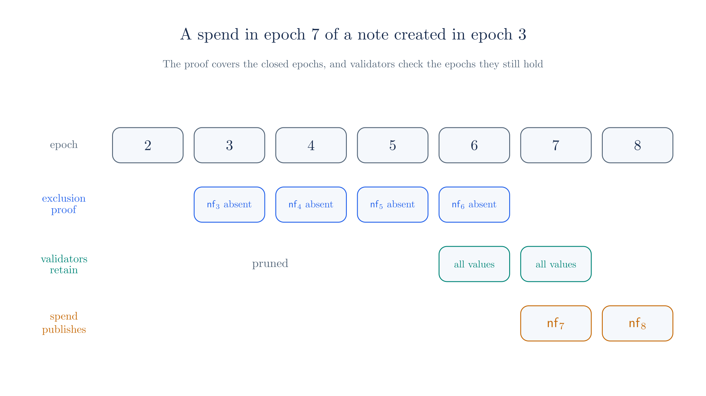
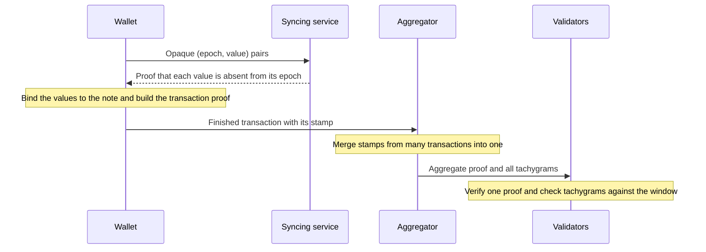
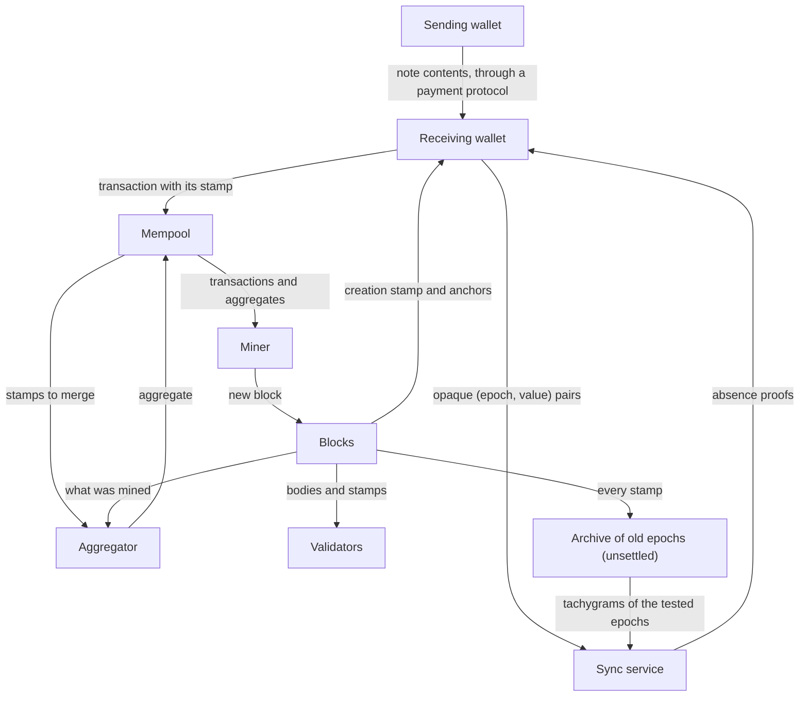

# Scaling Zcash

Zcash lets people pay each other without publishing who paid whom or how much. The cryptography that provides this privacy also creates two costs that grow with use. Every validator must remember a value for every note ever spent, and every wallet must examine every payment on the chain to find its own. Neither cost matters much at low volume, but both become serious limits if shielded payments are to grow by orders of magnitude.

Tachyon is a proposal to remove these two limits, and Ragu is the proving system built to support it. This chapter explains the problem and the outline of Tachyon's answer, and it ends with the requirements that answer places on a proof system. It contains no proof machinery. The rest of the site builds that machinery, and the later chapters return to Tachyon in detail.

::: warning Status of Tachyon
Tachyon is a proposal, and it has not activated on Zcash mainnet. Its design is still changing, and the sources sometimes disagree with one another. At commit [`7e50254`](https://github.com/tachyon-zcash/tachyon/tree/7e502548db33845dbaacdc0efe905d1a3c45e626), the [network upgrade deployment ZIP](https://github.com/tachyon-zcash/tachyon/blob/7e502548db33845dbaacdc0efe905d1a3c45e626/book/src/zips/network-upgrade-deployment.md) is an empty outline. The crate at that commit [builds against a mock of Ragu](https://github.com/tachyon-zcash/tachyon/blob/7e502548db33845dbaacdc0efe905d1a3c45e626/crates/tachyon/Cargo.toml#L74-L76), so its proof steps run natively with no real circuits, and we did not find a validator in it. Statements about Tachyon in this chapter describe the design at that commit, and they may not describe what eventually ships.
:::

## 1. Hiding payments on a public ledger

A public ledger has to convince everyone that no money was created or spent twice, and transparent systems do this by showing every balance. Zcash's shielded pools have to reach the same conclusion from data that reveals no amounts or parties.

The [Zerocash paper](https://eprint.iacr.org/2014/349) achieved this with a **zero-knowledge proof**, which is a short object that convinces a verifier that a statement is true while revealing nothing beyond that fact. Later chapters construct such proofs. For now, treat one as a black box. The prover holds some secret data, the verifier holds a public statement about it, and the verifier learns only that the statement holds.

This section and the next two describe how shielded payments use such proofs today. We follow [Orchard](https://zcash.github.io/orchard/), the Zcash shielded pool that Tachyon's design starts from, and we leave out details that do not affect the scaling problem.

## 2. Notes and commitments

Shielded money exists as discrete **notes**. A note resembles a banknote with a named owner, because it records a value, the recipient, and some random values that make it unique. Orchard writes the recipient as a diversifier $d$ and a transmission key $\mathsf{pk_d}$, so that

$$\mathsf{Note}^{\mathsf{Orchard}} = (d,\ \mathsf{pk_d},\ v,\ \rho,\ \psi,\ \mathsf{rcm}).$$

Here $v$ is the value, and $\rho$, $\psi$ and $\mathsf{rcm}$ are the random-looking values. Section 3 explains the first two.

The note cannot appear on the chain, since that would reveal its value and owner. A transaction that creates a note publishes a **note commitment** $\mathsf{cm}$ instead, which is a short value computed from all the note's fields. As with the vector commitments of a [later chapter](./polynomial-commitments.md), a commitment fixes the note's contents without revealing them, because the random value $\mathsf{rcm}$ masks everything else.

A spender later has to show that the note being spent really was created. Validators collect all commitments into a Merkle tree of [depth 32](https://zips.z.cash/protocol/protocol.pdf), and the tree's root at a given moment is called an **anchor**. The spender proves in zero knowledge that it knows a note whose commitment is a leaf under a recent anchor. The proof reveals neither the note nor the leaf's position, so the spend cannot be linked to the output that created it.

## 3. Nullifiers

Hiding which note is being spent creates a new problem. Validators cannot mark a leaf as spent, because they do not know which leaf is involved, so without some further mechanism one note could be spent repeatedly with a new proof each time.

To close this gap, the spender publishes a second value, the **nullifier** $\mathsf{nf}$. The note determines its nullifier uniquely, and the proof shows that the published value is the correct one for the note. Validators keep a set of all nullifiers seen so far and reject any transaction that repeats one.

Two properties make this work. First, the nullifier must be unlinkable to the commitment, or publishing it would reveal which note was spent. Second, only the owner should be able to compute it, or the sender of a note could watch for it and learn when the recipient spends the money. Both properties come from deriving the nullifier with the owner's secret **nullifier key** $\mathsf{nk}$. Leaving out some curve details, [Orchard's derivation](https://zcash.github.io/orchard/design/nullifiers.html) has the form

$$\mathsf{nf} = \mathsf{Extract}\big([\,F_{\mathsf{nk}}(\rho) + \psi\,]\,G + \mathsf{cm}\big),$$

where $F$ is a keyed pseudorandom function and $\mathsf{Extract}$ takes a point's $x$-coordinate. Orchard sets a new note's $\rho$ to the nullifier of the note spent in the same action, which keeps each $\rho$ distinct because consensus already forbids repeated nullifiers.

A small ledger shows how the pieces fit together. The next table uses a shortened SHA-256 in place of the real functions, so its values only illustrate the structure and are not Orchard values.

<!-- worked:toy-pool -->

| Note | Owner | Value | Commitment (public) | Nullifier (secret until spent) |
| --- | --- | --- | --- | --- |
| 0 | Alice | 40 | `a7256984` | `8c7694d4` |
| 1 | Bob | 25 | `ca571e77` | `8901141e` |
| 2 | Bob | 25 | `8145c71a` | `06c5940b` |

<!-- /worked:toy-pool -->

Notes 1 and 2 have the same owner and value, yet their commitments and nullifiers look unrelated, because each note has its own random values.

<!-- worked:toy-spend -->

Suppose Bob spends note 1. He publishes the nullifier `8901141e` and proves in zero knowledge that it belongs to some commitment in the list. The validators see that `8901141e` is new, accept the spend, and add it to the nullifier set. If he tries again, the proof forces him to publish `8901141e` a second time, and the validators reject it. An observer cannot match `8901141e` to `ca571e77` rather than to `a7256984` or `8145c71a`, because matching them requires Bob's key. Carol could not compute this nullifier either, since her key gives `38cfd1c4` for the same note.

<!-- /worked:toy-spend -->

An Orchard transaction contains a bundle of **actions**, and each action pairs one spend with one output. [ZIP 225](https://zips.z.cash/zip-0225) fixes an action's encoding at 820 bytes, consisting of a value commitment, the nullifier, a randomized signing key, the new note's commitment, an ephemeral key, and two ciphertexts of 580 and 80 bytes. Section 5 returns to those ciphertexts.

## 4. Why the nullifier set grows forever

The nullifier set has an unusual property, which is that its entries can never become irrelevant. A note has no expiry date, so its owner might spend it decades after receiving it. To reject a repeat of a spend from ten years ago, a validator needs the nullifier from ten years ago. Removing old nullifiers would allow those notes to be spent again, and forcing old notes to move before a deadline would strand the funds of anyone who missed it. Bowe and Miers [state the same dilemma](https://eprint.iacr.org/2025/2031) in their note on this problem.

The commitment tree also grows, but it causes less trouble. [Tachyon's deep dive](https://github.com/tachyon-zcash/tachyon/blob/7e502548db33845dbaacdc0efe905d1a3c45e626/book/src/revisit.md#L209-L215) draws the distinction this way. Commitments can sit on disk, while every incoming transaction must check its nullifiers against the entire set, which pushes validators to hold that set in memory on the path that decides whether a transaction is valid. So the nullifier set is the state that limits throughput.

The growth itself is plain arithmetic.

<!-- worked:state-growth -->

Take a hypothetical load of 100 transactions per second, each with 2 spends and 2 outputs. These inputs are illustrative and do not forecast anything. Each spend adds one 32-byte nullifier, so the set grows by 200 nullifiers per second. Counting only the raw bytes, with no index structure:

| Elapsed time | Nullifiers | Raw size |
| --- | --- | --- |
| 1 day | 17,280,000 | 0.6 GB |
| 1 year | 6,307,200,000 | 201.8 GB |
| 5 years | 31,536,000,000 | 1,009.2 GB |

The last column has no ceiling, because no entry ever leaves the set.

<!-- /worked:state-growth -->

The deep dive quotes a far larger figure from a talk, 500 GB per day at Visa-level throughput. The book does not spell out the assumptions behind it, and we have not checked them, but the shape of the problem is the same at any rate. A validator's cost depends on the entire history of the pool, so faster hardware only postpones the limit.

Faster block validation alone would not change this. Even if verifying proofs became free, the set would keep growing with each spend. This is why a post in the forum thread on [Tachyon and Ragu](https://forum.zcashcommunity.com/t/scaling-zcash-tachyon-ragu/50789) describes validator state, rather than verification speed, as the main target.

## 5. Why wallets download everything

The second cost falls on recipients. A sender creates a note, but the recipient must learn the note's contents in order to spend it, and that includes the random values. The two parties may have no private channel, so Zcash has always used the chain as a public bulletin board. The sender encrypts the note to the recipient's address and publishes the ciphertext inside the action. This is called **in-band secret distribution**.

Encryption hides the recipient from everyone, including the recipient's own wallet, which has no way to tell which ciphertexts are addressed to it. Nothing public can reveal this, because any public marker of the recipient would link payments together. The wallet therefore attempts to decrypt every output on the chain with its viewing key and keeps those that succeed. This is **trial decryption**. Its cost grows with the total traffic on the chain, regardless of how many payments the wallet receives.

A full node could absorb this as computation, but a phone also has to download the data. [ZIP 307](https://zips.z.cash/zip-0307) reduces the download by sending a compact form of each output, with the 32-byte ephemeral key, the 32-byte commitment, and only the first 52 bytes of the ciphertext. A wallet also wants each 32-byte nullifier, so that it can tell when its notes have been spent. The table's compact row counts all four of these fields.

<!-- worked:wallet-load -->

With the same hypothetical 100 transactions per second, Orchard-style pairing gives 2 actions per transaction and 200 actions per second. A wallet attempts 17,280,000 trial decryptions per day whether or not anyone has paid it.

| What the wallet downloads | Bytes per action | Per day | After 30 days offline |
| --- | --- | --- | --- |
| Full action | 820 | 14.2 GB | 425.1 GB |
| Compact form | 148 | 2.6 GB | 76.7 GB |

<!-- /worked:wallet-load -->

This cost has already caused real trouble at far lower volume. After the NU5 upgrade in 2022, shielded outputs [rose from a monthly average of 42,600 to 21,622,590 in June](https://zodl.com/a-look-back-nu5-and-network-sandblasting/), in an episode known as sandblasting. Some mobile wallets could no longer sync in a reasonable time, and some users could not reach their funds. The fee changes and wallet improvements that followed reduced the damage, but they did not remove the underlying link between chain traffic and wallet work.

A linear scan also has a privacy cost. The [deep dive](https://github.com/tachyon-zcash/tachyon/blob/7e502548db33845dbaacdc0efe905d1a3c45e626/book/src/revisit.md#L2509-L2514) notes that it leaks metadata and that it becomes infeasible for mobile wallets with limited bandwidth as throughput rises.

## 6. Tachyon's approach in outline

The two costs share a structure. In each case, a party does work proportional to everybody's activity in order to answer a question about one note. A validator searches all of history to ask whether this note has already been spent, and a wallet reads all of history to ask whether a given output belongs to it.

Tachyon's guiding principle, which the deep dive calls [client-side validation](https://github.com/tachyon-zcash/tachyon/blob/7e502548db33845dbaacdc0efe905d1a3c45e626/book/src/revisit.md#L234-L242), is to move as much of this work as possible away from consensus and onto the party that cares about the answer. That party then supplies a proof, which validators can check cheaply. Tachyon applies the principle in three ways, which the next sections take in turn:

1. Note delivery leaves the core shielded protocol, so that wallets no longer scan every ciphertext to find their notes.
2. Nullifiers change over time, so that validators can forget old ones, and the spender proves that none of the note's nullifiers appeared in the part of history validators have forgotten.
3. Many transactions share one proof through aggregation, which reduces the chain space and verification time per transaction.

The second and third rely on proofs that can absorb other proofs, and Section 13 collects what this demands from the proof system.

## 7. Separating note delivery from the shielded protocol

Orchard's payment address carries two responsibilities. It says who owns a note, and it also provides the key that encrypts the note to its recipient. The [deep dive](https://github.com/tachyon-zcash/tachyon/blob/7e502548db33845dbaacdc0efe905d1a3c45e626/book/src/revisit.md#L59-L65) separates them into two layers. The **shielded protocol** only tracks notes and enforces who may spend them. A **payment protocol** run by wallets decides how a sender gets the note's contents to the recipient.

The note format reflects the split. A Tachyon note drops the address and $\rho$ and keeps only what ownership and uniqueness need,

$$\mathsf{Note}^{\mathsf{Tachyon}} = (\mathsf{pk},\ v,\ \psi,\ \mathsf{rcm}),$$

where the **payment key** $\mathsf{pk}$ is a commitment to the owner's authorization key $\mathsf{ak}$ and nullifier key $\mathsf{nk}$. The key that encrypts a note no longer appears in the note at all. [Chapter 20](./notes-and-nullifiers.md) covers these keys.

Once delivery is a separate layer, wallets can use channels other than the chain. A web checkout, a payment terminal, or a messaging app can carry the note's contents directly, as [Sean Bowe's original post](https://seanbowe.com/blog/tachyon-scaling-zcash-oblivious-synchronization/) proposes, and the wallet then learns of a payment without scanning anything. This is **out-of-band delivery**, and it is the source of the common summary that Tachyon removes in-band secret distribution. The current design is less absolute than that summary, as the following note explains.

::: warning The sources differ on how far delivery leaves the chain
[Bowe's posts](https://seanbowe.com/blog/tachyaction-at-a-distance/) and the Tachyon book's [key hierarchy page](https://github.com/tachyon-zcash/tachyon/blob/7e502548db33845dbaacdc0efe905d1a3c45e626/book/src/keys.md), which carries a note saying it is significantly outdated, describe fully out-of-band payments. The [deep dive's payment protocol section](https://github.com/tachyon-zcash/tachyon/blob/7e502548db33845dbaacdc0efe905d1a3c45e626/book/src/revisit.md#L2477-L2484) instead sketches a design under development by a separate team. In that design the address travels out of band, while encrypted memos remain on chain with a short per-note **tag**. Wallets then fetch their memos by tag through **private information retrieval**, which lets a client read a database entry without the server learning which one. A key-exchange ciphertext appears on chain only for a first contact between two parties. The [bundle format](https://github.com/tachyon-zcash/tachyon/blob/7e502548db33845dbaacdc0efe905d1a3c45e626/book/src/bundle.md#L166-L173) and the [code](https://github.com/tachyon-zcash/tachyon/blob/7e502548db33845dbaacdc0efe905d1a3c45e626/crates/tachyon/src/bundle/mod.rs#L47-L58) both carry one optional, opaque, variable-length memo per bundle, and the deep dive says the shielded protocol never parses it.

This site follows the code on this point. The shielded protocol leaves a place for opaque payload data and does not depend on it, and how wallets use that field is a payment-protocol choice that is not settled.
:::

In either version, the protocol no longer requires every action to carry a ciphertext that every wallet must try, and this is the step that breaks the link between chain traffic and wallet work. The change has costs of its own. The chain stops being a complete record from which a seed phrase can recover everything, so the deep dive sketches periodic encrypted wallet-state backups on chain. Addresses in that sketch also become harder to share, because the post-quantum encryption keys are too large for a QR code and need a lookup service. A post in the [forum thread](https://forum.zcashcommunity.com/t/scaling-zcash-tachyon-ragu/50789) names the user experience of removing in-band delivery as a pressing concern.

## 8. Evolving nullifiers

We now turn to the validator's problem. Consider the most direct way to let validators forget old nullifiers. Validators keep only the nullifiers from recent blocks, and a spender adds a proof that the note's nullifier does not appear anywhere in the older history. We call this an **exclusion proof**. Validators check the recent part themselves and rely on the proof for the rest, so their state no longer depends on the age of the chain.

This idea has two practical problems. First, the exclusion proof must stay current as new blocks arrive, and a wallet that is offline or running on a phone cannot do that work continuously. It could hire a service to do it, but that leads to the second problem. To test a nullifier against history, the service must know the nullifier. When the note is eventually spent, that same value appears on chain, so the service learns exactly when its client spent the note.

The fix is to stop giving each note a single nullifier. Tachyon divides time into **epochs** and gives a note a different nullifier in each epoch. A wallet can then hand a service the nullifiers for past epochs, while the value revealed at spend time belongs to a later epoch and looks unrelated to anything the service saw. The [nullifier page](https://github.com/tachyon-zcash/tachyon/blob/7e502548db33845dbaacdc0efe905d1a3c45e626/book/src/nullifiers.md) and the [bundle page](https://github.com/tachyon-zcash/tachyon/blob/7e502548db33845dbaacdc0efe905d1a3c45e626/book/src/bundle.md#L55-L60) define

$$\mathsf{nf}_e = \mathsf{PRF}_{\mathsf{mk}}(e), \qquad \mathsf{mk} = \mathsf{Poseidon}(\psi,\ \mathsf{nk}),$$

where $e$ is the epoch number and $\mathsf{mk}$ is a master key for this note. Poseidon is a hash designed to be cheap inside proofs, and [chapter 3](./statements-and-challenges.md) returns to it. Only the holder of $\mathsf{nk}$ can compute $\mathsf{mk}$, and a pseudorandom function's outputs reveal nothing about one another, so the value at epoch $e$ tells a service nothing about the value at any other epoch. Here is that behaviour with another SHA-256 stand-in, since this chapter does not need real Poseidon values:

<!-- worked:toy-evolving -->

| Epoch $e$ | Stand-in $\mathsf{nf}_e$ |
| --- | --- |
| 5 | `9f70b45d` |
| 6 | `1d94e8ac` |
| 7 | `c6bf4052` |
| 8 | `a75f7578` |

<!-- /worked:toy-evolving -->

This breaks a rule that every earlier Zcash pool relies on, namely that a note has exactly one nullifier. A set of past nullifiers can no longer catch a double spend by looking for a repeat, because a second spend in a later epoch publishes a different value. Tachyon therefore needs a new double-spend rule as well, which the next section describes.

::: warning The sources give different epoch lengths
The [code](https://github.com/tachyon-zcash/tachyon/blob/7e502548db33845dbaacdc0efe905d1a3c45e626/crates/tachyon/src/constants.rs#L9-L15) sets an epoch to 4096 blocks outside its test configuration. The book uses other lengths in examples, with [one day per epoch](https://github.com/tachyon-zcash/tachyon/blob/7e502548db33845dbaacdc0efe905d1a3c45e626/book/src/nf-analysis.md#L41-L44) in the nullifier analysis and [two weeks](https://github.com/tachyon-zcash/tachyon/blob/7e502548db33845dbaacdc0efe905d1a3c45e626/book/src/revisit.md#L881-L883) in the deep dive. This site follows the code.

<!-- worked:epoch-length -->

At the current 75-second block target, 4,096 blocks last 307,200 seconds, or about 3.56 days.

<!-- /worked:epoch-length -->

:::

## 9. Catching double spends without the full history

The new rule splits the check between the spender and the validators. A spender chooses a **target epoch** $e$ and must satisfy two conditions.

The first condition is the exclusion proof. For every closed epoch $j$ from the note's creation up to $e - 1$, the proof shows that $\mathsf{nf}_j$ does not appear anywhere in epoch $j$'s published data. Each nullifier is tested only against its own epoch, so the work is one test per epoch. A note spent in the same epoch it was created has no closed epochs to cover and skips this step.

The second condition is a check by validators, who retain every published value from the current and preceding epochs. A spend must publish its nullifier for the target epoch, and it is rejected if any published value matches a retained one.

A timing problem forces one more detail. A transaction built for epoch $e$ may still be waiting to be mined when epoch $e+1$ begins, and neither miners nor the syncing service can update the proof on the wallet's behalf. Tachyon [therefore accepts](https://github.com/tachyon-zcash/tachyon/blob/7e502548db33845dbaacdc0efe905d1a3c45e626/book/src/revisit.md#L1368-L1374) a spend during its target epoch and the following one. This grace period would open a gap on its own, so each spend publishes two nullifiers, $\mathsf{nf}_e$ and $\mathsf{nf}_{e+1}$. The figure shows who covers what for a note created in epoch 3 and spent with target epoch 7.

Suppose the owner of this note tries to spend it twice, and call the spend that the chain accepts first the first spend. The proof pins each published nullifier to the note and the epoch, so the owner cannot disguise the second spend by publishing fresh values. The owner can only choose the second spend's target epoch and when to submit it.

The argument depends on what the pair of nullifiers guarantees. A spend lands in its target epoch or the next one, and it publishes the nullifiers of both, so it always publishes the nullifier of the epoch that accepts it. Let $a$ be the epoch that accepts the first spend, which means $\mathsf{nf}_a$ now sits in epoch $a$'s data.

<!-- worked:double-spend-walk -->

Take the note in the figure, and suppose its first spend targets epoch 7 and lands in epoch 8. It publishes $\mathsf{nf}_{7}$ and $\mathsf{nf}_{8}$, so $a = 8$. The table lists the second spends with targets up to epoch 9, and any later target fails in the same way as target 9.

| Second target | Accepted in | Publishes | What stops it |
| --- | --- | --- | --- |
| 7 | 8 | $\mathsf{nf}_{7}$, $\mathsf{nf}_{8}$ | validators, who still hold $\mathsf{nf}_{8}$ from epoch 8 |
| 8 | 8 | $\mathsf{nf}_{8}$, $\mathsf{nf}_{9}$ | validators, who still hold $\mathsf{nf}_{8}$ from epoch 8 |
| 8 | 9 | $\mathsf{nf}_{8}$, $\mathsf{nf}_{9}$ | validators, who still hold $\mathsf{nf}_{8}$ from epoch 8 |
| 9 | 9 | $\mathsf{nf}_{9}$, $\mathsf{nf}_{10}$ | the exclusion proof, which would have to show $\mathsf{nf}_{8}$ absent from epoch 8 |
| 9 | 10 | $\mathsf{nf}_{9}$, $\mathsf{nf}_{10}$ | the exclusion proof, which would have to show $\mathsf{nf}_{8}$ absent from epoch 8 |

<!-- /worked:double-spend-walk -->

The rows follow a pattern that holds for any note. A second spend that targets an epoch later than $a$ fails because its exclusion proof would have to cover epoch $a$, where $\mathsf{nf}_a$ is present. A second spend that targets $a$ or earlier still publishes $\mathsf{nf}_a$, and it lands while validators retain epoch $a$, so they see the repeat. The box below checks both cases in general.

::: details Why every second spend fails

The second spend's target is either later than $a$ or not, and each case fails for a different reason.

If the target is later than $a$, the exclusion proof must cover epoch $a$, because it covers every closed epoch before the target. The proof would have to show that $\mathsf{nf}_a$ is absent from epoch $a$'s data, which is false, so the owner cannot produce it.

If the target is not later than $a$, the exclusion proof stops short of epoch $a$, so the validators have to catch the spend. The second spend lands in epoch $a$ or later, and a spend lands at most one epoch after its target, so its target is $a - 1$ or $a$. Both targets give a pair that includes $\mathsf{nf}_a$. The spend also lands in epoch $a$ or $a + 1$, and validators still retain epoch $a$ at either point, so they find the repeated value and reject the spend.

:::

This argument assumes that the proofs cannot be forged and that $\mathsf{PRF}$ behaves as a pseudorandom function. [Chapter 20](./notes-and-nullifiers.md#_10-why-a-spend-publishes-two-nullifiers) builds on this argument with an attack that a single nullifier would allow, the reason the window spans two epochs, and a numeric check of every case on a running note. [Chapter 21](./pool-state.md) shows how a proof can refer to history that validators no longer hold.

## 10. What validators store now

Tachyon also simplifies what gets stored. Every published value, whether a nullifier or a note commitment, is a 32-byte **tachygram**, and consensus treats all of them identically. So that observers cannot tell spends from outputs, [each action publishes exactly two tachygrams](https://github.com/tachyon-zcash/tachyon/blob/7e502548db33845dbaacdc0efe905d1a3c45e626/book/src/tachygrams.md#L7-L40). A spend publishes its two nullifiers, and an output publishes its commitment and a padding value. Each bundle adds one more tachygram for a fee change note, as the [code's error message](https://github.com/tachyon-zcash/tachyon/blob/7e502548db33845dbaacdc0efe905d1a3c45e626/crates/tachyon/src/bundle/mod.rs#L307-L309) also states.

The window that validators retain is therefore bounded by throughput and epoch length, and the chain's age does not enter into it. Older tachygrams can be pruned.

<!-- worked:window -->

Return to the hypothetical 100 transactions per second. A Tachyon action is either a spend or an output, so each transaction has 4 actions and publishes $9 = 2 \cdot 4 + 1$ tachygrams. The window holds at most two epochs of these, which is 614,400 seconds of traffic:

| Elapsed time | Orchard-style nullifier set | Tachyon window (peak) |
| --- | --- | --- |
| 1 week | 3.9 GB | 17.4 GB |
| 1 month | 16.6 GB | 17.7 GB |
| 1 year | 201.8 GB | 17.7 GB |
| 5 years | 1,009.2 GB | 17.7 GB |

For the first 32 days or so the window is the larger of the two, because it records more values per transaction. After that the nullifier set keeps growing while the window stays where it is.

The size of the window depends on the epoch length, which is not settled. The sources give different lengths:

| Epoch length | Tachyon window (peak) | Days until the nullifier set is larger |
| --- | --- | --- |
| 1 day (book) | 5.0 GB | 9 |
| 4,096 blocks (code) | 17.7 GB | 32 |
| 2 weeks (book) | 69.7 GB | 126 |

<!-- /worked:window -->

The comparison matters for the shape of the two columns. The window is not small at this load, but it stops growing. Doubling the throughput doubles the window, which is a cost a validator can plan for, while in the other column the same doubling steepens a line that never levels off.

Validators do not forget everything. They still keep the **anchor chain**, a hash chain over the pool's history that lets them check that a proof refers to a real point in the chain. In Tachyon an anchor is a state of this hash chain, which differs from the Merkle root of Section 2. The chain advances [once per stamp](https://github.com/tachyon-zcash/tachyon/blob/7e502548db33845dbaacdc0efe905d1a3c45e626/book/src/revisit.md#L787-L798), where a **stamp** is the part of a bundle that holds its proof and tachygrams, so the chain grows with the number of stamps rather than with the number of notes.

Someone must also keep the pruned data, or nobody could build exclusion proofs against it. A post in the [forum thread](https://forum.zcashcommunity.com/t/scaling-zcash-tachyon-ragu/50789) acknowledges that this leaves a data availability problem, and we treat the question of who stores old history as unsettled.

### The data on the chain

The next sections refer to an epoch's history, so we should say what that history consists of. A block holds transactions, and the Tachyon part of a transaction is a **bundle**. The [bundle format](https://github.com/tachyon-zcash/tachyon/blob/7e502548db33845dbaacdc0efe905d1a3c45e626/book/src/bundle.md#L160-L190) divides a bundle into a body and a stamp, and validators use each part differently:

| Part | What it contains | What validators do with it |
| --- | --- | --- |
| Body | the net value balance, each action's value commitment and randomized signing key, the max fee commitment, the signatures, and an optional memo | check the signatures and the value balance |
| Stamp | the tachygram list, the anchor, a commitment to the list, the proof, and a few values that go with them | verify the proof, compare the tachygrams against the window, and advance the anchor chain |

Unlike an Orchard action, a Tachyon action carries no note ciphertext. Nothing in the table names a note or its owner, and the tachygrams carry no labels saying which kind each one is.

<!-- worked:chain-tachygrams -->

Take a transaction with 2 spends and 2 outputs, and count what its stamp lists:

| Source | Tachygrams | Count |
| --- | --- | --- |
| 2 spends | two nullifiers each | 4 |
| 2 outputs | a note commitment and a padding value each | 4 |
| Fee change note | one value for the bundle | 1 |
| Total | | 9 |

<!-- /worked:chain-tachygrams -->

Section 12 adds one complication. A transaction can give up its stamp and point to another transaction's stamp, and that stamp's list then includes its tachygrams. Tachygrams therefore always sit in stamps, although not every bundle has a stamp of its own.

An epoch's history is therefore the tachygram lists of all the stamps in that epoch's blocks. Validators hold this data for two epochs and then prune it, and it is the data that the service in the next section has to read.

## 11. Outsourcing the exclusion proof

Exclusion proofs still require someone to read every tachygram of each epoch being tested. Tachyon lets a wallet delegate this reading to an **oblivious syncing service**, which is untrusted and sees very little.

The service [receives opaque pairs](https://github.com/tachyon-zcash/tachyon/blob/7e502548db33845dbaacdc0efe905d1a3c45e626/book/src/revisit.md#L1255-L1270) of an epoch number and a value. For each pair, it proves that the value is absent from that epoch's history, and it returns the proof. It never learns the note or its commitment, and it cannot compute any nullifier beyond the list it was given. Nothing even shows that the values come from a real note, so a wallet can mix in decoys. Once the proof returns, the wallet separately proves that the values the service tested are the nullifiers of its note. This second step is what attaches the anonymous work to a real note, and it needs the note's secrets, so the wallet performs it.

Because each epoch's nullifier is unrelated to the others, the values that later appear on chain at the spend, $\mathsf{nf}_e$ and $\mathsf{nf}_{e+1}$, lie outside the delegated list, and the service cannot recognize them. This assumes that the wallet does not delegate those epochs and that $\mathsf{mk}$ stays secret. Requests from one wallet could still be correlated with each other, and the original post leaves this partly to later work, with mixnets as one suggestion. The deep dive also proposes standard request shapes and decoys. [Chapter 22](./oblivious-sync.md) covers how the service proves absence over a whole epoch, which takes a further set of ideas.

The following diagram shows the path of an older note through to the chain.

## 12. Aggregation

So far, every transaction carries its own proof, and an Orchard proof is the largest part of an Orchard transaction. Aggregation addresses this. An [aggregator](https://github.com/tachyon-zcash/tachyon/blob/7e502548db33845dbaacdc0efe905d1a3c45e626/book/src/aggregation.md#L1-L8) takes the stamps of several transactions and merges their proofs into one that covers all of them. We use the word "merge" as the Tachyon book does, and the Ragu book and code call the same two-into-one operation [`fuse`](https://github.com/tachyon-zcash/ragu/blob/3219e0865e8bff1f9d817bfe3850d9e94b64338c/book/src/concepts/pcd.md#L100-L104). The original transactions go into the block without their proofs and point to the aggregate instead. Miners are likely to take on this role. Validators still check each transaction's signatures and value balance, and they check every tachygram against the window, but they verify only one proof.

Here is what that does to the on-chain bytes of a transaction. Orchard's sizes come from [ZIP 225](https://zips.z.cash/zip-0225) and Tachyon's from the [bundle format](https://github.com/tachyon-zcash/tachyon/blob/7e502548db33845dbaacdc0efe905d1a3c45e626/book/src/bundle.md#L160-L190). We leave out binding signatures, value balances, Orchard's anchor and flags, and small length fields, which are small next to the totals and similar in each.

<!-- worked:chain-bytes -->

| Component, for 2 spends and 2 outputs | Orchard bytes | Tachyon bytes |
| --- | --- | --- |
| Action descriptions | $2 \cdot 820 = 1,640$ | $4 \cdot 64 = 256$ |
| Authorization signatures | $2 \cdot 64 = 128$ | $4 \cdot 64 = 256$ |
| Published tachygrams | included in the actions | $9 \cdot 32 = 288$ |
| Maximum fee value commitment | none | 32 |
| Proof | $2720 + 2272 \cdot 2 = 7,264$ | a share of one aggregate proof |
| Total without the shared proof | 9,032 | 832 |

<!-- /worked:chain-bytes -->

<!-- worked:block-load -->

These totals also show how far the hypothetical 100 transactions per second is from today's chain. At 75 seconds per block, that load needs about 67.7 MB per block with Orchard and 6.24 MB with Tachyon, before counting the aggregate proof. Both exceed the current limit of 2 MB per block, so this load would also require a larger block limit. The pruned window is only one part of what a node may store, too. Keeping the block history at this load would add about 2.6 TB per year for Tachyon, excluding proofs.

<!-- /worked:block-load -->

This comparison is not exact. The Orchard column includes encrypted memos in its action descriptions, while the Tachyon column leaves out its optional memo field and the reference to the aggregate. It also leaves out the aggregate proof, which has a fixed size in the [bundle format](https://github.com/tachyon-zcash/tachyon/blob/7e502548db33845dbaacdc0efe905d1a3c45e626/book/src/bundle.md#L187), though the real size is not settled. The [chapter on aggregation](./aggregation-and-bundles.md) uses the mock's constant as a placeholder and explains why it probably overstates the proof's share. The table shows where the savings come from, and the largest part is removing the per-transaction proof.

Verification time follows a similar pattern, though aggregation does not win in every case. The Ragu book's [rough estimate](https://github.com/tachyon-zcash/ragu/blob/3219e0865e8bff1f9d817bfe3850d9e94b64338c/book/src/protocol/analysis.md#L50-L75) puts an aggregate's verification at about 100 ms, and it places the break-even with Orchard's batch verification near 50 transactions. The book marks these as estimates still to be validated with benchmarks, so treat them as a guide to the shape of the trade-off. One aggregate is more expensive to verify than one Orchard proof, and it pays for itself as the number of transactions grows.

### Who reads what

All the participants have now appeared, so we can put them on one map that shows where each kind of data goes. Reconstructed from the book and code at commit `7e50254`, not confirmed by the authors. The book's [network roles page](https://github.com/tachyon-zcash/tachyon/blob/7e502548db33845dbaacdc0efe905d1a3c45e626/book/src/network_roles/overview.md) names the mempool, aggregator, and miner, and the deep dive adds the sync service. The archive is our label for a role that nobody has been assigned yet.

The table lists what each participant reads and what it can ignore.

| Participant | What it reads | What it can ignore |
| --- | --- | --- |
| Wallet | its note's contents from the sender, the tachygrams of the note's creation stamp and the anchor just before it, recent anchors, and the service's absence proofs | other people's notes, and the tachygrams of the epochs that it delegates |
| Sync service | the opaque pairs from wallets, and all the tachygrams of each epoch it tests | the note, its commitment, and the wallet's keys |
| Aggregator | the transactions and aggregates in the mempool, recent anchors, and each new block's action descriptors, fees, and tachygrams | epochs older than the ones its working aggregate depends on |
| Miner | the transactions and aggregates in the mempool, plus the window and the anchor chain | old tachygrams, which it no longer needs in order to accept a block |
| Validator | each new block's bodies and stamps, plus the window and the anchor chain | tachygrams older than the window |
| Archive | every stamp in every block, so that old epochs stay available | the contents of notes, which it cannot read anyway |

Parts of this picture are less settled than the table makes them look. The [proof tree](./proof-tree.md) needs the wallet to hold its creation stamp's data, but the sources we read do not say how a wallet finds that stamp or fetches it privately. Chapter 22 explains what the service proves, but we found no description of where it gets old epochs, which is the data availability question from Section 10. A payment protocol may also add its own participants, such as the memo retrieval servers in the warning under Section 7.

## 13. What this requires from a proof system

Tachyon now places a specific set of demands on its proof system, and these demands explain much of Ragu's design.

**Proofs must absorb other proofs.** An exclusion proof has to extend from epoch to epoch without being rebuilt from scratch, and without handing the verifier a list that grows with the note's age. Aggregation has to turn two proofs into one. In both cases, a new proof must establish that an earlier proof was valid, and then add something. A proof of this kind is **recursive**, because the statement it proves includes running the verifier of another proof. The general form of this idea, in which a whole tree of computation steps carries proofs along its edges, is called **proof-carrying data**, and the [next chapter](./pcd-intro.md) introduces it.

**Proofs must be small.** Stamps travel through the network and are stored on the chain. The Ragu book [gives this requirement](https://github.com/tachyon-zcash/ragu/blob/3219e0865e8bff1f9d817bfe3850d9e94b64338c/book/src/protocol/index.md#L51-L57) as the reason for building on the elliptic curve discrete logarithm. Given the current state of the art, it says, small recursive proofs essentially limit the design to constructions based on that assumption. It aims for performance [comparable to the proofs Orchard already deploys](https://github.com/tachyon-zcash/ragu/blob/3219e0865e8bff1f9d817bfe3850d9e94b64338c/book/src/protocol/index.md#L39-L47).

**There should be no trusted setup.** Some proof systems depend on public parameters generated from a secret, which must be destroyed afterwards, because anyone who kept it could forge proofs. Zcash's Sprout and Sapling pools used such parameters, and Orchard removed the need for them by moving to Halo 2. The Ragu book describes a [strong desire](https://github.com/tachyon-zcash/ragu/blob/3219e0865e8bff1f9d817bfe3850d9e94b64338c/book/src/protocol/index.md#L61-L68) to keep it that way, which limits it to polynomial commitments based on the inner product argument from Bulletproofs. [Chapter 6](./polynomial-commitments.md) and [chapter 7](./inner-product-argument.md) build these.

These last two requirements pull against each other, which sets the main technical problem of the site. Verifying an inner product argument takes group operations in proportion to the size of the committed vector, and a recursive proof would have to carry out that verification inside itself at every step. The way out, from the [Halo paper](https://eprint.iacr.org/2019/1021), is to defer the expensive check from one proof to the next and merge the deferred checks as they accumulate, which [chapter 11](./accumulation.md) develops. Ragu also keeps the committed vectors small, with a preferred size of $2^{11}$ multiplication gates per step. A single step therefore does little work, and [Tachyon's analysis](https://github.com/tachyon-zcash/tachyon/blob/7e502548db33845dbaacdc0efe905d1a3c45e626/book/src/nf-analysis.md#L46-L50) counts a capacity of 7 Poseidon permutations per step, so a large statement must be split across many small steps.

**The curves should be the Pasta cycle.** Orchard already uses the [Pasta curves](https://electriccoin.co/blog/the-pasta-curves-for-halo-2-and-beyond/), Pallas and Vesta. Spend authorization in Orchard, and in Tachyon, is a RedPallas signature over Pallas, and hardware wallets already sign on these curves. The Ragu book names this deployed base as a [reason for preferring them](https://github.com/tachyon-zcash/ragu/blob/3219e0865e8bff1f9d817bfe3850d9e94b64338c/book/src/protocol/index.md#L43-L47). They also suit recursion for a structural reason, which is that the two curves form a cycle in which each curve's scalar field is the other's coordinate field. [Chapter 13](./curve-cycles.md) explains why that matters.

**The cost is post-quantum soundness.** A large enough quantum computer could forge discrete-log proofs. Tachyon's [stated goal](https://github.com/tachyon-zcash/tachyon/blob/7e502548db33845dbaacdc0efe905d1a3c45e626/book/src/revisit.md#L2829-L2836) is privacy that resists a future quantum computer from the start, with soundness left for a later upgrade to a lattice-based scheme. The deep dive says that the details of that upgrade remain to be determined.

## 14. Where this chapter leaves us

This chapter took the following steps:

1. Shielded notes appear on chain only as commitments, and a spend reveals a nullifier, which validators test against the set of all earlier nullifiers.
2. Notes never expire, so that set can never shrink, and a validator's state grows with the whole history of the pool.
3. Notes travel as ciphertexts on chain and no public marker can identify their recipient, so wallets must trial-decrypt all traffic.
4. Tachyon moves note delivery out of the shielded protocol, although how much payload remains on chain is a payment-protocol question that is not settled.
5. Nullifiers change each epoch. A spender proves that its nullifiers are absent from closed epochs, and validators retain only two epochs of tachygrams, so their window stops growing.
6. An untrusted service can do most of the exclusion work without learning which note it serves, because each epoch's nullifier is unrelated to the others.
7. Aggregation merges the proofs of many transactions into one.
8. These ideas need small recursive proofs, with no trusted setup, on curves that Zcash already deploys. Tachyon itself is still a proposal, and none of this has activated on mainnet.

The requirement that proofs absorb other proofs is the one that shapes everything else. The next chapter, [An Introduction to Proof-Carrying Data](./pcd-intro.md), states that goal precisely before any machinery appears, using Tachyon's aggregation as its running example.
