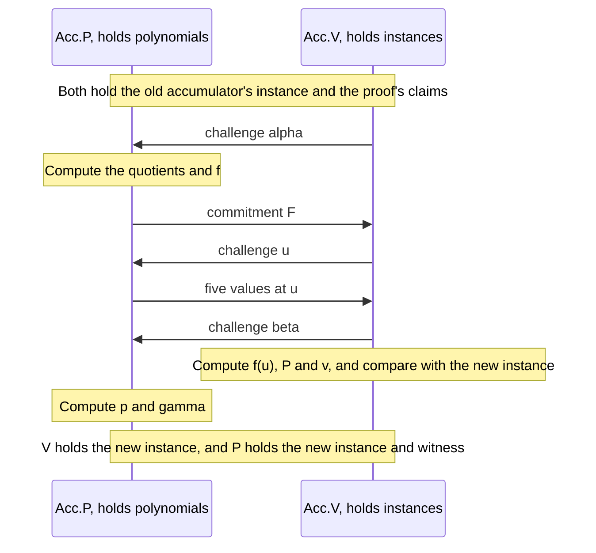

# Split Accumulation

The [last chapter](./accumulation.md) kept one claim alive across a chain of proofs and left the expensive check to a single decider at the end. That worked because the accumulator carried everything the next prover needed, but it had a price, since every step had to run a complete inner product argument for the proof it verified and another for the merge.

This chapter removes those arguments from the recursive path. The idea comes from noticing that the recursive verifier never needs to read most of a proof, so we divide both the proof and the accumulator into a short part that the circuit reads and a long part that only a prover and a decider ever touch. The long part need not be short at all, which is why a step can use the non-succinct proof of [chapter 09](./nark.md). Bünz, Chiesa, Lin, Mishra and Spooner formalized this in [Proof-Carrying Data without Succinct Arguments](https://eprint.iacr.org/2020/1618) under the name **split accumulation**, and it is the form the [Ragu Book says Ragu implements](https://github.com/tachyon-zcash/ragu/blob/3219e0865e8bff1f9d817bfe3850d9e94b64338c/book/src/protocol/core/accumulation/index.md?plain=1#L73-L77).

::: warning Reconstructed from code at commit 3219e08, not confirmed by the authors
The book gives the [syntax](https://github.com/tachyon-zcash/ragu/blob/3219e0865e8bff1f9d817bfe3850d9e94b64338c/book/src/protocol/core/accumulation/index.md?plain=1#L244-L249) and a [simplified scheme for evaluation claims](https://github.com/tachyon-zcash/ragu/blob/3219e0865e8bff1f9d817bfe3850d9e94b64338c/book/src/protocol/core/accumulation/pcs.md?plain=1#L74-L115). The explicit formulas, the choice of what the toy circuit reads, and the numeric run are our own assembly of that scheme with [chapter 08](./batched-openings.md) and [chapter 09](./nark.md). We could read only the abstract of the paper, so the description of the scheme here follows the book. Section 11 compares all of this with the code.
:::

::: tip Terminology
This chapter says that claims **fold** into an accumulator, because the book [uses "accumulation" and "folding" interchangeably](https://github.com/tachyon-zcash/ragu/blob/3219e0865e8bff1f9d817bfe3850d9e94b64338c/book/src/protocol/core/accumulation/index.md?plain=1#L94-L102) for what Ragu does. A **fuse** is still the [PCD operation of chapter 02](./pcd-intro.md#_9-fusion-in-ragu), which contains folds. A **merge** still means the operation on Halo's claims from [chapter 11](./accumulation.md#_5-merging-two-claims). The book's [evaluation section](https://github.com/tachyon-zcash/ragu/blob/3219e0865e8bff1f9d817bfe3850d9e94b64338c/book/src/protocol/core/accumulation/pcs.md?plain=1#L146-L147) says "merge circuit" where its [IVC section](https://github.com/tachyon-zcash/ragu/blob/3219e0865e8bff1f9d817bfe3850d9e94b64338c/book/src/protocol/core/accumulation/index.md?plain=1#L132-L147) says "fuse circuit" for the same object, and we use "fuse".
:::

## 1. What atomic accumulation still costs

[Section 9 of chapter 11](./accumulation.md#_9-atomic-accumulation) named its scheme atomic, because the accumulator alone lets anyone produce and check the next update. To see what that property costs, count the group work in one recursive step of that scheme:

<!-- worked:atomic-cost -->

Take $n = 2^{13}$ generators, and one step that holds one earlier accumulator and one new proof. The circuit batches the proof's claims, which takes $6$ scalar multiplications, runs the proof's inner product argument up to the split, which takes $28$, and then runs the merge, which takes $29$, for $63$ in all. Outside the circuit, the prover commits to $f$ with $8,192$ scalar multiplications and runs two inner product arguments at $32,764$ each, so $73,720$ at every step.

<!-- /worked:atomic-cost -->

Most of this comes from the two inner product arguments. Both exist for the same reason. An accumulation verifier sits inside a circuit, so anything it reads becomes part of that circuit, and an atomic verifier reads the whole proof it is given. The proof therefore has to be short, which forces an argument at every step, and the output of each argument is one more claim about $\hat{G}$ for the merge to handle.

If the verifier could leave most of a proof unread, the proof could stay long, and the arguments could go. That requires some other party to check the unread part eventually, and the decider is already such a party. We therefore need to find out which parts of a proof the recursive verifier has to read, and we can do that by inspecting the verifier of chapter 09.

## 2. Sorting the verifier's work by what it reads

[Section 16 of chapter 09](./nark.md#_16-what-the-verifier-pays) listed that verifier's steps. Here are the ones concerned with openings and the revdot product, sorted by the data each one touches:

<!-- worked:reads -->

| Verifier step from chapter 09 | Work for $4n = 2^{13}$ | What it reads |
| --- | --- | --- |
| Compute $t(x, z)$ | Two geometric sums | Challenges |
| Check the split of $b(x)$ | A few field operations | Instance values |
| Derive $f(u)$ | One inverse and a few multiplications per claim | Instance values and prover messages |
| Compute $\bar{P}$ and $v$ | 5 scalar multiplications | Instance commitments and prover messages |
| Recompute $S$, $\bar{A}$, $\bar{B}$ | 3 MSMs of size $4n$, or $24,576$ scalar multiplications | **Witness vectors** |
| Compute $\revdot{\v{a}}{\v{b}}$ | $8,192$ field multiplications | **Witness vectors** |
| Recompute $\bar{P}$ from $\v{p}$ | 1 MSM of size $4n$, or $8,192$ scalar multiplications | **Witness vector** |
| Evaluate $p(u)$ | $8,192$ field multiplications | **Witness vector** |

<!-- /worked:reads -->

The two groups differ sharply, and the difference lines up with cost. Every step that reads a witness vector is linear, and every step that avoids one is cheap. This is the division that [chapter 09 drew](./nark.md#_12-the-proof-s-two-parts) when it listed the instance part and the witness part of the proof. There we noted the division only as a matter of size, and now we can use it as a plan. The circuit runs the upper rows, and the lower rows wait for a decider.

The lower rows still look like several separate jobs. The last two are the evaluation check, and they concern the claims that [chapter 08](./batched-openings.md) knows how to batch. This chapter defers those. The revdot row needs its own folding, which is the subject of [chapter 14](./revdot-folding.md), and the correctness of $S$ against the circuit is the subject of [chapter 15](./wiring-and-registry.md). We left the computation of $\v{s}$ out of the table for that reason, since it is linear and reads the circuit rather than the proof. The book [lists the same three subprotocols](https://github.com/tachyon-zcash/ragu/blob/3219e0865e8bff1f9d817bfe3850d9e94b64338c/book/src/protocol/core/nark.md?plain=1#L268-L272) as the verifier's linear work.

## 3. Instances and witnesses

Chapter 03 introduced [instances and witnesses](./statements-and-challenges.md#_1-statements-instances-and-witnesses) for a whole statement, and the same words apply to one evaluation claim. Its **instance** is the triple $(\bar{C}, x, y)$ of commitment, point and value. Its **witness** is the polynomial behind the commitment, together with the blinding factor. The relation between them has two conditions:

$$\dot{\v{p}}{\v{G}} + \gamma \cdot H = \bar{C} \qquad \text{and} \qquad p(x) = y.$$

<!-- worked:one-claim -->

Take the first claim of chapter 09. Its instance is $(\bar{A}, xz, a(xz)) = ((22,\,24),\ 2,\ 9)$, three values that anyone can hold. Its witness is $\v{a} = (9, 27, 9, 3, 3, 3, 0, 0)$ with $\gamma_a = 17$. Checking the claim takes both parts, since $\dot{\v{a}}{\v{G}} + 17 \cdot H = (22,\,24)$ and $a(2) = 9$.

<!-- /worked:one-claim -->

The instance has a fixed size, so a circuit can read it at a fixed cost. The witness has $4n$ entries, and checking the first condition takes an MSM of that size. The instance alone also says nothing conclusive, because any prover can write down a triple. It becomes meaningful only when somebody with the witness runs the check.

The word "witness" here needs a warning. The book's [evaluation section](https://github.com/tachyon-zcash/ragu/blob/3219e0865e8bff1f9d817bfe3850d9e94b64338c/book/src/protocol/core/accumulation/pcs.md?plain=1#L18-L25) calls this a secret witness, held by the prover. In this chapter that describes who needs the data, which is different from a promise that the data stays hidden. Section 11 returns to the point.

## 4. An accumulator with two parts

Chapter 08 turned a list of evaluation claims into a single triple, and a triple is again an instance of the relation above. So the output of that reduction has the right shape to serve as an accumulator, if we keep the output polynomial with it. Following the [book's definition](https://github.com/tachyon-zcash/ragu/blob/3219e0865e8bff1f9d817bfe3850d9e94b64338c/book/src/protocol/core/accumulation/pcs.md?plain=1#L101-L104), the accumulator has two parts:

$$\mathsf{acc}.\text{inst} = (\bar{P}, u, v), \qquad \mathsf{acc}.\text{wit} = (\v{p}, \gamma).$$

The circuit reads the first part, and the second part travels beside the proof. This is what separates the scheme from chapter 11. There the polynomial $g_{\v{u}}$ could be rebuilt from public challenges, whereas here nothing in the instance's $u$ and $v$ determines $p$:

<!-- worked:underdetermined -->

For $(u, v) = (17, 23)$, trying all $79,507$ polynomials with 3 coefficients finds $1,849$ that pass through this point, and each extra coefficient multiplies that count by 43. With 8 coefficients there are $43^7 = 271,818,611,107$ of them. In chapter 11, by contrast, $\v{u} = (15, 10)$ gave one polynomial and only one.

<!-- /worked:underdetermined -->

The commitment does narrow this down, since a binding commitment fixes one polynomial as far as any prover can tell, but finding it from $\bar{P}$ would mean solving discrete logs. So a party who holds only the instance cannot run the next fold and cannot decide the accumulator. Whoever continues the computation has to receive the witness too. That is the price of the split, and we measure it in Section 7.

## 5. The three algorithms

A scheme of this kind has three algorithms. The book [gives the first two](https://github.com/tachyon-zcash/ragu/blob/3219e0865e8bff1f9d817bfe3850d9e94b64338c/book/src/protocol/core/accumulation/index.md?plain=1#L244-L253) in this form, and it [names the decider](https://github.com/tachyon-zcash/ragu/blob/3219e0865e8bff1f9d817bfe3850d9e94b64338c/book/src/protocol/core/accumulation/index.md?plain=1#L67-L71) in its description of accumulation:

| Algorithm | Reads | Produces | Runs |
| --- | --- | --- | --- |
| $\mathsf{Acc.P}$, the accumulation prover | Proofs and accumulators, both parts | A new accumulator, both parts, and a proof $\mathsf{pf}$ of the update | Outside any circuit |
| $\mathsf{Acc.V}$, the accumulation verifier | Instances of the inputs, the new instance, and $\mathsf{pf}$ | Accept or reject | Inside the next circuit |
| $\mathsf{Acc.Decide}$, the decider | One accumulator, both parts | Accept or reject | Once, outside any circuit |

The second row is the defining feature of the scheme, because a verifier that reads only instances has no need for a short witness. To turn chapter 08's reduction into these algorithms, we only have to decide what goes in the input list and which messages form $\mathsf{pf}$.

### The input list

A step holds an earlier accumulator and a new proof. The accumulator's instance is itself one evaluation claim, and the proof contributes the [claims of chapter 09](./nark.md#_8-batching-the-evaluation-claims). That gives five claims about five polynomials:

$$
(\bar{P}_{\text{old}},\, u_{\text{old}},\, v_{\text{old}}), \quad (\bar{A},\, xz,\, a(xz)), \quad (\bar{B},\, x,\, b(x)), \quad (S,\, x,\, s(x, y)), \quad (K,\, y,\, c).
$$

The book's [list](https://github.com/tachyon-zcash/ragu/blob/3219e0865e8bff1f9d817bfe3850d9e94b64338c/book/src/protocol/core/accumulation/pcs.md?plain=1#L90-L100) has two more entries for the constant wire, which [our toy circuit does not use](./nark.md#_14-the-constant-wire). The proof in chapter 09 also carried its own batched triple $(\bar{P}, u, v)$. A recursive step has no need to batch the proof's claims separately and then fold the result, because it can place them directly in this one list.

### The accumulation prover

The prover follows the steps of chapter 08 with this list. We keep that chapter's weights, in which the first claim takes the highest power of $\alpha$ and $f$ takes the highest power of $\beta$. Write $(\bar{C}_i, x_i, y_i)$ for the claims in order and $p_i$ for their polynomials, so that $p_0$ is the old accumulator's polynomial and $p_1, \ldots, p_4$ are $a$, $b$, $s(X, y)$ and $k$.

After receiving $\alpha$, the prover divides and combines,

$$q_i(X) = \frac{p_i(X) - y_i}{X - x_i}, \qquad f(X) = \sum_{i=0}^{4} \alpha^{4-i}\, q_i(X),$$

and it sends $\bar{F} = \dot{\v{f}}{\v{G}} + \gamma_f \cdot H$. After receiving $u$, it sends the five values $p_i(u)$. After receiving $\beta$, it forms the new witness:

$$
\begin{aligned}
p(X) &= \beta^5 f(X) + \sum_{i=0}^{4} \beta^{4-i}\, p_i(X), \\
\gamma &= \beta^5 \gamma_f + \sum_{i=0}^{4} \beta^{4-i}\, \gamma_i.
\end{aligned}
$$

Here $\gamma_i$ is zero for $s$ and $k$, which have no blinding factor. The messages make up the accumulation proof, $\mathsf{pf} = (\bar{F},\, p_0(u), \ldots, p_4(u))$, which [matches the book's](https://github.com/tachyon-zcash/ragu/blob/3219e0865e8bff1f9d817bfe3850d9e94b64338c/book/src/protocol/core/accumulation/pcs.md?plain=1#L112-L115). The book [describes it](https://github.com/tachyon-zcash/ragu/blob/3219e0865e8bff1f9d817bfe3850d9e94b64338c/book/src/protocol/core/accumulation/index.md?plain=1#L83-L85) as an internal value for the circuit's prover, so it goes into the next circuit's witness and is not an output of the recursive step.

### The accumulation verifier

The verifier derives what the new instance has to be, using only the old instances and $\mathsf{pf}$. Its arithmetic never mentions a polynomial's coefficients:

$$
\begin{aligned}
f(u) &= \sum_{i=0}^{4} \alpha^{4-i}\, \frac{p_i(u) - y_i}{u - x_i}, \\
\bar{P} &= \beta^5 \cdot \bar{F} + \sum_{i=0}^{4} \beta^{4-i} \cdot \bar{C}_i, \\
v &= \beta^5 f(u) + \sum_{i=0}^{4} \beta^{4-i}\, p_i(u).
\end{aligned}
$$

It accepts if the claimed new instance equals $(\bar{P}, u, v)$, and if $u$ is the challenge that the transcript produced. This takes one scalar multiplication per commitment and one inverse per claim, however large $n$ is, because no vector and no inner product argument appears in the calculation.

The two sides agree for an honest prover. Expanding the commitment to the new witness and applying [linearity](./polynomial-commitments.md#_5-adding-commitments) gives

$$
\begin{aligned}
\dot{\v{p}}{\v{G}} + \gamma \cdot H
&= \beta^5 \left(\dot{\v{f}}{\v{G}} + \gamma_f \cdot H\right) + \sum_{i=0}^{4} \beta^{4-i} \left(\dot{\v{p}_i}{\v{G}} + \gamma_i \cdot H\right) \\
&= \beta^5 \cdot \bar{F} + \sum_{i=0}^{4} \beta^{4-i} \cdot \bar{C}_i,
\end{aligned}
$$

which is the verifier's $\bar{P}$. Substituting $u$ into the definition of $p(X)$, and using $q_i(u) = (p_i(u) - y_i)/(u - x_i)$ from [Section 4 of chapter 08](./batched-openings.md#_4-moving-one-claim-to-a-new-point) for each term of $f(u)$, gives the verifier's $v$ in the same way.

### The decider

The decider checks the relation of Section 3 on the accumulator, so it computes one MSM and one evaluation. It accepts if $\dot{\v{p}}{\v{G}} + \gamma \cdot H = \bar{P}$ and $p(u) = v$. Chapter 09's verifier performed this same check at the end, when it [recomputed $\bar{P}$ from a revealed $\v{p}$](./nark.md#_9-revealing-p). That chapter said the reveal fits how the proof will be used, and we can now say how, since the revealed polynomial is the accumulator's witness and the reveal gives the decider its input.



## 6. A run on the toy curve

We now run a chain with the step function $F(z) = z^3 + z + 5$ from [chapter 10](./recursive-proofs.md#_1-a-chain-of-steps), starting from $z_0 = 3$, with chapter 09's eight generators. All challenges are picked by hand, and all arithmetic takes place on one curve.

Two simplifications apply to this run. Each proof covers only its step's circuit, because a circuit that also holds $\mathsf{Acc.V}$ would be [far too large for the toy curve](./recursive-proofs.md#_3-writing-the-verifier-as-gates), so the run shows the folds on their own. We also ignore the fact that a circuit over $\F_{43}$ cannot do arithmetic on points whose coordinates lie in $\F_{31}$, which the [next chapter](./curve-cycles.md) addresses.

The first fold has no earlier accumulator, so its list holds only the first proof's four claims. Chapter 09 already did this calculation:

<!-- worked:first-acc -->

Chapter 09's proof of $z_1 = 35$ gives the input list, and no accumulator exists yet. Running the fold with $\alpha = 11$, $u = 17$ and $\beta = 23$ repeats chapter 09's batching with no changes, so $\mathsf{pf}_1 = ((11,\,30),\ 42, 29, 35, 29)$. The result is

$$\mathsf{acc}_1.\text{inst} = ((23,\,24),\ 17,\ 23), \qquad \mathsf{acc}_1.\text{wit} = ((17, 12, 34, 38, 23, 36, 30, 17),\ 27).$$

<!-- /worked:first-acc -->

So chapter 09's batch was the first accumulator all along. The second step brings a new proof and has an accumulator to fold:

<!-- worked:second-proof -->

The second step applies $F$ to $35$ and outputs $1$. Its challenges are $z = 16$, $y = 34$ and $x = 37$, so $xz = 33$. The statement gives $k(Y) = 39\,Y^3$. The script confirms that this proof's revdot product and split check hold, and these are its polynomials and claims:

| Polynomial | Coefficients of $X^0, \ldots, X^7$ | Blinding | Commitment | Point | Value |
| --- | --- | --- | --- | --- | --- |
| $a$ | (21, 4, 21, 35, 35, 35, 0, 0) | 17 | $(7,\,25)$ | 33 | 27 |
| $b$ | (21, 21, 39, 40, 19, 38, 26, 37) | 29 | $(27,\,30)$ | 37 | 24 |
| $s$ | (0, 0, 38, 42, 8, 34, 2, 9) | 0 | $(4,\,25)$ | 37 | 12 |
| $k$ | (0, 0, 0, 39, 0, 0, 0, 0) | 0 | $(28,\,10)$ | 34 | 35 |

<!-- /worked:second-proof -->

The list now has the five claims of Section 5. The old accumulator is $\mathsf{acc}_1$, so its polynomial $p_1$ and its instance $(\bar{P}_1, u_1, v_1)$ come first, in the place that Section 5 calls $p_0$. The first stage combines the quotients:

<!-- worked:fold-f -->

The verifier sends $\alpha = 20$, whose powers give the weights in the next table. The first row divides $p_1(X) - 23$ by $X - 17$, which is the only difference from chapter 09's list.

| Quotient | Weight | Coefficients of $X^0, \ldots, X^6$ |
| --- | --- | --- |
| $q_{p_1}$ | 40 | (13, 38, 23, 32, 41, 18, 17) |
| $q_{a}$ | 2 | (8, 34, 3, 29, 35, 0, 0) |
| $q_{b}$ | 13 | (21, 0, 28, 2, 10, 19, 37) |
| $q_{s}$ | 20 | (41, 29, 23, 39, 2, 34, 9) |
| $q_{k}$ | 1 | (20, 36, 39, 0, 0, 0, 0) |
| $f$ |  | (15, 11, 26, 37, 31, 13, 8) |

With the blinding factor $\gamma_f = 7$, the prover sends $\bar{F} = (20,\,25)$.

<!-- /worked:fold-f -->

Next the prover sends the values at a fresh point:

<!-- worked:fold-fu -->

The verifier sends $u = 30$, and the prover sends the five values. The verifier then derives $f(u)$ from those values and the instances:

| Input | Value at $u$ | Claimed value | $u - x_i$ | Ratio | Weight | Term |
| --- | --- | --- | --- | --- | --- | --- |
| $p_1$ | 28 | 23 | 13 | 7 | 40 | 22 |
| $a$ | 28 | 27 | 40 | 14 | 2 | 28 |
| $b$ | 42 | 24 | 36 | 22 | 13 | 28 |
| $s$ | 35 | 12 | 36 | 9 | 20 | 8 |
| $k$ | 16 | 35 | 39 | 37 | 1 | 37 |

The last column sums to $f(30) = 37$, and the prover gets the same number by evaluating $f$.

<!-- /worked:fold-fu -->

The first row is the fold's link to the past. The value $v_1$ now sits inside the formula for $f(u)$, so a false $v_1$ would make this number wrong. The last stage produces the new instance:

<!-- worked:fold-beta -->

The verifier sends $\beta = 25$. Each input carries its weight into the commitment, the value and the blinding factor.

| Input | Weight | Commitment | Value at $u$ | Blinding factor |
| --- | --- | --- | --- | --- |
| $\bar{F}$ | 24 | $(20,\,25)$ | 37 | 7 |
| $\bar{P}_1$ | 13 | $(23,\,24)$ | 28 | 27 |
| $\bar{A}$ | 16 | $(7,\,25)$ | 28 | 17 |
| $\bar{B}$ | 23 | $(27,\,30)$ | 42 | 29 |
| $S$ | 25 | $(4,\,25)$ | 35 | 0 |
| $K$ | 1 | $(28,\,10)$ | 16 | 0 |
| Combined |  | $\bar{P}_2 = (24,\,1)$ | $v_2 = 31$ | $\gamma_2 = 39$ |

<!-- /worked:fold-beta -->

<!-- worked:fold-result -->

The accumulation verifier has now finished. It read no polynomial, and its recomputation gave $((24,\,1),\ 30,\ 31)$. The prover computes the new witness from the polynomials, using the same weights, which gives $\v{p}_2 = (24, 21, 24, 38, 4, 11, 26, 7)$ and $\gamma_2 = 39$. This vector has 8 entries, the same as $\v{p}_1$.

<!-- /worked:fold-result -->

The witness kept its length even though it absorbed a new round of claims, because each fold takes a linear combination of vectors that all have $4n$ entries. This is why a proof's size does not depend on the length of its history, as [chapter 02 required](./pcd-intro.md#_8-succinctness).

The third step repeats the procedure, and the next table collects all three folds:

<!-- worked:chain -->

| Fold | New proof covers | Input claims | $(\alpha, u, \beta)$ | Accumulator instance | Accumulator witness $\v{p}$ |
| --- | --- | --- | --- | --- | --- |
| 1 | $35 = F(3)$ | 4 | $(11,\ 17,\ 23)$ | $((23,\,24),\ 17,\ 23)$ | (17, 12, 34, 38, 23, 36, 30, 17) |
| 2 | $1 = F(35)$ | 5 | $(20,\ 30,\ 25)$ | $((24,\,1),\ 30,\ 31)$ | (24, 21, 24, 38, 4, 11, 26, 7) |
| 3 | $7 = F(1)$ | 5 | $(24,\ 26,\ 38)$ | $((25,\,29),\ 26,\ 20)$ | (5, 39, 23, 37, 39, 0, 2, 21) |

<!-- /worked:chain -->

Suppose the chain stops here, so that a decider takes over:

<!-- worked:decide -->

The decider receives $\mathsf{acc}_3$. It computes $\dot{\v{p}}{\v{G}} + 42 \cdot H = (25,\,29)$, which equals $\bar{P}_3$, and it evaluates $p_3(26) = 20$, which equals $v_3$. It accepts. One MSM over 8 generators and one evaluation of 8 coefficients stand in for opening all twelve polynomials of the three proofs.

<!-- /worked:decide -->

The following figure shows how the two parts move through this chain.


A tree needs no new idea. A node with two children holds two accumulators and two proofs, and all of their claims go in one list, in the way [chapter 10](./recursive-proofs.md#_8-from-a-chain-to-a-tree) described:

<!-- worked:tree -->

Suppose a second chain has proved $9 = F(8)$ and reached the accumulator $((22,\,7),\ 20,\ 3)$. A node takes this one and $\mathsf{acc}_2$ from its two children, along with one new proof from each side. The input list has $2 + 2 \cdot 4 = 10$ claims. With $\alpha = 18$, $u = 17$ and $\beta = 32$, the fold outputs $((26,\,23),\ 17,\ 40)$. The accumulation verifier accepts, and the decider accepts the witness $(19, 5, 37, 4, 13, 7, 42, 21)$. The proof $\mathsf{pf}$ grows to one point and 10 values, while the output keeps the same three-part instance and 8-entry witness.

<!-- /worked:tree -->

## 7. What the split costs and what it saves

The next table puts the two schemes side by side for the opening work alone. Both schemes also need the commitments to the proof's polynomials, and both still have to deal with the revdot product and the wiring. Those parts are the same in both columns, so we leave them out.

<!-- worked:compare -->

| For $n = 2^{13}$ and 32-byte values | Atomic (chapter 11) | Split (this chapter) |
| --- | --- | --- |
| Scalar multiplications in the circuit, one proof and one accumulator | $63$ | $6$ |
| Scalar multiplications in the circuit, two proofs and two accumulators | $99$ | $11$ |
| Growth of that count with $n$ | Logarithmic | None |
| Prover's scalar multiplications for this opening work at each step | $73,720$ | $8,192$, to commit to $f$ |
| Accumulator data that the circuit reads | $448$ bytes | $96$ bytes |
| Proof and accumulator data handed to the next prover | $1,696$ bytes | $1,049,216$ bytes |
| How much of that is the accumulator's witness | None | $262,176$ bytes |
| Decider | 1 MSM of $8,192$ | 1 MSM of $8,192$ and one evaluation |

<!-- /worked:compare -->

The saving and the cost both come from one change. The verifier's count falls and stops depending on $n$, since the $L_j$ and $R_j$ have gone. The prover's group work falls, since it no longer folds generators. In return, the data handed from step to step changes from a few short values to whole vectors, because the next prover needs every one of them. These byte counts describe our protocol at Ragu's polynomial size, and Ragu's own proofs have a different layout, as Section 11 shows.

Because the witness never enters a circuit, the growth affects storage and bandwidth and does not affect recursion. That trade suits a system like Ragu, where [a proof stays large while it is being fused](./pcd-intro.md#_10-uncompressed-and-compressed-proofs) and only needs to become short when it leaves the tree.

The decider's linear work has not disappeared, and it has the same size as in chapter 11. It occurs once for a whole history in both schemes. The difference lies in what the steps before it had to do.

## 8. Why a NARK is enough

We can now rewrite the recursive relation of [chapter 10](./recursive-proofs.md#_2-a-proof-about-a-verifier). The circuit no longer checks the previous proof. It checks that the accumulator was updated correctly to take that proof in. Following the [book's relation](https://github.com/tachyon-zcash/ragu/blob/3219e0865e8bff1f9d817bfe3850d9e94b64338c/book/src/protocol/core/accumulation/index.md?plain=1#L87-L92), with the inputs narrowed to what $\mathsf{Acc.V}$ reads,

$$
\begin{aligned}
\text{public: } & z_{i+1},\ \mathsf{acc}_{i+1}.\text{inst} \\
\text{witness: } & z_i,\ \pi_i.\text{inst},\ \mathsf{acc}_i.\text{inst},\ \mathsf{pf}_{i+1} \\
\text{checks: } & F(z_i) = z_{i+1} \ \text{ and } \ \mathsf{Acc.V}(\mathsf{acc}_i.\text{inst},\ \pi_i.\text{inst},\ \mathsf{pf}_{i+1},\ \mathsf{acc}_{i+1}.\text{inst}) = 1.
\end{aligned}
$$

The book lists the whole of $\pi_i$ and $\mathsf{acc}_i$ in the witness, and $\mathsf{Acc.V}$ [reads only their instance parts](https://github.com/tachyon-zcash/ragu/blob/3219e0865e8bff1f9d817bfe3850d9e94b64338c/book/src/protocol/core/accumulation/index.md?plain=1#L73-L77). The witness parts go to $\mathsf{Acc.P}$, which runs outside the circuit, so a proof of this relation can be a NARK. The output handed onward is the pair $(\mathsf{acc}_{i+1}, \pi_{i+1})$. A final verifier checks $\pi_{i+1}$ directly and then runs the decider on $\mathsf{acc}_{i+1}$. The [paper's abstract](https://eprint.iacr.org/2020/1618) states the general result, which is that any non-interactive argument of knowledge with a split accumulation scheme yields proof-carrying data, without requiring the argument to be succinct.

The reasoning runs backward from the end, in the same way as [chapter 10's walk](./recursive-proofs.md#_11-why-cheating-fails). The final verifier establishes that the last circuit was satisfied, so $\mathsf{Acc.V}$ passed on the last fold. The decider establishes that the last accumulator is true. A passing fold with a true output means, except with small probability, that its inputs were true too, so the earlier accumulator and the last proof's opening claims were true. Each earlier proof has its own circuit that did the same thing for the fold before it. Section 10 examines the step in the middle of this argument.

Chapter 09 listed [two linear costs](./nark.md#_17-a-short-proof-from-the-same-parts) as targets for this part of the site. The cost of computing $\hat{G}$ does not arise on the recursive path of this scheme, because that path contains no inner product argument. The other cost, computing $s(x, y)$, remains. In the toy run the script recomputes $s$ from the circuit, because the folds in this chapter establish what $S$ opens to, and they establish nothing about whether $S$ belongs to the right circuit. The [wiring chapter](./wiring-and-registry.md) deals with this.

The base case and the record of initial states follow [chapter 10](./recursive-proofs.md#_9-the-base-case). Our run began with no accumulator at the first fold, which keeps the numbers equal to chapter 09's. The book [uses a placeholder accumulator](https://github.com/tachyon-zcash/ragu/blob/3219e0865e8bff1f9d817bfe3850d9e94b64338c/book/src/protocol/core/accumulation/index.md?plain=1#L125-L128) instead, while the code uses one `Bootstrap` step, and [that chapter's warning](./recursive-proofs.md#the-base-case-in-ragu) compares them. The Merkle root of initial states in the [book's PCD description](https://github.com/tachyon-zcash/ragu/blob/3219e0865e8bff1f9d817bfe3850d9e94b64338c/book/src/protocol/core/accumulation/index.md?plain=1#L219-L223) has [no counterpart in the code](./recursive-proofs.md#_10-tracking-initial-states), so we leave it out.

## 9. Folding schemes

[Nova](https://eprint.iacr.org/2021/370) introduced a related formalization called a **folding scheme**, which its abstract describes as a reduction from checking two instances of a relation to checking one. We could read only that abstract, so this section rests on it and on the book. The book says [the two formalizations are equivalent for all practical purposes](https://github.com/tachyon-zcash/ragu/blob/3219e0865e8bff1f9d817bfe3850d9e94b64338c/book/src/protocol/core/accumulation/index.md?plain=1#L94-L102), and elsewhere it calls folding a [related alternative](https://github.com/tachyon-zcash/ragu/blob/3219e0865e8bff1f9d817bfe3850d9e94b64338c/book/src/protocol/index.md?plain=1#L188-L190) that merges statements without running a proof's verifier during accumulation. The two wordings fit together once we write our scheme as a folding scheme.

Take the relation of Section 3 with $\bar{P}$, $u$, $v$ as instance and $\v{p}$, $\gamma$ as witness. Then Section 5 reduces checking five instances of this relation to checking one instance of the same relation, with a verifier that sees only instances:

| Accumulation term | Folding term | In this chapter |
| --- | --- | --- |
| $\mathsf{acc}.\text{inst}$ | Running instance | $(\bar{P}, u, v)$ |
| $\mathsf{acc}.\text{wit}$ | Running witness | $(\v{p}, \gamma)$ |
| $\pi.\text{inst}$ | Fresh instances | The claims about $a, b, s, k$ |
| $\mathsf{Acc.P}$ and $\mathsf{Acc.V}$ | Folding prover and verifier | The two sides of Section 5 |
| $\mathsf{pf}$ | Folding proof | $\bar{F}$ and the values at $u$ |
| $\mathsf{Acc.Decide}$ | Checking the final instance against its witness | The MSM and the evaluation |

So our scheme is a folding scheme for evaluation claims, and the book's phrase "without the use of any (S)NARK verifier" describes the same thing as a verifier that reads nothing of a proof beyond its instances. What differs is mainly the point of view. Accumulation starts from a proof system and asks what can be postponed, whereas folding starts from a relation and asks how to combine instances of it.

Not every relation folds as cleanly as this one, and the reason explains why $\mathsf{pf}$ can take different forms. The book says that an accumulation proof [contains the cross terms](https://github.com/tachyon-zcash/ragu/blob/3219e0865e8bff1f9d817bfe3850d9e94b64338c/book/src/protocol/core/accumulation/index.md?plain=1#L81-L83) the verifier needs. Evaluation claims at one point combine linearly and need no such term, which is why our $\mathsf{pf}$ only has to bring the claims to a common point. A relation with a product does not combine linearly. Suppose the claim is $\dot{\v{a}}{\v{b}} = c$, and we fold two instances with a challenge $r$. Multiplying out gives

$$
\begin{aligned}
\dot{\v{a}_1 + r\v{a}_2}{\v{b}_1 + r\v{b}_2}
&= \dot{\v{a}_1}{\v{b}_1} + r\left(\dot{\v{a}_1}{\v{b}_2} + \dot{\v{a}_2}{\v{b}_1}\right) + r^2 \dot{\v{a}_2}{\v{b}_2} \\
&= c_1 + r E + r^2 c_2,
\end{aligned}
$$

where the middle term $E$ is the cross term. The verifier cannot compute it from instances, so the prover has to supply it.

<!-- worked:cross-term -->

Take $\v{a}_1 = (2, 5)$, $\v{b}_1 = (7, 3)$ with $c_1 = 29$, and $\v{a}_2 = (4, 6)$, $\v{b}_2 = (1, 8)$ with $c_2 = 9$. At $r = 9$ the folded vectors are $(38, 16)$ and $(16, 32)$, and their inner product is $2$. The two old values give only $c_1 + r^2 c_2 = 27$. The prover supplies the cross term $E = 2$ before it learns $r$, and $c_1 + r E + r^2 c_2 = 2$ matches.

<!-- /worked:cross-term -->

Nova's folding of R1CS is commonly described with a term of this kind, although its abstract does not mention one and we have not checked this against the paper. Ragu's revdot claims have the same structure, so [chapter 14](./revdot-folding.md) develops this example into a complete protocol.

## 10. Why cheating fails

A prover in this scheme can lie in more places than in chapter 08, because the verifier no longer sees any polynomial. We go through what it can try. The toy curve permits forgeries, since [every discrete log is known](./batched-openings.md#binding-at-the-end), so the counts below model a prover who holds real polynomials and does not exploit those relations, except in the last example, which shows what happens if it does.

### Altering the output

The verifier recomputes the new instance from the inputs, so the prover has little freedom in stating it:

<!-- worked:tamper -->

At the second fold, we replaced $\bar{P}_2$ with each of the 42 other group elements, replaced $v_2$ with each of the 42 other values, and separately replaced $\bar{F}$ with each of the 42 other group elements while keeping the output. We also shifted each of the five values at $u$ by each of the 42 nonzero amounts while keeping the output, which makes 210 more cases. The accumulation verifier rejected $294$ of the $336$ altered runs. The other $42$ are shifts of the value for $a$. At these particular challenges the effect on the derived $f(u)$ and the effect on that polynomial's own term happen to cancel, so the output stays the same true claim and the prover gains nothing.

<!-- /worked:tamper -->

The instance is therefore a function of the inputs and of the prover's messages. The prover keeps the freedom to change those messages consistently, and the verifier cannot detect that:

<!-- worked:consistent -->

For example, a prover can send $\bar{F}^* = (5,\,29)$ and output the matching point $(16,\,10)$. The accumulation verifier recomputes that same point and accepts. This happens for all 42 false values of $\bar{F}$, because the verifier has no way to see what $\bar{F}$ commits to. With the honest witness, the decider rejects all 42.

<!-- /worked:consistent -->

This shows the limit of what $\mathsf{Acc.V}$ does. It confirms the arithmetic of the update and says nothing about whether the new claim is true. The decider has to confirm that, and for a false $\bar{F}$ the decider can reject because it recomputes the commitment from the vector.

### A false claim travels to the decider

Now suppose an input is false. Say the prover states the old accumulator's value as $v_{\text{old}} + \delta$, where $v_{\text{old}}$ is the true value, and it otherwise follows the protocol, including honest division, which [ignores claimed values](./batched-openings.md#_3-writing-a-claim-as-a-division). The polynomials and $\bar{F}$ stay honest, so $\bar{P}$ commits to the true $p$. The error enters at one place, which is the first term of the formula for $f(u)$:

$$\alpha^{4} \cdot \frac{p_0(u) - v_{\text{old}} - \delta}{u - u_{\text{old}}} = \alpha^{4} \cdot \frac{p_0(u) - v_{\text{old}}}{u - u_{\text{old}}} - \alpha^4 \cdot \frac{\delta}{u - u_{\text{old}}}.$$

The derived $f(u)$ is therefore off by the last term, and its weight in $v$ is $\beta^5$. That gives the gap between the stated value and the true value of $p$ at $u$:

$$v - p(u) = -\beta^5 \alpha^4 \cdot \frac{\delta}{u - u_{\text{old}}}.$$

Every factor is nonzero as long as $\alpha$ and $\beta$ are nonzero, so a false input produces a false output. Each later fold repeats this calculation, with the previous gap in place of $\delta$:

<!-- worked:false-carry -->

Take the run of Section 6, but let the prover state $v_1 = 24$ where the true value is $23$. Every later step is honest, with the same challenges.

| Accumulator | $\bar{P}$ | $u$ | Stated $v$ | True $p(u)$ | Gap |
| --- | --- | --- | --- | --- | --- |
| $\mathsf{acc}_1$ | $(23,\,24)$ | 17 | 24 | 23 | 1 |
| $\mathsf{acc}_2$ | $(24,\,1)$ | 30 | 20 | 31 | 32 |
| $\mathsf{acc}_3$ | $(25,\,29)$ | 26 | 9 | 20 | 32 |

The accumulation verifier accepts both folds, because the output instance is what it recomputes. The decider rejects the last accumulator, since its value differs from the polynomial's.

<!-- /worked:false-carry -->

<!-- worked:gap-count -->

For the fold above, the formula gives $-25^5 \cdot 20^4 \cdot 1 / (30 - 17) = 32$, which matches the table. We also ran all $68,796$ choices of nonzero $\alpha$, nonzero $\beta$ and an allowed $u$ out of 39 values, with the gap computed directly and compared with the formula. The gap is zero in none of them.

<!-- /worked:gap-count -->

The gap therefore survives every fold and reaches the decider. A chain that never runs the decider has established nothing about its openings, which was also the conclusion of [chapter 11](./accumulation.md#a-false-claim-moves-forward).

A prover can do better than stay honest after the lie, for example by altering the values at $u$ or by committing to something other than the true quotients. [Chapter 08 counted these options](./batched-openings.md#_9-why-cheating-fails) in full, and the same bounds apply to each fold, because the fold is that protocol with the accumulator as one more claim. For a real field each fold's chance of hiding a false claim is negligible, and the chances add across folds and grow with [private retries under Fiat–Shamir](./statements-and-challenges.md#_10-repeated-trials).

### Dropping the accumulator

A prover with a false accumulator might try to avoid carrying it at all, by folding some other accumulator in its place. Nothing in the fold's arithmetic forbids this:

<!-- worked:swap -->

Suppose the prover holds the false $\mathsf{acc}_1$ from above and wants to be rid of it. It folds an unrelated true accumulator $((22,\,7),\ 20,\ 3)$ in its place, and gets the output $((28,\,21),\ 30,\ 2)$. If the circuit reads the swapped instance, the accumulation verifier accepts and the decider accepts. Run against the instance of the false $\mathsf{acc}_1$, the same output fails.

<!-- /worked:swap -->

The fold cannot detect this by itself, so the protection has to come from the circuit. The old accumulator's instance has to be part of the public statement of the previous proof, which ties it to that proof through $k(Y)$. This is the same shared-wire requirement that [chapter 10](./recursive-proofs.md#_3-writing-the-verifier-as-gates) met for the state $z_1$, where the inner proof's public input is computed from the wire the step reads. Here the wires for $\mathsf{acc}_i.\text{inst}$ in the next circuit must feed both $\mathsf{Acc.V}$ and that computation.

### The order of the messages

Chapter 08 showed that [each challenge must follow the message it tests](./batched-openings.md#each-challenge-has-to-come-after-the-message-it-tests), and in a non-interactive proof this means the transcript has to absorb [everything the challenges depend on](./statements-and-challenges.md#_9-omitting-data-from-the-transcript). The accumulator's instance belongs on that list. It is the one input that chapter 08 did not have, so it is the easiest to forget:

<!-- worked:late -->

Suppose the transcript leaves out the accumulator, so that the prover knows $\alpha = 20$, $u = 30$ and $\beta = 25$ before it fixes $v_1$. It states the false value $v_1 = 26$, an error of $3$, and it sends $24$ in place of the true $p_1(30) = 28$, a shift of $39$ that solves one linear equation. The two errors cancel in $v_2$, so the output is the true claim $((24,\,1),\ 30,\ 31)$. The accumulation verifier accepts and the decider accepts, although $\mathsf{acc}_1$ was false. If instead the prover must fix these messages before $\beta$ arrives, then trying all 43 values of $\beta$ finds 2 that pass, namely $0, 25$.

<!-- /worked:late -->

The pass at $\beta = 0$ is the [case chapter 08 described](./batched-openings.md#the-cheater-commits-to-the-quotients-and-reports-true-values), in which $\beta^m$ removes the error along with almost everything else, and a random $\beta$ avoids it.

### Binding at the decider

The decider's check means something only because $\bar{P}$ can be opened in one way. The argument above assumed this throughout:

<!-- worked:binding -->

Using the known discrete logs of the toy generators, a prover can state the false $v_2 = 32$ and present the witness $(36, 21, 42, 38, 4, 11, 26, 7)$. This vector commits to the same $\bar{P}_2 = (24,\,1)$, and it evaluates to $32$ at $u = 30$, so the decider accepts it.

<!-- /worked:binding -->

On a real curve, such a witness would give a discrete log relation among the generators.

### Assumptions

This reasoning is informal and is not a security proof. It relies on the [discrete log relation assumption](./polynomial-commitments.md#_4-why-a-prover-cannot-change-the-vector) for the generators, and it treats the transcript hash as a [random oracle](./statements-and-challenges.md#the-assumption), with each challenge drawn after the data it tests. It assumes that the circuit ties each input instance to the previous proof, and that the decider runs honestly on the final accumulator. The paper's abstract says its construction is proved secure in the random oracle model under the hardness of discrete logarithms. The recursion adds the further concerns that [chapter 10 listed](./recursive-proofs.md#_11-why-cheating-fails), and we do not analyse Ragu's scheme here.

## 11. Split accumulation in Ragu

The code at commit `3219e08` has a proof type that contains this accumulator, and its fuse folds it in the way Section 5 describes, with the claims about the children's accumulators at the head of the list. In the first excerpt below, from [`internal/native/circuits/compute_v.rs`](https://github.com/tachyon-zcash/ragu/blob/3219e0865e8bff1f9d817bfe3850d9e94b64338c/crates/ragu_pcd/src/internal/native/circuits/compute_v.rs#L573-L574), the three entries are the value at $u$, the child's stored $v$, and the inverse of $u - u_{\text{old}}$. The second, from [`fuse/_10_p.rs`](https://github.com/tachyon-zcash/ragu/blob/3219e0865e8bff1f9d817bfe3850d9e94b64338c/crates/ragu_pcd/src/fuse/_10_p.rs#L218), adds the child's polynomial and commitment to the running combination.

```rust
StaticFQuery::LeftP => (&eval.left.p_poly, &preamble.left.unified.v, &d.left.u),
StaticFQuery::RightP => (&eval.right.p_poly, &preamble.right.unified.v, &d.right.u),
```

```rust
acc.acc(proof.native_p_poly(), proof.native_p_commitment());
```

::: warning Reconstructed from code at commit 3219e08, not confirmed by the authors
- **Where the witness lives.** The code has no separate accumulator object for this claim. The [`Proof` struct](https://github.com/tachyon-zcash/ragu/blob/3219e0865e8bff1f9d817bfe3850d9e94b64338c/crates/ragu_pcd/src/proof/mod.rs#L196-L197) keeps the polynomial $p$ as a field, and [`Proof::v`](https://github.com/tachyon-zcash/ragu/blob/3219e0865e8bff1f9d817bfe3850d9e94b64338c/crates/ragu_pcd/src/proof/mod.rs#L476-L478) computes $v$ by evaluating it at $u$, so instance and witness travel together as one value.
- **Which claims.** The [static query list](https://github.com/tachyon-zcash/ragu/blob/3219e0865e8bff1f9d817bfe3850d9e94b64338c/crates/ragu_pcd/src/internal/native/mod.rs#L895-L916) has 20 entries, and [`compute_f`](https://github.com/tachyon-zcash/ragu/blob/3219e0865e8bff1f9d817bfe3850d9e94b64338c/crates/ragu_pcd/src/fuse/_08_f.rs#L225-L232) then adds more for each stage polynomial of each child, so a fuse folds far more than our five claims. The children's $p$ take the first two places in that list and therefore the highest powers of $\alpha$, as in our run. In the $\beta$ combination they come [after each child's other polynomials](https://github.com/tachyon-zcash/ragu/blob/3219e0865e8bff1f9d817bfe3850d9e94b64338c/crates/ragu_pcd/src/fuse/_10_p.rs#L205-L219), which [only relabels the weights](./batched-openings.md#_7-beta-batching).
- **The accumulation proof.** The polynomial $f$ is [marked as ephemeral](https://github.com/tachyon-zcash/ragu/blob/3219e0865e8bff1f9d817bfe3850d9e94b64338c/crates/ragu_pcd/src/fuse/_08_f.rs#L46), used only during the fuse step, which matches the book's description of $\mathsf{pf}$ as internal. The values at $u$ go into a [committed stage](https://github.com/tachyon-zcash/ragu/blob/3219e0865e8bff1f9d817bfe3850d9e94b64338c/crates/ragu_pcd/src/fuse/_09_eval.rs#L1-L5) that the proof keeps, which [chapter 17](./staging.md) explains.
- **The tie to the previous proof.** A child's $v$ is a [slot of the unified instance](https://github.com/tachyon-zcash/ragu/blob/3219e0865e8bff1f9d817bfe3850d9e94b64338c/crates/ragu_pcd/src/internal/native/unified.rs#L311-L312), [whose fields are written in $k(Y)$ order](https://github.com/tachyon-zcash/ragu/blob/3219e0865e8bff1f9d817bfe3850d9e94b64338c/crates/ragu_pcd/src/internal/native/unified.rs#L258-L259), and the [$k(y)$ computation](https://github.com/tachyon-zcash/ragu/blob/3219e0865e8bff1f9d817bfe3850d9e94b64338c/crates/ragu_pcd/src/internal/ky.rs#L261) covers that instance. We read this as the protection that Section 10 asked for.
- **The decider.** The documentation of [`verify_uncompressed`](https://github.com/tachyon-zcash/ragu/blob/3219e0865e8bff1f9d817bfe3850d9e94b64338c/crates/ragu_pcd/src/verify.rs#L3-L12) says that this verifier is the decider, and calls it a test oracle rather than a production path. It [checks commitments against polynomials in one batch](https://github.com/tachyon-zcash/ragu/blob/3219e0865e8bff1f9d817bfe3850d9e94b64338c/crates/ragu_pcd/src/verify.rs#L252-L274) per curve, including $P$ against $\v{p}$. In production, [compression](https://github.com/tachyon-zcash/ragu/blob/3219e0865e8bff1f9d817bfe3850d9e94b64338c/crates/ragu_pcd/src/compress/mod.rs#L1-L21) restates those checks over commitments and openings, among them [an opening of $P$ at $u$ to $v$](https://github.com/tachyon-zcash/ragu/blob/3219e0865e8bff1f9d817bfe3850d9e94b64338c/crates/ragu_pcd/src/compress/instance.rs#L725-L738), and finishes with one IPA per curve. The inner product argument of [chapter 07](./inner-product-argument.md) therefore comes back once, at the point where a proof leaves the tree. As [chapter 11 found](./accumulation.md#_11-accumulation-in-ragu), the IPA verifier at this commit computes its MSM in full.
:::

::: warning The Ragu Book and the code differ here
**Blinding.** The [book's accumulator](https://github.com/tachyon-zcash/ragu/blob/3219e0865e8bff1f9d817bfe3850d9e94b64338c/book/src/protocol/core/accumulation/pcs.md?plain=1#L101-L104) has a blinding factor $\gamma$. The [code's proof](https://github.com/tachyon-zcash/ragu/blob/3219e0865e8bff1f9d817bfe3850d9e94b64338c/crates/ragu_pcd/src/fuse/_10_p.rs#L252) stores $p$ with its commitment and no such factor, in line with [chapter 08's note](./batched-openings.md#_11-blinding-factors) on $f$. Our run includes $\gamma$ so that its numbers match chapter 09.

**Claim list.** The [book's list](https://github.com/tachyon-zcash/ragu/blob/3219e0865e8bff1f9d817bfe3850d9e94b64338c/book/src/protocol/core/accumulation/pcs.md?plain=1#L90-L100) has claims about $\bar{A}$, $\bar{B}$, $S$ and $K$. The [code's list](https://github.com/tachyon-zcash/ragu/blob/3219e0865e8bff1f9d817bfe3850d9e94b64338c/crates/ragu_pcd/src/internal/native/mod.rs#L851-L892) has claims about the folded $a$ and $b$, about registry polynomials in place of $S$, and about stage polynomials. We found no commitment to a polynomial $k$ among its inputs, and [circuits compute $k(y)$ directly](https://github.com/tachyon-zcash/ragu/blob/3219e0865e8bff1f9d817bfe3850d9e94b64338c/crates/ragu_pcd/src/internal/native/circuits/collapse.rs#L193-L201).

**What the accumulator holds.** The book gives the accumulator on one curve as [$(S, \bar{A}, \bar{B}, c, \bar{P}, u, v)$](https://github.com/tachyon-zcash/ragu/blob/3219e0865e8bff1f9d817bfe3850d9e94b64338c/book/src/protocol/core/accumulation/index.md?plain=1#L187-L188). The code's [unified instance](https://github.com/tachyon-zcash/ragu/blob/3219e0865e8bff1f9d817bfe3850d9e94b64338c/crates/ragu_pcd/src/internal/native/unified.rs#L276-L331) has no field named $S$, and it also holds bridge commitments and every challenge of the step.

**Number of circuits.** The book's accumulation chapter has one fuse circuit per curve, while the code [has many internal circuits](./recursive-proofs.md#_12-recursion-in-ragu), and the circuit that recomputes $v$ is only one of them.

This site follows the code. The simplified single-curve scheme remains the book's own way of [conveying the core idea](https://github.com/tachyon-zcash/ragu/blob/3219e0865e8bff1f9d817bfe3850d9e94b64338c/book/src/protocol/core/accumulation/pcs.md?plain=1#L82-L85), and this chapter uses it in that spirit.
:::

The fold itself differs from Section 5 in two further ways, which we leave to later chapters. A circuit cannot compute $\bar{P}$ cheaply, so Ragu [divides the fold between two circuits](https://github.com/tachyon-zcash/ragu/blob/3219e0865e8bff1f9d817bfe3850d9e94b64338c/book/src/protocol/core/accumulation/pcs.md?plain=1#L117-L160) on a curve cycle, as the [next chapter](./curve-cycles.md) describes. Those circuits have to agree on their challenges, which the [endoscalars chapter](./endoscalars.md) covers.

The witness also raises a question about privacy, because a proof that carries polynomials in the clear reveals what they contain. Neither the book nor the code claims otherwise at this commit. The [book states](https://github.com/tachyon-zcash/ragu/blob/3219e0865e8bff1f9d817bfe3850d9e94b64338c/book/src/concepts/pcd.md?plain=1#L132-L136) that the current construction does not yet establish zero knowledge, in part because it lacks a randomizer at the level of the fold, which is the operation of this chapter. [Chapter 02 records](./pcd-intro.md#_10-uncompressed-and-compressed-proofs) the same status. Tachyon, which has not activated on mainnet and whose design is still changing, depends on fusing proofs of this kind through a [different Ragu revision](https://github.com/tachyon-zcash/tachyon/blob/7e502548db33845dbaacdc0efe905d1a3c45e626/crates/tachyon/Cargo.toml#L83).

## 12. Where this chapter leaves us

This chapter took the following steps:

1. Atomic accumulation forces an inner product argument at every step, because its verifier reads the whole of what it is given.
2. Sorting the verifier's opening and revdot steps shows that every linear one reads a witness vector and every cheap one reads only the instance.
3. An evaluation claim divides into an instance $(\bar{C}, x, y)$ and a witness $(\v{p}, \gamma)$, and so does an accumulator, which is a claim of the same form.
4. $\mathsf{Acc.P}$ runs chapter 08's reduction on the old accumulator and the new proof's claims, $\mathsf{Acc.V}$ recomputes the new instance from instances and the accumulation proof, and $\mathsf{Acc.Decide}$ runs one MSM and one evaluation.
5. The witness keeps a fixed length across any number of folds, and the circuit's work on the instance is constant in $n$, while the data handed between provers grows to the size of the polynomials.
6. Since the witness never enters a circuit, each step can use a NARK, and the opening claims of a whole history rest on one decider.
7. Written as a reduction between instances of one relation, this scheme is a folding scheme. Relations with products also need cross terms in the accumulation proof.
8. A false input leads to a false output at all but a few challenges, so it reaches the decider. This depends on the circuit tying each input instance to the previous proof and on the transcript absorbing the accumulator.

We set aside one problem throughout, which is that $\mathsf{Acc.V}$ performs group operations on points whose coordinates live in a different field from the circuit's wires. The [next chapter](./curve-cycles.md) introduces a pair of curves that removes that mismatch, and it shows which circuit folds what.
