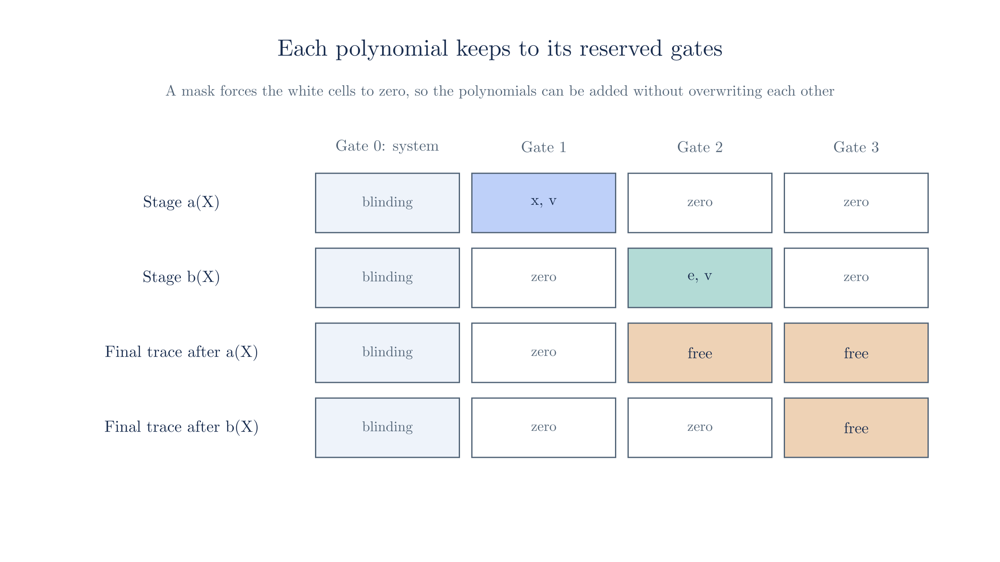

# Staging

Up to now a circuit's trace has been one polynomial $r(X)$, committed all at once. The [curve cycles chapter](./curve-cycles.md#_8-deferred-operations) already had to break that habit, because a nested commitment only works if it covers part of a trace that some other circuit runs on. That chapter showed the idea on a short vector and promised the full mechanism here.

We split a trace into pieces that are committed separately, find out what can go wrong when the pieces are added back together, and build the check that prevents it. Then we use the pieces for the two jobs Ragu needs them for, which are sharing data between circuits and committing to data before a challenge. The chapter closes with a difference that chapter 13 left open, because the book adds the commitments of the pieces and we found no such addition in the code.

::: warning Reconstructed from code at commit 3219e08, not confirmed by the authors
The trace layout, the masks and their closed form below follow the code, and so do the enforced and unenforced loading of Section 10, the bonding polynomials of Section 12 and the code's version of Section 13. Where the book and the code differ, a separate box shows both. The small circuits are our own, because the toy curves have too few points to serve as generators for one of Ragu's real circuits. The script behind this page runs each of them with the real gate and wiring equations.
:::

::: tip Terminology
- The book's [staging chapter](https://github.com/tachyon-zcash/ragu/blob/3219e0865e8bff1f9d817bfe3850d9e94b64338c/book/src/protocol/extensions/staging.md?plain=1#L21-L34) calls the pieces **stage polynomials**, or partial traces, and the [code's module documentation](https://github.com/tachyon-zcash/ragu/blob/3219e0865e8bff1f9d817bfe3850d9e94b64338c/crates/ragu_circuits/src/staging/mod.rs#L34-L44) calls them staging polynomials. This site says stage polynomial.
- The book calls the remainder the **final trace** $r'(X)$. The module documentation writes it as $f(X)$, while [`builder.rs`](https://github.com/tachyon-zcash/ragu/blob/3219e0865e8bff1f9d817bfe3850d9e94b64338c/crates/ragu_circuits/src/staging/builder.rs#L8-L10) in the same directory writes $r'(X)$. This site writes $r'(X)$, because $f$ already means the combined quotient of [chapter 08](./batched-openings.md).
:::

## 1. Two jobs for a partial commitment

Two situations in a recursive step call for committing to only part of a trace.

The first is a challenge in the middle of a circuit. Suppose a circuit holds many wires and would like to check something about them with a [random linear combination](./statements-and-challenges.md#_6-random-linear-combinations). The challenge must depend on those wires, or the prover could pick the wires to suit the challenge. So the circuit has to hash them, and hashing inside a circuit is expensive. A commitment offers a cheaper route, since it binds all the wires under the same assumption as any Pedersen commitment and takes only two coordinates to hash. Those coordinates lie in the other field of the cycle, so the saving comes at the price of a nested commitment and a second circuit, as [chapter 13](./curve-cycles.md#_7-committing-to-coordinates) found and Section 11 shows on our example. The hashing itself costs this much:

<!-- worked:hash-cost -->

The toy sponge from [chapter 03](./statements-and-challenges.md#a-toy-poseidon) has rate 2, and one permutation applies $8 \cdot 3 + 8 = 32$ S-boxes of $3$ multiplications each, or $96$ gates before counting anything else. Hashing $8$ wires takes $4$ permutations and $384$ gates. Hashing the two coordinates of a commitment to those same $8$ wires takes $1$ permutation and $96$ gates, and that cost stays the same however many wires the commitment covers.

<!-- /worked:hash-cost -->

The second situation is data that several circuits have to read. The [recursive proofs chapter](./recursive-proofs.md#_12-recursion-in-ragu) noted that Ragu divides its verifier into many small circuits, and these circuits work on the same child proofs. Passing the shared data through public inputs would make every shared wire a term of $k(Y)$ that a verifier has to evaluate, and it would also publish any wire that is meant to stay secret. It would be better for each circuit to read the data as if it were part of its own witness.

Both jobs need the same thing, which is a commitment to some of the wires of a trace, made before the rest of the trace exists.

## 2. Splitting a trace

Commitments add, so a trace can be divided into parts that each get their own commitment. We write

$$r(X) = a(X) + r'(X),$$

where $a(X)$ is a stage polynomial and $r'(X)$ is the final trace. With a second stage this becomes $r(X) = a(X) + b(X) + r'(X)$, and so on. The prover commits to $a(X)$ and $r'(X)$ and does not need to commit to their sum, because the commitment to a sum is the sum of the commitments.

We need a small circuit to work with. Keep the secret $x = 3$ from the [arithmetization chapter](./arithmetization.md), and start with the statement $x^2 + 1 = 10$, which takes one multiplication. The trace uses the layout from [Section 8 of that chapter](./arithmetization.md#_8-arranging-the-witness), including the system gate at index 0 that [chapter 09](./nark.md#_15-the-constant-wire) introduced. We take $n = 4$ gates, and we reserve gate 1 for the stage. The stage holds $x$, and it also holds $v = x^2$, which the next circuits will use.

<!-- worked:gens -->

A vector of $4n = 16$ entries needs 16 generators. We use the twelve from [chapter 09](./nark.md#_15-the-constant-wire), followed by $(7,\,6), (8,\,9), (16,\,10), (18,\,10)$. This chapter never uses the blinding generator $H$, for a reason Section 3 gives.

<!-- /worked:gens -->

Here are the two parts and their sum:

<!-- worked:split -->

| Polynomial | Coefficients of $X^0, \ldots, X^{15}$ | Commitment |
| --- | --- | --- |
| Stage $a(X)$ | $(0, 0, 0, 0, 0, 0, 3, 10, 0, 0, 0, 0, 0, 0, 9, 0)$ | $\bar{A} = (22,\,24)$ |
| Final trace $r'(X)$ | $(0, 0, 9, 0, 0, 3, 0, 25, 0, 0, 3, 0, 0, 0, 0, 1)$ | $\bar{R}' = (24,\,30)$ |
| Sum $r(X)$ | $(0, 0, 9, 0, 0, 3, 3, 35, 0, 0, 3, 0, 0, 0, 9, 1)$ | $\bar{R} = (25,\,29)$ |

<!-- /worked:split -->

Read gate by gate, with the stage's entry first and the final trace's entry second in each cell, the same numbers show which part supplies each wire:

<!-- worked:gate-table -->

| Gate $i$ | Reserved for | $a_i$ | $b_i$ | $c_i$ | $d_i$ |
| --- | --- | --- | --- | --- | --- |
| 0 | System gate | 10 + 25 | 0 + 0 | 0 + 0 | 0 + 1 |
| 1 | Stage | 3 + 0 | 0 + 0 | 0 + 0 | 9 + 0 |
| 2 | Final trace | 0 + 3 | 0 + 3 | 0 + 9 | 0 + 0 |
| 3 | Final trace (unused) | 0 + 0 | 0 + 0 | 0 + 0 | 0 + 0 |

<!-- /worked:gate-table -->

Gate 2 is the multiplication $x \cdot x = v$. Its copies of $x$ come from the wiring, with rows $a_2 - a_1 = 0$ and $b_2 - a_1 = 0$, so the circuit's constraints reach across into the wires of the stage. This is what the split is for, because the final trace does not need its own copy of $x$.

## 3. Gates that hold free values

The consolidated equation from the [arithmetization chapter](./arithmetization.md#_12-the-consolidated-equation) applies to the sum $r(X)$, and it includes a gate check for every gate. A stage's gate has to pass that check for whatever values the stage holds, because the stage is committed before anything else is known about the circuit.

The [wire allocator](https://github.com/tachyon-zcash/ragu/blob/3219e0865e8bff1f9d817bfe3850d9e94b64338c/crates/ragu_primitives/src/allocator.rs#L107-L116) achieves this by writing each value to the $a$ wire of a new gate with $b_i = c_i = 0$, and it writes the next value to that gate's spare $d$ wire. So the gate has the form $(a_i, 0, 0, d_i)$, which is why a [stage carries two values per gate](https://github.com/tachyon-zcash/ragu/blob/3219e0865e8bff1f9d817bfe3850d9e94b64338c/crates/ragu_circuits/src/staging/layout.rs#L136-L149). The two gate equations from [chapter 04](./arithmetization.md#_13-the-arithmetization-in-ragu) then read $a_i \cdot 0 = 0$ and $0 \cdot d_i = 0$, and both hold whatever $a_i$ and $d_i$ are. So a stage's gates do no checking of their own. They are storage, and any meaning the values have comes from constraints in the circuits that read them.

The system gate needs separate care, and the reason has to do with how commitments travel. A commitment is passed on as its two coordinates. Section 11 writes those coordinates into wires of the other circuit, and the transcript absorbs them. The identity point of the curve has no affine coordinates $(x, y)$, so a commitment that comes out as the identity cannot be written into wires or absorbed, and the proof cannot continue past it.

A Pedersen commitment is the identity when every entry of its vector is zero. A nonzero vector can commit to the identity only if its entries form a relation among the generators, and the binding assumption says that nobody can find one. A complete trace is never all zero, because it holds the constant wire $d_0 = 1$ at the system gate. A stage [has no such wire](https://github.com/tachyon-zcash/ragu/blob/3219e0865e8bff1f9d817bfe3850d9e94b64338c/crates/ragu_circuits/src/staging/mod.rs#L385-L394), so an honest stage whose values all happen to be zero would commit to the identity. One nonzero entry of the stage's own, at $a_0$ of the system gate, prevents this:

<!-- worked:alpha-zero -->

An honest stage that happens to hold $(x, v) = (0, 0)$ and has $a_0 = 0$ has every entry zero, so its commitment $0 \cdot G_0 + \cdots + 0 \cdot G_{15}$ is the identity. Put $\alpha = 10$ at $a_0$, which is position $7$ of the trace, and the same stage commits to $10 \cdot G_{7} = (5,\,2)$, a point with coordinates.

<!-- /worked:alpha-zero -->

The prover does this for every stage, and for stage $a(X)$ the value is the first number in the $a_i$ column of gate 0 in Section 2. Any nonzero constant would rule out the all-zero case above, but the prover draws $\alpha$ at random. The reason only shows up once stages are combined, so Section 8 gives it. The toy curve is too small for the binding assumption, and Section 11 meets a few nonzero stages that still commit to the identity, but on a real curve the one entry $\alpha$ is enough.

This $\alpha$ is random, but it [is not there for hiding](./nark.md#_15-the-constant-wire), and the [book's wiring chapter](https://github.com/tachyon-zcash/ragu/blob/3219e0865e8bff1f9d817bfe3850d9e94b64338c/book/src/protocol/local/wiring.md?plain=1#L85-L89) says so directly. As [chapter 09](./nark.md#_13-hiding-commitments-and-what-the-proof-reveals) showed, the proof later reveals evaluations of these polynomials, so one random entry does not keep the other entries secret. The same chapter recorded that the code commits without Pedersen blinding, which is why this chapter leaves out the generator $H$.

With those two points settled, the consolidated equation applies to the sum as it does to any trace:

<!-- worked:sum-holds -->

The right vector at $z = 5$ and $y = 7$ gives $\langle\!\langle \v{r}, \v{r} \circ \v{z^{16}} + \v{t} + \v{s} \rangle\!\rangle = 28$, and $k(7) = 1 + 10 \cdot 7 = 28$. The two sides agree at all $1,849$ pairs $(z, y)$. The final trace alone fails at $1,763$ of those pairs, which shows that the circuit reads its input from the stage polynomial, not from $r'(X)$.

<!-- /worked:sum-holds -->

## 4. Overlapping the stage

The split has a weakness. Adding polynomials adds their coefficients in every position, so nothing so far stops the final trace from putting a value in a slot reserved for the stage. To see what that buys a cheater, consider two equations:

<!-- worked:roots -->

Over $\F_{43}$, the equation $x^2 + 1 = 10$ has the solutions $3, 40$, and the equation $x^2 + 1 = 17$ has the solutions $4, 39$. So $x = 3$ solves the first equation and not the second.

<!-- /worked:roots -->

A stage is meant to fix the value that a circuit reads, so the verifier takes the squaring circuit's statement to be about the $x$ inside $\bar{A}$. Suppose $a(X)$ holds $x = 3$ and a cheater wants the squaring circuit to accept $x^2 + 1 = 17$ about that same $x$. The lists above show that $x = 3$ does not solve this equation, but a stray entry in the circuit's final trace can change what the circuit reads:

<!-- worked:overlap -->

Let the prover leave $\bar{A} = (22,\,24)$ alone, so the stage still says $x = 3$, and put $1$ in slot $a_1$ of the final trace, whose gate 2 now holds $4 \cdot 4 = 16$. The sum then holds $a_1 = 4$, and the circuit for $x^2 + 1 = 17$ accepts it at all $1,849$ challenge pairs, while the commitments still add up: $\bar{A} + (27,\,1) = (23,\,24)$. So the commitment still holds $x = 3$, while the circuit ran on $x = 4$.

<!-- /worked:overlap -->

Chapter 13 [saw the same effect](./curve-cycles.md#_8-deferred-operations) on a shorter vector. A commitment check cannot find the problem, because a commitment to a sum equals the sum of the commitments however the entries overlap. We need a check that looks at where a polynomial's nonzero entries sit.

## 5. The stage mask

The requirement is linear in the polynomial's entries. A stage must be zero at every wire of every gate outside its reserved range, apart from the system gate. Let $F$ be that set of forbidden positions. Requiring many values to be zero is the task that a random combination handles, so we could ask for

$$\sum_{p \in F} a_p\, y^{4n-1-p} = 0$$

at a random $y$. If all the forbidden entries are zero, this holds for every $y$. If any of them is nonzero, the left side is a nonzero polynomial in $y$ of degree at most $4n - 1$, which has few roots.

Ragu writes this combination as a revdot product $\revdot{\v{a}}{\v{s}}$ with a public vector $\v{s}$, and that matters because revdot products are the claims that [Ragu's accumulators fold](./revdot-folding.md). The vector $\v{s}$ holds a power of $y$ opposite each forbidden position and zeros everywhere else, so the revdot pairing multiplies each forbidden entry by its power of $y$ and ignores the allowed ones. Ragu calls this $\v{s}$ the **stage mask**. The challenge $z$ of [chapter 13's toy mask](./curve-cycles.md#_8-deferred-operations) plays the role of $y$ here. The mask is also an ordinary wiring polynomial $s(X, Y)$, for a circuit whose constraints each say that one forbidden wire is zero. The box below writes out both views.

::: details Writing the mask as a revdot product and as a wiring polynomial

Any distinct power of $y$ per position would do in the combination above. We use the mirrored exponent $4n - 1 - p$ in place of $p$ because it matches the revdot pairing. The revdot product pairs position $p$ with position $4n - 1 - p$, so we define a public vector $\v{s}$ with

$$s_k = \begin{cases} y^k & \text{if } 4n - 1 - k \in F, \\ 0 & \text{otherwise.} \end{cases}$$

Then

$$\revdot{\v{a}}{\v{s}} = \sum_{p=0}^{4n-1} a_p\, s_{4n-1-p} = \sum_{p \in F} a_p\, y^{4n-1-p},$$

which is the combination we wanted.

The mask is an ordinary wiring polynomial, for a circuit with an unusual shape. Take one constraint per forbidden wire, saying that the wire is zero. [Section 11 of chapter 04](./arithmetization.md#_11-encoding-the-constraints) places each coefficient at the wire's partner position and weights row $j$ by $y^j$. We are free to choose the order of the constraints, and one order makes the mask cheap to evaluate. If row $k$ is the constraint whose partner position is $k$, then every term has the form $X^kY^k$, and Section 6 turns a sum of such terms into a short closed form. The [code's test version of this circuit](https://github.com/tachyon-zcash/ragu/blob/3219e0865e8bff1f9d817bfe3850d9e94b64338c/crates/ragu_circuits/src/staging/mask.rs#L306-L311) uses this numbering. One row shows what it does:

<!-- worked:mask-row -->

Take the constraint $a_2 = 0$. The wire $a_2$ sits at position $5$ of the trace, so its coefficient goes to the partner position $10$, which is the power $X^{10}$. The code numbers this constraint as row $10$, so it is weighted by $Y^{10}$, and the whole row contributes the single term $X^{10} Y^{10}$. Every other forbidden wire gives a term of the same kind, with one shared exponent.

<!-- /worked:mask-row -->

Adding these terms over all forbidden wires gives

$$s(X, Y) = \sum_{k \,:\, 4n-1-k \in F} X^k Y^k.$$

:::

Notice what is missing compared with the consolidated equation. A stage polynomial does not satisfy gates or the circuit's constraints on its own, so the claim has no dilation and no $\v{t}$, and it has no public inputs, so its target is 0. The full claim is $\revdot{\v{a}}{\v{s}} = 0$, in place of the consolidated equation $\revdot{\v{r}}{\v{r} \circ \v{z^{4n}} + \v{t} + \v{s}} = k(y)$, where $\v{s}$ is the circuit's own wiring polynomial and not a mask.

For stage $a(X)$, which reserves gate 1, the forbidden wires are those of gates 2 and 3:

<!-- worked:mask-degrees -->

| Gate | Wire | Position $p$ in the trace | Degree $4n - 1 - p$ in the mask |
| --- | --- | --- | --- |
| 2 | $a_2$ | 5 | 10 |
| 2 | $b_2$ | 10 | 5 |
| 2 | $c_2$ | 2 | 13 |
| 2 | $d_2$ | 13 | 2 |
| 3 | $a_3$ | 4 | 11 |
| 3 | $b_3$ | 11 | 4 |
| 3 | $c_3$ | 3 | 12 |
| 3 | $d_3$ | 12 | 3 |

<!-- /worked:mask-degrees -->

<!-- worked:mask-run -->

At $y = 7$ the mask for stage $a(X)$ has coefficients $(0, 0, 6, 42, 36, 37, 0, 0, 0, 0, 36, 37, 1, 7, 0, 0)$. The stage has nonzero entries only at positions 6, 7 and 14, whose partners are 9, 8 and 1, and those are the positions where the mask has zeros. So the product is $0$. The result is 0 at all 43 values of $y$.

<!-- /worked:mask-run -->

The final trace has its own mask, which forbids gate 1. Section 7 gives the details, but we can already apply it to the attack of the previous section:

<!-- worked:mask-catch -->

The final trace from Section 4 has the stray entry at position 6, the partner of degree 9. Its product with the final mask is therefore $1 \cdot y^9$, which equals $42$ at $y = 7$. It is zero only at $y = 0$, so 42 of the 43 values of $y$ catch it.

<!-- /worked:mask-catch -->

Every mask product passes at $y = 0$, and the reason is in the table above. Degree 0 in the mask is the partner of $d_0$, the system gate's wire, which no mask forbids, so the product never has a constant term and always vanishes at $y = 0$.

<!-- worked:mask-best -->

The cheater has more freedom than this, because the other three wires of gate 1 are also forbidden entries, and it can fill them in the hope of building roots. The product becomes $y^9 + e\,y + f\,y^6 + g\,y^{14}$, where $e$, $f$ and $g$ are the entries it adds to $d_1$, $b_1$ and $c_1$. We tried all $79,507$ choices, and none gives more than $5$ nonzero roots out of the 42 nonzero values of $y$. Only $85$ of the choices also leave gate 1 satisfied, as the circuit needs, and none of those gives more than $4$ nonzero roots, a count reached at $(e, f, g) = (34, 7, 28)$.

<!-- /worked:mask-best -->

<!-- worked:mask-bound -->

For $n = 4$ the mask has degree at most $4n - 1 = 15$ in $y$, so a nonzero product vanishes at no more than $15$ of the 43 values, a rate of at most $15/43 \approx 0.349$. The cheater that keeps gate 1 satisfied stays well below that bound. It passes at $y = 0$ and at its $4$ nonzero roots, which is $5$ of the 43 values, a rate of $0.116$. On a field of about $2^{254}$ elements with $4n = 2^{13}$, the same bound falls below $2^{-240}$.

<!-- /worked:mask-bound -->

::: warning The book's description of the mask
**Book:** the [staging chapter](https://github.com/tachyon-zcash/ragu/blob/3219e0865e8bff1f9d817bfe3850d9e94b64338c/book/src/protocol/extensions/staging.md?plain=1#L44-L47) first says that wires outside the reserved range should be zero, and then says the mask enforces that everything must be nonzero inside the range.

**Code at `3219e08`:** the [mask forces wires to zero outside the range](https://github.com/tachyon-zcash/ragu/blob/3219e0865e8bff1f9d817bfe3850d9e94b64338c/crates/ragu_circuits/src/staging/mask.rs#L96-L102) and says nothing about wires inside it.

This site follows the code, and it reads "nonzero" in the book as a slip for "zero outside".
:::

## 6. A closed form for the mask

So far we tested a mask only at $y$, as a vector. The verifier of [chapter 09](./nark.md#_16-what-the-verifier-pays) does more than that. It evaluates the wiring polynomial $s(X, Y)$ at the random opening point $x$ as well as at $y$, and for an arbitrary circuit that evaluation was one of its two linear costs, because such a circuit has no structure to exploit. A mask does have structure, because every term of it has the form $X^kY^k$, so it depends only on the product $t = XY$, and that makes it far cheaper. We describe the form the [code uses](https://github.com/tachyon-zcash/ragu/blob/3219e0865e8bff1f9d817bfe3850d9e94b64338c/crates/ragu_circuits/src/staging/mask.rs#L184-L209).

The mask is a sum of powers of $t$, one for each forbidden wire. Rather than add those powers one at a time, start from the sum of all $4n$ powers $t^0, \ldots, t^{4n-1}$ and subtract the powers that the mask leaves out. Those are the four powers that belong to the system gate and the powers that belong to the stage's reserved gates, which are the $m$ gates starting at gate $g$. Each of the three pieces is a geometric sum or a product of geometric sums. The first two pieces do not depend on the stage, and the code calls them the [global mask](https://github.com/tachyon-zcash/ragu/blob/3219e0865e8bff1f9d817bfe3850d9e94b64338c/crates/ragu_circuits/src/staging/mask.rs#L9-L40). The last piece is the **notch** for this stage. Each geometric sum has a closed form that takes $O(\log n)$ multiplications, as in [chapter 09](./nark.md#_16-what-the-verifier-pays). The box carries out the subtraction.

::: details Deriving the closed form

Let the stage reserve the $m$ gates starting at gate $g$. The partner degrees of the wires of gate $j$ are $j$ for $d_j$, $2n - 1 - j$ for $b_j$, $2n + j$ for $a_j$, and $4n - 1 - j$ for $c_j$.

For the system gate, $j = 0$ gives the degrees $0$, $2n - 1$, $2n$ and $4n - 1$, whose powers of $t$ sum to

$$1 + t^{2n-1} + t^{2n} + t^{4n-1} = (1 + t^{2n})(1 + t^{2n-1}).$$

For the reserved gates, group the $d$ and $a$ wires, and then the $b$ and $c$ wires:

$$\sum_{j=g}^{g+m-1} \big(t^{j} + t^{2n+j}\big) = (1 + t^{2n})\, t^{g} \sum_{i=0}^{m-1} t^i,$$

$$\sum_{j=g}^{g+m-1} \big(t^{2n-1-j} + t^{4n-1-j}\big) = (1 + t^{2n})\, t^{2n-g-m} \sum_{i=0}^{m-1} t^i,$$

where the second line substitutes $i = g + m - 1 - j$. Subtracting both groups from the full sum gives

$$s(x, y) = \sum_{i=0}^{4n-1} t^i \;-\; (1 + t^{2n})(1 + t^{2n-1}) \;-\; (1 + t^{2n})\big(t^{g} + t^{2n-g-m}\big) \sum_{i=0}^{m-1} t^i.$$

The first two terms are the global mask, and the last term is the notch.

:::

<!-- worked:closed-run -->

Take $x = 9$ and $y = 7$, so $t = xy = 20$, and the mask of stage $a(X)$, for which $g = 1$ and $m = 1$. The global term is $18$ and the notch is $25$, so the formula gives $18 - 25 = 36$ modulo 43. Adding $t^k$ over the eight forbidden degrees gives the same value. We checked the formula against the direct sum for every mask of this chapter at all 42 nonzero values of $t$.

<!-- /worked:closed-run -->

<!-- worked:closed-size -->

For a circuit with $n = 2^{11}$ gates and a stage of $100$ gates, the mask has $4(n - 1 - m) = 7,788$ nonzero coefficients. The closed form needs only a few powers of $t$ and two geometric sums.

<!-- /worked:closed-size -->

The registry computes the shared global term [once](https://github.com/tachyon-zcash/ragu/blob/3219e0865e8bff1f9d817bfe3850d9e94b64338c/crates/ragu_circuits/src/registry.rs#L768-L775), and each mask contributes only its notch. The chapter on [wiring and the registry](./wiring-and-registry.md) covers the registry itself.

## 7. A mask for every polynomial

Masks have to cover the final trace as well, because Section 4's attack put the stray entry there. The final trace has the same kind of mask, with the reserved range running from the end of the last stage to the top of the trace. In the code this is [`final_mask`](https://github.com/tachyon-zcash/ragu/blob/3219e0865e8bff1f9d817bfe3850d9e94b64338c/crates/ragu_circuits/src/staging/mod.rs#L469-L480), and it uses the [same type](https://github.com/tachyon-zcash/ragu/blob/3219e0865e8bff1f9d817bfe3850d9e94b64338c/crates/ragu_circuits/src/staging/mask.rs#L120-L142) as a stage's mask with a larger count.

Stages also stack. A stage names its parent, and it [starts where the parent ends](https://github.com/tachyon-zcash/ragu/blob/3219e0865e8bff1f9d817bfe3850d9e94b64338c/crates/ragu_circuits/src/staging/mod.rs#L224-L230), with a stage of $k$ values taking $\lceil k/2 \rceil$ gates. Section 11 adds a second stage $b(X)$ at gate 2, and with it our small circuits need these four masks:

<!-- worked:mask-table -->

| Polynomial | $g$ | $m$ | Gates it may use | Gates it must leave zero |
| --- | --- | --- | --- | --- |
| $a(X)$ | 1 | 1 | 1 | 2, 3 |
| $b(X)$ | 2 | 1 | 2 | 1, 3 |
| Final trace after $a(X)$ | 2 | 2 | 2, 3 | 1 |
| Final trace after $b(X)$ | 3 | 1 | 3 | 1, 2 |

<!-- /worked:mask-table -->

The system gate column is outside every mask, which is why each polynomial can have its own $a_0$. A polynomial could also put values in $b_0$, $c_0$ or $d_0$, and that does no harm, because the circuit's constraints on the sum still pin those wires down, as the box shows.

::: details Why stray values in the system gate do no harm

The circuit's row for the constant wire, with $k_0 = 1$, pins the sum's $d_0$ to 1, and once $d_0 = 1$ the gate equation $c_0 \cdot d_0 = 0$ forces $c_0 = 0$, which in turn forces $a_0 b_0 = 0$.

:::

The stage values fill only reserved gates, and [the builder](https://github.com/tachyon-zcash/ragu/blob/3219e0865e8bff1f9d817bfe3850d9e94b64338c/crates/ragu_circuits/src/staging/builder.rs#L238-L249) writes zeros in those slots of the final trace, so that the sum places each value in one spot.

A mask leaves all four wires of its reserved gates free, so a stage could in principle put values in its $b_i$ and $c_i$. That gains nothing, because the gate equations on the sum still apply to that gate, and circuits read stage data only from the $a$ and $d$ wires.

## 8. Sharing one mask claim

A recursive step has two children. A child does not check its own mask claims in the step that makes them. Each claim joins that child's accumulator, as the [accumulation chapter](./accumulation.md#_7-keeping-a-running-accumulator) described for claims in general, so a false stage leaves a false claim that the next step has to check. The parent therefore inherits two polynomials for the same stage, one from each child, and each still needs its mask claim checked. These claims can be combined with a random weight $\rho$, because the mask claim is linear in the polynomial:

$$\revdot{\rho\,\v{a}_L + \v{a}_R}{\v{s}} = \rho\,\revdot{\v{a}_L}{\v{s}} + \revdot{\v{a}_R}{\v{s}} = 0.$$

The book and the code call this weight $z$. We write $\rho$ to keep $z$ for the dilation challenge of the consolidated equation.

The target stays 0, because mask claims [have no public inputs](https://github.com/tachyon-zcash/ragu/blob/3219e0865e8bff1f9d817bfe3850d9e94b64338c/book/src/protocol/extensions/staging.md?plain=1#L62-L68) that would need combining too.

<!-- worked:fold-run -->

Take the stage above as the left child's, and a right child's stage holding $(x, v) = (5, 25)$ with $a_0 = 8$. At $\rho = 5$ the fold $\rho \cdot a_L(X) + a_R(X)$ has coefficients $(0, 0, 0, 0, 0, 0, 20, 15, 0, 0, 0, 0, 0, 0, 27, 0)$, and its product with the mask is 0, as it is at all $1,849$ pairs $(\rho, y)$, so the parent checks one mask claim in place of two.

<!-- /worked:fold-run -->

Folding also explains why Section 3 draws $\alpha$ at random. The prover commits to weighted combinations of stored commitments, as Section 13 shows, so a combination whose entries all vanish leaves it with the identity, a point it cannot pass on. Entries that anyone can predict, such as a stage that holds public data, make this possible:

<!-- worked:alpha-cancel -->

Suppose both children carry the same public data in this stage, $(x, v) = (3, 9)$, and neither uses an $\alpha$. The two stages are then equal, and at $\rho = 42$, which is $-1$ modulo 43, the fold $\rho \cdot a_L(X) + a_R(X)$ has every entry zero, so its commitment is the identity. Now give the left stage $\alpha_L = 10$ and the right stage $\alpha_R = 8$. At $\rho = 42$ the fold keeps $42 \cdot 10 + 8 = 41$ at $a_0$, and no value of $\rho$ makes every entry vanish. Of the 43 possible values of $\alpha_R$, only $1$, namely $\alpha_R = \alpha_L = 10$, would let the fold cancel at some $\rho$.

<!-- /worked:alpha-cancel -->

A fixed constant in place of $\alpha$ would not help, because if both children used $a_0 = 1$, the two stages would still be equal and would still cancel at the same $\rho$. A random $\alpha$ works because a collision then also needs the two secret values of $\alpha$ to line up.

The code's documentation states this case generally, saying that any wire slot whose value can be predicted can cancel in a linear combination of stages. It does not name a party who would build the cancelling stage, and we did not find one. In the example, two honest children reach the identity by accident at one value of $\rho$, which is unlikely on a real field but not excluded. A cheater gains nothing by causing it, since the result is a proof that cannot continue. So we read the random $\alpha$ as protection for honest proofs rather than as a defence against an attack.

The folded claim still catches a bad stage:

<!-- worked:fold-catch -->

Put a stray $11$ in gate 3 of the right stage. Among all $1,849$ pairs $(\rho, y)$, the folded claim passes at $43$, which are the 43 pairs with $y = 0$. Two stray entries at one position, one per child, can cancel each other at a single $\rho$, since $\rho\,\delta_L + \delta_R$ is a degree-1 polynomial in $\rho$.

<!-- /worked:fold-catch -->

The same step does not work for a circuit's own claim, because $\v{r}$ appears twice in that equation. Substituting a weighted sum of two traces into the quadratic part produces a cross term between the two traces, weighted by $\rho$, and the target side has nothing to match it. The box writes out the expansion, and the numbers below show the mismatch.

::: details Expanding the folded quadratic term

Substituting $\v{r} = \rho\,\v{r}_1 + \v{r}_2$ into the quadratic part gives

$$\revdot{\v{r}}{\v{r} \circ \v{z^{4n}}} = \rho^2 \revdot{\v{r}_1}{\v{r}_1 \circ \v{z^{4n}}} + \rho \Big( \revdot{\v{r}_1}{\v{r}_2 \circ \v{z^{4n}}} + \revdot{\v{r}_2}{\v{r}_1 \circ \v{z^{4n}}} \Big) + \revdot{\v{r}_2}{\v{r}_2 \circ \v{z^{4n}}},$$

and the middle term has nothing to match it on the target side.

:::

<!-- worked:fold-quadratic -->

Fold two honest traces of the squaring circuit, with $x = 3$ and with $x = 5$, in the same way at $\rho = 2$, $z = 5$ and $y = 7$. The two claims are both true, but the folded product is $30$ while the folded target is $24$. The terms with $\rho^2$ and $\rho$ do not match the target, and the two sides agree at only $2$ of the 43 values of $\rho$.

<!-- /worked:fold-quadratic -->

Circuit claims therefore go through the error terms of the [revdot folding chapter](./revdot-folding.md), and each one stays a separate entry going into that fold. Mask claims skip that cost, which the code's documentation [lists as a property of gate-free claims](https://github.com/tachyon-zcash/ragu/blob/3219e0865e8bff1f9d817bfe3850d9e94b64338c/crates/ragu_circuits/src/lib.rs#L314-L320).

The code also folds across circuits. Any polynomials with the same reserved range can share a mask, so the final traces of all the circuits that end on the same last stage fold into one claim. Section 15 shows this.

::: warning The order of the weights
**Book:** the [combined claim](https://github.com/tachyon-zcash/ragu/blob/3219e0865e8bff1f9d817bfe3850d9e94b64338c/book/src/protocol/extensions/staging.md?plain=1#L62-L64) is $\v{a} + z\,\v{b}$.

**Code at `3219e08`:** the [fold](https://github.com/tachyon-zcash/ragu/blob/3219e0865e8bff1f9d817bfe3850d9e94b64338c/crates/ragu_pcd/src/internal/claims.rs#L133-L150) gives entry $i$ of $n$ the weight $\rho^{n-1-i}$, so the first polynomial takes the highest power, as [its module documentation](https://github.com/tachyon-zcash/ragu/blob/3219e0865e8bff1f9d817bfe3850d9e94b64338c/crates/ragu_circuits/src/staging/mod.rs#L82-L97) also shows.

This site follows the code. The two orders are equally sound.
:::

## 9. Two circuits on one stage

We can now do the second job from Section 1. Two circuits read the same stage by having the same polynomial $a(X)$ inside their traces. The cubing circuit is the [statement of chapter 04](./arithmetization.md), with $x$ and $v$ read from the stage, and with one gate checking $x \cdot x = v$ and another computing $v \cdot x$. Each circuit has its own final trace and its own wiring.

<!-- worked:two-circuits -->

| Circuit | Statement | Trace | Commitment to its final trace | Consolidated equation |
| --- | --- | --- | --- | --- |
| Squaring | $x^2 + 1 = 10$ | $a(X) + r'_1(X)$ | $(24,\,30)$ | Holds at all $1,849$ pairs |
| Cubing | $x^3 + x + 5 = 35$ | $a(X) + r'_2(X)$ | $(24,\,1)$ | Holds at all $1,849$ pairs |

<!-- /worked:two-circuits -->

The verifier holds three commitments and not four, because $\bar{A}$ appears once and serves both traces. Neither statement mentions $x$ in its public inputs, and yet the shared commitment ties the two statements to one value. The difference shows when a prover tries the false pair of claims from Section 4, where the squaring circuit asserts $x^2 + 1 = 17$. First compare the solutions of the two equations:

<!-- worked:roots-cube -->

Over $\F_{43}$, the cubing equation $x^3 + x + 5 = 35$ has the single solution $3$, while Section 4 found that $x^2 + 1 = 17$ has the solutions $4, 39$. No value appears in both lists.

<!-- /worked:roots-cube -->

<!-- worked:two-statements -->

With separate traces, the prover can use $x = 3$ for the cubing circuit and $x = 4$ for the circuit of $x^2 + 1 = 17$, and each trace passes its own consolidated equation at every challenge pair. The verifier has no way to see that the inputs differ. With one shared stage the prover has to pick one $x$, and the lists above show that no single value satisfies both equations.

<!-- /worked:two-statements -->

The overlap of Section 4 tried to break exactly this tie, by letting the squaring circuit read a different $x$ from the one in $\bar{A}$, and the final mask of Section 7 catches it.

A circuit does not have to read every stage below its own. The builder can [skip a stage](https://github.com/tachyon-zcash/ragu/blob/3219e0865e8bff1f9d817bfe3850d9e94b64338c/crates/ragu_circuits/src/staging/builder.rs#L279-L289), which keeps the layout the same but leaves those wires out of the circuit's constraints. The polynomial then does not join the circuit's sum at all.

## 10. What a mask does not check

A mask looks only at where entries sit, and it ignores their values. A stage whose wires are supposed to form a curve point or a bit passes its mask for any value:

<!-- worked:content -->

A stage over $\F_{31}$ that is supposed to hold a point of $E$ passes its mask for all $961$ pairs of coordinates, and only $42$ of those pairs lie on $E$.

<!-- /worked:content -->

Constraints written while a stage is being built do not help, because the framework [discards them](https://github.com/tachyon-zcash/ragu/blob/3219e0865e8bff1f9d817bfe3850d9e94b64338c/book/src/implementation/staging.md?plain=1#L66-L75). So some circuit that reads the stage has to state those constraints as its own. In the example of Section 9, the cubing circuit ties the product $x \cdot x$ of its gate 2 to the stage's $v$, and that tie is what makes $v$ the square of $x$. The squaring circuit never reads $v$, so it relies on the cubing circuit for that meaning. The code makes this kind of reliance explicit. Loading a stage [`enforced`](https://github.com/tachyon-zcash/ragu/blob/3219e0865e8bff1f9d817bfe3850d9e94b64338c/crates/ragu_circuits/src/staging/builder.rs#L137-L162) emits the checks in that circuit, and loading it `unenforced` relies on some other circuit to do so. Since the circuits read the same stage polynomial, one reader's check protects them all, and the chapter on [recursion in Ragu](./ragu-recursion.md) names which circuit enforces each of Ragu's stages.

## 11. Stages across the cycle

This section does the first job from Section 1 in two parts. The first commits to a stage in a way the transcript can absorb, and the second uses the resulting challenge.

### Committing a stage across the cycle

Chapter 13 explained the difficulty. The commitment $\bar{A}$ is a point on $E$, so its coordinates lie in $\F_{31}$, and the sponge that derives challenges has wires in $\F_{43}$. The fix was a [nested commitment](./curve-cycles.md#_7-committing-to-coordinates), and we can now say exactly what that object is. It is a commitment to a stage of the circuit over $\F_{31}$, and the book calls this a [**nested staged commitment**](https://github.com/tachyon-zcash/ragu/blob/3219e0865e8bff1f9d817bfe3850d9e94b64338c/book/src/protocol/core/accumulation/pcs.md?plain=1#L238-L247). Its stage holds foreign coordinates as ordinary wires, so it follows every rule above, including the layout, the $\alpha$ and the mask.

<!-- worked:nested-run -->

| Step | Field | Result |
| --- | --- | --- |
| Commit to stage $a(X)$ on $E$ | $\F_{43}$ scalars | $\bar{A} = (22,\,24)$ |
| Place its coordinates in a stage of the other circuit, gate 1 | $\F_{31}$ wires | $a_1 = 22$, $d_1 = 24$, with $a_0 = 8$ |
| Commit to that stage on $E'$ | $\F_{31}$ scalars | $\mathring{A} = (21,\,25)$ |
| Absorb the coordinates of $\mathring{A}$ and squeeze | $\F_{43}$ wires | $w = 11$ |

<!-- /worked:nested-run -->

In this way the challenge $w$ depends on $x$ and $v$ through two commitments, and the sponge absorbed only two wires. The circuit over $\F_{31}$ reads the coordinates as its own witness, so it can run the [deferred group operations](./curve-cycles.md#_8-deferred-operations) on them:

<!-- worked:deferred-run -->

The circuit over $\F_{31}$ uses the twelve generators of $E'$ from [chapter 13](./curve-cycles.md#_8-deferred-operations), and $4n = 12$ entries cap it at $n = 3$ gates. Its gate 2 is the first gate of adding $\bar{A}$ to the fixed point $(11,\,1)$. Holding the slope $\sigma = 19$, it checks $19 \cdot 20 = 8$ modulo 31, with both differences written as linear rows over the stage wires. Its consolidated equation holds at all $961$ pairs $(z, y)$, and both of its masks return 0 at all 31 values of $y$. The full addition needs two more gates, which this circuit has no room for, so we stop after the slope.

<!-- /worked:deferred-run -->

The mask gives input consistency across the cycle in the same way as Section 5, so a prover cannot run this circuit on other coordinates than the ones the transcript absorbed:

<!-- worked:nested-catch -->

Suppose the prover adds $7$ to slot $a_1$ in the final trace of this circuit, so that its gates run on the $x$-coordinate $29$ while $\mathring{A}$ still holds $22$. The final mask returns $4$ at $y = 5$, and only $y = 0$ hides the entry. The same holds for all 30 nonzero amounts.

<!-- /worked:nested-catch -->

### A challenge that depends on a stage

Back on the $\F_{43}$ side, the challenge lets the prover commit to the next stage and finish the trace. Here we use $w$ to compress two wires of the stage into one value $e = x + w\,v$. Two wires make a small example, and the same reduction applies however many wires the stage holds. The new stage $b(X)$ holds $e$, and next to it a copy of $v$, which the combining circuit reads in place of the $v$ in stage $a(X)$. The copy stands in for a situation that Ragu meets for real, and Section 12 explains that situation and how the copy is tied to the original:

<!-- worked:combine-run -->

With $w = 11$, the prover computes $e = x + w\,v = 3 + 11 \cdot 9 = 16$ and commits to stage $b(X)$, which holds $e = 16$ in $a_2$ and the copy $v = 9$ in $d_2$, giving $\bar{B} = (5,\,29)$. The final trace holds one gate, which multiplies $a_3 = w = 11$ by $b_3 = v = 9$ to give $c_3 = wv = 13$. Besides the row for the constant wire, the wiring has four rows. Two of them make $a_3 = w$ and $a_2 = e$ public inputs. The row $b_3 - d_2 = 0$ ties the gate's copy of $v$ to the one in stage $b(X)$, and the row $c_3 + a_1 - a_2 = 0$ states $e = x + wv$, with $a_1 = x$ read from stage $a(X)$. The trace $a(X) + b(X) + r'(X)$ satisfies the consolidated equation at all $1,849$ pairs, with $k(Y) = 1 + 11Y + 16Y^2$.

<!-- /worked:combine-run -->

The two public inputs have different reasons for being public. The verifier rederives $w$ from the transcript, so making it public lets the verifier check that the circuit used the right challenge. The value $e$ is public because it is what a later check would use.

The order of the commitments is what gives $e$ its value as a check. The combination $e = x + w\,v$ is a [random linear combination](./statements-and-challenges.md#_6-random-linear-combinations), and such a combination catches a wrong wire only because the prover cannot predict the challenge when it fixes the wires. If the prover could choose the stage after seeing $w$, it could steer $e$ to any value it liked, and a check written on $e$ would then accept wires that separate checks on $x$ and $v$ would reject.

To measure how much the commitment order limits the prover, we give it an arbitrary target value for $e$, which stands for whatever value a later check would accept. The prover may change the stage, but $v$ has to stay the square of $x$, because a reader such as the cubing circuit checks that relation. So a new stage means a new $x$ with $v = x^2$, and we let $x$ range freely, as if no other statement fixed it.

<!-- worked:grind -->

Suppose the target is $e = 8$. With the stage fixed at $(x, v) = (3, 9)$, only one of the 43 values of $w$ gives that result, namely $w = 34$. If the prover could see $w = 11$ before fixing the stage, it would solve $x + 11\,x^2 = 8$, which has the solutions $x = 4, 35$, and it would reach the target for certain.

<!-- /worked:grind -->

The commitment order prevents this, because the prover cannot see $w$ first. Every new $x$ changes $\bar{A}$, then $\mathring{A}$, then $w$, so each try is a fresh draw. We ran that chain for every $x$:

<!-- worked:grind-chain -->

For $2$ of the 43 values of $x$, one of the two commitments $\bar{A}$ and $\mathring{A}$ is the identity, which Section 3 showed cannot be absorbed, so we skip them. Of the remaining $41$ values, one, $x = 15$, reaches the target. A search of about 43 tries succeeds on a field of 43 elements, which is the [repeated-trials problem from chapter 03](./statements-and-challenges.md#_9-repeated-trials), and the same search has no realistic chance on a 255-bit field.

<!-- /worked:grind-chain -->

::: warning Encoding the inputs on each side
**Book:** the [PCS chapter](https://github.com/tachyon-zcash/ragu/blob/3219e0865e8bff1f9d817bfe3850d9e94b64338c/book/src/protocol/core/accumulation/pcs.md?plain=1#L194-L247) gives two mirrored nested commitments, one for each circuit of the cycle, and treats them by symmetry.

**Code at `3219e08`:** the design is not symmetric, because only the primary side has a transcript, and the secondary side [squeezes nothing](https://github.com/tachyon-zcash/ragu/blob/3219e0865e8bff1f9d817bfe3850d9e94b64338c/crates/ragu_pcd/src/internal/nested/mod.rs#L235-L247). The [chapter on recursion in Ragu](./ragu-recursion.md) follows each value through the stages that carry it.
:::

## 12. Linking stages with a bonding polynomial

Stage $b(X)$ of Section 11 holds a copy of $v$ in $d_2$, and the combining circuit reads that copy. Nothing so far says the copy equals the $v$ in $d_1$ of stage $a(X)$. The mask of $b(X)$ accepts any value there, because, as Section 10 showed, a mask checks only where entries sit. So a prover could compute $e$ from one value of $v$ and hand the combining circuit another.

The missing requirement is $d_1 = d_2$. A circuit with one gate could check it, but the requirement is only a linear equation between wires, so it needs no gates at all. The code provides for this case. A **bonding polynomial** is the wiring polynomial of a [circuit that has only constraints](https://github.com/tachyon-zcash/ragu/blob/3219e0865e8bff1f9d817bfe3850d9e94b64338c/crates/ragu_circuits/src/lib.rs#L305-L327), with no gates and an empty instance, and its claim has the same shape as a mask claim. A stage mask is the special case whose constraints each say that one wire is zero. The general case can [compare stage wires](https://github.com/tachyon-zcash/ragu/blob/3219e0865e8bff1f9d817bfe3850d9e94b64338c/crates/ragu_circuits/src/staging/bonding.rs#L1-L14) with each other, and it is applied to the sum of the stages involved:

$$\revdot{\v{a} + \v{b}}{\v{s}} = 0.$$

A bonding polynomial has no row for the constant wire, so it has $s(X, 0) = 0$ where every circuit has $s(X, 0) = 1$, and its constraint rows start at $Y^1$ rather than $Y^0$. The box explains why, and Section 14 uses the same fact.

::: details Why a bonding polynomial starts at $Y^1$

Recall from [chapter 09](./nark.md#_15-the-constant-wire) that a circuit's row $Y^0$ is the constraint $d_0 = k_0$ on the constant wire, whose only term is $X^0Y^0$, so every circuit has $s(X, 0) = 1$. A bonding polynomial is [not allowed to reference the constant wire](https://github.com/tachyon-zcash/ragu/blob/3219e0865e8bff1f9d817bfe3850d9e94b64338c/crates/ragu_circuits/src/staging/bonding.rs#L39-L51), so it has no such row and $s(X, 0) = 0$. That is why the row numbering below starts at 1.

:::

<!-- worked:bond-run -->

The two stages hold $v = 9$ in $d_1$ and $d_2$. The only row of the polynomial is $d_1 - d_2 = 0$, placed at $Y^1$, because the $Y^0$ position is empty in a polynomial of this kind. Then $\langle\!\langle \v{a} + \v{b}, \v{s} \rangle\!\rangle = y\,(d_1 - d_2)$, which is 0 at all 43 values of $y$. If stage $b(X)$ holds $20$ in $d_2$, the product at $y = 7$ is $9$, and only $y = 0$ hides the difference.

<!-- /worked:bond-run -->

Ragu meets the same need in the secondary circuit. That circuit receives the coordinates of primary commitments in several stages, as the stage of Section 11 receives the coordinates of $\bar{A}$, and each of those stages is committed at its own moment in the transcript, so that its commitment exists before the challenge that depends on it. A later computation wants all of those points gathered in one stage, in the order it uses them. So each point exists twice, and the two copies need the check that $v$ needed above. Apart from the masks, Ragu's one bonding polynomial does this. It comes from the nested [loading circuit](https://github.com/tachyon-zcash/ragu/blob/3219e0865e8bff1f9d817bfe3850d9e94b64338c/crates/ragu_pcd/src/internal/nested/circuits/loading.rs#L126-L150), which requires each point in the gathering stage to equal the same point in the stage that brought it in. The [chapter on recursion in Ragu](./ragu-recursion.md) names these stages. Because the claim is linear, a [grouped fold](https://github.com/tachyon-zcash/ragu/blob/3219e0865e8bff1f9d817bfe3850d9e94b64338c/crates/ragu_pcd/src/internal/nested/claims.rs#L249-L262) sums the stages within each child and combines the two children with $\rho$.

## 13. Adding the stage commitments

Chapter 13 [recorded a difference](./curve-cycles.md#_12-cycles-in-ragu) that we can now settle. The book asks for two things about staged traces, that the parts do not overlap and that [their commitments add up](https://github.com/tachyon-zcash/ragu/blob/3219e0865e8bff1f9d817bfe3850d9e94b64338c/book/src/protocol/prelim/nested_commitment.md?plain=1#L70-L78) to the commitment to the overall trace. Sections 5 and 7 handled the first. The second ties the trace that the circuit's claim is about to the stage commitments that the transcript absorbed, so that a prover who committed to one $\bar{R}$ and to unrelated stages would fail. In the book's form, it looks like this:

<!-- worked:book-sum -->

In the $\F_{31}$ circuit of Section 11, $\mathring{A} = (21,\,25)$ and the final trace commits to $\bar{R}' = (2,\,31)$. The whole trace commits to $\bar{R} = (12,\,31)$. These are points on $E'$, so the next circuit over $\F_{43}$ can add them with the $3$ gates of [chapter 13](./curve-cycles.md#_3-a-curve-for-each-field). The sum matches, because $\mathring{A} + \bar{R}' = (21,\,25) + (2,\,31) = (12,\,31)$ on $E'$, which is $\bar{R}$.

<!-- /worked:book-sum -->

The code reaches the same goal without a separate $\bar{R}$. A proof stores a commitment per stage and none for the whole trace, so there is no second object to compare. Instead, the [claim of each internal circuit is defined on the sum](https://github.com/tachyon-zcash/ragu/blob/3219e0865e8bff1f9d817bfe3850d9e94b64338c/crates/ragu_pcd/src/internal/claims.rs#L29-L48) of its final trace and the stages it reads. The [chapter on recursion in Ragu](./ragu-recursion.md#_3-the-internal-circuits) has a table of which circuit reads and enforces each stage.

These claims then fold into one polynomial $r^*(X) = \sum_i \lambda_i\, r_i(X)$ by the method of the [revdot folding chapter](./revdot-folding.md), with weights $\lambda_i$ as in that chapter. Two parties then have to connect $r^*(X)$ to the stored commitments, and they do it in different ways.

The prover carries the folded claim forward, so it needs the commitment $\bar{R}^*$ to $r^*(X)$. Each $r_i(X)$ is a sum of stored parts, so $r^*(X)$ is a weighted sum of stored parts, and since commitments add, $\bar{R}^*$ is the same weighted sum of the stored commitments. The prover computes it with one small multi-scalar multiplication.

The verifying circuit cannot follow that route. The commitments are points on $E$, whose coordinates lie in the other field, so adding them inside the circuit would need the nested arithmetic of [chapter 13](./curve-cycles.md#_8-deferred-operations). It works with values instead, which are elements of its own field. The prover opens each stored polynomial and $r^*(X)$ at one random point, which is $xz$ because of the dilation in the consolidated equation, and the circuit recomputes the value of $r^*$ at that point from the values of its parts and compares the two.

::: details Why the opening point is $xz$

The point where the circuit takes those values has to account for the dilation in the consolidated equation. The vector $\v{r} \circ \v{z^{4n}}$ has coefficients $r_i z^i$, so it is the polynomial $r(zX)$, and its value at the opening point $x$ is $r(xz)$, as in [chapter 09](./nark.md#_16-what-the-verifier-pays).

:::

<!-- worked:code-sum-intro -->

That gives the following run for our two circuits, with $\lambda_1 = 5$, $\lambda_2 = 8$ and the opening point $xz = 2$ from $x = 9$ and $z = 5$:

<!-- /worked:code-sum-intro -->

<!-- worked:code-sum -->

| Polynomial | Commitment | Value at the opening point $2$ | Weight in $r^*(X)$ |
| --- | --- | --- | --- |
| $a(X)$ | $(22,\,24)$ | 19 | $\lambda_1 + \lambda_2 = 13$ |
| $r'_1(X)$ | $(24,\,30)$ | 42 | $\lambda_1 = 5$ |
| $r'_2(X)$ | $(24,\,1)$ | 21 | $\lambda_2 = 8$ |
| $r^*(X)$ | $(7,\,25)$ | 23 | Derived from the three rows above |

<!-- /worked:code-sum -->

<!-- worked:code-sum-text -->

The prover gets the commitment $\bar{R}^*$ to $r^*(X)$ from three scalar multiplications, $13 \cdot \bar{A} + 5 \cdot \bar{R}'_1 + 8 \cdot \bar{R}'_2$, and a commitment to the full polynomial gives the same point. The verifying circuit computes the expected value $5 \cdot (19 + 42) + 8 \cdot (19 + 21) = 23$ with field arithmetic and compares it with the opening of $r^*(X)$ at that point.

<!-- /worked:code-sum-text -->

A polynomial identity checked at a random point is enough, as in the [encoding chapter](./polynomial-encoding.md#_1-what-polynomials-provide), and the addition is linear, so it costs no gates. Evaluating at the shared point also means that a stage read by several circuits needs only one opening. A cheater who breaks the tie between stage and claim gets caught here:

<!-- worked:code-sum-catch -->

Suppose the prover folds a squaring trace with stage input $x = 4$ into $r^*(X)$, while the commitment $\bar{A}$ in the proof still holds $x = 3$. The polynomial it commits to as $r^*(X)$ then differs from the expected combination by a nonzero polynomial of degree $14$. Of the 43 opening points, $2$ hide the difference.

<!-- /worked:code-sum-catch -->

::: warning Reconstructed from code at commit 3219e08, not confirmed by the authors
**Book:** the sum $\bar{R} = \mathring{A} + \mathring{B}$ is [checked in-circuit by the next $\F_p$ circuit](https://github.com/tachyon-zcash/ragu/blob/3219e0865e8bff1f9d817bfe3850d9e94b64338c/book/src/protocol/prelim/nested_commitment.md?plain=1#L75-L90). The [PCS chapter](https://github.com/tachyon-zcash/ragu/blob/3219e0865e8bff1f9d817bfe3850d9e94b64338c/book/src/protocol/core/accumulation/pcs.md?plain=1#L244-L247) puts both kinds of check in the next secondary circuit.

**Code at `3219e08`:** we found no such addition of points. The sum holds by definition of each claim, and the openings at $xz$ tie the stored commitments to the folded claim. The stage checks are revdot claims on [the native side](https://github.com/tachyon-zcash/ragu/blob/3219e0865e8bff1f9d817bfe3850d9e94b64338c/crates/ragu_pcd/src/internal/native/claims.rs#L338-L400) and on [the nested side](https://github.com/tachyon-zcash/ragu/blob/3219e0865e8bff1f9d817bfe3850d9e94b64338c/crates/ragu_pcd/src/internal/nested/claims.rs#L206-L262), each folded by the parent with the rest of that side's claims.

This reading is ours, and the authors have not confirmed it. The site follows the code. The book's version remains a good way to understand the requirement, which is why this section and chapter 13 show it.
:::

## 14. Why cheating fails

The sections above each counted one attack, so here we list what the protection rests on and add one more attack.

A prover can try to overlap the parts, and the stage and final masks catch that. It can try to give circuits different inputs, but they read the same stage polynomial, and the opening check ties the folded claim to the stored commitments. It can try to change a stage after seeing a challenge, but the commitment fixes the stage first, and through the nested commitment the stage fixes the challenge. It can also try to supply a mask that suits its polynomial, but the mask for each stage is fixed in the registry, so it cannot select a different range. Masks for different ranges are not interchangeable:

<!-- worked:wrong-mask -->

For example, the honest stage $a(X)$ fails the mask of $b(X)$, which forbids gate 1. The product is $3\,y^{9} + 9\,y^{1}$, or $17$ at $y = 7$, and it vanishes at only $3$ of the 43 values of $y$.

<!-- /worked:wrong-mask -->

The bonding polynomials also differ from circuit wiring in a way that blocks a substitution. Since $s(X, 0) = 0$ for a bonding polynomial and $s(X, 0) = 1$ for a circuit, a verifier that fixes $k_0 = 1$ for a circuit claim [cannot be satisfied](https://github.com/tachyon-zcash/ragu/blob/3219e0865e8bff1f9d817bfe3850d9e94b64338c/crates/ragu_circuits/src/lib.rs#L321-L327) by a bonding polynomial in its place.

As Section 8 noted, none of these claims is checked in the step that makes it. A false stage leaves a false claim that [the next step folds](./curve-cycles.md#_11-why-cheating-fails), and the decider rejects it at the end. The last step has no parent to do the checking, so the uncompressed verifier [checks the root's own revdot claims](https://github.com/tachyon-zcash/ragu/blob/3219e0865e8bff1f9d817bfe3850d9e94b64338c/crates/ragu_pcd/src/verify.rs#L169-L180), which include its mask claims with target 0.

The argument rests on these assumptions, and it is informal. Nobody knows a relation among the generators of either curve, so the commitments bind. The transcript hash behaves as a random oracle, each challenge comes after the commitments it depends on, and $y$ and $z$ come after the stage polynomials they test. A mask's check is only as strong as the degree over the field size, which is negligible for real parameters.

## 15. Staging in Ragu

The small circuits above match the structure of the real ones. The application's own circuit has a [single trace with no stages](https://github.com/tachyon-zcash/ragu/blob/3219e0865e8bff1f9d817bfe3850d9e94b64338c/crates/ragu_pcd/src/internal/native/claims.rs#L172-L175), and the internal circuits are where staging happens.

::: warning Reconstructed from code at commit 3219e08, not confirmed by the authors
The code calls the primary circuit's side **native** and the secondary circuit's side **nested**, [as chapter 13 explained](./curve-cycles.md#_12-cycles-in-ragu), and this section uses those names.

**Stages.** The native side's stages form a tree, and the nested side's stages form [one chain](https://github.com/tachyon-zcash/ragu/blob/3219e0865e8bff1f9d817bfe3850d9e94b64338c/crates/ragu_pcd/src/internal/nested/claims.rs#L137-L155) of them. The [chapter on recursion in Ragu](./ragu-recursion.md#the-stages-and-their-names) names the native stages, says what each holds, and lists which circuit reads and enforces it.

**Final masks.** Each internal circuit's [claim](https://github.com/tachyon-zcash/ragu/blob/3219e0865e8bff1f9d817bfe3850d9e94b64338c/crates/ragu_pcd/src/internal/native/claims.rs#L177-L296) sums its own trace with the stages it reads, as in Section 13, and each [final mask](https://github.com/tachyon-zcash/ragu/blob/3219e0865e8bff1f9d817bfe3850d9e94b64338c/crates/ragu_pcd/src/internal/native/claims.rs#L373-L400) covers all the circuits that end on one stage, which is the cross-circuit sharing that Section 8 promised.

**The challenge stage.** The [prover randomizes each ordinary stage's $\alpha$](https://github.com/tachyon-zcash/ragu/blob/3219e0865e8bff1f9d817bfe3850d9e94b64338c/crates/ragu_pcd/src/fuse/_02_preamble.rs#L59-L62), as Section 3 required, and the last stage of the nested chain is the one exception. This stage holds the challenges that Section 11 sends to the secondary circuit, and the primary circuit already knows them, so it [recomputes the stage's commitment](https://github.com/tachyon-zcash/ragu/blob/3219e0865e8bff1f9d817bfe3850d9e94b64338c/crates/ragu_pcd/src/internal/nested/stages/challenges.rs#L1-L15) as a fixed combination of generators to check it. A secret $\alpha$ would add a term that the primary circuit could not recompute, so the code commits this stage with $\alpha = 0$. Its entries are hash outputs, so the all-zero case of Section 3 arises only with negligible probability. They are also public, which makes them predictable in the sense of Section 8, and we did not find where the code addresses cancellation for this stage.

**Mask claims.** Every stage and final mask is one [claim across both children](https://github.com/tachyon-zcash/ragu/blob/3219e0865e8bff1f9d817bfe3850d9e94b64338c/crates/ragu_pcd/src/internal/native/claims.rs#L338-L400), [with no dilation and target 0](https://github.com/tachyon-zcash/ragu/blob/3219e0865e8bff1f9d817bfe3850d9e94b64338c/crates/ragu_pcd/src/internal/claims.rs#L125-L131). The saving is visible in the claim count:

<!-- worked:code-count -->

In the standard profile, the native side has $33$ internal circuits, of which $23$ are endoscaling steps, along with $11$ stage masks and $5$ final masks. The [count of revdot claims per fuse](https://github.com/tachyon-zcash/ragu/blob/3219e0865e8bff1f9d817bfe3850d9e94b64338c/crates/ragu_pcd/src/internal/native/mod.rs#L151-L166) adds one raw claim per child, one application claim per child, one claim per child for each internal circuit, and one claim for each mask across both children, which gives $2 + 2 + 2 \cdot 33 + 16 = 86$. Checking each mask once per child would cost $16$ more claims.

<!-- /worked:code-count -->
:::

The warnings in this chapter list where the book and the code differ. The chapter on recursion in Ragu walks through what these circuits compute. All of this applies to the Ragu revision at `3219e08`. Tachyon, which has not activated on mainnet and whose design is still changing, pins a [different Ragu revision](https://github.com/tachyon-zcash/tachyon/blob/7e502548db33845dbaacdc0efe905d1a3c45e626/crates/tachyon/Cargo.toml#L83) and [runs its steps against a mock](./proof-tree.md) of Ragu, so nothing at its pinned commit executes these stages.

## 16. Where this chapter leaves us

This chapter took the following steps:

1. A trace can be split into stage polynomials and a final trace, each with its own commitment, so that some wires are fixed before the others exist.
2. Stage values sit in gates of the form $(a_i, 0, 0, d_i)$, which satisfy the gate equations for any values, and a random $a_0 = \alpha$ keeps each stage's commitment and its combinations away from the identity point.
3. Adding parts can hide an overlap that no commitment check sees, so each part has a mask, which is a gate-free revdot claim that forbidden wires are zero.
4. A mask depends only on $XY$, has a closed form, and folds across polynomials without error terms because its claim is linear with target 0.
5. Circuits share data by including the same stage polynomial in their sums.
6. A mask checks where values sit and not what they mean, so one reading circuit has to enforce the meaning.
7. A nested staged commitment holds a commitment's coordinates in a stage of the other circuit, which lets the transcript absorb them and lets that circuit operate on them.
8. Bonding polynomials compare copies of a value held in different stages, again without gates.
9. The book adds stage commitments to reach a trace commitment. The code has no trace commitment, defines each claim on the sum of polynomials, and ties the result to the stored commitments by openings at a random point.

We now hold every part that the internal circuits use, namely folding, the registry, endoscalars and stages. The [next chapter](./ragu-recursion.md) assembles them into the recursive step that Ragu runs.
