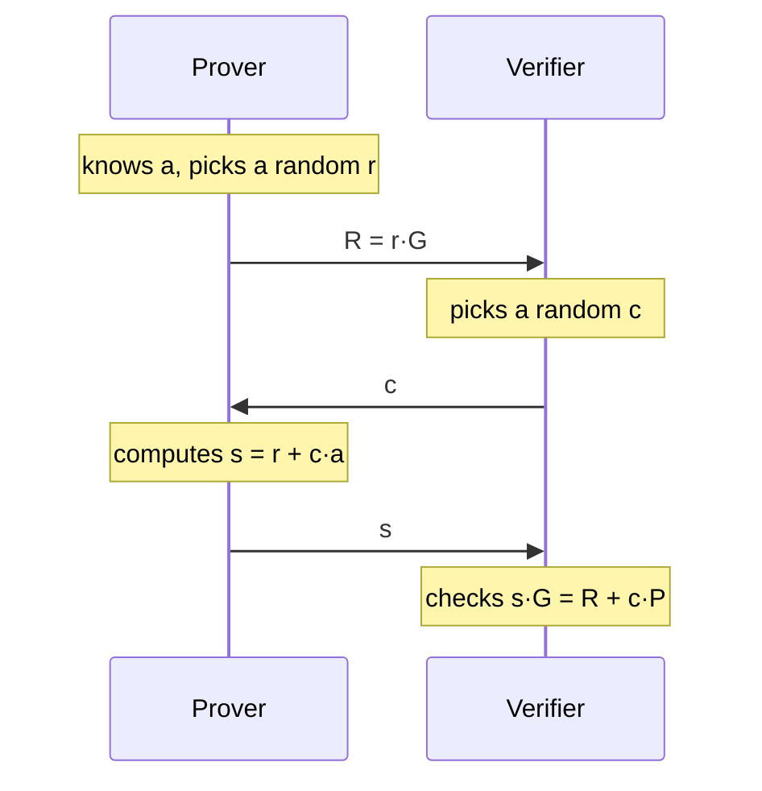
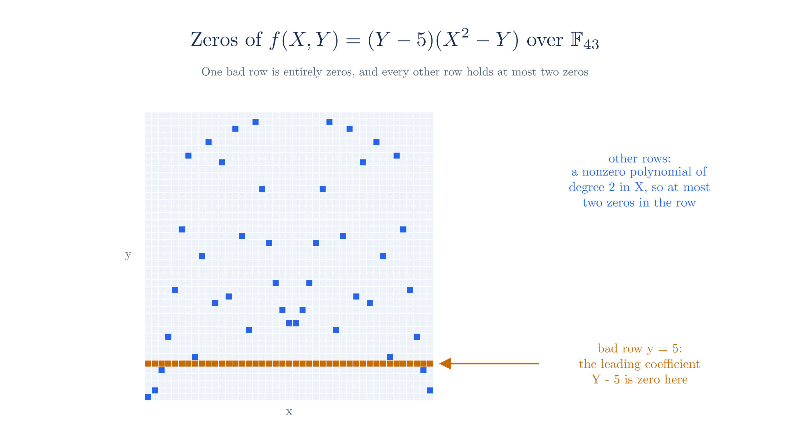
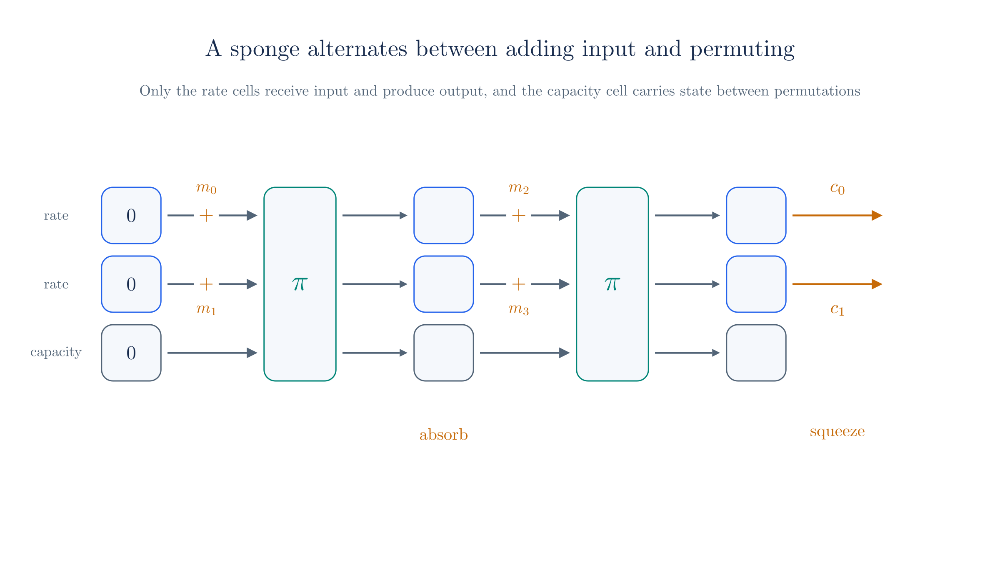

# Statements and Challenges

The [previous chapter](./pcd-intro.md) set proof-carrying data as the goal, where each step of a computation hands over its output together with a proof. Before building any proof, we need to say precisely what a proof is about and what it means for one to work. This chapter supplies that vocabulary.

It also introduces the three tools that every later chapter uses. The Schwartz–Zippel lemma explains why checking a polynomial at one random point tells us about the whole polynomial. Random linear combinations replace many claims with one. The Fiat–Shamir transform then removes the verifier's live participation by deriving its random choices from a hash.

## 1. Statements, instances, and witnesses

Suppose a prover wants to convince a verifier of the following claim, which the [next chapter](./arithmetization.md) uses as its running example:

> I know a number $x$ in $\F_{43}$ such that $x^3 + x + 5 = 35$.

This claim has a public part and a secret part. The number 35 is known to both parties, and we call this public part the **instance**. The number $x$ is known only to the prover, and we call this secret part the **witness**. The rule connecting them is a **relation**, which is a test that takes an instance and a witness and answers yes or no. Here the relation contains a pair $(t, x)$ exactly when $x^3 + x + 5 = t$. A **statement** is then a claim that a given instance has a witness in the relation.

The relation has to be cheap to evaluate, since it is the test the verifier would run if it were handed the witness. Finding a witness from the instance can be much harder. In the example above, the field is small enough to search:

<!-- worked:cubic-witnesses -->

Evaluating $x^3 + x + 5$ at all 43 elements of $\F_{43}$ finds that the value 35 occurs at $x \in \{3\}$. Our $x = 3$ is the only witness for this instance. The value $x = 4$ gives $30$, so the pair $(35, 4)$ falls outside the relation. Some instances have no witness at all, and the instance 2 is one of them.

<!-- /worked:cubic-witnesses -->

Later chapters use a second relation, the one behind every elliptic curve commitment. The instance is a point $P$ on a curve, the witness is a scalar $a$, and the relation holds when $a \cdot G = P$ for a public generator $G$. We work on the toy curve $E: y^2 = x^3 + 3$ over $\F_{31}$, which has 43 points. Coordinates are computed modulo 31, and scalars are computed modulo 43 because adding a point to itself 43 times returns the identity. The [chapter on polynomial commitments](./polynomial-commitments.md#_2-the-toy-curve) returns to this distinction, and the [curves appendix](./appendix-curves.md) lists the parameters.

<!-- worked:dlog-instance -->

Take the generator $G = G_0 = (1,\,2)$ and the secret scalar $a = 12$, which give the instance $P = 12 \cdot G = (18,\,10)$. The relation holds for the pair $(P, 12)$ because recomputing $12 \cdot G$ yields $P$. The pair $(P, 13)$ falls outside it, since $13 \cdot G = (6,\,23)$.

<!-- /worked:dlog-instance -->

The two relations differ in one respect that affects what a proof must establish. The group has prime order, so every point is a multiple of $G$. A witness for $P$ therefore always exists, and the claim "some $a$ satisfies this" tells the verifier nothing. The useful claim is that the prover knows $a$, and Section 2 gives this difference a name.

The prover could convince the verifier by sending the witness, and the verifier could run the relation. We want to avoid that for two reasons. The witness may be secret, as the spending keys in a Zcash transaction are. It may also be enormous, because in proof-carrying data the witness for one step includes everything needed to check the previous steps. A proof has to be shorter than the witness and has to keep it hidden.

## 2. Completeness and soundness

We judge a proof system by how it treats honest and dishonest provers, and a useful system has to satisfy two requirements at once. **Completeness** says that a prover with a valid witness who follows the protocol always convinces the verifier. **Soundness** says that a prover making a false statement rarely convinces the verifier, however it deviates from the protocol.

Each requirement alone is easy to meet. A verifier that accepts everything is complete but not sound, and a verifier that rejects everything is sound but not complete. Sending the witness satisfies both but fails the goals from Section 1, so the real work is meeting both requirements with a short message that hides the witness.

We allow soundness to fail with a small probability, called the **soundness error**. Accepting a small error is what makes short proofs possible, as this chapter shows repeatedly. The error has to be small enough that no one could expect to see it happen, and Section 5 shows how a large field achieves that.

Three refinements of soundness appear in later chapters, and we state them here informally:

- **Knowledge soundness** says that a prover who convinces the verifier must actually know a witness. This is the property we need for the curve relation in Section 1, where a witness always exists.
- **Computational soundness** says that soundness holds only against provers with realistic computing power. A proof system with this weaker guarantee is called an **argument**. Ragu's proofs are arguments, because they rest on the hardness assumptions listed in Section 11.
- **Zero knowledge** says that the verifier learns nothing from the proof beyond the truth of the statement.

This site explains why cheating fails and which assumptions that depends on, but it does not give formal definitions or security proofs.

## 3. An interactive proof

The clearest way to see these properties is to run a protocol. We use Schnorr's protocol for the curve relation, because it is short enough to follow every step. Ragu's proof is a different and much larger protocol, but it has the same shape, in which the prover commits to something, the verifier answers with randomness, and the prover responds.

### Building the protocol

The prover wants to show that it knows $a$ with $a \cdot G = P$. Sending $a$ would reveal it, so the prover has to send something derived from $a$ that can be checked against $P$. One candidate is a multiple $c \cdot a$ for a number $c$ chosen by the verifier, because the verifier can check it against $c \cdot P$. This fails immediately, since the verifier can divide by $c$ and recover $a$.

Adding a random mask $r$ repairs this, giving the response $s = r + c \cdot a$. The value $r$ hides $c \cdot a$ in the same way a one-time pad hides a message. The verifier now cannot check $s$ without some information about $r$, so the prover announces $R = r \cdot G$ ahead of time. Multiplying the response by $G$ shows why this is enough:

$$
\begin{aligned}
s \cdot G &= (r + c \cdot a) \cdot G \\
&= r \cdot G + c \cdot (a \cdot G) \\
&= R + c \cdot P.
\end{aligned}
$$

The last line contains only values the verifier holds, so the verifier can check it. These lines also establish completeness, because an honest prover passes for every $r$ and every $c$.

The protocol has three messages, and their order is part of the protocol:

Here is one run:

<!-- worked:schnorr-run -->

| Step | Party | Value |
| --- | --- | --- |
| 1 | Prover picks a mask and sends $R$ | $r = 29$, $R = 29 \cdot G = (28,\,10)$ |
| 2 | Verifier sends a random challenge | $c = 16$ |
| 3 | Prover sends the response | $s = 29 + 16 \cdot 12 = 6$ modulo 43 |
| 4 | Verifier computes the left side | $s \cdot G = 6 \cdot G = (5,\,2)$ |
| 5 | Verifier computes the right side | $R + c \cdot P = (28,\,10) + (8,\,9) = (5,\,2)$ |

<!-- /worked:schnorr-run -->

### Why the order matters

The verifier has to send $c$ after receiving $R$. To see why, rearrange the check to isolate $R$, which gives $R = s \cdot G - c \cdot P$. If a cheater knows $c$ ahead of time, it can pick any $s$ and compute the $R$ that makes the equation hold.

<!-- worked:schnorr-early -->

Suppose a cheater holds only the public point $P = (18,\,10)$ and learns in advance that $c = 16$. It picks the response $s = 23$ first, and then computes $R = 23 \cdot G - 16 \cdot P = (22,\,24)$. The check passes because $s \cdot G = (8,\,22)$ and $R + c \cdot P = (8,\,22)$. The cheater never used $a$.

<!-- /worked:schnorr-early -->

Sending $R$ first removes this option, since $R$ is fixed before $c$ exists. Section 9 shows what happens when the same ordering breaks in a non-interactive proof.

### Why a cheater fails

Consider a cheater who sends some point $R$ and has prepared one response $s$. The check $s \cdot G = R + c \cdot P$ involves one unknown, the challenge, and it holds for exactly one value of $c$ because $P$ generates the group.

<!-- worked:schnorr-count -->

We can test this on all $43 \times 43 = 1849$ pairs $(R, s)$, trying every one of the 43 challenges against each pair. Every pair passes for exactly one challenge. A cheater who fixes $R$ and prepares one response therefore succeeds with probability $1/43$.

<!-- /worked:schnorr-count -->

A cheater might instead hope to prepare a different response for each challenge. Suppose it could answer two different challenges $c$ and $c'$ for the same $R$, with responses $s$ and $s'$. Writing both checks and subtracting removes $R$:

$$
\begin{aligned}
s \cdot G &= R + c \cdot P \\
s' \cdot G &= R + c' \cdot P \\
(s - s') \cdot G &= (c - c') \cdot P.
\end{aligned}
$$

Since $c \neq c'$, dividing by $c - c'$ gives $P = \frac{s - s'}{c - c'} \cdot G$, so the cheater can compute the discrete log of $P$.

<!-- worked:schnorr-extract -->

Keep $R = (28,\,10)$. The prover answers $c = 16$ with $s = 6$ and answers $c' = 31$ with $s' = 14$. The difference gives $s - s' = 35$ and $c - c' = 28$ modulo 43, and dividing gives $35 / 28 = 12$, which is the secret $a$.

<!-- /worked:schnorr-extract -->

This gives us knowledge soundness in an informal sense. A prover who answers more than one challenge for a given $R$ can compute $a$, and anyone who cannot compute $a$ is limited to one challenge out of 43, which on a Pasta curve is one out of about $2^{254}$. The argument assumes that discrete log is hard. On the toy curve anyone can solve discrete log by counting, so these numbers show the mechanism and offer no security.

### What the verifier learns

The response gives away nothing about $a$, because the mask $r$ is uniform and is used once.

<!-- worked:schnorr-mask -->

Fix $c = 16$ and let the mask $r$ range over $\F_{43}$. The response $s = r + 16 \cdot 12$ takes each of the 43 values exactly once, with $r = 29$ giving $6$ and $r = 8$ giving $28$, for example. We also listed the 43 pairs $(R, s)$ an honest prover can produce for this challenge, and the 43 pairs a simulator produces by picking $s$ first and computing $R = s \cdot G - c \cdot P$. The two lists contain the same pairs.

<!-- /worked:schnorr-mask -->

The second comparison is informative. The same trick that lets a cheater forge when it knows $c$ early also lets anyone produce transcripts with the correct distribution without knowing $a$. A transcript that anyone could have produced cannot teach the verifier anything about $a$, which is the informal reason the protocol is zero knowledge for a verifier who picks $c$ honestly. Reusing a mask would destroy this, since two responses with the same $r$ reveal $a$ through the subtraction above.

## 4. Counting the roots of a polynomial

Schnorr's protocol relied on a linear equation in $c$, which has one solution. Most protocols on this site check polynomial equations of high degree, so we need to count the solutions of those equations. The count rests on one algebraic fact about roots.

### Each root gives a linear factor

Let $f(X) = \sum_{i=0}^{d} c_i X^i$ have degree $d$, and suppose $f(a) = 0$. Subtracting $f(a)$ changes nothing, so we can write

$$
\begin{aligned}
f(X) &= f(X) - f(a) \\
&= \sum_{i=0}^{d} c_i X^i - \sum_{i=0}^{d} c_i a^i \\
&= \sum_{i=1}^{d} c_i \big(X^i - a^i\big).
\end{aligned}
$$

The $i = 0$ term cancels because $X^0 - a^0 = 0$. Each remaining difference contains the factor $X - a$, as multiplying out the following product confirms:

$$X^i - a^i = (X - a)\big(X^{i-1} + X^{i-2}a + \cdots + X a^{i-2} + a^{i-1}\big).$$

For $i = 2$ this reads $X^2 - a^2 = (X - a)(X + a)$. Pulling out the common factor gives $f(X) = (X - a)\,g(X)$, where $g$ has degree $d - 1$.

<!-- worked:factor -->

Take $p(X) = 7 + 2X + 5X^2 + 3X^3$ over $\F_{43}$ and $a = 9$, where $p(9) = 37$. Subtracting gives $f(X) = p(X) - 37 = 13 + 2X + 5X^2 + 3X^3$, which has a root at $9$. Dividing by $X - 9$ leaves no remainder, so $f(X) = (X - 9)(32 + 32X + 3X^2)$. Expanding this product returns the coefficients of $f$.

<!-- /worked:factor -->

### A polynomial of degree d has at most d roots

Now suppose $b \neq a$ is another root of $f$. Substituting $b$ into the factorization gives

$$0 = f(b) = (b - a)\,g(b).$$

In a field, a product of two nonzero values is never zero. Since $b - a \neq 0$, this forces $g(b) = 0$, so every other root of $f$ is a root of $g$. We can repeat the argument on $g$, which has degree one lower. A nonzero constant has no roots, so the process removes at most $d$ roots before it stops. This proves that a nonzero polynomial of degree $d$ over a field has at most $d$ roots.

<!-- worked:peel -->

| Step | Polynomial | Degree | Root removed |
| --- | --- | --- | --- |
| Start | $31 + 22X + 31X^2 + 2X^3$ | 3 | |
| 1 | $12 + 33X + 2X^2$ | 2 | 1 |
| 2 | $37 + 2X$ | 1 | 2 |
| 3 | $2$ | 0 | 3 |

The constant 2 has no roots, so the process stops after three steps. Evaluating the starting polynomial at all 43 points confirms that its roots are exactly 1, 2 and 3.

<!-- /worked:peel -->

The field assumption is essential, because without it the cancellation step fails:

<!-- worked:ring -->

Work modulo 8, which is not a prime. The degree-2 polynomial $X^2 - 1$ has the four roots $1, 3, 5, 7$. At $X = 3$ it factors as $(3 - 1)(3 + 1) = 2 \cdot 4 = 0$ modulo 8, where neither factor is zero, so the cancellation step above is invalid.

<!-- /worked:ring -->

The toy field is small enough to check the bound on every polynomial of a given degree. Multiplying a polynomial by a nonzero constant does not move its roots, so it is enough to count the monic cubics, whose leading coefficient is 1:

<!-- worked:root-tally -->

| Distinct roots | Monic cubics over $\F_{43}$ | Share |
| --- | --- | --- |
| 0 | 26488 | 0.333 |
| 1 | 38872 | 0.489 |
| 2 | 1806 | 0.023 |
| 3 | 12341 | 0.155 |

The counts add up to $43^3 = 79507$, and no polynomial reaches 4 roots.

<!-- /worked:root-tally -->

The bound of 3 is what a cheater can reach at best, and many polynomials stay below it. A protocol's guarantee has to hold against the worst polynomial a cheater could choose, so we use the bound rather than the typical count.

## 5. Testing polynomials at a random point

The root count gives us a cheap test for equality. Let $p$ and $q$ be different polynomials of degree at most $d$, and let $x$ be uniform in $\F$. If $p(x) = q(x)$, then $x$ is a root of the nonzero polynomial $p - q$, whose degree is at most $d$. It has at most $d$ roots, so

$$\Pr\big[p(x) = q(x)\big] \le \frac{d}{|\F|}.$$

This is the one-variable case of the **Schwartz–Zippel lemma**. Comparing two polynomials coefficient by coefficient takes time proportional to their size, whereas this test compares one field element from each side.

The test is more useful for identities that are expensive to check directly. Suppose a prover claims that $r(X) = p(X)q(X)$. Multiplying the two polynomials out takes a number of field multiplications that grows with the square of the degree in the schoolbook method, but checking the claim at one point requires only three evaluations and one multiplication.

<!-- worked:product-honest -->

Let $p(X) = 7 + 2X + 5X^2 + 3X^3$ and $q(X) = 3 + X + 8X^2 + 4X^3$. Their product is $r(X) = 21 + 13X + 30X^2 + 15X^3 + 8X^4 + X^5 + 12X^6$. At the point $9$, $p(9) = 37$ and $q(9) = 7$, whose product is $1$ modulo 43, and $r(9) = 1$ as well.

<!-- /worked:product-honest -->

Now suppose a cheater sends $r$ plus some error polynomial. The test passes exactly at the roots of the error. The product has degree 6, which gives a bound of $6/43$, and the next table counts the passing points for several errors.

<!-- worked:product-cheats -->

| Error added to $r$ | Points where the test passes | Pass rate | Bound $6/43$ |
| --- | --- | --- | --- |
| $5$ | 0 | 0.000 | 0.140 |
| $X - 4$ | 1 | 0.023 | 0.140 |
| $X^2 + 1$ | 0 | 0.000 | 0.140 |
| $(X-1)(X-2)(X-3)$ | 3 | 0.070 | 0.140 |
| $(X-1)(X-2)(X-3)(X-4)(X-5)(X-6)$ | 6 | 0.140 | 0.140 |

<!-- /worked:product-cheats -->

The last row reaches the bound, and the others stay under it. An error such as $X^2 + 1$ has no roots in this field, so the test catches it at every point.

Two conditions make the bound meaningful. The first is that the polynomials must be fixed before $x$ is chosen, for the same reason as the ordering in Section 3. The bound counts the roots of a fixed polynomial, and a prover who sees $x$ first can build a polynomial with a root at $x$:

<!-- worked:product-early -->

If the prover knows the point $9$ in advance, it can send $r'(X) = r(X) + (X - 9) = 12 + 14X + 30X^2 + 15X^3 + 8X^4 + X^5 + 12X^6$. This polynomial differs from $r$, yet $r'(9) = 1$, so the test at $9$ passes.

<!-- /worked:product-early -->

The [chapter on polynomial commitments](./polynomial-commitments.md#choosing-the-point-after-the-commitment) builds the tool that fixes a polynomial without revealing it.

The second condition is that the degree must be well below the field size. The bound says nothing once $d$ reaches $|\F|$:

<!-- worked:degree-limit -->

The polynomial $X^{43} - X$ has degree 43 and is not the zero polynomial, yet it evaluates to 0 at all 43 points of $\F_{43}$. Its bound is $43/43 = 1$, which promises nothing.

<!-- /worked:degree-limit -->

Real fields leave plenty of room:

<!-- worked:sz-scale -->

With degree $d = 2^{13}$ over a field with more than $2^{254}$ elements, such as either Pasta field, the probability is below $2^{-241}$.

<!-- /worked:sz-scale -->

## 6. Polynomials in several variables

The checks in later chapters often involve more than one challenge, which turns the polynomial being tested into a function of several variables. The [consolidated equation](./arithmetization.md#_12-the-consolidated-equation) in the next chapter, for example, uses two challenges. We therefore need the same kind of bound for several variables.

The relevant size measure is the **total degree**, the largest sum of exponents among the monomials. The monomial $X^2 Y$ has total degree 3, so $(Y - 5)(X^2 - Y) = X^2 Y - Y^2 - 5X^2 + 5Y$ has total degree 3.

::: tip Schwartz–Zippel lemma
Let $f$ be a nonzero polynomial in $m$ variables with total degree $d$ over a field $\F$. If $r_1, \ldots, r_m$ are chosen uniformly and independently from $\F$, then

$$\Pr\big[f(r_1, \ldots, r_m) = 0\big] \le \frac{d}{|\F|}.$$
:::

The bound does not grow with the number of variables, so it is worth going through the two-variable argument. Longer lists of variables follow by repeating it.

Group the terms of $f(X, Y)$ by powers of $X$:

$$f(X, Y) = \sum_{i=0}^{k} f_i(Y)\, X^i,$$

where $k$ is the highest power of $X$ whose coefficient $f_k(Y)$ is a nonzero polynomial. Each monomial of $f_k(Y) X^k$ has total degree at most $d$, and $X^k$ already accounts for $k$ of it, so $f_k$ has degree at most $d - k$.

Now picture choosing $y$ first and $x$ second. Two cases can occur:

- **The chosen $y$ is a root of $f_k$.** By Section 4 there are at most $d - k$ such values, so this happens with probability at most $(d - k)/|\F|$. We give up on these rows and assume the worst, which is that $f$ vanishes for every $x$.
- **The chosen $y$ is not a root of $f_k$.** Then $f(X, y)$ is a one-variable polynomial with nonzero leading coefficient $f_k(y)$ and degree $k$. It has at most $k$ roots, so a uniform $x$ hits one with probability at most $k/|\F|$.

Adding the two probabilities gives

$$\Pr\big[f(x, y) = 0\big] \le \frac{d - k}{|\F|} + \frac{k}{|\F|} = \frac{d}{|\F|}.$$

The figure shows both cases for one polynomial:

<!-- worked:biv-rows -->

For $f(X, Y) = (Y - 5)(X^2 - Y)$ we have $k = 2$ and $f_2(Y) = Y - 5$, so the only bad row is $y = 5$, and it contains all 43 points as zeros. The other 42 rows hold at most 2 zeros each, because each is a nonzero degree-2 polynomial in $X$. They contribute 43 zeros in total, and the sum $43 + 43 = 86$ stays below the limit of $129$.

<!-- /worked:biv-rows -->

For $m$ variables, we treat one variable as $X$ and the rest as a group, and the same two cases apply with the lemma for $m - 1$ variables in place of the root count.

Over $\F_{43}$ there are $43^2$ points to test, so the probability bound $d/43$ becomes a limit of $d \cdot 43$ on the number of zeros. The next table counts the zeros of several polynomials.

<!-- worked:biv-table -->

| Polynomial | Total degree $d$ | Zeros among $(x, y)$ | Limit $d \cdot 43$ |
| --- | --- | --- | --- |
| $XY - 1$ | 2 | 42 | 86 |
| $(X - 1)(Y - 2)$ | 2 | 85 | 86 |
| $(X - 1)(X - 2)$ | 2 | 86 | 86 |
| $X^3 + X^2 + Y^3 - 5$ | 3 | 46 | 129 |
| $(Y - 5)(X^2 - Y)$ | 3 | 86 | 129 |

The third row reaches the limit exactly. It ignores $Y$ and vanishes on two whole columns of the grid, so the bound cannot be improved in general.

<!-- /worked:biv-table -->

<!-- worked:biv-exhaustive -->

To test every case rather than selected ones, we move to the smaller field $\F_{5}$, whose bivariate polynomials of total degree at most 2 have six coefficients. There are 15624 nonzero choices. None has more than 10 zeros among the 25 points of the grid, which matches the limit $2 \cdot 5$, and 240 of them reach it.

<!-- /worked:biv-exhaustive -->

## 7. Random linear combinations

A proof system has to check a large number of equations, since a circuit has thousands of gates and each one contributes a claim of the form $e_i = 0$, where $e_i$ is the difference between the two sides. A proof that handled every equation separately would be very long, so we want one equation that fails whenever any of the original equations fails.

Adding the errors does not work, because they can cancel. Fixed weights do not work either, because the cheater can plan around them:

<!-- worked:rlc-cancel -->

The errors $(1, 42)$ are both nonzero, but they add to 0 modulo 43. Fixed weights known in advance do no better. With the weights $(1, 2)$, a cheater picks the errors $(2, 42)$, and $1 \cdot 2 + 2 \cdot 42 = 0$ modulo 43.

<!-- /worked:rlc-cancel -->

The remedy for both is to choose the weights at random after the errors are fixed, so that the cheater has nothing to plan around. There are two standard ways to do this.

### Independent weights

The verifier picks a separate uniform $r_i$ for each claim and checks $\sum_i r_i e_i = 0$. Suppose some $e_k \neq 0$. Fix all the other weights to any values, and let $w$ be the sum of their terms. The check becomes

$$e_k r_k + w = 0,$$

which has exactly one solution $r_k = -w / e_k$. A uniform $r_k$ hits that solution with probability exactly $1/|\F|$, however many claims there are.

<!-- worked:rlc-independent -->

Take the errors $(6, 5, 1)$. Trying all $43^3 = 79507$ choices of $(r_0, r_1, r_2)$ finds 1849 that give a zero combination, which is a share of exactly $1/43$.

<!-- /worked:rlc-independent -->

### Powers of one challenge

Independent weights require one random value per claim. A single value $r$ can stand in for all of them if we use its powers as the weights:

$$\sum_{i=0}^{m-1} r^i e_i = 0.$$

The left side is a polynomial in $r$ whose coefficients are the errors. If any error is nonzero, this polynomial is nonzero with degree at most $m - 1$, so Section 5 gives an error of at most $(m - 1)/|\F|$. The verifier sends one field element rather than $m$, and the cost is a larger soundness error that a large field absorbs. The [next chapter](./arithmetization.md#_5-reducing-the-gates-to-one-equation) applies this form to circuit gates and constraints.

All nonzero error vectors of length 3 are few enough to enumerate:

<!-- worked:rlc-powers -->

| Values of $r$ that hide the errors | Nonzero error vectors of length 3 |
| --- | --- |
| 0 | 37968 |
| 1 | 3612 |
| 2 | 37926 |

The counts cover all $79506$ nonzero vectors, and no vector is hidden by more than 2 of the 43 values, which agrees with the bound $(m - 1)/|\F| = 2/43$. The errors $(6, 5, 1)$ from the previous example are hidden by 2 values in this form, namely $r \in \{40, 41\}$.

<!-- /worked:rlc-powers -->

### Combining evaluation claims

The same technique combines claims about polynomials. Suppose a prover claims $p(x) = y_0$ and $q(x) = y_1$. Evaluation is linear in the coefficients, so for any $r$,

$$(p + r q)(x) = p(x) + r\,q(x).$$

The verifier can therefore pick $r$ and test one claim, $(p + rq)(x) = y_0 + r y_1$. Writing $e_0 = y_0 - p(x)$ and $e_1 = y_1 - q(x)$, the right side minus the left side is $e_0 + r e_1$, which is the two-claim case of the check above.

<!-- worked:rlc-claims -->

The true values at $x = 9$ are $p(9) = 37$ and $q(9) = 7$. A cheater claims $38$ and $9$, with errors 1 and 2. At $r = 6$, the combined polynomial $p + 6q$ evaluates to $36$, while the combined claim is $38 + 6 \cdot 9 = 6$, so the check fails. Trying all 43 values of $r$ finds that only $r = 21$ hides the errors, because that is the single solution of $1 + 2r = 0$ modulo 43.

<!-- /worked:rlc-claims -->

As with every challenge, the errors must be fixed before $r$ is known. A cheater who sees $r$ first can pick errors that cancel:

<!-- worked:rlc-early -->

If the cheater learns $r = 6$ first, it keeps the error $e_1 = 2$ and solves for $e_0 = -6 \cdot 2 = 31$ modulo 43. It then claims $25$ and $9$. Both claims are false, yet $25 + 6 \cdot 9 = 36$ equals the value of $p + 6q$ at $9$.

<!-- /worked:rlc-early -->

In linear algebra terms, one row replaces a system of equations. A system $A\v{w} = \v{b}$ with $m$ rows becomes the single equation $\dot{\v{r}}{A\v{w}} = \dot{\v{r}}{\v{b}}$, in which a random vector $\v{r}$ combines the rows. The technique applies wherever claims combine linearly, which includes the curve points in [Pedersen commitments](./polynomial-commitments.md#_5-adding-commitments). The chapters on batched openings, accumulation, and folding all build on it.

## 8. Removing the verifier with Fiat–Shamir

Interaction is a problem for proof-carrying data. A proof has to travel with its data and convince anyone who later receives it, including parties that did not exist when the prover ran. A live verifier cannot do that, and a recording of an interactive run does not help either, because Section 3 showed that anyone can write a valid transcript once the challenge is known in advance.

The observation behind the **Fiat–Shamir transform** is that the verifier in these protocols contributes nothing but random values. Protocols with this property are called **public coin**, since the verifier's coins are visible and it keeps no secrets. The challenge needs only two properties, which are that it looks random and that nobody can predict it before the prover's message is fixed. A hash of the prover's message has both properties, provided the hash behaves like a random function.

The transform therefore replaces each verifier message with a hash of everything sent so far. We keep this running record in an object called a **transcript**, with two operations. Absorbing adds a value to the record, and squeezing produces a challenge that depends on everything absorbed so far. Prover and verifier run the same sequence of operations, so they obtain the same challenges. For Schnorr's protocol, the sequence is:

1. Start the transcript with a tag that names the protocol.
2. Absorb the instance $P$.
3. Absorb the commitment $R$.
4. Squeeze the challenge $c$.

Section 11 describes the toy hash we use here, which works over $\F_{43}$. It absorbs a curve point as its two coordinates. Each coordinate is an integer below 31, so it is also a distinct element of $\F_{43}$, and the output is a scalar for the toy curve. On real curves, moving values between the two fields of a curve cycle takes more care, and the chapters on [curve cycles](./curve-cycles.md) and [endoscalars](./endoscalars.md) cover that step.

<!-- worked:fs-run -->

| Step | Party | Value |
| --- | --- | --- |
| 1 | Prover starts the transcript with the tag and instance | tag $(11, 22)$, $P = (18,\,10)$ |
| 2 | Prover computes the commitment and absorbs it | $R = 29 \cdot G = (28,\,10)$ |
| 3 | Prover squeezes the challenge | $c = 10$ |
| 4 | Prover computes the response | $s = 29 + 10 \cdot 12 = 20$ modulo 43 |
| 5 | Prover publishes the proof | $(R, s) = ((28,\,10),\ 20)$ |
| 6 | Verifier replays steps 1 to 3 | $c = 10$ |
| 7 | Verifier checks the equation | $s \cdot G = (8,\,9)$ and $R + c \cdot P = (8,\,9)$ |

<!-- /worked:fs-run -->

The proof is now a single message that anyone can check at any time. The verifier no longer picks anything, and it instead recomputes the challenge and confirms the equation.

The challenge depends on the commitment, which restores the ordering from Section 3. A prover cannot choose $R$ after the challenge, because a different $R$ produces a different challenge. Later challenges depend on all earlier messages, because the transcript keeps its state between squeezes:

<!-- worked:fs-tamper -->

Changing the commitment to $R' = (6,\,8)$ changes the challenge from $10$ to $5$, and the old response $20$ no longer satisfies the check. The effect also carries forward. If the protocol had a later round, which absorbed $s$ and squeezed a second challenge, that challenge would be $3$ after $R$ and $29$ after $R'$, with the same $s$ in both runs.

<!-- /worked:fs-tamper -->

## 9. Omitting data from the transcript

The transform is safe only when the transcript includes everything the verifier would have seen before choosing the challenge. Leaving out a value lets a prover choose that value after seeing the challenge, which is the attack from Section 3 in a new form. These mistakes have happened in deployed code. Trail of Bits named the class [Frozen Heart](https://blog.trailofbits.com/2022/04/13/part-1-coordinated-disclosure-of-vulnerabilities-affecting-girault-bulletproofs-and-plonk/) in its disclosure of such flaws in implementations of Girault's proof of knowledge, Bulletproofs, and PLONK.

### Omitting the commitment

Suppose the transcript absorbs the tag and $P$ but not $R$. The challenge is then fixed before the commitment exists, so the early-challenge forgery from Section 3 works directly, with no search.

<!-- worked:omit-commitment -->

| Step | Value |
| --- | --- |
| Compute the challenge from the tag and $P$ alone | $c = 39$ |
| Pick any response | $s = 31$ |
| Solve for the commitment | $R = 31 \cdot G - 39 \cdot P = (25,\,2)$ |
| Verifier's left side | $s \cdot G = (18,\,21)$ |
| Verifier's right side | $R + c \cdot P = (18,\,21)$ |

The flawed verifier accepts. A verifier that also absorbs $R$ derives the challenge $26$ instead of $39$ and rejects the same proof.

<!-- /worked:omit-commitment -->

This breaks the protocol completely, since a cheater can forge a proof for any instance. The same mistake in a polynomial protocol has the same effect. If the evaluation point does not depend on a polynomial's commitment, the prover can [change the polynomial to fit the point](./polynomial-commitments.md#choosing-the-point-after-the-commitment).

### Omitting the instance

Suppose instead that the transcript absorbs $R$ but not $P$. [Bernhard, Pereira, and Warinschi](https://eprint.iacr.org/2016/771) call this variant weak Fiat–Shamir and examine its pitfalls. The cheater can no longer choose $R$ after the challenge, but it can now choose the statement afterward. Rearranging the check $s \cdot G = R + c \cdot P$ to isolate $P$ gives $P = c^{-1} \cdot (s \cdot G - R)$.

<!-- worked:omit-instance -->

Start from the public point $R = G_3 = (17,\,7)$, whose relation to $G$ the cheater need not know. The flawed transcript gives $c = 15$ without looking at any instance. Picking $s = 19$ and solving gives $P' = c^{-1} \cdot (s \cdot G - R) = (9,\,9)$. The check holds, since $s \cdot G = (27,\,1)$ and $R + c \cdot P' = (27,\,1)$.

<!-- /worked:omit-instance -->

The cheater now has a valid proof for $P'$, and the construction used only public points, so it never needed the discrete log of $P'$. The cheater cannot aim at a specific $P'$ this way. A weak transcript also lets an observer adapt someone else's proof to a related statement, and in that case the observer does choose the target. The challenge does not change when the instance changes, so the observer can add a multiple of $G$ to the instance and add the corresponding amount to the response:

$$s' \cdot G = (s + c \cdot t) \cdot G = R + c \cdot P + c \cdot t \cdot G = R + c \cdot (P + t \cdot G).$$

<!-- worked:omit-maul -->

An honest prover publishes $(R, s) = ((28,\,10),\ 35)$ for $P = (18,\,10)$ under the flawed transcript, whose challenge is $c = 22$. An observer takes $t = 7$ and computes $P' = P + 7 \cdot G = (27,\,1)$ and $s' = s + c \cdot t = 35 + 22 \cdot 7 = 17$ modulo 43. The pair $(R, s')$ passes for $P'$, because $s' \cdot G = (20,\,6)$ and $R + c \cdot P' = (20,\,6)$.

<!-- /worked:omit-maul -->

The witness for $P'$ is $a + t$, and the observer does not know it because it does not know $a$. A verifier would nevertheless accept this proof as evidence that someone does.

### Omitting the protocol tag

Tags address a less direct problem. If two protocols use the same message format, a proof made for one would also pass in the other, even when the two assign different meanings to the same equation. Starting the transcript with a tag gives each protocol its own stream of challenges, a practice called **domain separation**.

<!-- worked:omit-tag -->

With the tag $(11, 22)$, the instance and commitment above give the challenge $10$. With the tag $(11, 24)$, the same two points give $12$, and the response $20$ fails the check.

<!-- /worked:omit-tag -->

Our rule follows from these three cases. The transcript has to include the protocol tag, all public parameters that the tag does not already fix, the full instance, every prover message, and all earlier challenges, which the transcript state includes automatically.

## 10. Repeated trials

The transform also changes the soundness error in a way that is easy to miss. In an interactive run, a cheater gets one attempt, because the verifier sees each failure. In a non-interactive proof, a cheater can try as many transcripts as it likes on its own machine and publish only one that works. This is called **grinding**.

The toy field makes grinding visible, because each attempt has a chance of about $1/43$:

<!-- worked:grinding -->

A cheater repeats the early-challenge trick. It guesses a challenge, picks a response, computes $R = s \cdot G - c \cdot P$, and tests whether the hash of the transcript returns its guess. Running through the pairs from the largest values downward with $P = (18,\,10)$, attempt 19 succeeds with the guess $c = 42$, the response $s = 23$ and $R = (30,\,23)$. The honest verifier accepts this proof, and the search never touched $a$. Across all 1806 pairs that give a nonidentity $R$, exactly 42 succeed, which is one attempt in 43.

<!-- /worked:grinding -->

A cheater with $T$ attempts therefore has a success probability of up to about $T$ times the soundness error of a single attempt. The defense is a field large enough for the product to remain tiny:

<!-- worked:grinding-scale -->

Suppose a cheater can compute $2^{128}$ hashes, and each attempt faces the error $d/|\F|$ with $d = 2^{13}$ and a field above $2^{254}$. Each attempt succeeds with probability below $2^{-241}$, and all attempts together succeed with probability below $2^{-113}$.

<!-- /worked:grinding-scale -->

These numbers only illustrate how grinding scales, and we make no claim here about the overall security level of Ragu. The [Ragu Book](https://github.com/tachyon-zcash/ragu/blob/3219e0865e8bff1f9d817bfe3850d9e94b64338c/book/src/protocol/extensions/endoscalar.md?plain=1#L235-L241) raises the same point in one of its discussions, noting that a complete accounting has to include an adversary's repeated Fiat–Shamir trials.

## 11. Poseidon and the random oracle assumption

Fiat–Shamir needs a hash function, and the choice matters more in recursive proofs than elsewhere. In a recursive proof, the verifier's work runs inside a circuit, so each challenge must be recomputed inside a circuit too. The [next chapter](./arithmetization.md#_2-flattening-a-computation) explains that a circuit's main cost is its number of field multiplications. A hash such as SHA-256 works with bits and 32-bit words, and expressing those operations as field equations takes tens of thousands of constraints for each compression. Ragu instead uses [Poseidon](https://eprint.iacr.org/2019/458), a hash designed to work directly with field elements and to need few multiplications.

### The sponge

Poseidon is built from a permutation $\pi$ of a small array of field elements, called the **state**. A construction called a **sponge** turns this permutation into a transcript. The state starts at zero and is split into **rate** cells, which interact with the outside, and **capacity** cells, which do not.

Absorbing adds input into the rate cells. Once they are full, or when the prover wants a challenge, the sponge applies $\pi$. Squeezing reads values out of the rate cells and applies $\pi$ again when they run out. The capacity cells prevent a prover from controlling the whole state, because input can reach them only through the permutation.

### The permutation

Each round of $\pi$ performs three operations on the state:

1. It adds a fixed **round constant** to every cell, which makes the rounds differ and blocks attacks that exploit repeated structure.
2. It applies the **S-box**, the map $x \mapsto x^5$, to some of the cells. This is the only nonlinear step, and it provides the mixing that linear algebra cannot undo.
3. It multiplies the state by a fixed invertible matrix, which spreads each cell's influence to all the others.

The exponent has to make the S-box invertible, because otherwise the round would lose information. The map $x \mapsto x^e$ is a bijection on $\F_q$ exactly when $e$ shares no factor with $q - 1$, so the usable exponents depend on the field.

<!-- worked:sbox -->

Over $\F_{43}$, the map $x \mapsto x^2$ takes only 22 distinct values and $x \mapsto x^3$ takes 15, whereas $x \mapsto x^5$ takes all 43, because 5 shares no factor with $43 - 1 = 42$. The same reasoning rules out smaller exponents on the Pasta fields, where $p - 1$ and $q - 1$ are divisible by 2 and 3 but not by 5.

<!-- /worked:sbox -->

Computing $x^5$ takes three multiplications, as $x^2$, then $x^4$, then $x^4 \cdot x$. The S-box is therefore the part of Poseidon that costs gates, which suggests applying it sparingly. Poseidon does so by running two kinds of rounds. **Full rounds** apply the S-box to every cell, and **partial rounds** apply it to the first cell only. A permutation places half of its full rounds at the start, all of its partial rounds in the middle, and the remaining full rounds at the end.

### A toy Poseidon

Our examples use a small instance over $\F_{43}$ with three cells, of which two are rate cells, along with 8 full rounds and 8 partial rounds. We derive its round constants from SHA-256 and use a Cauchy matrix for the mixing step. This instance has the structure of Poseidon and none of its security, because its parameters were chosen to fit on a page and its outputs have only 43 possible values. The next table shows the first round of the first permutation from Section 8, along with the fifth round of that permutation, which is the first partial round:

<!-- worked:round-trace -->

| Step | Full round | Partial round |
| --- | --- | --- |
| Input state | $(2, 11, 0)$ | $(20, 38, 31)$ |
| After adding constants | $(19, 14, 37)$ | $(35, 22, 5)$ |
| After the S-box | $(30, 23, 7)$ | $(41, 22, 5)$ |
| After the mixing matrix | $(15, 19, 18)$ | $(13, 42, 22)$ |

<!-- /worked:round-trace -->

The S-box changes every cell in the full round but only the first cell in the partial round. Running the sponge over the whole transcript from Section 8 gives the next table.

<!-- worked:sponge-trace -->

The transcript of Section 8 absorbs seven elements in order: the tag length 2, the tag $(11, 22)$, the coordinates of $P = (18,\,10)$, and the coordinates of $R = (28,\,10)$.

| Permutation | Elements added to the state | State afterward |
| --- | --- | --- |
| 1 | $(2, 11)$ | $(26, 23, 7)$ |
| 2 | $(22, 18)$ | $(6, 42, 32)$ |
| 3 | $(10, 28)$ | $(15, 10, 8)$ |
| 4 | $(10)$ | $(10, 31, 42)$ |

The last permutation runs when the prover squeezes. The first entry of the resulting state is the challenge $c = 10$ from Section 8.

<!-- /worked:sponge-trace -->

### The assumption

The argument of Section 8 treats the hash as a **random oracle**, an imaginary function that returns an independent uniform value for each new input. In that model, a prover has no way to predict a challenge other than computing the hash on the full transcript, and the challenges behave as a verifier's random choices would. The [Ragu Book](https://github.com/tachyon-zcash/ragu/blob/3219e0865e8bff1f9d817bfe3850d9e94b64338c/book/src/protocol/prelim/assumptions.md?plain=1#L24-L31) models Poseidon this way.

This assumption is stronger than collision resistance. A Pedersen commitment, for example, is collision resistant under the discrete log assumption, yet it would make a poor source of challenges. Its output moves predictably when its input changes, as the [homomorphism](./polynomial-commitments.md#_5-adding-commitments) shows, and a prover could exploit that structure to steer a challenge. A random oracle has no structure of this kind.

No real hash function is a random oracle, because a real hash has a short public description that anyone can analyze. The assumption is therefore a modeling choice with known limits. [Goldwasser and Tauman](https://eprint.iacr.org/2003/034) built a secure identification scheme whose Fiat–Shamir signature version is secure with a random oracle but insecure under every concrete hash. More recently, [Khovratovich, Rothblum, and Soukhanov](https://eprint.iacr.org/2025/118) gave a practical attack on a GKR-based argument made non-interactive with a concrete hash, producing accepting proofs of false statements. Neither result targets Ragu, and both show that the assumption needs scrutiny for each protocol. Confidence in Poseidon specifically comes from public cryptanalysis rather than from a proof.

### Assumptions behind the protocols

The Ragu Book lists [three assumptions](https://github.com/tachyon-zcash/ragu/blob/3219e0865e8bff1f9d817bfe3850d9e94b64338c/book/src/protocol/prelim/assumptions.md), and later chapters refer back to them:

- **Discrete log relation.** Nobody can find a nontrivial linear relation among independently chosen curve generators. The [chapter on polynomial commitments](./polynomial-commitments.md#_4-why-a-prover-cannot-change-the-vector) uses this for binding.
- **Random oracle.** Poseidon behaves like a random oracle when deriving Fiat–Shamir challenges, as described above.
- **Knowledge soundness.** An efficient prover who produces a valid commitment and evaluation proof knows the underlying polynomial. This is the same kind of property we saw in Section 3, applied to the polynomial commitment scheme.

## 12. The transcript in Ragu

Ragu's transcript has the structure described above, with a few differences that come from its goal of keeping in-circuit hashing cheap. The operation that combines two proofs is called "fuse" in the code and in much of the Ragu Book, while some pages of the book say "merge". This chapter uses "fuse", following the code.

::: warning Reconstructed from code at commit 3219e08, not confirmed by the authors
**Parameters.** The transcript wraps a [Poseidon sponge](https://github.com/tachyon-zcash/ragu/blob/3219e0865e8bff1f9d817bfe3850d9e94b64338c/crates/ragu_primitives/src/poseidon/mod.rs#L77-L87) over the circuit field. A [comment in the test vectors](https://github.com/tachyon-zcash/ragu/blob/3219e0865e8bff1f9d817bfe3850d9e94b64338c/crates/ragu_primitives/src/poseidon/tests/halo2_vectors.rs#L11-L16) states that Ragu's instance has five cells with a rate of 4, and that the tests check the [permutation structure](https://github.com/tachyon-zcash/ragu/blob/3219e0865e8bff1f9d817bfe3850d9e94b64338c/crates/ragu_primitives/src/poseidon/mod.rs#L415-L419) against `halo2`'s published vectors at `halo2`'s own width of three cells. A [test](https://github.com/tachyon-zcash/ragu/blob/3219e0865e8bff1f9d817bfe3850d9e94b64338c/crates/ragu_primitives/src/poseidon/tests/mod.rs#L84-L99) fixes the cost of one permutation with Ragu's parameters at 288 gates. The constants themselves live in a dependency outside the repository, and we did not read them.

**Tags.** [`Transcript::new`](https://github.com/tachyon-zcash/ragu/blob/3219e0865e8bff1f9d817bfe3850d9e94b64338c/crates/ragu_pcd/src/internal/transcript.rs#L82-L97) absorbs the length of the tag and then the tag itself in 16-byte chunks. The two tags are [`ragu-pcd-v1`](https://github.com/tachyon-zcash/ragu/blob/3219e0865e8bff1f9d817bfe3850d9e94b64338c/crates/ragu_pcd/src/lib.rs#L115) for the fuse protocol and [`ragu-ipa-v1`](https://github.com/tachyon-zcash/ragu/blob/3219e0865e8bff1f9d817bfe3850d9e94b64338c/crates/ragu_pcd/src/ipa/mod.rs#L47) for compression. The [book](https://github.com/tachyon-zcash/ragu/blob/3219e0865e8bff1f9d817bfe3850d9e94b64338c/book/src/protocol/prelim/transcript.md?plain=1#L27-L40) explains that these tags version the protocol, so proofs made under an earlier tag stop verifying under a later one.

**Challenges.** The [fuse prover](https://github.com/tachyon-zcash/ragu/blob/3219e0865e8bff1f9d817bfe3850d9e94b64338c/crates/ragu_pcd/src/fuse/mod.rs#L101-L283) alternates between absorbing a commitment and squeezing challenges:

| Absorbed | Squeezed |
| --- | --- |
| Tag, then the preamble bridge commitment | $w$ |
| The $s'$ bridge commitment | $y$, $z$ |
| The inner error bridge commitment | $\mu$ |
| The outer error bridge commitment | $\mu'$ |
| The $AB$ bridge commitment | $x$ |
| The query bridge commitment | $\alpha$ |
| The $f$ bridge commitment | $u$ |
| The eval bridge commitment | `pre_beta` |

The later chapters explain what each commitment and challenge does. Here we need only the pattern, which is the one in Section 8. We read the word "bridge" as reflecting that these commitments are recorded in a form the transcript's field can absorb, which the chapters on [curve cycles](./curve-cycles.md) and [endoscalars](./endoscalars.md) explain.
:::

The in-circuit cost explains one further choice. Each recursive step has to recompute these challenges inside a circuit, and Ragu divides that work [across two internal circuits](https://github.com/tachyon-zcash/ragu/blob/3219e0865e8bff1f9d817bfe3850d9e94b64338c/book/src/protocol/recursion/index.md?plain=1#L59-L80), `hashes_1` and `hashes_2`, by saving the sponge state between them. The [chapter on recursion in Ragu](./ragu-recursion.md) returns to this split.

### Absorption without length prefixes

Ragu's sponge adds input to the state and records no message lengths, so a trailing zero in the buffer has no effect on the result. We can see this on the toy sponge, which [follows the same absorption rule](https://github.com/tachyon-zcash/ragu/blob/3219e0865e8bff1f9d817bfe3850d9e94b64338c/crates/ragu_primitives/src/poseidon/mod.rs#L128-L134):

<!-- worked:zero-absorb -->

Absorb the seven elements from the table above. The seventh waits in the buffer alone, so absorbing a zero after it leaves the sum unchanged. Both runs squeeze the challenge $10$.

<!-- /worked:zero-absorb -->

General-purpose transcript libraries prevent this ambiguity by prefixing each message with its length. Ragu [prefixes only the tag](https://github.com/tachyon-zcash/ragu/blob/3219e0865e8bff1f9d817bfe3850d9e94b64338c/crates/ragu_pcd/src/internal/transcript.rs#L25-L37), and its source comments give efficiency as the reason. The code argues that this is safe because the circuit code fixes how many elements are absorbed at each point and the verifier replays that exact sequence. A prover therefore has no way to attach a message of a different length, and protocols with different sequences have different tags.

### An honest prover that retries

One challenge in the table has a special property. The fuse prover [grinds `pre_beta`](https://github.com/tachyon-zcash/ragu/blob/3219e0865e8bff1f9d817bfe3850d9e94b64338c/crates/ragu_pcd/src/fuse/mod.rs#L261-L286), re-randomizing the eval commitment and squeezing again until the value falls in the range an endoscalar requires. Section 10 treated repeated attempts as a cheater's tool, and here the honest prover uses them to meet a range condition. The [chapter on endoscalars](./endoscalars.md) explains that requirement.

::: warning The Ragu Book and the code differ here
The book's [transcript chapter](https://github.com/tachyon-zcash/ragu/blob/3219e0865e8bff1f9d817bfe3850d9e94b64338c/book/src/protocol/prelim/transcript.md?plain=1#L11-L16) says that Ragu uses the permutation as a fixed-length hash "rather than as a full sponge". The code at commit `3219e08` has a [`Sponge` type](https://github.com/tachyon-zcash/ragu/blob/3219e0865e8bff1f9d817bfe3850d9e94b64338c/crates/ragu_primitives/src/poseidon/mod.rs#L77-L87) that alternates absorbing and squeezing over one protocol run, and its documentation restricts it to fixed-length inputs. We read the book as describing the absence of length handling, and this site says "sponge", following the code.

The book's [configuration guide](https://github.com/tachyon-zcash/ragu/blob/3219e0865e8bff1f9d817bfe3850d9e94b64338c/book/src/guide/configuration.md?plain=1#L386) also gives an illustrative figure of about 280 constraints for two Poseidon hashes, whereas the [test](https://github.com/tachyon-zcash/ragu/blob/3219e0865e8bff1f9d817bfe3850d9e94b64338c/crates/ragu_primitives/src/poseidon/tests/mod.rs#L96) counts 288 gates for one permutation. The two figures may count different things, and this site uses the test's number.
:::

Ragu and Tachyon are both still changing. Tachyon has not activated on mainnet, and the details above describe one commit rather than a settled specification.

## 13. Where this chapter leaves us

This chapter took the following steps:

1. A statement claims that a public instance has a secret witness in a relation, and a proof system has to be complete and sound, with a small soundness error.
2. Schnorr's protocol shows the commit, challenge, and response pattern, and it shows why the challenge has to come after the commitment.
3. A nonzero polynomial of degree $d$ over a field has at most $d$ roots, so two different low-degree polynomials rarely agree at a random point.
4. The Schwartz–Zippel lemma extends this to several variables, with the bound $d/|\F|$ for total degree $d$.
5. A random linear combination, usually built from powers of one challenge, replaces many claims with one.
6. The Fiat–Shamir transform replaces the verifier's challenges with hashes of a transcript, which must include all public data and every prover message.
7. Non-interactive proofs allow repeated trials, so the soundness error has to remain small after multiplying by the number of hashes a cheater can compute.
8. Ragu derives its challenges with Poseidon, which it models as a random oracle.

We still have no way of expressing a real computation as a polynomial claim. The [next chapter](./arithmetization.md) takes the statement from Section 1 and rewrites it as equations over a field, ending with a single equation that the tools from this chapter can check.
