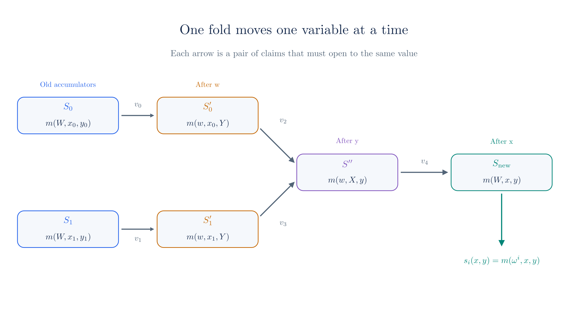

# Wiring and the Registry

The [fold of chapter 14](./revdot-folding.md) accepts any $\bar{B}$ whose vector has the right product, and it never asks whether that vector was built from the right circuit's wiring. The check that would answer this is the computation of $s(x, y)$, the last remaining linear step that [chapter 09's verifier](./nark.md#_16-what-the-verifier-pays) listed, and it requires reading the whole circuit. So this chapter has two problems to solve. The wiring is unchecked, and checking it directly costs as much as the circuit. A third problem comes with them, which is how different nodes of a [PCD tree](./pcd-intro.md) can run different circuits.

All three problems have the same answer. The prover commits to pieces of the wiring polynomial, a cheap random check ties each new piece to the old ones, and a single expensive check at the very end covers the whole history. The Ragu Book calls this idea [post-processing](https://github.com/tachyon-zcash/ragu/blob/3219e0865e8bff1f9d817bfe3850d9e94b64338c/book/src/protocol/index.md?plain=1#L30-L35), and credits it to Halo. We start with one circuit, then extend the method to a polynomial that holds many circuits, called the **registry polynomial**.

::: warning Reconstructed from code at commit 3219e08, not confirmed by the authors
The protocols come from the book's [wiring consistency chapter](https://github.com/tachyon-zcash/ragu/blob/3219e0865e8bff1f9d817bfe3850d9e94b64338c/book/src/protocol/core/accumulation/wiring.md) and its [registry chapter](https://github.com/tachyon-zcash/ragu/blob/3219e0865e8bff1f9d817bfe3850d9e94b64338c/book/src/protocol/extensions/registry.md). The toy circuits, the attacks, and the link between a chosen circuit and its wiring value in Section 7 are our own assembly, and we read that link from the code. We could not read the Halo paper, so what we say about Halo follows the book. Section 13 compares everything with the code.
:::

## 1. What the verifier still computes

Recall the check that ties the right factor to the trace in [chapter 09](./nark.md#_7-tying-b-back-to-the-trace),

$$b(x) = a(xz) + s(x, y) + t(x, z).$$

The value $t(x, z)$ has a short closed form, while the value $s(x, y)$ has none, because the wiring comes from an arbitrary circuit. [Chapter 09 counted](./nark.md#_16-what-the-verifier-pays) the terms for our circuit, and we recall the count here with its scaling to a full circuit:

<!-- worked:s-terms -->

Our circuit has 8 nonzero wiring coefficients, so computing $s(9, 7) = 23$ takes 8 terms. A real circuit has at least one coefficient for each wire it uses, so at $4n = 2^{13}$ a full circuit needs on the order of 8,192 terms for this one value.

<!-- /worked:s-terms -->

A recursive verifier would have to do this inside a circuit, so the circuit would have to contain a description of itself and grow with every wire it adds, as [chapter 10 found](./recursive-proofs.md#_6-why-the-circuit-cannot-keep-growing). [Chapter 11](./accumulation.md#_10-the-other-linear-step) escaped the same problem for $\hat{G}$ by testing a claim at a random point, which worked because $g_{\v{u}}$ has a short product form. The wiring polynomial has no such form.

A natural next idea is to let the prover supply a commitment $S$ to $s(X, y)$ and to carry the claim forward in the accumulator, as [split accumulation](./split-accumulation.md#_8-why-a-nark-is-enough) does for evaluation claims. That chapter showed that folding establishes what $S$ opens to. It says nothing about whether $S$ commits to the right polynomial, and this gap is exploitable:

<!-- worked:wrong-wiring -->

Take the false trace with $x = 4$, $\v{r}' = (16, 21, 16, 4, 4, 4, 0, 0)$, at $z = 5$ and $y = 7$. With the true wiring the revdot product is 18, and the target is $k(7) = 13$. The prover adds $31X^4$ to its wiring polynomial, which moves the revdot product by $r'_3 \cdot 31 = 38$ and reaches the target. It commits to the altered polynomial $(0, 0, 6, 42, 25, 7, 42, 36)$, which gives $S^* = (17,\,7)$ in place of the true $(7,\,6)$. The right factor is built from this polynomial, so the check $b(x) = a(xz) + s(x, y) + t(x, z)$ holds at all 43 values of $x$, and every evaluation claim is true of the committed polynomials. The only thing wrong with this proof is that $S^*$ does not commit to $s(X, 7)$.

<!-- /worked:wrong-wiring -->

So the claim $S = \mathrm{com}(s(X, y))$ has to be checked somehow, and we want the check to cost far less than computing $s(X, y)$. Polynomial identity tests are the usual tool for this, but a test needs a polynomial on the other side to compare with, and the verifier does not want to compute any of them. The next section finds that second polynomial inside $s$ itself.

## 2. Restricting a polynomial of two variables

The wiring polynomial $s(X, Y)$ has two variables. Its coefficients form a table, with one row for each constraint and one column for each position in the trace. Here is the table for our circuit, with empty cells for zeros:

<!-- worked:matrix -->

|  | $X^0$ | $X^1$ | $X^2$ | $X^3$ | $X^4$ | $X^5$ | $X^6$ | $X^7$ |
| --- | --- | --- | --- | --- | --- | --- | --- | --- |
| $Y^0$ |  |  |  | 42 | 1 |  |  |  |
| $Y^1$ |  |  |  |  |  | 1 |  | 42 |
| $Y^2$ |  |  | 1 |  | 42 |  |  |  |
| $Y^3$ |  |  |  |  | 1 |  | 1 |  |

<!-- /worked:matrix -->

We can fix either variable. Fixing $Y$ gives a polynomial in $X$, and fixing $X$ gives a polynomial in $Y$. Each of these is called a **restriction**. Both directions take the same table and add it up along different lines, so the two restrictions agree where they cross:

$$s(X, y)\big|_{X = x} = s(x, y) = s(x, Y)\big|_{Y = y}.$$

<!-- worked:restrictions -->

Fixing $Y = 7$ collapses the rows into $s(X, 7)$, with coefficients $(0, 0, 6, 42, 37, 7, 42, 36)$. Fixing $X = 9$ collapses the columns into $s(9, Y)$, with coefficients $(27, 17, 13, 29, 0, 0, 0, 0)$ on $Y^0, \ldots, Y^7$. These are different polynomials, and they meet at one number, since evaluating the first at $X = 9$ and the second at $Y = 7$ both give $23$.

<!-- /worked:restrictions -->

This crossing is what the protocol uses. A commitment to a restriction in $X$ and a commitment to a restriction in $Y$ make two evaluation claims that must have the same value, and [chapter 08](./batched-openings.md) already knows how to check evaluation claims cheaply. The verifier needs no knowledge of the table to compare the two claims.

Restricting in $Y$ only makes sense if the result fits the commitment scheme, and this explains a limit we met earlier. The commitment has $4n$ generators, so $s(x, Y)$ must have degree below $4n$ in $Y$. The book [gives this as the reason](https://github.com/tachyon-zcash/ragu/blob/3219e0865e8bff1f9d817bfe3850d9e94b64338c/book/src/protocol/local/wiring.md?plain=1#L20-L27) for the bound of [$4n$ constraint rows](./arithmetization.md#_8-arranging-the-witness).

## 3. Consistency for one circuit

Section 1 ended with a commitment $S$ that nobody has checked against the circuit. A recursive step cannot afford to check it, so it carries the commitment forward as a claim $(S, y)$, which says that $S$ commits to $s(X, y)$. Suppose a node has two children, and each child's accumulator holds such a claim $(S_i, y_i)$. Each $S_i$ is the wiring accumulator that the child received from its own fold, or a starting value if the child is a leaf. It is not the free $S$ of Section 1. That per-proof commitment is how the book presents a single proof, and the next paragraph explains why a tree never needs it. Section 13 records this difference between the book and the code.

Before building anything, we need to know where in a tree the check of Section 1 runs, because that decides which wiring value a node has to supply. A child does not finish the check of its own trace. Its trace commitments travel up, and the parent folds the check into its own work, in the same way that [chapter 14](./revdot-folding.md) defers revdot claims to the next fold. The parent checks each child's trace at challenges that it draws itself, and those challenges are valid tests, because a challenge tests a commitment only if it is drawn after the commitment is fixed, and the child's trace commitments were fixed long before. That check needs the child's wiring value at the parent's fresh point, which no earlier claim covers, so the accumulator that leaves the parent's fold has to supply it. [Chapter 18](./ragu-recursion.md#_7-what-a-proof-carries-to-its-parent) lists everything else a child passes up.

The node therefore wants to replace the two claims with one new claim of the same form, at a point of its own. Keeping one of the old claims would not work. The old claims sit at different points, $y_0 \neq y_1$, so neither speaks for the other, and neither sits at the node's fresh point. So the node makes a new claim $(S_{\text{new}}, y_{\text{new}})$, and it needs some commitment that links the old claims to the new one. We call that commitment the **bridge**. It is unrelated to the bridge stages of [chapter 13](./curve-cycles.md#_12-cycles-in-ragu) and [chapter 18](./ragu-recursion.md#the-stages-and-their-names), which are stages of the secondary circuit that carry commitment coordinates. We want three things from the replacement. It should tie each old $S_i$ to the true circuit, it should produce the new claim, and it should leave no work that depends on the size of the circuit.

The [book's protocol](https://github.com/tachyon-zcash/ragu/blob/3219e0865e8bff1f9d817bfe3850d9e94b64338c/book/src/protocol/core/accumulation/wiring.md?plain=1#L39-L66) achieves this with a single restriction in $Y$. A restriction in $Y$ at one value $x$ crosses every restriction in $X$ at that $x$, so one bridge meets both old claims and the new one:

1. Both parties hold the old claims $(S_0, y_0)$ and $(S_1, y_1)$.
2. The verifier sends a random $x$.
3. The prover sends the bridge $S'$, a commitment to $s(x, Y)$.
4. The verifier sends a random $y_{\text{new}}$.
5. The prover sends $S_{\text{new}}$, a commitment to $s(X, y_{\text{new}})$.
6. Both parties add six evaluation claims to the batch of chapter 08.

Each pair of claims says that a restriction in $X$ and the restriction in $Y$ agree at their crossing. The first two pairs concern the old claims, and the last concerns the new one:

$$S_0(x) = S'(y_0), \qquad S_1(x) = S'(y_1), \qquad S_{\text{new}}(x) = S'(y_{\text{new}}).$$

Here we write $S(x)$ for the value at $x$ of the polynomial behind a commitment $S$, as the book does.

This one-circuit version shows how claims chain, but it does not yet place the new claim where a trace check can read it. The check of Section 1 needs $s(x, y)$ at an $x$ drawn after $y$, because the prover commits to the right factor once it knows $y$, and $x$ then tests that commitment. Here $x$ comes before $y_{\text{new}}$, so the claim $S_{\text{new}}(x) = s(x, y_{\text{new}})$ sits at an $x$ that the right factor could have been built to pass. We cannot repair this by drawing $y_{\text{new}}$ first, because the bridge $S'$ is read at $y_{\text{new}}$, and reading a commitment at a point tests it only if the point was drawn after the commitment was fixed. With only two variables, $x$ has to come before $y_{\text{new}}$. The extra variable $W$ of Section 5 gives Section 6 the room to reorder the challenges as $w$, then $y$, then $x$, and with that order the new claim lands at exactly the point the trace check reads.

We now run this on our circuit, using two accumulators with values we have already met. The first holds [chapter 09's](./nark.md#_5-building-the-two-multiplicands) $y$, and the second holds the $y$ of [chapter 12's second proof](./split-accumulation.md#_6-a-run-on-the-toy-curve):

<!-- worked:single-run -->

| Step | Party | Value |
| --- | --- | --- |
| 1 | Both hold | $(S_0, y_0) = ((7,\,6),\ 7)$ and $(S_1, y_1) = ((4,\,25),\ 34)$ |
| 2 | Verifier sends | $x = 21$ |
| 3 | Prover sends | $S' = (24,\,30)$, the commitment to $s(21, Y) = (19, 3, 19, 33, 0, 0, 0, 0)$ |
| 4 | Verifier sends | $y_{\text{new}} = 12$ |
| 5 | Prover sends | $S_{\text{new}} = (20,\,6)$, the commitment to $s(X, 12) = (0, 0, 15, 42, 37, 12, 8, 31)$ |

<!-- /worked:single-run -->

The prover states one value for each pair, which gives six claims about four polynomials:

<!-- worked:single-claims -->

| Claim | Commitment | Point | Value | Which value is shared |
| --- | --- | --- | --- | --- |
| 0 | $S_0$ | 21 | 35 | $s(21, 7)$ |
| 1 | $S'$ | 7 | 35 | $s(21, 7)$ |
| 2 | $S_1$ | 21 | 6 | $s(21, 34)$ |
| 3 | $S'$ | 34 | 6 | $s(21, 34)$ |
| 4 | $S_{\text{new}}$ | 21 | 2 | $s(21, 12)$ |
| 5 | $S'$ | 12 | 2 | $s(21, 12)$ |

<!-- /worked:single-claims -->

The verifier never computes these values. It treats them as [claims that share polynomials](./batched-openings.md#_10-claims-that-share-a-polynomial-or-a-point) and places them in the batch, so one number in each pair appears twice. Chapter 08's batch runs in three moves, which the run below follows:

- The challenge $\alpha$ weights the claims' quotients, and the prover sends $F$, a commitment to their weighted sum $f$.
- At a second challenge $u$ the prover reveals each polynomial's value, so that the verifier can derive $f(u)$ without opening $F$.
- The challenge $\beta$ merges everything into one claim $(P, u, v)$, and a decider settles that claim by recomputing the vector $\v{p}$ behind $P$.

<!-- worked:single-batch -->

With $\alpha = 11$, $u = 17$ and $\beta = 15$, the prover sends $F = (9,\,9)$ and the values at $u$, one for each of the four polynomials: $35, 31, 33, 4$. The verifier derives $f(17) = 4$, then $P = (11,\,30)$ and $v = 9$. A decider holding $\v{p} = (35, 38, 42, 37, 30, 17, 37, 17)$ commits to it and evaluates it, and both results match. Checking the crossing identity at all 1849 pairs $(x, y)$ confirms that an honest prover passes at every challenge.

<!-- /worked:single-batch -->

A batched check tells us that the claims are true of the committed polynomials, and it says nothing about the circuit. Something still has to connect the last commitment to the real wiring. That job falls to the end of the chain, in the same way that a single MSM ended [chapter 11's](./accumulation.md#_3-deciding-a-claim) chain:

<!-- worked:single-decide -->

The accumulator that leaves this fold is $(S_{\text{new}}, y_{\text{new}}) = ((20,\,6),\ 12)$. If the chain stops here, the decider computes $s(X, 12)$ from the circuit, which takes 8 terms, commits to it and gets $(20,\,6)$. That one linear computation stands in for computing $s$ at each of the three points.

<!-- /worked:single-decide -->

## 4. Why a false accumulator fails

The argument runs backward from the decider. Suppose the decider has confirmed that $S_{\text{new}}$ commits to $s(X, y_{\text{new}})$. Then the third pair of claims fixes $S'(y_{\text{new}})$ to the correct value, and the prover committed to $S'$ before it saw $y_{\text{new}}$. Two different polynomials of degree below $4n$ agree at no more than $4n - 1$ points, so $S'$ is $s(x, Y)$, except with probability about $4n/|\F|$. That makes $S'(y_0)$ correct, so the first pair fixes $S_0(x)$ to the correct value, and the prover fixed $S_0$ before it saw $x$. The same reasoning then shows that $S_0$ commits to $s(X, y_0)$.

We can follow this in the toy run by giving the prover a false $S_0$ and counting what it can do at each step. Say it holds an $S_0$ built for the attack of Section 1. The first check it faces is the pair at $x$:

<!-- worked:false-honest-bridge -->

The most favourable false polynomial differs from $s(X, 7)$ by a multiple of $(X-1)(X-2)\cdots(X-7)$, the difference that [chapter 09](./nark.md#the-prover-changes-b) found best for its cheater. The prover scales this multiple so that it still moves the revdot product by $38$, since otherwise the false $S_0$ would no longer carry the attack. Against an honest $S'$, the pair of claims about $s(x, 7)$ can hold only where this difference vanishes. Trying all 43 values of $x$ finds 7 that pass, $x \in \{1, \ldots, 7\}$. No polynomial with 8 coefficients has more roots.

<!-- /worked:false-honest-bridge -->

Outside those values the prover must lie in $S'$ to keep the pair true, which moves the error one step along:

<!-- worked:false-bridge -->

At $x = 21$ the false $S_0$ opens to $15$, while the true $s(21, 7)$ is $35$. The error is $15 - 35 = -20$, which is $23$ in $\F_{43}$. The prover can absorb it by committing to $s(21, Y) + D(Y)$ with $D(7) = 23$ and $D(34) = 0$, so that both old pairs now hold. The polynomial $D$ can have at most 7 roots, and one of them has to be $34$. Taking the other six at $1, \ldots, 6$, we tried all 43 values of $y_{\text{new}}$ against an honest $S_{\text{new}}$, and 7 pass.

<!-- /worked:false-bridge -->

Outside those values the error moves once more:

<!-- worked:false-new -->

At $y_{\text{new}} = 12$ the difference is $D(12) = 20$, so the prover has one option left. It commits to $s(X, 12) + 20$, which opens at $x = 21$ to the value that $S'$ now requires. All six claims are true of the committed polynomials, and the batched check of the previous section accepts. The prover has moved its error into the new accumulator, whose commitment is $(5,\,29)$. The decider computes $s(X, 12)$ itself, gets $(20,\,6)$, and rejects.

<!-- /worked:false-new -->

So a false accumulator does not disappear. At each step it either hits a rare root or it passes its error into a new commitment, and the decider exposes the last one. A chain that never runs the decider has established nothing about its wiring, in the same way as [chapter 12's](./split-accumulation.md#a-false-claim-travels-to-the-decider) evaluation claims.

All of this depends on the order of the messages. If the prover knows $x$ before fixing $S_0$, then the pair at $x$ tests nothing:

<!-- worked:false-early -->

Suppose the prover knows $x = 21$ before it fixes the old accumulator. The difference $(X - 21) X^3$, scaled by $35$, vanishes at that point and gives the revdot shift of Section 1, so the false polynomial $(0, 0, 6, 38, 29, 7, 42, 36)$ passes with an honest $S'$ and an honest $S_{\text{new}}$, and the decider accepts the accumulator that leaves the fold.

<!-- /worked:false-early -->

This is why the old commitments have to enter the transcript before $x$ is squeezed.

## 5. A polynomial for many circuits

The protocol above assumes that every accumulator refers to the same $s(X, Y)$. Now suppose a tree has two kinds of step. We will use the running circuit as circuit A, along with a second circuit B that has the same number of gates and proves a different statement:

<!-- worked:two-circuits -->

| Circuit | Statement | Constraints that differ from A | $s(X, 7)$ | Commitment |
| --- | --- | --- | --- | --- |
| A | $x^3 + x + 5 = 35$ | None | $(0, 0, 6, 42, 37, 7, 42, 36)$ | $(7,\,6)$ |
| B | $x^4 + 2 = 40$ | $b_1 - c_0 = 0$ and $c_1 = 38$ | $(0, 0, 6, 42, 1, 7, 42, 30)$ | $(26,\,8)$ |

<!-- /worked:two-circuits -->

The constant in B's last constraint is its output minus 2. The instance supplies it as the coefficient of $Y^3$ in $k(Y)$, in the same way that circuit A's instance supplies $35 - 5$ for A's last constraint. Section 9 changes both circuits to read the output itself from $k(Y)$.

The two accumulators may now refer to different circuits, and the bridge of Section 3 stops working, since a single $S'$ cannot be a restriction of both:

<!-- worked:cannot-merge -->

Let the first accumulator hold circuit A at $y_0 = 7$ and the second hold circuit B at $y_1 = 34$, so that $S_1 = (9,\,22)$. If $S'$ commits to $s_A(21, Y)$, the first pair of claims holds, and the second compares $s_B(21, 34) = 24$ with $s_A(21, 34) = 6$. Over all 43 values of $x$ these agree only at $x = 0$, so an honest prover with two different circuits fails almost everywhere.

<!-- /worked:cannot-merge -->

We could avoid this by merging A and B into one large circuit with a selector, as [chapter 04](./arithmetization.md#_1-what-arithmetization-produces) did for a branch. Then every step would pay for the gates of all its branches. The tally of [chapter 02](./pcd-intro.md) shows the cost. It has two steps, `Entry` and `Join`, and a model with a single rule at every node would merge them into one circuit with a selector, so every leaf of the tree would pay for a `Join` it never runs, and every inner node would pay for an `Entry`. A better way is to keep the circuits apart and to put the choice of circuit into the polynomial itself, as one more variable.

Lagrange interpolation works on any set of distinct points, but roots of unity give two properties that later sections use. Testing whether a value belongs to the domain takes only $k$ squarings (Section 9), and the domain of $2^k$ points sits inside the domain of $2^{k+1}$ points, which lets a registry grow without moving its circuits (Section 8). Pick a set of points $\omega^0, \ldots, \omega^{2^k - 1}$, one for each circuit, where $\omega$ is a root of unity of order $2^k$. Let $\ell_i(W)$ be the Lagrange polynomial that equals 1 at $\omega^i$ and 0 at the other points, as in [chapter 05](./polynomial-encoding.md). The **registry polynomial** is

$$m(W, X, Y) = \sum_{i=0}^{2^k - 1} \ell_i(W)\, s_i(X, Y).$$

Setting $W = \omega^i$ makes every term vanish except one, so $m(\omega^i, X, Y) = s_i(X, Y)$. The field needs enough roots of unity for this. The toy field $\F_{43}$ has $42 = 2 \cdot 21$ nonzero elements, so its only roots of unity of 2-power order are $1$ and $-1 = 42$, and our registry holds exactly two circuits. With two points, the Lagrange polynomials are $\ell_0(W) = (1 + W)/2$ and $\ell_1(W) = (1 - W)/2$:

<!-- worked:lagrange -->

| $W$ | $\ell_0(W)$ | $\ell_1(W)$ | $m(W, X, 7)$ |
| --- | --- | --- | --- |
| $\omega^0 = 1$ | 1 | 0 | $(0, 0, 6, 42, 37, 7, 42, 36)$, which is $s_A(X, 7)$ |
| $\omega^1 = 42$ | 0 | 1 | $(0, 0, 6, 42, 1, 7, 42, 30)$, which is $s_B(X, 7)$ |
| $14$ | 29 | 15 | $(0, 0, 6, 42, 13, 7, 42, 32)$, which is neither |

<!-- /worked:lagrange -->

<!-- worked:registry-check -->

The script compares $m(1, x, y)$ with $s_A(x, y)$ and $m(42, x, y)$ with $s_B(x, y)$ at all 1849 pairs, and they agree at every pair. Since $\ell_0 + \ell_1 = 1$ at every $W$, the two weights at $W = 14$ also add up to 1, and we return to this fact in Section 9.

<!-- /worked:registry-check -->

The last row of that table shows what $W$ does away from the domain. It gives a blend of the circuits that belongs to no single one, and the protocol uses this blend as a random fingerprint of the whole set.

An accumulator now has to carry a claim that does not name one circuit, so that accumulators from different circuits can merge. The form the book chooses leaves $W$ free. The claim is $(S, x, y)$, meaning that $S$ commits to $m(W, x, y)$, the polynomial in $W$ that holds every circuit's value at the point $(x, y)$. Leaving $W$ free pays off when a step needs one circuit's value, because opening this polynomial at $\omega^i$ gives $s_i(x, y)$ for any registered circuit $i$, and Section 7 puts that to use. Since this polynomial is committed with the same generators, it needs degree below $4n$ in $W$, and the [code enforces](https://github.com/tachyon-zcash/ragu/blob/3219e0865e8bff1f9d817bfe3850d9e94b64338c/crates/ragu_circuits/src/registry.rs#L252-L257) that a registry has at most $4n$ entries.

## 6. Consistency for the registry

Two old claims $(S_0, x_0, y_0)$ and $(S_1, x_1, y_1)$ now differ in two coordinates, while the claims in Section 3 differed in only one. From here on, $x_i$ and $y_i$ are the children's values, and the letters $w$, $x$ and $y$ without a subscript are the new challenges of this node, so $y$ plays the part of Section 3's $y_{\text{new}}$.

A single bridge cannot reach both old claims. The order of the bridges follows from one constraint, which is that each commitment holds a polynomial in one variable, so a bridge that moves one variable has to fix the other two. The old claims are polynomials in $W$, with $x_i$ and $y_i$ fixed. The [book's protocol](https://github.com/tachyon-zcash/ragu/blob/3219e0865e8bff1f9d817bfe3850d9e94b64338c/book/src/protocol/core/accumulation/wiring.md?plain=1#L69-L140) makes four moves in a fixed order:

- **Fix $W$.** A bridge in $Y$ is a polynomial $m(w, x_i, Y)$, which needs a value for $W$. So the verifier draws $w$ first, and each old claim crosses its bridge at $W = w$.
- **Move $Y$.** The two bridges in $Y$ are both read at one new $y$. After this, the children's restrictions share $w$ and $y$ and differ only in $X$. Moving $Y$ before $X$ is what leaves $x$ as the last challenge, which the trace check of Section 7 needs, as Section 3 explained.
- **Move $X$.** One bridge $m(w, X, y)$ now crosses both children, at $x_0$ and at $x_1$, and it is read at one new $x$.
- **Free $W$.** A last restriction in $W$, at the common $(x, y)$, returns the claim to its original form $m(W, x, y)$. That form lets the next node repeat the walk, and Section 7 opens it at a circuit's point $\omega^i$.

Here are the steps of the protocol:

1. Both parties hold the old claims.
2. The verifier sends a random $w$.
3. The prover sends $S'_0$ and $S'_1$, commitments to $m(w, x_0, Y)$ and $m(w, x_1, Y)$.
4. The verifier sends a random $y$, and with it the challenge $z$ that the trace check of Section 7 uses.
5. The prover sends $S''$, a commitment to $m(w, X, y)$.
6. The verifier sends a random $x$.
7. The prover sends $S_{\text{new}}$, a commitment to $m(W, x, y)$.
8. Both parties add ten evaluation claims to the batch.



Each arrow in the figure stands for a crossing of two restrictions, and each crossing gives a pair of claims:

$$
\begin{aligned}
S_0(w) &= m(w, x_0, y_0) = S'_0(y_0), \\
S_1(w) &= m(w, x_1, y_1) = S'_1(y_1), \\
S'_0(y) &= m(w, x_0, y) = S''(x_0), \\
S'_1(y) &= m(w, x_1, y) = S''(x_1), \\
S''(x) &= m(w, x, y) = S_{\text{new}}(w).
\end{aligned}
$$

Step 3 uses two bridges because the children have different $x_i$, and a restriction in $Y$ is taken at one value of $X$. Step 5 uses one, because after step 4 both children's restrictions are read at the same $y$, and both land on the same polynomial in $X$.

For the toy run, let the left child have used circuit A at chapter 09's challenges, and the right child circuit B at the $x$ and $y$ of chapter 12's second proof. The choice of circuit does not show up in $S_0$ or $S_1$, because each of them holds every circuit's value at its child's point. It matters only when Section 7 opens the new accumulator at a circuit's point:

<!-- worked:reg-run -->

| Step | Party | Value |
| --- | --- | --- |
| 1 | Both hold | $(S_0, x_0, y_0) = ((5,\,29),\ 9,\ 7)$ and $(S_1, x_1, y_1) = ((27,\,30),\ 37,\ 34)$ |
| 2 | Verifier sends | $w = 14$ |
| 3 | Prover sends | $S'_0 = (11,\,30)$ for $m(14, 9, Y) = (27, 17, 20, 41, 0, 0, 0, 0)$ |
|  | Prover sends | $S'_1 = (18,\,21)$ for $m(14, 37, Y) = (7, 13, 38, 3, 0, 0, 0, 0)$ |
| 4 | Verifier sends | $y = 12$, and $z = 16$ with it |
| 5 | Prover sends | $S'' = (28,\,10)$ for $m(14, X, 12) = (0, 0, 15, 42, 13, 12, 8, 21)$ |
| 6 | Verifier sends | $x = 21$ |
| 7 | Prover sends | $S_{\text{new}} = (23,\,7)$ for $m(W, 21, 12) = (31, 14, 0, 0, 0, 0, 0, 0)$ |

The left child's $S_0 = (5,\,29)$ happens to equal the false accumulator of Section 4, because the toy group has only 43 elements, but the polynomial behind it here is the honest $m(W, 9, 7)$.

<!-- /worked:reg-run -->

Notice that the commitment to $m(W, x, y)$ uses only the first two generators, because on this domain it has degree 1 in $W$. The five crossings give the following values:

<!-- worked:reg-claims -->

| Shared value | Number | First claim | Second claim |
| --- | --- | --- | --- |
| $m(14, 9, 7)$ | 10 | $S_0$ at 14 | $S'_0$ at 7 |
| $m(14, 37, 34)$ | 7 | $S_1$ at 14 | $S'_1$ at 34 |
| $m(14, 9, 12)$ | 42 | $S'_0$ at 12 | $S''$ at 9 |
| $m(14, 37, 12)$ | 26 | $S'_1$ at 12 | $S''$ at 37 |
| $m(14, 21, 12)$ | 12 | $S''$ at 21 | $S_{\text{new}}$ at 14 |

<!-- /worked:reg-claims -->

<!-- worked:reg-honest -->

The script repeats these comparisons at all 79,507 triples $(w, x, y)$, and an honest prover passes every one.

<!-- /worked:reg-honest -->

The accumulator that leaves the fold is $(S_{\text{new}}, x, y)$, and it has the same form as the two that entered, so the next node can repeat the walk.

## 7. Selecting a circuit

The walk keeps the accumulators consistent with $m$, but the point of all this was to obtain a wiring value for the check in Section 1, for whichever circuit a child used. As Section 3 explained, the parent checks each child's trace at its own challenges. It adds a revdot claim for each child to its [fold of chapter 14](./revdot-folding.md#_10-the-quotient-fold-in-ragu-s-fuse), and it builds the child's right factor from its own $y$ and $z$,

$$b_i(X) = a_i(Xz) + s_i(X, y) + t(X, z),$$

where $a_i$ is the child's trace polynomial. The parent's prover commits to $b_i$ after $y$ and $z$ are drawn and before $x$ is, so the spot check of Section 1 at the parent's $x$ tests it. That check needs $s_i(x, y)$, which is exactly the point of the new accumulator. Since $S_{\text{new}}$ commits to $m(W, x, y)$, opening it at the domain point of circuit $i$ gives

$$S_{\text{new}}(\omega^i) = m(\omega^i, x, y) = s_i(x, y).$$

Each circuit's value is one evaluation claim on the same commitment, and the prover names the circuit by naming the point. The check of $b_i(x)$ then reads a claimed value that the batch will test, in place of a value the circuit would have to compute.

<!-- worked:select -->

The new accumulator is $m(W, 21, 12) = 31 + 14W$. The run of Section 6 drew $x = 21$, $y = 12$ and $z = 16$, so $xz = 35$. For each child the circuit reads the wiring value by opening $S_{\text{new}}$ at the child's domain point, and it adds the trace value $a_i(xz)$ and the gate value:

| Child | $\omega^i$ | $s_i(x, y) = m(\omega^i, x, y)$ | $a_i(35)$ | $t(21, 16)$ | Sum, $b(x)$ |
| --- | --- | --- | --- | --- | --- |
| Left, circuit A | $1$ | 2 | 21 | 23 | 3 |
| Right, circuit B | $42$ | 17 | 7 | 23 | 4 |

The script also confirms that each child's revdot product at $z = 16$ and $y = 12$ equals its own $k(y)$, with different wiring and different public inputs on the two sides.

<!-- /worked:select -->

The two children here used different wiring and the same step of the protocol handled both. Only the evaluation point changed. These two openings bring the list to twelve claims, on six polynomials, and the batch of chapter 08 combines them into one claim $(P, u, v)$ as in Section 3:

<!-- worked:reg-batch -->

With $\alpha = 11$, $u = 17$ and $\beta = 23$, the prover sends $F = (28,\,21)$ and six values at $u$: $7, 29, 11, 20, 15, 11$. The verifier derives $f(17) = 21$, then $P = (22,\,7)$ and $v = 22$, and a decider holding $\v{p} = (19, 41, 39, 5, 8, 29, 9, 10)$ accepts. The wiring decider then evaluates the accumulator at a fresh point. At $W = 30$ the polynomial gives $21$, and the two circuits give $\ell_0(30) s_A(21, 12) + \ell_1(30) s_B(21, 12) = 21$.

<!-- /worked:reg-batch -->

The last sentence of that run is the registry's form of the decider. Section 10 counts what it costs, after two sections on how circuits get their points and on which points a prover may name.

## 8. Assigning domain points

The formula in Section 5 gives circuit $i$ the point $\omega^i$, but $\omega$ depends on $k$, and $k$ depends on how many circuits there are. If a registry grows from four circuits to five, it moves from a domain of 4 points to one of 8, and then $\omega$ changes and so does the point of every circuit except the first. Circuit code that refers to another circuit's point would then need to know the final count, and such references exist. The recursive verifier's internal circuits open $m$ at fixed internal-circuit points (Section 13), and a step reads the point of the circuit its child used. The toy field has no room to show this, so we use $\F_{97}$ in this section, for arithmetic only. Its multiplicative group has order $96 = 2^5 \cdot 3$, so it has a root of unity $\omega_5$ of order $2^5$. Write $\omega_k$ for the element of order $2^k$, with $\omega_k = \omega_5^{2^{5 - k}}$.

<!-- worked:naive -->

| Circuit $j$ | Naive, 4 points: $\omega_2^j$ | Naive, 8 points: $\omega_3^j$ | Bit-reversed, any size |
| --- | --- | --- | --- |
| 0 | 1 | 1 | 1 |
| 1 | 22 | 64 | 96 |
| 2 | 96 | 22 | 22 |
| 3 | 75 | 50 | 75 |

<!-- /worked:naive -->

The first two columns differ at every circuit except the first, and the 8-point column gives circuit 2 the value that the 4-point column gave circuit 1. To avoid this, we take one maximal domain, of order $2^S$ where $2^S$ is the largest power of 2 dividing the group order, and assign each circuit a point there. Circuit $j$ gets $\omega_S^i$, where $i$ is $j$ with its $S$ bits reversed. The [book calls this rolling domain extension](https://github.com/tachyon-zcash/ragu/blob/3219e0865e8bff1f9d817bfe3850d9e94b64338c/book/src/protocol/extensions/registry.md?plain=1#L117-L179), and the third column above uses it.

Reversing the bits puts the low bits of $j$ at the top of the exponent, so small values of $j$ give exponents that are multiples of a large power of 2:

<!-- worked:bitrev -->

| Circuit $j$ | $j$ in 5 bits | Reversed | Exponent $i$ | $\omega_5^i$ | Order |
| --- | --- | --- | --- | --- | --- |
| 0 | 00000 | 00000 | 0 | 1 | 1 |
| 1 | 00001 | 10000 | 16 | 96 | 2 |
| 2 | 00010 | 01000 | 8 | 22 | 4 |
| 3 | 00011 | 11000 | 24 | 75 | 4 |
| 4 | 00100 | 00100 | 4 | 64 | 8 |
| 5 | 00101 | 10100 | 20 | 33 | 8 |
| 6 | 00110 | 01100 | 12 | 50 | 8 |
| 7 | 00111 | 11100 | 28 | 47 | 8 |

<!-- /worked:bitrev -->

The last column shows why this works. The first $2^k$ circuits always land on elements of order at most $2^k$, which are exactly the $2^k$-th roots of unity. They fill the small domain first, and growing the registry adds new points without moving old ones. The element also stays the same when written in the smaller domain, since $\omega_S^{\text{rev}(j, S)} = \omega_k^{\text{rev}(j, k)}$ for $j < 2^k$, which the script checks at every size. So a circuit can compute its own point, or another circuit's, from its index alone. The code's [`omega_j`](https://github.com/tachyon-zcash/ragu/blob/3219e0865e8bff1f9d817bfe3850d9e94b64338c/crates/ragu_circuits/src/registry.rs#L90-L104) does this, and a [test](https://github.com/tachyon-zcash/ragu/blob/3219e0865e8bff1f9d817bfe3850d9e94b64338c/crates/ragu_circuits/src/registry.rs#L862-L883) asserts the orders 1, 2, 4, 4, 8, 8, 8, 8 that the table shows.

<!-- worked:bitrev-toy -->

On $\F_{43}$ the largest available 2-power order is 2, so $S = 1$. Circuit 0 gets $\omega_1^0 = 1$, and circuit 1 gets $\omega_1^1 = 42$, which are the two points our registry has used all along.

<!-- /worked:bitrev-toy -->

The degree of $m$ in $W$ still depends on $k$, because the Lagrange polynomials change with the domain. What stays fixed is the element that names each circuit.

## 9. What the prover may select

The prover chooses the point at which $S_{\text{new}}$ opens for each child, and a verifier should worry about a free choice like this. Write $\iota$ for the point the prover names for a child. Section 7 wrote this point as $\omega^i$, and the code calls it `left_id` or `right_id`. We give it its own letter for two reasons. The prover might name a point that is not of the form $\omega^i$, and the letter $w$ already names the verifier's challenge, which the prover does not control. We go through the three kinds of point the prover might choose, namely a point outside the domain, a domain point that holds no circuit, and a point that holds the wrong registered circuit.

All three cases turn on the row $Y^0$ of the wiring, so this section first switches to circuits that have a meaningful one, as Section 5 promised. The two-gate circuits A and B of Sections 1 to 7 have no system gate, which is why their $Y^0$ row in Section 2 looks the way it does. The [constant wire of chapter 09](./nark.md#_15-the-constant-wire) adds one. That section added a system gate at position 0, with $b_0 = c_0 = 0$ and a wire $d_0$ that holds 1, and a constraint at $Y^0$ that reads $d_0 = k_0$, with $k_0 = 1$ supplied by the instance. Because that constraint has the single coefficient 1 on $d_0$, it makes $s(X, 0) = 1$. So this section uses 3-gate versions of A and B with the constant wire. In these versions both circuits read the output itself from $k(Y)$ as a public input, whereas Section 5's circuits read a constant derived from the output.

### A point outside the domain

Section 5 showed that the Lagrange weights add up to 1 at every $W$. So at a point $\iota$ outside the domain, $m(\iota, X, Y)$ is a blend of the circuits whose row $Y^0$ is still $s(X, 0) = 1$, and the blend behaves as a third circuit that nobody registered. The decider's blend at a random $w$ does no harm, because nobody checks a trace against it, but a blend at a point the prover chose can serve as the wiring of a child's trace check:

<!-- worked:mix-attack -->

Take the instance $k(Y) = 1 + 35Y$, whose second coefficient is the public output, and let the prover select the out-of-domain point $\iota = 4$. There the weights are $24$ and $20$, and they add up to 1, so $m(4, X, 0) = 1$ and the mixture looks like a circuit. The input $x = 7$ does not satisfy $x^3 + x + 5 = 35$, yet the trace with $b_2 = 30$, which is $(0, 6, 8, 6, 7, 11, 0, 7, 30, 0, 0, 1)$, satisfies the consolidated equation at all 1849 pairs $(z, y)$. The same trace passes against circuit A at 43 pairs and against circuit B at 43. The domain check catches the selection, because $\iota^2 = 4^2 = 16$, which is not 1.

<!-- /worked:mix-attack -->

So the protocol has to check $\iota$. A value is in the domain exactly when squaring it $k$ times gives 1, and [the `hashes_1` circuit enforces this](https://github.com/tachyon-zcash/ragu/blob/3219e0865e8bff1f9d817bfe3850d9e94b64338c/crates/ragu_pcd/src/internal/native/circuits/hashes_1.rs#L226-L234) on both children's points $\iota$. The [uncompressed](https://github.com/tachyon-zcash/ragu/blob/3219e0865e8bff1f9d817bfe3850d9e94b64338c/crates/ragu_pcd/src/verify.rs#L133-L149) and [compressed](https://github.com/tachyon-zcash/ragu/blob/3219e0865e8bff1f9d817bfe3850d9e94b64338c/crates/ragu_pcd/src/compress/verifier.rs#L58-L68) verifiers make the same check on the root's point.

### A domain point with no circuit

The domain usually has more points than circuits, because $2^k$ is the next power of two above the number of circuits. The book [treats every domain point as a wiring polynomial](https://github.com/tachyon-zcash/ragu/blob/3219e0865e8bff1f9d817bfe3850d9e94b64338c/book/src/protocol/extensions/registry.md?plain=1#L181-L216), so an unassigned point holds the zero polynomial, and a prover might select it in place of a circuit. The two differ in one coefficient. A circuit has the constraint $d_0 = k_0$ at $Y^0$, so $s(X, 0) = 1$, while the zero polynomial has $s(X, 0) = 0$. The registry also holds polynomials of another kind, called [bonding polynomials](https://github.com/tachyon-zcash/ragu/blob/3219e0865e8bff1f9d817bfe3850d9e94b64338c/book/src/protocol/local/wiring.md?plain=1#L112-L133), which [chapter 17](./staging.md) introduces, and they too have $s(X, 0) = 0$. Here is a registry with three entries on a domain of 4 points in $\F_{97}$:

<!-- worked:kinds -->

| Circuit index $j$ | Domain point in $\F_{97}$ | What sits there | $s(X, 0)$ |
| --- | --- | --- | --- |
| 0 | 1 | $s_A$, a circuit | 1 |
| 1 | 96 | $s_B$, a circuit | 1 |
| 2 | 22 | A bonding polynomial | 0 |
| 3 | 75 | Nothing registered, so the zero polynomial | 0 |

<!-- /worked:kinds -->

The verifier always sets $k_0 = 1$ when it expects a circuit, and this rules out every entry with $s(X, 0) = 0$. To see this, read the consolidated equation at $y = 0$, as a statement about the coefficient of $Y^0$. Such an entry contributes nothing to that coefficient, so the only terms left on the left side are the gate terms from [chapter 04](./arithmetization.md#_12-the-consolidated-equation),

$$\sum_{i=0}^{n-1} (a_i b_i - c_i) \big( z^{2n-1-i} + z^{2n+i} \big) + \sum_{i=0}^{n-1} c_i d_i \big( z^{i} + z^{4n-1-i} \big),$$

and these would have to equal 1 for every $z$. Only the term with $i = 0$ in the second sum contains $z^0$, and it brings $z^{4n-1}$ with it, so a constant 1 cannot be formed.

<!-- worked:zero-count -->

Take the trace with $x = 3$ and the instance $k(Y) = 1 + 35Y$, and let the prover select the zero polynomial. Its gates hold, so the left side is 0, and the equation becomes $0 = 1 + 35y$, which holds for one value of $y$. Over all 1849 pairs it passes at 43. A prover can try to manufacture the missing 1 from the $c_0 d_0$ terms by setting $c_0 = d_0 = 1$, with an instance that has no public outputs. Then the left side is $1 + z^{11}$, because the term at $z^0$ always comes with a partner at $z^{4n-1}$. It equals 1 only at $z = 0$, which is 43 of the 1849 pairs.

<!-- /worked:zero-count -->

These entries also change the blend of the previous subsection. When some domain points hold entries with $s(X, 0) = 0$, the weights on the circuits alone need not add up to 1, so a prover would have to search for a $\iota$ at which they do. The domain check rules out such a point in any case.

### A different registered circuit

The two checks above leave the prover a free choice among registered circuits. That choice is safe only if the statement says which circuit it expects, and a public input with the same shape can otherwise be proved by the wrong circuit:

<!-- worked:substitution -->

Suppose the verifier wants a proof that some $x$ satisfies $x^4 + 2 = 35$. Trying all 43 values shows that no such $x$ exists, so this statement is false. The verifier computes $k(Y) = 1 + 35Y$, and the prover selects circuit A in place of circuit B, with $x = 3$. Every check passes at all 1849 pairs, because the instance is the same as that of the true statement $3^3 + 3 + 5 = 35$. Now add a row to each circuit that sets the linear coefficient of $k(Y)$ to a value fixed for that circuit, 2 for A and 3 for B, and let the verifier compute $k(Y) = 1 + 3Y + 35Y^2$ for the false statement about circuit B. Circuit B with a true statement still passes everywhere, for example $x = 3$ with the output 40 and the instance $k(Y) = 1 + 3Y + 40Y^2$. The same substitution with circuit A now passes at 43 of the 1849 pairs, all of them at $y = 0$.

<!-- /worked:substitution -->

The extra row gives each circuit a label that the verifier writes into $k(Y)$, so a proof from one circuit no longer matches a statement meant for another. Ragu calls this label a **suffix**. The book's [substitution section](https://github.com/tachyon-zcash/ragu/blob/3219e0865e8bff1f9d817bfe3850d9e94b64338c/book/src/protocol/recursion/public_inputs.md?plain=1#L99-L118) says that an application circuit's suffix fills the linear coefficient of $k(Y)$ and is never zero, which also keeps internal circuits apart from application circuits, as [chapter 18 explains](./ragu-recursion.md#_6-keeping-internal-and-application-circuits-apart).

### Header types and suffixes

In the code a suffix [belongs to a header type](https://github.com/tachyon-zcash/ragu/blob/3219e0865e8bff1f9d817bfe3850d9e94b64338c/crates/ragu_pcd/src/header.rs#L99) and not to one circuit. So, unlike our toy row, it leaves steps with the same output header interchangeable.

Coming right after the substitution attack, this could look like a hole in Ragu, but the structure of PCD makes it safe. A step's check reads only its input headers and their types, as the [steps of chapter 02](./pcd-intro.md#_4-steps) do, so a parent accepts a child produced by any step that outputs a valid header of the type it expects. Each such step enforces its own check on its own inputs, so substituting one for another can only produce a header that some valid step could have produced, and chapter 02 asks only that every producible header be true. The substitution attack above worked because the verifier's statement named circuit B, and circuit A produced an output that no valid run of B could produce. In PCD the statement names a header type rather than a circuit.

What the suffix still has to separate is headers of different types. That separation matters even when two types hold the same data, because a step must accept only the types it was written for:

<!-- worked:charge -->

Extend the tally of [chapter 02](./pcd-intro.md) with a final step `Charge` that adds a flat fee of 2. It consumes $(0, 8, 47)$ and outputs $(0, 8, 49)$. If `Charge` accepted its own output, a prover could apply it again to reach $(0, 8, 51)$, even though the fee is meant to apply once. The input and output are three numbers of the same form, so the numbers cannot tell the two states apart.

<!-- /worked:charge -->

Giving the input and output different types, say `Tally` and `Charged`, gives them different suffixes, and a `Charge` that accepts only a `Tally` then has no valid input for a second run. Tachyon's [`Actions`](https://github.com/tachyon-zcash/tachyon/blob/7e502548db33845dbaacdc0efe905d1a3c45e626/crates/tachyon/src/stamp/proof/stamp.rs#L46-L55) and `Stamp` headers work this way. They contain identical fields, and only the suffix tells them apart. The step that applies a bundle's fee accepts only `Actions` and outputs a `Stamp`, so it cannot run twice on one bundle.

## 10. What the registry costs

The cost divides among three parties. The recursive circuit handles claims only, so its cost does not depend on the size of the circuits, and it grows with the size of the registry only through the domain check, which is logarithmic. It does a little field arithmetic per claim, as in [chapter 12](./split-accumulation.md#the-accumulation-verifier), and the fold adds six commitments to that chapter's list, namely the children's $S_0$ and $S_1$ and the four new ones $S'_0$, $S'_1$, $S''$ and $S_{\text{new}}$. It also checks that each child's circuit point lies in the domain, which Section 9 showed is needed and which takes $k$ squarings per child. Here is a comparison for a hypothetical tree with 256 application circuits of $2^{11}$ gates each, which is the gate limit [chapter 10 recorded](./recursive-proofs.md#_12-recursion-in-ragu). The registry also holds internal circuits and bonding polynomials (Section 13), so it has more than 256 entries and its domain needs more than 256 points:

<!-- worked:costs -->

| Approach | What one step puts in its circuit | Size for this example |
| --- | --- | --- |
| Compute $s_i(x, y)$ directly | One term per wiring coefficient of each child's circuit | At least 16,384 multiplications for two full circuits |
| One merged circuit with selectors | The gates of every circuit, on every step | 524,288 gates |
| Registry, as in this chapter | Field arithmetic on claims, 6 commitments in the fold, and a domain check on 2 indices | 12 claims and at least 18 squarings |

<!-- /worked:costs -->

The prover pays more than this table suggests. Each of the four new polynomials is a Lagrange-weighted sum over the circuits, so computing one [touches every registered circuit](https://github.com/tachyon-zcash/ragu/blob/3219e0865e8bff1f9d817bfe3850d9e94b64338c/crates/ragu_circuits/src/registry.rs#L643-L677), including those the step did not use. Section 13 notes what the book says about sharing this work. We have not measured these costs.

The decider pays too. To test $S_{\text{new}}$ it computes $m(w, x, y)$ at a fresh $w$, which means one $s_i(x, y)$ for each circuit. That is a linear cost in the total size of the registry, but it is paid once for a whole history.

Adding a circuit therefore leaves the recursive circuit almost unchanged, so the book [encourages applications](https://github.com/tachyon-zcash/ragu/blob/3219e0865e8bff1f9d817bfe3850d9e94b64338c/book/src/protocol/index.md?plain=1#L108-L115) to split work into many small circuits that communicate along the PCD tree, and it speaks of hundreds or thousands of circuits. Tachyon, which has not activated on mainnet and whose design is still changing, has [a few dozen steps](https://github.com/tachyon-zcash/tachyon/blob/7e502548db33845dbaacdc0efe905d1a3c45e626/book/src/proof-tree.md?plain=1#L562-L601) at the revision we read, and those steps [run against a mock](./proof-tree.md) of Ragu.

## 11. Post-processing and the registry tag

We can now say what is unusual about this design. Many recursive systems preprocess each circuit into a **verification key**, a short commitment to the circuit's polynomials, and the verifier reads this key. With many circuits, a recursive verifier would have to handle a table of keys. Ragu has no such keys, as its [book states](https://github.com/tachyon-zcash/ragu/blob/3219e0865e8bff1f9d817bfe3850d9e94b64338c/book/src/appendix/related.md?plain=1#L106-L110). A verifier holds [the registries themselves](https://github.com/tachyon-zcash/ragu/blob/3219e0865e8bff1f9d817bfe3850d9e94b64338c/crates/ragu_pcd/src/lib.rs#L596-L597), built from the circuit definitions, and a prover computes the restrictions it needs at each step. That is the sense in which the work moves from before the proof to after it.

Without keys, one question remains, which is how the transcript comes to depend on the circuits. Fiat–Shamir requires the [statement to enter the transcript](./statements-and-challenges.md#_9-omitting-data-from-the-transcript) before any challenge, and the circuits are part of the statement. Here is what goes wrong otherwise:

<!-- worked:adaptive -->

Fix the false trace $(16, 21, 16, 4, 4, 4, 0, 0)$ and suppose the transcript has produced $z = 5$ and $y = 7$ from data that does not depend on the circuit. At these values the trace misses its target, because constraint 3 is off by $38$. An author who has seen $y$ can now publish a slightly different circuit, whose constraint 0 reads $(1 + 31)a_0 - b_0 = 0$. This constraint fails on the trace by $31 \cdot 4 = 38$, and with its weight $y^0$ that exactly cancels the error of constraint 3 with its weight $y^3 = 42$. Two constraints are broken, and the equation holds at $y = 7$. Counting over all 1849 pairs, it holds at 129, namely those with $y \in \{7, 37, 42\}$, so the verifier was misled only because the circuit came after the challenge.

<!-- /worked:adaptive -->

The usual fix is to hash the circuits into the first transcript state. That does not work directly here, for a reason [the code documents](https://github.com/tachyon-zcash/ragu/blob/3219e0865e8bff1f9d817bfe3850d9e94b64338c/crates/ragu_circuits/src/registry.rs#L300-L317). The registry contains the recursive verifier's own circuits, and those circuits replay the transcript, so a transcript that starts from a digest of the registry would need that digest inside the circuits that it summarizes. Keyed systems avoid the cycle because they generate the key beforehand and carry it in public inputs.

Ragu breaks the cycle with a **registry tag**, a field element $\kappa$ added to the polynomial at the one slot that no circuit uses:

$$m(W, X, Y) \;\to\; m(W, X, Y) + \kappa\, (XY)^{4n-1}.$$

We should first check that this cannot break an honest proof. Read as a constraint, the term is at row $Y^{4n-1}$, and at $X^{4n-1}$ its partner in the revdot product is position 0 of the trace, the wire $c_0$. So it [adds the constraint](https://github.com/tachyon-zcash/ragu/blob/3219e0865e8bff1f9d817bfe3850d9e94b64338c/book/src/protocol/local/wiring.md?plain=1#L93-L104) $\kappa c_0 = 0$, which holds for every $\kappa$, because the system gate has $c_0 = 0$. The code [reserves that row](https://github.com/tachyon-zcash/ragu/blob/3219e0865e8bff1f9d817bfe3850d9e94b64338c/crates/ragu_circuits/src/lib.rs#L245-L251) by refusing a circuit that would reach it. The term has no factor of $W$, so it [appears at every domain point](https://github.com/tachyon-zcash/ragu/blob/3219e0865e8bff1f9d817bfe3850d9e94b64338c/crates/ragu_circuits/src/registry.rs#L516-L522), and it vanishes at $Y = 0$, so it does not disturb the distinction of Section 9.

<!-- worked:tag-run -->

Take $\kappa = 19$. On the trace of [chapter 09's constant-wire circuit](./nark.md#_15-the-constant-wire), $\v{r} = (0, 9, 27, 9, 3, 11, 0, 3, 3, 0, 0, 1)$, the wire $c_0$ is 0, and the tagged wiring polynomial $s(X, Y) + 19(XY)^{11}$ still satisfies the consolidated equation at all 1849 pairs. The tag cannot be added to our earlier two-gate circuit, whose $c_0 = 9$. There the term contributes $9 \cdot 19 \cdot y^7$, and the honest trace passes at only 43 pairs, those with $y = 0$. The tag reaches every commitment a fold makes to a restriction. For $x = 21$ the commitment to the constant-wire circuit's tagged restriction $s_{\kappa}(21, Y)$ is $(11,\,1)$, and going through all 43 values of $\kappa$ gives 43 different points. So a transcript that absorbs this commitment gives challenges that the author of the circuit could not predict before $\kappa$ was drawn.

<!-- /worked:tag-run -->

To see that this reaches the challenges the attack needed, follow the transcript of Section 6. The fold absorbs the children's $S_0$ and $S_1$ in its first stage, before it squeezes $w$, and it absorbs $S'_0$ and $S'_1$ before it squeezes $y$ and $z$. Each of these commits to a restriction of the tagged polynomial, so each depends on $\kappa$ in the way the run above shows. So $y$ and $z$, the two challenges that the adaptive attack had to know in advance, depend on $\kappa$ too.

The order of events is what provides the protection. The whole system description, including every circuit, is [fixed and published first](https://github.com/tachyon-zcash/ragu/blob/3219e0865e8bff1f9d817bfe3850d9e94b64338c/crates/ragu_circuits/src/registry.rs#L319-L330), and then $\kappa$ is sampled independently and without bias. An author cannot adapt a circuit to challenges that depend on a number drawn after the circuit was published. The [code](https://github.com/tachyon-zcash/ragu/blob/3219e0865e8bff1f9d817bfe3850d9e94b64338c/crates/ragu_pcd/src/lib.rs#L120-L125) keeps one tag for each of its two registries.

::: warning A temporary mechanism
The [book](https://github.com/tachyon-zcash/ragu/blob/3219e0865e8bff1f9d817bfe3850d9e94b64338c/book/src/guide/configuration.md?plain=1#L233-L242) and the [code](https://github.com/tachyon-zcash/ragu/blob/3219e0865e8bff1f9d817bfe3850d9e94b64338c/crates/ragu_circuits/src/registry.rs#L292-L298) both call the caller-supplied tag a temporary workaround for [issue #78](https://github.com/tachyon-zcash/ragu/issues/78), which replaced an earlier tag derived from evaluations. Each application has to supply its tags, for example from a public randomness beacon, and the API does not verify how they were produced. Any argument that needs a nonzero tag has to [include the small chance](https://github.com/tachyon-zcash/ragu/blob/3219e0865e8bff1f9d817bfe3850d9e94b64338c/crates/ragu_circuits/src/registry.rs#L361-L364) that uniform sampling returned zero. Expect this part of the design to change.
:::

## 12. Why cheating fails

This argument is informal. It assumes the [discrete log relation assumption](./polynomial-commitments.md#_4-why-a-prover-cannot-change-the-vector) for the generators, it treats the transcript hash as a [random oracle](./statements-and-challenges.md#the-assumption) with each challenge drawn after the data it tests, and it assumes that someone runs the decider. It also assumes that the circuit ties each child's $(S_i, x_i, y_i)$ and the circuit point $\iota$ named for it to that child's proof, for the reason that [chapter 12 gave](./split-accumulation.md#dropping-the-accumulator) about dropping an accumulator. A prover who could restate $x_i$ and $y_i$ freely could prove consistency for coordinates that have nothing to do with the check they were meant to support.

The reasoning of Section 4 applies to the registry link by link. Each commitment is tested at a challenge drawn after it was fixed, and a false commitment passes only at a root of its difference from the true polynomial. Running the toy registry with the best difference we could build at each link gives these counts:

<!-- worked:links -->

| False commitment | Variable left free | Challenge that tests it | Passing values out of 43, with the best difference |
| --- | --- | --- | --- |
| $S_0$ | $W$ | $w$ | 7 |
| $S'_0$ | $Y$ | $y$ | 7 |
| $S''$ | $X$ | $x$ | 7 |
| $S_{\text{new}}$ | $W$ | The next $w$, or the decider's | 7 |

<!-- /worked:links -->

The right child's commitments behave in the same way as the left child's. Those rates are large because the field is small and the polynomials have 8 coefficients:

<!-- worked:links-real -->

At $4n = 2^{13}$ on a field of about $2^{254}$ elements, each link passes with probability at most $(4n - 1)/2^{254}$. Adding this over the six commitments of one fold gives $49,146/2^{254}$, which is below $2^{-238}$.

<!-- /worked:links-real -->

Now take the attack that opened this chapter and try it against the full protocol. The prover no longer gets to supply a free $S$, because its wiring value has to come out of the accumulator at the domain point of the circuit it named:

<!-- worked:replay -->

Replay Section 1 at $y = 12$ and $z = 16$. The false trace needs a wiring value of $26$ at $x = 21$, while the true $s_A(21, 12)$ is $2$. That value comes from $S_{\text{new}}$ at $W = 1$, so the prover has to change this polynomial, and it can do so without disturbing the claim at $w = 14$ or the right child's value by adding $9(W - 14)(W + 1)$. All twelve claims are true of the committed polynomials, and the batched check accepts. The false accumulator commits to $(9,\,9)$ in place of $(23,\,7)$. The next check tests it at a fresh point. Over all 43 values, the only ones that pass are $W = 14$ and $W = 42$, the two points the prover built into its difference.

<!-- /worked:replay -->

That false accumulator then behaves as in Section 4. It moves from node to node, it changes form with each fold, and at the end of the chain the decider rejects it. As [chapter 12](./split-accumulation.md#binding-at-the-decider) showed, this conclusion relies on binding, because a prover who knows a relation among the generators could open the same point to a different polynomial.

## 13. Wiring and the registry in Ragu

The code at commit `3219e08` runs the walk of Section 6 inside [`fuse`](https://github.com/tachyon-zcash/ragu/blob/3219e0865e8bff1f9d817bfe3850d9e94b64338c/crates/ragu_pcd/src/fuse/mod.rs#L108-L125) on both of its registries. Its test-oracle verifier [states what each stage must hold](https://github.com/tachyon-zcash/ragu/blob/3219e0865e8bff1f9d817bfe3850d9e94b64338c/crates/ragu_pcd/src/verify.rs#L460-L469), and this list locates all five shared values from our table in Section 6 and the two openings from Section 7. Here `m` is the registry polynomial, `left_id` is the left child's domain point, and the first entry is the value shared by $S''$ and $S_{\text{new}}$:

```rust
let query_claim = claimed
    == [
        m(w, x, y),
        m(w, left_x, left_y),
        m(left_id, x, y),
        m(w, left_x, y),
        m(w, right_x, right_y),
        m(right_id, x, y),
        m(w, right_x, y),
    ];
```

The book and the code use different names for the same objects:

| This chapter | Polynomial | Book | Code |
| --- | --- | --- | --- |
| $S_i$ | $m(W, x_i, y_i)$ | $S_i$ | A child's `registry_xy` |
| $S'_i$ | $m(w, x_i, Y)$ | $S'_i$ | `registry_wx0`, `registry_wx1` |
| $S''$ | $m(w, X, y)$ | $S''$ | `registry_wy` |
| $S_{\text{new}}$ | $m(W, x, y)$ | $S_{new}$ | `registry_xy` |
| $\kappa$ | The registry tag | $\kappa$ | `Tag`, and $k$ in its comments |
| $\omega^i$ | A circuit's point | $\omega^i$ | `CircuitIndex::omega_j`, and $\omega^j$ in comments |

We use $\kappa$ because $k$ already names the public input polynomial.

::: warning Reconstructed from code at commit 3219e08, not confirmed by the authors
- **Message order.** The fuse squeezes [$w$ after the preamble](https://github.com/tachyon-zcash/ragu/blob/3219e0865e8bff1f9d817bfe3850d9e94b64338c/crates/ragu_pcd/src/fuse/mod.rs#L105-L112), which [carries the children's stored commitments](https://github.com/tachyon-zcash/ragu/blob/3219e0865e8bff1f9d817bfe3850d9e94b64338c/crates/ragu_pcd/src/internal/nested/stages/preamble.rs#L92-L93), and then [commits to the two $m(w, x_i, Y)$](https://github.com/tachyon-zcash/ragu/blob/3219e0865e8bff1f9d817bfe3850d9e94b64338c/crates/ragu_pcd/src/fuse/_03_s_prime.rs#L1-L10). It squeezes $y$ and $z$ together, [commits to $m(w, X, y)$](https://github.com/tachyon-zcash/ragu/blob/3219e0865e8bff1f9d817bfe3850d9e94b64338c/crates/ragu_pcd/src/fuse/_04_inner_error.rs#L134-L136), and later squeezes $x$ and [commits to $m(W, x, y)$](https://github.com/tachyon-zcash/ragu/blob/3219e0865e8bff1f9d817bfe3850d9e94b64338c/crates/ragu_pcd/src/fuse/_07_query.rs#L81-L88). The order matches Section 6, with the revdot messages of [chapter 14](./revdot-folding.md) in between.
- **The claims.** The [static query list](https://github.com/tachyon-zcash/ragu/blob/3219e0865e8bff1f9d817bfe3850d9e94b64338c/crates/ragu_pcd/src/internal/native/mod.rs#L851-L916) names all ten claims of Section 6, then the two openings at the children's circuit points, and the [`compute_v` circuit](https://github.com/tachyon-zcash/ragu/blob/3219e0865e8bff1f9d817bfe3850d9e94b64338c/crates/ragu_pcd/src/internal/native/circuits/compute_v.rs#L575-L625) gives each claim its value.
- **Internal circuits.** The fuse also [opens $m(W, x, y)$ at each internal circuit's fixed point](https://github.com/tachyon-zcash/ragu/blob/3219e0865e8bff1f9d817bfe3850d9e94b64338c/crates/ragu_pcd/src/internal/native/circuits/compute_v.rs#L654-L657), so the real list has more entries than our twelve. Those values [feed the check of $b(x)$](https://github.com/tachyon-zcash/ragu/blob/3219e0865e8bff1f9d817bfe3850d9e94b64338c/crates/ragu_pcd/src/internal/native/circuits/compute_v.rs#L441-L459) for internal circuits in the same way as an application circuit's value.
- **The order of registration.** [`finalize`](https://github.com/tachyon-zcash/ragu/blob/3219e0865e8bff1f9d817bfe3850d9e94b64338c/crates/ragu_circuits/src/registry.rs#L233-L237) places internal circuits first, then bonding polynomials, internal steps and application steps, which gives the internal circuits low indices.
- **The decider.** The test-oracle verifier [samples a fresh $w$](https://github.com/tachyon-zcash/ragu/blob/3219e0865e8bff1f9d817bfe3850d9e94b64338c/crates/ragu_pcd/src/verify.rs#L221-L229) and compares the stored polynomial with $m(w, x, y)$, computed from the registry. In production, [compression](https://github.com/tachyon-zcash/ragu/blob/3219e0865e8bff1f9d817bfe3850d9e94b64338c/crates/ragu_pcd/src/compress/instance.rs#L725-L738) turns this into an opening of the commitment at $w$, whose value the verifier computes from the registry. That is the final linear cost that [chapter 19](./compression.md) places in the larger picture.
- **Two registries.** The [nested registry](https://github.com/tachyon-zcash/ragu/blob/3219e0865e8bff1f9d817bfe3850d9e94b64338c/crates/ragu_pcd/src/verify.rs#L231-L240) runs the same walk at the nested counterparts of the challenges, on the other curve of [chapter 13's cycle](./curve-cycles.md). Its query list has no openings at children's circuit points, which agrees with [that chapter's finding](./curve-cycles.md#_12-cycles-in-ragu) that application circuits sit only on the native side.
:::

::: warning The Ragu Book and the code differ here
**The S commitment.** The book's [wiring chapter opens](https://github.com/tachyon-zcash/ragu/blob/3219e0865e8bff1f9d817bfe3850d9e94b64338c/book/src/protocol/core/accumulation/wiring.md?plain=1#L18-L24) with a commitment to $s(X, y)$ for the circuit at hand, and its NARK and its [claim list](https://github.com/tachyon-zcash/ragu/blob/3219e0865e8bff1f9d817bfe3850d9e94b64338c/book/src/protocol/core/accumulation/pcs.md?plain=1#L90-L100) include such an $S$. We found no such per-circuit commitment in the fuse. The code [adds $s_i(X, y)$ into $b$](https://github.com/tachyon-zcash/ragu/blob/3219e0865e8bff1f9d817bfe3850d9e94b64338c/crates/ragu_pcd/src/internal/claims.rs#L114-L123) and reads $s_i(x, y)$ from $m(W, x, y)$, as Section 7 describes.

**The list of claims.** The book's [registry protocol](https://github.com/tachyon-zcash/ragu/blob/3219e0865e8bff1f9d817bfe3850d9e94b64338c/book/src/protocol/core/accumulation/wiring.md?plain=1#L116-L127) lists ten claims and stops, so it does not say how a chosen circuit's value reaches the check of $b(x)$. The code adds the openings at circuit points. This site follows the code.

**Domain points.** The book's [wiring chapter](https://github.com/tachyon-zcash/ragu/blob/3219e0865e8bff1f9d817bfe3850d9e94b64338c/book/src/protocol/core/accumulation/wiring.md?plain=1#L79-L88) writes $s_i = m(\omega^i, X, Y)$ and notes that this ignores the remapping. The [opening of its registry chapter](https://github.com/tachyon-zcash/ragu/blob/3219e0865e8bff1f9d817bfe3850d9e94b64338c/book/src/protocol/extensions/registry.md?plain=1#L21-L23) says that circuits go to successive powers of $\omega$, while its later section and [the code](https://github.com/tachyon-zcash/ragu/blob/3219e0865e8bff1f9d817bfe3850d9e94b64338c/crates/ragu_circuits/src/registry.rs#L729-L737) use bit reversal. Sections 5 to 7 use $\omega^i$ as the book's simplification does, and on the toy domain the two agree.

**Memoization.** The book's routines chapter [describes a floor planner and memoization](https://github.com/tachyon-zcash/ragu/blob/3219e0865e8bff1f9d817bfe3850d9e94b64338c/book/src/implementation/routines.md?plain=1#L615-L632) that let circuits with common routines share the prover's work over the registry, which is one source of the ["diminishing overhead"](https://github.com/tachyon-zcash/ragu/blob/3219e0865e8bff1f9d817bfe3850d9e94b64338c/book/src/protocol/index.md?plain=1#L30-L35) it claims. A [code comment](https://github.com/tachyon-zcash/ragu/blob/3219e0865e8bff1f9d817bfe3850d9e94b64338c/crates/ragu_circuits/src/wiring/sxy.rs#L39-L46) calls a multi-dimensional strategy planned under [issue #58](https://github.com/tachyon-zcash/ragu/issues/58). We did not establish how much of this applies to the registry at this commit.
:::

## 14. Where this chapter leaves us

This chapter took the following steps:

1. Without a check against the circuit, a prover can commit to wiring of its own and satisfy every other part of the proof.
2. Two restrictions of a polynomial agree at their crossing, which turns a claim about wiring into a pair of evaluation claims.
3. For one circuit, a restriction $s(x, Y)$ ties old claims $(S_i, y_i)$ to a new claim, and a false claim either hits a rare root or passes its error forward until a decider rejects it.
4. The registry polynomial $m(W, X, Y)$ holds many circuits, each at a root of unity, and its restriction $m(W, x, y)$ lets a single commitment supply any circuit's wiring value.
5. The registry walk moves $W$, $Y$ and $X$ one at a time, using four new commitments and ten claims. With the children's two commitments, a fold handles six, and each child's circuit adds one more claim.
6. The recursive circuit's cost does not depend on the size of the circuits, and it grows only with the logarithm of the registry size, through the domain check. The prover and the decider pay for reading all of the circuits.
7. Bit reversal gives each circuit a point that does not depend on the size of the registry.
8. A domain check rules out blended circuits, $k_0 = 1$ rules out bonding polynomials and unassigned points, and a header suffix tells apart circuits whose output headers differ in type.
9. No verification keys exist, so the transcript depends on the circuits through a registry tag that is sampled after they are published, and the code treats this tag as a temporary measure.

This completes the three linear subprotocols that [chapter 09 listed](./nark.md#_16-what-the-verifier-pays): evaluation claims in chapter 12, revdot products in chapter 14, and wiring here. All of them produce challenges in one field and use them on commitments handled in another, so the [next chapter](./endoscalars.md) looks at how a challenge can cross the curve cycle cheaply.
